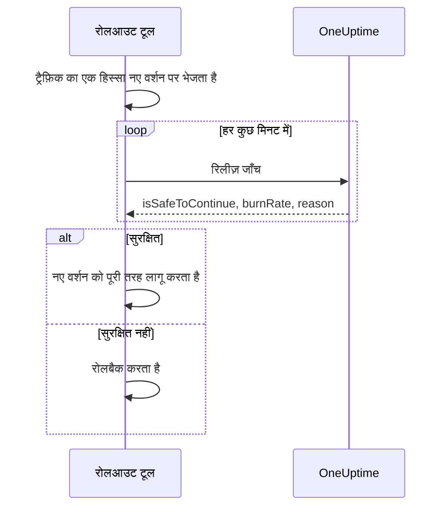

# रिलीज़ जाँच

रिलीज़ जाँच, रिलीज़ के आगे बढ़ते समय, किसी SLO से पूछती है "क्या इस रिलीज़ को आगे रोल आउट करते रहना सुरक्षित है?", और इसका जवाब इस आधार पर देती है कि पिछले कुछ मिनटों में SLO ने अपना एरर बजट कितनी तेज़ी से खर्च किया। Argo Rollouts, Flagger या कोई डिप्लॉयमेंट पाइपलाइन यह सवाल तब पूछती है जब कैनरी ट्रैफ़िक ले रही होती है, और जवाब "नहीं" होने पर रिलीज़ को रोलबैक कर देती है। OneUptime ख़ुद कुछ भी डिप्लॉय नहीं करता: रोलआउट आपका रोलआउट टूल ही करता रहता है, और OneUptime उसे बताता है कि रिलीज़ कैसी चल रही है।

:::cards
- [जाँच से पूछें](#जाँच-से-पूछें): API कुंजी के साथ एक अनुरोध, और जाँच क्या जवाब देती है।
- [Argo Rollouts](#argo-rollouts): एक विश्लेषण जो रोलआउट को रद्द कर देता है।
- [Flagger](#flagger): एक वेबहुक जो कैनरी को रोक देता है।
- [GitHub Actions](#github-actions): एक चरण जो डिप्लॉय के बाद रोलबैक करता है।
- [फ़ीचर फ़्लैग बंद करें](#फ़ीचर-फ़्लैग-बंद-करें): एक वर्कफ़्लो जो SLO का बजट बहुत तेज़ी से खर्च होने पर फ़्लैग बंद कर देता है।
:::

## यह कैसे काम करता है

[डिप्लॉयमेंट गेट](/docs/slo/error-budget-policy#डिप्लॉयमेंट-गेट) रिलीज़ से पहले, पूरी अनुपालन विंडो के एरर बजट के आधार पर जवाब देता है। कुछ तोड़ देने वाली रिलीज़ अपने पहले दस मिनट में एक महीने के बजट का लगभग कुछ भी खर्च नहीं करती, इसलिए रिलीज़ जाँच वह पढ़ती है जो रिलीज़ बदलती है: पिछले कुछ मिनटों का बर्न रेट।



जाँच तीन में से एक फ़ैसले के साथ जवाब देती है:

| फ़ैसला | कब | `isSafeToContinue` |
| --- | --- | --- |
| `Pass` | विंडो ने एरर बजट `maxBurnRate` पर या उससे धीमे खर्च किया। | `true` |
| `Fail` | उसने बजट इससे तेज़ी से खर्च किया, या SLO की एरर बजट नीति डिप्लॉयमेंट फ़्रीज़ करती है। | `false` |
| `NotEnoughData` | विंडो में `minimumRequestCount` से कम अनुरोध थे, या SLO के मॉनिटर ने उसमें कोई स्थिति दर्ज नहीं की। रिलीज़ को सुरक्षित कहने के लिए यह बहुत कम है। | `false` |

बर्न रेट 1 पर विंडो ने SLO का लक्ष्य ठीक-ठीक पूरा किया, इसलिए `maxBurnRate` का डिफ़ॉल्ट मान `1` उस रिलीज़ को विफल करता है जो लक्ष्य से खराब प्रदर्शन करती है।

जाँच क्या पढ़ती है, यह इस पर निर्भर करता है कि SLO क्या मापता है:

- [अनुरोध SLO](/docs/slo/request-slos) को विंडो में उसकी सेवाओं के अनुरोधों से परखा जाता है, जो उनके स्पैन आते ही उनसे पढ़े जाते हैं। केवल नए वर्शन के अनुरोध परखने के लिए `serviceVersion` जोड़ें: OneUptime इसे स्पैन के `service.version` रिसोर्स एट्रिब्यूट से मिलाता है, जिसे OpenTelemetry SDK `OTEL_RESOURCE_ATTRIBUTES=service.version=1.4.2` से सेट करता है। इस तरह कैनरी को उसके अपने अनुरोधों पर परखा जाता है, और पुराने वर्शन के अनुरोध नतीजे को कमज़ोर नहीं करते।
- [मेट्रिक SLO](/docs/slo/request-slos#मेट्रिक-से-slo) को विंडो में उसके मेट्रिक के इवेंट से परखा जाता है, जिन्हें वैसे ही गिना जाता है जैसे उसका SLI गिनता है, इसलिए `minimumRequestCount`, `goodRequestCount` और `totalRequestCount` इवेंट होते हैं। `serviceVersion` के साथ मेट्रिक के केवल वे पॉइंट गिने जाते हैं जिनका `service.version` रिसोर्स एट्रिब्यूट यही मान रखता है: OpenTelemetry SDK इसे अपने स्पैन की तरह अपने मेट्रिक पर भी सेट करता है।
- मॉनिटर अपटाइम SLO को विंडो में उसके मॉनिटर की स्थिति टाइमलाइन से परखा जाता है। उस पर `minimumRequestCount` लागू नहीं होता, और `serviceVersion` वाली जाँच अस्वीकार कर दी जाती है: मॉनिटर के कोई वर्शन नहीं होते।

## शुरू करने से पहले

आपको ऐसा SLO चाहिए जो वह मापे जिस पर रिलीज़ का असर पड़ता है। जिस सेवा को आप रिलीज़ करते हैं, उसका अनुरोध SLO कैनरी को सबसे अच्छी तरह परखता है, क्योंकि वह उसी सेवा के अपने अनुरोध पढ़ता है।

## रिलीज़ जाँच सेट करें

:::steps
### रोलआउट को एक कुंजी दें

प्रोजेक्ट की एक ऐसी [API कुंजी](/docs/api-reference/api-reference) बनाएँ जिसकी भूमिका SLO पढ़ सके, और उसे अपने रोलआउट टूल या पाइपलाइन में सीक्रेट के रूप में रखें।

### SLO की ID कॉपी करें

SLO खोलें और पते से उसकी ID कॉपी करें: `/slos/<slo-id>`।

### एक बार हाथ से जाँच से पूछें

कुंजी और ID के साथ [जाँच से पूछें](#जाँच-से-पूछें) में दिया गया अनुरोध चलाएँ। जाँच `isSafeToContinue` और एक `reason` के साथ जवाब देती है।

### इसे अपने रोलआउट में जोड़ें

[Argo Rollouts](#argo-rollouts), [Flagger](#flagger) या [GitHub Actions](#github-actions) से जाँच से पूछें, और जब `isSafeToContinue` `false` हो, तो रोलबैक करें।
:::

## जाँच से पूछें

जाँच SLO के `release-check` पते पर एक `GET` या `POST` है। विकल्प क्वेरी स्ट्रिंग में भेजें, या `POST` के साथ JSON बॉडी के रूप में:

```bash
curl -sS "https://oneuptime.com/api/service-level-objective/<slo-id>/release-check?windowInMinutes=10&serviceVersion=1.4.2" \
  -H "ApiKey: $ONEUPTIME_API_KEY"
```

यह पहले फ़ैसला देती है, फिर वह सब जिससे फ़ैसला पढ़ा गया:

```json
{
  "isSafeToContinue": false,
  "verdict": "Fail",
  "reason": "The last 10 minutes burned the error budget at 3.2x, faster than the 1x this check allows (SLI 99.68% against the 99.9% target).",
  "sloId": "<slo-id>",
  "sloName": "Checkout requests",
  "sliType": "Request Success",
  "targetPercentage": 99.9,
  "windowInMinutes": 10,
  "maxBurnRate": 1,
  "burnRate": 3.2,
  "sliPercentage": 99.68,
  "deploymentsAllowed": true,
  "errorBudgetPolicyTier": null,
  "sloStatus": "Healthy",
  "checkedAt": "2026-11-15T12:00:00.000Z",
  "goodRequestCount": 2492,
  "totalRequestCount": 2500,
  "minimumRequestCount": 1,
  "serviceVersion": "1.4.2"
}
```

विकल्प:

| विकल्प | डिफ़ॉल्ट | यह क्या करता है |
| --- | --- | --- |
| `windowInMinutes` | `10` | जाँच कितना पीछे देखती है, 1 से 360 तक पूरे मिनटों में। |
| `maxBurnRate` | `1` | पास होने वाला सबसे तेज़ बर्न रेट। `2` विंडो को लक्ष्य की अनुमति से दोगुनी तेज़ी से बजट खर्च करने देता है। |
| `minimumRequestCount` | `1` | अनुरोध SLO: कम से कम कितने अनुरोध होने पर जाँच फ़ैसला करती है। `0` के साथ, बिना अनुरोधों वाली विंडो पास हो जाती है। |
| `serviceVersion` | कोई नहीं | अनुरोध SLO: केवल उन अनुरोधों को परखें जिनके स्पैन में यह `service.version` हो। |
| `includeDeploymentGate` | `true` | जब तक SLO की एरर बजट नीति डिप्लॉयमेंट फ़्रीज़ करती है, तब तक विफल करें। `false` के साथ, केवल बर्न रेट फ़ैसला करता है। |
| `failWithStatusCode` | `false` | "नहीं" का जवाब 200 के बजाय HTTP स्टेटस 412 से दें, उन टूल के लिए जो केवल स्टेटस कोड पढ़ते हैं। |

जवाब के फ़ील्ड:

| फ़ील्ड | इसमें क्या होता है |
| --- | --- |
| `isSafeToContinue` | रोलआउट जारी रखने के लिए `true`, उसे रोलबैक करने के लिए `false`। |
| `verdict` | `Pass`, `Fail` या `NotEnoughData`। |
| `reason` | रोलआउट के लॉग के लिए एक वाक्य, जो बताता है कि क्या मापा गया और जाँच ने ऐसा जवाब क्यों दिया। |
| `burnRate` और `sliPercentage` | विंडो ने एरर बजट कितनी तेज़ी से खर्च किया, और विंडो पर SLI। |
| `goodRequestCount` और `totalRequestCount` | अनुरोध SLO: विंडो में कितने अनुरोध थे, और उनमें से कितने अच्छे थे। |
| `deploymentsAllowed` और `errorBudgetPolicyTier` | SLO की एरर बजट नीति डिप्लॉयमेंट की अनुमति देती है या नहीं, और SLO किस स्तर में है। |
| `checkedAt` | जाँच का माप कब लिया गया। |

जिस SLO को मापा नहीं जा सकता, जैसे बिना सेवाओं वाला अनुरोध SLO, बिना सीमा वाला लेटेंसी SLO, ऐसा मेट्रिक SLO जिसका मेट्रिक गिना न जा सके, या बिना मॉनिटर वाला मॉनिटर अपटाइम SLO, उसका जवाब HTTP 400 और यह बताकर दिया जाता है कि क्या ठीक करना है, ताकि रोलआउट किसी अनुमान के बजाय एक स्पष्ट त्रुटि पर रुके। सेल्फ़-होस्टेड इंस्टॉलेशन पर oneuptime.com की जगह उसका अपना पता इस्तेमाल करें।

## Argo Rollouts

`web` मेट्रिक वाला विश्लेषण कैनरी के हर चरण पर जाँच से पूछता है, और जाँच विफल होने पर Argo Rollouts रोलआउट रद्द करके कैनरी को स्केल डाउन कर देता है। पहले API कुंजी को सीक्रेट के रूप में रखें:

```bash
kubectl create secret generic oneuptime --from-literal=api-key="$ONEUPTIME_API_KEY"
```

फिर टेम्पलेट जोड़ें, और इसे कैनरी के पहले चरण के बाद चलाएँ:

:::tabs
@tab AnalysisTemplate
```yaml title="oneuptime-release-check.yaml"
apiVersion: argoproj.io/v1alpha1
kind: AnalysisTemplate
metadata:
  name: oneuptime-release-check
spec:
  args:
    - name: version
    - name: api-key
      valueFrom:
        secretKeyRef:
          name: oneuptime
          key: api-key
  metrics:
    - name: slo-burn-rate
      interval: 2m
      count: 5
      failureLimit: 0
      successCondition: result == true
      provider:
        web:
          url: "https://oneuptime.com/api/service-level-objective/<slo-id>/release-check?windowInMinutes=10&serviceVersion={{args.version}}"
          headers:
            - key: ApiKey
              value: "{{args.api-key}}"
          jsonPath: "{$.isSafeToContinue}"
```
@tab Rollout
```yaml title="rollout.yaml"
apiVersion: argoproj.io/v1alpha1
kind: Rollout
metadata:
  name: checkout
spec:
  strategy:
    canary:
      steps:
        - setWeight: 10
        - analysis:
            templates:
              - templateName: oneuptime-release-check
            args:
              - name: version
                value: "1.4.2"
        - setWeight: 50
        - pause: { duration: 10m }
```
:::

विश्लेषण दो-दो मिनट के अंतर पर पाँच बार पूछता है, और पहला "नहीं" रोलआउट रद्द कर देता है। वही वर्शन दें जो कैनरी के पॉड `OTEL_RESOURCE_ATTRIBUTES` में सेट करते हैं। अगर हो सकता है कि कैनरी को अपने पहले वेट पर कोई ट्रैफ़िक न मिले, तो पते में `&minimumRequestCount=0` जोड़ें, वरना शांत कैनरी `NotEnoughData` के साथ विश्लेषण में विफल हो जाती है।

## Flagger

Flagger अपने विश्लेषण के हर चरण पर एक `rollout` वेबहुक कॉल करता है, और वेबहुक के लगातार विफल होने पर कैनरी को रोककर रोलबैक कर देता है। Flagger के वेबहुक कोई हेडर नहीं भेजते, इसलिए जाँच से Flagger लोड टेस्टर के ज़रिए पूछें, जो वेबहुक के लिए एक कमांड चलाता है:

```yaml title="canary.yaml"
apiVersion: flagger.app/v1beta1
kind: Canary
metadata:
  name: checkout
spec:
  analysis:
    interval: 1m
    threshold: 2
    maxWeight: 50
    stepWeight: 10
    webhooks:
      - name: oneuptime-release-check
        type: rollout
        url: http://flagger-loadtester.test/
        timeout: 30s
        metadata:
          type: bash
          cmd: "curl -sSf -H \"ApiKey: $ONEUPTIME_API_KEY\" 'https://oneuptime.com/api/service-level-objective/<slo-id>/release-check?windowInMinutes=5&failWithStatusCode=true'"
```

`failWithStatusCode=true` के साथ "नहीं" का जवाब HTTP 412 होता है, इसलिए `curl -f` त्रुटि के साथ बाहर निकलता है और वेबहुक विफल हो जाता है। लोड टेस्टर को कुंजी उसके एनवायरनमेंट में `ONEUPTIME_API_KEY` के रूप में, Kubernetes सीक्रेट से दें। जब `threshold` जाँचें विफल हो जाती हैं, तो Flagger कैनरी को रोलबैक कर देता है।

## GitHub Actions

जो पाइपलाइन एक ही बार में डिप्लॉय करती है, वह भी रिलीज़ पर नज़र रख सकती है: डिप्लॉय करें, कुछ बार जाँच से पूछें, और जवाब "नहीं" होने पर रोलबैक करें।

```yaml title=".github/workflows/deploy.yml"
name: Deploy
on:
  push:
    branches: [main]

jobs:
  deploy:
    runs-on: ubuntu-latest
    steps:
      - uses: actions/checkout@v4
      - name: Deploy
        run: ./deploy.sh
      - name: Watch the release against the SLO
        env:
          ONEUPTIME_API_KEY: ${{ secrets.ONEUPTIME_API_KEY }}
          SLO_ID: <slo-id>
          VERSION: ${{ github.sha }}
        run: |
          for attempt in 1 2 3 4 5; do
            sleep 120
            CHECK=$(curl -sS "https://oneuptime.com/api/service-level-objective/$SLO_ID/release-check?windowInMinutes=10&serviceVersion=$VERSION" \
              -H "ApiKey: $ONEUPTIME_API_KEY")
            echo "$CHECK" | jq -r '.reason'
            if [ "$(echo "$CHECK" | jq -r '.isSafeToContinue')" != "true" ]; then
              exit 1
            fi
          done
      - name: Roll back
        if: failure()
        run: ./rollback.sh
```

चरण "नहीं" पर विफल होता है, और `isSafeToContinue: true` के बिना किसी भी जवाब पर भी, जैसे गलत ID, ऐसी कुंजी जो SLO नहीं पढ़ सकती, या कोई जवाब ही नहीं, ताकि पाइपलाइन कभी ऐसे जवाब के भरोसे आगे न बढ़े जो उसे मिला ही नहीं। सेवा शुरू होते समय `service.version` को कमिट (`${{ github.sha }}`) पर सेट करें, ताकि जाँच केवल नए वर्शन को परखे।

## फ़ीचर फ़्लैग बंद करें

जो रिलीज़ किसी फ़ीचर फ़्लैग के पीछे है, उसे फ़्लैग बंद करके रोलबैक किया जाता है। यह काम एक वर्कफ़्लो आपके लिए कर सकता है: जब SLO का कोई [बर्न रेट नियम](/docs/slo/burn-rate-alerts) अपना अलर्ट उठाता है या अपनी घटना घोषित करता है, तो वर्कफ़्लो LaunchDarkly या Unleash में फ़्लैग बंद कर देता है। इस तरह खराब रोलआउट मिनटों में वापस ले लिया जाता है, और किसी व्यक्ति का इंतज़ार नहीं करना पड़ता।

:::steps
### बर्न रेट नियम की ID कॉपी करें

SLO खोलें और **बर्न रेट नियम** पर जाएँ। जिस नियम के ट्रिगर होने पर फ़्लैग बंद होना चाहिए, उसका मेनू खोलें और **ID दिखाएँ** चुनें। इसके लिए तेज़ बर्न नियम सबसे अच्छा रहता है, क्योंकि वह खराब रोलआउट के कुछ ही मिनटों के भीतर ट्रिगर हो जाता है।

### टेम्पलेट से वर्कफ़्लो बनाएँ

**वर्कफ़्लो** खोलें और **वर्कफ़्लो बनाएं** पर क्लिक करें। **या किसी टेम्पलेट से शुरू करें** में **SLOs** श्रेणी चुनें, फिर अपनी फ़्लैग सेवा का टेम्पलेट चुनें:

| टेम्पलेट | यह क्या माँगता है |
| --- | --- |
| **Turn a LaunchDarkly flag off when an SLO burns too fast** | एक API एक्सेस टोकन जो फ़्लैग को अपडेट कर सके, और फ़्लैग के प्रोजेक्ट, ख़ुद फ़्लैग और एनवायरनमेंट की कुंजियाँ। |
| **Turn an Unleash flag off when an SLO burns too fast** | आपके Unleash का पता, एक सर्विस अकाउंट टोकन या पर्सनल एक्सेस टोकन, और फ़्लैग का प्रोजेक्ट, उसका नाम और एनवायरनमेंट। |

नियम की ID को **Burn Rate Rule ID** में पेस्ट करें, बाकी जानकारी भरें, और वर्कफ़्लो बनाएँ।

### इसे चालू करें

वर्कफ़्लो बंद अवस्था में बनते हैं। जब आप तैयार हों, तो वर्कफ़्लो के **बिल्डर** में सबसे ऊपर **सक्षम** चालू करें।
:::

प्रोजेक्ट का कोई भी बर्न रेट नियम जब भी अलर्ट उठाता है या घटना घोषित करता है, तो वर्कफ़्लो शुरू होता है। इसका **अगर / वरना** सिर्फ़ उसी नियम के लिए आगे बढ़ता है जिसकी ID आपने पेस्ट की थी, और अगला चरण फ़्लैग सेवा को कॉल करता है: LaunchDarkly का `turnFlagOff` निर्देश, एक टिप्पणी के साथ जिसमें नियम और SLO के नाम होते हैं, या एनवायरनमेंट के लिए Unleash का `off`। दोनों उस एनवायरनमेंट में फ़्लैग को सबके लिए बंद कर देते हैं, उसकी टारगेटिंग चाहे जो हो। अगर फ़्लैग सेवा कॉल अस्वीकार कर देती है, तो रन विफल हो जाता है, और उसका लॉग बताता है कि क्यों। नियम का अलर्ट पहले की तरह ही लोगों को पेज करता है।

**बिल्डर** में **वर्कफ़्लो चलाएं** बटन वर्कफ़्लो को ऐसे चलाता है मानो आपका चुना हुआ नियम अभी-अभी ट्रिगर हुआ हो, इसलिए यह फ़्लैग को सच में बंद कर देता है। इसे पहले किसी टेस्ट एनवायरनमेंट के फ़्लैग पर परखें।

किसी दूसरी फ़्लैग सेवा के लिए, या अपने अलग पते वाले LaunchDarkly इंस्टेंस के लिए, दोनों में से किसी भी टेम्पलेट से शुरू करें और उसके API चरण को ऐसी कॉल में बदलें जो एनवायरनमेंट में सबके लिए फ़्लैग बंद करे। ऐसी कॉल चुनें जो इन दोनों की तरह सेगमेंट और टारगेटिंग नियमों को भी ओवरराइड करे, वरना धीरे-धीरे बढ़ता रोलआउट फ़्लैग को चालू करता रहता है।

## आगे के कदम

:::cards
- [अनुरोध और लेटेंसी SLO](/docs/slo/request-slos): किसी सेवा के अनुरोध मापें, वह SLI जो कैनरी को सबसे अच्छी तरह परखता है।
- [एरर बजट नीति](/docs/slo/error-budget-policy): बजट कम होने पर डिप्लॉयमेंट फ़्रीज़ करें।
- [बर्न रेट अलर्ट और घटनाएँ](/docs/slo/burn-rate-alerts): जब बजट बहुत तेज़ी से खर्च हो, तो अपनी टीम को सूचित करें।
:::
