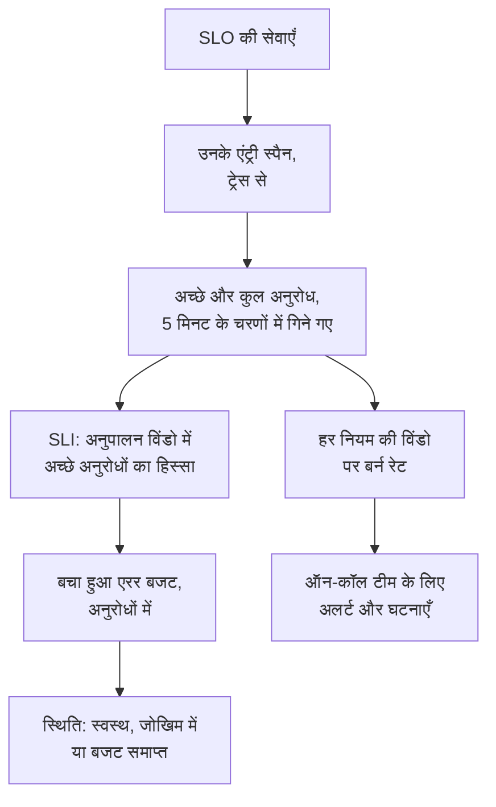

# अनुरोध और लेटेंसी SLO

अनुरोध SLO यह मापता है कि आपके उपयोगकर्ताओं को किसी सेवा से क्या मिलता है: उसके अनुरोधों का वह हिस्सा जो सफल होता है, या जिसका जवाब पर्याप्त तेज़ी से मिलता है। OneUptime उन्हें उन ट्रेस से गिनता है जो आपकी सेवाएँ पहले से भेजती हैं, इसलिए कोई मॉनिटर सेट करने की ज़रूरत नहीं: सेवाएँ और एक लक्ष्य चुनें, और OneUptime हर 5 मिनट में उन्हें मापता है।

:::cards
- [अनुरोध SLO बनाएँ](#अनुरोध-slo-बनाएँ): सेवाएँ, लेटेंसी की एक सीमा, और एक लक्ष्य।
- [अनुरोध कैसे गिने जाते हैं](#अनुरोध-कैसे-गिने-जाते-हैं): कौन-से स्पैन गिने जाते हैं, और कब।
- [रिलीज़ जाँच](/docs/slo/release-checks): जो रिलीज़ एरर बजट खर्च कर रही हो, उसे रोलबैक करें।
:::

## अनुरोध सफलता और अनुरोध लेटेंसी

| यह क्या मापता है | अनुरोध कब खराब माना जाता है | एरर बजट क्या गिनता है |
| --- | --- | --- |
| **अनुरोध सफलता** | उसके स्पैन की स्थिति `Error` है। जिस स्पैन की कोई स्थिति नहीं होती, वह अच्छा गिना जाता है, जैसा OpenTelemetry का आशय है। | विफल अनुरोध |
| **अनुरोध लेटेंसी** | उसमें SLO की **लेटेंसी सीमा (ms)** से अधिक समय लगा, उसकी स्थिति चाहे जो हो। | धीमे अनुरोध |

SLI अनुपालन विंडो में अच्छे अनुरोधों का हिस्सा है, और एरर बजट वे खराब अनुरोध हैं जिनकी लक्ष्य अनुमति देता है: 99.9% पर हर 1,000 में से एक। लेटेंसी SLO उस अनुरोध को भी अच्छा गिनता है जो तेज़ी से विफल हुआ, इसलिए किसी अहम सेवा को दोनों तरह से मापें: एक SLO इस बात का कि वह काम करती है, और एक इस बात का कि वह तेज़ है।

## यह कैसे काम करता है

यहाँ अनुरोध का मतलब है SLO की किसी सेवा का एंट्री स्पैन: वह स्पैन जहाँ कोई अनुरोध या संदेश सेवा में प्रवेश करता है, जैसे [ट्रेस](/docs/telemetry/traces-explorer#ट्रेस-और-स्पैन) सूची उन्हें डिफ़ॉल्ट रूप से दिखाती है। जो अनुरोध SLO की दो सेवाओं से होकर गुज़रता है, वह दोनों में एक-एक बार गिना जाता है।

इसके आगे अनुरोध SLO किसी भी दूसरे SLO की तरह काम करता है। उसकी स्थिति, बर्न रेट नियम, एरर बजट नीति, स्वामी और सूचनाएँ वही रहती हैं, बस उसका एरर बजट मिनटों के बजाय अनुरोधों में होता है।

## शुरू करने से पहले

- सेवाएँ OneUptime को ट्रेस भेजती हैं: देखें [OpenTelemetry](/docs/telemetry/open-telemetry)। हर सेवा अपने `service.name` के नाम से [सेवा कैटलॉग](/docs/telemetry/services) में मौजूद है।
- ऐसी भूमिका जो SLO बना सके: Project Owner, Project Admin, या Create Service Level Objective अनुमति वाली कस्टम भूमिका।

## अनुरोध SLO बनाएँ

:::steps
### SLO खोलें

ऊपर की बार में **उत्पाद** मेनू से **SLOs** खोलें, और **Service Level Objective बनाएँ** पर क्लिक करें।

### चुनें कि यह क्या मापता है

**यह क्या मापता है** में **अनुरोध सफलता** या **अनुरोध लेटेंसी** चुनें, फिर **सेवाएं** में वे सेवाएँ चुनें जिनके अनुरोध यह गिनेगा। **अनुरोध लेटेंसी** के लिए **लेटेंसी सीमा (ms)** भी सेट करें: जिस अनुरोध का जवाब इस सीमा के भीतर मिल जाए, वह पर्याप्त तेज़ गिना जाता है, जैसे `300`। **अगला** पर क्लिक करें।

### नाम दें और लक्ष्य तय करें

एक **नाम** दर्ज करें, जैसे "Checkout requests", और एक **लक्ष्य (%)**: अनुरोधों का वह हिस्सा जो अच्छा होना चाहिए। **Service Level Objective बनाएँ** पर क्लिक करें।

### पहली संख्याएँ आती देखें

पहला मूल्यांकन, 5 मिनट के भीतर, पिछले 6 घंटों के अनुरोध गिनता है, इसलिए SLO के पास तुरंत संख्याएँ होती हैं। उसके बाद के मूल्यांकन पुराने अनुरोध भी गिनते हैं, जब तक पूरी अनुपालन विंडो शामिल न हो जाए।
:::

किसी सेवा का अपना **SLOs** पेज उन SLO को दिखाता है जो उसे मापते हैं, और उसका **Service Level Objective बनाएँ** वही फ़ॉर्म खोलता है जिसमें सेवा पहले से चुनी होती है। बाद में SLO क्या मापता है, उसकी सेवाएँ या उसकी सीमा बदलने के लिए, उसकी **सेटिंग्स** खोलें और **यह क्या मापता है, संपादित करें** पर क्लिक करें।

## अनुरोध कैसे गिने जाते हैं

OneUptime हर SLO के अच्छे और कुल अनुरोधों को 5 मिनट के चरणों में गिनता है और ये गिनतियाँ सहेजकर रखता है, ताकि SLO हर बार हर स्पैन को पढ़ने के बजाय अपनी ही गिनतियों से अपनी विंडो पढ़े:

- हर चरण उसके खत्म होने के 2 मिनट बाद गिना जाता है, ताकि देर से आने वाले स्पैन भी उसमें आ जाएँ, और अगला मूल्यांकन और भी देर से आने वाले स्पैन के लिए पिछले दो चरण फिर से गिनता है।
- नया SLO पिछले 6 घंटों से शुरू होता है। उसके बाद हर मूल्यांकन एक दिन तक के पुराने अनुरोध गिनता है, सबसे नए पहले, जब तक पूरी विंडो शामिल न हो जाए।
- केवल वही अनुरोध गिने जा सकते हैं जो अभी भी आपके [टेलीमेट्री प्रतिधारण](/docs/telemetry/data-retention#टेलीमेट्री-कितने-समय-तक-रखी-जाती-है) के भीतर हैं। गिने गए चरण 400 दिनों तक रखे जाते हैं, जो किसी भी अनुपालन विंडो से लंबा है, इसलिए प्रतिधारण से लंबी विंडो SLO के पुराने होने के साथ-साथ भरती है।
- SLO क्या मापता है, उसकी सेवाएँ या उसकी लेटेंसी सीमा बदलने पर उसके अनुरोध शुरू से फिर गिने जाते हैं। लंबी अनुपालन विंडो और पीछे तक गिनकर भरी जाती है।

जब तक गिनतियाँ अनुपालन विंडो का केवल एक हिस्सा कवर करती हैं, **अवलोकन** यह **विंडो 23% भरी है** संकेतक से बताता है, और **बचा त्रुटि बजट** टाइल अपनी संख्या के नीचे यही दोहराती है। गिनतियों के पूरी विंडो कवर करते ही दोनों गायब हो जाते हैं।

## अनुरोधों में एरर बजट

बजट वे खराब अनुरोध हैं जिनकी लक्ष्य विंडो में गिने गए अनुरोधों में से अनुमति देता है, इसलिए यह ट्रैफ़िक के साथ बढ़ता है: 99.9% पर 2,000,000 अनुरोधों वाली विंडो 2,000 विफल अनुरोधों की अनुमति देती है। **अवलोकन** पर:

- **बचा त्रुटि बजट** बताता है कि कुल में से कितने खराब अनुरोध बचे हैं, या SLO बजट से कितने अनुरोध ऊपर है।
- **बजट कितना चलेगा** बताता है कि मौजूदा बर्न रेट पर बजट कितने समय चलेगा, बशर्ते ट्रैफ़िक पहले जैसा ही रहे।
- सारांश SLO की सेवाओं की संख्या बताता है, और लेटेंसी SLO अपने लक्ष्य के नीचे अपनी सीमा भी दिखाता है।

बर्न रेट अलर्ट, सूचनाएँ और फ़ीड भी बजट को अनुरोधों में बताते हैं। अनुरोध SLO के लिए `oneuptime.slo.error.budget.remaining.seconds` मेट्रिक नहीं भेजा जाता; इसके बजाय `oneuptime.slo.error.budget.remaining.percent` का चार्ट बनाएँ।

अनुरोध SLO को भी किसी भी नए SLO की तरह **Fast burn**, **Slow burn** और **Slow leak** नियम मिलते हैं। मुट्ठी भर अनुरोधों वाले शांत घंटे में एक ही विफलता बजट को तेज़ी से खर्च कर सकती है, इसलिए कोई नियम बहुत कम अनुरोधों वाली विंडो को अनदेखा कर सकता है: API से नियम का `minimumSampleCount` सेट करें, और नियम उससे कम अनुरोधों वाली लंबी विंडो को छोड़ देगा।

## समस्या निवारण

:::details SLO पर अनुरोधों की प्रतीक्षा दिखता है
उसकी किसी भी सेवा ने अभी तक विंडो में किसी अनुरोध का जवाब नहीं दिया है। जाँचें कि सेवाएँ OneUptime को ट्रेस भेजती हैं, और उनके स्पैन में एंट्री स्पैन शामिल हैं: जिस सेवा के सभी स्पैन आंतरिक हैं, उसके पास गिनने के लिए कोई अनुरोध नहीं होता।
:::

:::details सेवाएँ बदलने के बाद SLI बदल गया
SLO क्या मापता है, उसकी सेवाएँ या उसकी लेटेंसी सीमा बदलने पर उसके अनुरोध फिर से गिने जाते हैं, पिछले 6 घंटों से शुरू करके, इसलिए SLI और बजट वहीं से फिर शुरू होते हैं। **विंडो 23% भरी है** संकेतक दिखाता है कि अब तक विंडो का कितना हिस्सा गिना जा चुका है।
:::

## आगे के कदम

:::cards
- [रिलीज़ जाँच](/docs/slo/release-checks): Argo Rollouts, Flagger या किसी पाइपलाइन को वह रिलीज़ रोलबैक करने दें जो बजट खर्च कर रही हो।
- [बर्न रेट अलर्ट और घटनाएँ](/docs/slo/burn-rate-alerts): जब बजट बहुत तेज़ी से खर्च हो, तो अपनी टीम को सूचित करें।
- [एरर बजट नीति](/docs/slo/error-budget-policy): तय करें कि बजट घटने के दौरान टीम क्या करती है।
:::
