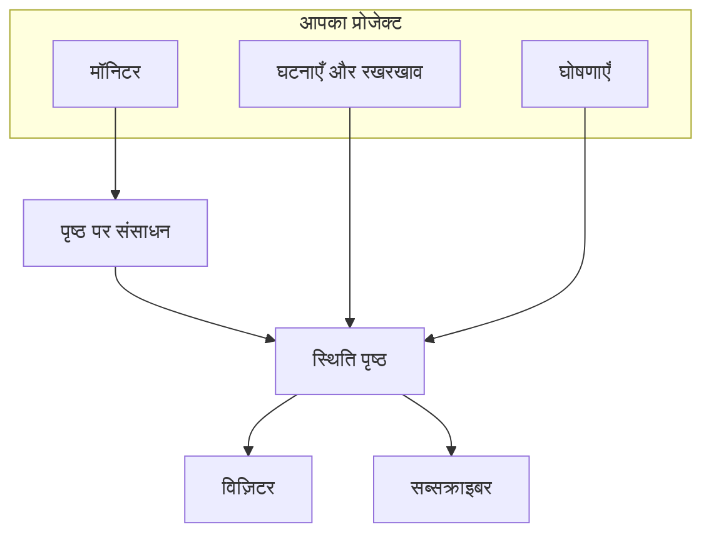

# स्थिति पृष्ठ अवलोकन

स्थिति पृष्ठ आपकी निगरानी में मौजूद हर चीज़ का सार्वजनिक चेहरा है: एक URL जिसे आपके ग्राहक खोल सकते हैं, बजाय आपको ईमेल करके यह पूछने के कि क्या दिक़्क़त सिर्फ़ उन्हीं के साथ है। यह उन सेवाओं की मौजूदा स्थिति दिखाता है जिन्हें आप दिखाना चुनते हैं, वे घटनाएँ जिन पर आप काम कर रहे हैं, आपका नियोजित रखरखाव, और कोई भी घोषणा जिसे आप सबसे ऊपर पिन करना चाहते हैं।

जब रात 2 बजे कुछ टूटता है, तो आपकी सपोर्ट कतार सबसे पहले स्थिति पृष्ठ का ही लिंक देती है। आपके सब्सक्राइबर को सूचनाएँ भी यहीं से जाती हैं, इसलिए इसे आउटेज के दौरान नहीं, बल्कि ज़रूरत पड़ने से पहले सेट करना फ़ायदेमंद है।

:::cards
- [स्थिति पृष्ठ बनाएँ](#स्थिति-पृष्ठ-बनाना): शुरुआत के लिए दो फ़ील्ड, बाकी सब बाद में।
- [चुनें कि यह क्या दिखाए](#पेज-पर-क्या-दिखेगा-यह-चुनना): घटनाएँ, एपिसोड, घोषणाएँ, रखरखाव और अपटाइम, एक ही कार्ड में।
- [तय करें कि इसे कौन देख सकता है](#पेज-कौन-देख-सकता-है-इसे-सीमित-करना): लिंक वाला कोई भी, केवल साइन इन करने वाले, या पासवर्ड वाला कोई भी।
- [स्थिति पृष्ठ संग्रहीत करें](#स्थिति-पृष्ठ-को-संग्रहीत-करना): पृष्ठ को हटाए बिना ऑफ़लाइन करें।
:::

## यह कैसे काम करता है

स्थिति पृष्ठ ऊपरी बार के **उत्पाद** मेनू में मुख्य उत्पादों के बीच **स्थिति पृष्ठ** के अंतर्गत रहते हैं। इस पृष्ठ पर लिखी हर बात हर स्थिति पृष्ठ के लिए अलग होती है: एक प्रोजेक्ट जितने चाहे उतने स्थिति पृष्ठ चला सकता है, जैसे ग्राहकों के लिए एक सार्वजनिक पृष्ठ, किसी आंतरिक ऑडियंस के लिए एक निजी पृष्ठ, या किसी ख़ास बाज़ार के लिए क्षेत्र-वार पृष्ठ।

पृष्ठ उन मॉनिटर को अपने संसाधनों के रूप में दिखाता है जिन्हें आप उस पर रखते हैं। घटनाएँ और अनुसूचित रखरखाव उन मॉनिटर के ज़रिए उस तक पहुँचते हैं, और घोषणाएँ सीधे उस पर पोस्ट की जाती हैं। विज़िटर पृष्ठ पढ़ते हैं, और सब्सक्राइबर को हर बदलाव की सूचना उनके चुने हुए चैनलों पर मिलती है।

## एक नज़र में

- **दो फ़ील्ड से बनता है।** नया स्थिति पृष्ठ केवल **नाम** और **विवरण** माँगता है। संसाधन, ब्रांडिंग और डोमेन सब बाद में कॉन्फ़िगर किए जाते हैं।
- **संसाधन वही हैं जो विज़िटर देखते हैं।** पृष्ठ की हर पंक्ति एक **स्थिति पृष्ठ संसाधन** है: एक मॉनिटर (या मॉनिटर समूह), जिसका अपना डिस्प्ले नाम, टूलटिप और अपटाइम विकल्प होते हैं। समूह लंबे पृष्ठ को खंडों में बाँटते हैं और एक-दूसरे के भीतर रखे जा सकते हैं।
- **पहले दिन से एक पूर्वावलोकन URL।** हर स्थिति पृष्ठ को एक पूर्वावलोकन लिंक मिलता है, ताकि कस्टम डोमेन होने से पहले ही आप उसे देख सकें।
- **विज़िटर के लिए रूट सेटिंग्स से नियंत्रित होते हैं।** घटनाएँ, एपिसोड, घोषणाएँ और निर्धारित कार्यक्रम तभी दिखते हैं जब **आपका स्थिति पृष्ठ क्या दिखाता है** (**उन्नत सेटिंग्स** पर) में उनका स्विच चालू हो, और सब्सक्राइब पृष्ठ तभी दिखता है जब **सब्सक्राइबर पृष्ठ दिखाएं** चालू हो।
- **इसे कौन देख सकता है, यह एक ही चुनाव है।** लिंक वाला कोई भी, केवल साइन इन करने वाले लोग (निजी उपयोगकर्ता, SAML SSO या OIDC), या पासवर्ड वाला कोई भी, यह पृष्ठ की **एक्सेस** स्क्रीन पर चुना जाता है, और **और सेटिंग्स** के अंतर्गत एक वैकल्पिक IP अनुमति सूची होती है।
- **सब्सक्राइबर को अपने-आप सूचना मिलती है।** ईमेल, SMS, Slack, Microsoft Teams और वेबहुक सब्सक्राइबर सभी पृष्ठ को फ़ॉलो कर सकते हैं, और हर चैनल का अपना टॉगल होता है।

## मुख्य शब्द

| शब्द | मतलब |
| --- | --- |
| **स्थिति पृष्ठ** | एक सार्वजनिक (या निजी) पृष्ठ, जिसकी अपनी ब्रांडिंग, डोमेन, संसाधन और सब्सक्राइबर होते हैं। `StatusPage` मॉडल। |
| **संसाधन** | वह एक पंक्ति जो विज़िटर देखते हैं: पृष्ठ पर डिस्प्ले नाम और अपटाइम विकल्पों के साथ दिखाया गया एक मॉनिटर या मॉनिटर समूह। |
| **समूह** | संसाधनों को रखने वाला एक नामित खंड। समूह दूसरे समूहों के भीतर रखे जा सकते हैं, और हर स्तर अपने नीचे की हर चीज़ की स्थिति को समेटता है। |
| **घोषणा** | एक संदेश जिसे आप एक या अधिक स्थिति पृष्ठों पर पोस्ट करते हैं, जिसका एक शुरुआती समय और एक वैकल्पिक समाप्ति समय होता है। |
| **सब्सक्राइबर** | कोई व्यक्ति (या सिस्टम) जो ईमेल, SMS, Slack, Microsoft Teams या वेबहुक पर पृष्ठ को फ़ॉलो करता है। |
| **कस्टम डोमेन** | आपका अपना डोमेन, `status.example.com`, जो CNAME रिकॉर्ड से पृष्ठ की ओर इंगित होता है। OneUptime इसका SSL प्रमाणपत्र मुफ़्त में जारी करता है और उसका नवीनीकरण करता है। |
| **निजी उपयोगकर्ता** | एक खाता जो किसी निजी स्थिति पृष्ठ में लॉग इन कर सकता है। यह आपके OneUptime प्रोजेक्ट उपयोगकर्ताओं से अलग है। |

## स्थिति पृष्ठ बनाना

:::steps
### बनाने का फ़ॉर्म खोलें

**स्थिति पृष्ठ → सभी स्थिति पृष्ठ** खोलें और **स्थिति पृष्ठ बनाएं** पर क्लिक करें।

### पृष्ठ को नाम दें

**नया स्थिति पृष्ठ बनाएँ** मोडल में **नाम** (ज़रूरी, कम से कम दो अक्षर) और, चाहें तो, **विवरण** भरें, फिर **स्थिति पृष्ठ बनाएं** पर क्लिक करें।

बनाने का पूरा फ़ॉर्म बस इतना ही है। आप जिस सूची पर वापस आते हैं, वह **नाम**, **विवरण**, **लेबल** और **मालिक** दिखाती है, और उसे **स्थिति पृष्ठ ID**, **नाम** और **विवरण** से फ़िल्टर किया जा सकता है।

### नया पृष्ठ खोलें

नया पृष्ठ खोलने पर आप उसकी **अवलोकन** स्क्रीन पर पहुँचते हैं, जिस पर दो कार्ड होते हैं: पृष्ठ के लिंक वाला **Status Page Preview URL**, और **स्थिति पृष्ठ विवरण**, जहाँ आप अभी सेट किए गए नाम, विवरण और लेबल संपादित कर सकते हैं। जब प्रोजेक्ट में स्थिति पृष्ठ कस्टम फ़ील्ड हों, तो उनके बाद एक **कस्टम फ़ील्ड** कार्ड आता है।
:::

API या Terraform से बनाए गए पृष्ठ पर भी नीचे बताई गई सेटिंग्स वाले वही प्लान लागू होते हैं। OneUptime Cloud पर, ऐसी सेटिंग चालू रखकर पृष्ठ बनाना जो आपके प्लान में शामिल नहीं है (जैसे निजी, कोई छिपी सूची, कस्टम HTML, CSS या JavaScript, ईमेल रिपोर्ट, SMS, Slack, Microsoft Teams या वेबहुक सब्सक्राइबर, IP अनुमति सूची) `402 Payment Required` के साथ अस्वीकार किया जाता है, और संदेश में प्लान का नाम होता है। हर सेटिंग का प्लान नीचे उसी सेटिंग के साथ दिया गया है। डिफ़ॉल्ट पर छोड़ी गई सेटिंग्स, जैसे यह फ़ॉर्म उन्हें छोड़ता है, हर प्लान पर काम करती हैं।

इसके बाद, मोटे तौर पर उपयोगिता के क्रम में:

- संसाधन जोड़ें ताकि पृष्ठ पर कुछ हो। [स्थिति पृष्ठ संसाधन और समूह](/docs/status-pages/resources-and-groups) देखें।
- पृष्ठ का शीर्षक, फ़ेविकॉन, लोगो और कवर सेट करें, फिर कस्टम डोमेन जोड़ें। [स्थिति पृष्ठ ब्रांडिंग और डोमेन](/docs/status-pages/branding-and-domains) देखें।
- तय करें कि लोग किन चैनलों पर सब्सक्राइब कर सकते हैं। [सब्सक्राइबर और घोषणाएँ](/docs/status-pages/subscribers) देखें।
- पृष्ठ पर क्या दिखता है, उसे **उन्नत सेटिंग्स** में ठीक करें।

## क्या कहाँ रहता है

कोई स्थिति पृष्ठ खुलने पर उसका अपना बायाँ साइड मेनू नौ खंडों में बँटा होता है। इस दस्तावेज़ समूह के बाकी हिस्से के लिए इसे एक नक्शे की तरह इस्तेमाल करें।

| खंड | इसमें क्या है |
| --- | --- |
| **बेसिक** | **अवलोकन**, **घोषणाएं**, **मालिक**। |
| **संसाधन** | एक ही **संसाधन** स्क्रीन (बाईं ओर समूह, दाईं ओर चुने गए समूह के मॉनिटर) और **Monitor Rules**। |
| **सब्सक्राइबर** | **ईमेल सब्सक्राइबर**, **SMS सब्सक्राइबर**, **Slack सब्सक्राइबर**, **MS Teams सब्सक्राइबर**, **Webhook ग्राहक**, **सब्सक्राइबर सेटिंग्स**। |
| **सूचना लॉग** | **सूचना लॉग**: सब्सक्राइबर को क्या भेजा गया। |
| **ब्रांडिंग** | **ब्रांडिंग** (लोगो, शीर्षक, फ़ेविकॉन, लिंक, फ़ुटर, रंग और भाषाएँ, एक ही पृष्ठ पर), **कस्टम डोमेन**, **HTML, CSS और JavaScript**। |
| **सुरक्षा** | **एक्सेस** (पृष्ठ को कौन देख सकता है), **निजी उपयोगकर्ता**, **SSO**, **OIDC**, **SCIM**। |
| **एआई** | **MCP**। |
| **डेवलपर** | **Terraform**, **API**, **AI सहायक**: कोड के रूप में पृष्ठ। |
| **उन्नत** | **एम्बेडेड स्थिति**, **रिपोर्ट**, **कस्टम फ़ील्ड**, **उन्नत सेटिंग्स**, **ऑडिट लॉग**, **स्थिति पृष्ठ हटाएं**। |

शुरुआत में केवल **बेसिक** और **संसाधन**, यानी पृष्ठ जो दिखाता है, खुले रहते हैं। बाकी हर खंड OneUptime के हर मेनू के कम इस्तेमाल होने वाले खंडों की तरह बंद (फ़ोल्ड) शुरू होता है: किसी खंड के पृष्ठ दिखाने के लिए उसके शीर्षक पर क्लिक करें। जब आप किसी खंड के किसी पृष्ठ पर होते हैं, जैसे **उन्नत सेटिंग्स** या **ईमेल सब्सक्राइबर**, तो वह खंड अपने-आप खुल जाता है।

खोजना शुरू करने से पहले नामकरण की दो बातें जान लेना अच्छा है:

- **संसाधन** आइटम का नाम केवल तभी **संसाधन** होता है जब प्रोजेक्ट में मॉनिटर समूह सक्षम हों। वरना इसका नाम **मॉनिटर** होता है। दोनों ही स्थितियों में यह वही स्क्रीन है।
- समूहों का कोई अलग पृष्ठ नहीं है। समूह और संसाधन मिला दिए गए हैं, और पुराना `/groups` रूट अब संसाधन स्क्रीन पर रीडायरेक्ट करता है।

किसी एक पृष्ठ के बाहर, **स्थिति पृष्ठ** खंड ख़ुद **सभी स्थिति पृष्ठ** सूचीबद्ध करता है, और **अधिक** खंड में **घोषणाएं** होती हैं। एक बंद **सेटिंग्स** खंड में **घोषणा टेम्पलेट**, **सब्सक्राइबर टेम्पलेट**, **कस्टम फ़ील्ड**, **स्वामी नियम** और **लेबल नियम** होते हैं, जो पूरे प्रोजेक्ट पर लागू होते हैं और सभी स्थिति पृष्ठों में साझा होते हैं। एक बंद **उन्नत** खंड में **संग्रहीत** होता है: वे स्थिति पृष्ठ जिन्हें आपने ऑफ़लाइन किया है ([स्थिति पृष्ठ को संग्रहीत करना](#स्थिति-पृष्ठ-को-संग्रहीत-करना) देखें)।

**लेबल नियम** और **स्वामी नियम** नए स्थिति पृष्ठों पर लेबल लगाते हैं और उन्हें मालिक देते हैं। एक नियम में दो चरण होते हैं: पहले **मिलान**, यानी वे शर्तें जो किसी स्थिति पृष्ठ को पूरी करनी हैं, फिर **लेबल** (या **मालिक**), यानी नियम क्या जोड़ता है, और उसका **नाम** आपके चुनाव से भर दिया जाता है। नए नियम को कम से कम एक लेबल या मालिक जोड़ना होता है; संपादन में इस पर ज़ोर नहीं दिया जाता, और कुछ भी न जोड़ने वाला पुराना नियम सूची में **कुछ नहीं जोड़ता** के रूप में चिह्नित होता है। [लेबल और स्वामी नियम](/docs/configuration/label-and-owner-rules) देखें।

## विज़िटर को क्या दिखता है

सार्वजनिक पृष्ठ अपना एक अलग ऐप है, जिसमें गिने-चुने रूट हैं:

- `/`: **अवलोकन**।
- `/incidents` और `/incidents/:id`: घटनाओं की सूची और एक घटना।
- `/announcements` और `/announcements/:id`।
- `/scheduled-events` और `/scheduled-events/:id`।
- `/subscribe/email`, `/subscribe/sms`, `/subscribe/slack`, `/subscribe/microsoft-teams`, `/subscribe/webhooks`।
- `/confirm-subscription/:id`, `/update-subscription/:id` और `/unsubscribe/:token`: सब्सक्राइबर को मिलने वाले संदेशों में दिए लिंक।
- `/rss`: फ़ीड।
- `/login`, `/sso` और `/master-password`: केवल निजी पृष्ठ पर प्रासंगिक।

ऊपर की नेविगेशन बार हमेशा **अवलोकन** दिखाती है; बाकी केवल सक्षम होने पर दिखते हैं। **घटनाएँ**, **घोषणाएँ** और **निर्धारित कार्यक्रम** में से हर एक के लिए उसका टॉगल चालू होना चाहिए; **सदस्यता लें** के लिए **सब्सक्राइबर पृष्ठ दिखाएं** और कम से कम एक सब्सक्राइबर चैनल, दोनों सक्षम होने चाहिए। निजी पृष्ठ को एक **लॉग आउट करें** आइटम भी मिलता है।

कोई एक घटना, एपिसोड, घोषणा या निर्धारित कार्यक्रम तभी खुलता है जब पृष्ठ उसे सूचीबद्ध करता, उसकी इतिहास अवधि चाहे जो हो: कोई निजी घटना या एपिसोड, स्थिति पृष्ठों से छिपाया गया कोई आइटम, स्थिति पृष्ठों से छिपाया गया कोई निर्धारित कार्यक्रम, या बाद के लिए शेड्यूल की गई कोई घोषणा, अपने लिंक से भी नहीं मिलती।

### अवलोकन पृष्ठ

अवलोकन वह पृष्ठ है जिसे ज़्यादातर विज़िटर कभी देखते हैं। ऊपर से नीचे यह दिखाता है:

1. **कोई भी चालू घोषणा**: वे घोषणाएँ जिनका शुरुआती समय बीत चुका है और समाप्ति समय नहीं।
2. **एक समग्र स्थिति बैनर**: एक पंक्ति जो बताती है कि सभी संसाधन प्रभावित हैं या कुछ ही।
3. **एक समग्र अपटाइम प्रतिशत**, अगर आपने इसे चालू किया है: समग्र स्थिति बैनर के अंत में, जब तक हर संसाधन चालू है। डिफ़ॉल्ट रूप से बंद।
4. **संसाधन समूह**, हर एक अपने संसाधनों, उनकी मौजूदा स्थिति और उनके अपटाइम इतिहास बार के साथ।
5. **सक्रिय घटनाएँ**, सक्रिय एपिसोड के साथ।
6. **निर्धारित रखरखाव कार्यक्रम**।

बिना किसी सामग्री वाला एकदम नया पृष्ठ एक खाली स्थिति दिखाता है जो आपको डैशबोर्ड से संसाधन जोड़ने को कहती है, और यही **संसाधन** स्क्रीन पर जाने का संकेत है।

विज़िटर को दिखाया गया अवलोकन अधिकतम 15 सेकंड पुराना होता है, और जो कुछ आप पृष्ठ से हटाते हैं, वह एक सेकंड के भीतर हट जाता है: कोई घटना, एपिसोड या निर्धारित कार्यक्रम जिसे आप स्थिति पृष्ठों से छिपाते हैं, निजी बनाते हैं, दूसरे पृष्ठों तक सीमित करते हैं या हटाते हैं, कोई घोषणा जिसे आप समाप्त करते हैं, बाद में ले जाते हैं या हटाते हैं, कोई सार्वजनिक नोट जिसे आप हटाते हैं, और कोई संसाधन, समूह या मॉनिटर जिसे आप पृष्ठ से हटाते हैं या मिटाते हैं। दूसरे संपादन, जैसे नया शीर्षक, उन्हीं 15 सेकंड के भीतर दिखते हैं।

कोई घटना इस पृष्ठ पर सबसे पहले किस वजह से आती है, और फिर किस वजह से हटती है, इसके लिए [घटना स्थितियाँ और गंभीरता](/docs/incidents/states-and-severities) देखें।

## पेज पर क्या दिखेगा, यह चुनना

विज़िटर क्या देखते हैं, यह एक ही कार्ड में सेट होता है: **स्थिति पृष्ठ → आपका पृष्ठ → उन्नत → उन्नत सेटिंग्स** पर **आपका स्थिति पृष्ठ क्या दिखाता है**। इसमें पृष्ठ जो भी सूची दिखा सकता है, हर एक के लिए एक पंक्ति है, फिर **अपटाइम इतिहास** (समग्र अपटाइम प्रतिशत और कौन-सी स्थितियाँ डाउनटाइम गिनी जाती हैं, उसके साथ) और "Powered by OneUptime" वाली पंक्ति। कोई संपादन बटन नहीं है: स्विच पलटते ही सहेजा जाता है, दिनों की संख्या बॉक्स छोड़ने या Enter दबाने पर, और किसी सूची से चुनाव उसी पल।

- **घटनाएं दिखाएं** (`showIncidentsOnStatusPage`): डिफ़ॉल्ट रूप से चालू। इसके नीचे, **पिछले … दिन दिखाएं** (`showIncidentHistoryInDays`, डिफ़ॉल्ट 14) तय करता है कि घटना सूची कितना पीछे तक जाती है, और **घटना लेबल दिखाएं** (`showIncidentLabelsOnStatusPage`) डिफ़ॉल्ट रूप से बंद है।
- **केवल इस पृष्ठ तक सीमित घटनाएँ दिखाएँ** (`onlyShowScopedIncidents`): यह भी घटनाओं की पंक्ति में है, डिफ़ॉल्ट रूप से बंद। इसे चालू करने पर पृष्ठ केवल वही घटनाएँ दिखाता है, और केवल उन्हीं के बारे में अपने सब्सक्राइबर को सूचित करता है, जो **इन स्थिति पृष्ठों तक सीमित करें** से उस तक सीमित हैं। जो घटनाएँ किसी पृष्ठ तक सीमित नहीं हैं, जिनमें वे भी शामिल हैं जिन्हें कोई मॉनिटर, Slack, Microsoft Teams, API या AI अपने-आप खोलता है, वे तब तक इस तक कभी नहीं पहुँचतीं जब तक कोई इस पृष्ठ को उनमें न जोड़े। यही यह भी तय करता है कि कौन-सी घटनाएँ अपने एपिसोड को पृष्ठ पर लाती हैं, इसलिए **घटनाएं दिखाएं** बंद होने पर भी यह बना रहता है। एक जैसे मॉनिटर साझा करने वाले पर अलग-अलग ऑडियंस के लिए बने पृष्ठों के लिए, [हर ऑडियंस के लिए एक स्थिति पृष्ठ](/docs/status-pages/one-status-page-per-audience) देखें।
- **एपिसोड दिखाएं** (`showEpisodesOnStatusPage`): डिफ़ॉल्ट रूप से चालू, **पिछले … दिन दिखाएं** (`showEpisodeHistoryInDays`, डिफ़ॉल्ट 14) और **एपिसोड लेबल दिखाएं** (`showEpisodeLabelsOnStatusPage`, डिफ़ॉल्ट रूप से बंद) के साथ। एपिसोड अपने एंडपॉइंट वाला अपना अलग मॉडल है, घटनाओं का कोई व्यू नहीं।
- **घोषणाएं दिखाएं** (`showAnnouncementsOnStatusPage`): डिफ़ॉल्ट रूप से चालू, **पिछले … दिन दिखाएं** (`showAnnouncementHistoryInDays`, डिफ़ॉल्ट 14) के साथ।
- **अनुसूचित रखरखाव इवेंट दिखाएं** (`showScheduledMaintenanceEventsOnStatusPage`): डिफ़ॉल्ट रूप से चालू, **पिछले … दिन दिखाएं** (`showScheduledEventHistoryInDays`, डिफ़ॉल्ट 14) और **इवेंट लेबल दिखाएं** (`showScheduledEventLabelsOnStatusPage`, डिफ़ॉल्ट रूप से बंद) के साथ।
- **अपटाइम इतिहास**: पृष्ठ के अपटाइम से जुड़ी हर चीज़, एक ही पंक्ति में:
  - **पिछले … दिन दिखाएं** (`showUptimeHistoryInDays`) हर संसाधन के बगल वाली अपटाइम बार की लंबाई है। डिफ़ॉल्ट 90 है और यह 1 से 90 के बीच होना चाहिए। किसी संसाधन या समूह का हर **अपटाइम % दिखाएं** और **स्थिति इतिहास चार्ट दिखाएं** विकल्प यही संख्या पढ़ता है, और समग्र अपटाइम प्रतिशत भी।
  - **समग्र अपटाइम प्रतिशत दिखाएं** (`showOverallUptimePercentOnStatusPage`): डिफ़ॉल्ट रूप से बंद। इसे चालू करने पर, जब तक सब कुछ चालू है, समग्र स्थिति बैनर पूरे पृष्ठ के एक अपटाइम प्रतिशत पर ख़त्म होता है, जो उसके संसाधनों और समूहों का औसत है। इसके चालू रहते, **परिशुद्धता** (`overallUptimePercentPrecision`) चुनती है कि यह कितने दशमलव दिखाए: `99%`, `99.9%`, `99.99%` (डिफ़ॉल्ट) या `99.999%`। हर संसाधन और समूह की अपनी परिशुद्धता होती है।
  - **डाउनटाइम के रूप में गिना जाता है** (`downtimeMonitorStatuses`): वे मॉनिटर स्थितियाँ जिनका समय पृष्ठ के हर अपटाइम प्रतिशत के ख़िलाफ़ गिना जाता है: हर संसाधन का, हर समूह का और समग्र। हर स्थिति अपने रंग की एक चिप है। सूची से एक जोड़ें या उसके **×** से एक हटाएँ, और बदलाव तुरंत सहेजा जाता है। नया स्थिति पृष्ठ प्रोजेक्ट की हर उस स्थिति के साथ शुरू होता है जो चालू नहीं है। कम से कम एक स्थिति बनी रहती है: आख़िरी वाली हटाई नहीं जा सकती, क्योंकि एक भी न होने पर पृष्ठ का हर अपटाइम 100% पढ़ा जाएगा।
- **Powered By OneUptime ब्रांडिंग दिखाएं**: डिफ़ॉल्ट रूप से चालू, इसलिए विज़िटर फ़ुटर में "Powered by OneUptime" लिखा होता है। पंक्ति छिपाने के लिए इसे बंद करें। कॉलम इसे उल्टे रूप में, `hidePoweredByOneUptimeBranding` के रूप में, सहेजता है।

**बंद की गई सूची** पृष्ठ से ग़ायब हो जाती है, और अगर नेविगेशन बार में उसका आइटम है तो वह भी; उसका सार्वजनिक एंडपॉइंट अनुरोध अस्वीकार करता है, और पृष्ठ के सब्सक्राइबर को उस तरह के इवेंट की सूचना नहीं मिलती। तब उसकी पंक्ति केवल उसका स्विच दिखाती है: छिपी सूची कितना पीछे जाती है, और वह लेबल दिखाती है या नहीं, इनसे कुछ नहीं बदलता।

**प्लान।** OneUptime Cloud पर, जिस सेटिंग को आपका प्लान नहीं बदल सकता, उसके बगल में ज़रूरी प्लान दिखता है। चार सूची स्विच, तीन लेबल स्विच और एपिसोड के इतिहास के लिए **Growth** चाहिए; समग्र अपटाइम प्रतिशत दिखाने और "Powered by OneUptime" पंक्ति छिपाने के लिए **Scale** चाहिए। बाकी इतिहास अवधियाँ, **अपटाइम इतिहास**, **परिशुद्धता**, **डाउनटाइम के रूप में गिना जाता है** और **केवल इस पृष्ठ तक सीमित घटनाएँ दिखाएँ** हर प्लान पर बदली जा सकती हैं, और हर एक अपने-आप में सहेजी जाती है: जिस पृष्ठ का समग्र अपटाइम प्रतिशत पहले से चालू है, वह किसी भी प्लान पर उसकी परिशुद्धता बदल सकता है। किसी सेटिंग को वैसा वापस करना जैसा नया पृष्ठ उसे रखता है (किसी सूची को फिर से दिखाना, लेबल या समग्र अपटाइम प्रतिशत छिपाना, "Powered by OneUptime" पंक्ति दिखाना, एपिसोड का इतिहास वापस 14 दिन करना) हर प्लान पर काम करता है, इसलिए ट्रायल में बदली गई कोई चीज़ प्लान की कमी से वैसी ही नहीं रह जाती: स्विच बताता है कि वह अब भी वापस जा सकता है, और उसे फिर से बदलने के लिए कौन-सा प्लान चाहिए।

पृष्ठ **सदस्यता लें** आइटम दिखाता है या नहीं (**सब्सक्राइबर पृष्ठ दिखाएं**, `showSubscriberPageOnStatusPage`, डिफ़ॉल्ट रूप से चालू), और विज़िटर किन चैनलों से सब्सक्राइब कर सकते हैं, ये इस स्क्रीन पर सेट नहीं होते: दोनों **सब्सक्राइबर → सब्सक्राइबर सेटिंग्स** पर **चैनल** कार्ड में हैं ([सदस्यता चैनल](/docs/status-pages/subscribers#सदस्यता-चैनल) देखें)।

कार्ड के नीचे **स्थिति पृष्ठ को JSON के रूप में निर्यात करें** है, जो स्थिति पृष्ठ की अपनी सेटिंग्स को एक फ़ाइल के रूप में डाउनलोड करता है जिसे आप फिर से आयात कर सकते हैं, और **Archive status page** ([स्थिति पृष्ठ को संग्रहीत करना](#स्थिति-पृष्ठ-को-संग्रहीत-करना) देखें)। समग्र अपटाइम प्रतिशत और डाउनटाइम स्थितियाँ पहले यहाँ दो अलग कार्ड हुआ करती थीं, हर एक **संपादित करें** बटन के पीछे; अब वे इस कार्ड की पंक्तियाँ हैं।

**रंग कहाँ हैं।** अपटाइम बार के रंग यहाँ नहीं हैं: **डिफ़ॉल्ट बार रंग** और बार-रंग के नियम **स्थिति पृष्ठ → आपका पृष्ठ → ब्रांडिंग → ब्रांडिंग** पर **और सेटिंग्स** के अंतर्गत हैं। कहीं भी कोई थीम या ब्रांड-रंग सेटिंग नहीं है; इन नियंत्रणों से आगे की कोई भी चीज़ **कस्टम CSS** से की जाती है।

## लाइव होने से पहले पूर्वावलोकन करना

हर स्थिति पृष्ठ की **अवलोकन** स्क्रीन पर एक **Status Page Preview URL** कार्ड होता है, जिसमें सीधे पृष्ठ का लिंक होता है। जब आप अभी संसाधन जोड़ रहे हों और कोई कस्टम डोमेन न हो, तब इसका इस्तेमाल करें।

पर्दे के पीछे, हर सार्वजनिक रूट का `/status-page/{statusPageId}/...` के अंतर्गत एक पूर्वावलोकन जुड़वाँ होता है: पूर्वावलोकन अवलोकन, पूर्वावलोकन घटना सूची, पूर्वावलोकन सब्सक्राइब पृष्ठ, वगैरह। इसका मतलब है कि डैशबोर्ड पूर्वावलोकन से लिया गया URL या स्क्रीनशॉट कस्टम डोमेन जुड़ने के बाद ग्राहक जो देखता है उससे मेल नहीं खाएगा, इसलिए रनबुक या ईमेल में चिपकाए गए किसी भी लिंक को दोबारा जाँचें।

## पेज कौन देख सकता है, इसे सीमित करना

हर स्थिति पृष्ठ आम जनता के लिए नहीं होता। पृष्ठ को कौन देख सकता है, यह एक ही चुनाव है, **स्थिति पृष्ठ → आपका पृष्ठ → सुरक्षा → एक्सेस** पर पहला कार्ड, **यह स्थिति पृष्ठ कौन देख सकता है**:

- **लिंक वाला कोई भी व्यक्ति**: पृष्ठ सार्वजनिक है। हर नया स्थिति पृष्ठ यहीं से शुरू होता है।
- **केवल साइन इन करने वाले लोग**: विज़िटर `/login` पर पहुँचते हैं और निजी उपयोगकर्ता के रूप में, या आपके SSO या OIDC प्रदाता से साइन इन करते हैं (नीचे देखें)। चुनाव के नीचे, कार्ड पृष्ठ के लिए सेट किए गए साइन-इन की सूची देता है (उसके कितने निजी उपयोगकर्ता हैं, और SSO व OIDC चालू हैं या नहीं, हर एक अपनी स्क्रीन से जुड़ा), और जब यही चुनाव हो, तो बताता है कि अभी कोई साइन इन नहीं कर सकता।
- **पासवर्ड वाला कोई भी व्यक्ति**: विज़िटर `/master-password` पर पहुँचते हैं और एक पासवर्ड से पृष्ठ अनलॉक करते हैं जो आप उनके साथ साझा करते हैं। किसी को खाते की ज़रूरत नहीं। इसे चुनने पर, अगर पृष्ठ का कोई पासवर्ड नहीं है, तो उसी डायलॉग में पासवर्ड माँगा जाता है; अगर है, तो आप उसे रख सकते हैं या नया टाइप कर सकते हैं। बाद में, चुनाव के नीचे **पासवर्ड बदलें** उसे बदलता है। पासवर्ड हैश के रूप में सहेजा जाता है और फिर से नहीं दिखाया जा सकता, और जिन लोगों ने पुराना पासवर्ड डाला था, वे 7 दिनों तक पृष्ठ देखते रह सकते हैं।

कोई चुनाव करने पर आपसे पुष्टि माँगी जाती है, जिसमें बताया जाता है कि विज़िटर के लिए क्या बदलेगा, और वह तुरंत सहेजा जाता है। कोई संपादन बटन नहीं है।

**छवियाँ।** पृष्ठ जो दिखाता है उसमें (कोई सार्वजनिक नोट, घोषणा, विवरण) मौजूद छवि अपने लंबे, अनुमान न लगाए जा सकने वाले पते से खुलती है, जो बिना साइन इन किए काम करता है, ताकि आपके सब्सक्राइबर को मिलने वाले ईमेल भी उसे दिखा सकें। पृष्ठ ख़ुद अब भी साइन-इन या पासवर्ड माँगता है।

**यह क्या सहेजता है।** यह चुनाव तीन कॉलम हैं, जिन्हें API और Terraform पहले की तरह पढ़ते और लिखते हैं: `isPublicStatusPage`, `enableMasterPassword` और `masterPassword`। विज़िटर से पासवर्ड केवल ऐसे पृष्ठ पर माँगा जाता है जो सार्वजनिक नहीं है, जिस पर `enableMasterPassword` चालू है और पासवर्ड सेट है; स्विच चालू पर बिना पासवर्ड वाला निजी पृष्ठ एक साइन-इन पृष्ठ है। **लिंक वाला कोई भी व्यक्ति** चुनने से `enableMasterPassword` भी बंद हो जाता है, क्योंकि सार्वजनिक पृष्ठ कभी पासवर्ड नहीं माँगता। **एक्सेस** स्क्रीन केवल वही कॉलम लिखती है जिन्हें चुनाव बदलता है।

**प्लान।** OneUptime Cloud पर, पृष्ठ को निजी बनाने के लिए **Growth** प्लान चाहिए: निचले प्लान पर दोनों निजी चुनाव अपना ज़रूरी प्लान दिखाते हैं और चुने नहीं जा सकते। इसे फिर से सार्वजनिक बनाना (**लिंक वाला कोई भी व्यक्ति**) हर प्लान पर काम करता है, इसलिए ट्रायल ख़त्म होने के बाद या निचले प्लान पर जाने के बाद निजी रह गया पृष्ठ हमेशा खोला जा सकता है; डायलॉग बताता है कि इसे फिर से निजी बनाने के लिए **Growth** चाहिए। **केवल साइन इन करने वाले लोग** और **पासवर्ड वाला कोई भी व्यक्ति** के बीच आना-जाना हर प्लान पर काम करता है, और **पासवर्ड बदलें** भी।

### निजी उपयोगकर्ता

जो लोग साइन इन कर सकते हैं, उन्हें **स्थिति पृष्ठ → आपका पृष्ठ → सुरक्षा → निजी उपयोगकर्ता** पर जोड़ें। वहाँ **थोक में जोड़ें** कार्रवाई है: ईमेल पतों की एक सूची चिपकाएँ और हर पते को एक आमंत्रण ईमेल मिलता है। निजी उपयोगकर्ताओं का पासवर्ड भूलने और रीसेट करने का अपना प्रवाह होता है, जो आपके OneUptime प्रोजेक्ट खातों से अलग है।

**निजी उपयोगकर्ता और पासवर्ड एक साथ लागू नहीं होते।** जब **पासवर्ड वाला कोई भी व्यक्ति** चुना होता है, तो निजी उपयोगकर्ता साइन इन नहीं कर सकते (वे भी पासवर्ड डालते हैं), और **निजी उपयोगकर्ता** स्क्रीन यही बताती है, **एक्सेस** पर वापस जाने के लिंक के साथ।

### SSO और OIDC

आपके पहचान प्रदाता से जुड़े निजी पृष्ठ के लिए, **स्थिति पृष्ठ → आपका पृष्ठ → सुरक्षा → SSO** SAML कॉन्फ़िगर करता है: आप साइन-ऑन URL, जारीकर्ता और x509 प्रमाणपत्र डालते हैं, और हस्ताक्षर व डाइजेस्ट विधियाँ **और फ़ील्ड** के अंतर्गत पहले से भरी होती हैं। **स्थिति पृष्ठ → आपका पृष्ठ → सुरक्षा → OIDC** OpenID Connect कॉन्फ़िगर करता है: आप जारीकर्ता, क्लाइंट ID और सीक्रेट डालते हैं, और डिस्कवरी URL, स्कोप और क्लेम नाम **और फ़ील्ड** के अंतर्गत पहले से भरे होते हैं। **SCIM** IdP से निजी उपयोगकर्ताओं को अपने-आप प्रोविज़न करता है। OneUptime Cloud पर तीनों के लिए Scale या उससे ऊपर का प्लान चाहिए। सेल्फ़-होस्टेड इंस्टॉलेशन पर SSO और OIDC हर संस्करण का हिस्सा हैं, और SCIM के लिए [एंटरप्राइज़ संस्करण](/docs/self-hosted/enterprise) चाहिए।

किसी स्थिति पृष्ठ के SSO या OIDC प्रदाता को बंद करने या हटाने से वे निजी उपयोगकर्ता साइन आउट हो जाते हैं जिन्हें उसने साइन इन कराया था: उनके सत्र उनके अगले अनुरोध पर ख़त्म हो जाते हैं, और प्रदाता को फिर से चालू करने से वे वापस नहीं आते; वे उससे फिर से साइन इन करते हैं। नया प्रमाणपत्र या क्लाइंट सीक्रेट, दूसरे URL या नया नाम सभी को साइन इन रखते हैं। जिस पृष्ठ पर SSO अनिवार्य है, वहाँ उसका आख़िरी प्रदाता बंद करने के बाद कोई तब तक साइन इन नहीं कर सकता जब तक आप कोई प्रदाता फिर से चालू न करें या **लॉगिन के लिए SSO अनिवार्य करें** बंद न करें; दूसरे प्रदाता पर जाने के लिए, पुराने को बंद करने से पहले नया सेट करके उसका परीक्षण करें।

प्रदाताओं के नीचे, **SSO सेटिंग्स** कार्ड में **लॉगिन के लिए SSO अनिवार्य करें** स्विच है (`requireSsoForLogin`, डिफ़ॉल्ट रूप से बंद), जो पलटते ही सहेजा जाता है। इसे चालू करने पर पहले पुष्टि माँगी जाती है, क्योंकि उसके बाद निजी उपयोगकर्ता ईमेल और पासवर्ड से साइन इन नहीं कर सकते: केवल वे लोग पृष्ठ देख सकते हैं जिन्हें आपका SSO या OIDC प्रदाता अंदर आने देता है। इसे चालू करने से पहले उस स्क्रीन के लिंक से SSO का परीक्षण करें। यह केवल तब मायने रखता है जब **केवल साइन इन करने वाले लोग** चुना हो, और **एक्सेस** स्क्रीन इसे उस चुनाव के नीचे **SSO अनिवार्य** के रूप में दिखाती है। इसके चालू रहते, ईमेल और पासवर्ड से साइन इन किया हुआ निजी उपयोगकर्ता भी अपने अगले अनुरोध पर साइन आउट हो जाता है: केवल वे सत्र गिने जाते हैं जिन्हें किसी SSO या OIDC प्रदाता ने साइन इन कराया है। OneUptime Cloud पर इसे चालू करने के लिए **Scale** प्लान चाहिए, और इसे बंद करना हर प्लान पर काम करता है। Scale ट्रायल ख़त्म होने के बाद या निचले प्लान पर जाने के बाद भी जिस पृष्ठ पर SSO अनिवार्य है, वह तब तक अनिवार्य रहता है जब तक कोई इसे बंद न करे: इसके लिए उसके **SSO** और **OIDC** पृष्ठ प्लान के अपसेल के नीचे स्विच दिखाते हैं।

### IP अनुमति सूची

**एक्सेस** पर **और सेटिंग्स** के अंतर्गत, **IP अनुमति सूची** खंड (`ipWhitelist` कॉलम) पृष्ठ को ज्ञात नेटवर्कों तक सीमित करता है। पृष्ठ चाहे जिसके लिए खुला हो, यह लागू होता है: किसी और पते से आने वाला विज़िटर अस्वीकार किया जाता है, पासवर्ड या निजी उपयोगकर्ता खाते के साथ भी। हर पंक्ति में एक प्रविष्टि डालें: एक IPv4 या IPv6 पता, या `10.0.0.0/8` जैसी कोई IPv4 रेंज; जो पंक्ति इनमें से कुछ नहीं है, वह सहेजते समय अस्वीकार की जाती है। हर पते को आने देने के लिए इसे ख़ाली छोड़ें। जब तक सूची लागू है, बंद **और सेटिंग्स** हेडर **IP अनुमति सूची** को उसमें मौजूद प्रविष्टियों की संख्या के साथ दिखाता है। OneUptime Cloud पर इसे बदलने के लिए **Scale** प्लान चाहिए; इसे ख़ाली करना हर प्लान पर काम करता है।

## एम्बेड करने योग्य बैज और RSS फ़ीड

पृष्ठ के अलावा कहीं और स्थिति दिखाने के दो तरीके।

**एम्बेडेड स्थिति बैज।** **स्थिति पृष्ठ → आपका पृष्ठ → उन्नत → एम्बेडेड स्थिति** पर **एम्बेडेड स्थिति बैज सक्षम करें** (`enableEmbeddedOverallStatus`, डिफ़ॉल्ट रूप से बंद) चालू करें, फिर बैज को उसका टोकन (`embeddedOverallStatusToken`) देने के लिए **सुरक्षा टोकन** कार्ड पर **टोकन पुनर्जनित करें** पर क्लिक करें। बैज `/api/status-page/badge/<status-page-id>?token=<token>` से परोसा जाता है, और स्क्रीन उसे **बैज पूर्वावलोकन** के अंतर्गत कॉपी करने लायक स्निपेट के साथ दिखाती है, ताकि आप मौजूदा समग्र स्थिति को अपने दस्तावेज़ों, अपने ऐप के फ़ुटर या किसी मार्केटिंग पृष्ठ में रख सकें।

**RSS फ़ीड।** हर स्थिति पृष्ठ `/rss` परोसता है: "{पृष्ठ शीर्षक} Updates" शीर्षक वाली एक फ़ीड, जिसमें **ब्रांडिंग** से पृष्ठ का **पृष्ठ शीर्षक** होता है, या न होने पर उसका नाम, और जिसके आइटम `Incident: `, `Announcement: ` और `Scheduled Maintenance: ` से शुरू होते हैं। यह उन लोगों के लिए उपयोगी है जो ईमेल से सब्सक्राइब करने के बजाय आपके अपडेट किसी रीडर या चैट बॉट में लाना चाहते हैं।

अगर आप डेटा ख़ुद खींचना चाहते हैं, तो स्थिति पृष्ठ के पीछे अवलोकन, घटनाओं, अनुसूचित रखरखाव इवेंट, घोषणाओं और एपिसोड के लिए सार्वजनिक रीड एंडपॉइंट हैं; [सार्वजनिक API](/docs/status-pages/public-api) देखें।

## स्थिति पृष्ठ को संग्रहीत करना

किसी स्थिति पृष्ठ को हटाए बिना ऑफ़लाइन करने के लिए उसे संग्रहीत करें। संग्रहीत स्थिति पृष्ठ:

- **ऑफ़लाइन होता है।** उसका URL, उसके कस्टम डोमेन, उसका एम्बेडेड बैज, उसका सार्वजनिक API और उसका MCP सर्वर सभी ऐसे जवाब देते हैं जैसे पृष्ठ मौजूद ही न हो ("Status Page not found"), इसलिए विज़िटर संग्रहीत पृष्ठ और कभी न रहे पृष्ठ में फ़र्क नहीं कर सकता। डैशबोर्ड पूर्वावलोकन लिंक भी काम करना बंद कर देता है।
- **अपने सब्सक्राइबर को कुछ नहीं भेजता।** न कोई घटना, एपिसोड, रखरखाव या घोषणा सूचना, न रिपोर्ट, न सदस्यता पुष्टि। कोई उसे सब्सक्राइब नहीं कर सकता।
- **स्थिति पृष्ठ सूची से हट जाता है।** उसे **स्थिति पृष्ठ → उन्नत → संग्रहीत** के अंतर्गत ढूँढें।
- **सब कुछ रखता है।** उसके संसाधन, समूह, ब्रांडिंग, डोमेन, निजी उपयोगकर्ता और सब्सक्राइबर रखे जाते हैं, इसलिए असंग्रहीत करने से पृष्ठ ठीक वैसा ही वापस ऑनलाइन आ जाता है जैसा वह था।

एक स्थिति पृष्ठ को संग्रहीत करने के लिए, उसे खोलें और **उन्नत → उन्नत सेटिंग्स → Archive status page** पर जाएँ। कई को संग्रहीत करने के लिए, उन्हें **स्थिति पृष्ठ** सूची में चुनें और **संग्रहित करें** चुनें। किसी एक को वापस लाने के लिए, **स्थिति पृष्ठ → उन्नत → संग्रहीत** खोलें, उसे चुनें और **अनसंग्रहीत करें** चुनें, या उसे खोलकर उसके पृष्ठों के ऊपर वाले बैनर पर **अनसंग्रहीत करें** पर क्लिक करें।

## अगले कदम

:::cards
- [स्थिति पृष्ठ संसाधन और समूह](/docs/status-pages/resources-and-groups): पृष्ठ पर मॉनिटर रखें और उन्हें खंडों में व्यवस्थित करें।
- [स्थिति पृष्ठ ब्रांडिंग और डोमेन](/docs/status-pages/branding-and-domains): आपका लोगो और रंग, और आपके अपने डोमेन पर पृष्ठ।
- [सब्सक्राइबर और घोषणाएँ](/docs/status-pages/subscribers): पाँच सब्सक्राइबर चैनल, और घोषणाएँ पोस्ट करना।
- [हर ऑडियंस के लिए एक स्थिति पृष्ठ](/docs/status-pages/one-status-page-per-audience): हर ग्राहक, साइट या क्षेत्र के लिए एक पृष्ठ, और उनमें से किसे हर घटना के बारे में बताया जाए।
:::
