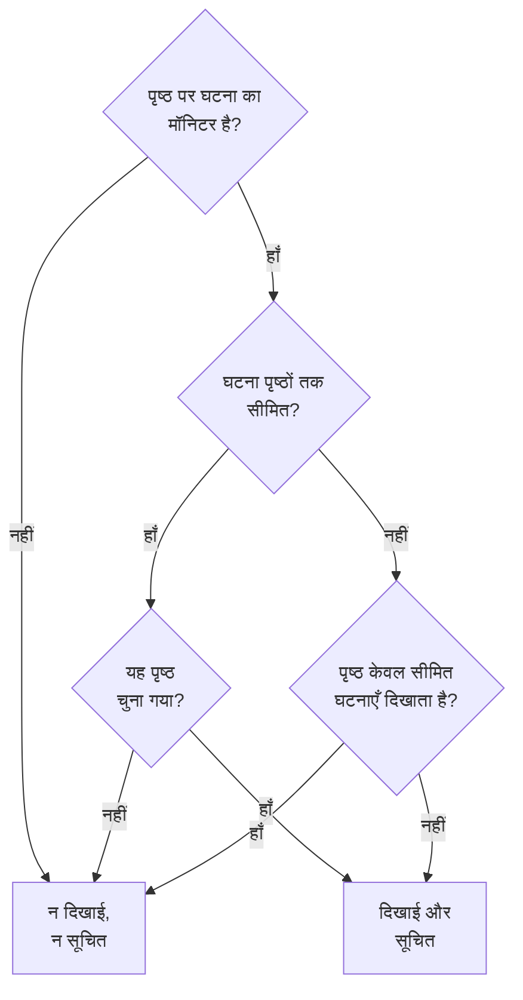

# हर ऑडियंस के लिए एक स्थिति पृष्ठ

अलग-अलग लोगों को अलग-अलग ख़बर चाहिए। कोई ग्राहक किसी दूसरे ग्राहक के आउटेज के बारे में नहीं सुनना चाहता, और किसी एक साइट के कर्मचारी हर बार किसी दूसरी साइट का नेटवर्क जाने पर ईमेल नहीं चाहते। OneUptime में ऑडियंस की इकाई स्थिति पृष्ठ है: हर एक के अपने सब्सक्राइबर, अपनी ब्रांडिंग और अपनी गोपनीयता होती है। इसलिए हर ऑडियंस को उसका अपना पृष्ठ दें, और घटना-दर-घटना तय करें कि किन पृष्ठों को उसके बारे में पता चले।

साझा इन्फ्रास्ट्रक्चर पहले इसे मुश्किल बनाता था। कोई घटना अपने मॉनिटर के ज़रिए स्थिति पृष्ठ तक पहुँचती है, इसलिए दस साइट पृष्ठों द्वारा साझा किया गया मॉनिटर दो साइटों को प्रभावित करने वाले आउटेज के बारे में दसों साइटों को बता देता था। एकमात्र जुगाड़ था साइटों के हर संयोजन के लिए एक पृष्ठ, या एक मॉनिटर। यह पृष्ठ उन सेटिंग्स को कवर करता है जो इसे ठीक करती हैं:

- किसी घटना पर **इन स्थिति पृष्ठों तक सीमित करें**, ताकि वह केवल आपके चुने पृष्ठों पर दिखे और उन्हीं को सूचित करे।
- किसी स्थिति पृष्ठ पर **केवल इस पृष्ठ तक सीमित घटनाएँ दिखाएँ**, ताकि जिस घटना का दायरा अभी किसी ने तय नहीं किया, वह तब तक इनमें से किसी पृष्ठ तक न पहुँचे जब तक कोई फ़ैसला न करे। इसमें वे घटनाएँ भी शामिल हैं जिन्हें कोई मॉनिटर, Slack, Microsoft Teams, API या AI अपने-आप खोलता है।
- एक रिकॉर्ड कि किन पृष्ठों को बताया गया कि घटना बनाई गई, ताकि बाद में जोड़े गए पृष्ठ को एक बार बताया जाए और बाकियों को दोबारा न बताया जाए।
- एक **सूचित किया जाएगा** सारांश जो किसी घटना को घोषित करने या सार्वजनिक नोट पोस्ट करने से पहले दिखाता है कि उसके बारे में कौन सुनेगा, और **पूर्वावलोकन**, जो दिखाता है कि हर पृष्ठ के सब्सक्राइबर को क्या मिलेगा।

:::cards
- [इसे सेट करें](#हर-ऑडियंस-के-लिए-एक-पृष्ठ-सेट-करना): हर ऑडियंस के लिए एक पृष्ठ, और वह स्विच जो बिना दायरे वाली घटनाओं को उनसे दूर रखता है।
- [किसी घटना को सीमित करें](#किसी-घटना-को-स्थिति-पृष्ठों-तक-सीमित-करना): घोषित करते समय या बाद में पृष्ठ चुनें।
- [पृष्ठ जोड़ें या हटाएँ](#स्थिति-पृष्ठ-जोड़ना-और-हटाना): आपके जोड़े गए पृष्ठ के बारे में किसे बताया जाता है, और किसी पृष्ठ को हटाने से क्या वापस होता है।
- [हर संदेश में क्या जाता है](#हर-संदेश-में-क्या-जाता-है): वे मान जो हर पृष्ठ को मिलते हैं, और वे हर ऑडियंस को क्या बताते हैं।
:::

## इसका इस्तेमाल कब करें

- **एक मैनेज्ड सर्विस प्रोवाइडर**, जिसके पास हर ग्राहक के लिए एक स्थिति पृष्ठ है, उन मॉनिटर पर जिन्हें ग्राहक साझा करते हैं।
- **साइटों, प्लांटों या क्षेत्रों वाला कोई संगठन**, जिसमें हर एक के अपने कर्मचारी हैं जिन्हें बताना है।
- **आंतरिक IT**, जिसके पास हर विभाग या इमारत के लिए एक पृष्ठ है।

अगर आपकी ऑडियंस ख़ुद चुनने से ख़ुश है, तो एक पृष्ठ काफ़ी हो सकता है: सब्सक्राइबर को वे संसाधन चुनने दें जिनकी उन्हें परवाह है ([सब्सक्राइबर और घोषणाएँ](/docs/status-pages/subscribers) देखें)। हर ऑडियंस के लिए एक पृष्ठ तब इस्तेमाल करें जब आप उनके लिए, घटना-दर-घटना, चुनाव करते हैं, या जब किसी एक ऑडियंस को दूसरी ऑडियंस की घटनाएँ बिल्कुल नहीं दिखनी चाहिए।

## घटना किसी स्थिति पृष्ठ तक कैसे पहुँचती है

कोई घटना अपने मॉनिटर के ज़रिए स्थिति पृष्ठ तक पहुँचती है। कोई पृष्ठ किसी घटना को दिखाता है, और उसके बारे में अपने सब्सक्राइबर को सूचित करता है, जब पृष्ठ का कोई संसाधन घटना के मॉनिटर में से एक हो, सीधे या पृष्ठ पर किसी मॉनिटर समूह के ज़रिए। दो सेटिंग्स इसे सीमित करती हैं:

- घटना पर **इन स्थिति पृष्ठों तक सीमित करें** (`statusPages`)। ख़ाली छोड़ने पर, घटना हमेशा की तरह हर उस पृष्ठ तक पहुँचती है जो उसके मॉनिटर सूचीबद्ध करता है। पृष्ठ चुने होने पर, यह केवल उसके मॉनिटर सूचीबद्ध करने वाले पृष्ठों **में से** चुने गए पृष्ठों तक पहुँचती है।
- स्थिति पृष्ठ पर **केवल इस पृष्ठ तक सीमित घटनाएँ दिखाएँ** (`onlyShowScopedIncidents`, डिफ़ॉल्ट रूप से बंद)। इसके चालू होने पर, पृष्ठ ऐसी किसी घटना को कभी नहीं दिखाता, और उसके बारे में कभी किसी को सूचित नहीं करता, जो ख़ास स्थिति पृष्ठों तक सीमित नहीं है।



घटना के किसी मॉनिटर को सूचीबद्ध करने वाले पृष्ठ के लिए:

| घटना | **केवल इस पृष्ठ तक सीमित घटनाएँ दिखाएँ** बंद वाला पृष्ठ | इसे चालू रखने वाला पृष्ठ |
| --- | --- | --- |
| किसी स्थिति पृष्ठ तक सीमित नहीं | दिखाई और सूचित | न दिखाई, न सूचित |
| स्थिति पृष्ठों तक सीमित, और यह पृष्ठ चुना गया | दिखाई और सूचित | दिखाई और सूचित |
| स्थिति पृष्ठों तक सीमित, पर यह नहीं | न दिखाई, न सूचित | न दिखाई, न सूचित |

जो पृष्ठ घटना के किसी भी मॉनिटर को सूचीबद्ध नहीं करता, वह उसे कभी नहीं दिखाता, आप चाहे जो चुनें, और बिना मॉनिटर वाली घटना किसी स्थिति पृष्ठ सब्सक्राइबर को बिल्कुल सूचित नहीं करती। सामान्य नियम ऊपर से फिर भी लागू होते हैं: घटना **स्थिति पृष्ठ पर दृश्यमान** होनी चाहिए और निजी नहीं, पृष्ठ पर **घटनाएं दिखाएं** चालू होना चाहिए, और जिस सब्सक्राइबर ने केवल कुछ संसाधन या इवेंट प्रकार चुने हैं, उसे केवल वही मिलता है जो उसने चुना।

जो कुछ इस पर निर्भर है कि कोई घटना किन पृष्ठों तक पहुँचती है, वह सब इन्हीं नियमों से तय होता है:

- सार्वजनिक स्थिति पृष्ठ पर घटना सूचियाँ, अवलोकन और घटना का अपना पृष्ठ, और स्थिति पृष्ठ [सार्वजनिक API](/docs/status-pages/public-api);
- घटना बनने, स्थिति बदलने, सार्वजनिक नोट मिलने या पोस्टमॉर्टम मिलने पर भेजे जाने वाले ईमेल, SMS, Slack, Microsoft Teams और वेबहुक संदेश;
- ईमेल से भेजी जाने वाली स्थिति पृष्ठ रिपोर्ट में घटनाओं की गिनती, जो केवल उन्हीं घटनाओं को गिनती है जिन्हें पृष्ठ दिखाता है।

कोई घटना एपिसोड किसी पृष्ठ तक तब पहुँचता है जब उसकी कम से कम एक घटना पहुँचती है। उसकी सूचनाएँ हर उस पृष्ठ पर जाती हैं जहाँ उसकी घटनाएँ पहुँचती हैं, और जिस स्थिति पृष्ठ तक उनमें से कोई नहीं पहुँचती, उस पर उसका पृष्ठ नहीं मिलता। कोई निजी घटना किसी पृष्ठ तक नहीं पहुँचती, इसलिए वह अपने एपिसोड को कभी किसी पृष्ठ पर नहीं लाती, और कोई निजी एपिसोड किसी भी पृष्ठ पर बिल्कुल नहीं दिखता।

## हर ऑडियंस के लिए एक पृष्ठ सेट करना

:::steps
### हर ऑडियंस के लिए एक स्थिति पृष्ठ बनाएँ

हर ऑडियंस के लिए एक पृष्ठ बनाएँ, जैसे `Site 01` से `Site 10` तक। अगर ऑडियंस आंतरिक है तो उन्हें निजी बनाएँ ([पेज कौन देख सकता है, इसे सीमित करना](/docs/status-pages/index#पेज-कौन-देख-सकता-है-इसे-सीमित-करना) देखें)। निजी पृष्ठ के सब्सक्राइबर फिर भी हर संदेश के लिंक से, बिना साइन इन किए, सदस्यता समाप्त कर सकते हैं ([सदस्यता प्रबंधित करना और रद्द करना](/docs/status-pages/subscribers#सदस्यता-प्रबंधित-करना-और-रद्द-करना) देखें)। उन्हें `Region East` जैसे लेबल दें, ताकि पिकर किसी लेबल वाले हर पृष्ठ को एक क्लिक में जोड़ सके।

### साझा मॉनिटर को हर पृष्ठ पर रखें

साझा मॉनिटर को हर पृष्ठ पर संसाधन के रूप में जोड़ें ([स्थिति पृष्ठ संसाधन और समूह](/docs/status-pages/resources-and-groups) देखें)। **संसाधन → Monitor Rules** के अंतर्गत कोई नियम यह आपके लिए मॉनिटर के लेबल से कर सकता है।

### "केवल इस पृष्ठ तक सीमित घटनाएँ दिखाएँ" चालू करें

उनमें से हर पृष्ठ पर इसे चालू करें। यह **स्थिति पृष्ठ → आपका पृष्ठ → उन्नत → उन्नत सेटिंग्स** पर **आपका स्थिति पृष्ठ क्या दिखाता है** कार्ड में, **घटनाएं दिखाएं** के अंतर्गत है, और पलटते ही सहेजा जाता है। उसके बाद से, किसी साइट पृष्ठ तक तब तक कुछ नहीं पहुँचता जब तक कोई उसे न चुने।

### हर ऑडियंस के सब्सक्राइबर जोड़ें

कर्मचारियों के लिए **ईमेल सब्सक्राइबर** पर **थोक में जोड़ें** इस्तेमाल करें, और `site03-all@` जैसी मेलिंग सूची के बजाय हर व्यक्ति के अपने पते को प्राथमिकता दें: सूची का कोई भी व्यक्ति उस पर मौजूद सभी के लिए उसकी सदस्यता समाप्त कर सकता है। अगर आपका जोड़ा हुआ कोई सब्सक्राइबर सदस्यता समाप्त करता है, तो पृष्ठ के मालिकों और उसे जोड़ने वाले को ईमेल किया जाता है ([साझा पते और मेलिंग सूचियाँ](/docs/status-pages/subscribers#साझा-पते-और-मेलिंग-सूचियाँ) देखें)।

### रिस्पॉन्डर को स्थिति पृष्ठ पढ़ने दें

पिकर केवल वही स्थिति पृष्ठ सूचीबद्ध करता है जिन्हें व्यक्ति पढ़ सकता है, और घटना भूमिकाएँ स्थिति पृष्ठ नहीं पढ़ सकतीं। रिस्पॉन्डर को उनकी घटना भूमिका के साथ **Status Page Viewer** भूमिका दें; इसे कुछ ख़ास लेबल वाले पृष्ठों तक सीमित किया जा सकता है। इसके बिना पिकर ख़ाली रहता है।

### तय करें कि हर संदेश क्या कहे

**घटनाएं → सेटिंग्स → कस्टम फ़ील्ड** पर वे घटना कस्टम फ़ील्ड परिभाषित करें जिनका जवाब आपकी टीम हर बार देती है, जैसे `Impact` (एक ड्रॉपडाउन), `Expected Resolution` (तारीख़ और समय) और `Acknowledgement` (हाँ/नहीं स्विच)। उन्हें उस **क्रम** में खींचें जिसमें आप उन्हें पूछना और सूचीबद्ध करना चाहते हैं, और **बनाते समय दिखाएँ** चालू करें ताकि घोषणा फ़ॉर्म उन्हें पूछे, जहाँ जवाब ज़रूरी हो वहाँ **बनाते समय आवश्यक**, और जिन्हें हर ऑडियंस पढ़ सकती है उनके लिए **सब्सक्राइबर सूचनाओं में शामिल करें**। फिर वे हर पृष्ठ के डिफ़ॉल्ट ईमेल में होते हैं। [कस्टम फ़ील्ड](/docs/incidents/settings#कस्टम-फ़ील्ड) देखें।

### हर पृष्ठ के ईमेल की ब्रांडिंग करें (वैकल्पिक)

**Scale** प्लान पर, हर पृष्ठ को एक **कस्टम SMTP कॉन्फ़िग** दें और घटना इवेंट के लिए कस्टम टेम्पलेट जोड़ें; वे `{{incident.customFields.<key>}}` से कोई भी फ़ील्ड रख सकते हैं। टेम्पलेट लिखते समय, उसके नीचे **लाइव पूर्वावलोकन** उसे नमूना मानों से भरा हुआ दिखाता है। [कस्टम टेम्पलेट को क्या चाहिए](/docs/status-pages/subscribers#कस्टम-टेम्पलेट-को-क्या-चाहिए) देखें, और `{{affectedStatusPages}}` इस्तेमाल करने से पहले [हर संदेश में क्या जाता है](#हर-संदेश-में-क्या-जाता-है)।

### चुने हुए पृष्ठों के साथ घटना टेम्पलेट सहेजें (वैकल्पिक)

एक `Region East outage` टेम्पलेट पूर्वी साइट पृष्ठ, और कस्टम फ़ील्ड के डिफ़ॉल्ट जवाब, साथ रख सकता है।

### पहले आउटेज से पहले हर पृष्ठ का ईमेल जाँचें

साझा मॉनिटर और दो साइट पृष्ठ चुनकर **घटना घोषित करें** शुरू करें, और सबमिट करने से पहले सारांश पर **हाँ** के बगल में **पूर्वावलोकन** खोलें: यह दिखाता है कि हर पृष्ठ के सब्सक्राइबर को कौन-सा ईमेल मिलेगा, और वह कौन-सा टेम्पलेट इस्तेमाल करता है और क्यों। **मुझे टेस्ट भेजें** एक ईमेल आपके अपने इनबॉक्स में भेजता है। जब तक आप घटना घोषित नहीं करते, किसी और को कुछ नहीं भेजा जाता, इसलिए काम हो जाने पर फ़ॉर्म को सबमिट किए बिना छोड़ दें। [किसे सूचित किया जाएगा](#किसे-सूचित-किया-जाएगा) देखें।
:::

## किसी घटना को स्थिति पृष्ठों तक सीमित करना

### जब आप इसे घोषित करते हैं

**घटनाएं → सभी घटनाएं → घटना घोषित करें** पर, **प्रभावित संसाधन** चरण में मॉनिटर और दूसरे संसाधनों के बाद **और फ़ील्ड** के अंतर्गत **इन स्थिति पृष्ठों तक सीमित करें** है। इसका प्लेसहोल्डर, **मॉनिटर सूचीबद्ध करने वाले सभी स्थिति पृष्ठ**, बताता है कि इसे ख़ाली छोड़ने का मतलब क्या है। पृष्ठों को नाम से चुनें, या पिकर का **लेबल** टैब खोलकर कोई लेबल चुनें ताकि उसे रखने वाला हर पृष्ठ जुड़ जाए।

फ़ॉर्म आपको चेतावनी देता है:

- जब कोई चुना गया पृष्ठ घटना के किसी भी मॉनिटर को सूचीबद्ध नहीं करता, या कोई मॉनिटर जुड़ा ही नहीं है। घटना उस पृष्ठ पर नहीं दिखेगी और उसके सब्सक्राइबर को सूचित नहीं करेगी;
- जब आप उसी चरण पर मॉनिटर के ठीक नीचे **मॉनिटर स्थिति बदलकर करें** भी सेट करते हैं। [मॉनिटर की स्थिति साझा होती है](#मॉनिटर-की-स्थिति-साझा-होती-है) देखें;
- जब आप **घटना विवरण** चरण पर **और फ़ील्ड** के अंतर्गत **निजी घटना** भी चुनते हैं। निजी घटनाएँ सभी स्थिति पृष्ठों से छिपी रहती हैं, आपके चुने पृष्ठों सहित।

**प्रभावित संसाधन** के ठीक बाद वाला **विवरण** चरण **बनाते समय दिखाएँ** चिह्नित घटना कस्टम फ़ील्ड पूछता है ([घटना घोषित करना](/docs/incidents/declaring-incidents) देखें)। उसके जवाब हर उस पृष्ठ पर जाते हैं जहाँ घटना पहुँचती है: कस्टम फ़ील्ड मान घटना के होते हैं, किसी स्थिति पृष्ठ के नहीं।

**टेम्पलेट से बनाएँ** यह फ़ील्ड टेम्पलेट से भरता है। किसी टेम्पलेट के पृष्ठ उसे बनाते समय उसके **प्रभावित संसाधन** चरण पर सेट होते हैं, और बाद में उसके **स्थिति पृष्ठ दायरा** कार्ड पर (**घटनाएं → सेटिंग्स → घटना टेम्पलेट**)। दूसरे टेम्पलेट फ़ील्ड की तरह, आपकी ख़ुद सेट की गई सूची जीतती है। किसी टेम्पलेट के पृष्ठ उस रिस्पॉन्डर के लिए भी भरे जाते हैं जो स्थिति पृष्ठ नहीं पढ़ सकता: टेम्पलेट सेट करने वाले ने उन्हें उससे घोषित करने वाले हर व्यक्ति के लिए चुना था।

### किसे सूचित किया जाएगा

**प्रभावित संसाधन** चरण पर **और फ़ील्ड** के अंतर्गत पिकर के ठीक नीचे **स्थिति पृष्ठ ग्राहकों को सूचित करें** के अंतर्गत, और सबमिट करने से पहले सारांश पर फिर से, फ़ॉर्म दिखाता है कि घटना किस तक पहुँचेगी:

> सूचित किया जाएगा:
>
> - Site 03 (अधिकतम ईमेल से 41)
> - Site 07 (अधिकतम ईमेल से 18)

उसके नीचे, **सूचित नहीं किया जाएगा:** के अंतर्गत, यह उन पृष्ठों को सूचीबद्ध करता है जो मॉनिटर सूचीबद्ध करते हैं पर जिन्हें बताया नहीं जाएगा, और क्यों: वह उन पृष्ठों में से नहीं है जिन तक घटना सीमित है, वह ऐसा पृष्ठ है जो केवल अपने तक सीमित घटनाएँ दिखाता है, या वह ऐसा पृष्ठ है जो घटनाएँ नहीं दिखाता।

जब किसी को नहीं बताया जाएगा, तो सारांश कुछ नहीं दिखाता: घटना का कोई मॉनिटर नहीं, कोई स्थिति पृष्ठ उन्हें सूचीबद्ध नहीं करता, पृष्ठों के अभी कोई सब्सक्राइबर नहीं, **स्थिति पृष्ठ ग्राहकों को सूचित करें** बंद है, या घटना निजी है। यह केवल तब चेतावनी देता है जब स्थिति पृष्ठ दायरा कारण हो, और उन पृष्ठों का नाम लेता है जिन्हें यह छोड़ता है: घटना सीमित नहीं है और उसके मॉनिटर सूचीबद्ध करने वाले पृष्ठ केवल अपने तक सीमित घटनाएँ दिखाते हैं, यह दूसरे पृष्ठों तक सीमित है, या जिन पृष्ठों तक यह सीमित है वे इसके किसी मॉनिटर को सूचीबद्ध नहीं करते। सारांश पर **स्थिति पृष्ठ ग्राहकों को सूचित करें** हर दूसरे बॉक्स की तरह **हाँ** या **नहीं** पढ़ा जाता है, **हाँ** के बगल में **पूर्वावलोकन** के साथ; यह तब नहीं मिलता जब बॉक्स बंद हो, घटना निजी हो, या कोई मॉनिटर जुड़ा न हो।

जब आप घटना के **सार्वजनिक नोट** पृष्ठ पर कोई नोट लिखते हैं, तब भी **स्थिति पृष्ठ ग्राहकों को सूचित करें** के अंतर्गत वही सारांश दिखता है, घटना की मौजूदा स्थिति के लिए। वहाँ यह यह भी बताता है कि घटना स्थिति पृष्ठों से छिपी है, क्योंकि तब कुछ नहीं भेजा जाएगा।

गिनतियाँ "अधिकतम" हैं। वे हर पृष्ठ के उन पुष्ट सब्सक्राइबर को, हर चैनल के हिसाब से, गिनती हैं जिन्होंने सदस्यता समाप्त नहीं की, और जिस सब्सक्राइबर ने केवल कुछ संसाधन या इवेंट प्रकार चुने हैं, उसे यह संदेश न मिले ऐसा हो सकता है। जिन पृष्ठों को आप नहीं पढ़ सकते, उनका नाम नहीं लिया जाता। उन्हें "और स्थिति पृष्ठ जिन तक आपकी पहुँच नहीं है" के रूप में गिना जाता है।

सारांश पर **हाँ** के बगल में और नोट के चेकबॉक्स के बगल में **पूर्वावलोकन** दिखाता है कि उन्हें क्या मिलेगा: किसी पृष्ठ का ईमेल वैसा देखने के लिए उसे चुनें जैसा उसके सब्सक्राइबर को मिलेगा, उसके विषय के साथ, और यह भी कि वह कौन-सा टेम्पलेट इस्तेमाल करता है और क्यों, जैसे कि किसी पृष्ठ का कस्टम टेम्पलेट इस्तेमाल नहीं होता क्योंकि पृष्ठ का कोई **कस्टम SMTP कॉन्फ़िग** नहीं है। **मुझे टेस्ट भेजें** पृष्ठ का ईमेल आपके अपने खाते के ईमेल पर भेजता है, और किसी और को नहीं। जिन पृष्ठों को आप नहीं पढ़ सकते, वे गिने जाते हैं पर उनका पूर्वावलोकन नहीं होता। [भेजने से पहले ईमेल का पूर्वावलोकन](/docs/status-pages/subscribers#भेजने-से-पहले-ईमेल-का-पूर्वावलोकन) देखें।

### घोषित होने के बाद

घटना खोलें और **उन्नत → सेटिंग्स** पर जाएँ। **स्थिति पृष्ठ दायरा** कार्ड उन पृष्ठों को सूचीबद्ध करता है जिन तक घटना सीमित है, और **स्थिति पृष्ठ दायरा संपादित करें** उन्हें बदलता है। घटना का **अवलोकन** वही सूची **स्थिति पृष्ठ दायरा** के रूप में, केवल-पढ़ने के लिए, एक **सेटिंग्स में बदलें** लिंक के साथ दिखाता है।

**घटनाएं → सभी घटनाएं** पर, **स्थिति पृष्ठ** फ़िल्टर आपके चुने पृष्ठों तक सीमित घटनाएँ, या किसी पृष्ठ तक सीमित न होने वाली घटनाएँ ढूँढता है।

### API से

`statusPages` स्थिति पृष्ठ ID की एक सूची है, `POST /api/incident` पर और किसी घटना के अपडेट पर, और घटना टेम्पलेट पर। हर पृष्ठ घटना के प्रोजेक्ट का होना चाहिए; किसी दूसरे प्रोजेक्ट का पृष्ठ अस्वीकार किया जाता है। आपका जोड़ा हर पृष्ठ ऐसा भी होना चाहिए जिसे आप पढ़ सकें, जैसे पिकर में, वरना अनुरोध अस्वीकार होता है। घटना या टेम्पलेट के पास पहले से मौजूद पृष्ठ रखे जाते हैं चाहे आप उन्हें पढ़ सकें या नहीं, और जिस घटना टेम्पलेट को आप पढ़ सकते हैं उसका पृष्ठ घटना घोषित करते समय चुना जा सकता है। इससे दो और कॉलम निकलते हैं, और उनमें से कोई भी आपको सेट नहीं करना:

- `isScopedToStatusPages` `statusPages` से निकाला जाता है। इसके लिए आप जो भी भेजें, उसे अनदेखा किया जाता है।
- `statusPagesNotifiedOnCreation` उन पृष्ठों का रिकॉर्ड है जिन्हें बताया गया कि घटना बनाई गई। [स्थिति पृष्ठ जोड़ना](#स्थिति-पृष्ठ-जोड़ना) देखें।

कुछ भेजे बिना यह देखने के लिए कि कोई घटना किस तक पहुँचेगी, ऑडियंस एंडपॉइंट को कॉल करें:

```bash
curl -X POST https://oneuptime.com/api/incident/subscriber-audience \
  -H "apikey: $ONEUPTIME_API_KEY" \
  -H "Content-Type: application/json" \
  -d '{
    "monitorIds": ["<monitor-id>"],
    "statusPageIds": ["<status-page-id>"]
  }'
```

किसी मौजूदा घटना के लिए इसके बजाय `{"incidentId": "<incident-id>"}` भेजें। जवाब हर उस पृष्ठ को सूचीबद्ध करता है जिसे सूचित किया जाएगा, हर चैनल (`email`, `sms`, `slack`, `microsoftTeams`, `webhook`) की गिनती के साथ, छोड़े गए पृष्ठों और उनके कारणों को, और कॉल करने वाले के न पढ़ सकने वाले पृष्ठों के लिए `hiddenStatusPageCount` को। यह कभी कोई पता नहीं लौटाता।

## वे घटनाएँ जिनका दायरा अभी किसी ने तय नहीं किया

मॉनिटर मानदंड, Slack, Microsoft Teams, API और AI सभी अपने-आप घटना खोल सकते हैं, और उनमें से कोई नहीं जानता कि किसी साझा मॉनिटर की विफलता किन साइटों को प्रभावित करती है। ऐसी घटना किसी पृष्ठ तक सीमित नहीं होती, इसलिए मॉनिटर सूचीबद्ध करने वाला हर पृष्ठ लगभग एक मिनट में उसे दिखा देगा, और अपने सब्सक्राइबर को सूचित कर देगा। किसी सब्सक्राइबर को एक बार ईमेल भेज दिया जाए, तो उसे वापस नहीं लिया जा सकता।

**केवल इस पृष्ठ तक सीमित घटनाएँ दिखाएँ** इसी को रोकता है। इसे चालू रखने वाला पृष्ठ हर बिना दायरे वाली घटना को अनदेखा करता है। घटना फिर भी खुलती है, ऑन-कॉल नीतियाँ फिर भी रिस्पॉन्डर को पेज करती हैं, और उसके मालिकों को फिर भी बताया जाता है, पर इनमें से कोई पृष्ठ उसके बारे में नहीं सुनता। फिर कोई रिस्पॉन्डर पता लगाता है कि कौन प्रभावित है और घटना के **सेटिंग्स** टैब पर उन पृष्ठों को जोड़ता है, **नए जोड़े गए पृष्ठों को घटना बनने की सूचना भेजें** चुनकर। उनके सब्सक्राइबर को लगभग एक मिनट में बताया जाता है।

## स्थिति पृष्ठ जोड़ना और हटाना

### स्थिति पृष्ठ जोड़ना

किसी पृष्ठ के सब्सक्राइबर एक बार सुनते हैं कि कोई घटना बनाई गई। इसलिए जब आप **स्थिति पृष्ठ दायरा** कार्ड पर पृष्ठ जोड़ते हैं, तो संपादन फ़ॉर्म **नए जोड़े गए पृष्ठों को घटना बनने की सूचना भेजें** देता है, जो डिफ़ॉल्ट रूप से चुना होता है:

- चुना होने पर, घटना की 'बनाई गई' सूचना फिर से कतार में लगती है, और केवल उन पृष्ठों पर जाती है जिन्हें अभी बताया नहीं गया। घटना बताए गए पृष्ठों का रिकॉर्ड रखती है, इसलिए बाकी इसे दो बार नहीं सुनते।
- चुना न होने पर, जोड़े गए पृष्ठ घटना दिखाने लगते हैं, और अब से हर चीज़ के बारे में सुनते हैं, पर उन्हें नहीं बताया जाता कि यह बनाई गई थी।

चेकबॉक्स केवल तभी दिखता है जब उसे चुनने से कुछ भेजा जाएगा: आपके जोड़े गए पृष्ठों में से कम से कम एक को अभी बताया नहीं गया, और घटना **स्थिति पृष्ठ ग्राहकों को सूचित करें** चालू रखकर घोषित की गई थी, स्थिति पृष्ठों पर दिखाई देती है और निजी नहीं है। कुछ मामले आपके लिए संभाले जाते हैं:

- **सूचना अभी कतार में है, या ठीक इसी पल भेजी जा रही है।** कतार वाला भेजना जाते समय पृष्ठ पढ़ता है, और चल रहा भेजना ख़त्म होने पर उन्हें फिर से पढ़ता है और फिर बीच में जोड़े गए पृष्ठों को बताता है। इसलिए कोई चेकबॉक्स नहीं है: आपके जोड़े पृष्ठों को किसी भी तरह बताया जाता है। (अगर वह भेजना विफल होता है, तो बीच में जोड़े गए पृष्ठ उन पृष्ठों में होते हैं जिन्हें उसका **फिर से प्रयास करें** भेजता है।)
- **आपके जोड़े गए हर पृष्ठ को पहले ही बताया जा चुका है**, जैसे कोई पृष्ठ जिसे आपने हटाकर फिर से जोड़ा, या कोई घटना जो हर साइट तक पहुँची थी और अब उनमें से दो तक सीमित है। किसी को फिर से नहीं बताया जाता, इसलिए कोई चेकबॉक्स नहीं है।
- **घटना की कभी घोषणा नहीं हुई।** जब यह **सब्सक्राइबर को सूचित करें कि यह घटना बनाई गई थी** के बिना प्रकाशित हुई, या बिना मॉनिटर के घोषित हुई, तो किसी को नहीं बताया गया। चेकबॉक्स चुनने से केवल आपके जोड़े पृष्ठों को बताया जाता है, उन पृष्ठों को नहीं जिन तक यह पहले से सीमित थी।
- **घटना यह सुविधा जारी होने से पहले घोषित हुई थी।** इसकी 'बनाई गई' सूचना इसके मॉनिटर सूचीबद्ध करने वाले हर पृष्ठ पर गई थी, और उन पृष्ठों का कोई रिकॉर्ड नहीं है। पृष्ठ जोड़ने से यह फिर से नहीं भेजी जाती, इसलिए चेकबॉक्स नहीं दिया जाता।
- **घटना छिपी है।** छिपी रहते कुछ नहीं भेजा जाता। जब आप **स्थिति पृष्ठ पर दृश्यमान** फिर से चालू करते हैं, तो **घटना सेटिंग्स** कार्ड इसके दायरे के उन पृष्ठों के लिए **सब्सक्राइबर को सूचित करें कि यह घटना बनाई गई थी** देता है जिन्हें कभी बताया नहीं गया, जैसे इसके छिपे रहते जोड़े गए पृष्ठ।

बाद में जोड़ा गया पृष्ठ आगे जो होता है उसके बारे में सुनता है: बाद के सार्वजनिक नोट, स्थिति बदलाव और पोस्टमॉर्टम। उसे वे नोट और स्थिति बदलाव नहीं भेजे जाते जो उसके जुड़ने से पहले जा चुके थे। अगर उसे बराबरी पर आना है, तो एक सार्वजनिक नोट पोस्ट करें।

यही रिकॉर्ड किसी विफल 'बनाई गई' सूचना पर **फिर से प्रयास करें** को वहीं से शुरू कराता है जहाँ वह रुकी थी: जिन पृष्ठों को पहले ही बताया जा चुका है, वे छोड़ दिए जाते हैं। किसी पृष्ठ को बताया गया तभी गिना जाता है जब उसके हर सब्सक्राइबर को संदेश भेजा जा चुका हो; जिस पृष्ठ पर कोई संदेश विफल हुआ, या जिस पर भेजना बीच में रुक गया, उसे यह पूरी तरह फिर से भेजा जाता है। रिकॉर्ड हर पृष्ठ के पूरा होने पर लिखा जाता है, इसलिए यह बीच में रुके भेजने के लिए भी सही रहता है। यह हर पृष्ठ के लिए रखा जाता है, हर सब्सक्राइबर के लिए नहीं: जिस पृष्ठ पर भेजना बीच में रुक गया, उसके जिन सब्सक्राइबर को संदेश पहले ही भेजा जा चुका था, उन्हें यह दूसरी बार मिलता है।

इसके बजाय नए सिरे से शुरू करने के लिए, जैसे किसी टेम्पलेट या SMTP सेटिंग को ठीक करने के बाद, **फिर से प्रयास करें** की पुष्टि में **इसे सभी स्थिति पृष्ठों पर फिर से भेजें, पहले से पहुँचे पृष्ठों सहित** चुनें: बटन **सभी पृष्ठों पर फिर से भेजें** बन जाता है, रिकॉर्ड ख़ाली हो जाता है, और घटना अब जिन पृष्ठों तक पहुँचती है उन सबको यह फिर से भेजी जाती है। पूरी तरह जा चुकी सूचना के बाद, घटना के **अवलोकन** पर **ग्राहक सूचना स्थिति** **फिर से भेजें** देती है, जो यही करता है। दोनों पुष्टियाँ उन पृष्ठों को सूचीबद्ध करती हैं जिन तक यह अब पहुँचेगी, या बताती हैं कि यह किसी तक नहीं पहुँचेगी; सादी **फिर से प्रयास करें** पुष्टि पहले से पहुँचे पृष्ठों को फिर से न भेजे जाने वाले के रूप में सूचीबद्ध करती है, क्योंकि यह उन्हें छोड़ देती है। इनमें से कोई भी उस सूचना पर नहीं मिलता जो छोड़ दी गई, या जो अभी कतार में है या भेजी जा रही है, न ही ऐसे व्यक्ति को जो घटना संपादित नहीं कर सकता।

API से, `statusPages` बदलने वाले अपडेट के साथ `"miscDataProps": {"notifyAddedStatusPagesOfIncidentCreated": true}` भेजें। `subscriberNotificationStatusOnIncidentCreated` को ख़ुद वापस `Pending` करना अब भी 'बनाई गई' सूचना को घटना के पहुँचने वाले हर पृष्ठ पर फिर से भेजता है, जैसा हमेशा करता था: इसके साथ रिकॉर्ड ख़ाली हो जाता है। किसी विफलता के बाद यह इसके बजाय वहीं से शुरू होता है जहाँ विफल भेजना रुका था। विफलता के बाद भी इसे हर पृष्ठ पर भेजने के लिए, उसी अपडेट में `"miscDataProps": {"resendIncidentCreatedToAllStatusPages": true}` जोड़ें। छोड़ी गई सूचना, या कतार में या भेजी जा रही सूचना के लिए वह अनुरोध अस्वीकार किया जाता है।

`shouldStatusPageSubscribersBeNotifiedOnIncidentCreated` लिखना इनमें से कुछ नहीं है। यह घटना घोषित करते समय चुना जाता है, और उसके बाद कोई प्रोजेक्ट भूमिका API से इसे नहीं बदल सकती। सिस्टम के रूप में लिखने वाला वर्कफ़्लो और किसी इंस्टेंस का मास्टर एडमिन बदल सकते हैं, पर इससे केवल नया मान सहेजा जाता है। इसे बिना बदले वापस लिखना, जैसे पूरी घटना कॉपी करने वाला वर्कफ़्लो करता है, कुछ भी फिर से नहीं भेजता, और बाद में इसे चालू करने से वह 'बनाई गई' सूचना नहीं भेजी जाती जिसके बिना घटना घोषित हुई थी। वह सूचना जाने से पहले इसे बंद करने पर, वह छोड़ दी जाती है।

### स्थिति पृष्ठ हटाना

किसी पृष्ठ को हटाने से कुछ वापस नहीं होता। पृष्ठ घटना दिखाना बंद कर देता है, और उसके सब्सक्राइबर उसके बारे में आगे कुछ नहीं सुनते, यह भी नहीं कि वह सुलझ गई। जब आप ऐसा पृष्ठ हटाते हैं जिसे घटना के बारे में पहले ही बताया जा चुका है, तो संपादन फ़ॉर्म आपको चेतावनी देता है और एक समापन सार्वजनिक नोट का सुझाव देता है। वह नोट पहले पोस्ट करें, जब पृष्ठ अभी सूची में हो, और फिर पृष्ठ हटाएँ।

पूरी सूची ख़ाली करना पृष्ठ हटाने से अलग है: तब घटना बिल्कुल सीमित नहीं रहती। यह फिर से अपने मॉनिटर सूचीबद्ध करने वाले हर पृष्ठ पर दिखती है, और उसे सूचित करती है, उन पृष्ठों को छोड़कर जो केवल अपने तक सीमित घटनाएँ दिखाते हैं। फ़ॉर्म इसके बारे में भी आपको चेतावनी देता है।

### जब कोई चुना हुआ स्थिति पृष्ठ मिटा दिया जाता है

किसी स्थिति पृष्ठ को मिटाने से वह हर उस घटना से हट जाता है जो उस तक सीमित थी। जिस घटना के सभी चुने पृष्ठ मिटा दिए गए, वह सीमित ही रहती है, किसी तक नहीं: यह अपने मॉनिटर सूचीबद्ध करने वाले हर पृष्ठ पर दिखने के बजाय हर स्थिति पृष्ठ से छिपी रहती है। **स्थिति पृष्ठ दायरा** कार्ड यही बताता है। इसे फिर से दिखाने के लिए दूसरे पृष्ठ चुनें, या सूची ख़ाली करें।

घटना टेम्पलेट भी इसी तरह काम करते हैं। जिस टेम्पलेट के सभी पृष्ठ मिटा दिए गए, वह सीमित ही रहता है: उससे कोई [फ़ॉर्म](/docs/forms/on-submit#घटना-टेम्पलेट) या किसी वर्कफ़्लो का **Create One Incident** चरण जो घटना घोषित करता है, वह हर स्थिति पृष्ठ से छिपी रहती है, टेम्पलेट का **स्थिति पृष्ठ दायरा** कार्ड आपको चेतावनी देता है, और **घटना घोषित करें** बिना किसी चुने पृष्ठ के शुरू होता है और आपसे वे पृष्ठ चुनने को कहता है जिनके लिए घटना है। टेम्पलेट पर दूसरे पृष्ठ चुनें, या उसकी सूची ख़ाली करके सहेजें ताकि उससे घोषित घटनाएँ सीमित होना बंद हो जाएँ।

## हर व्यक्ति को एक ईमेल

ख़ास स्थिति पृष्ठों तक सीमित घटना के लिए, उनमें से एक से ज़्यादा पृष्ठों पर सब्सक्राइब किए गए ईमेल पते या फ़ोन नंबर को हर भेजने पर एक ईमेल या टेक्स्ट संदेश मिलता है, हर पृष्ठ पर एक नहीं। पृष्ठ नाम के क्रम में देखे जाते हैं, इसलिए उस व्यक्ति को पहले पृष्ठ का टेम्पलेट, ब्रांडिंग और सदस्यता समाप्ति लिंक मिलता है।

वेबहुक, Slack और Microsoft Teams संदेश कभी नहीं मिलाए जाते। उनके पेलोड उस स्थिति पृष्ठ का नाम लेते हैं जिसके लिए वे हैं, और हर पृष्ठ पर सुनने वाले इंटीग्रेशन को हर पृष्ठ देखना होता है।

यह केवल एक भेजने के भीतर लागू होता है। `Site 03` और `Site 05` पर सब्सक्राइब किए किसी व्यक्ति को, जिसे 'बनाई गई' ईमेल `Site 03` के ज़रिए मिला, बाद में `Site 05` जोड़े जाने पर यह फिर से मिलता है। किसी पृष्ठ तक सीमित न होने वाली घटना हर सदस्यता पर एक संदेश भेजती है, जैसा हमेशा करती थी।

## हर संदेश में क्या जाता है

घटना जिस भी पृष्ठ तक पहुँचती है, उसे वही मान मिलते हैं: वे घटना के होते हैं, किसी स्थिति पृष्ठ के नहीं।

- **डिफ़ॉल्ट संदेशों में कस्टम फ़ील्ड।** **सब्सक्राइबर सूचनाओं में शामिल करें** चालू वाले घटना कस्टम फ़ील्ड हर पृष्ठ के बनाई गई, स्थिति बदलाव, सार्वजनिक नोट और पोस्टमॉर्टम संदेशों में, उनके **क्रम** में, सूचीबद्ध होते हैं: ईमेल, Slack, Microsoft Teams और वेबहुक, पर SMS नहीं। इसके लिए न Scale प्लान चाहिए और न कस्टम SMTP। [सूचनाओं में घटना के कस्टम फ़ील्ड](/docs/status-pages/subscribers#सूचनाओं-में-घटना-के-कस्टम-फ़ील्ड) देखें।
- **अपडेट।** अकेले किसी कस्टम फ़ील्ड को बदलने से किसी को नहीं बताया जाता। अगला सार्वजनिक नोट या स्थिति बदलाव मौजूदा मान ले जाता है, इसलिए साइटों को यह बताने के लिए कि `Expected Resolution` बदल गया, फ़ील्ड बदलें और फिर एक सार्वजनिक नोट पोस्ट करें।
- **नोट टेम्पलेट।** कोई नोट टेम्पलेट चुनने से `{{incident.title}}` और `{{incident.customFields.<key>}}` जैसे प्लेसहोल्डर घटना के मौजूदा मानों से भर जाते हैं, और पोस्ट करने से पहले आप नोट फिर भी संपादित कर सकते हैं। [नोट टेम्पलेट](/docs/incidents/settings#नोट-टेम्पलेट) देखें।
- **दूसरी ऑडियंस के नाम।** किसी कस्टम सब्सक्राइबर टेम्पलेट में `{{affectedStatusPages}}`, और किसी नोट टेम्पलेट में `{{incident.affectedStatusPages}}`, उन पृष्ठों को सूचीबद्ध करते हैं जिन तक घटना पहुँचती है, और जिस किसी को भी संदेश जाता है वह सूची पढ़ता है: `Site 03` के सब्सक्राइबर जान जाते हैं कि `Site 07` भी प्रभावित है। एक ही संगठन की साइटों के बीच शायद यही आप चाहते हैं। ग्राहकों के बीच यह एक ग्राहक को दूसरे के बारे में बता देता है, इसलिए उन पृष्ठों को मिलने वाले टेम्पलेट और नोट से दोनों को बाहर रखें।

## यह अनुसूचित रखरखाव से कैसे अलग है

अनुसूचित रखरखाव इवेंट की भी एक **स्थिति पृष्ठ** सूची होती है, पर यह अलग तरह से काम करती है:

- **अनुसूचित रखरखाव बदल देता है।** इवेंट ठीक उन्हीं पृष्ठों पर दिखता है जो उसकी सूची में हैं, चाहे वे उसके मॉनिटर सूचीबद्ध करें या नहीं।
- **घटना सीमित करती है।** इसकी सूची केवल उन पृष्ठों में से चुनती है जो पहले से इसके मॉनिटर सूचीबद्ध करते हैं। कोई ऐसा पृष्ठ चुनने से जो उनमें से किसी को सूचीबद्ध नहीं करता, कुछ नहीं होता, और फ़ॉर्म यही बताता है। पहले मॉनिटर को उस पृष्ठ पर रखें।

इससे कोई ग़लत चुनाव किसी घटना को ऐसे पृष्ठ पर नहीं डाल पाता जो पूरी तरह किसी और चीज़ के बारे में है। इसका यह भी मतलब है कि बिना मॉनिटर वाली घटना किसी स्थिति पृष्ठ तक नहीं पहुँचती, आप चाहे जितने चुनें।

## मॉनिटर की स्थिति साझा होती है

किसी मॉनिटर की एक ही स्थिति होती है, और उस मॉनिटर को सूचीबद्ध करने वाला हर स्थिति पृष्ठ उसे दिखाता है। किसी घटना को सीमित करने से यह नहीं बदलता। अगर घटना **मॉनिटर स्थिति बदलकर करें** सेट करती है, या मॉनिटर अपने-आप डाउन हो जाता है, तो मॉनिटर उसे सूचीबद्ध करने वाले हर पृष्ठ पर लाल हो जाता है, उन पृष्ठों सहित जिन तक घटना सीमित नहीं है और उन पृष्ठों सहित जो केवल अपने तक सीमित घटनाएँ दिखाते हैं। जब आप स्थिति बदलाव को चुने हुए पृष्ठों के साथ मिलाते हैं, तो घोषणा फ़ॉर्म आपको चेतावनी देता है।

**जब हर साइट को अपनी स्थिति चाहिए, तो हर साइट को एक मैन्युअल मॉनिटर दें।** हर साइट के लिए एक [मैन्युअल मॉनिटर](/docs/monitor/manual-monitor) बनाएँ, जैसे `Site 03 network`, और उसे केवल उसी साइट के पृष्ठ पर सूचीबद्ध करें। प्रभावित साइटों के मैन्युअल मॉनिटर घटना से जोड़ें, अगर आप उनकी स्थिति बदलना चाहते हैं तो **मॉनिटर स्थिति बदलकर करें** के साथ, और साझा मॉनिटर को उन पृष्ठों के लिए छोड़ दें जिन्हें उसे देखना चाहिए। तब घटना ठीक उन्हीं साइटों तक पहुँचती है जिनके मॉनिटर वह ले जाती है, और स्थिति बदलाव केवल उन्हीं के पृष्ठों पर दिखता है।

## क्या दर्ज होता है

- **घटना फ़ीड।** सीमित घटना की 'बनाई गई' प्रविष्टि उन पृष्ठों को सूचीबद्ध करती है जिन तक वह सीमित है। सूची में हर बदलाव एक प्रविष्टि जोड़ता है जो जोड़े और हटाए गए पृष्ठों को सूचीबद्ध करती है, और यह भी कि जोड़े गए पृष्ठों को 'बनाई गई' सूचना भेजी जाएगी या नहीं।
- **हर सब्सक्राइबर सूचना।** घटना फ़ीड में **सब्सक्राइबर सूचना भेजी गई** प्रविष्टि में एक **More Information** पैनल होता है जो हर उस पृष्ठ को सूचीबद्ध करता है जिस पर भेजना गया: हर चैनल पर कितने संदेश भेजे गए और कितने विफल हुए, और उसका ईमेल किस विषय के साथ गया। यह उन पृष्ठों को भी सूचीबद्ध करता है जिन्हें इसने छोड़ा और क्यों (पहले ही बताया गया, या घटनाएँ नहीं दिखाता), दायरे द्वारा छोड़े गए पृष्ठों को, और यह कि ईमेल और SMS हर पते पर एक बार भेजे गए या नहीं। जब भेजने ने किसी संदेश में कस्टम फ़ील्ड मान डाले, तो पैनल उन्हीं पर, **Custom fields sent** के अंतर्गत, ख़त्म होता है।
- **सूचना की स्थिति।** हर सूचना का स्थिति संदेश हर पृष्ठ के लिए बताता है कि हर चैनल पर कितने संदेश भेजे गए और कितने विफल हुए, और किसी विफलता के बाद **फिर से प्रयास करें** क्या करेगा। जो भेजना बीच में रुक गया, क्योंकि उसका सर्वर रीस्टार्ट हुआ या जवाब देना बंद कर दिया, वह प्रगति में बने रहने के बजाय `Interrupted:` से शुरू होने वाले संदेश के साथ विफल चिह्नित किया जाता है। [क्या भेजा गया, यह जाँचना](/docs/status-pages/subscribers#क्या-भेजा-गया-यह-जाँचना) देखें।
- हर स्थिति पृष्ठ पर **सूचना लॉग** उस पृष्ठ द्वारा भेजा गया हर संदेश दिखाते हैं।

फ़ीड के बारे में [घटना नोट्स, स्वामी और फ़ीड](/docs/incidents/notes-owners-and-feed) देखें।

## अनुमतियाँ

- **कोई स्थिति पृष्ठ चुनने के लिए उसे पढ़ने की अनुमति चाहिए।** स्थिति पृष्ठ स्थिति पृष्ठ भूमिकाओं के अंतर्गत पढ़े जाते हैं, घटना भूमिकाओं के अंतर्गत नहीं, और किसी स्थिति पृष्ठ को लेबल से सीमित किया जा सकता है। रिस्पॉन्डर को **Status Page Viewer** दें, चाहें तो लेबल तक सीमित। इसके बिना पिकर ख़ाली रहता है, और API ऐसा पृष्ठ अस्वीकार करता है जिसे कॉल करने वाला नहीं पढ़ सकता, घटनाओं पर और घटना टेम्पलेट पर दोनों में।
- **जो पृष्ठ संपादक नहीं देख सकता, वे रखे जाते हैं।** जो संपादक किसी घटना के केवल कुछ पृष्ठ पढ़ सकता है, उसे पिकर में केवल वही दिखते हैं, और सहेजने पर वे पृष्ठ रखे जाते हैं जिन्हें वह नहीं देख सकता।
- **जिन पृष्ठों तक घटना सीमित है, वे घटना का हिस्सा हैं।** उसके मॉनिटर की तरह, जो कोई भी घटना पढ़ सकता है वह उनके नाम **स्थिति पृष्ठ दायरा** कार्ड पर, अवलोकन पर और घटना फ़ीड में देखता है, चाहे वह उन स्थिति पृष्ठों को पढ़ सके या नहीं।
- **कोई भेजना कहाँ पहुँचा, यह भी घटना का हिस्सा है।** सूचना जाने के बाद, उसका स्थिति संदेश और उसका फ़ीड आइटम हर उस स्थिति पृष्ठ का नाम लेते हैं जिस पर वह गई, हर एक पर क्या भेजा गया और क्या विफल हुआ इसके साथ, और जो कोई भी घटना पढ़ सकता है वह उन्हें देखता है, चाहे वह उन स्थिति पृष्ठों को पढ़ सके या नहीं। केवल नीचे दिए सारांश और पूर्वावलोकन, जो आगे देखते हैं, उन्हीं पृष्ठों तक सीमित रहते हैं जिन्हें व्यक्ति पढ़ सकता है।
- **ऑडियंस सारांश** उन भूमिकाओं के लिए खुला है जो कोई घटना घोषित या संपादित कर सकती हैं या उस पर सार्वजनिक नोट पोस्ट कर सकती हैं। यह केवल उन्हीं पृष्ठों का नाम लेता है जिन्हें व्यक्ति पढ़ सकता है। घटना जिन दूसरे पृष्ठों को सूचित करेगी, उन्हें "और स्थिति पृष्ठ जिन तक आपकी पहुँच नहीं है" के रूप में गिना जाता है, और यह कभी पते नहीं दिखाता।
- **पूर्वावलोकन** उन्हीं भूमिकाओं के लिए खुला है, और केवल उन्हीं पृष्ठों का पूर्वावलोकन करता है जिन्हें व्यक्ति पढ़ सकता है, हर दस मिनट में अधिकतम साठ बार। सारांश की तरह, यह कभी कोई पता नहीं दिखाता। **मुझे टेस्ट भेजें** केवल व्यक्ति के अपने खाते के ईमेल पर भेजता है, उसके सत्यापित होने के बाद, हर 15 मिनट में अधिकतम दस बार।
- **कोई सूचना फिर से भेजने** के लिए, उसकी 'बनाई गई' सूचना के लिए घटना संपादित करने की अनुमति चाहिए, और किसी नोट के लिए सार्वजनिक नोट संपादित करने की अनुमति और सब्सक्राइबर को सूचित करने वाले सार्वजनिक नोट पोस्ट करने की अनुमति, दोनों; किसी नोट के संपादन के बारे में सब्सक्राइबर को बताने के लिए भी यही चाहिए। वह सूचना भेजी जाते समय इनमें से कुछ भी स्वीकार नहीं किया जाता।

## सेल्फ़-होस्टेड सर्वर अपग्रेड करना

सब्सक्राइबर सूचनाएँ भेजने वाले वर्कर ही किसी घटना को उन पृष्ठों तक रखते हैं जिन तक वह सीमित है। जब इस सुविधा वाले संस्करण पर अपग्रेड रोल आउट हो रहा होता है, तो अब भी पिछले संस्करण पर चल रहा वर्कर जो सूचनाएँ उठाता है उन्हें हमेशा की तरह भेजता है: घटना के मॉनिटर सूचीबद्ध करने वाले हर स्थिति पृष्ठ पर, उन पृष्ठों सहित जो केवल अपने तक सीमित घटनाएँ दिखाते हैं। इसलिए किसी के घटना को स्थिति पृष्ठों तक सीमित करने या **केवल इस पृष्ठ तक सीमित घटनाएँ दिखाएँ** चालू करने से पहले, वर्कर डिप्लॉयमेंट का रोल आउट पूरा होने दें, या पुराने वर्कर को शून्य पर स्केल करें। Helm के साथ, `migrate.hook: true` किसी भी नए पॉड के शुरू होने से पहले डेटाबेस माइग्रेशन भी चलाता है।

## अगले कदम

:::cards
- [सब्सक्राइबर और घोषणाएँ](/docs/status-pages/subscribers): सब्सक्राइबर चैनल, और हर इवेंट क्या भेजता है।
- [घटना घोषित करना](/docs/incidents/declaring-incidents): घोषणा फ़ॉर्म, चरण-दर-चरण।
- [घटना स्थितियाँ और गंभीरता](/docs/incidents/states-and-severities): और क्या किसी घटना को स्थिति पृष्ठ से दूर रखता है।
- [मैन्युअल मॉनिटर](/docs/monitor/manual-monitor): वे मॉनिटर जिनकी स्थिति आप ख़ुद सेट करते हैं।
:::
