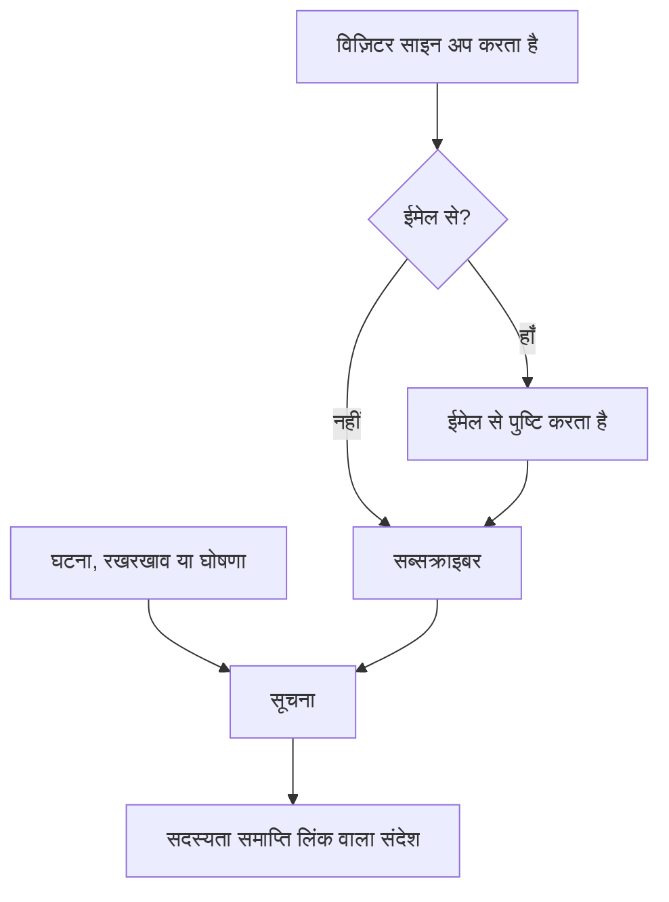

# सब्सक्राइबर और घोषणाएँ

स्थिति पृष्ठ वह जगह है जहाँ लोग जाते हैं। सब्सक्राइबर वे लोग हैं जो वहाँ जाना ही नहीं चाहते: वे आपको एक बार ईमेल पता, फ़ोन नंबर, Slack वेबहुक या HTTP एंडपॉइंट देते हैं, और उसके बाद आपके अपडेट ख़ुद उन तक पहुँचते हैं।

घोषणाएँ इसी काम का दूसरा आधा हिस्सा हैं। मॉनिटर आपके विज़िटर को बता सकता है कि चेकआउट 500 लौटा रहा है; कोई मॉनिटर उन्हें यह नहीं बता सकता कि आप शनिवार को डेटाबेस माइग्रेट कर रहे हैं, कि किसी थर्ड-पार्टी प्रदाता का दिन ख़राब चल रहा है, या कि कल उन्होंने जिस घटना के बारे में पढ़ा था वह पूरी तरह बंद हो चुकी है। घोषणाएँ उन सब बातों के लिए मुक्त-पाठ चैनल हैं जिन्हें आपकी जाँचें नहीं देख सकतीं, और वे उसी सब्सक्राइबर सूची तक पहुँचती हैं।

यह पृष्ठ दोनों को कवर करता है: पाँच सदस्यता चैनल और विज़िटर कैसे साइन अप करते हैं, सब्सक्राइबर किन बातों के बारे में सुनना चुन सकते हैं, डबल ऑप्ट-इन और सदस्यता समाप्त करने के प्रवाह, वह ईमेल रिपोर्ट जो सब्सक्राइबर हर महीने पा सकते हैं, और घोषणाएँ कैसे लिखी, शेड्यूल और टेम्पलेट की जाती हैं।

:::cards
- [सदस्यता चैनल](#सदस्यता-चैनल): वे चैनल जिन पर विज़िटर साइन अप कर सकते हैं, और वह पृष्ठ जिस पर वे साइन अप करते हैं।
- [सब्सक्राइबर को क्या बताया जाता है](#सब्सक्राइबर-को-किन-बातों-की-सूचना-मिलती-है): घोषणाएँ, रखरखाव, घटनाएँ और एपिसोड, और उनमें किए गए संपादन।
- [क्या भेजा गया, यह जाँचें](#क्या-भेजा-गया-यह-जाँचना): हर सूचना की स्थिति, और फिर से प्रयास व फिर से भेजना।
- [घोषणाएँ](#घोषणाएँ): एक या अधिक स्थिति पृष्ठों पर कोई सूचना पोस्ट करें।
:::

## यह कैसे काम करता है



हर स्थिति पृष्ठ के अपने सब्सक्राइबर होते हैं। विज़िटर पृष्ठ के **सदस्यता लें** पृष्ठ पर साइन अप करता है, जहाँ कोई ईमेल पता कुछ भी पाने से पहले एक लिंक से पुष्टि करता है, या आपकी टीम उन्हें डैशबोर्ड पर जोड़ती है। उसके बाद से, पृष्ठ तक पहुँचने वाली हर घटना, अनुसूचित रखरखाव इवेंट और घोषणा उसके सब्सक्राइबर को सूचित करती है, हर एक को उसी चैनल पर जिससे उसने साइन अप किया था, और हर संदेश में सदस्यता रद्द करने वाला लिंक होता है।

## सदस्यता चैनल

एक स्थिति पृष्ठ पाँच चैनलों का समर्थन करता है। ये चैनल, और वह पृष्ठ जिस पर विज़िटर साइन अप करते हैं, एक ही जगह चालू और बंद किए जाते हैं: **स्थिति पृष्ठ → आपका पृष्ठ → सब्सक्राइबर → सब्सक्राइबर सेटिंग्स** पर **चैनल** कार्ड। हर स्विच पलटते ही सहेजा जाता है:

- **सब्सक्राइबर पृष्ठ दिखाएं** (`showSubscriberPageOnStatusPage`): डिफ़ॉल्ट रूप से चालू। स्थिति पृष्ठ की नेविगेशन बार में **सदस्यता लें** आइटम रखता है, जहाँ विज़िटर नीचे दिए चैनलों से साइन अप करते हैं।
- **ईमेल** (`enableEmailSubscribers`): डिफ़ॉल्ट रूप से चालू। बाकी सब तब तक बंद रहते हैं जब तक आप उन्हें चालू न करें।
- **SMS** (`enableSmsSubscribers`): डिफ़ॉल्ट रूप से बंद। OneUptime Cloud पर हर टेक्स्ट का भुगतान प्रोजेक्ट के SMS और कॉल बैलेंस से होता है, जब तक पृष्ठ का अपना **Twilio कॉन्फ़िगरेशन** न हो ([नीचे](#ईमेल-फ़ुटर-कस्टम-smtp-और-twilio) देखें)। इसे चालू करने के लिए प्रोजेक्ट के लिए भी **SMS** चालू होना चाहिए, **प्रोजेक्ट सेटिंग्स > सूचनाएं > सूचना सेटिंग्स** पर **सूचना चैनल** कार्ड में, जो प्रोजेक्ट का मालिक, **Billing Admin** या **Manage Billing** वाला कोई व्यक्ति कर सकता है।
- **Slack** (`enableSlackSubscribers`): डिफ़ॉल्ट रूप से बंद।
- **Microsoft Teams** (`enableMicrosoftTeamsSubscribers`): डिफ़ॉल्ट रूप से बंद।
- **वेबहुक** (`enableWebhookSubscribers`): डिफ़ॉल्ट रूप से बंद।

ये स्विच तय करते हैं कि विज़िटर ख़ुद किस तरह साइन अप कर सकते हैं, और स्थिति पृष्ठ बंद चैनल से साइन-अप अस्वीकार करता है। ये सूचनाएँ नहीं रोकते: आपकी टीम जिन सब्सक्राइबर को डैशबोर्ड पर, API से या किसी वर्कफ़्लो से जोड़ती है, उन्हें अपडेट मिलते हैं, चाहे कोई भी चैनल चालू हो।

OneUptime Cloud पर, जो स्विच आपके प्लान में शामिल नहीं है, उसके बगल में प्लान का नाम होता है: **SMS** और **सब्सक्राइबर पृष्ठ दिखाएं** के लिए **Growth**, **Slack**, **Microsoft Teams** और **वेबहुक** के लिए **Scale**। किसी चैनल को बंद करना हर प्लान पर काम करता है, इसलिए ट्रायल में चालू किया गया चैनल हमेशा फिर से बंद किया जा सकता है; स्विच के नीचे यही लिखा होता है।

हर चैनल की स्थिति पृष्ठ के साइड मेनू में **सब्सक्राइबर** के अंतर्गत अपनी सूची भी होती है: **ईमेल सब्सक्राइबर**, **SMS सब्सक्राइबर**, **Slack सब्सक्राइबर**, **MS Teams सब्सक्राइबर** और **Webhook ग्राहक**। यहीं आप देखते हैं कि किसने साइन अप किया है, किसी को हाथ से जोड़ते हैं, या किसी ख़ास सब्सक्राइबर पर अपने लिए **नोट** (`internalNote`) छोड़ते हैं। जब तक कोई चैनल बंद है, उसकी सूची के ऊपर यही लिखा होता है, और वहीं चैनल का स्विच होता है, ताकि आप सूची छोड़े बिना उसे चालू कर सकें।

**एक स्विच काफ़ी नहीं है।** स्थिति पृष्ठ की नेविगेशन बार में **सदस्यता लें** आइटम केवल तभी दिखता है जब **सब्सक्राइबर पृष्ठ दिखाएं** चालू हो *और* कम से कम एक चैनल चालू हो। अगर आप **ईमेल** चालू करते हैं पर **सब्सक्राइबर पृष्ठ दिखाएं** बंद छोड़ देते हैं, तो विज़िटर के पास फ़ॉर्म तक पहुँचने का कोई रास्ता नहीं होता।

## सदस्यता पृष्ठ पर विज़िटर को क्या दिखता है

**सदस्यता लें** पृष्ठ पर एक उप-मेनू होता है जिसमें हर सक्षम चैनल के लिए एक टैब होता है। हर टैब केवल उतना ही माँगता है जितना ज़रूरी है:

| टैब | पता | शीर्षक | यह क्या माँगता है |
| --- | --- | --- | --- |
| **ईमेल** | `/subscribe/email` | **ईमेल द्वारा सदस्यता लें** | **आपका ईमेल**, प्लेसहोल्डर `subscriber@company.com` के साथ। |
| **एसएमएस** | `/subscribe/sms` | **एसएमएस द्वारा सदस्यता लें** | **आपका फ़ोन नंबर**, प्लेसहोल्डर `+11234567890` के साथ। |
| **Slack** | `/subscribe/slack` | **Slack द्वारा सदस्यता लें** | **Slack कार्यक्षेत्र का नाम** (सत्यापन के लिए) और **Slack इनकमिंग वेबहुक URL**, प्लेसहोल्डर `https://hooks.slack.com/services/...` के साथ। |
| **MS Teams** | `/subscribe/microsoft-teams` | **Microsoft Teams द्वारा सदस्यता लें** | **Microsoft Teams कार्यक्षेत्र का नाम** और **Microsoft Teams इनकमिंग वेबहुक URL**, प्लेसहोल्डर `https://outlook.office.com/webhook/...` के साथ। |
| **वेबहुक** | `/subscribe/webhooks` | **वेबहुक के माध्यम से सदस्यता लें** | **वेबहुक URL**, प्लेसहोल्डर `https://example.com/webhook` के साथ। हर स्थिति पृष्ठ इवेंट पर इसे एक JSON `POST` अनुरोध भेजा जाता है। |

सबमिट बटन पर **सदस्यता लें** लिखा होता है। SMS, Slack, Microsoft Teams या वेबहुक से साइन-अप करने पर यह दिखता है: *आपने सफलतापूर्वक सदस्यता ले ली है।* ईमेल से साइन-अप करने पर बताया जाता है कि पुष्टि लिंक भेज दिया गया है, और न मिलने पर स्पैम फ़ोल्डर देखने को कहा जाता है ([ईमेल का डबल ऑप्ट-इन](#ईमेल-का-डबल-ऑप्ट-इन) देखें)। **ईमेल**, **एसएमएस**, **Slack** और **MS Teams** टैब में **नई सदस्यता** / **मौजूदा सदस्यता प्रबंधित करें** का विकल्प भी होता है, ताकि जिसने पहले से सदस्यता ली है वह कोई पुराना संदेश खोजे बिना अपनी प्राथमिकताओं पर लौट सके।

## सब्सक्राइबर को संसाधन और इवेंट प्रकार चुनने देना

डिफ़ॉल्ट रूप से सब्सक्राइबर को पृष्ठ की हर चीज़ मिलती है। **उन्नत सब्सक्राइबर सेटिंग्स** कार्ड के दो टॉगल इसे बदलते हैं:

- **सब्सक्राइबर्स को संसाधन चुनने दें** (`allowSubscribersToChooseResources`): डिफ़ॉल्ट रूप से बंद। इसे चालू करने पर सदस्यता फ़ॉर्म में **सभी संसाधनों की सदस्यता लें** टॉगल आ जाता है; उसे हटाने पर **सदस्यता के लिए संसाधन चुनें** दिखता है ताकि विज़िटर अलग-अलग संसाधन चुन सके।
- **सब्सक्राइबर्स को इवेंट प्रकार चुनने दें** (`allowSubscribersToChooseEventTypes`): डिफ़ॉल्ट रूप से बंद। वैसा ही ढाँचा: एक **सभी प्रकार के कार्यक्रमों की सदस्यता लें** टॉगल, और उसे हटाने पर उसके नीचे **सदस्यता के लिए कार्यक्रम प्रकार चुनें**।

इनमें से किसी के भी चालू होने पर सदस्यता फ़ॉर्म एक ही पृष्ठ रहता है। अपडेट कहाँ भेजने हैं (ईमेल पता, फ़ोन नंबर, कार्यक्षेत्र या वेबहुक) उसके नीचे **प्राथमिकताएँ** आता है, जो एक पंक्ति में मुड़ा होता है जो बताती है कि विज़िटर को क्या मिलेगा। हर संसाधन और हर तरह का इवेंट पहले से चुना होता है, इसलिए यह "आपको इस स्थिति पृष्ठ के सभी अपडेट मिलेंगे।" से शुरू होता है, और जो विज़िटर सब कुछ चाहता है वह इसे खोले बिना **सदस्यता लें** दबा देता है। बाकी लोग **प्राथमिकताएँ** खोलकर संसाधनों या इवेंट प्रकारों को सीमित करते हैं; फिर से मोड़ने पर पंक्ति उनके चुनाव के हिसाब से बदल जाती है ("आपको केवल आपके चुने हुए संसाधनों के अपडेट मिलेंगे।")। दोनों बंद होने पर कोई **प्राथमिकताएँ** नहीं होती: फ़ॉर्म में बस अपडेट भेजने की जगह होती है, फिर **सदस्यता लें**।

**सदस्यता अपडेट करें** पृष्ठ (नीचे देखें) वही विकल्प खुले हुए दिखाता है, क्योंकि सब्सक्राइबर वहाँ इन्हें बदलने ही जाता है।

इवेंट प्रकार `Incident`, `Announcement` और `Scheduled Event` हैं।

**मॉनिटर समूह अपने हर मॉनिटर का प्रतिनिधित्व करता है।** पृष्ठ पर कोई संसाधन या तो मॉनिटर होता है या मॉनिटर समूह, और जो सब्सक्राइबर किसी मॉनिटर समूह को चुनता है, उसे समूह के किसी भी मॉनिटर की घटनाओं, अनुसूचित रखरखाव इवेंट (उनके नोट सहित) और घोषणाओं की सूचना ठीक वैसे ही मिलती है जैसे उसने वह मॉनिटर चुना हो, और स्थिति पृष्ठ भी उन्हें इसी तरह दिखाता है। जिसने केवल दूसरे संसाधन चुने हैं उसे नहीं बताया जाता, और जिसने कोई मॉनिटर और उसे रखने वाला समूह दोनों चुने हैं उसे दो नहीं, एक सूचना मिलती है।

ये चुनाव सब्सक्राइबर रिकॉर्ड पर **Is Subscribed to All Resources** (`isSubscribedToAllResources`, डिफ़ॉल्ट true), **Is Subscribed to All Event Types** (`isSubscribedToAllEventTypes`, डिफ़ॉल्ट true), **Subscribed to Resources** और **Subscribed to Event Types** के रूप में दर्ज होते हैं।

**सब्सक्राइबर अपने ही पृष्ठ के संसाधनों में से चुनता है।** **Subscribed to Resources** सब्सक्राइबर के अपने स्थिति पृष्ठ के संसाधनों को नाम देता है, चाहे इसे कोई भी लिखे: पृष्ठ पर कोई विज़िटर, डैशबोर्ड पर कोई साथी, कोई API कुंजी या कोई वर्कफ़्लो। विज़िटर वही चुनता है जो पृष्ठ उसे दिखाता है, इसलिए जिस संसाधन का मॉनिटर संग्रहीत है और जिसे पृष्ठ छिपाता है, उसे वह नहीं चुन सकता। किसी दूसरे स्थिति पृष्ठ का संसाधन, या जिसे पृष्ठ विज़िटर से छिपाता है, वह उसी `400` से अस्वीकार किया जाता है जो फ़ील्ड और ID का नाम लेता है, जैसे कोई ID जो किसी से मेल नहीं खाती। कोई बदलाव केवल उन्हीं संसाधनों के बारे में पूछता है जिन्हें वह जोड़ता है, इसलिए कोई सदस्यता उस संसाधन को बनाए रखती है जिसका वह पहले से नाम लेती है, जैसे वह जिसका मॉनिटर चुने जाने के बाद संग्रहीत हुआ हो। सब्सक्राइबर को किसी इवेंट के बारे में केवल अपने पृष्ठ के संसाधनों के ज़रिए बताया जाता है।

किसके लिए अच्छा है: कई उत्पादों को कवर करने वाला पृष्ठ। जो ग्राहक केवल आपका API इस्तेमाल करता है, वह हर बार मार्केटिंग साइट के डगमगाने पर सूचना नहीं चाहता; उन्हें पूरी तरह सदस्यता समाप्त करते देखने के बजाय, उन्हें ख़ुद सूची छोटी करने दें।

उसी कार्ड में **सब्सक्राइबर टाइमज़ोन** भी है।

## ईमेल का डबल ऑप्ट-इन

ईमेल सब्सक्राइबर हमेशा पुष्टि करते हैं। जब कोई सब्सक्राइबर ईमेल पते के साथ बनाया जाता है और पहले से पुष्ट रूप में नहीं बनाया गया होता, तो **Is Subscription Confirmed** (`isSubscriptionConfirmed`) को ज़बरदस्ती `false` किया जाता है और छह अंकों का **Subscription Confirmation Token** बनाया जाता है। फिर OneUptime `{statusPageUrl}/confirm-subscription/{statusPageSubscriberId}?verification-token={token}` जैसे रूप वाला पुष्टि लिंक ईमेल करता है। विज़िटर **सदस्यता की पुष्टि करें** पृष्ठ पर पहुँचता है और, पुष्टि हो जाने पर, उसे *सदस्यता की पुष्टि सफलतापूर्वक हो गई* दिखता है।

SMS, Slack, Microsoft Teams और वेबहुक सब्सक्राइबर यह चरण छोड़ देते हैं: वे `isSubscriptionConfirmed` पहले से `true` के साथ बनाए जाते हैं। आपकी टीम जिन ईमेल सब्सक्राइबर को **ईमेल सब्सक्राइबर** पर जोड़ती है, वे भी: वहाँ **पुष्टिकरण लिंक न भेजें** डिफ़ॉल्ट रूप से चालू होता है। पते से साइन-अप की तरह पुष्टि करवाने के लिए इसे बंद करें।

**अपुष्ट का मतलब है चुप्पी।** किसी सूचना के लिए सब्सक्राइबर लाने वाली क्वेरी `isUnsubscribed: false` और `isSubscriptionConfirmed: true` पर फ़िल्टर करती है। जिस ईमेल पते ने कभी लिंक पर क्लिक नहीं किया, वह आपकी **ईमेल सब्सक्राइबर** सूची में बैठा रहेगा और उसे कुछ नहीं मिलेगा। अगर कोई कसम खाकर कहे कि उसने सदस्यता ली है पर उसे कुछ नहीं मिलता, तो सबसे पहले वही कॉलम देखें।

ईमेल पुष्टि बंद करने का कोई टॉगल नहीं है: स्थिति पृष्ठ से साइन अप करने वाले हर व्यक्ति के लिए यह बिना शर्त लागू है। हर सब्सक्राइबर का एक अलग कॉलम, **Send You Have Subscribed Message** (`sendYouHaveSubscribedMessage`, डिफ़ॉल्ट true), सब्सक्राइबर की पुष्टि हो जाने पर जाने वाले "आपने सदस्यता ली है" ईमेल को नियंत्रित करता है।

## सदस्यता प्रबंधित करना और रद्द करना

सब्सक्राइबर को मिलने वाले हर संदेश में `{statusPageUrl}/unsubscribe/{statusPageSubscriberId}-{token}` जैसे रूप वाला सदस्यता समाप्ति लिंक होता है: ईमेल के नीचे, SMS, Slack या Microsoft Teams संदेश के टेक्स्ट में, और वेबहुक पेलोड में `unsubscribeUrl` के रूप में। टोकन उसी एक सदस्यता का एक यादृच्छिक रहस्य है, इसलिए लिंक बिना साइन इन किए काम करता है। यह निजी स्थिति पृष्ठ पर भी लागू है, जहाँ बाकी हर चीज़ के लिए साइन इन किया हुआ विज़िटर चाहिए।

एकमात्र अपवाद **public** स्थिति पृष्ठ से आया SMS है, जिसमें इसके बजाय सब्सक्राइबर का **सदस्यता अपडेट करें** लिंक होता है (नीचे देखें)। वह पृष्ठ सार्वजनिक स्थिति पृष्ठ पर बिना साइन इन किए काम करता है, और उसका लिंक 57 अक्षर छोटा है। SMS का बिल 160 अक्षरों के खंड के हिसाब से बनता है, इसलिए लंबा लिंक ज़्यादातर डिफ़ॉल्ट टेक्स्ट को एक और खंड में डाल देता। कस्टम SMS टेम्पलेट का `{{unsubscribeUrl}}` भी इसी नियम का पालन करता है। निजी स्थिति पृष्ठ से आए SMS में सदस्यता समाप्ति लिंक होता है।

SMS लॉग (स्थिति पृष्ठ पर और प्रोजेक्ट की सेटिंग्स में **सूचना लॉग** का **SMS** टैब) हर SMS का टेक्स्ट रखता है, और उसे सब्सक्राइबर प्रबंधित करने वालों से ज़्यादा प्रोजेक्ट सदस्य पढ़ सकते हैं। इसलिए लॉग सदस्यता समाप्ति लिंक को उसके टोकन की जगह `[redacted]` के साथ दिखाता है, जैसे `{statusPageUrl}/unsubscribe/{statusPageSubscriberId}-[redacted]`। काम करने वाला लिंक केवल सब्सक्राइबर के अपने फ़ोन को मिलता है। नए सब्सक्राइबर का टोकन API भी कभी नहीं लौटाता, उस अनुरोध के जवाब में भी नहीं जिसने उसे बनाया।

**लिंक खोलने से कुछ नहीं बदलता।** पृष्ठ स्थिति पृष्ठ का नाम और लोगो और वह सदस्यता दिखाता है जिसका लिंक है: पूरा ईमेल पता, आख़िरी चार अंकों तक छिपाया गया फ़ोन नंबर, Slack या Microsoft Teams कार्यक्षेत्र का नाम, या वेबहुक का होस्ट। यह पूछता है: *क्या आप इस स्थिति पृष्ठ से सूचनाएँ पाना बंद करना चाहते हैं?* और केवल **सदस्यता समाप्त करें** दबाने पर ही सदस्यता रद्द होती है, इसलिए संदेश के हर लिंक को खोलने वाले मेल स्कैनर और लिंक प्रीव्यूअर किसी की सदस्यता समाप्त नहीं कर सकते। पृष्ठ के बारे में और कुछ नहीं दिखाया जाता, और उसका कोई कस्टम JavaScript नहीं चलता। दो बार पुष्टि करना, या पहले से रद्द सदस्यता का लिंक खोलना, बस यह बताता है कि वह रद्द है। सार्वजनिक स्थिति पृष्ठ पर, सदस्यता समाप्ति पृष्ठ सब्सक्राइबर के **सदस्यता अपडेट करें** पृष्ठ से भी जुड़ता है, ताकि वह इसके बजाय चुन सके कि उसे कौन-सी सूचनाएँ मिलें।

**सदस्यता अपडेट करें** पृष्ठ, `{statusPageUrl}/update-subscription/{statusPageSubscriberId}`, का शीर्षक **सदस्यता अपडेट करें** है और यह विज़िटर को बताता है कि वह वहाँ अपनी प्राथमिकताएँ अपडेट कर सकता है या सदस्यता समाप्त कर सकता है। इसमें होते हैं:

- पृष्ठ जो भी संसाधन और इवेंट-प्रकार चुनने वाले विकल्प देता है।
- एक **सदस्यता समाप्त करें** टॉगल, जिसे सभी संसाधनों की सदस्यता समाप्त करने के रूप में बताया गया है। यह **सदस्यता समाप्त है** (`isUnsubscribed`, डिफ़ॉल्ट false) लिखता है।
- **सदस्यता अपडेट करें** लिखा एक सबमिट बटन; सहेजने पर यह दिखता है: *आपके परिवर्तन सहेजे गए हैं।*

निजी स्थिति पृष्ठ पर इसके लिए, पृष्ठ के बाकी हिस्से की तरह, साइन इन किया हुआ विज़िटर चाहिए। जिसने लिंक खो दिया है, वह **सदस्यता लें** पृष्ठ पर **मौजूदा सदस्यता प्रबंधित करें** इस्तेमाल करके **प्रबंधन लिंक भेजें** दबाता है। लिंक ख़ुद सदस्यता को जाता है (उसके ईमेल पते, उसके फ़ोन नंबर, या उसके Slack या Microsoft Teams चैनल पर), अनुरोध में दिए किसी पते पर कभी नहीं, और पृष्ठ हर हाल में एक जैसा जवाब देता है चाहे कोई सदस्यता मेल खाई हो या नहीं, इसलिए इससे यह पता नहीं लगाया जा सकता कि किसने सदस्यता ली है। वह संदेश **सदस्यता अपडेट करें** पृष्ठ से जुड़ता है, और कस्टम टेम्पलेट को दोनों लिंक देता है: `manageSubscriptionUrl` और `unsubscribeUrl`।

इस सबके पीछे के एंडपॉइंट हैं `POST .../subscribe/:statusPageId`, `POST .../manage-subscription/:statusPageId`, `POST .../get-subscription/:statusPageId/:subscriberId`, `PUT .../update-subscription/:statusPageId/:subscriberId`, और `GET` और `POST .../unsubscribe/:statusPageId/:subscriberId/:token`। सदस्यता समाप्ति का `GET` केवल लिंक का वर्णन करता है। `POST` अपनी बॉडी चाहे जो हो, सदस्यता रद्द करता है, एक-क्लिक सदस्यता समाप्ति अनुरोध की `List-Unsubscribe=One-Click` बॉडी सहित। दोनों ग़लत टोकन, हटाए गए सब्सक्राइबर और किसी दूसरे स्थिति पृष्ठ के सब्सक्राइबर के लिए एक जैसा जवाब देते हैं, इसलिए इनसे यह पता नहीं लगाया जा सकता कि किसने सदस्यता ली है।

सदस्यता समाप्त करना कोई पंक्ति मिटाने के बजाय एक फ़्लैग पलटता है, इसलिए रिकॉर्ड **सदस्यता समाप्त है** सेट के साथ चैनल सूची में बना रहता है, जो तब काम आता है जब बाद में आपको समझाना हो कि किसी ख़ास पते को मेल मिलना क्यों बंद हुआ। यह **अनसब्सक्राइब किया गया** (`unsubscribedAt`) भी दर्ज करता है, चाहे सदस्यता किसी ने भी रद्द की हो: लिंक या **सदस्यता अपडेट करें** पृष्ठ से सब्सक्राइबर ने, या डैशबोर्ड पर या API से किसी साथी ने। हर सब्सक्राइबर सूची में **अनसब्सक्राइब किया गया** कॉलम और फ़िल्टर होता है। **सदस्यता समाप्त है** को फिर से बंद करने पर यह साफ़ हो जाता है। जो सदस्यताएँ OneUptime के यह दर्ज करने से पहले रद्द हुईं, उनकी कोई तारीख़ नहीं है।

सदस्यता समाप्ति पृष्ठ आने से पहले भेजे गए संदेशों के लिंक काम करते रहते हैं: **सदस्यता अपडेट करें** लिंक अब भी वही पृष्ठ खोलता है। बहुत पुराने संदेशों में `/api/status-page-subscriber/unsubscribe/{statusPageSubscriberId}` होता था, जो खुलते ही सदस्यता समाप्त कर देता था। अब यह कुछ नहीं बदलता: यह सदस्यता समाप्ति पृष्ठ पर ले जाता है, जो बताता है कि लिंक पुराना है और किसी हाल के संदेश वाला लिंक इस्तेमाल करें।

### साझा पते और मेलिंग सूचियाँ

जो कोई किसी मेलबॉक्स को पढ़ सकता है, वह उसकी सदस्यता समाप्त कर सकता है। जिस पते से किसी ने ख़ुद साइन अप किया हो, उसके लिए यही मक़सद है। आपकी टीम द्वारा जोड़े गए पते के लिए, जैसे `site03-all@` जैसी किसी साइट की मेलिंग सूची, इसका मतलब है कि एक पाठक अगले आउटेज से पहले सूची के हर व्यक्ति को पृष्ठ से हटा सकता है। इसलिए:

- **जहाँ हो सके, लोगों को उनके अपने पते से जोड़ें।** **थोक में जोड़ें** फ़ॉर्म और ईमेल सब्सक्राइबर फ़ॉर्म ईमेल फ़ील्ड के विवरण में यही कहते हैं।
- **टीम को बताया जाता है।** आपकी टीम द्वारा जोड़ा गया सब्सक्राइबर वह है जिसे डैशबोर्ड से, किसी API कुंजी से (REST API, Terraform, कोई स्क्रिप्ट) या किसी वर्कफ़्लो ने जोड़ा हो; API इसे **Is Added By Team** (`isAddedByTeam`) के रूप में पढ़ता है। जब ऐसा कोई सब्सक्राइबर अपने लिंक या **सदस्यता अपडेट करें** पृष्ठ से सदस्यता समाप्त करता है, तो स्थिति पृष्ठ के हर मालिक (उसके मालिक उपयोगकर्ता, और उसकी मालिक टीमों के सदस्य) को एक ईमेल मिलता है जिसमें सब्सक्राइबर का नाम और पृष्ठ की सब्सक्राइबर सूची का लिंक होता है। अगर किसी साथी ने उसे जोड़ा था, तो उस साथी को भी। जिस पृष्ठ का कोई मालिक नहीं, वह केवल उसी साथी को ईमेल करता है, इसलिए किसी API कुंजी या वर्कफ़्लो द्वारा बिना मालिक वाले पृष्ठ पर जोड़े गए सब्सक्राइबर की रिपोर्ट नहीं होती। जिन लोगों ने स्थिति पृष्ठ पर ख़ुद साइन अप किया, उनकी कभी रिपोर्ट नहीं होती। OneUptime के यह दर्ज करने से पहले किसी API कुंजी या वर्कफ़्लो द्वारा जोड़े गए सब्सक्राइबर को साइन-अप से अलग नहीं पहचाना जा सकता, और उनकी भी रिपोर्ट नहीं होती।
- **सब्सक्राइबर सूचियाँ इसे दिखाती हैं।** हर सूची के ऊपर एक सूचना आपकी टीम द्वारा जोड़े गए उन सब्सक्राइबर का नाम लेती है जिन्होंने पिछले 30 दिनों में सदस्यता समाप्त की।

सदस्यता समाप्ति पृष्ठ ऐसी सदस्यता के पाठक को पुष्टि करने से पहले चेतावनी देता है: अगर यह कोई साझा पता है, तो सदस्यता समाप्त करने से उसे पाने वाले हर व्यक्ति की सूचनाएँ बंद हो जाती हैं, और टीम को बताया जाएगा।

## सब्सक्राइबर को किन बातों की सूचना मिलती है

सब्सक्राइबर ऊपर दिए तीन इवेंट प्रकारों के बारे में सुनते हैं, पर हर स्रोत का अपना स्विच है, इसलिए कुछ भी ग़लती से नहीं भेजा जाता।

### घोषणा की सूचनाएँ

घोषणा अपने साथ **Should subscribers be notified?** (`shouldStatusPageSubscribersBeNotified`) रखती है, जो बनाने वाले फ़ॉर्म पर **अनुसूची और सूचनाएँ** के अंतर्गत **स्थिति पृष्ठ ग्राहकों को सूचित करें** चेकबॉक्स के रूप में दिखता है, और डिफ़ॉल्ट रूप से चालू है। सब्सक्राइबर को एक बार बताया जाता है, जब घोषणा दिखनी शुरू होती है, इसलिए यह घोषणा बनाते समय तय होता है; संपादन इसे नहीं बदल सकता। जो वर्कफ़्लो इसे बाद में लिखता है, वह केवल इसे सहेजता है: इसे बिना बदले वापस लिखने से घोषणा फिर कभी नहीं भेजी जाती, इसे चालू करने से यह नहीं भेजी जाती, और सूचना जाने से पहले इसे बंद करने से सूचना छोड़ दी जाती है। अगर घोषणा **प्रभावित मॉनिटर** के अंतर्गत मॉनिटर का नाम लेती है, तो सूचना उन्हीं मॉनिटर तक सीमित होती है: जिस पृष्ठ पर सब्सक्राइबर संसाधन चुनते हैं, वहाँ यह उन मॉनिटर के, उन्हें रखने वाले मॉनिटर समूहों के, और हर संसाधन के सब्सक्राइबर तक जाती है। इसे ख़ाली छोड़ें और सभी सब्सक्राइबर को सूचित किया जाता है। जो स्थिति पृष्ठ उन मॉनिटर में से किसी को भी सीधे या किसी समूह के ज़रिए सूचीबद्ध नहीं करता, वहाँ घोषणा उस पृष्ठ को पढ़ने वाले हर व्यक्ति के लिए है, इसलिए वहाँ घोषणाएँ पाने वाले हर सब्सक्राइबर को सूचित किया जाता है।

### अनुसूचित रखरखाव इवेंट

अनुसूचित रखरखाव इवेंट के अपने सब्सक्राइबर कॉलम होते हैं: **Should subscribers be notified when event is created?**, **Should subscribers be notified when event is changed to ongoing?**, **Should subscribers be notified when event is changed to ended?**, साथ ही अग्रिम चेतावनी के लिए **Subscriber notifications before the event** और **Next subscriber notification before the event at?**। इवेंट पर **स्थिति पृष्ठ** तय करता है कि यह किन पृष्ठों पर दिखे, और **Should be visible on status page?** तय करता है कि यह दिखे भी या नहीं।

**अनुसूचित रखरखाव इवेंट बनाएँ** दो चरणों से गुज़रता है, फिर एक समीक्षा, ठीक वैसे ही जैसे **घटना घोषित करें**:

1. **इवेंट**: **शीर्षक**, **विवरण**, **शुरू होता है** और **समाप्त होता है**। नया इवेंट आपकी घड़ी पर अगले पूरे घंटे से शुरू होता है और एक घंटा चलता है; समय केवल तभी बदलें जब वे ग़लत हों। **शुरू होता है** को खिसकाने पर **समाप्त होता है** भी उसके साथ खिसकता है, ताकि अवधि की लंबाई बनी रहे, और इवेंट को शुरू होने के बाद ख़त्म होना चाहिए। **मालिक** और **लेबल** **और फ़ील्ड** के अंतर्गत इंतज़ार करते हैं।
2. **प्रभावित संसाधन**: पहले **मॉनिटर**, फिर कोई मॉनिटर चुने जाने पर उनके ठीक नीचे **मॉनिटर स्थिति बदलकर करें**: इवेंट शुरू होने पर मॉनिटर उस स्थिति में बदल जाते हैं, और ख़त्म होने पर वापस चालू स्थिति में। फिर **अन्य प्रभावित संसाधन**: होस्ट, क्लस्टर, कंटेनर होस्ट, डेटाबेस, IoT फ़्लीट, नेटवर्क साइट और सेवाएँ जिन्हें रखरखाव छूता है। फिर **इन स्थिति पृष्ठों पर इवेंट दिखाएं**, फिर **सब्सक्राइबर सूचनाएँ**, जो एक पंक्ति में मुड़ा होता है जो बताती है कि क्या होगा। डिफ़ॉल्ट रूप से इसमें लिखा होता है "इवेंट के स्थिति पृष्ठों के सब्सक्राइबर्स को उसके शेड्यूल होने पर, शुरू होने पर और समाप्त होने पर सूचित किया जाता है।" इसे खोलकर **जब इवेंट शेड्यूल होता है**, **जब इवेंट शुरू होता है**, **जब इवेंट समाप्त होता है** और **इवेंट से पहले रिमाइंडर** बदलें; पंक्ति आपके चुनाव के हिसाब से बदलती है, और समीक्षा चरण भी इसे दिखाता है।

किसी होस्ट, किसी Kubernetes, Proxmox, Ceph या Docker Swarm क्लस्टर, किसी Docker या Podman होस्ट, किसी vCenter, किसी स्टोरेज ऐरे, किसी IoT फ़्लीट, किसी डेटाबेस, किसी सेवा या किसी नेटवर्क साइट के **अनुसूचित रखरखाव** टैब से, **अनुसूचित रखरखाव इवेंट बनाएँ** (और **टेम्पलेट से बनाएँ**) वही फ़ॉर्म खोलता है जिसमें वह संसाधन **अन्य प्रभावित संसाधन** के अंतर्गत पहले से चुना होता है, और ब्रेडक्रम्ब उसी टैब पर वापस ले जाते हैं। किसी इन्वेंटरी आइटम का **अनुसूचित रखरखाव** टैब वह होस्ट, सेवा या Kubernetes क्लस्टर चुनता है जिसकी ओर आइटम इंगित करता है, और ब्रेडक्रम्ब उस संसाधन के टैब से होकर वापस जाते हैं।

केवल शीर्षक टाइप करना होता है: बाकी हर चीज़ का डिफ़ॉल्ट है, इसलिए **अगला** बिना कुछ माँगे बाकी चरणों से गुज़रता है, और **अनुसूचित रखरखाव इवेंट बनाएँ** अंत में समीक्षा पर होता है। जब तक आप कोई स्थिति पृष्ठ नहीं चुनते, किसी को सूचित नहीं किया जाता। तीनों **जब इवेंट…** सेटिंग्स इवेंट बनाते समय चुनी जाती हैं, और जो वर्कफ़्लो बाद में **जब इवेंट शेड्यूल होता है** लिखता है, वह केवल इसे सहेजता है: बिना बदले वापस लिखने या चालू करने पर यह कुछ नहीं भेजता, और 'शेड्यूल' सूचना जाने से पहले बंद करने पर वह सूचना छोड़ दी जाती है। इवेंट के **Maintenance Details** कार्ड पर **संपादित करें** बटन उसका शीर्षक, अवधि और लेबल (**इवेंट**) और उसके स्थिति पृष्ठ और रिमाइंडर (**स्थिति पृष्ठ**) बदलता है। उसके **प्रभावित संसाधन** कार्ड पर **संपादित करें** बटन फ़ॉर्म की तरह ही पूछता है: **मॉनिटर**, फिर कोई मॉनिटर होने पर **मॉनिटर स्थिति बदलकर करें**, फिर **अन्य प्रभावित संसाधन**, और कार्ड मॉनिटर के नीचे स्थिति दिखाता है। जो इवेंट संपादित कर सकता है, वह इवेंट शुरू होने तक उसकी मॉनिटर स्थिति बदल सकता है। जब यह शुरू होता है (अपने शुरुआती समय पर, या जब कोई इसे हाथ से, Slack या Microsoft Teams से, या API से चालू स्थिति में ले जाता है), तो इसके मॉनिटर उस स्थिति में बदल जाते हैं जो उस पल इसके पास है, और इसके चलते समय जोड़े गए मॉनिटर भी। इसे **Scheduled** से सीधे आपकी अपनी किसी स्थिति में ले जाना जो **Ongoing** और **Ended** के बीच रखी है, जैसे "Verifying", इसे उसी तरह शुरू करता है: इसके मॉनिटर इसकी स्थिति में बदल जाते हैं, जैसे **Ongoing** में बदलते, और ख़त्म होने पर वापस चालू स्थिति में आ जाते हैं। उसके बाद से स्थिति बदली नहीं जा सकती: कार्ड का **संपादित करें** इसे केवल-पढ़ने के रूप में दिखाता है, "इवेंट शुरू हो चुका है, इसलिए इसे अब बदला नहीं जा सकता।" के साथ, और API "Change Monitor Status to can no longer be changed: this event has already started." के साथ बदलाव अस्वीकार करता है। इवेंट के पास पहले से मौजूद स्थिति को वापस लिखना अब भी स्वीकार किया जाता है। अनुसूचित रखरखाव टेम्पलेट (**सेटिंग्स → इवेंट टेम्पलेट**) वही चरण इस्तेमाल करते हैं, आगे टेम्पलेट के नाम और अंत में उसकी आवर्ती अनुसूची के साथ। टेम्पलेट **मॉनिटर स्थिति बदलकर करें** पूछता है चाहे वह मॉनिटर का नाम ले या नहीं, क्योंकि उसकी स्थिति उन मॉनिटर पर भी लागू होती है जो उससे इवेंट शेड्यूल करते समय चुने जाते हैं। किसी मौजूदा टेम्पलेट का **प्रभावित संसाधन** कार्ड उसी तरह पूछता है और टेम्पलेट द्वारा चुनी गई स्थिति दिखाता है, या कोई न चुनने पर यह दिखाता है: **मॉनिटर अपनी स्थिति बनाए रखते हैं।** जो टेम्पलेट संपादित कर सकता है, वह इसे वहीं बदल सकता है।

**कौन-से स्थिति पृष्ठ?** जैसे ही इवेंट मॉनिटर का नाम लेता है, उन्हें दिखाने वाले स्थिति पृष्ठ **इन स्थिति पृष्ठों पर इवेंट दिखाएं** के अंतर्गत सुझाए जाते हैं: "प्रभावित मॉनिटर दिखाने वाले स्थिति पृष्ठ:" और उसके बाद हर पृष्ठ का नाम। किसी नाम पर क्लिक करके वह पृष्ठ जोड़ें, या सभी को जोड़ने के लिए **सभी जोड़ें**। वह पृष्ठ गिना जाता है जो किसी मॉनिटर को सीधे या किसी मॉनिटर समूह के ज़रिए सूचीबद्ध करता है। केवल वही स्थिति पृष्ठ सुझाए जाते हैं जिन्हें आप देख सकते हैं, और संग्रहीत पृष्ठ और अनुसूचित रखरखाव इवेंट न दिखाने वाले पृष्ठ छोड़ दिए जाते हैं। आपके लिए कुछ नहीं चुना जाता: आपका चुना हुआ स्थिति पृष्ठ इवेंट दिखाता है और, डिफ़ॉल्ट सूचनाओं के साथ, अपने सब्सक्राइबर को बताता है, इसलिए यह आपका ही चुनाव रहता है। इवेंट के **संपादित करें** का **स्थिति पृष्ठ** चरण और अनुसूचित रखरखाव टेम्पलेट के फ़ॉर्म भी इवेंट या टेम्पलेट के मॉनिटर से इसी तरह सुझाते हैं।

**आपकी अपनी स्थितियाँ।** कोई इवेंट **Ongoing** में, और **Ongoing** और **Ended** के बीच रखी आपकी हर अपनी स्थिति में चल रहा होता है, जैसे "Verifying" चरण। **Ongoing** से पहले रखी आपकी अपनी स्थिति अभी शुरू नहीं हुई है, और **Ended** के बाद रखी स्थिति ("Reviewing") ख़त्म हो चुकी है। जो कुछ भी पूछता है कि कोई इवेंट चल रहा है या नहीं, वह यही एक नियम पूछता है। ऐसा इवेंट अपने स्थिति पृष्ठों पर (अवलोकन पर, इवेंट के अपने पृष्ठ पर और RSS फ़ीड में) चल रहा दिखाया जाता है, और **अनुसूचित रखरखाव** और **मुख्य पृष्ठ** के अंतर्गत **Ongoing** सूचियों में, उनके मेनू बैज में और **मुख्य पृष्ठ** पर **चल रहा रखरखाव** टाइल में भी, और Microsoft Teams ऐप इसे चल रहे रखरखाव के रूप में सूचीबद्ध करता है। इसके मॉनिटर रखरखाव में रहते हैं, जिन नेटवर्क साइटों और टेलीमेट्री सीरीज़ को यह कवर करता है वे शांत रहती हैं, और इसके मॉनिटर पर SLO बर्न-रेट अलर्ट रोके रहते हैं। अपने **समाप्त होता है** पर यह उसी तरह ख़त्म होता है जैसे कोई चल रहा इवेंट, और **जब इवेंट समाप्त होता है** चालू होने पर इसके सब्सक्राइबर को बताया जाता है। इसे **Ongoing** या "Verifying" से सीधे **Ended** के बाद रखी आपकी किसी अपनी स्थिति में ले जाना इसे **Ended** की तरह ख़त्म करता है: इसके मॉनिटर वापस चालू स्थिति में आते हैं, और इवेंट का हेडर दिखाता है कि इसमें कितना समय लगा। इसे **Ongoing** से "Verifying" में, या **Ended** से "Reviewing" में ले जाने से कुछ भी फिर से शुरू या ख़त्म नहीं होता। किसी स्थिति का स्थान **अनुसूचित रखरखाव → सेटिंग्स** के अंतर्गत **इवेंट स्थिति** पृष्ठ की सूची में उसका स्थान है।

**शुरू होने का इंतज़ार, ख़त्म और पूरा।** वही स्थान बाकी बातें भी बताता है। कोई इवेंट **Scheduled** में, और **Scheduled** और **Ongoing** के बीच रखी आपकी हर अपनी स्थिति में, अपने **शुरू होता है** का इंतज़ार करता है, जैसे "Confirmed" चरण। अपने शुरुआती समय पर यह वहाँ से उसी तरह शुरू होता है जैसे **Scheduled** से: यह **Ongoing** में जाता है, इसके मॉनिटर इसके **मॉनिटर स्थिति बदलकर करें** में बदल जाते हैं, इसके मालिकों को बताया जाता है, और **जब इवेंट शुरू होता है** चालू होने पर इसके सब्सक्राइबर को भी। तब तक यह आने वाले इवेंट में सूचीबद्ध रहता है (इसके स्थिति पृष्ठों के अवलोकन, निर्धारित कार्यक्रम पृष्ठ और RSS फ़ीड पर, और जब कोई Microsoft Teams ऐप से अनुसूचित रखरखाव के बारे में पूछता है), और इवेंट से पहले के रिमाइंडर इसके सब्सक्राइबर को जाते रहते हैं। इसकी फ़ीड और इसके स्थिति पृष्ठ की टाइमलाइन ऐसी स्थिति को उसी घड़ी के साथ दिखाती हैं जो वे **Scheduled** के लिए दिखाती हैं। **Scheduled** से पहले रखी आपकी अपनी स्थिति ("Draft" या कोई अनुमोदन चरण) भी शुरू नहीं हुई है, पर किसी व्यक्ति का इंतज़ार करती है: वहाँ समय होने पर भी कुछ भी इवेंट को शुरू नहीं करता, और यह आने वाले के रूप में सूचीबद्ध नहीं होता। कोई इवेंट **Ended** में, **Completed** में और **Ended** के बाद रखी आपकी हर अपनी स्थिति में ख़त्म हो चुका होता है, और इवेंट का **अवलोकन** इसे हर जगह ख़त्म मानता है: इसका हेडर, इसका **माप** कार्ड और इसकी दिखाई गई टाइमलाइन। यह **Completed** में और उसके बाद रखी आपकी हर अपनी स्थिति ("Archived") में पूरा हो चुका होता है: यही इसके मालिकों के रिमाइंडर (**Remind until event is Completed**) रोकता है, यही वह है जिसके लिए Slack और Microsoft Teams **Mark as Complete** अस्वीकार करते हैं, और यही इसकी फ़ीड और इसके स्थिति पृष्ठ की टाइमलाइन पूरा चिह्नित करती हैं। **Ended** में, या **Ended** और **Completed** के बीच "Reviewing" में, यह ख़त्म है पर अभी पूरा नहीं।

**नेटवर्क साइटें स्थिति के हर बदलाव का पालन करती हैं।** जिन नेटवर्क साइटों को कोई इवेंट कवर करता है, वे इवेंट के चलते रहने तक उसके नियोजित आउटेज को अपने ऊपर की साइटों के ख़िलाफ़ गिनना बंद कर देती हैं। इवेंट की स्थिति का हर बदलाव उनकी स्थिति तुरंत दोनों दिशाओं में फिर से निकालता है, वापस जाने पर भी, जैसे जब इवेंट जिस स्थिति में है उसकी प्रविष्टि उसकी **स्थिति टाइमलाइन** से हटाई जाती है: "Verifying" से वापस **Scheduled** में जाने पर यह अगली जाँच का इंतज़ार किए बिना उन्हें तुरंत शांत करना बंद कर देता है, जो अब भी सुरक्षा के लिए हर पाँच मिनट चलती है।

**संपादन के लिए फ़ीड क्या दर्ज करती है।** एक संपादन इवेंट की **अनुसूचित रखरखाव फ़ीड** में एक **Scheduled Maintenance was updated.** प्रविष्टि जोड़ता है (जो इसके Slack और Microsoft Teams चैनलों पर भी पोस्ट होती है), जिसमें इसके हर बदले हुए हिस्से के लिए नए मान के साथ एक पंक्ति होती है: शीर्षक, **शुरू होता है**, **समाप्त होता है**, विवरण, इवेंट से पहले के रिमाइंडर, इवेंट किसे प्रभावित करता है, **मॉनिटर स्थिति बदलकर करें**, यह किन स्थिति पृष्ठों पर दिखाया जाता है और इसके लेबल। जैसा था वैसा सहेजे गए मान की कोई पंक्ति नहीं होती, इसलिए बिना कुछ बदले **Maintenance Details** कार्ड सहेजना (यह हर बार शीर्षक, अवधि, लेबल, स्थिति पृष्ठ और रिमाइंडर भेजता है), या किसी API क्लाइंट, वर्कफ़्लो या Terraform का इवेंट को जैसा है वैसा वापस लिखना, कोई प्रविष्टि नहीं जोड़ता। कोई समय तब एक जैसा माना जाता है जब वह उसी पल को बताए, चाहे वह कैसे भी लिखा हो (बिना टाइम ज़ोन लिखा समय UTC है, जैसे वह सहेजा जाता है), और रिमाइंडर, स्थिति पृष्ठ, प्रभावित संसाधन और लेबल किसी भी क्रम में एक ही समुच्चय माने जाते हैं। हर रिमाइंडर, स्थिति पृष्ठ या लेबल हटाना "No reminders before the event.", "Not shown on any status page." या "All labels removed." के रूप में दर्ज होता है, और मॉनिटर के अलावा आख़िरी प्रभावित संसाधन (जैसे आख़िरी होस्ट, क्लस्टर या सेवा) हटाना "No other affected resources." के रूप में। इवेंट का रिमाइंडर नियम फिर से मिलाया जाता है, और उसके अगले रिमाइंडर का इंतज़ार फिर से शुरू होता है, केवल तब जब उसके लेबल बदलते हैं या उसका **रिमाइंडर भेजें** स्विच पलटा जाता है। **Remind While Event is Scheduled** बंद वाला रिमाइंडर नियम (**अनुसूचित रखरखाव → नियम → Reminder Rules**) पहला रिमाइंडर इवेंट की शुरुआत से गिनता है, इसलिए शुरुआत अभी आगे होने पर **शुरू होता है** को किसी दूसरे समय पर ले जाने से वह रिमाइंडर भी साथ खिसकता है; इवेंट के शेड्यूल रहते रिमाइंड करने वाले नियम के रिमाइंडर अपनी जगह रहते हैं। किसी मॉनिटर की फ़ीड भी उसके नाम, विवरण और लेबल के संपादन को इसी तरह दर्ज करती है।

अगर कोई इवेंट **जब इवेंट शेड्यूल होता है** बंद करके बनाया गया है (बनाने वाले फ़ॉर्म के **प्रभावित संसाधन** चरण पर **सब्सक्राइबर सूचनाएँ** के अंतर्गत), तो उस पर नए सार्वजनिक नोट **Notify status page subscribers** बंद के साथ शुरू होते हैं, चेकबॉक्स के नीचे कारण बताने वाली एक पंक्ति के साथ। यह इवेंट के **सार्वजनिक नोट** पृष्ठ पर और **अनुसूचित रखरखाव फ़ीड** पर **Add Public Note** में लागू होता है, जो वही नोट कंपोज़र खोलता है। बिना स्पष्ट चुनाव के पोस्ट किए गए नोट उसी **जब इवेंट शेड्यूल होता है** सेटिंग का पालन करते हैं: Slack और Microsoft Teams के नोट, वर्कफ़्लो, और वे API अनुरोध जो `shouldStatusPageSubscribersBeNotifiedOnNoteCreated` छोड़ देते हैं। स्पष्ट `true` या `false` हमेशा रखा जाता है। **जब इवेंट शेड्यूल होता है** केवल इवेंट बनने पर भेजी जाने वाली घोषणा बंद करता है। रिमाइंडर (**Subscriber notifications before the event**, बनाने वाले फ़ॉर्म पर **इवेंट से पहले रिमाइंडर** से सेट) और **जब इवेंट शुरू होता है** व **जब इवेंट समाप्त होता है** से सेट की गई सूचनाएँ अलग सेटिंग्स हैं और फिर भी जाती हैं। अगर सब्सक्राइबर उस तरह पहले ही इवेंट के बारे में सुन चुके हैं, जैसे किसी रिमाइंडर या चालू होने की सूचना से, तो उन्हें नोट के बारे में सूचित करने के लिए बॉक्स चुनें।

इवेंट के **अवलोकन** पृष्ठ के ऊपर के बटनों से खुलने वाले **अनुसूचित रखरखाव को `<state name>` के रूप में चिह्नित करें** मोडल में एक **स्थिति पृष्ठ ग्राहकों को सूचित करें** चेकबॉक्स होता है जो स्थिति बदलाव और मोडल के **सार्वजनिक नोट** (**सार्वजनिक नोट जोड़ें** के अंतर्गत मुड़ा हुआ) दोनों को कवर करता है। **जब इवेंट शेड्यूल होता है** चालू करके बनाए गए इवेंट पर यह पहले की तरह चालू शुरू होता है। इसे बंद करके बनाए गए इवेंट पर यह बंद शुरू होता है, नीचे वही पंक्ति दिखाते हुए, सिवाय दो मामलों के जिनमें यह चालू शुरू होता है, ताकि स्वचालित स्थिति बदलाव जो घोषणा करता वही मेल खाए:

- आप इवेंट को उसकी चालू स्थिति में ले जाते हैं, या ऐसी स्थिति से जहाँ यह शुरू नहीं हुआ है **Ongoing** और **Ended** के बीच रखी आपकी किसी अपनी स्थिति में (यह शुरू होता है), और **जब इवेंट शुरू होता है** चालू है।
- आप इवेंट को किसी ख़त्म या पूरी स्थिति में ले जाते हैं, या ऐसी स्थिति से जहाँ यह चल रहा है **Ended** के बाद रखी आपकी किसी अपनी स्थिति में (यह ख़त्म होता है), और **जब इवेंट समाप्त होता है** चालू है।

**स्थिति बदलाव के साथ भेजा गया नोट ही एकमात्र संदेश है।** उस मोडल में (या **स्थिति बदलें** बल्क कार्रवाई में) **स्थिति पृष्ठ ग्राहकों को सूचित करें** चालू रखकर एक **सार्वजनिक नोट** लिखें, और सब्सक्राइबर को अलग स्थिति-बदलाव संदेश के बजाय, हर चैनल पर, वह नोट मिलता है: एक संदेश, दो नहीं। स्थिति बदलाव **भेजी गई सूचनाएं** दिखाता है, और उसका स्थिति संदेश बताता है कि नोट ने उसे पहुँचाया। नोट स्थिति बदलाव सहेजे जाने के बाद पोस्ट होता है: इवेंट की फ़ीड में और Slack व Microsoft Teams में यह बदलाव के बाद आता है, और जो स्थिति बदलाव सहेजा नहीं गया वह कोई नोट पोस्ट नहीं करता और किसी को नहीं बताता। जिस नोट में केवल स्पेस हों वह पोस्ट नहीं होता, और सब्सक्राइबर को स्थिति-बदलाव संदेश मिलता है। बॉक्स बंद होने पर न स्थिति बदलाव और न उसका नोट किसी को बताता है। API से, नोट स्थिति बदलाव के साथ `POST /api/scheduled-maintenance-state-timeline` पर `"miscDataProps": {"publicNote": "..."}` में जाता है, और `shouldStatusPageSubscribersBeNotified` दोनों के लिए तय करता है (छोड़ देने पर स्थिति बदलाव सूचित करता है और उसका नोट नहीं)। घटनाएँ भी इसी तरह काम करती हैं; [घटना स्थितियाँ और गंभीरता](/docs/incidents/states-and-severities#स्थिति-पृष्ठ-सब्सक्राइबर-को-स्थिति-बदलाव-के-बारे-में-बताना) देखें।

**नोट नई स्थिति का नाम लेता है।** चूँकि यह एकमात्र संदेश है, स्थिति बदलाव के साथ भेजा गया नोट हर चैनल पर बताता है कि इवेंट अब क्या है, वैसे ही जैसे स्थिति-बदलाव संदेश बताता: ईमेल का विषय `[Ongoing Scheduled Maintenance] <title>` होता है और उसके विवरण में **स्थिति** पंक्ति दिखती है, SMS कहता है `Maintenance <title> on <status page> is Ongoing.`, Slack और Microsoft Teams संदेशों में `**Status:** Ongoing` पंक्ति होती है, और वेबहुक का `ScheduledMaintenanceNoteCreated` पेलोड `data` में `scheduledMaintenanceState` रखता है। अपने-आप पोस्ट किया गया नोट हमेशा की तरह पढ़ा जाता है। नोट पोस्ट करने के लिए **Create Scheduled Maintenance Status Page Note** चाहिए (बिल्ट-इन अनुसूचित रखरखाव और प्रोजेक्ट भूमिकाओं के पास यह है): जिसके पास यह नहीं है, उसे **सार्वजनिक नोट जोड़ें** नहीं दिया जाता, और नोट के साथ भेजा गया उसका स्थिति बदलाव अस्वीकार किया जाता है, इसलिए इवेंट किसी को बताए बिना बदलने के बजाय अपनी स्थिति बनाए रखता है।

इवेंट के **स्थिति टाइमलाइन** पृष्ठ का मैन्युअल फ़ॉर्म और अनुसूचित रखरखाव सूची की **स्थिति बदलें** बल्क कार्रवाई इन सेटिंग्स को नहीं देखते: उनका **स्थिति पृष्ठ ग्राहकों को सूचित करें** चेकबॉक्स हमेशा चालू शुरू होता है।

टेम्पलेट से बनाए गए इवेंट **जब इवेंट शेड्यूल होता है** को टेम्पलेट से लेते हैं, उसकी दूसरी सब्सक्राइबर सेटिंग्स के साथ। **टेम्पलेट से बनाएँ** बनाने वाला फ़ॉर्म टेम्पलेट के मानों से भरता है, और **सेटिंग्स → इवेंट टेम्पलेट** के अंतर्गत किसी टेम्पलेट द्वारा शेड्यूल किए गए आवर्ती इवेंट उन्हें कॉपी करते हैं।

### घटनाएँ

`Incident` तीसरा इवेंट प्रकार है। कोई घटना सबसे पहले किसी स्थिति पृष्ठ तक क्यों पहुँचती है (यह किन संसाधनों को छूती है और कौन-सी स्थितियाँ इसे दिखाई देती रखती हैं), यह [घटना स्थितियाँ और गंभीरता](/docs/incidents/states-and-severities) में बताया गया है। सब्सक्राइबर को सूचित किए बिना घोषित घटना पर सार्वजनिक नोट **स्थिति पृष्ठ ग्राहकों को सूचित करें** बंद के साथ शुरू होते हैं; [घटना नोट्स, स्वामी और फ़ीड](/docs/incidents/notes-owners-and-feed#सार्वजनिक-नोट-पोस्ट-करना) देखें।

किसी घटना के संदेश (बनाया गया, स्थिति बदली, सार्वजनिक नोट और पोस्टमॉर्टम) उसके किसी मॉनिटर को सूचीबद्ध करने वाले हर स्थिति पृष्ठ के सब्सक्राइबर तक जाते हैं। दो सेटिंग्स इसे सीमित करती हैं। घटना पर **इन स्थिति पृष्ठों तक सीमित करें** इसे उनमें से आपके चुने पृष्ठों तक रखता है, और किसी स्थिति पृष्ठ पर **केवल इस पृष्ठ तक सीमित घटनाएँ दिखाएँ** हर उस घटना को दूर रखता है जो उस तक सीमित नहीं है। ख़ास पृष्ठों तक सीमित घटना के लिए, उनमें से कई पर सब्सक्राइब किए गए ईमेल पते या फ़ोन नंबर को हर भेजने पर एक ईमेल या टेक्स्ट संदेश मिलता है, हर पृष्ठ पर एक नहीं; वेबहुक, Slack और Microsoft Teams संदेश कभी नहीं मिलाए जाते। घोषणा फ़ॉर्म और **सार्वजनिक नोट** पृष्ठ कुछ भी भेजे जाने से पहले दिखाते हैं कि किसे सूचित किया जाएगा। [हर ऑडियंस के लिए एक स्थिति पृष्ठ](/docs/status-pages/one-status-page-per-audience) देखें।

#### पोस्टमॉर्टम

सब्सक्राइबर किसी घटना के पोस्टमॉर्टम के बारे में एक बार सुनते हैं, जब वह प्रकाशित होता है: पहली बार जब स्थिति पृष्ठ उसे दिखाता है। स्थिति पृष्ठ पोस्टमॉर्टम तब दिखाता है जब **स्थिति पृष्ठ पर प्रकाशित करें** चालू हो और पोस्टमॉर्टम में नोट हो; उसके अनुलग्नक नोट के साथ दिखाए जाते हैं, उसके बिना कभी नहीं। इसलिए लिखे हुए नोट पर प्रकाशन चालू करना उसे प्रकाशित करता है, और चालू किए गए पोस्टमॉर्टम का नोट लिखना भी। उसी फ़ॉर्म पर **सब्सक्राइबर्स को सूचित करें** तय करता है कि उन्हें बताया जाए भी या नहीं। उसके बाद:

- **इसे फिर से सहेजने से किसी को नहीं बताया जाता।** **पोस्टमॉर्टम नोट संपादित करें** फ़ॉर्म हर सहेजने पर पूरा पोस्टमॉर्टम भेजता है, और कोई API क्लाइंट, Terraform या वर्कफ़्लो पूरी घटना वापस लिख सकता है; जो पहले से प्रकाशित है वह कोई ख़बर नहीं है।
- **प्रकाशित पोस्टमॉर्टम संपादित करने से भी किसी को नहीं बताया जाता।** स्थिति पृष्ठ नया नोट तुरंत दिखाता है, और घटना फ़ीड इसे एक बार **Postmortem Note updated** के रूप में दर्ज करती है, पर सब्सक्राइबर को पहले ही बताया जा चुका है। नोट के आसपास के स्पेस बदलाव नहीं गिने जाते।
- **इसे स्थिति पृष्ठ से हटाने से किसी को नहीं बताया जाता, और फिर से प्रकाशित करने पर उन्हें फिर से बताया जाता है**: उन्होंने इसे जाते देखा था। प्रकाशित पोस्टमॉर्टम का नोट ख़ाली करने से भी यह स्थिति पृष्ठ से हट जाता है।
- **बिना नोट के चालू पोस्टमॉर्टम कुछ नहीं दिखाता**, इसलिए उसका नोट लिखे जाने तक किसी को नहीं बताया जाता।
- **घटना छिपी रहते प्रकाशित पोस्टमॉर्टम घटना के दिखाई देने पर भेजा जाता है।** स्थिति पृष्ठ पोस्टमॉर्टम केवल उसी घटना पर दिखाता है जिसे वह दिखाता है (**स्थिति पृष्ठ पर दृश्यमान** चालू, और घटना निजी नहीं), इसलिए घटना छिपी रहने तक किसी को नहीं बताया जाता, और सूचना की स्थिति **अभी तक नहीं भेजा गया: घटना स्थिति पृष्ठों से छिपी हुई है** पढ़ी जाती है। **स्थिति पृष्ठ पर दृश्यमान** चालू करने से यह एक बार भेजा जाता है (निजी घटना के लिए, **निजी घटना** बंद करने के साथ), और घटना के **सेटिंग्स** पृष्ठ पर स्विच सहेजने से पहले आपको यही बताता है। घटना को छिपाकर फिर से दिखाने से और कुछ नहीं भेजा जाता, और ऐसी घटना दिखाने से जिसका पोस्टमॉर्टम पहले ही भेजा जा चुका है या प्रकाशित नहीं है, कुछ नहीं भेजा जाता। किसी पिछली रिलीज़ ने इस तरह जो पोस्टमॉर्टम छोड़ा, वह उसी तरह भेजा जाता है अगर अपग्रेड करते समय उसकी घटना अब भी छिपी थी; जिसकी घटना तब से दिखाई गई है, वह बिना भेजे रहता है, क्योंकि तब से स्थिति पृष्ठ उसे दिखा चुका है।
- **सब्सक्राइबर्स को सूचित करें सूचना जाते समय पढ़ा जाता है।** इसे बंद रखकर प्रकाशित पोस्टमॉर्टम की घोषणा नहीं होती, और बाद में इसे चालू करने से वह सूचना नहीं भेजी जाती जिसके बिना वह प्रकाशित हुआ था।

सूचना की स्थिति घटना के **पोस्टमॉर्टम** पृष्ठ पर है; जो विफल हुई उसमें **फिर से प्रयास करें** मिलता है ([फिर से प्रयास और फिर से भेजना](#फिर-से-प्रयास-और-फिर-से-भेजना) देखें)। API से, लिखे हुए `postmortemNote` पर `showPostmortemOnStatusPage` को `true` लिखना उसे प्रकाशित करता है, तब भी जब अनुरोध पूरी घटना वापस लिखता है, उसकी मौजूदा सूचना स्थिति सहित, और किसी छिपी घटना को दिखाई देने वाला बनाना (`isVisibleOnStatusPage` को `true` लिखना, और निजी घटना के लिए `isPrivate` को `false`) उसका इंतज़ार कर रहा पोस्टमॉर्टम भेजता है। `subscriberNotificationStatusOnPostmortemPublished` को `Pending` लिखने से यह फिर से भेजा जाता है। जो सूचना पहले से इंतज़ार में है या भेजी जा रही है, वह दूसरी बार कतार में नहीं लगती, और सूचना तैयार होते समय प्रकाशित पोस्टमॉर्टम की घोषणा भी एक ही बार होती है। स्वचालित AI पोस्टमॉर्टम ड्राफ़्ट कभी किसी चालू पोस्टमॉर्टम में नहीं लिखा जाता, इसलिए बिना समीक्षा वाला ड्राफ़्ट कभी सब्सक्राइबर तक नहीं पहुँचता।

#### भेजने से पहले ईमेल का पूर्वावलोकन

**पूर्वावलोकन** उस मान के बगल में एक छोटा लिंक है जिसका वह पूर्वावलोकन करता है: **नई घटना घोषित करें** के आख़िरी चरण पर **स्थिति पृष्ठ ग्राहकों को सूचित करें** के अंतर्गत **हाँ** के बगल में, और सार्वजनिक नोट लिखते समय **स्थिति पृष्ठ ग्राहकों को सूचित करें** चेकबॉक्स के बगल में। यह **सूचना का पूर्वावलोकन** खोलता है, जो वह ईमेल दिखाता है जो हर स्थिति पृष्ठ के सब्सक्राइबर को मिलेगा, उसी कोड, टेम्पलेट और सेटिंग्स से बनाया और रेंडर किया गया जिनसे सूचना भेजी जाती है, इसलिए आप जो देखते हैं वही उन्हें मिलता है:

- किसी स्थिति पृष्ठ का ईमेल देखने के लिए उसे चुनें, उसके विषय और हर चैनल की "अधिकतम" संख्या के साथ;
- एक पंक्ति बताती है कि कौन-सा टेम्पलेट इस्तेमाल होता है और क्यों, जैसे कि पृष्ठ का कस्टम टेम्पलेट इस्तेमाल नहीं होता क्योंकि पृष्ठ का कोई **कस्टम SMTP कॉन्फ़िग** नहीं है;
- जब कुछ भी नहीं भेजा जाएगा (कोई मॉनिटर नहीं, निजी या छिपी घटना, **स्थिति पृष्ठ ग्राहकों को सूचित करें** बंद, या घटना दिखाने वाला कोई स्थिति पृष्ठ नहीं), तो यह ईमेल दिखाने के बजाय यही बताता है।

केवल वही स्थिति पृष्ठ पूर्वावलोकन में आते हैं जिन्हें आप देख सकते हैं; बाकी गिने जाते हैं। ईमेल एक सैंडबॉक्स फ़्रेम में दिखाया जाता है जो कोई स्क्रिप्ट नहीं चलाता। उसका सदस्यता समाप्ति लिंक एक नमूना है, क्योंकि हर सब्सक्राइबर के ईमेल में उसका अपना लिंक होता है।

**मुझे टेस्ट भेजें** दिखाए गए पृष्ठ का ईमेल आपके अपने खाते के ईमेल पर भेजता है, विषय की शुरुआत में `[Test]` के साथ, और पृष्ठ का **कस्टम SMTP कॉन्फ़िग** हो तो उसी से होकर। यह कभी किसी और पते पर नहीं भेजता, इसके लिए आपके खाते का ईमेल सत्यापित होना चाहिए, और हर व्यक्ति हर 15 मिनट में दस टेस्ट ईमेल भेज सकता है।

#### सूचनाओं में घटना के कस्टम फ़ील्ड

जिन घटना कस्टम फ़ील्ड पर **सब्सक्राइबर सूचनाओं में शामिल करें** चालू है (**घटनाएं → सेटिंग्स → कस्टम फ़ील्ड** पर), वे घटना के संदेशों के साथ जाते हैं: बनाया गया, स्थिति बदली, सार्वजनिक नोट पोस्ट या अपडेट हुआ, और पोस्टमॉर्टम। यह कस्टम फ़ील्ड वाले हर प्लान पर काम करता है; इसके लिए न कस्टम टेम्पलेट चाहिए, न कस्टम SMTP।

- **ईमेल** उन्हें विवरण बॉक्स में, घटना की अपनी पंक्तियों के नीचे, फ़ील्ड के **क्रम** में सूचीबद्ध करता है। जिस फ़ील्ड का घटना में कोई मान नहीं, वह छोड़ दिया जाता है। हाँ/नहीं फ़ील्ड **हाँ** या **नहीं** पढ़ा जाता है, तारीख़ वही दिन है जो चुना गया था (UTC−10:59 से UTC+13 तक किसी भी टाइम ज़ोन में चुनी गई तारीख़ के लिए, हर प्राप्तकर्ता के लिए वही दिन, वह जहाँ भी हो), तारीख़ और समय स्थिति पृष्ठ के सब्सक्राइबर टाइम ज़ोन में दिखाया जाता है, लंबा टेक्स्ट अपनी पंक्तियाँ रखता है, और रिच टेक्स्ट फ़ॉर्मैट होकर दिखता है, नोट वाले ही लिंक नियमों के साथ। उसकी इनलाइन छवियाँ उन लोगों के लिए देखने योग्य बनाई जाती हैं जिन्हें यह भेजा जाता है, जब इसे ले जाने वाला पहला संदेश भेजा जाता है।
- **Slack** और **Microsoft Teams** उन्हें उसी तरह, हर पंक्ति में एक, सूचीबद्ध करते हैं।
- **वेबहुक** पेलोड उन्हें `data.customFields` में रखते हैं, हर फ़ील्ड के **टेम्पलेट वेरिएबल** को कुंजी बनाकर: `{ "name": ..., "type": ..., "value": ... }`, मान जैसा सहेजा गया वैसा (घटना में न होने पर `null`)। फ़ील्ड का नाम बदलने पर कुंजियाँ नहीं बदलतीं।
- **SMS** उन्हें छोड़ देता है। टेक्स्ट संदेश का बिल खंड के हिसाब से बनता है और डिफ़ॉल्ट संदेश पहले ही एक खंड के क़रीब है; कस्टम SMS टेम्पलेट `{{incident.customFields.<key>}}` से कोई भी फ़ील्ड रख सकता है।
- **Incident episode** सूचनाओं में कोई कस्टम फ़ील्ड नहीं होते: एपिसोड उन घटनाओं को समूह बनाता है जिनके अपने-अपने मान होते हैं। हर सदस्य घटना की अपनी सूचनाएँ उसके फ़ील्ड ले जाती हैं।

घटना फ़ीड में **सब्सक्राइबर सूचना भेजी गई** प्रविष्टि **Custom fields sent** के अंतर्गत वे मान सूचीबद्ध करती है जो हर भेजने ने संदेश में डाले। सब्सक्राइबर आमतौर पर आपकी टीम के बाहर होते हैं, इसलिए यह सेटिंग केवल उन्हीं फ़ील्ड के लिए चालू करें जिन्हें उनके साथ साझा करना सुरक्षित है।

स्थिति पृष्ठ के साइड मेनू में **सूचना लॉग** खंड (`{id}/notification-logs`) वह जगह है जहाँ आप तब जाते हैं जब आपको देखना हो कि पृष्ठ ने वास्तव में क्या भेजा।

### घटना एपिसोड

कोई घटना एपिसोड `shouldStatusPageSubscribersBeNotifiedOnEpisodeCreated` में दर्ज करता है कि उसके बनने के बारे में सब्सक्राइबर को बताया गया था या नहीं। **एपिसोड बनाएँ** बटन से या **समूहीकरण नियम** द्वारा बनाए गए एपिसोड में यह चालू होता है; कोई API अनुरोध इसे `false` रखकर एपिसोड बना सकता है।

इसे `false` रखकर बनाए गए एपिसोड पर, नए सार्वजनिक नोट **Notify status page subscribers** बंद के साथ शुरू होते हैं, उसके नीचे कारण बताने वाली एक पंक्ति के साथ, एपिसोड के **सार्वजनिक नोट** पृष्ठ पर और **एपिसोड फ़ीड** पर **Add Public Note** में, जो वही नोट कंपोज़र खोलता है। आप फिर भी इसे चुन सकते हैं। बिना स्पष्ट चुनाव के पोस्ट किए गए नोट उसी सेटिंग का पालन करते हैं: Slack नोट, वर्कफ़्लो, और वे API अनुरोध जो `shouldStatusPageSubscribersBeNotifiedOnNoteCreated` छोड़ देते हैं। स्पष्ट `true` या `false` हमेशा रखा जाता है। केवल यही सेटिंग गिनी जाती है: घटना के विपरीत, एपिसोड को निजी बनाने से यह नहीं बदलता कि चेकबॉक्स कहाँ से शुरू होता है।

यह केवल सार्वजनिक नोट को कवर करता है। एपिसोड के स्थिति बदलाव (**स्वीकार करें**, **सुलझाएं** और स्वतः-समाधान) अब भी सब्सक्राइबर को सूचित करते हैं, क्योंकि न एपिसोड के स्थिति-बदलाव मोडल में और न उसके **स्थिति टाइमलाइन** पृष्ठ के फ़ॉर्म में **स्थिति पृष्ठ ग्राहकों को सूचित करें** चेकबॉक्स है।

किसी बाद की स्थिति में बनाया गया एपिसोड (**एपिसोड बनाएँ** फ़ॉर्म पर **प्रारंभिक स्थिति** से, या API से भेजी गई स्थिति से) अपनी बनने की सूचना से एक बार घोषित होता है: उसकी पहली स्थिति कभी अपने-आप स्थिति बदलाव के रूप में नहीं भेजी जाती, वह चाहे जो हो, और `shouldStatusPageSubscribersBeNotifiedOnEpisodeCreated` को `false` रखकर बनाया गया एपिसोड इसकी घोषणा बिल्कुल नहीं करता। उसकी स्थिति टाइमलाइन की पहली पंक्ति उस सूचना को कारण के साथ छोड़ी गई के रूप में दर्ज करती है।

### सब्सक्राइबर को किसी संपादन के बारे में बताना

सब्सक्राइबर किसी घोषणा या सार्वजनिक नोट के बारे में एक बार सुनते हैं, जब वह पोस्ट होता है। बाद में उसे संपादित करने से स्थिति पृष्ठ पर दिखने वाली चीज़ बदलती है पर किसी को नहीं बताया जाता, जब तक आप उस संपादन पर इसके लिए न कहें।

किसी घोषणा के संपादन फ़ॉर्म में, और किसी घटना, अनुसूचित रखरखाव इवेंट या घटना एपिसोड पर सार्वजनिक नोट के संपादन फ़ॉर्म में, एक **इस अपडेट के बारे में सब्सक्राइबर को सूचित करें** चेकबॉक्स होता है। यह हर बार बिना चुने शुरू होता है, इसलिए टाइपो सुधार चुपचाप रहता है; इसे तब चुनें जब बदलाव मायने रखता हो, जैसे रखरखाव की नई अवधि, संशोधित प्रभाव, कोई सुधारा गया ग्राहक अपडेट। यह बनाने वाले फ़ॉर्म पर नहीं है, जिनका अपना **स्थिति पृष्ठ ग्राहकों को सूचित करें** विकल्प है। किसी घोषणा पर यह **घोषणा** चरण पर, विवरण के ठीक नीचे होता है।

बॉक्स चुनकर सहेजने पर सब्सक्राइबर को संपादित सामग्री नई पोस्ट के बजाय अपडेट के रूप में चिह्नित होकर मिलती है:

- **ईमेल** अपना टेम्पलेट इस्तेमाल करता है, जैसे विषय `[Announcement Updated] <title>` और शीर्षक `Announcement Updated: <title>`, या किसी नोट ईमेल के विवरण बॉक्स में **Updated Note**।
- **SMS**, **Slack** और **Microsoft Teams** बताते हैं कि घोषणा या नोट अपडेट हुआ।
- **वेबहुक** सब्सक्राइबर को `eventType` के रूप में `AnnouncementUpdated`, `IncidentNoteUpdated`, `ScheduledMaintenanceNoteUpdated` या `EpisodeNoteUpdated` मिलता है, ताज़ा सामग्री `data` में।

अपडेट उन्हीं लोगों तक जाता है जिन तक मूल संदेश आज पहुँचता: वही चैनल टॉगल, वही संसाधन और इवेंट-प्रकार प्राथमिकताएँ, और वही दृश्यता जाँचें (छिपी घटना या **घोषणाएं दिखाएं** बंद वाला पृष्ठ अब भी कुछ नहीं भेजता)।

दो मामलों में जानबूझकर कुछ नहीं भेजा जाता, और कारण दर्ज होता है:

- **मूल सूचना अभी गई नहीं है।** अगर कोई घोषणा या नोट अभी घोषित होने का इंतज़ार कर रहा है, तो वह सूचना भेजे जाते समय आइटम पढ़ती है और आपका संपादन पहले से ले जाती है, इसलिए अलग "अपडेट हुआ" संदेश केवल लोगों को उलझाएगा। अगर मूल सूचना ठीक उसी पल भेजी जा रही है, तो अपडेट इसके बजाय इंतज़ार करता है और मूल के ख़त्म होने पर जाता है: उस भेजने ने आपके संपादन से पहले आइटम पढ़ा था, इसलिए सब्सक्राइबर को उससे पहले का टेक्स्ट भेजा गया हो सकता है।
- **घोषणा बाद के लिए शेड्यूल है।** जब तक **घोषणा दिखाना यहाँ से शुरू करें** बीत नहीं जाता, यह किसी स्थिति पृष्ठ पर नहीं होती, और इसके लाइव होने पर जिसे भी सूचित किया जाता है वह संपादित संस्करण देखता है।

संपादित आइटम मूल के बगल में एक **अपडेट सूचना स्थिति** दिखाता है, उन्हीं स्थितियों (**Sending Soon**, **भेजी गई सूचनाएं**, **विफल** आदि) के साथ। विफल अपडेट सूचना पर **फिर से प्रयास करें** अपडेट फिर से भेजता है, मूल "पोस्ट हुआ" संदेश कभी नहीं। हर स्थिति पृष्ठ इन संदेशों को **Subscriber Announcement Updated**, **Subscriber Incident Note Updated**, **Subscriber Scheduled Maintenance Note Updated** और **Subscriber Episode Note Updated** टेम्पलेट इवेंट प्रकारों से अनुकूलित कर सकता है; कस्टम टेम्पलेट के बिना बिल्ट-इन अपडेट शब्दावली इस्तेमाल होती है।

API से, आप जिन फ़ील्ड को बदलते हैं उनके बगल में, `miscDataProps` में चुनाव भेजें:

```json
{
  "data": {
    "description": "The maintenance now starts on Sunday at 02:00 UTC."
  },
  "miscDataProps": {
    "notifySubscribersOfUpdate": true
  }
}
```

`PUT /api/status-page-announcement/<announcement-id>` (या `incident-public-note`, `scheduled-maintenance-public-note`, `incident-episode-public-note`) की बॉडी के रूप में। `miscDataProps` छोड़ दें और संपादन पहले की तरह चुपचाप होता है।

## क्या भेजा गया, यह जाँचना

हर सब्सक्राइबर सूचना की अपनी स्थिति होती है, जिस चीज़ के बारे में वह है उसके बगल में। किसी घटना के लिए, यह घटना के **अवलोकन** पर उसकी 'बनाई गई' सूचना, उसकी **स्थिति टाइमलाइन** की हर पंक्ति, हर सार्वजनिक नोट और उसका **पोस्टमॉर्टम** है। अनुसूचित रखरखाव इवेंट और घोषणाएँ अपनी स्थिति इसी तरह दिखाते हैं, और घटना एपिसोड अपने सार्वजनिक नोट पर। उसका संदेश पढ़ने के लिए स्थिति पर क्लिक करें, जो बताता है कि क्या हुआ। सार्वजनिक नोट स्थिति को अपनी शब्दावली वाले बैज के रूप में दिखाते हैं:

| स्थिति | सार्वजनिक नोट पर | इसका मतलब |
| --- | --- | --- |
| **Sending Soon** | **Notifying subscribers soon** | कतार में है। इसे भेजने वाला काम हर मिनट चलता है। |
| **Notifications Being Sent** | **Notifying subscribers** | काम सब्सक्राइबर को एक-एक करके संभाल रहा है। |
| **भेजी गई सूचनाएं** | **Subscribers notified** | यह चला गया। इसका मतलब नीचे देखें। |
| **विफल** | **Notification failed** | यह हर सब्सक्राइबर को नहीं भेजा गया, या भेजना रुक गया। संदेश बताता है कि क्या भेजा गया और **फिर से प्रयास करें** क्या करता है। |
| **Notifications skipped.** | **Subscribers not notified** | कुछ भी भेजा जाना था ही नहीं, जैसे क्योंकि घटना स्थिति पृष्ठों से छिपी है। संदेश कारण बताता है। |

### भेजना कैसे गिना जाता है

घटनाओं और घटना एपिसोड की सूचनाएँ (बनाया गया, स्थिति बदली, सार्वजनिक नोट पोस्ट या अपडेट हुआ, और पोस्टमॉर्टम) संदेश-दर-संदेश गिनी जाती हैं:

- **कोई संदेश भेजा गया गिना जाता है** जब मेल सर्वर या SMS प्रदाता उसे ले लेता है, या जब Slack, Microsoft Teams या वेबहुक एंडपॉइंट जवाब देता है। "भेजा गया" वहाँ तक है जहाँ तक OneUptime देख सकता है: मेल सर्वर बाद में भी कोई ईमेल लौटा सकता है।
- **कोई संदेश विफल गिना जाता है** जब वह अस्वीकार होता है, जब उसे भेजने में त्रुटि होती है, या जब 4 मिनट में कोई जवाब नहीं मिलता। एक विफलता सूचना को **विफल** बना देती है; बाकी सब्सक्राइबर को यह फिर भी भेजी जाती है।
- **हर सब्सक्राइबर तक पहुँचा जाता है।** किसी स्थिति पृष्ठ के सब्सक्राइबर आख़िरी तक 10,000 एक बार में पढ़े जाते हैं, एक साथ 20 संदेश भेजे जाते हुए। कोई सूचना शुरू होने के 20 मिनट बाद नए संदेश शुरू करना बंद कर देती है: तब तक जिन स्थिति पृष्ठों और सब्सक्राइबर तक वह नहीं पहुँची, वे न भेजे गए के रूप में सूचीबद्ध होते हैं, और उसे **विफल** चिह्नित किया जाता है।
- **गिनतियाँ हर स्थिति पृष्ठ के लिए दर्ज होती हैं।** स्थिति संदेश हर स्थिति पृष्ठ के लिए सूचीबद्ध करता है कि हर चैनल पर कितने संदेश भेजे गए और कितने विफल हुए, जैसे `Site 03: 41 email sent. Site 07: 16 email, 2 SMS sent; 2 email failed.` घटना की फ़ीड में **सब्सक्राइबर सूचना भेजी गई** प्रविष्टि वही गिनतियाँ उस विषय के साथ सूचीबद्ध करती है जिससे हर पृष्ठ का ईमेल गया। हर स्थिति पृष्ठ पर **सूचना लॉग** हर संदेश दिखाता है।

अनुसूचित रखरखाव और घोषणा सूचनाएँ अभी इस तरह नहीं गिनी जातीं। उनके संदेश जवाब का इंतज़ार किए बिना भेजने वालों को सौंप दिए जाते हैं, इसलिए **भेजी गई सूचनाएं** का मतलब है कि वे सौंप दिए गए, और एक भेजना हर स्थिति पृष्ठ के अधिकतम 10,000 सब्सक्राइबर तक पहुँचता है।

### बीच में रुके हुए भेजने

जिस भेजने का सर्वर बीच में रीस्टार्ट हो जाए या जवाब देना बंद कर दे, वह ख़त्म नहीं हो सकता, और कोई दूसरी चीज़ उसे निपटाती भी नहीं। इसलिए 40 मिनट बाद भी, जो किसी भी भेजने को मिलने वाले समय से ज़्यादा है, **Notifications Being Sent** में पड़ी सूचना **विफल** चिह्नित की जाती है, एक ऐसे संदेश के साथ जो `Interrupted:` से शुरू होता है और बताता है कि **फिर से प्रयास करें** क्या करेगा। यह ऊपर की हर सूचना को कवर करता है, अनुसूचित रखरखाव और घोषणाओं सहित। यह जाँच हर 5 मिनट चलती है।

### फिर से प्रयास और फिर से भेजना

**फिर से प्रयास करें** उस सूचना पर मिलता है जो **विफल** हुई। यह सूचना को वापस कतार में डालता है, और भेजने वाले काम का अगला चलना, एक मिनट के भीतर, उसे फिर से भेजता है। किसी घटना पर, सूचना जाने के बाद फिर से भेजना भी मिलता है: किसी सार्वजनिक नोट पर **सूचना फिर से भेजें**, और घटना की 'बनाई गई' सूचना पर, उसके **अवलोकन** पर, **फिर से भेजें**। दोनों पहले पूछते हैं, उन स्थिति पृष्ठों की सूची देते हुए जिन तक यह अब पहुँचेगी, हर चैनल की "अधिकतम" संख्या के साथ। इनमें से कोई भी उस सूचना पर नहीं मिलता जो छोड़ दी गई, या जब कोई अब भी कतार में है या भेजी जा रही है। [घटना नोट्स, स्वामी और फ़ीड](/docs/incidents/notes-owners-and-feed#सार्वजनिक-नोट-असल-में-सब्सक्राइबर-तक-कब-पहुँचता-है) देखें।

फिर से भेजी गई सूचना वैसे ही भेजी जाती है जैसी चीज़ें उसके जाते समय हैं: उन स्थिति पृष्ठों पर जिन तक वह तब पहुँचती है, और तब के उनके सब्सक्राइबर को। किसी घटना के लिए, इसका मतलब है कि तब से उसके दायरे में जोड़े गए या उससे हटाए गए पृष्ठ गिने जाते हैं, और तब से सदस्यता लेने या समाप्त करने वाले लोग भी।

**प्रगति हर स्थिति पृष्ठ के लिए रखी जाती है, हर सब्सक्राइबर के लिए नहीं।**

- **घटना की 'बनाई गई' सूचना** हर स्थिति पृष्ठ को तब दर्ज करती है जब उसके हर सब्सक्राइबर को वह भेजी जा चुकी हो, और **फिर से प्रयास करें** उन पृष्ठों को छोड़ देता है। जिस पृष्ठ पर कोई संदेश विफल हुआ, या जिस पर भेजना बीच में रुक गया, उसे यह पूरी तरह फिर से भेजी जाती है, इसलिए उस पृष्ठ के जिन सब्सक्राइबर को यह पहले ही मिल चुकी थी, उन्हें यह दूसरी बार मिलती है। इसे हर पृष्ठ पर फिर से भेजने के लिए **सभी पृष्ठों पर फिर से भेजें** इस्तेमाल करें ([स्थिति पृष्ठ जोड़ना](/docs/status-pages/one-status-page-per-audience#स्थिति-पृष्ठ-जोड़ना) देखें)।
- **हर दूसरी सूचना** (स्थिति बदलाव, सार्वजनिक नोट, पोस्टमॉर्टम, और एपिसोड, अनुसूचित रखरखाव इवेंट और घोषणाओं की सूचनाएँ) ऐसा कोई रिकॉर्ड नहीं रखती। **फिर से प्रयास करें** इसे हर स्थिति पृष्ठ पर फिर से भेजता है, उन सब्सक्राइबर सहित जिन्हें यह पहले ही मिल चुकी थी।

ख़ास स्थिति पृष्ठों तक सीमित घटना के लिए, हर व्यक्ति को एक ईमेल या टेक्स्ट संदेश का नियम हर भेजने के भीतर लागू होता है, इसलिए फिर से प्रयास, जो अपने-आप में एक भेजना है, उस व्यक्ति तक पहुँच सकता है जिसे पहला मिल चुका था। [हर व्यक्ति को एक ईमेल](/docs/status-pages/one-status-page-per-audience#हर-व्यक्ति-को-एक-ईमेल) देखें।

## ईमेल रिपोर्ट

कोई स्थिति पृष्ठ अपने सब्सक्राइबर को एक अनुसूची पर रिपोर्ट ईमेल कर सकता है: पृष्ठ के हर संसाधन के लिए, एक अवधि में उसका अपटाइम, उसका डाउनटाइम और उसकी घटनाएँ। यह **स्थिति पृष्ठ → आपका पृष्ठ → उन्नत → रिपोर्ट** पर **ईमेल रिपोर्ट** कार्ड में सेट होता है।

- **ईमेल रिपोर्ट भेजें** रिपोर्ट चालू और बंद करता है, और पलटते ही सहेजा जाता है। दोनों में से किसी भी तरह कुछ भरना नहीं होता।
- **पहली बार रिपोर्ट चालू करने पर**, पृष्ठ को एक अनुसूची मिलती है: हर महीने की 1 तारीख़ को 09:00 बजे एक रिपोर्ट, अगले महीने की 1 तारीख़ से शुरू, हर एक अपने से पहले के पूरे कैलेंडर महीने को कवर करती हुई, इसलिए 1 नवंबर को भेजी गई रिपोर्ट अक्टूबर को कवर करती है। 09:00 रिपोर्ट के टाइम ज़ोन में है, जो आपके बदलने तक UTC है।
- **रिपोर्ट चालू रहते**, कार्ड बताता है कि अगली रिपोर्ट कब जाएगी और वह किन तारीख़ों को कवर करती है, रिपोर्ट कितनी बार जाती हैं, हर एक क्या कवर करती है और टाइम ज़ोन। **शेड्यूल संपादित करें** इन्हें एक ही पृष्ठ पर बदलता है: **कितनी बार**, और **पहली रिपोर्ट**, जिसके बाद की हर रिपोर्ट आपके भेजने की आवृत्ति के हिसाब से, दिन के उसी समय, आती है। **और फ़ील्ड** के अंतर्गत **रिपोर्ट का समय क्षेत्र** और **रिपोर्टिंग अवधि** हैं: पिछली पूरी कैलेंडर अवधि (साप्ताहिक रिपोर्ट सोमवार से रविवार तक कवर करती है) या रिपोर्ट भेजे जाने पर ख़त्म होने वाले दिनों की एक चलती संख्या। अगली रिपोर्ट और उसकी तारीख़ें आपके संपादन करते समय, सहेजने से पहले, निकाली जाती हैं। अगर रिपोर्ट चालू रहते कार्ड पर **अभी शेड्यूल नहीं है** लिखा है, तो **शेड्यूल संपादित करें** से अनुसूची सहेजें: इससे निकलता है कि अगली रिपोर्ट कब जाएगी।
- **रिपोर्ट बंद करने पर** अनुसूची बनी रहती है। फिर से चालू करने पर, रिपोर्ट उसकी अगली तारीख़ से फिर उसी पर जाती हैं, इसलिए एक महीने बंद रहा पृष्ठ वह रिपोर्ट नहीं भेजता जो उससे छूट गई।
- कार्ड के नीचे **टेस्ट रिपोर्ट भेजें** आपके दिए पते पर एक रिपोर्ट ईमेल करता है, ताकि आप देख सकें कि सब्सक्राइबर को क्या मिलता है, रिपोर्ट चालू हों या नहीं। इसके लिए वही चाहिए जो रिपोर्ट चालू करने के लिए: पृष्ठ संपादित करने की अनुमति और, OneUptime Cloud पर, **Growth** प्लान।

रिपोर्ट पृष्ठ के ईमेल सब्सक्राइबर को जाती हैं; SMS, Slack, Microsoft Teams और वेबहुक सब्सक्राइबर को नहीं मिलतीं। पृष्ठ से जुड़ा **Subscriber Report** टेम्पलेट बिल्ट-इन ईमेल की जगह लेता है जब पृष्ठ का **कस्टम SMTP कॉन्फ़िग** हो ([सूचना टेम्पलेट को अनुकूलित करना](#सूचना-टेम्पलेट-को-अनुकूलित-करना) देखें)। OneUptime Cloud पर रिपोर्ट चालू करने के लिए **Growth** या उससे ऊपर का प्लान चाहिए, और निचले प्लान पर स्विच के बगल में प्लान का नाम होता है। उन्हें बंद करना हर प्लान पर काम करता है, इसलिए ट्रायल द्वारा रिपोर्ट भेजते छोड़ा गया पृष्ठ हमेशा रुक सकता है: स्विच के नीचे यही लिखा होता है, और रिपोर्ट फिर से चालू करने के लिए **Growth** चाहिए।

**API या Terraform से**, `reportStartDateTime` या `reportRecurringInterval` के बिना `isReportEnabled` चालू करने से पृष्ठ को वही डिफ़ॉल्ट अनुसूची मिलती है, बजाय रिपोर्ट को बिना किसी अनुसूची के चालू छोड़ने के। इसके साथ भेजी गई अनुसूची रखी जाती है, और पृष्ठ के पास पहले से मौजूद अनुसूची भी। `reportStartDateTime` के बिना `reportRecurringInterval` भेजें और पहली रिपोर्ट उस अंतराल की अगली अवधि की शुरुआत में 09:00 बजे जाती है: दैनिक अनुसूची के लिए अगले दिन, साप्ताहिक के लिए अगले सोमवार, मासिक के लिए अगले महीने की 1 तारीख़ और वार्षिक के लिए 1 जनवरी; प्रति घंटा अनुसूची अगले पूरे घंटे से शुरू होती है। सर्वर `sendNextReportBy` निकालता है, यानी अगली रिपोर्ट जाने का समय, और ऐसा `reportStartDateTime` या `reportRecurringInterval` अस्वीकार करता है जिसे वह पढ़ नहीं सकता।

## सूचना टेम्पलेट को अनुकूलित करना

**सब्सक्राइबर सेटिंग्स** का **सूचना टेम्पलेट** टैब यह स्थिति पृष्ठ जो टेम्पलेट इस्तेमाल करता है उन्हें **टेम्पलेट नाम**, **ईवेंट प्रकार** और **सूचना विधि** कॉलम के साथ सूचीबद्ध करता है, ताकि आप हर चीज़ के लिए एक ही संदेश मानने के बजाय हर इवेंट प्रकार और हर चैनल के लिए शब्द बदल सकें।

पूरे प्रोजेक्ट के टेम्पलेट एक स्तर ऊपर, **स्थिति पृष्ठ → सेटिंग्स → सब्सक्राइबर टेम्पलेट** पर, **घोषणा टेम्पलेट** के बगल में रहते हैं।

### कस्टम टेम्पलेट को क्या चाहिए

OneUptime Cloud पर सब्सक्राइबर सूचना टेम्पलेट **Scale** प्लान की सुविधा हैं; सेल्फ़-होस्टेड इंस्टॉलेशन पर कोई प्लान सीमा नहीं है। टेम्पलेट केवल तभी इस्तेमाल होता है जब वह उस पृष्ठ के **सूचना टेम्पलेट** टैब पर किसी स्थिति पृष्ठ से जुड़ा हो, और दो चैनलों के लिए यह भी ज़रूरी है कि पृष्ठ आपके अपने प्रदाता से भेजे:

| चैनल | जुड़ा हुआ टेम्पलेट तब इस्तेमाल होता है जब पृष्ठ के पास हो |
| --- | --- |
| **ईमेल** | एक **कस्टम SMTP कॉन्फ़िग** ([नीचे](#ईमेल-फ़ुटर-कस्टम-smtp-और-twilio) देखें) |
| **SMS** | एक **Twilio कॉन्फ़िगरेशन** |
| **Slack** और **Microsoft Teams** | और कुछ नहीं |

इनके बिना पृष्ठ अपना डिफ़ॉल्ट ईमेल या SMS भेजता है। जब किसी जुड़े हुए ईमेल या SMS टेम्पलेट का इस वजह से इस्तेमाल नहीं हो सकता, तो **सूचना टेम्पलेट** टैब इसे **कस्टम टेम्पलेट्स के लिए कॉन्फ़िगरेशन आवश्यक है** के साथ बताता है। कस्टम SMTP और Twilio कॉन्फ़िगरेशन के लिए **Growth** या उससे ऊपर का प्लान चाहिए। वेबहुक सब्सक्राइबर को हमेशा मानक JSON पेलोड मिलता है।

घटना कस्टम फ़ील्ड को संदेशों में डालने के लिए इनमें से कुछ भी ज़रूरी नहीं। **सब्सक्राइबर सूचनाओं में शामिल करें** चिह्नित फ़ील्ड कस्टम फ़ील्ड वाले हर प्लान पर डिफ़ॉल्ट ईमेल, Slack, Microsoft Teams और वेबहुक संदेशों में होते हैं ([सूचनाओं में घटना के कस्टम फ़ील्ड](#सूचनाओं-में-घटना-के-कस्टम-फ़ील्ड) देखें)। कस्टम टेम्पलेट उन्हें ख़ुद, अपने लेआउट में कहीं भी रखने के लिए है।

### घटना के वेरिएबल

पाँच घटना इवेंट प्रकारों (**Subscriber Incident Created**, **Subscriber Incident State Changed**, **Subscriber Incident Note Created**, **Subscriber Incident Note Updated** और **Subscriber Incident Postmortem Published**) के टेम्पलेट अपने वेरिएबल के ऊपर इन्हें इस्तेमाल कर सकते हैं:

| वेरिएबल | इसमें क्या भरा जाता है |
| --- | --- |
| `{{incidentLabels}}` | घटना के लेबल, कॉमा से अलग। |
| `{{affectedStatusPages}}` | हर उस स्थिति पृष्ठ का नाम जिस पर घटना दिखाई जाती है, कॉमा से अलग। |
| `{{incident.customFields.<key>}}` | किसी घटना कस्टम फ़ील्ड का मान, फ़ील्ड के **टेम्पलेट वेरिएबल** के अनुसार, चाहे फ़ील्ड पर **सब्सक्राइबर सूचनाओं में शामिल करें** चिह्नित हो या नहीं। |

कुंजी फ़ील्ड का **टेम्पलेट वेरिएबल** है, जो फ़ील्ड का नाम बदलने पर नहीं बदलता; टेम्पलेट फ़ॉर्म टेम्पलेट बॉडी के नीचे प्रोजेक्ट के घटना कस्टम फ़ील्ड, हर एक के वेरिएबल के साथ, सूचीबद्ध करता है ([वेरिएबल डालना](#वेरिएबल-डालना) देखें)। पुराने `{{customFields.<key>}}` के साथ सहेजे गए टेम्पलेट भी उसी तरह भरे जाते हैं। जिस फ़ील्ड का घटना में कोई मान नहीं, वह ख़ाली छोड़ा जाता है। ईमेल बॉडी में कोई सादा फ़ील्ड किसी भी दूसरे मान की तरह एस्केप किया जाता है, जबकि रिच टेक्स्ट, लंबा टेक्स्ट या तारीख़ और समय फ़ील्ड HTML के रूप में जाता है: फ़ॉर्मैट किया गया Markdown, उसकी पंक्तियाँ, या हर सब्सक्राइबर टाइम ज़ोन के लिए एक पंक्ति। रिच टेक्स्ट फ़ील्ड की इनलाइन छवियाँ उन लोगों के लिए देखने योग्य बनाई जाती हैं जिन्हें यह भेजा जाता है।

**इनमें से दो आंतरिक डेटा हैं।** `{{affectedStatusPages}}` हर उस ऑडियंस का नाम लेता है जिस तक घटना पहुँचती है: [हर ऑडियंस के लिए एक स्थिति पृष्ठ](/docs/status-pages/one-status-page-per-audience) के साथ, एक साइट के सब्सक्राइबर जान जाते हैं कि और कौन-सी साइटें प्रभावित हैं, और एक ग्राहक दूसरों के नाम जान जाता है। किसी कस्टम फ़ील्ड में आपकी टीम के लिए लिखे नोट हो सकते हैं। इन्हें केवल उन्हीं टेम्पलेट में रखें जिनके सब्सक्राइबर इन्हें देख सकते हैं।

**लेबल और कस्टम फ़ील्ड रखने के लिए घटना एक्सेस चाहिए।** `{{incidentLabels}}` और `{{incident.customFields.<key>}}` आपकी टीम के घटना रिकॉर्ड पढ़ते हैं, जिन्हें स्थिति पृष्ठ नहीं दिखाता। इसलिए इन्हें रखने वाला टेम्पलेट केवल वही सहेज सकता है जो हर घटना और उसके कस्टम फ़ील्ड पढ़ सके: **Project Owner**, **Project Admin**, **Project Member** या **Viewer**, या **Incident Admin**, **Incident Member** या **Incident Viewer**, कुछ लेबल या अपनी घटनाओं तक किसी सीमा के बिना। अकेले **Status Page Admin** और **Status Page Member** टेम्पलेट लिख सकते हैं, पर ये प्लेसहोल्डर नहीं जोड़ सकते; जिस टेम्पलेट में ये पहले से हैं, उसका बाकी हिस्सा वे फिर भी संपादित कर सकते हैं। `{{affectedStatusPages}}` को टेम्पलेट से ज़्यादा कुछ नहीं चाहिए।

### नोट टेम्पलेट में स्थिति

**Subscriber Incident Note Created** और **Subscriber Scheduled Maintenance Note Created** के टेम्पलेट `{{incidentState}}` और `{{scheduledMaintenanceState}}` से इवेंट की स्थिति का नाम ले सकते हैं। स्थिति बदलाव के साथ पोस्ट किए गए नोट के लिए, यह वह स्थिति है जिसमें बदलाव ले गया, भले ही संदेश भेजे जाने तक इवेंट आगे बढ़ चुका हो; किसी दूसरे नोट के लिए, यह संदेश भेजे जाते समय इवेंट की स्थिति है। **Note Updated** टेम्पलेट को अपडेट भेजे जाते समय इवेंट की स्थिति मिलती है। जिस कस्टम ईमेल टेम्पलेट का अपना कोई विषय नहीं, वह स्थिति बदलाव के साथ पोस्ट किए गए नोट के लिए स्थिति बदलाव के विषय पर लौट आता है: `[Incident Resolved] <title>` या `[Scheduled Maintenance Ongoing] <title>`।

### वेरिएबल डालना

आपको कभी किसी वेरिएबल का नाम टाइप करने की ज़रूरत नहीं। टेम्पलेट बॉडी के नीचे (और ईमेल टेम्पलेट के विषय के नीचे), **टेम्पलेट वेरिएबल** हर वह वेरिएबल सूचीबद्ध करता है जिसे टेम्पलेट का इवेंट इस्तेमाल कर सकता है, इस जानकारी के साथ कि उसमें क्या भरा जाता है: स्थिति पृष्ठ के, इवेंट के अपने और, किसी घटना इवेंट के लिए, प्रोजेक्ट के घटना कस्टम फ़ील्ड नाम से। यह खोले जाने तक मुड़ा रहता है, और किसी वेरिएबल पर क्लिक करने से वह कर्सर वाली जगह पर आ जाता है। ईमेल टेम्पलेट के HTML संपादक के टूलबार में **वेरिएबल डालें** भी है, और इनमें से किसी भी फ़ील्ड में `{{` टाइप करने से कर्सर के नीचे सूची खुल जाती है: छाँटने के लिए टाइप करते रहें, एरो कुंजियों से चुनें और Enter या Tab दबाएँ। रिपोर्ट टेम्पलेट के लिए सूची उन चीज़ों पर ख़त्म होती है जिन तक उसके लूप पहुँचते हैं, जैसे `{{#each report.resources}}` के अंदर `{{this.resourceName}}`। टेम्पलेट का अपना पृष्ठ पूरा **टेम्पलेट चर संदर्भ** रखता है।

### टेम्पलेट में मान

किसी **ईमेल** टेम्पलेट की बॉडी HTML के रूप में भेजी जाती है, इसलिए OneUptime उसमें जो मान डालता है वे एस्केप किए जाते हैं: कोई शीर्षक, नाम, गंभीरता या स्थिति और URL अपने अक्षरों के रूप में पढ़े जाते हैं, और उनमें मौजूद मार्कअप (जैसे `<a href="...">` शीर्षक वाली कोई घटना) लिंक बनने के बजाय टेक्स्ट के रूप में दिखता है। विवरण, नोट, पोस्टमॉर्टम और `{{resourcesAffected}}` पहले से HTML हैं और जैसे हैं वैसे जाते हैं। टेम्पलेट का अपना HTML वैसा ही भेजा जाता है जैसा आपने लिखा। विषय और SMS टेक्स्ट को लिखे अनुसार दिखाते हैं, इसलिए उन्हें हर सादा मान बिना बदले मिलता है, और विवरण, नोट, पोस्टमॉर्टम और रिच टेक्स्ट फ़ील्ड सादे टेक्स्ट के रूप में: उनका Markdown फ़ॉर्मैटिंग निकल जाता है, और HTML टैग और टिप्पणियाँ भी, जैसे `<b>`, `</p>` या `<!-- draft -->`। जो `<` इनमें से कोई शुरू नहीं करता, जैसे `p99 < 200 ms` में, वह रहता है। एंगल ब्रैकेट रखने के लिए टेक्स्ट को इनलाइन कोड स्पैन में रखें, जैसे एकल बैकटिक के बीच `Map<String, Integer>`: फ़ेंस किया गया कोड ब्लॉक छोड़ दिया जाता है, और किसी टिप्पणी के अंदर की कोई भी चीज़ भी। Slack या Microsoft Teams संदेश Markdown होता है, इसलिए हर सब्सक्राइबर संदेश में (किसी घटना, घटना एपिसोड, अनुसूचित रखरखाव इवेंट या घोषणा का, और स्वागत और टेस्ट संदेश) हर सादा मान (शीर्षक, स्थिति पृष्ठ का नाम, गंभीरता या स्थिति, प्रभावित संसाधन, कस्टम फ़ील्ड का टेक्स्ट) Markdown के लिए एस्केप किया जाता है, डिफ़ॉल्ट संदेशों में भी और आपके अपने टेम्पलेट में भी: यह अपने अक्षरों के रूप में, एक पंक्ति में पढ़ा जाता है, और उसमें मौजूद ब्रैकेट, `<` या `<!channel>` जैसा कोई मेंशन लिंक, छवि या पिंग बनने के बजाय टेक्स्ट के रूप में दिखता है। विवरण और नोट पहले से Markdown हैं और जैसे हैं वैसे जाते हैं।

ईमेल तक पहुँचने वाले Markdown (विवरण, नोट, घोषणाएँ) में लिंक और छवियाँ केवल `http`, `https` और `mailto` पतों के लिए रखी जाती हैं (छवियों के लिए `http` और `https`); कोई भी दूसरा लिंक अपने टेक्स्ट के रूप में दिखता है।

### लाइव पूर्वावलोकन

टेम्पलेट लिखते समय, टेम्पलेट बॉडी के नीचे **लाइव पूर्वावलोकन** उसे नमूना मानों से भरता है, उसी तरह जैसे हर सूचना असली मानों से भरी जाती है। ईमेल टेम्पलेट वैसा दिखता है जैसा ईमेल दिखेगा, एक सैंडबॉक्स फ़्रेम में, HTML मान HTML के रूप में और हर दूसरा मान एस्केप करके; दूसरे चैनल वह टेक्स्ट दिखाते हैं जो वे भेजेंगे। जो प्लेसहोल्डर टेम्पलेट का इवेंट नहीं देता, वे पूर्वावलोकन के नीचे सूचीबद्ध होते हैं: वे लिखे अनुसार भेजे जाते हैं। रिपोर्ट टेम्पलेट का कोई पूर्वावलोकन नहीं है, क्योंकि रिपोर्ट भेजे जाते समय वे रिपोर्ट के अपने डेटा से भरे जाते हैं।

## ईमेल फ़ुटर, कस्टम SMTP और Twilio

**सब्सक्राइबर सेटिंग्स** पर तीन और कार्ड नियंत्रित करते हैं कि सब्सक्राइबर संदेश आपके प्रोजेक्ट से कैसे निकलते हैं:

- **ईमेल फुटर सेटिंग्स**: **कस्टम ईमेल फुटर टेक्स्ट सक्षम करें** और **सब्सक्राइबर ईमेल सूचना फ़ुटर टेक्स्ट** सब्सक्राइबर ईमेल पर आपका अपना फ़ुटर लगाते हैं।
- **कस्टम SMTP**: **कस्टम SMTP कॉन्फ़िग** सब्सक्राइबर ईमेल को डिफ़ॉल्ट के बजाय आपके अपने मेल सर्वर से भेजता है।
- **Twilio कॉन्फ़िगरेशन**: **Twilio कॉन्फ़िगरेशन** SMS सब्सक्राइबर के लिए इस्तेमाल होने वाला Twilio खाता है।

अगर आपके ईमेल सब्सक्राइबर हैं, तो कस्टम SMTP जल्दी कर लेना फ़ायदेमंद है: आपके अपने डोमेन से आने वाला मेल फ़िल्टर होने की संभावना बहुत कम है, और रात 2 बजे उसे पढ़ने वाले ग्राहक द्वारा उस पर भरोसा किए जाने की संभावना बहुत ज़्यादा।

## घोषणाएँ

घोषणा एक प्रोजेक्ट-स्तर का रिकॉर्ड है (`StatusPageAnnouncement` मॉडल) जिसे आप एक या अधिक स्थिति पृष्ठों पर फैलाते हैं, वैकल्पिक रूप से ख़ास मॉनिटर तक सीमित, एक अवधि के साथ जिसमें यह दिखाई जाती है।

आप इसे **स्थिति पृष्ठ → अधिक → घोषणाएं** से बनाते हैं, या किसी एक स्थिति पृष्ठ के साइड मेनू में **घोषणाएं** से। किसी स्थिति पृष्ठ से बनाने पर वह पृष्ठ पहले से चुना होता है, इसलिए यह केवल शीर्षक और विवरण माँगता है: **अगला** बाकी से गुज़रता है, और समीक्षा पर **घोषणा बनाएँ** आपको पृष्ठ की **घोषणाएं** सूची पर वापस लाता है (या प्रोजेक्ट की सूची पर, अगर रास्ते में आपने उस पृष्ठ का चुनाव हटा दिया)। बनाने वाले फ़ॉर्म में दो चरण होते हैं, फिर एक समीक्षा:

1. **घोषणा**: **शीर्षक** (ज़रूरी, कम से कम दो अक्षर) और **विवरण** (Markdown, ज़रूरी: यह वह टेक्स्ट है जिसे लोग स्थिति पृष्ठ पर पढ़ते हैं)। **अनुलग्नक**, उन फ़ाइलों के लिए जो स्थिति पृष्ठ पर घोषणा के साथ उपलब्ध होनी चाहिए, **और फ़ील्ड** के अंतर्गत इंतज़ार करते हैं।
2. **स्थिति पृष्ठ**: **इन स्थिति पृष्ठों पर घोषणा दिखाएं**, एक ज़रूरी बहु-चयन (एक घोषणा एक साथ कई पृष्ठों को लक्ष्य बना सकती है), और **प्रभावित मॉनिटर**: अगर आप कोई नहीं चुनते, तो सभी सब्सक्राइबर को सूचित किया जाता है। मॉनिटर चुने जाने पर, उन्हें दिखाने वाले स्थिति पृष्ठ स्थिति पृष्ठ चुनने वाले के नीचे सुझाए जाते हैं ("प्रभावित मॉनिटर दिखाने वाले स्थिति पृष्ठ:", फिर हर पृष्ठ का नाम)। किसी नाम पर क्लिक करके वह पृष्ठ जोड़ें, या **सभी जोड़ें**; आपके लिए कुछ नहीं चुना जाता। उनके नीचे, **अनुसूची और सूचनाएँ** एक पंक्ति में मुड़ा होता है जो बताती है कि क्या होगा: "अभी से दिखती है और तब तक दिखती रहती है जब तक आप इसे समाप्त न करें। दिखना शुरू होने पर सब्सक्राइबर्स को सूचित किया जाता है।" इसे खोलकर **घोषणा दिखाना यहाँ से शुरू करें** (डिफ़ॉल्ट अभी), **घोषणा दिखाना समाप्त करें** (ख़ाली: घोषणा तब तक दिखती रहती है जब तक आप समाप्ति सेट न करें) या **स्थिति पृष्ठ ग्राहकों को सूचित करें** (डिफ़ॉल्ट रूप से चालू) बदलें। पंक्ति आपके जवाबों के हिसाब से बदलती है। समाप्ति शुरुआत के बाद आनी चाहिए और, नई घोषणा पर, अभी आनी बाकी होनी चाहिए: जो पहले ही ख़त्म हो चुकी, वह कभी नहीं दिखेगी।

समीक्षा चरण वही पंक्ति दिखाता है। **टेम्पलेट से बनाएँ** फ़ॉर्म को किसी टेम्पलेट से भरता है; किसी स्थिति पृष्ठ से बनाने पर, टेम्पलेट के अपने स्थिति पृष्ठ उस पृष्ठ के साथ रखे जाते हैं।

घोषणा का अपना पृष्ठ इसे उन्हीं दो चरणों पर संपादित करता है। **इस अपडेट के बारे में सब्सक्राइबर को सूचित करें** विवरण के नीचे होता है ([सब्सक्राइबर को किसी संपादन के बारे में बताना](#सब्सक्राइबर-को-किसी-संपादन-के-बारे-में-बताना) देखें), और **अनुसूची** में शुरुआत और समाप्ति होती है। बीत चुकी समाप्ति सेट करना ही किसी घोषणा को हटाने का तरीका है।

विज़िटर `/announcements` पर घोषणाएँ पढ़ते हैं, जो **सक्रिय घोषणाएँ** और **पिछली घोषणाएँ** में बँटी होती हैं, हर एक पर **घोषित किया गया:** की मुहर के साथ। मौजूदा लाइव घोषणाएँ अवलोकन पृष्ठ के ऊपर भी पिन रहती हैं। जब दिखाने को कुछ न हो, तो पृष्ठ पर *कोई घोषणा नहीं* लिखा होता है, इस टिप्पणी के साथ कि अब तक कोई पोस्ट नहीं हुई।

अनुलग्नक `GET {statusPageCrudPath}/status-page-announcement/attachment/:statusPageId/:announcementId/:fileId` से परोसे जाते हैं, उसी पढ़ने की जाँच के पीछे जो स्थिति पृष्ठ के लिए है, इसलिए निजी पृष्ठ का अनुलग्नक निजी रहता है।

## घोषणा की शेड्यूलिंग कैसे काम करती है

**Show At** (`showAnnouncementAt`) और **End At** (`endAnnouncementAt`) सब कुछ चलाते हैं, पर अवलोकन पृष्ठ और घोषणाओं की सूची अलग-अलग सवाल पूछते हैं, और यही फ़र्क लोगों को उलझाता है।

- **अवलोकन पृष्ठ** कोई घोषणा तब दिखाता है जब `showAnnouncementAt` अतीत में हो और `endAnnouncementAt` या तो भविष्य में हो या ख़ाली।
- **`/announcements` सूची** वे घोषणाएँ दिखाती है जिनका `showAnnouncementAt` घोषणाओं की इतिहास अवधि (`showAnnouncementHistoryInDays`, डिफ़ॉल्ट 14) में आता है, फिर उन्हें क्लाइंट-साइड सक्रिय और पिछली में बाँटती है।

योजना बनाते समय ध्यान रखने लायक दो नतीजे:

- **बिना समाप्ति तारीख़ वाली घोषणा कभी समाप्त नहीं होती।** **घोषणा दिखाना समाप्त करें** ख़ाली छोड़ें और यह अनिश्चित काल तक अवलोकन पृष्ठ पर पिन रहती है। समय-सीमा वाली किसी भी चीज़ पर समाप्ति तारीख़ सेट करें।
- **कोई पुरानी पर अब भी सक्रिय घोषणा सूची से ग़ायब हो सकती है।** अगर यह `showAnnouncementHistoryInDays` दिन से पहले शुरू हुई थी, तो यह अवलोकन पर रहते हुए `/announcements` से हट जाती है। अगर आप लंबे समय तक चलने वाली सूचनाएँ रखते हैं, तो इतिहास अवधि बढ़ाएँ।

**छवियाँ घोषणा का अनुसरण करती हैं।** किसी घोषणा के विवरण की छवि **घोषणा दिखाना यहाँ से शुरू करें** से सबके लिए खुलती है, उससे पहले नहीं। जब तक घोषणा बाद के लिए शेड्यूल है, उसकी छवियाँ केवल आपके प्रोजेक्ट के सदस्यों के लिए खुलती हैं, ठीक वैसे ही जैसे घोषणा ख़ुद केवल डैशबोर्ड में दिखती है। दिखना शुरू होने के बाद, उसकी छवियाँ स्थिति पृष्ठ पर और सब्सक्राइबर को मिलने वाले ईमेल में सबके लिए खुलती हैं। इसके ख़त्म होने के बाद भी वे वैसी ही रहती हैं, क्योंकि इसके स्थिति पृष्ठ अब भी इसे **पिछली घोषणाएँ** के अंतर्गत सूचीबद्ध करते हैं और इसका लिंक काम करता रहता है। किसी घोषणा को बाद के समय पर ले जाएँ और उसकी छवियाँ तब तक फिर से निजी हो जाती हैं।

घोषणाएँ दिखें भी या नहीं, यह **उन्नत सेटिंग्स** पर **आपका स्थिति पृष्ठ क्या दिखाता है** कार्ड में सेट होता है: **घोषणाएं दिखाएं** (`showAnnouncementsOnStatusPage`, डिफ़ॉल्ट true) और, उसके नीचे, **पिछले … दिन दिखाएं** (`showAnnouncementHistoryInDays`, डिफ़ॉल्ट 14)। **घोषणाएं दिखाएं** बंद होने पर घोषणाओं का एंडपॉइंट अनुरोध सीधे अस्वीकार कर देता है।

## घोषणा टेम्पलेट

अगर आप एक ही तरह की सूचना बार-बार पोस्ट करते हैं, जैसे मासिक रखरखाव की पूर्व-सूचना या किसी थर्ड-पार्टी की बार-बार होने वाली गिरावट, तो उसे पहले से तैयार रखें। **स्थिति पृष्ठ → सेटिंग्स → घोषणा टेम्पलेट** `StatusPageAnnouncementTemplate` मॉडल सहेजता है। इसका फ़ॉर्म **टेम्पलेट जानकारी** (**टेम्पलेट नाम**, **टेम्पलेट विवरण**) से होकर, फिर घोषणा के अपने चरणों से गुज़रता है: **घोषणा** (**शीर्षक**, **विवरण**) और **स्थिति पृष्ठ** (**इन स्थिति पृष्ठों पर घोषणा दिखाएं**, **प्रभावित मॉनिटर** और **स्थिति पृष्ठ ग्राहकों को सूचित करें**, डिफ़ॉल्ट रूप से चालू), ताकि फैलाव और सूचित करने का फ़ैसला हर बार के बजाय एक बार हो। टेम्पलेट कोई अनुसूची नहीं रखता: उससे बनाई गई घोषणा बनते ही दिखनी शुरू होती है, जब तक आप उसे **अनुसूची और सूचनाएँ** के अंतर्गत न बदलें।

## वेबहुक सब्सक्राइबर और SSRF से बचाव

वेबहुक सब्सक्राइबर को हर स्थिति पृष्ठ इवेंट पर एक JSON `POST` अनुरोध मिलता है, जो उन्हें स्थिति पृष्ठ अपडेट को आपके अपने किसी सिस्टम में डालने का सबसे आसान तरीका बनाता है, जैसे कोई चैटबॉट, कोई आंतरिक डैशबोर्ड या कोई टिकटिंग कतार। घटना पेलोड में `data.customFields` शामिल होता है, यानी **सब्सक्राइबर सूचनाओं में शामिल करें** चिह्नित घटना के कस्टम फ़ील्ड ([सूचनाओं में घटना के कस्टम फ़ील्ड](#सूचनाओं-में-घटना-के-कस्टम-फ़ील्ड) देखें)।

क्योंकि सब्सक्राइब करना किसी सार्वजनिक पृष्ठ पर एक सार्वजनिक कार्रवाई है, OneUptime लक्ष्य की रक्षा करता है:

- सामान्य **वेबहुक URL** स्वीकार किए जाने से पहले सत्यापित होता है, और निजी, लूपबैक, लिंक-लोकल और क्लाउड-मेटाडेटा पते अस्वीकार किए जाते हैं। आप किसी सदस्यता को OneUptime डिप्लॉयमेंट के अपने नेटवर्क के अंदर की किसी चीज़ पर इंगित नहीं कर सकते।
- **Slack इनकमिंग वेबहुक URL** `https://hooks.slack.com/services/` से शुरू होना चाहिए।
- **Microsoft Teams इनकमिंग वेबहुक URL** `office.com`, `office365.com`, `logic.azure.com` या `environment.api.powerplatform.com` पर, या उनमें से किसी के सबडोमेन पर, एक `https` पता होना चाहिए।

अगर साइन-अप पर कोई वेबहुक सदस्यता अस्वीकार हो, तो सबसे पहले यही देखें कि URL आंतरिक या ग़लत रूप वाला तो नहीं।

## अगले कदम

:::cards
- [स्थिति पृष्ठ अवलोकन](/docs/status-pages/index): स्थिति पृष्ठ क्या है, और यह कैसे बना है।
- [स्थिति पृष्ठ संसाधन और समूह](/docs/status-pages/resources-and-groups): वे मॉनिटर और समूह जिनमें से सब्सक्राइबर चुनते हैं।
- [हर ऑडियंस के लिए एक स्थिति पृष्ठ](/docs/status-pages/one-status-page-per-audience): किसी घटना को उन पृष्ठों तक सीमित करें जिनके सब्सक्राइबर को उसके बारे में सुनना चाहिए।
- [स्थिति पृष्ठ ब्रांडिंग और डोमेन](/docs/status-pages/branding-and-domains): उस पृष्ठ का रूप जिससे आपके संदेश जुड़ते हैं।
:::
