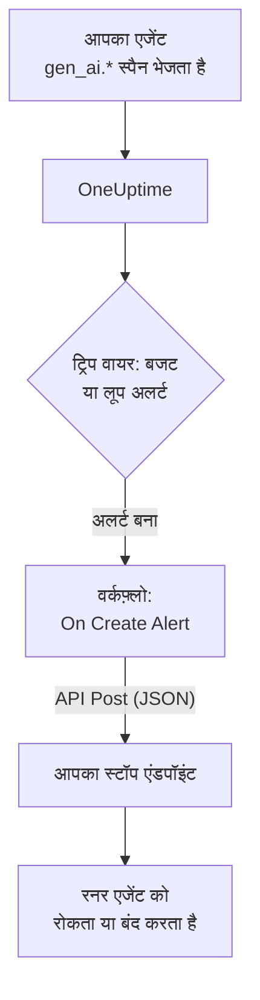

# AI एजेंट सर्किट ब्रेकर

AI एजेंट शायद ही कभी क्रैश होकर विफल होता है। वह चलते रहकर विफल होता है: टूटे हुए टूल को बार-बार आज़माता है, उसी चरण की फिर से योजना बनाता है, या और सब-एजेंट शुरू करता है, और हर बारी में और टोकन का बिल बनता है। यह पेज इसके लिए उन हिस्सों से एक सर्किट ब्रेकर बनाता है जो OneUptime में पहले से हैं: एक अलर्ट जो बेकाबू एजेंट को पहचानता है, और एक वर्कफ़्लो जो उसे रोकने के लिए आपके अपने एंडपॉइंट को कॉल करता है।

:::cards
- [ट्रिप वायर चुनें](#ट्रिप-वायर-चुनें): खर्च पर, या बार-बार कॉल होने वाले किसी एक टूल पर अलर्ट करें।
- [स्टॉप एंडपॉइंट बनाएँ](#स्टॉप-एंडपॉइंट-बनाएँ): छोटी सेवा जो आपके एजेंट को रोकती है।
- [वर्कफ़्लो बनाएँ](#वर्कफ़्लो-बनाएँ): नए अलर्ट से आपके एंडपॉइंट की कॉल तक।
- [ब्रेकर का परीक्षण करें](#ब्रेकर-का-परीक्षण-करें): पहले हाथ से ट्रिप करें, फिर असली हालात में।
:::

## यह कैसे काम करता है



ब्रेकर उस OpenTelemetry पर नज़र रखता है जो आपका एजेंट पहले से भेजता है, सीधे या [किसी गेटवे के ज़रिए](/docs/telemetry/ai-gateways), और अनुरोध के रास्ते के बगल में काम करता है, उसके अंदर नहीं। हर मॉडल कॉल में कुछ नहीं जुड़ता, और प्रदाता, SDK या गेटवे बदलने से यह नहीं टूटता।

इसकी कीमत गति है: यह बेकाबू एजेंट को मिलीसेकंड में नहीं, मिनटों में रोकता है। चरणों की सीमा और टाइमआउट एजेंट के अंदर ही रखें, और जो उनसे बच निकले उसे ब्रेकर को पकड़ने दें।

| ट्रिप वायर | क्या पकड़ता है | अलर्ट तक का समय |
| --- | --- | --- |
| मेट्रिक्स मॉनिटर से बजट अलर्ट | बढ़ता ही जा रहा खर्च, कारण जो भी हो | 15 मिनट तक, और मॉनिटर के लिए लगभग एक मिनट |
| ट्रेस मॉनिटर से लूप अलर्ट | एक ही टूल जो बार-बार कॉल होता है | 1 से 5 मिनट |

## शुरू करने से पहले

- आपका एजेंट OneUptime को GenAI स्पैन भेजता है। देखें [AI / LLM ऑब्ज़र्वेबिलिटी](/docs/telemetry/ai-llm-observability)।
- एक HTTPS एंडपॉइंट जो आपके एजेंट के रनर को रोक या बंद कर सके, और जिस तक OneUptime पहुँच सके। आप इसे [स्टॉप एंडपॉइंट बनाएँ](#स्टॉप-एंडपॉइंट-बनाएँ) में बनाएँगे।
- प्रोजेक्ट में मॉनिटर और वर्कफ़्लो बनाने की अनुमति।

## ट्रिप वायर चुनें

दोनों ट्रिप वायर एक ही तरह खत्म होते हैं: एक मॉनिटर अलर्ट बनाता है, और नया अलर्ट वर्कफ़्लो शुरू करता है। आप दोनों सेट कर सकते हैं: वर्कफ़्लो को फ़र्क नहीं पड़ता कि कौन-सा ट्रिप हुआ।

### बजट अलर्ट

खर्च बेकाबू एजेंट का सबसे पक्का संकेत है। बजट हर 15 मिनट में दिन का AI खर्च जोड़ता है और उसे दो मेट्रिक्स के रूप में प्रकाशित करता है, `oneuptime.llm.budget.spend.usd` और `oneuptime.llm.budget.percent.used`, दोनों में `oneuptime.llm.budget.id` में बजट की ID होती है।

:::steps
1. **उत्पाद → AI / LLM → बजट** खोलें और **LLM Cost Budget बनाएँ** पर क्लिक करें। **दैनिक बजट (USD)** सेट करें, और **सेवा (वैकल्पिक)** में एजेंट की सेवा चुनें ताकि बजट सिर्फ़ उसी एजेंट पर नज़र रखे।
2. नए बजट के पंक्ति मेनू में **ID दिखाएँ** चुनें और ID कॉपी करें।
3. `oneuptime.llm.budget.percent.used` पर एक [मेट्रिक्स मॉनिटर](/docs/monitor/metrics-monitor) बनाएँ, जिसे विशेषता `oneuptime.llm.budget.id` पर कॉपी की गई ID से फ़िल्टर किया गया हो, और उसकी **समय सीमा** को **Past 30 Minutes** पर सेट करें।
4. एक मानदंड **Greater Than Or Equal To** `100` जोड़ें जो अलर्ट बनाए, और उसे एक **अलर्ट शीर्षक** दें जिसमें एजेंट का नाम हो, जैसे `LLM budget exceeded: support-bot`। वर्कफ़्लो और आपका एंडपॉइंट दोनों यही शीर्षक पढ़ते हैं।
:::

नाम से नहीं, ID से फ़िल्टर करें: बजट का नाम बदलने से उसकी सीरीज़ का नाम बदल जाता है, और पुराने नाम से फ़िल्टर किया गया मॉनिटर चुपचाप मेल खाना बंद कर देगा। समय सीमा 30 मिनट पर रखें: बजट हर 15 मिनट में एक बिंदु प्रकाशित करता है, इसलिए छोटी सीमा दो बिंदुओं के बीच कुछ नहीं पाती और अलर्ट बार-बार खुलता और सुलझता रहता है।

`80` पर कम गंभीरता वाला दूसरा मानदंड, ब्रेकर के `100` पर ट्रिप होने से पहले, अलर्ट की ऑन-कॉल नीति के ज़रिए किसी व्यक्ति को पहले चेतावनी देता है।

### लूप अलर्ट

अटका हुआ एजेंट पहचानने लायक निशान छोड़ता है: एक ही टूल स्पैन, बार-बार। एक स्वस्थ रन कुछ ही मिनटों में एक टूल को दर्जनों बार कॉल नहीं करता, इसलिए गिनती बजट से बहुत पहले लूप पकड़ लेती है।

:::steps
1. **मॉनिटर** खोलें, **मॉनिटर बनाएं** पर क्लिक करें, और **और मॉनिटर प्रकार** के अंदर **ट्रेस** चुनें।
2. **और फ़ील्ड** के अंदर, **टेलीमेट्री सेवा द्वारा फ़िल्टर करें** को एजेंट की सेवा पर सेट करें, और **विशेषताओं द्वारा फ़िल्टर करें** को `gen_ai.tool.name` बराबर उस टूल पर, जिस पर आपको लूप की आशंका है, जैसे `search_web`। अगर आपका इंस्ट्रुमेंटेशन हर टूल के स्पैन को नाम देता है, तो इसके बजाय वह नाम **स्पैन नाम** में डालें।
3. **(time) के लिए मॉनिटर ट्रेस** को **पिछले 5 मिनट** पर सेट करें।
4. एक मानदंड **Span Count** **Greater Than** जोड़ें, ऐसी संख्या के साथ जिस तक कोई स्वस्थ रन पाँच मिनट में न पहुँचे, जैसे `50`, जो `Agent loop: support-bot` जैसे शीर्षक वाला अलर्ट बनाए।
:::

**स्पैन स्थिति द्वारा फ़िल्टर करें** को **त्रुटि** पर सेट करके और कम गिनती के साथ दूसरा ट्रेस मॉनिटर रीट्राई के तूफ़ान पकड़ता है: एक टूल जो विफल होता रहता है, और एक एजेंट जो उसे फिर से आज़माता रहता है।

## स्टॉप एंडपॉइंट बनाएँ

वर्कफ़्लो आपके चलाए एंडपॉइंट पर JSON बॉडी के साथ एक `POST` भेजता है। "रोकने" का मतलब क्या है, यह आप तय करते हैं। सबसे छोटे असर से सबसे बड़े तक:

| कार्रवाई | असर |
| --- | --- |
| नया काम रोकें | रनर उस एजेंट के लिए कोई नया रन शुरू नहीं करता |
| उसके रन रद्द करें | उस एजेंट के चल रहे रन रद्द हो जाते हैं |
| पूल को रोकें | हर वर्कर खाली हो जाता है, जब तक कोई ब्रेकर रीसेट न करे |

Express में एक न्यूनतम एंडपॉइंट जो हर एजेंट के लिए अलग ब्रेकर ट्रिप करता है:

```typescript title="circuit-breaker.ts"
import express from "express";

const app = express();
app.use(express.json());

const tripped = new Set<string>(); // agents whose breaker is open

app.post("/circuit-breaker", (req, res) => {
  if (req.headers["authorization"] !== `Bearer ${process.env.KILL_TOKEN}`) {
    return res.status(401).end();
  }

  const alertTitle: string = req.body.alertTitle ?? "";

  // "LLM budget exceeded: support-bot" -> "support-bot"
  const agent: string = alertTitle.split(": ").pop() ?? "unknown";

  tripped.add(agent); // your run loop checks this set
  abortActiveRuns(agent); // cancel that agent's runs in flight

  // Answer fast; do the slow cleanup in the background.
  return res.status(200).json({ tripped: agent });
});
```

इसे इन नियमों के अनुसार बनाएँ:

- ट्रिप होना आइडेम्पोटेंट बनाएँ। एक चेतावनी और एक उल्लंघन, या एक साथ आए बजट अलर्ट और लूप अलर्ट, इसे एक से ज़्यादा बार ट्रिप कर सकते हैं, और दूसरे ट्रिप से कुछ नहीं बदलना चाहिए।
- एक-दो सेकंड में जवाब दें, और सफ़ाई बैकग्राउंड में करें। वर्कफ़्लो किसी भी 2xx जवाब को सफलता मानता है।
- एक सीक्रेट माँगें। जो भी एंडपॉइंट को कॉल कर सकता है, वह आपके एजेंट रोक सकता है, इसलिए एक bearer टोकन जाँचें, जिसे वर्कफ़्लो एक सीक्रेट ग्लोबल वेरिएबल से भेजता है।
- हाथ से रीसेट करें। ट्रिप हुआ ब्रेकर तब तक ट्रिप ही रहता है जब तक कोई रन को देख न ले: एजेंट ने क्या किया, यह पढ़ने या फिर से चलाने के लिए **उत्पाद → AI / LLM → बातचीत** के अंदर उसकी बातचीत खोलें।

अनुरोध OneUptime से निकलता है। OneUptime Cloud पर आपका एंडपॉइंट इंटरनेट से पहुँचने योग्य होना चाहिए। सेल्फ़-होस्टेड इंस्टॉलेशन निजी नेटवर्क पतों को अस्वीकार करता है, जब तक कोई एडमिनिस्ट्रेटर उन्हें अनुमति न दे: देखें [आउटबाउंड नेटवर्क एक्सेस](/docs/workflows/configuration#बाहर-जाने-वाली-नेटवर्क-पहुँच)।

## वर्कफ़्लो बनाएँ

पहले एंडपॉइंट का टोकन ऐसी जगह सहेजें जहाँ वर्कफ़्लो उसे दिखाए बिना इस्तेमाल कर सके: **वर्कफ़्लो → ग्लोबल वेरिएबल** खोलें, **वर्कफ़्लो वेरिएबल बनाएँ** पर क्लिक करें, उसका नाम `AGENT_KILL_TOKEN` रखें, टोकन **सामग्री** में डालें, और **रहस्य** चालू करें। सीक्रेट मान रन लॉग और चरणों के ट्रेस से हटा दिया जाता है।

:::steps
### वर्कफ़्लो तैयार करें

**उत्पाद → वर्कफ़्लो** खोलें और **वर्कफ़्लो बनाएं** पर क्लिक करें। **शुरू से बनाएं** पर क्लिक करें, उसका नाम `AI agent circuit breaker` रखें, और **वर्कफ़्लो बनाएं** पर क्लिक करें। यह **बिल्डर** में बंद अवस्था में खुलता है।

### ट्रिगर जोड़ें

डैश वाले ब्लॉक **Choose what starts this workflow** पर क्लिक करें और **Add Trigger** पैनल में **On Create Alert** चुनें। ट्रिगर पर क्लिक करें, **Select Fields** में शीर्षक और विवरण पर टिक करें, और **सहेजें** पर क्लिक करें। ब्लॉक पर दिखने वाली ID, `alert-on-create-1`, वह तरीका है जिससे आगे के ब्लॉक इसका हवाला देते हैं।

### शीर्षक जाँचें

**घटक जोड़ें** पर क्लिक करें, **If / Else** चुनें, और ट्रिगर का **Success** बिंदु उससे जोड़ें। **Value to check** को अलर्ट के शीर्षक पर सेट करें ( **{ }** पर क्लिक करके उसे चुनें), **Comparison** को **शामिल है** पर, और **Compare with** को उस शुरुआत पर जो आपके ट्रिप वायर के शीर्षकों में साझा है, जैसे `LLM budget exceeded`।

### अपने एंडपॉइंट को कॉल करें

**API Post (JSON)** जोड़ें और **If / Else** का **Yes** बिंदु उससे जोड़ें। उसका **URL** अपने एंडपॉइंट पर सेट करें, जैसे `https://agents.example.com/circuit-breaker`, और नीचे दिए हेडर और बॉडी भरें।

### विफलता की सूचना दें

**Send Message to Slack** या **Send Email** जोड़ें और API ब्लॉक का **Error** बिंदु उससे जोड़ें। जो ब्रेकर ट्रिप होने में विफल रहे, वही वह अलर्ट है जिसे किसी व्यक्ति को ज़रूर देखना चाहिए।

### इसे चालू करें

**बिल्डर** के ऊपर **सक्षम** चालू करें।
:::

API ब्लॉक के **Request Headers** :

```json title="Request Headers"
{
  "Authorization": "Bearer {{global.variables.AGENT_KILL_TOKEN}}",
  "Content-Type": "application/json"
}
```

इसकी **Request Body** :

```json title="Request Body"
{
  "source": "oneuptime-circuit-breaker",
  "alertId": "{{local.components.alert-on-create-1.returnValues.model._id}}",
  "alertTitle": "{{local.components.alert-on-create-1.returnValues.model.title}}",
  "alertDescription": "{{local.components.alert-on-create-1.returnValues.model.description}}"
}
```

कई ट्रिप वायर पर प्रतिक्रिया देने के लिए, उनके सभी शीर्षक एक ही तरह शुरू करें, या **No** बिंदु से और **If / Else** ब्लॉक जोड़ते जाएँ। कैनवास के लिए [वर्कफ़्लो लिखना](/docs/workflows/authoring) और `{{…}}` संदर्भों के लिए [वेरिएबल](/docs/workflows/variables) देखें।

## ब्रेकर का परीक्षण करें

:::steps
1. हाथ से ट्रिप करें। **अलर्ट** खोलें, **अलर्ट बनाएं** पर क्लिक करें, और `LLM budget exceeded: test` शीर्षक वाला अलर्ट बनाएँ। रन **वर्कफ़्लो → लॉग → रन** के अंदर दिखता है, और आपके एंडपॉइंट को अनुरोध मिलता है।
2. असली हालात में ट्रिप करें। किसी टेस्ट एजेंट की सेवा पर बहुत छोटी सीमा वाला बजट बनाएँ, जैसे `0.01` USD, उस पर एक बजट मॉनिटर लगाएँ, और एजेंट को चलने दें: प्रतिशत 100 पार करता है, अलर्ट खुलता है, वर्कफ़्लो चलता है और ब्रेकर ट्रिप होता है। लूप अलर्ट के लिए, किसी टेस्ट एजेंट को ऐसा टूल दें जो हमेशा विफल हो।
3. दो बार ट्रिप करें। वही अलर्ट फिर से बनाएँ: आपके एंडपॉइंट को कुछ बदले बिना दूसरा ट्रिप स्वीकार करना चाहिए।
:::

## समय के साथ ब्रेकर का व्यवहार

- वर्कफ़्लो अलर्ट बनने पर चलता है, इसलिए एक ट्रिप वायर ब्रेकर को हर अलर्ट पर एक बार ट्रिप करता है, हर मूल्यांकन पर नहीं।
- बजट UTC दिन गिनता है, इसलिए उसका प्रतिशत UTC आधी रात को 0 से फिर शुरू होता है। तब बजट अलर्ट सुलझ सकता है, और अगला खराब दिन एक नया अलर्ट खोलता है जो ब्रेकर को फिर से ट्रिप करता है।
- मॉनिटर अपना अलर्ट तब तक खुला रखता है जब तक उसके मानदंड पूरे होते रहते हैं। **अलर्ट स्वतः सुलझाएं** चालू होने पर, मानदंड पूरे होना बंद होते ही अलर्ट सुलझ जाता है, और अगला उल्लंघन नया अलर्ट खोलता है।
- रीसेट करना दोनों तरफ़ इंसान का फ़ैसला है: OneUptime में अलर्ट सुलझाएँ, और अपने रनर में ब्रेकर रीसेट करें।
- प्रोजेक्ट का हर नया अलर्ट वर्कफ़्लो शुरू करता है। दूसरे अलर्ट को ब्रेकर से दूर रखने वाला **If / Else** ही है: इसे न हटाएँ।

## समस्या निवारण

:::details वर्कफ़्लो नहीं चलता
जाँचें कि **बिल्डर** के ऊपर **सक्षम** चालू है: वर्कफ़्लो बंद अवस्था में बनते हैं। फिर जाँचें कि अलर्ट वर्कफ़्लो चालू करने के बाद बना था: ट्रिगर सिर्फ़ नए अलर्ट के लिए रन शुरू करता है।
:::

:::details वर्कफ़्लो चलता है, लेकिन हमेशा No शाखा लेता है
शीर्षक खाली है या मेल नहीं खाता। ट्रिगर के **Select Fields** में जिस फ़ील्ड पर टिक नहीं है, वह खाली आता है, इसलिए शीर्षक पर टिक करें। फिर अलर्ट के शीर्षक की तुलना **Compare with** से करें: **शामिल है** को उसमें ठीक वही टेक्स्ट मिलना चाहिए।
:::

:::details आपका एंडपॉइंट 401 जवाब देता है
`Authorization` हेडर उस टोकन से मेल नहीं खाता जिसकी आपके एंडपॉइंट को उम्मीद है। `{{global.variables.AGENT_KILL_TOKEN}}` में नाम जाँचें, और ग्लोबल वेरिएबल में सहेजा गया मान भी। सीक्रेट वेरिएबल का मान वापस पढ़ा नहीं जा सकता, इसलिए शक हो तो **Update Content** से उसे फिर से टाइप करें।
:::

:::details बजट अलर्ट बार-बार खुलता और सुलझता है
मॉनिटर की **समय सीमा** बजट के दो बिंदुओं के बीच के 15 मिनट से छोटी है। उसे **Past 30 Minutes** पर सेट करें।
:::

:::details अनुरोध आपके एंडपॉइंट तक कभी नहीं पहुँचता
**वर्कफ़्लो → लॉग → रन** के अंदर रन खोलें और **API Post (JSON)** चरण देखें: वह बताता है कि अनुरोध क्यों विफल हुआ। OneUptime Cloud पर एंडपॉइंट इंटरनेट से पहुँचने योग्य होना चाहिए; सेल्फ़-होस्टेड इंस्टॉलेशन निजी नेटवर्क पतों को अस्वीकार करता है, जब तक कोई एडमिनिस्ट्रेटर उन्हें अनुमति न दे।
:::

## अगले कदम

:::cards
- [AI / LLM ऑब्ज़र्वेबिलिटी](/docs/telemetry/ai-llm-observability): बजट, लागत, और वे स्पैन जिन पर ब्रेकर नज़र रखता है।
- [ट्रेस मॉनिटर](/docs/monitor/traces-monitor): स्पैन फ़िल्टर और मानदंड विस्तार से।
- [वर्कफ़्लो](/docs/workflows/index): ट्रिगर, घटक, वेरिएबल और रन।
- [AI गेटवे](/docs/telemetry/ai-gateways): हर एजेंट की मॉडल कॉल एक ही एक्सपोर्ट से।
:::
