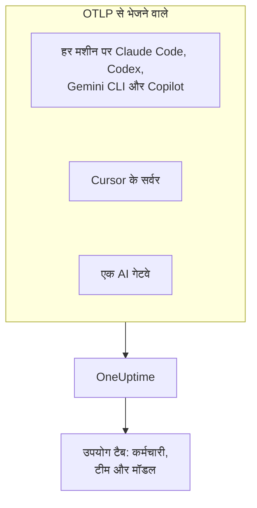

# AI कोडिंग असिस्टेंट

आपके इंजीनियर Claude Code, Cursor, Codex, Gemini CLI और Copilot चलाते हैं, और बिल बढ़ते जा रहे हैं। यह पेज एक मैनेजर के सवालों का जवाब देता है: **कौन कौन-सा टूल, किन मॉडलों पर इस्तेमाल करता है, और हर व्यक्ति और हर टीम कितना खर्च करती है** ।

ज़्यादातर कोडिंग असिस्टेंट खुद OpenTelemetry एक्सपोर्ट करते हैं, इसलिए डेवलपर मशीनों पर कुछ इंस्टॉल नहीं करना पड़ता: एक्सपोर्ट को OneUptime की ओर करें, और टोकन, लागत और टूल उपयोग आपके अपने ऐप की AI कॉल के साथ आ जाते हैं। यहाँ सब कुछ OpenTelemetry से आता है; OneUptime किसी विक्रेता के एडमिन या बिलिंग API को पोल नहीं करता।

:::cards
- [सपोर्ट मैट्रिक्स](#सपोर्ट-मैट्रिक्स): हर टूल क्या भेजता है, और क्या वह किसी व्यक्ति का नाम बताता है।
- [कर्मचारी और टीम एट्रिब्यूशन](#कर्मचारी-और-टीम-एट्रिब्यूशन): वे कुंजियाँ जो खर्च पर नाम और टीम लगाती हैं।
- [उपयोग टैब](#उपयोग-टैब): किसी कोडिंग असिस्टेंट के लिए खर्च की तालिकाएँ क्या दिखा सकती हैं और क्या नहीं।
- [कहाँ से शुरू करें](#कहाँ-से-शुरू-करें): रोलआउट का ऐसा क्रम जो पहले ही दिन नतीजे दिखाए।
:::

## यह कैसे काम करता है

हर टूल अपनी टेलीमेट्री आपकी इंजेशन कुंजी के साथ OneUptime के OTLP एंडपॉइंट पर भेजता है: हर डेवलपर मशीन से, विक्रेता के सर्वर से (Cursor), या किसी ऐसे गेटवे से जिससे आपका मॉडल ट्रैफ़िक गुज़रता है।



## शुरू करने से पहले

1. **प्रोजेक्ट सेटिंग्स → टेलीमेट्री और APM → इंजेशन कुंजियाँ** में एक टेलीमेट्री इंजेशन कुंजी बनाएँ।
2. आपका OTLP एंडपॉइंट `https://oneuptime.com/otlp` है, या अगर आप OneUptime खुद होस्ट करते हैं तो `https://YOUR-ONEUPTIME-HOST/otlp`।
3. हर एक्सपोर्ट कुंजी को `x-oneuptime-token` हेडर में भेजता है।

पूरे बेड़े के लिए एक इंजेशन कुंजी ठीक है। वह हर डेवलपर मशीन पर पहुँचती है, इसलिए उसे एक साझा क्रेडेंशियल मानें जो सिर्फ़ डेटा भेज सकता है, और उसे किसी भी दूसरे क्रेडेंशियल की तरह बदलते रहें।

## सपोर्ट मैट्रिक्स

किसी टूल से आपको क्या मिलता है, यह तीन बातों पर निर्भर है: क्या वह OpenTelemetry भेजता भी है, उसकी टेलीमेट्री OneUptime तक कैसे पहुँचती है, और क्या उसमें कुछ किसी व्यक्ति का नाम बताता है।

| टूल | यह क्या भेजता है | OneUptime तक कैसे पहुँचता है | किसका नाम बताता है | गाइड |
| --- | --- | --- | --- | --- |
| Claude Code | मेट्रिक्स और लॉग; ट्रेस बीटा में | हर मशीन से; एनवायरनमेंट वेरिएबल या मैनेज्ड सेटिंग्स फ़ाइल | `user.email`, जब Claude खाते से साइन इन हो | [Claude Code](/docs/telemetry/claude-code) |
| Cursor | मेट्रिक्स और लॉग | Cursor के सर्वर से, Cursor के डैशबोर्ड में एक बार सेट अप; सिर्फ़ Enterprise प्लान पर | `cursor.user.id`, एक पूर्णांक | [Cursor](/docs/telemetry/cursor) |
| OpenAI Codex | ट्रेस, मेट्रिक्स और लॉग, हर एक `~/.codex/config.toml` में चालू | हर मशीन से, हर सिग्नल के लिए पूरा URL | स्पैन या मेट्रिक्स पर किसी का नहीं: `[otel.span_attributes]` में `user.id` और `user.email` आप खुद सेट करते हैं | [OpenAI Codex](/docs/telemetry/openai-codex) |
| Gemini CLI | ट्रेस, मेट्रिक्स और लॉग | हर मशीन से, आम तौर पर किसी लोकल collector के ज़रिए | `user.email`, जब साइन इन हो | [Gemini CLI और GitHub Copilot](/docs/telemetry/gemini-cli-and-copilot) |
| GitHub Copilot | ट्रेस, मेट्रिक्स और लॉग, सिर्फ़ इसकी एजेंट सुविधाओं से | एडिटर या एजेंट होस्ट से | किसी का नहीं: हर मशीन पर `enduser.id` और `user.email` आप खुद सेट करते हैं | [Gemini CLI और GitHub Copilot](/docs/telemetry/gemini-cli-and-copilot) |
| Cline | मेट्रिक्स और लॉग | Cline के संगठन डैशबोर्ड में केंद्रीय रूप से कॉन्फ़िगर | एक गुमनाम `user_id` | — |
| LiteLLM और Portkey | गेटवे से गुज़रने वाली हर कॉल के ट्रेस | गेटवे प्रोसेस से | LiteLLM में, वर्चुअल कुंजी का मालिक | [AI गेटवे](/docs/telemetry/ai-gateways) |
| आपके अपने ऐप | आपका GenAI इंस्ट्रुमेंटेशन जो भेजता है | आपके ऐप से | जिसे भी आप `user.id` के रूप में सेट करें | [AI / LLM ऑब्ज़र्वेबिलिटी](/docs/telemetry/ai-llm-observability) |
| Windsurf, JetBrains AI, Amazon Bedrock, Azure OpenAI | अपना कोई OpenTelemetry नहीं | सिर्फ़ आगे लगाए गए गेटवे के ज़रिए | जिसका नाम गेटवे बताए | [AI गेटवे](/docs/telemetry/ai-gateways) |

डैश का मतलब है कि OneUptime के पास अभी उस टूल की कोई गाइड नहीं है। उसकी टेलीमेट्री फिर भी किसी भी दूसरे OpenTelemetry की तरह इंजेस्ट होती है।

:::details GitHub Copilot ठीक-ठीक क्या एक्सपोर्ट करता है
Copilot सिर्फ़ अपनी एजेंट सुविधाओं से OpenTelemetry एक्सपोर्ट करता है: VS Code चैट और एजेंट मोड, Copilot CLI के पीछे का एजेंट होस्ट, Copilot SDK, और Copilot प्लगइन के ज़रिए JetBrains IDE में एजेंट वर्कफ़्लो। इनलाइन कंप्लीशन, github.com पर Copilot या Copilot कोड रिव्यू के लिए GitHub कोई एक्सपोर्ट दर्ज नहीं करता। Copilot किसी भी तरह की कोई उपयोगकर्ता विशेषता नहीं भेजता, इसलिए `resourceAttributes` या `OTEL_RESOURCE_ATTRIBUTES` के ज़रिए हर मशीन पर `enduser.id` और `user.email` सेट करें।
:::

:::details Amazon Bedrock, Azure OpenAI, Windsurf और JetBrains AI
- **Amazon Bedrock**: `InvokeModel` और `Converse` API कोई OpenTelemetry नहीं भेजते। Bedrock AgentCore अलग है: AWS इसके लिए मेट्रिक्स, स्पैन और लॉग दर्ज करता है, जो डिफ़ॉल्ट रूप से CloudWatch को भेजे जाते हैं। `DISABLE_ADOT_OBSERVABILITY=true` सेट करने से रनटाइम का डिफ़ॉल्ट ADOT कॉन्फ़िगरेशन बंद हो जाता है, ताकि आप ADOT SDK को OneUptime की ओर कर सकें।
- **Azure OpenAI**: सेवा कुछ नहीं भेजती, और इसके Azure Monitor मेट्रिक्स में कोई उपयोगकर्ता आयाम नहीं होता। क्लाइंट को इंस्ट्रुमेंट करें, या आगे API Management या कोई दूसरा गेटवे लगाएँ।
- **Windsurf**: कोई टेलीमेट्री एक्सपोर्ट दर्ज नहीं करता। प्रति-उपयोगकर्ता डेटा Windsurf के Enterprise API में है, जिसे OneUptime पोल नहीं करता।
- **JetBrains AI Assistant और Junie**: कोई उपयोग एक्सपोर्ट नहीं करते। JetBrains का OpenTelemetry प्लगइन IDE के अंदर आपके अपने ऐप की टेलीमेट्री लेता है; वह बाहर कुछ नहीं भेजता।
:::

## कर्मचारी और टीम एट्रिब्यूशन

टेलीमेट्री आते ही OneUptime कॉल करने वाले व्यक्ति और उसकी टीम को कॉलम में कॉपी कर देता है, ताकि **उपयोग** टैब बिना विशेषता फ़िल्टर के व्यक्तियों और टीमों को रैंक कर सके।

### कर्मचारी के रूप में पढ़ी जाने वाली विशेषताएँ

किसी स्पैन पर, इस क्रम में मौजूद पहली कुंजी जीतती है:

| कॉलम | कुंजियाँ, पसंदीदा पहले |
| --- | --- |
| कर्मचारी ID | `user.id`, `enduser.id`, `litellm.metadata.user_api_key_user_id`, `metadata.user_api_key_user_id`, `traceloop.association.properties.user_id`, `langfuse.user.id`, `user.account_uuid`, `user.account_id`, `cursor.user.id` |
| कर्मचारी ईमेल | `user.email`, `litellm.metadata.user_api_key_user_email`, `metadata.user_api_key_user_email`, `traceloop.association.properties.user_email`, `enduser.email` |
| टीम / कॉस्ट सेंटर | `team.id`, `team`, `cost_center`, `department`, `litellm.metadata.user_api_key_team_id`, `litellm.team.id`, `metadata.user_api_key_team_id`, `cursor.team.id` |

किसी मेट्रिक डेटा पॉइंट पर सूची छोटी है और ईमेल से शुरू होती है, क्योंकि मेट्रिक्स भेजने वाले कोडिंग असिस्टेंट `user.email` खुद भेजते हैं:

| कॉलम | कुंजियाँ, पसंदीदा पहले |
| --- | --- |
| कर्मचारी | `user.email`, `user.id`, `user.account_uuid`, `user.account_id`, `cursor.user.id` |
| टीम / कॉस्ट सेंटर | `team.id`, `team`, `cost_center`, `department`, `cursor.team.id` |
| मॉडल | `gen_ai.request.model`, `model`, `cursor.model.name` |

ये कुंजियाँ कैसे पढ़ी जाती हैं:

- **हर कुंजी `resource.` प्रीफ़िक्स के साथ भी पढ़ी जाती है।** OTLP इंजेस्ट रिसोर्स विशेषताओं को उसी प्रीफ़िक्स के नीचे सहेजता है, इसलिए `OTEL_RESOURCE_ATTRIBUTES=team.id=platform` `resource.team.id` के रूप में आता है। बिना प्रीफ़िक्स वाली कुंजियाँ पहले आज़माई जाती हैं, इसलिए स्पैन पर मौजूद मान पूरी प्रोसेस वाले मान पर भारी पड़ता है।
- **जब कॉल में किसी व्यक्ति का ईमेल होता है तो उपयोग टैब वह ईमेल दिखाता है, वरना ID।** एक ही ईमेल दिखाने वाली पंक्तियाँ जोड़ दी जाती हैं, इसलिए दो मशीनों वाला एक इंजीनियर एक ही पंक्ति होता है।
- **पहचान सिर्फ़ AI कॉल से पढ़ी जाती है।** `user.id`, `user.email` और `team.id` आम कुंजियाँ हैं जो ब्राउज़र और बैकएंड स्पैन में भी होती हैं; कॉलम सिर्फ़ उन स्पैन को मिलते हैं जिन्हें पहले से AI कॉल के रूप में पहचाना गया है।
- **पहचान के लिए लॉग रिकॉर्ड नहीं पढ़े जाते।** यह Codex के लिए मायने रखता है, जो `user.email` सिर्फ़ अपने लॉग पर रखता है।
- LiteLLM इन कुंजियों को दो तरह से लिखता है: इसका डिफ़ॉल्ट `otel` कॉलबैक `metadata.` प्रीफ़िक्स इस्तेमाल करता है, और इसका वैकल्पिक OpenTelemetry v2 मोड (`LITELLM_OTEL_V2=true`) `litellm.` नेमस्पेस। OneUptime दोनों पढ़ता है, इसलिए एक सामान्य प्रॉक्सी बिना अतिरिक्त सेटअप के काम करता है।

### टीमें और कॉस्ट सेंटर

कोई भी इंस्ट्रुमेंटेशन `team.id`, `team`, `cost_center` या `department` नहीं भेजता: इन्हें आपका संगठन सेट करता है, आम तौर पर टूल की प्रोसेस पर `OTEL_RESOURCE_ATTRIBUTES` के ज़रिए।

```bash
export OTEL_RESOURCE_ATTRIBUTES="team.id=platform,team=Platform_Engineering,cost_center=eng-123,department=engineering"
```

इसे वहीं सेट करें जहाँ आप पहले से डेवलपर मशीनें तैयार करते हैं: कोई MDM प्रोफ़ाइल, कोई मैनेज्ड सेटिंग्स फ़ाइल, या आपके dotfiles की कोई शेल प्रोफ़ाइल। मानों में स्पेस नहीं हो सकते: अंडरस्कोर इस्तेमाल करें, या `%20` जैसी प्रतिशत-एन्कोडिंग। Codex में रिसोर्स विशेषताएँ नहीं होतीं, इसलिए वही कुंजियाँ उसके `[otel.span_attributes]` में सेट करें।

खर्च को ऐप्लिकेशन के हिसाब से अलग करने के लिए सेवा का नाम इस्तेमाल करें (`OTEL_SERVICE_NAME`, या टूल की अपनी सेटिंग)। **ऐप्लिकेशन / सेवा** ब्रेकडाउन सिर्फ़ उन टूल को कवर करता है जो GenAI स्पैन भेजते हैं।

### जिसे जानबूझकर कर्मचारी नहीं माना जाता

एक कॉल में दो अलग-अलग लोग हो सकते हैं: वह कर्मचारी जिसने कॉल की, और वह ग्राहक जिसके लिए कॉल की गई। ये कुंजियाँ ग्राहक को दर्शाती हैं, और OneUptime इन्हें कभी किसी पहचान कॉलम में नहीं पढ़ता:

- `gen_ai.user` और `llm.user`: इंस्ट्रुमेंटेशन इनमें OpenAI के अनुरोध पैरामीटर `user` को दोहराते हैं, जिसे OpenAI आपके अंतिम उपयोगकर्ताओं की पहचान बताता है।
- `litellm.metadata.user_api_key_end_user_id`, `metadata.user_api_key_end_user_id` और `litellm.end_user.id`: LiteLLM का अंतिम उपयोगकर्ता, कुंजी के मालिक से अलग, जो कर्मचारी होता है।

किसी ग्राहक ID को कर्मचारी के रूप में पढ़ने से 40,000 ग्राहकों की सेवा करने वाला सपोर्ट बॉट 40,000 काल्पनिक कर्मचारियों में बदल जाएगा, जबकि खर्च का असली मालिक इंजीनियर कुछ भी खर्च करता नहीं दिखेगा। ये कुंजियाँ स्पैन की विशेषताओं में बनी रहती हैं, और ट्रेस व्यूअर का **LLM** टैब इन्हें अंतिम उपयोगकर्ता के रूप में दिखाता है।

### गोपनीयता

कर्मचारी ईमेल कॉलम में निजी डेटा होता है। ट्रेस के **स्क्रब नियम** उसे ठीक वैसे ही कवर करते हैं जैसे उस विशेषता को जिससे उसे पढ़ा गया था, इसलिए ईमेल मास्क करने वाला नियम कॉलम को भी मास्क करता है। ये **ट्रेस → सेटिंग्स** में मिलते हैं।

## कोडिंग असिस्टेंट मेट्रिक्स जिन्हें OneUptime पढ़ता है

कोडिंग असिस्टेंट अपने मेट्रिक्स को `gen_ai.*` के बजाय अपने प्रीफ़िक्स से नाम देते हैं, इसलिए OneUptime हर एक को उसके नाम से पहचानता है:

| मेट्रिक | टूल | इकाई |
| --- | --- | --- |
| `claude_code.token.usage` | Claude Code | टोकन |
| `claude_code.cost.usage` | Claude Code | USD |
| `cursor.token.usage` | Cursor | टोकन |
| `cursor.cost.usage` | Cursor | USD, Cursor के अपने हिसाब से एक अनुमान |
| `codex.turn.token_usage` | OpenAI Codex | टोकन |
| `codex.turn.cost_microusd` | OpenAI Codex | USD का दस-लाखवाँ हिस्सा: OneUptime इसे बदल देता है, इसलिए आप न बदलें |

OneUptime टोकन `gen_ai.client.token.usage`, `gen_ai.client.token.count`, `llm.token.usage` और `llm.usage.tokens` से भी पढ़ता है, और लागत `gen_ai.client.cost`, `gen_ai.client.cost.usd`, `gen_ai.usage.cost`, `litellm_spend_metric` और `litellm.cost.total` से।

आंकड़े पढ़ने से पहले दो बातें जान लें:

- **`gemini_cli.token.usage` जानबूझकर छोड़ दिया जाता है।** Gemini CLI अपने टोकन दो बार भेजता है, अपने मेट्रिक के रूप में और `gen_ai.client.token.usage` के रूप में, और दोनों पढ़ने से वे दोगुने हो जाएँगे। इसके टोकन `gen_ai.client.token.usage` के ज़रिए एक बार गिने जाते हैं। Gemini CLI कोई लागत मेट्रिक नहीं भेजता: हर कॉल की कीमत लगवाने के लिए इसके ट्रेस चालू करें।
- **सिर्फ़ इनपुट और आउटपुट टोकन गिने जाते हैं।** टोकन का प्रकार `gen_ai.token.type`, `llm.token.type`, `type`, `cursor.token.type` या `token_type` से पढ़ा जाता है, और सिर्फ़ `input` और `output` (या पुराने `prompt` और `completion`) गिने जाते हैं। कैश रीड और राइट, Codex का `total` (जो बाकी को दोहराता है) और `reasoning_output` (`output` का हिस्सा) छोड़ दिए जाते हैं, इसलिए मेट्रिक्स से आया कुल, किसी टूल के भेजे सब कुछ के जोड़ से छोटा होता है।

## उपयोग टैब

**उत्पाद → AI / LLM** खोलें और **उपयोग** पर जाएँ। यह **कर्मचारी** , **टीम** , **मॉडल** , **प्रदाता** और **ऐप्लिकेशन / सेवा** को खर्च के हिसाब से रैंक करता है, पिछले 7 दिनों के लिए, जब तक आप कोई और अवधि न चुनें। जिन कॉल में किसी का नाम नहीं होता, वे **बिना एट्रिब्यूशन** में गिनी जाती हैं: **बिना एट्रिब्यूशन** की बड़ी पंक्ति बताती है कि किस टूल को अभी अपनी पहचान सेट करनी है।

### कोडिंग असिस्टेंट मेट्रिक्स विकल्प हैं, जोड़ नहीं

GenAI स्पैन पहले आते हैं: मेट्रिक्स सिर्फ़ उसी आंकड़े के लिए पढ़े जाते हैं जिसके लिए स्पैन ने कुछ नहीं बताया, और दोनों को कभी नहीं जोड़ा जाता ([क्यों](/docs/telemetry/ai-llm-observability#स्पैन-पहले-मेट्रिक्स-कमी-पूरी-करते-हैं))। कोडिंग असिस्टेंट के लिए इसका एक सीधा नतीजा है: **अगर उसी प्रोजेक्ट को लागत वाले GenAI स्पैन मिलते हैं, तो कोडिंग असिस्टेंट का खर्च नहीं दिखता।** कोडिंग असिस्टेंट को उनका अपना प्रोजेक्ट दें, उसकी अपनी इंजेशन कुंजी के साथ।

जब यह विकल्प लागू होता है, तो सिर्फ़ मेट्रिक्स भेजने वाले टूल के लिए हर ब्रेकडाउन यह दिखा सकता है:

| ब्रेकडाउन | मेट्रिक्स से |
| --- | --- |
| **कर्मचारी** | हाँ, ऊपर की हर पहचान कुंजी से, बिना प्रीफ़िक्स और `resource.` प्रीफ़िक्स दोनों के साथ |
| **टीम** | हाँ, टीम कुंजियों से |
| **मॉडल** | हाँ: Claude Code और Codex बिना प्रीफ़िक्स का `model` भेजते हैं, Cursor `cursor.model.name` |
| **प्रदाता** | नहीं: कोडिंग असिस्टेंट के मेट्रिक्स किसी प्रदाता का नाम नहीं बताते |
| **ऐप्लिकेशन / सेवा** | नहीं: उनके मेट्रिक्स किसी OneUptime सेवा के नहीं होते |

मेट्रिक्स से पढ़ी गई पंक्ति में सिर्फ़ लागत होती है: उसके कॉल और टोकन सेल `—` दिखाते हैं, क्योंकि खर्च के काउंटर में हर कॉल का ब्योरा नहीं होता, और वहाँ 0 का मतलब यह दावा होगा कि उस व्यक्ति ने कोई कॉल नहीं की। तालिका पर **GenAI मेट्रिक्स से** का निशान होता है।

## OpenTelemetry नहीं है? आगे एक गेटवे लगाएँ

Windsurf, JetBrains AI, Bedrock के मॉडल API, Azure OpenAI और बिना अपने एक्सपोर्ट वाली किसी भी चीज़ के लिए आगे एक AI गेटवे लगाएँ। तब हर कॉल एक ही प्रोसेस से गुज़रती है जो OpenTelemetry भेजती है, और आप एक्सपोर्ट एक बार कॉन्फ़िगर करते हैं।

**हर कर्मचारी के लिए एक वर्चुअल कुंजी के साथ LiteLLM इस्तेमाल करें।** LiteLLM हर स्पैन पर कुंजी के मालिक की ID और ईमेल लगाता है, जिसे OneUptime कर्मचारी के रूप में पढ़ता है, और कुंजी की टीम को टीम के रूप में। यह हर कॉल की कीमत भी खुद लगाता है, प्रॉक्सी पर आपकी सेट की गई कस्टम दरों के साथ, और इसकी बताई लागत OneUptime के अनुमान पर भारी पड़ती है। इसके लिए इसकी अंतिम-उपयोगकर्ता ID इस्तेमाल न करें: वह ग्राहक है। सेटअप [AI गेटवे](/docs/telemetry/ai-gateways) में है।

गेटवे के इर्द-गिर्द योजना बनाने से पहले दो सीमाएँ:

- **गेटवे सिर्फ़ उसी ट्रैफ़िक को देखता है जो उससे होकर भेजा जाता है।** Cursor का अपना बेस-URL ओवरराइड एक प्रति-उपयोगकर्ता सेटिंग है जो सिर्फ़ चैट मॉडलों को कवर करती है (Tab कंप्लीशन Cursor के मॉडल ही इस्तेमाल करता रहता है), इसलिए Cursor का नेटिव एक्सपोर्ट बेहतर है।
- **गेटवे मॉडल कॉल देखता है, एजेंट नहीं।** यह प्रॉम्प्ट और जवाब रिकॉर्ड करता है, लेकिन वे टूल कॉल, फ़ाइल संपादन और स्वीकार या अस्वीकार के फ़ैसले नहीं, जो किसी टूल की अपनी टेलीमेट्री बताती है।

## प्रॉम्प्ट सामग्री: हर टूल का डिफ़ॉल्ट अलग है

प्रॉम्प्ट और जवाब इस पाइपलाइन का सबसे जोखिम भरा डेटा हैं: उनमें अक्सर सोर्स कोड, ग्राहक डेटा और चिपकाए गए क्रेडेंशियल होते हैं। हर टूल का डिफ़ॉल्ट जांचें:

| टूल | डिफ़ॉल्ट रूप से प्रॉम्प्ट सामग्री |
| --- | --- |
| Claude Code | बंद: हर तरह की सामग्री का अपना चालू करने वाला वेरिएबल है |
| Cursor | बंद: सिर्फ़ वैकल्पिक `conversation_content` फ़ैमिली संदेश का टेक्स्ट भेजती है |
| OpenAI Codex | बंद: `log_user_prompt` डिफ़ॉल्ट रूप से `false` है |
| Gemini CLI | **चालू**: `logPrompts` डिफ़ॉल्ट रूप से `true` है, इसलिए टेलीमेट्री चालू करते समय इसे `false` पर सेट करें |
| GitHub Copilot | बंद: `captureContent`, जिसे मैनेज्ड सेटिंग्स `lockCaptureContent` से लॉक कर सकती हैं |
| LiteLLM | डिफ़ॉल्ट `otel` कॉलबैक के साथ चालू (`turn_off_message_logging` से बंद करें); OpenTelemetry v2 मोड में बंद |

Codex डिफ़ॉल्ट रूप से अपने मेट्रिक्स OpenAI को भी भेजता है: [OpenAI Codex](/docs/telemetry/openai-codex) देखें। जहाँ आप जानबूझकर सामग्री कैप्चर करते हैं, वहाँ ट्रेस के **स्क्रब नियम** और **ड्रॉप फ़िल्टर** उस पर किसी भी दूसरी टेलीमेट्री की तरह लागू होते हैं।

## OneUptime अभी क्या नहीं करता

- **कोई विक्रेता एडमिन या बिलिंग कनेक्टर नहीं।** OneUptime Anthropic का Admin API, Cursor का Admin API, OpenAI के उपयोग और लागत एंडपॉइंट, GitHub की Copilot बिलिंग, या Windsurf या JetBrains के API पोल नहीं करता। इनवॉइस जैसे आंकड़ों के लिए उन्हें विक्रेता से लें।
- **लागत एक अनुमान है, जब तक कोई टूल उसे खुद न बताए।** बताई गई लागत जैसी है वैसी इस्तेमाल होती है; वरना OneUptime टोकन की कीमत सूची-मूल्यों पर लगाता है। Cursor का `cursor.cost.usage` खुद एक अनुमान है।
- **लॉग रिकॉर्ड पर मौजूद पहचान नहीं पढ़ी जाती।** Codex का `user.email`, जिसे वह सिर्फ़ लॉग पर भेजता है, खर्च से नहीं जुड़ता।
- **Cursor का `cursor.user.email` अभी नहीं पढ़ा जाता**, इसलिए Cursor उपयोगकर्ता अपने `cursor.user.id` पूर्णांक के रूप में दिखते हैं।
- **Codex स्पैन किसी मॉडल का नाम नहीं बताते**, इसलिए OneUptime उनकी कीमत नहीं लगा सकता: Codex प्रति व्यक्ति टोकन दिखाता है, और अपनी लागत सिर्फ़ कुल में।
- **टूल तेज़ी से बदलते हैं।** अगर यह पेज कहता है कि किसी टूल में कोई एक्सपोर्ट नहीं है, तो गेटवे के इर्द-गिर्द कुछ बनाने से पहले उसका मौजूदा दस्तावेज़ देख लें।

## कहाँ से शुरू करें

इस क्रम में रोलआउट करें; हर कदम अपने आप में उपयोगी है। ऐसा प्रोजेक्ट इस्तेमाल करें जिसे आपके अपने ऐप से पहले से GenAI स्पैन नहीं मिलते, वरना [विकल्प वाला नियम](#कोडिंग-असिस्टेंट-मेट्रिक्स-विकल्प-हैं-जोड़-नहीं) कोडिंग असिस्टेंट का खर्च पेज से बाहर रखेगा।

1. **Gemini CLI**, अगर कोई इसे इस्तेमाल करता है। यह बिना सेटअप के `user.email` भेजता है, इसलिए यह शुरू से अंत तक एट्रिब्यूशन काम करता दिखाता है। इसके ट्रेस भी चालू करें: यह कोई लागत मेट्रिक नहीं भेजता।
2. **Claude Code**: बेड़े के लिए एक मैनेज्ड सेटिंग्स फ़ाइल, मुफ़्त में `user.email`, एक असली लागत मेट्रिक, और प्रति डेवलपर स्वीकृति दर, कमिट, पुल रिक्वेस्ट और कोड की पंक्तियाँ।
3. **Cursor**, Enterprise प्लान पर: Cursor के डैशबोर्ड में एक स्क्रीन, किसी डेवलपर मशीन को छुए बिना, हालाँकि लोग पूर्णांकों के रूप में आते हैं।
4. **Copilot और Codex**, जिन दोनों को हर मशीन पर पहचान सेट करने की ज़रूरत है। यह मशीनें तैयार करते समय करें: जो कॉल बिना पहचान के आईं, उन्हें बाद में एट्रिब्यूट नहीं किया जा सकता।
5. **एक LiteLLM गेटवे** बाकी सब के लिए, हर कर्मचारी के लिए एक वर्चुअल कुंजी के साथ।

## अगले कदम

:::cards
- [Claude Code](/docs/telemetry/claude-code): एक मशीन या पूरे बेड़े के लिए Claude Code का एक्सपोर्ट चालू करें।
- [Cursor](/docs/telemetry/cursor): Cursor के डैशबोर्ड से Cursor की टीम टेलीमेट्री भेजें।
- [OpenAI Codex](/docs/telemetry/openai-codex): Codex के तीन एक्सपोर्टर कॉन्फ़िगर करें और उसके स्पैन पर पहचान लगाएँ।
- [AI / LLM ऑब्ज़र्वेबिलिटी](/docs/telemetry/ai-llm-observability): हर AI कॉल के लिए बातचीत, अलर्ट, लागत और बजट।
:::
