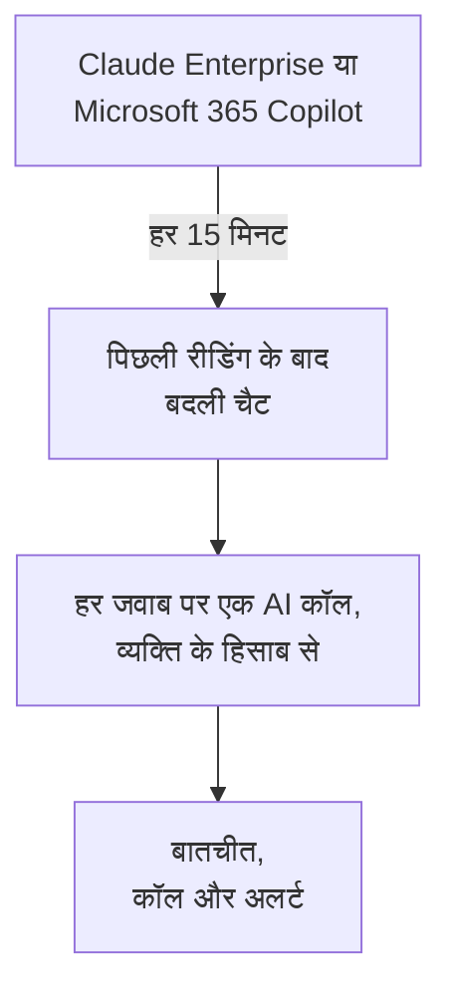

# कंपनी के AI टूल

देखें कि आपके लोग उन AI टूल से क्या पूछते हैं जिनका भुगतान आपकी कंपनी करती है, व्यक्ति के हिसाब से बातचीत के रूप में। Claude Enterprise या Microsoft 365 Copilot को ऐसे क्रेडेंशियल से कनेक्ट करें जो सिर्फ़ पढ़ सकता है, और OneUptime हर 15 मिनट में हर नई चैट **बातचीत** में लाता है। इन्हें सिर्फ़ प्रोजेक्ट के मालिक और एडमिन पढ़ सकते हैं, जब तक आप कुछ और न चुनें।

:::cards
- [पहले अपने लोगों को बताएँ](#पहले-अपने-लोगों-को-बताएँ): उनकी चैट उनके अपने शब्द हैं।
- [टूल कनेक्ट करें](#टूल-कनेक्ट-करें): क्रेडेंशियल चिपकाएँ, चुनें कि कौन पढ़ सकता है, जाँचें और कनेक्ट करें।
- [गोपनीयता](#गोपनीयता): बातचीत कौन पढ़ सकता है, और क्या शब्द रखे जाते हैं।
- [दूसरे AI टूल](#दूसरे-ai-टूल): ChatGPT Enterprise, Gemini, Open WebUI, LibreChat और कोडिंग असिस्टेंट।
:::

## पहले अपने लोगों को बताएँ

> [!IMPORTANT]
> ये आपके लोगों के अपने शब्द हैं। कोई टूल कनेक्ट करने से पहले उन्हें बताएँ कि उसके साथ उनकी चैट रखी जाती हैं और उन्हें कौन पढ़ सकता है, और अपनी कानूनी या HR टीम से पूछें कि आपकी नीतियाँ और स्थानीय कानून क्या माँगते हैं।

## यह कैसे काम करता है

हर 15 मिनट में OneUptime टूल से वे चैट माँगता है जो उसकी पिछली रीडिंग के बाद बदली हैं। हर जवाब पूछने वाले व्यक्ति की एक AI कॉल बनता है, पिछले जवाब के बाद पूछे गए सवालों के साथ, और हर चैट एक बातचीत बनती है।

चैट वैसे ही आती हैं जैसे आपके ऐप्स की AI कॉल, इसलिए स्क्रब नियम, ड्रॉप फ़िल्टर, रिटेंशन और AI अलर्ट उन पर लागू होते हैं। टूल का भुगतान प्रति सीट होता है, इसलिए इन कॉल में न टोकन होते हैं न लागत। जिस सवाल का एक घंटे तक जवाब नहीं आता, वह अकेला आ जाता है, ताकि वह चैट भी दिखे जिसका AI ने कभी जवाब नहीं दिया।

## शुरू करने से पहले

- Project Owner या Project Admin भूमिका। सिर्फ़ वही कोई टूल कनेक्ट कर, बदल या हटा सकते हैं।
- क्रेडेंशियल बनाने के लिए टूल का एक एडमिन: नीचे हर टूल का खंड बताता है कि कौन।
- आपके लोगों को सूचना, और आपकी कानूनी या HR टीम का जवाब।

## टूल कनेक्ट करें

:::steps
### कनेक्ट खोलें

**उत्पाद → AI / LLM → कनेक्ट करें** खोलें। **आपकी कंपनी के AI टूल** में टूल की टाइल पर क्लिक करें।

### क्रेडेंशियल चिपकाएँ

**क्रेडेंशियल** पर वह भरें जो टूल माँगता है। सीक्रेट एन्क्रिप्ट करके रखे जाते हैं और फिर कभी नहीं दिखाए जाते।

### चुनें कि कौन पढ़ सकता है

**निजता** पर **बातचीत कौन पढ़ सकता है** और **लिखी गई बातें रखें** सेट करें, जैसा [गोपनीयता](#गोपनीयता) समझाता है।

### जाँचें

**परीक्षण** पर **कनेक्शन का परीक्षण करें** पर क्लिक करें। OneUptime पिछले 7 दिनों की चैट गिनता है: किसी का लिखा कुछ भी पढ़ा, दिखाया या रखा नहीं जाता।

### कनेक्ट करें

**कनेक्ट करें** पर क्लिक करें। पहली रीडिंग एक मिनट के भीतर शुरू होती है और पिछले 7 दिन लाती है।
:::

## Claude Enterprise

OneUptime Compliance API से आपके संगठन की हर claude.ai चैट पढ़ता है: किसने पूछा, Claude से क्या पूछा गया, उसने क्या जवाब दिया और कौन-सा मॉडल उपयोग किया। जिस चैट में नया संदेश आता है, वह फिर से पढ़ी जाती है, और पहले से लाए गए जवाब पहचानकर छोड़ दिए जाते हैं।

:::steps
### Compliance API चालू करें

आपके संगठन का प्राथमिक मालिक claude.ai में Organization settings, API खोलता है और Compliance API चालू करता है।

### अनुपालन एक्सेस कुंजी बनाएँ

वहाँ `read:compliance_user_data` स्कोप वाली एक कुंजी बनाएँ। यह `sk-ant-api01-` से शुरू होती है।

### Claude Enterprise कनेक्ट करें

कुंजी को **अनुपालन एक्सेस कुंजी** के रूप में चिपकाएँ।
:::

## Microsoft 365 Copilot

OneUptime Microsoft Graph से हर व्यक्ति का Copilot इंटरैक्शन इतिहास पढ़ता है: उसने Teams, Outlook, Word, Excel, PowerPoint, Loop या Copilot Chat में Copilot से क्या पूछा, उसने क्या जवाब दिया, और किस ऐप में। एक प्रॉम्प्ट और उसके जवाब एक AI कॉल बनते हैं, और एक Copilot सेशन एक बातचीत। बड़ा टेनेंट हिस्सों में पढ़ा जाता है, वहीं से आगे जहाँ पिछली रीडिंग रुकी थी।

:::steps
### एक ऐप रजिस्टर करें

Microsoft Entra ID में एक ऐप रजिस्टर करें और उसके लिए एक क्लाइंट सीक्रेट बनाएँ।

### अनुमतियाँ दें

ऐप को Microsoft Graph की `AiEnterpriseInteraction.Read.All` और `User.Read.All` एप्लिकेशन अनुमतियाँ दें, और एडमिन सहमति दें।

### Copilot कनेक्ट करें

**डायरेक्टरी (टेनेंट) ID**, **एप्लिकेशन (क्लाइंट) ID** और **क्लाइंट सीक्रेट** भरें। सिर्फ़ कुछ लोगों को पढ़ने के लिए, **और फ़ील्ड** में **केवल इस समूह के लोग** में किसी समूह की ऑब्जेक्ट ID डालें, और ऐप को `GroupMember.Read.All` भी दें। Azure Government के लिए वहीं **क्लाउड** बदलें।
:::

## गोपनीयता

| सेटिंग | यह क्या करती है |
| --- | --- |
| **बातचीत कौन पढ़ सकता है** | **प्रोजेक्ट के मालिक और एडमिन**, डिफ़ॉल्ट: प्रोजेक्ट में कोई और इन बातचीत को, या जिन AI कॉल से वे बनी हैं उन्हें, OneUptime में कहीं नहीं देखता। **हर कोई जो AI कॉल पढ़ सकता है**: हर वह व्यक्ति जो प्रोजेक्ट के ट्रेस पढ़ सकता है। |
| **लिखी गई बातें रखें** | चालू, डिफ़ॉल्ट: सवाल और जवाब रखे जाते हैं। बंद: OneUptime रखता है कि किसने पूछा, कब, किस मॉडल से और किस ऐप में, पर शब्द नहीं। |

कौन पढ़ सकता है, इसमें बदलाव एक मिनट के भीतर लागू होता है। **लिखी गई बातें रखें** बंद करना उसके बाद पढ़ी गई चैट पर लागू होता है; जो पहले रखा गया, वह अपने रिटेंशन के खत्म होने तक रहता है।

शब्द रखने पर भी उनके कुछ हिस्से छिपाने के लिए, जैसे ईमेल पते या कार्ड नंबर, **ट्रेस → सेटिंग्स** में **स्क्रब नियम** का उपयोग करें: वे कुछ भी रखे जाने से पहले लागू होते हैं। बातचीत तब तक रखी जाती है जब तक कनेक्शन की सेवा अपने ट्रेस रखती है: [डेटा प्रतिधारण](/docs/telemetry/data-retention) देखें। कोई कनेक्शन हटाने से उसकी रीडिंग रुक जाती है; जो उसने पढ़ा, वह उन्हीं लोगों के लिए पढ़ने योग्य रहते हुए, अपने रिटेंशन के खत्म होने तक रहता है।

## दूसरे AI टूल

इन टूल के पास ऐसा कोई API नहीं है जिससे OneUptime लोगों की चैट पढ़ सके, या उन्हें दूसरा रास्ता चाहिए।

### ChatGPT Enterprise

OpenAI अपना Compliance API किसी वर्कस्पेस के लिए सिर्फ़ अनुरोध पर खोलता है और यह प्रकाशित नहीं करता कि उसके रिकॉर्ड में क्या होता है, इसलिए OneUptime अभी ChatGPT Enterprise की चैट नहीं पढ़ सकता। अपने OpenAI संगठन को [प्रदाता खाते](/docs/telemetry/ai-provider-accounts#openai) के रूप में कनेक्ट करने से उसका API उपयोग और लागत दिखती है, जिसमें ChatGPT शामिल नहीं है।

### Google Workspace के लिए Gemini

Google लोगों की Gemini चैट पढ़ने के लिए कोई API नहीं देता। Google Vault उन्हें eDiscovery के लिए रखता है।

### कोडिंग असिस्टेंट

Claude Code, Codex, Gemini CLI, GitHub Copilot और Cursor अपना OpenTelemetry भेजते हैं: [AI कोडिंग असिस्टेंट](/docs/telemetry/ai-coding-assistants) देखें।

### Open WebUI और LibreChat

सेल्फ़-होस्टेड चैट ऐप आपके तय किए API से मॉडल कॉल करते हैं। मॉडलों के आगे एक LiteLLM प्रॉक्सी लगाएँ और उसके ट्रेस OneUptime को भेजें, जैसा [AI गेटवे](/docs/telemetry/ai-gateways#litellm-proxy) दिखाता है: हर चैट के प्रॉम्प्ट और जवाब AI कॉल के रूप में आते हैं। हर व्यक्ति के लिए एक वर्चुअल कुंजी बताती है कि किसने पूछा; सबकी साझा कुंजी किसी का नाम नहीं बताती। Open WebUI का अपना OpenTelemetry एक्सपोर्ट उसके वेब अनुरोध और डेटाबेस कॉल ट्रेस करता है, चैट नहीं।

## समस्या निवारण

:::details जाँच में कोई चैट नहीं मिलती
पिछले 7 दिनों में किसी ने टूल का उपयोग नहीं किया, या क्रेडेंशियल किसी दूसरे संगठन या टेनेंट का है। Copilot के लिए जाँचें कि **केवल इस समूह के लोग** में दिया समूह वही है जो आप चाहते हैं।
:::

:::details क्रेडेंशियल काम करता है, पर वह नहीं पढ़ सकता जो कनेक्शन को चाहिए
Copilot के लिए ऐप की Graph अनुमतियों पर एडमिन सहमति दें, और समूह बताने पर `GroupMember.Read.All` भी। Claude Enterprise के लिए `read:compliance_user_data` स्कोप वाली कुंजी बनाएँ।
:::

:::details कोई बातचीत नहीं देख पा रहा
**बातचीत कौन पढ़ सकता है** **प्रोजेक्ट के मालिक और एडमिन** पर है। कोई मालिक या एडमिन कनेक्शन की पंक्ति में **संपादित करें** से इसे बदल सकता है।
:::

:::details बातचीत दिखाती है कि किसने पूछा, पर शब्द नहीं
जब वे पढ़ी गईं तब **लिखी गई बातें रखें** बंद था। इसे चालू करना उसके बाद पढ़ी गई चैट पर लागू होता है।
:::

## अगले कदम

:::cards
- [AI / LLM ऑब्ज़र्वेबिलिटी](/docs/telemetry/ai-llm-observability): बातचीत पढ़ें और दोबारा चलाएँ, और जानें कि जवाब कब गलत होते हैं।
- [AI प्रदाता खाते](/docs/telemetry/ai-provider-accounts): आपके OpenAI, Anthropic, Azure, Bedrock और Vertex AI खातों का उपयोग और लागत।
- [AI कोडिंग असिस्टेंट](/docs/telemetry/ai-coding-assistants): कोडिंग टूल पर हर इंजीनियर का खर्च।
- [डेटा प्रतिधारण](/docs/telemetry/data-retention): बातचीत कितने समय तक रखी जाती है।
:::
