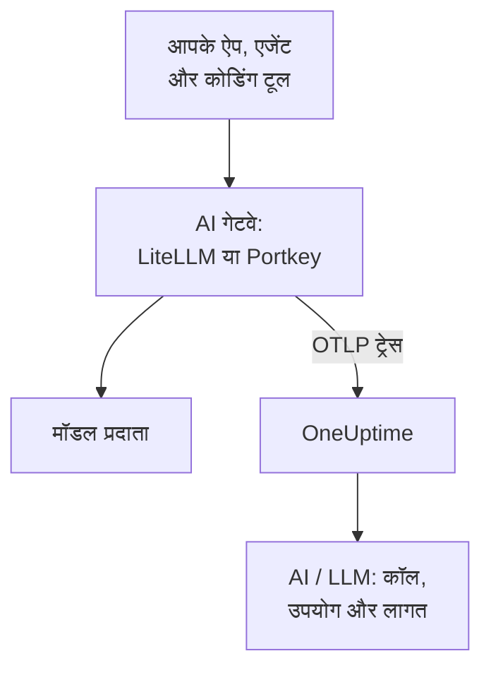

# AI गेटवे (LiteLLM, Portkey)

AI गेटवे आपके ऐप और मॉडल प्रदाताओं के बीच बैठता है, इसलिए हर मॉडल कॉल उससे होकर गुज़रती है। गेटवे का OpenTelemetry एक बार OneUptime को भेजें, और उसके पीछे की हर कॉल मॉडल, टोकन, लागत और, जब तक आप इसे बंद न करें, प्रॉम्प्ट और जवाब के साथ [AI / LLM](/docs/telemetry/ai-llm-observability) में पहुँचती है, हर ऐप को इंस्ट्रुमेंट किए बिना।

:::cards
- [LiteLLM Proxy](#litellm-proxy): बिल्ट-इन एक्सपोर्ट, तीन वेरिएबल से सेट।
- [किसने क्या खर्च किया](#हर-कर्मचारी-के-लिए-एक-वर्चुअल-कुंजी): हर कर्मचारी के लिए एक LiteLLM वर्चुअल कुंजी हर व्यक्ति की पहचान बताती है।
- [Portkey](#portkey): सेल्फ़-होस्टेड गेटवे पर बिल्ट-इन एक्सपोर्ट; बाकी जगह ऐप को इंस्ट्रुमेंट करें।
- [जाँचें कि कॉल पहुँच रही हैं](#जाँचें-कि-कॉल-पहुँच-रही-हैं): आपको क्या दिखना चाहिए, और न दिखे तो क्या करें।
:::

## यह कैसे काम करता है



| | LiteLLM Proxy | Portkey, सेल्फ़-होस्टेड या Enterprise | Portkey, ओपन सोर्स या होस्टेड |
| --- | --- | --- | --- |
| OneUptime को एक्सपोर्ट | बिल्ट-इन | बिल्ट-इन, प्रायोगिक | कोई नहीं: इसके बजाय ऐप को इंस्ट्रुमेंट करें |
| सेट करने वाला एंडपॉइंट | `https://oneuptime.com/otlp/v1/traces` | `https://oneuptime.com/otlp` | ऐप का अपना एक्सपोर्टर |
| हर व्यक्ति की पहचान | हाँ, हर कर्मचारी के लिए एक वर्चुअल कुंजी से | नहीं | सिर्फ़ वही जो ऐप भेजता है |
| प्रॉम्प्ट और जवाब | भेजे जाते हैं, जब तक आप बंद न करें | हमेशा भेजे जाते हैं | इंस्ट्रुमेंटेशन पर निर्भर |

## शुरू करने से पहले

- एक इन्जेशन कुंजी: **प्रोजेक्ट सेटिंग्स → टेलीमेट्री और APM → इंजेशन कुंजियाँ** खोलें और **इन्जेशन कुंजी बनाएँ** पर क्लिक करें।
- आपका OTLP बेस URL: `https://oneuptime.com/otlp`, या अगर आप OneUptime खुद होस्ट करते हैं तो `https://YOUR-ONEUPTIME-HOST/otlp`। OneUptime HTTP पर OTLP स्वीकार करता है, protobuf और JSON दोनों में।
- कुंजी हर एक्सपोर्ट अनुरोध के `x-oneuptime-token` हेडर में जाती है।

## LiteLLM Proxy

LiteLLM का OpenTelemetry कॉलबैक ओपन सोर्स प्रॉक्सी का हिस्सा है, और आधिकारिक Docker इमेज (`ghcr.io/berriai/litellm`) में उसके लिए ज़रूरी पैकेज पहले से हैं।

:::steps
### otel कॉलबैक चालू करें

प्रॉक्सी के `config.yaml` में कॉलबैक में `otel` जोड़ें:

```yaml title="config.yaml"
model_list:
  - model_name: gpt-4o
    litellm_params:
      model: openai/gpt-4o
      api_key: os.environ/OPENAI_API_KEY

litellm_settings:
  callbacks: ["otel"]
```

### एक्सपोर्टर को OneUptime की ओर मोड़ें

प्रॉक्सी पर तीन वेरिएबल सेट करें:

```bash
export OTEL_EXPORTER="otlp_http"
export OTEL_ENDPOINT="https://oneuptime.com/otlp/v1/traces"
export OTEL_HEADERS="x-oneuptime-token=YOUR_INGESTION_TOKEN"
```

### प्रॉक्सी शुरू करें

:::tabs
@tab Docker
```bash
docker run \
  -v $(pwd)/config.yaml:/app/config.yaml \
  -e OPENAI_API_KEY="sk-..." \
  -e OTEL_EXPORTER="otlp_http" \
  -e OTEL_ENDPOINT="https://oneuptime.com/otlp/v1/traces" \
  -e OTEL_HEADERS="x-oneuptime-token=YOUR_INGESTION_TOKEN" \
  -e OTEL_SERVICE_NAME="litellm-gateway" \
  -p 4000:4000 \
  ghcr.io/berriai/litellm:main-stable \
  --config /app/config.yaml
```
@tab pip
```bash
pip install 'litellm[proxy]' opentelemetry-api opentelemetry-sdk opentelemetry-exporter-otlp
litellm --config config.yaml
```
:::

सिर्फ़ `litellm[proxy]` में OpenTelemetry पैकेज शामिल नहीं हैं, इसलिए उन्हें साथ में इंस्टॉल करें।

### उससे होकर एक अनुरोध भेजें

प्रॉक्सी को एक बार कॉल करें, फिर [जाँचें कि कॉल पहुँच रही हैं](#जाँचें-कि-कॉल-पहुँच-रही-हैं) में बताए तरीके से AI / LLM जाँचें।
:::

| वेरिएबल | मान | टिप्पणी |
| --- | --- | --- |
| `OTEL_EXPORTER` | `otlp_http` | `OTEL_EXPORTER_OTLP_PROTOCOL` के रूप में भी पढ़ा जाता है |
| `OTEL_ENDPOINT` | `https://oneuptime.com/otlp/v1/traces` | पूरा पथ `/v1/traces` हर LiteLLM वर्शन के साथ काम करता है; `OTEL_EXPORTER_OTLP_ENDPOINT` के रूप में भी पढ़ा जाता है |
| `OTEL_HEADERS` | `x-oneuptime-token=YOUR_INGESTION_TOKEN` | कॉमा से अलग `key=value` जोड़े; `OTEL_EXPORTER_OTLP_HEADERS` के रूप में भी पढ़ा जाता है |
| `OTEL_SERVICE_NAME` | आपके गेटवे का नाम | वह सेवा जिसके अंदर कॉल दिखती हैं; कुछ सेट न करें तो `litellm` |

### LiteLLM क्या भेजता है

हर कॉल में `gen_ai.system`, `gen_ai.request.model`, `gen_ai.response.model`, `gen_ai.usage.input_tokens` और `gen_ai.usage.output_tokens`, उसके पैरामीटर, और प्रॉम्प्ट और जवाब होते हैं: वह सब जो OneUptime को [कॉल पढ़ने](/docs/telemetry/ai-llm-observability) के लिए चाहिए।

LiteLLM 1.81 से ये विशेषताएँ अनुरोध के `Received Proxy Server Request` स्पैन पर होती हैं, और अब अलग `litellm_request` स्पैन नहीं होता। जब एक अनुरोध कई मॉडल कॉल करता है, तो हर कॉल वहाँ पिछली कॉल की विशेषताओं को ओवरराइट कर देती है, इसलिए हर कॉल के लिए एक `litellm_request` स्पैन पाने के लिए `USE_OTEL_LITELLM_REQUEST_SPAN=true` सेट करें।

LiteLLM हर कॉल की कीमत खुद लगाता है, प्रॉक्सी पर सेट की गई कस्टम दरों सहित, और कीमत को `gen_ai.cost.total_cost` के रूप में रिपोर्ट करता है। OneUptime अपने अनुमान से ज़्यादा रिपोर्ट की गई कीमत को प्राथमिकता देता है, और [टोकन से अनुमान](/docs/telemetry/ai-llm-observability) तभी लगाता है जब LiteLLM कॉल की कीमत नहीं लगा सका, जैसे बिना कीमत सेट किए कस्टम मॉडल के लिए।

### हर कर्मचारी के लिए एक वर्चुअल कुंजी

हर व्यक्ति को उसकी अपनी LiteLLM वर्चुअल कुंजी दें, और उसकी हर कॉल इस जानकारी के साथ पहुँचती है कि वह कौन है। LiteLLM कुंजी के मालिक की ID, ईमेल और टीम स्पैन पर लिखता है, और OneUptime उन्हें कर्मचारी और टीम के रूप में पढ़ता है, इसलिए **उपयोग** टैब किसी की मशीन पर कुछ सेट किए बिना हर व्यक्ति के खर्च की रैंकिंग दिखाता है।

वर्चुअल कुंजियों के लिए प्रॉक्सी पर एक डेटाबेस और एक मास्टर कुंजी चाहिए (`DATABASE_URL` और `LITELLM_MASTER_KEY`)। व्यक्ति के ईमेल से एक उपयोगकर्ता बनाएँ, फिर उस उपयोगकर्ता के लिए एक कुंजी:

```bash
curl -X POST "http://localhost:4000/user/new" \
  -H "Authorization: Bearer YOUR_MASTER_KEY" \
  -H "Content-Type: application/json" \
  -d '{"user_email": "alice@example.com"}'

curl -X POST "http://localhost:4000/key/generate" \
  -H "Authorization: Bearer YOUR_MASTER_KEY" \
  -H "Content-Type: application/json" \
  -d '{"user_id": "USER_ID_FROM_THE_FIRST_CALL", "team_id": "platform"}'
```

| LiteLLM की स्पैन विशेषता | OneUptime इसे इस रूप में पढ़ता है |
| --- | --- |
| `metadata.user_api_key_user_id` | कर्मचारी की ID |
| `metadata.user_api_key_user_email` | कर्मचारी का ईमेल |
| `metadata.user_api_key_team_id` | टीम |
| `metadata.user_api_key_end_user_id` | कभी कर्मचारी नहीं: यह वह `user` है जो आपका ऐप अपने ग्राहक के लिए भेजता है |

LiteLLM के OpenTelemetry v2 मोड में वही मान `litellm.` प्रीफ़िक्स के साथ आते हैं (`litellm.metadata.user_api_key_user_email` आदि), जिन्हें OneUptime भी पढ़ता है।

### प्रॉम्प्ट बाहर रखें

`otel` कॉलबैक डिफ़ॉल्ट रूप से पूरे प्रॉम्प्ट और जवाब भेजता है। उन्हें बाहर रखने के लिए इनमें से कोई एक विकल्प इस्तेमाल करें:

:::tabs
@tab हर कॉलबैक
```yaml title="config.yaml"
litellm_settings:
  callbacks: ["otel"]
  turn_off_message_logging: true
```
@tab सिर्फ़ OTel कॉलबैक
```yaml title="config.yaml"
litellm_settings:
  callbacks: ["otel"]

callback_settings:
  otel:
    message_logging: False
```
@tab एनवायरनमेंट वेरिएबल
```bash
export OTEL_INSTRUMENTATION_GENAI_CAPTURE_MESSAGE_CONTENT="NO_CONTENT"
```
:::

`callback_settings` एक टॉप-लेवल कुंजी है, `litellm_settings` के अंदर की कुंजी नहीं। प्रॉम्प्ट रखते हुए उनके कुछ हिस्से छिपाने के लिए, इसके बजाय **ट्रेस → सेटिंग्स** के अंदर स्क्रब नियम इस्तेमाल करें।

:::details LiteLLM का OpenTelemetry v2 मोड
नए LiteLLM वर्शन में एक वैकल्पिक OpenTelemetry v2 मोड है (`LITELLM_OTEL_V2=true`, `config.yaml` में कोई बदलाव नहीं)। यह हर अनुरोध के लिए एक ट्रेस भेजता है, जिसमें HTTP हैंडलिंग, प्रमाणीकरण, गार्डरेल और मॉडल कॉल `chat gpt-4o` जैसे नामों वाले GenAI स्पैन के रूप में होते हैं। v2 मोड में प्रॉम्प्ट डिफ़ॉल्ट रूप से बंद रहते हैं; उन्हें `OTEL_INSTRUMENTATION_GENAI_CAPTURE_MESSAGE_CONTENT` से चालू करें। लागत `litellm.cost.total` के रूप में आती है, जिसे OneUptime भी पढ़ता है। एक ही मोड इस्तेमाल करें, दोनों नहीं।
:::

## Portkey

Portkey क्या भेज सकता है, यह इस पर निर्भर करता है कि आप उसे कैसे चलाते हैं:

| डिप्लॉयमेंट | OneUptime को एक्सपोर्ट |
| --- | --- |
| सेल्फ़-होस्टेड या Enterprise गेटवे | बिल्ट-इन (प्रायोगिक): नीचे दिए वेरिएबल सेट करें |
| ओपन सोर्स गेटवे (`portkey-ai/gateway`) | कोई नहीं: उसे कॉल करने वाले ऐप को इंस्ट्रुमेंट करें |
| होस्टेड गेटवे (portkey.ai) | गेटवे पर कोई नहीं: उसे कॉल करने वाले ऐप को इंस्ट्रुमेंट करें |

Portkey का अपना OpenTelemetry एंडपॉइंट (`api.portkey.ai/v1/otel`) भी है। वह Portkey में ट्रेस प्राप्त करता है, जो इस पेज की उलटी दिशा है।

### सेल्फ़-होस्टेड और Enterprise गेटवे

गेटवे के कंटेनर पर ये वेरिएबल सेट करें:

```yaml title="docker-compose.yml"
services:
  portkey-gateway:
    environment:
      EXPERIMENTAL_GEN_AI_OTEL_TRACES_ENABLED: "true"
      EXPERIMENTAL_GEN_AI_OTEL_EXPORTER_OTLP_ENDPOINT: "https://oneuptime.com/otlp"
      EXPERIMENTAL_GEN_AI_OTEL_EXPORTER_OTLP_HEADERS: "x-oneuptime-token=YOUR_INGESTION_TOKEN"
```

- OTLP बेस URL दें: Portkey `/v1/traces` खुद जोड़ता है।
- हेडर कॉमा से अलग `key=value` जोड़े होते हैं। `EXPERIMENTAL_GEN_AI_OTEL_RESOURCE_ATTRIBUTES` इसी तरह रिसोर्स विशेषताएँ जोड़ता है, जैसे `deployment.environment=production`।
- Portkey HTTP पर OTLP सिर्फ़ JSON में भेजता है, जिसे OneUptime बीच में कलेक्टर के बिना स्वीकार करता है।
- हर कॉल `{operation} {model}` नाम का एक स्पैन है, जैसे `chat gpt-4o`, जो `portkey` सेवा के अंदर होता है, और उसमें `gen_ai.provider.name`, माँगा गया और जवाब देने वाला मॉडल, टोकन की गिनती, `gen_ai.conversation.id`, और `gen_ai.input.messages` और `gen_ai.output.messages` में संदेश होते हैं।
- पूरे प्रॉम्प्ट और जवाब हमेशा शामिल रहते हैं। जो ज़रूरी हो उसे **ट्रेस → सेटिंग्स** के अंदर स्क्रब नियमों से छिपाएँ।
- हर कॉल जवाब के बाद अलग से भेजी जाती है, बिना बैचिंग और बिना रीट्राई के: विफल एक्सपोर्ट खो जाता है। इसे ऑब्ज़र्वेबिलिटी मानें, ऑडिट लॉग नहीं।
- अगर आपका `x-portkey-trace-id` एक मान्य ट्रेस ID है (32 हेक्साडेसिमल अक्षर), तो Portkey उसे फिर से इस्तेमाल करता है, जिससे गेटवे के स्पैन आपके अपने ऐप के ट्रेस से जुड़ जाते हैं।

Portkey इस एक्सपोर्ट को प्रायोगिक बताता है। अगर वेरिएबल का कोई असर न हो, तो Portkey के मौजूदा दस्तावेज़ को अपने गेटवे के वर्शन से मिलाकर देखें।

### ओपन सोर्स और होस्टेड गेटवे

ओपन सोर्स गेटवे में कोई एक्सपोर्टर नहीं है, और होस्टेड गेटवे पर आप उसके वेरिएबल सेट नहीं कर सकते। इसके बजाय उस ऐप को इंस्ट्रुमेंट करें जो Portkey को कॉल करता है। Portkey OpenAI API बोलता है, इसलिए [AI / LLM ऑब्ज़र्वेबिलिटी](/docs/telemetry/ai-llm-observability) के GenAI इंस्ट्रुमेंटेशन (OpenLLMetry, OpenInference, OpenLIT) आपके SDK की कॉल ट्रेस करते हैं, तब भी जब बेस URL Portkey की ओर इशारा करता हो:

```python
from traceloop.sdk import Traceloop
from openai import OpenAI

Traceloop.init(
    app_name="my-ai-agent",
    api_endpoint="https://oneuptime.com/otlp",
    headers={"x-oneuptime-token": "YOUR_INGESTION_TOKEN"},
)

client = OpenAI(
    base_url="https://api.portkey.ai/v1",   # or your gateway's URL
    default_headers={"x-portkey-api-key": "PORTKEY_API_KEY"},
)
# Calls through Portkey are now traced to OneUptime.
```

ये स्पैन कॉल को वैसे बताते हैं जैसे आपके ऐप ने उसे किया: उसने कौन-सा मॉडल माँगा, कितनी देर इंतज़ार किया, कितने टोकन वापस मिले। गेटवे ने रास्ते में जो तय किया, जैसे फ़ॉलबैक, रीट्राई या कैश हिट, वह Portkey में ही रहता है। उसे OneUptime में देखने के लिए सेल्फ़-होस्टेड गेटवे का एक्सपोर्ट इस्तेमाल करें।

## जाँचें कि कॉल पहुँच रही हैं

:::steps
1. गेटवे से होकर एक अनुरोध भेजें और कुछ सेकंड इंतज़ार करें।
2. **उत्पाद → AI / LLM → कॉल** खोलें। कॉल प्रदाता, मॉडल और टोकन के साथ सूची में दिखती है।
3. कॉल पर क्लिक करके उसका ट्रेस खोलें, और स्पैन का **LLM** टैब खोलें: मॉडल, टोकन, पैरामीटर और, जब तक आपने बंद न किया हो, प्रॉम्प्ट और जवाब।
4. **उपयोग** खोलें: कॉल कुल में गिनी जाती है, उस लागत के साथ जो गेटवे ने रिपोर्ट की या OneUptime ने अनुमान लगाई।
:::

## समस्या निवारण

:::details LiteLLM से कुछ नहीं आता
थोड़ी देर के लिए `OTEL_EXPORTER="console"` सेट करें। अगर प्रॉक्सी के आउटपुट में स्पैन दिखते हैं, तो LiteLLM ट्रेस कर रहा है, और समस्या एंडपॉइंट या कुंजी में है। `DEBUG_OTEL="true"` दिखाता है कि एक्सपोर्टर क्या कर रहा है।
:::

:::details कुंजी अस्वीकार हो जाती है
कुंजी न होने, अज्ञात होने या उसकी समय-सीमा खत्म होने पर OneUptime `401` जवाब देता है, और बंद की गई कुंजी या ब्राउज़र कुंजी पर `422`। **प्रोजेक्ट सेटिंग्स → टेलीमेट्री और APM → इंजेशन कुंजियाँ** के अंदर एक सर्वर कुंजी बनाएँ और उसे `x-oneuptime-token` में भेजें।
:::

:::details एंडपॉइंट गलत है
LiteLLM पूरा पथ लेता है, `https://oneuptime.com/otlp/v1/traces`। Portkey बेस URL लेता है, `https://oneuptime.com/otlp`, और `/v1/traces` खुद जोड़ता है।
:::

:::details स्पैन आते हैं, लेकिन AI / LLM में नहीं
कच्चे स्पैन देखने के लिए **ट्रेस** को गेटवे की सेवा (`litellm`, `portkey` या आपका `OTEL_SERVICE_NAME`) से फ़िल्टर करें। कोई स्पैन मॉडल कॉल तभी गिना जाता है जब उसमें `gen_ai.*` विशेषताएँ हों: जाँचें कि कॉलबैक `otel` है और कॉल किसी मॉडल को गई थी।
:::

:::details खर्च बिना एट्रिब्यूशन दिखता है
कॉल किसी व्यक्ति का नाम नहीं बतातीं। [हर कर्मचारी के लिए एक वर्चुअल कुंजी](#हर-कर्मचारी-के-लिए-एक-वर्चुअल-कुंजी) की तरह, हर कर्मचारी को उसकी अपनी वर्चुअल कुंजी दें। आपका ऐप जो `user` फ़ील्ड भेजता है, वह उसके ग्राहक का नाम बताता है, कर्मचारी का नहीं, और उसे कभी कर्मचारी के रूप में नहीं पढ़ा जाता।
:::

:::details कई कॉल में से सिर्फ़ आख़िरी दिखती है
LiteLLM 1.81 से एक अनुरोध की मॉडल कॉल एक ही स्पैन साझा करती हैं। हर कॉल के लिए एक स्पैन पाने के लिए `USE_OTEL_LITELLM_REQUEST_SPAN=true` सेट करें।
:::

## अगले कदम

:::cards
- [AI / LLM ऑब्ज़र्वेबिलिटी](/docs/telemetry/ai-llm-observability): इन कॉल के लिए बातचीत, अलर्ट, उपयोग और रोज़ाना लागत बजट।
- [AI कोडिंग असिस्टेंट](/docs/telemetry/ai-coding-assistants): जो टूल खुद टेलीमेट्री नहीं भेजते, उनके आगे एक गेटवे लगाएँ।
- [AI एजेंट सर्किट ब्रेकर](/docs/telemetry/ai-agent-circuit-breaker): जब उसका अलर्ट बजे, बेकाबू एजेंट को रोकें।
- [ट्रेस मॉनिटर](/docs/monitor/traces-monitor): स्पैन पैटर्न पर अलर्ट करें, जैसे लूप में कॉल होता टूल।
:::
