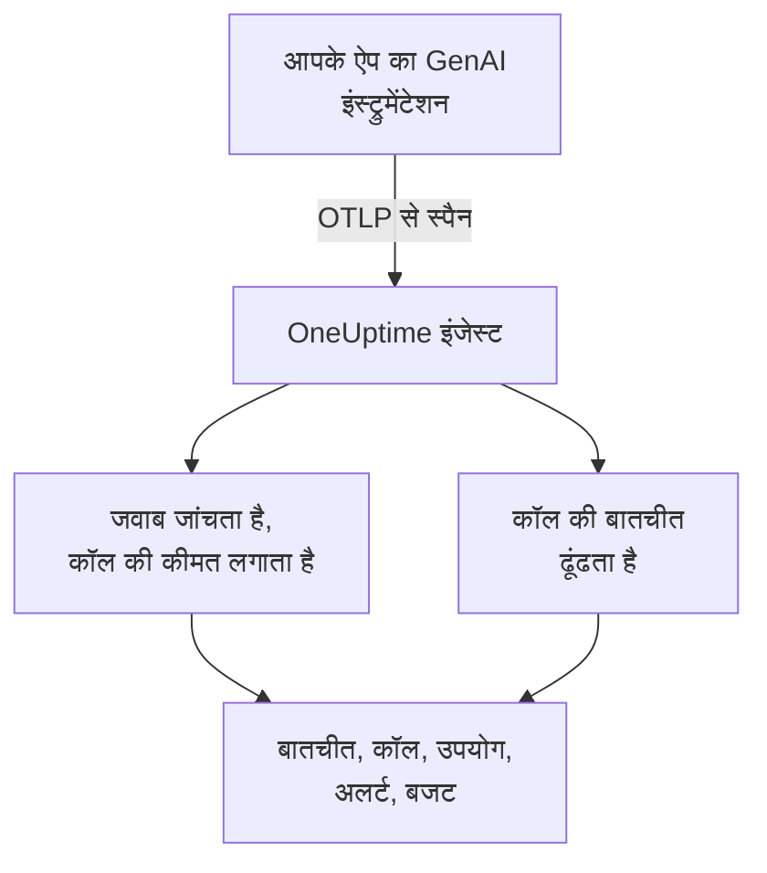
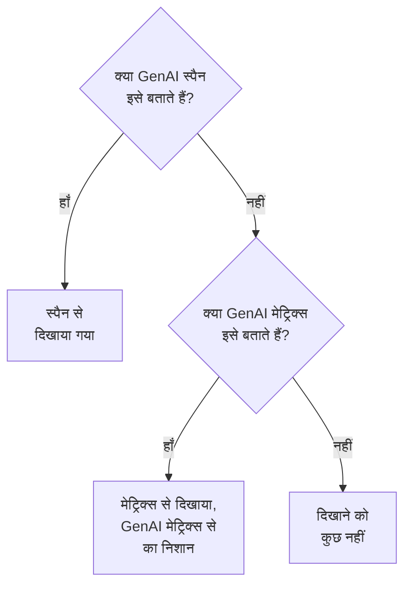

# AI / LLM ऑब्ज़र्वेबिलिटी

अपने AI की हर बातचीत पढ़ें, उसे वैसे ही फिर से चलाएँ जैसे वह हुई थी, और जब वह खराब जवाब दे तो सूचना पाएँ। OneUptime यह सब मानक OpenTelemetry से बनाता है: अगर आपका ऐप **GenAI सिमेंटिक कन्वेंशन** (`gen_ai.*`) वाले स्पैन भेजता है, तो आपको बिना किसी मालिकाना SDK के बातचीत, अलर्ट, उपयोग और लागत मिलती है।

:::cards
- [सेट अप करें](#पाँच-चरणों-में-सेट-अप-करें): पाँच चरण, पहले स्पैन से लेकर फ़्लैग किए गए जवाबों तक।
- [बातचीत फिर से चलाएँ](#बातचीत-पढ़ें-और-फिर-से-चलाएँ): चैट को वैसे पढ़ें जैसे व्यक्ति ने देखा, उसी रफ़्तार में जिसमें वह हुई।
- [अलर्ट पाएँ](#जब-ai-खराब-जवाब-दे-तो-सूचना-पाएँ): विफल, अस्वीकार किए गए, अधूरे कटे, फ़्लैग किए गए या धीमे जवाबों के लिए तैयार अलर्ट।
- [खर्च पर नज़र रखें](#देखें-कि-कौन-किस-पर-खर्च-करता-है): व्यक्ति, टीम, मॉडल और ऐप के हिसाब से लागत, रोज़ाना बजट के साथ।
:::

## यह कैसे काम करता है

आपके ऐप का GenAI इंस्ट्रुमेंटेशन मॉडल की हर कॉल को एक OpenTelemetry स्पैन के रूप में एक्सपोर्ट करता है। स्पैन आते ही OneUptime उसकी `gen_ai.*` विशेषताएँ पढ़ता है, जवाब में समस्याएँ जांचता है, कॉल की कीमत लगाता है और उसे उसकी बातचीत में रखता है।



**अवलोकनीयता** के अंदर **उत्पाद → AI / LLM** खोलें। इस उत्पाद में सात टैब हैं:

| टैब | यह क्या दिखाता है |
| --- | --- |
| **बातचीत** | आपके AI की हर बातचीत, जिन पर ध्यान देना है वे सबसे पहले। सूची के ऊपर: बातचीत, AI के जवाब, कितनी पर ध्यान देना है, लागत और जवाब का आम समय। |
| **कॉल** | मॉडल, एम्बेडिंग, एजेंट और टूल की हर कॉल। सेवा, प्रदाता, मॉडल, ऑपरेशन, व्यक्ति, टीम या बातचीत से फ़िल्टर करें; किसी कॉल पर क्लिक करके उसे ट्रेस व्यूअर में खोलें। |
| **उपयोग** | किसी समय-अवधि की कॉल, टोकन और लागत, कर्मचारी, टीम, मॉडल, प्रदाता या ऐप के हिसाब से रैंक की हुई। |
| **अलर्ट** | AI के खराब जवाब देने के लिए तैयार अलर्ट, और आपके AI / LLM मॉनिटर। |
| **बजट** | रोज़ाना की लागत सीमाएँ, ऐसे मेट्रिक्स के रूप में प्रकाशित जिन पर अलर्ट लगाया जा सके। |
| **मूल्य** | उन मॉडलों के लिए आपकी अपनी कीमतें जिन्हें बिल्ट-इन मूल्य सूची नहीं जानती। |
| **सेटअप** | नीचे दिए गए पाँच चरण, आपके प्रोजेक्ट के एंडपॉइंट के साथ। |

ट्रेस व्यूअर में हर AI कॉल के स्पैन में एक **LLM** टैब भी होता है: प्रदाता, मॉडल, टोकन, लागत, अनुरोध के पैरामीटर, और प्रॉम्प्ट और जवाब।

## शुरू करने से पहले

- एक OneUptime प्रोजेक्ट जिसमें आप टेलीमेट्री इंजेशन कुंजी बना सकें।
- एक ऐप जो किसी मॉडल को कॉल करता है, और उसकी भाषा के लिए एक GenAI इंस्ट्रुमेंटेशन: **OpenLLMetry** (Traceloop), **OpenInference** (Arize), **Vercel AI SDK**, या OpenAI, Anthropic और Gemini के लिए OpenTelemetry इंस्ट्रुमेंटेशन।

> [!TIP]
> LiteLLM या Portkey जैसे गेटवे से गुज़रने वाला मॉडल ट्रैफ़िक हर ऐप के बजाय गेटवे से एक्सपोर्ट किया जा सकता है: [AI गेटवे](/docs/telemetry/ai-gateways) देखें। आपके इंजीनियर जिन कोडिंग असिस्टेंट का इस्तेमाल करते हैं, उनके लिए [AI कोडिंग असिस्टेंट](/docs/telemetry/ai-coding-assistants) देखें।

## पाँच चरणों में सेट अप करें

कॉल देखने के लिए पहला चरण ही काफ़ी है। उसके बाद का हर चरण और ज़्यादा दिखाता है।

:::steps
### अपनी AI कॉल भेजें

**प्रोजेक्ट सेटिंग्स → टेलीमेट्री और APM → इंजेशन कुंजियाँ** में एक इंजेशन कुंजी बनाएँ ([OpenTelemetry क्विकस्टार्ट](/docs/telemetry/open-telemetry#एक-इंजेशन-कुंजी-बनाएं) इसे चरण-दर-चरण बताता है)। फिर अपने इंस्ट्रुमेंटेशन को OneUptime की ओर करें:

:::tabs
@tab Python
```bash
pip install traceloop-sdk opentelemetry-exporter-otlp
```

```python
from traceloop.sdk import Traceloop

Traceloop.init(
    app_name="my-ai-agent",
    api_endpoint="https://oneuptime.com/otlp",
    headers={"x-oneuptime-token": "YOUR_INGESTION_TOKEN"},
)
# Your OpenAI, Anthropic and LangChain calls are now traced.
```
@tab Node.js
```bash
npm install @traceloop/node-server-sdk
```

```typescript
import * as traceloop from "@traceloop/node-server-sdk";

traceloop.initialize({
  appName: "my-ai-agent",
  baseUrl: "https://oneuptime.com/otlp",
  headers: { "x-oneuptime-token": "YOUR_INGESTION_TOKEN" },
});
```
@tab OpenTelemetry SDK
```bash
export OTEL_EXPORTER_OTLP_ENDPOINT="https://oneuptime.com/otlp"
export OTEL_EXPORTER_OTLP_HEADERS="x-oneuptime-token=YOUR_INGESTION_TOKEN"
export OTEL_EXPORTER_OTLP_PROTOCOL="http/protobuf"
export OTEL_SERVICE_NAME="my-ai-agent"
```
:::

OneUptime खुद होस्ट करते हैं? `https://oneuptime.com/otlp` की जगह `https://YOUR-ONEUPTIME-HOST/otlp` इस्तेमाल करें। अपने मॉडल को एक बार कॉल करें, और वह कॉल **कॉल** में दिखने लगती है।

### जो कहा गया वह रिकॉर्ड करें

बातचीत में यह तभी दिखता है कि लोगों ने क्या पूछा और AI ने क्या जवाब दिया, जब आपका इंस्ट्रुमेंटेशन उसे रिकॉर्ड करता है। OpenLLMetry प्रॉम्प्ट और जवाब रिकॉर्ड करता है, जब तक आप `TRACELOOP_TRACE_CONTENT=false` सेट न करें। OpenTelemetry इंस्ट्रुमेंटेशन उन्हें तभी रिकॉर्ड करते हैं जब आप कहें:

```bash
export OTEL_INSTRUMENTATION_GENAI_CAPTURE_MESSAGE_CONTENT=true
```

नए OpenTelemetry इंस्ट्रुमेंटेशन `true` की जगह `span_only`, `event_only` या `span_and_event` लेते हैं। रिकॉर्ड की गई सामग्री के बिना भी बातचीत अपना समय, लागत और समस्याएँ दिखाती है। प्रॉम्प्ट में संवेदनशील डेटा हो सकता है: [गोपनीयता और रिडैक्शन](#गोपनीयता-और-रिडैक्शन) बताता है कि उसे सहेजने से पहले कैसे मास्क करें।

### कॉल को बातचीत में समूहित करें

चैट ऐप हर बारी में मॉडल को एक बार कॉल करता है। हर AI कॉल पर `gen_ai.conversation.id` (या `session.id`) को अपनी चैट की ID पर सेट करें, और हर चैट एक बातचीत के रूप में दिखेगी, चाहे उसमें कितनी भी कॉल और ट्रेस लगे हों। OpenLLMetry के साथ इसे हर अनुरोध में एक बार सेट करें:

```python
from traceloop.sdk import Traceloop

Traceloop.set_association_properties({
    "session_id": chat.id,
    "user_email": user.email,
})
```

Vercel AI SDK के साथ चैट की ID को `experimental_telemetry: { metadata: { sessionId } }` के रूप में दें। बातचीत ID के बिना कॉल भी दिखती हैं, एक बार में एक अनुरोध (एक ट्रेस)।

### बताएँ कि किसने पूछा

हर AI कॉल पर `user.id` या `user.email` सेट करें (ऊपर की एसोसिएशन प्रॉपर्टी ईमेल सेट करती है)। तब हर बातचीत दिखाती है कि वह किसके साथ थी, आप सूची को व्यक्ति से खोज सकते हैं, और **उपयोग** टैब खर्च को कर्मचारी के हिसाब से रैंक करता है। [कर्मचारी और टीम एट्रिब्यूशन](/docs/telemetry/ai-coding-assistants#कर्मचारी-और-टीम-एट्रिब्यूशन) उन सभी पहचान कुंजियों की सूची देता है जिन्हें OneUptime पढ़ता है।

### खराब जवाबों को फ़्लैग करें

OneUptime हर जवाब को आते ही जांचता है और उसमें जो गलत हुआ उसे चिह्नित करता है:

| समस्या | इसका मतलब | किससे पता चलता है |
| --- | --- | --- |
| विफल | कॉल एक त्रुटि पर खत्म हुई, इसलिए कोई जवाब नहीं आया | स्पैन स्टेटस Error, `error.type`, या फ़िनिश रीज़न `error` |
| अस्वीकार | AI ने मना कर दिया, या किसी सुरक्षा फ़िल्टर ने जवाब रोक दिया | इनकार या सुरक्षा वाला फ़िनिश रीज़न (`content_filter`, `refusal`, `SAFETY` आदि), जवाब में इनकार, या ऐसा जवाब जो अंग्रेज़ी के किसी तय इनकार वाक्य से शुरू हो |
| अधूरा कटा | जवाब टोकन सीमा पर रुक गया | फ़िनिश रीज़न `length`, `max_tokens` या `MAX_TOKENS` |
| खाली | न टेक्स्ट, न टूल कॉल | रिकॉर्ड की गई सामग्री जिसमें कुछ नहीं, या 0 आउटपुट टोकन |
| फ़्लैग किया गया | आपके ऐप के भेजे किसी मूल्यांकन ने कहा कि जवाब खराब था | एक `gen_ai.evaluation.result` इवेंट |

पहले चार के लिए आपको कुछ नहीं करना होता। जिस जवाब को आपका गार्डरेल, आपका मूल्यांकन या थम्स-डाउन बटन खारिज करे उसे फ़्लैग करने के लिए, जवाब के स्पैन पर, स्पैन खुला रहते हुए, एक `gen_ai.evaluation.result` इवेंट जोड़ें और `gen_ai.evaluation.score.label` को `fail` पर सेट करें:

```python
from opentelemetry import trace

trace.get_current_span().add_event(
    "gen_ai.evaluation.result",
    {
        "gen_ai.evaluation.name": "relevance",
        "gen_ai.evaluation.score.label": "fail",
        "gen_ai.evaluation.explanation": "The answer is about another product.",
    },
)
```

`incorrect`, `wrong`, `unhelpful`, `toxic`, `unsafe` और `hallucination` जैसे लेबल भी विफल गिने जाते हैं। OneUptime आपकी बातचीत को जांचने के लिए कभी किसी दूसरे AI को नहीं भेजता: हर जांच सिर्फ़ वही पढ़ती है जो कॉल खुद लेकर आती है।
:::

## बातचीत पढ़ें और फिर से चलाएँ

बातचीत पूरी खुलती है, वैसे ही जैसे कोई चैट ऐप अपना इतिहास दिखाता है: व्यक्ति ने जो कहा वह दाईं ओर, AI के जवाब बाईं ओर उनके मॉडल, समय, टोकन और लागत के साथ, बीच में टूल कॉल, और जो गलत हुआ वह वहीं चिह्नित जहाँ हुआ। किसी जवाब के नीचे **विवरण** दिखाता है कि वह क्यों रुका, उसके मूल्यांकन, और ट्रेस में उस कॉल का लिंक।

नीचे की पट्टी बातचीत को वैसे ही फिर से चलाती है जैसे व्यक्ति ने उसे जिया:

| कंट्रोल | यह क्या करता है |
| --- | --- |
| **फिर से चलाएँ** | बातचीत को पहले संदेश से उसी रफ़्तार में चलाता है जिसमें वह हुई थी। जब कोई जवाब आ रहा होता है तो "AI जवाब दे रहा है…" समय गिनता रहता है। किसी भी संदेश के समय पर क्लिक करके वहीं से चलाएँ। |
| **इंतज़ार छोड़ें** | डिफ़ॉल्ट रूप से चालू: 3 सेकंड से लंबी किसी भी चुप्पी को छोटा कर देता है। |
| `1x` | गति बदलता है: 1x, 2x, 4x या 8x। |
| **K**, **J** या **←**, **L** या **→** | चलाएँ या रोकें, पिछले संदेश पर जाएँ, अगले संदेश पर जाएँ। |

पेज का पता उस संदेश को याद रखता है जहाँ रिप्ले रुका था (`?step=`), इसलिए आपका साझा किया गया लिंक उसी पल पर खुलता है।

## जब AI खराब जवाब दे तो सूचना पाएँ

**अलर्ट** टैब वे अलर्ट दिखाता है जो ज़्यादातर AI ऐप चाहते हैं। किसी एक को चुनने पर **मॉनिटर बनाएं** पहले से भरा हुआ खुलता है, और सहेजने से पहले आप कुछ भी बदल सकते हैं:

| अलर्ट | यह आपको कब बताता है | गंभीरता |
| --- | --- | --- |
| जवाबों में गड़बड़ी | 15 मिनट में 5% से ज़्यादा जवाब विफल, अस्वीकार, अधूरे कटे, खाली या फ़्लैग किए गए हों | Warning |
| AI कॉल विफल होती हैं | 5 मिनट में मॉडल की 10% से ज़्यादा कॉल त्रुटि पर खत्म हों | Critical |
| AI जवाब देने से इनकार करता है | 30 मिनट में 5% से ज़्यादा जवाब इनकार हों | Warning |
| जवाब अधूरे कटते हैं | 30 मिनट में 3 या उससे ज़्यादा जवाब टोकन सीमा पर रुकें | Warning |
| जवाब फ़्लैग होते हैं | कोई मूल्यांकन किसी जवाब को खराब बताए | Warning |
| जवाब धीमे हैं | 15 मिनट में 10% से ज़्यादा जवाबों में 30 सेकंड से ज़्यादा लगें | Warning |
| AI जवाब देना बंद कर देता है | AI 30 मिनट तक कोई जवाब न दे | Critical |

जवाबों के हिस्से पर आधारित अलर्ट कम से कम 3 खराब जवाबों का भी इंतज़ार करते हैं, ताकि दो में से एक खराब जवाब किसी को पेज न करे। Critical अलर्ट को आपके प्रोजेक्ट की सबसे गंभीर अलर्ट गंभीरता मिलती है और Warning अलर्ट को उससे अगली: नए प्रोजेक्ट में High और Low।

हर अलर्ट एक **AI / LLM** मॉनिटर है। इसकी सेटिंग्स बताती हैं कि खराब जवाब किसे माना जाए ( **किसी जवाब को खराब तब गिनें जब वह** , **या इससे ज़्यादा समय ले (सेकंड)** ), हर जांच कितना पीछे तक देखती है ( **समय-सीमा** , डिफ़ॉल्ट रूप से 15 मिनट), यह किन **ऐप** पर नज़र रखता है और, **और फ़ील्ड** के अंदर, किस **मॉडल** पर। एक **पूर्वावलोकन** दिखाता है कि मॉनिटर इस समय क्या गिनेगा। इसके मानदंड तीन संख्याओं की तुलना करते हैं: **AI के खराब जवाब (%)** , **AI के खराब जवाब** और **AI के जवाब** ।

तैयार अलर्ट एक ऐसा अलर्ट बनाता है जो अपने आप सुलझ जाता है, और जब तक जवाब खराब हैं, मॉनिटर को **Degraded** दिखाता है। इसका इंसिडेंट भरा हुआ है लेकिन बंद है: किसी को पेज करने के लिए इसे चालू करें।

## देखें कि कौन किस पर खर्च करता है

**उपयोग** टैब किसी समय-अवधि (जब तक आप कोई और न चुनें, पिछले 7 दिन) की कॉल, टोकन और लागत दिखाता है, और पाँच ब्रेकडाउन में से किसी एक के हिसाब से शीर्ष 25 की तालिका: **कर्मचारी** , **टीम** , **मॉडल** , **प्रदाता** और **ऐप्लिकेशन / सेवा** । जिन कॉल में किसी का नाम नहीं होता, वे **बिना एट्रिब्यूशन** में गिनी जाती हैं, कभी हटाई नहीं जातीं।

व्यक्ति और टीमें कॉल की पहचान विशेषताओं से आती हैं: [कर्मचारी और टीम एट्रिब्यूशन](/docs/telemetry/ai-coding-assistants#कर्मचारी-और-टीम-एट्रिब्यूशन) देखें।

### स्पैन पहले, मेट्रिक्स कमी पूरी करते हैं

GenAI स्पैन एक कॉल का मॉडल, टोकन और लागत लेकर आते हैं, इसलिए जहाँ वे मौजूद हैं वहाँ वे हर सवाल का जवाब देते हैं। कुछ टूल टोकन और लागत के मेट्रिक्स प्रकाशित करते हैं और कोई GenAI स्पैन नहीं भेजते, जैसे ज़्यादातर कोडिंग असिस्टेंट। OneUptime इन मेट्रिक्स को सिर्फ़ उसी आंकड़े के लिए पढ़ता है जिसके लिए स्पैन ने कुछ नहीं बताया, और दोनों को कभी नहीं जोड़ता: कई इंस्ट्रुमेंटेशन एक ही कॉल के लिए दोनों भेजते हैं, और उन्हें जोड़ने से हर डॉलर दो बार गिना जाएगा।



| कहाँ | मेट्रिक्स पर क्या लौटता है | कब |
| --- | --- | --- |
| इनपुट और आउटपुट टोकन | दोनों कुल | स्पैन के टोकन कुल दोनों 0 हैं |
| लागत (USD) | लागत, Codex की माइक्रो-USD लागत USD में बदली गई | स्पैन की लागत का कुल 0 है |
| LLM कॉल | कुछ नहीं: सिर्फ़ स्पैन | — |
| **कर्मचारी** , **टीम** , **मॉडल** तालिकाएँ | सिर्फ़ लागत; कॉल और टोकन के सेल `—` दिखाते हैं | उस तालिका को स्पैन की कोई पंक्ति नहीं मिली |
| **प्रदाता** , **ऐप्लिकेशन / सेवा** तालिकाएँ | कुछ नहीं: सिर्फ़ स्पैन | — |
| बातचीत | कुछ नहीं: बातचीत स्पैन से बनती है | — |

मेट्रिक्स से लिया गया आंकड़ा **GenAI मेट्रिक्स से** के रूप में चिह्नित होता है, क्योंकि **कॉल** में उसकी कोई मेल खाती पंक्ति नहीं होती। इसलिए जैसे ही आपके GenAI स्पैन कोई आंकड़ा बताते हैं, सिर्फ़ मेट्रिक्स भेजने वाले टूल का हिस्सा नहीं दिखता। ऐसे टूल का खर्च अलग से देखने के लिए उसे उसके अपने प्रोजेक्ट में भेजें, जहाँ कोई GenAI स्पैन नहीं आते।

## एक कॉल की लागत

आपके इंस्ट्रुमेंटेशन की बताई लागत (`gen_ai.usage.cost`) जैसी है वैसी इस्तेमाल होती है, भले ही वह 0 हो। जब कोई लागत नहीं बताई जाती, तो OneUptime स्पैन आते ही उसके टोकन की संख्या और OpenAI, Anthropic, Google Gemini, Mistral, DeepSeek, xAI, Cohere, Amazon Nova और Meta Llama के आम मॉडलों की बिल्ट-इन मूल्य सूची से लागत का अनुमान लगाता है। पहले जवाब देने वाले मॉडल की कीमत लगाई जाती है, फिर अनुरोध किए गए मॉडल की।

मॉडल सबसे लंबे नाम-प्रीफ़िक्स से मिलाए जाते हैं, इसलिए `gpt-4o-2024-08-06` और `us.anthropic.claude-sonnet-4-5-20250929-v1:0` जैसी तारीख वाली या विक्रेता-सजावट वाली ID भी अपने परिवार की कीमत पा लेती हैं। जिस मॉडल को सूची नहीं जानती, चाहे वह नई रिलीज़ ही क्यों न हो, उसका कभी अनुमान नहीं लगाया जाता: जब तक आप उसकी कीमत तय नहीं करते, उसकी लागत 0 रहती है। अनुमान सूची-मूल्यों से लगते हैं, कैश या बैच छूट के बिना।

किसी मॉडल की कीमत खुद तय करने के लिए (तय की गई दर, फ़ाइन-ट्यून किया गया मॉडल या आपका खुद होस्ट किया मॉडल), उसे **मूल्य** टैब में **कस्टम LLM मूल्य** के अंदर जोड़ें: एक **मॉडल प्रीफ़िक्स** , एक **इनपुट मूल्य (प्रति 10 लाख टोकन USD)** और एक **आउटपुट मूल्य (प्रति 10 लाख टोकन USD)** । आपकी कीमतों और बिल्ट-इन सूची में से सबसे लंबा मेल खाने वाला प्रीफ़िक्स जीतता है; बराबरी पर आपकी कीमत जीतती है। कीमत उन कॉल पर लागू होती है जो उसे सहेजने के लगभग एक मिनट बाद आती हैं; पहले से सहेजी गई कॉल अपनी लागत बनाए रखती हैं।

## रोज़ाना लागत बजट

बजट UTC दिन के दौरान एक दिन के खर्च को USD में ट्रैक करता है। हर 15 मिनट में OneUptime दिन का AI खर्च जोड़ता है (स्पैन से, या जब किसी स्पैन ने खर्च नहीं बताया तब GenAI लागत मेट्रिक्स से), उसे बजट पर दिखाता है, और दो मेट्रिक्स प्रकाशित करता है:

| मेट्रिक | यह क्या है |
| --- | --- |
| `oneuptime.llm.budget.spend.usd` | अब तक का दिन का खर्च, USD में |
| `oneuptime.llm.budget.percent.used` | रोज़ाना सीमा के प्रतिशत के रूप में खर्च |

दोनों में `oneuptime.llm.budget.id` और `oneuptime.llm.budget.name` होते हैं, और बजट का दायरा, अगर हो।

:::steps
### बजट बनाएँ

**बजट** टैब पर **LLM Cost Budget बनाएँ** पर क्लिक करें। इसे एक नाम और एक **दैनिक बजट (USD)** दें, और पूरे प्रोजेक्ट के लिए दायरा खाली छोड़ें, या एक **सेवा (वैकल्पिक)** , एक **LLM प्रदाता (वैकल्पिक)** या एक **LLM मॉडल (वैकल्पिक)** चुनें। कई बजट अलग-अलग दायरों पर नज़र रख सकते हैं।

### इस पर अलर्ट लगाएँ

`oneuptime.llm.budget.percent.used` पर एक [मेट्रिक्स मॉनिटर](/docs/monitor/metrics-monitor) बनाएँ, जो `oneuptime.llm.budget.id` से फ़िल्टर हो (बजट का नाम बदलने पर नाम बदल जाता है)। एक मानदंड `>= 80` जोड़ें जो चेतावनी दे, और एक `>= 100` जो गंभीर अलर्ट दे।

### विंडो बड़ी करें

मॉनिटर की रोलिंग विंडो को 30 मिनट पर सेट करें। बजट हर 15 मिनट में एक बिंदु प्रकाशित करता है, इसलिए डिफ़ॉल्ट 1 मिनट की विंडो को दो बिंदुओं के बीच कुछ नहीं मिलेगा।
:::

बजट अलर्ट एक वर्कफ़्लो भी चला सकता है जो बेकाबू एजेंट को रोक दे: [AI एजेंट सर्किट ब्रेकर](/docs/telemetry/ai-agent-circuit-breaker) देखें।

## डैशबोर्ड और मेट्रिक अलर्ट

`gen_ai.client.token.usage` और `gen_ai.client.operation.duration` जैसे GenAI मेट्रिक्स सामान्य OpenTelemetry मेट्रिक्स के रूप में आते हैं। उन्हें किसी [डैशबोर्ड](/docs/dashboards/index) पर चार्ट करें, या [मेट्रिक्स मॉनिटर](/docs/monitor/metrics-monitor) से उन पर अलर्ट लगाएँ, उदाहरण के लिए जब मॉडल के हिसाब से समूहित `gen_ai.client.operation.duration` का p95 किसी सीमा को पार करे।

## गोपनीयता और रिडैक्शन

AI कॉल ट्रेस स्पैन के रूप में सहेजी जाती हैं, इसलिए ट्रेस के **स्क्रब नियम** और **ड्रॉप फ़िल्टर** उन पर लागू होते हैं: किसी विशेषता को मास्क करें, या किसी स्पैन को सहेजे जाने से पहले हटा दें। दोनों **ट्रेस → सेटिंग्स** में मिलते हैं। कर्मचारी ईमेल कॉलम उस विशेषता के साथ स्क्रब होता है जिससे उसे पढ़ा गया था, इसलिए ईमेल मास्क करने वाला नियम उसे भी कवर करता है।

बातचीत ट्रेस वाली ही अनुमति से पढ़ी जाती है: जो प्रोजेक्ट के ट्रेस पढ़ सकता है वही उसकी बातचीत पढ़ सकता है, और कोई नहीं।

## वे विशेषताएँ जिन्हें OneUptime पढ़ता है

OneUptime OpenTelemetry GenAI कन्वेंशन पढ़ता है, और वे वर्तनियाँ भी जो OpenLLMetry, OpenInference, Vercel AI SDK और LiteLLM इस्तेमाल करते हैं, इसलिए आम लाइब्रेरी जैसी हैं वैसी काम करती हैं। हर मान के लिए, स्पैन पर मौजूद पहली कुंजी जीतती है:

| मान | कुंजियाँ, उसी क्रम में जिसमें आज़माई जाती हैं |
| --- | --- |
| प्रदाता | `gen_ai.system`, `gen_ai.provider.name`, `llm.system`, `llm.provider` |
| ऑपरेशन | `gen_ai.operation.name`, `llm.request.type`, `openinference.span.kind` |
| अनुरोधित मॉडल | `gen_ai.request.model`, `llm.model_name`, `llm.request.model` |
| जवाब देने वाला मॉडल | `gen_ai.response.model`, `llm.response.model` |
| इनपुट टोकन | `gen_ai.usage.input_tokens`, `gen_ai.usage.prompt_tokens`, `llm.token_count.prompt`, `llm.usage.prompt_tokens` |
| आउटपुट टोकन | `gen_ai.usage.output_tokens`, `gen_ai.usage.completion_tokens`, `llm.token_count.completion`, `llm.usage.completion_tokens` |
| कुल टोकन | `gen_ai.usage.total_tokens`, `llm.token_count.total`, `llm.usage.total_tokens` |
| लागत (USD) | `gen_ai.usage.cost`, `gen_ai.usage.cost_usd`, `gen_ai.usage.total_cost`, `llm.usage.total_cost`, `gen_ai.cost.total_cost`, `litellm.cost.total` |
| बातचीत | `gen_ai.conversation.id`, `session.id`, `langfuse.session.id`, `traceloop.association.properties.session_id`, `ai.telemetry.metadata.sessionId` |
| एजेंट | `gen_ai.agent.name`, `agent.name` |
| टूल | `gen_ai.tool.name`, `tool.name`, `ai.toolCall.name` |
| फ़िनिश रीज़न | `gen_ai.response.finish_reasons`, `gen_ai.response.finish_reason`, `llm.response.finish_reason`, `ai.response.finishReason` |
| त्रुटि | `error.type` |

कोई स्पैन AI कॉल गिना जाता है जब उसमें इनमें से कोई भी मान हो, या कोई भी विशेषता जो `gen_ai.`, `llm.` या `traceloop.` से शुरू होती हो। जब कोई कुल नहीं बताया जाता, तो कुल टोकन इनपुट और आउटपुट का जोड़ होते हैं। `gen_ai.usage.total_tokens` और `gen_ai.usage.cost` कुंजियाँ कन्वेंशन का हिस्सा नहीं हैं, जो इनमें से किसी को परिभाषित नहीं करते; OneUptime उन्हें इसलिए पढ़ता है क्योंकि आम इंस्ट्रुमेंटेशन उन्हें भेजते हैं।

पहचान कुंजियाँ (कॉल किसने की, और उनकी टीम) [कर्मचारी और टीम एट्रिब्यूशन](/docs/telemetry/ai-coding-assistants#कर्मचारी-और-टीम-एट्रिब्यूशन) में दी गई हैं।

### प्रॉम्प्ट और जवाब कहाँ से पढ़े जाते हैं

बातचीत व्यू किसी कॉल के संदेश इस क्रम में पढ़ता है:

- `gen_ai.client.inference.operation.details` इवेंट;
- `gen_ai.input.messages`, `gen_ai.output.messages` और `gen_ai.system_instructions` विशेषताएँ;
- पुराने भूमिका-वार इवेंट: `gen_ai.system.message`, `gen_ai.user.message`, `gen_ai.assistant.message`, `gen_ai.tool.message` और `gen_ai.choice`;
- इंडेक्स वाली विशेषताएँ: OpenLLMetry की `gen_ai.prompt.N.content` और `gen_ai.completion.N.content`, OpenInference की `llm.input_messages.N.message.content` और `llm.output_messages.N.message.content`;
- `gen_ai.prompt`, `gen_ai.completion`, `ai.prompt.messages`, `ai.response.text`, `input.value` और `output.value` में संदेश ऐरे।

## समस्या निवारण

:::details कॉल आती हैं, लेकिन किसी बातचीत में टेक्स्ट नहीं दिखता
आपका इंस्ट्रुमेंटेशन सामग्री रिकॉर्ड नहीं कर रहा। इसे वैसे चालू करें जैसा [जो कहा गया वह रिकॉर्ड करें](#जो-कहा-गया-वह-रिकॉर्ड-करें) में बताया गया है; उससे पहले की कॉल बिना टेक्स्ट के रहती हैं।
:::

:::details किसी चैट की हर कॉल अपनी अलग बातचीत के रूप में दिखती है
कॉल में कोई बातचीत ID नहीं है। चैट की हर कॉल पर `gen_ai.conversation.id` या `session.id` सेट करें, जैसा [कॉल को बातचीत में समूहित करें](#कॉल-को-बातचीत-में-समूहित-करें) में बताया गया है।
:::

:::details कॉल टोकन दिखाती हैं लेकिन लागत $0 है
मॉडल बिल्ट-इन मूल्य सूची में नहीं है, या स्पैन किसी मॉडल का नाम नहीं बताता। **मूल्य** टैब पर मॉडल की कीमतें जोड़ें; उसके बाद आने वाली कॉल की कीमत लगेगी।
:::

:::details उपयोग टैब "GenAI मेट्रिक्स से" कहता है और कॉल और टोकन के लिए `—` दिखाता है
आंकड़े ऐसे टूल से आते हैं जो मेट्रिक्स भेजता है और कोई GenAI स्पैन नहीं, जैसे कोई कोडिंग असिस्टेंट। मेट्रिक में लागत होती है लेकिन हर कॉल का ब्योरा नहीं, इसलिए वे सेल खाली रहते हैं। [स्पैन पहले, मेट्रिक्स कमी पूरी करते हैं](#स्पैन-पहले-मेट्रिक्स-कमी-पूरी-करते-हैं) देखें।
:::

:::details बजट मॉनिटर दो स्थितियों के बीच झूलता रहता है
मॉनिटर की रोलिंग विंडो 15 मिनट से छोटी है, इसलिए कभी-कभी उसे कोई बिंदु नहीं मिलता। इसे 30 मिनट पर सेट करें।
:::

## अगले कदम

:::cards
- [AI कोडिंग असिस्टेंट](/docs/telemetry/ai-coding-assistants): Claude Code, Cursor, Codex, Gemini CLI और Copilot का इंजीनियर-वार खर्च।
- [AI गेटवे](/docs/telemetry/ai-gateways): एक LiteLLM या Portkey गेटवे से हर ऐप की मॉडल कॉल ट्रेस करें।
- [AI एजेंट सर्किट ब्रेकर](/docs/telemetry/ai-agent-circuit-breaker): बजट अलर्ट चलने पर बेकाबू एजेंट को रोकें।
- [OpenTelemetry](/docs/telemetry/open-telemetry): हर सिग्नल के लिए एंडपॉइंट, इंजेशन कुंजियाँ और सीमाएँ।
:::
