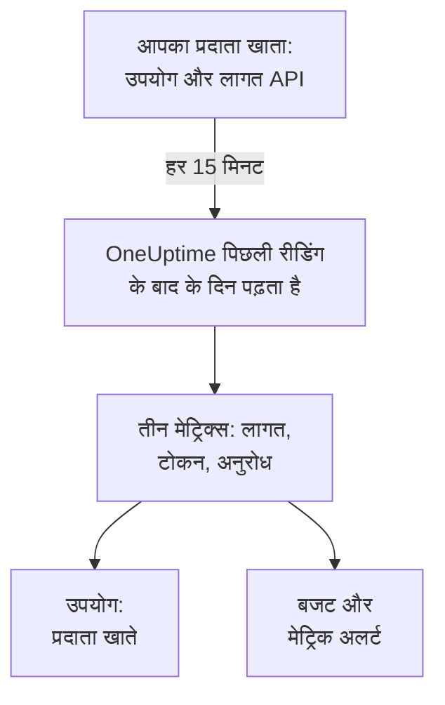

# AI प्रदाता खाते

देखें कि आपके AI प्रदाता खातों ने कितना उपयोग किया और उसकी लागत कितनी रही, अपने ऐप्स में कोई बदलाव किए बिना। OpenAI, Anthropic, Azure OpenAI और Microsoft Foundry, Amazon Bedrock या Google Vertex AI का कोई खाता ऐसे क्रेडेंशियल से जोड़ें जो सिर्फ़ पढ़ सकता है, और OneUptime हर 15 मिनट में उसका उपयोग **उपयोग**, **बजट** और ऐसे मेट्रिक्स में पढ़ता है जिन पर आप अलर्ट बना सकते हैं।

:::cards
- [खाता कनेक्ट करें](#खाता-कनेक्ट-करें): प्रदाता चुनें, क्रेडेंशियल चिपकाएँ, जाँचें और कनेक्ट करें।
- [हर प्रदाता क्या देता है](#हर-प्रदाता-क्या-देता-है): लागत, टोकन और अनुरोध, और हर प्रदाता उन्हें कैसे समूहित करता है।
- [उपयोग देखें](#उपयोग-देखें): मॉडल, व्यक्ति, प्रोजेक्ट या संसाधन, API कुंजी और कनेक्शन के हिसाब से।
- [बजट और अलर्ट](#बजट-और-अलर्ट): बिल पर एक दैनिक बजट, और मेट्रिक्स पर अलर्ट।
:::

## यह कैसे काम करता है

हर 15 मिनट में OneUptime हर कनेक्ट किए गए खाते से UTC दिन के हिसाब से उसका उपयोग माँगता है और उसे कनेक्शन की अपनी सेवा के तीन मेट्रिक्स के रूप में रखता है। हर रीडिंग पिछली रीडिंग के बाद के दिन लेती है, और पिछले 3 दिन फिर से, आज समेत, क्योंकि प्रदाता आज के दिन में जोड़ते रहते हैं और अभी बीते दिनों को सुधारते हैं।

किसी खाते का उपयोग वह है जिसके लिए उसे बिल किया गया, एक-एक दिन करके। इसमें बातचीत, प्रॉम्प्ट या जवाब नहीं होते: उनके लिए अपने ऐप्स की AI कॉल भेजें, जैसा [AI / LLM ऑब्ज़र्वेबिलिटी](/docs/telemetry/ai-llm-observability) दिखाता है। दोनों अलग रखे जाते हैं, इसलिए कुछ भी दो बार नहीं गिना जाता।

## शुरू करने से पहले

- Project Owner या Project Admin भूमिका। सिर्फ़ वही कोई खाता कनेक्ट कर, बदल या हटा सकते हैं; प्रोजेक्ट की टेलीमेट्री पढ़ने वाला हर व्यक्ति कनेक्शन और उपयोग देखता है।
- खाते का क्रेडेंशियल, उसे चलाने वाले किसी व्यक्ति से। नीचे हर प्रदाता का खंड बताता है कि कौन-सा और कहाँ बनता है।
- कुछ इंस्टॉल नहीं करना: OneUptime अपने सर्वरों से प्रदाता का API कॉल करता है।

## खाता कनेक्ट करें

:::steps
### कनेक्ट खोलें

**उत्पाद → AI / LLM → कनेक्ट करें** खोलें। **आपके AI प्रदाता खाते** में प्रदाता की टाइल पर क्लिक करें।

### क्रेडेंशियल चिपकाएँ

**क्रेडेंशियल** पर वह भरें जो प्रदाता माँगता है। सीक्रेट एन्क्रिप्ट करके रखे जाते हैं और फिर कभी नहीं दिखाए जाते, न डैशबोर्ड में न API से। **नाम** और वे सेटिंग्स जिन्हें ज़्यादातर लोग नहीं बदलते, **और फ़ील्ड** में हैं।

### जाँचें

**परीक्षण** पर **कनेक्शन का परीक्षण करें** पर क्लिक करें। OneUptime पिछले 7 दिनों का उपयोग पढ़ता है और दिखाता है कि उसे क्या मिला: लागत, टोकन, अनुरोध, मॉडल, लोग, कुंजियाँ और प्रोजेक्ट। कनेक्ट करने तक कुछ नहीं रखा जाता।

### कनेक्ट करें

**कनेक्ट करें** पर क्लिक करें। पहली रीडिंग एक मिनट के भीतर शुरू होती है और पिछले 30 दिन लाती है।
:::

कनेक्ट किए गए खाते टाइलों के नीचे दिखते हैं, अपनी **स्थिति** और **पिछली रीडिंग** के साथ। **अभी पढ़ें** तुरंत पढ़ता है, **परीक्षण** रखी गई सेटिंग्स को फिर जाँचता है, **बंद करें** पढ़ना रोकता है और पढ़ा हुआ रखता है, और **संपादित करें** सेटिंग्स बदलता है: खाली छोड़ा गया सीक्रेट रखा हुआ सीक्रेट ही बनाए रखता है। **View error** दिखाता है कि कोई रीडिंग क्यों विफल हुई, बिना किसी सीक्रेट के।

## हर प्रदाता क्या देता है

| प्रदाता | लागत | किसके हिसाब से समूहित | क्रेडेंशियल |
| --- | --- | --- | --- |
| OpenAI | जो OpenAI बताता है | प्रोजेक्ट, API कुंजी, व्यक्ति और मॉडल | एक एडमिन कुंजी |
| Anthropic | जो Anthropic बताता है | वर्कस्पेस, API कुंजी, व्यक्ति और मॉडल | एक एडमिन कुंजी |
| Azure OpenAI और Microsoft Foundry | टोकन से अनुमानित | संसाधन और मॉडल | Monitoring Reader वाला एक ऐप |
| Amazon Bedrock | टोकन से अनुमानित | क्षेत्र और मॉडल | CloudWatch पढ़ने वाली एक्सेस कुंजी |
| Google Vertex AI | टोकन से अनुमानित | क्षेत्र और मॉडल | Monitoring Viewer वाला सेवा खाता |

Anthropic को छोड़कर हर प्रदाता अनुरोध भी गिनता है: Anthropic की उपयोग रिपोर्ट में अनुरोध नहीं होते। अनुमानित लागत [एक कॉल की लागत](/docs/telemetry/ai-llm-observability#एक-कॉल-की-लागत) की मूल्य सूची और **मूल्य** से आपकी अपनी कीमतों का उपयोग करती है, और अनुमान के रूप में चिह्नित होती है। जिस मॉडल को मूल्य सूची नहीं जानती, उसकी कोई लागत नहीं होती जब तक आप वहाँ उसकी कीमत न डालें।

इनमें से कोई भी क्रेडेंशियल किसी मॉडल को कॉल नहीं कर सकता: हर एक सिर्फ़ उपयोग, लागत या मेट्रिक्स पढ़ता है, और कुछ नहीं।

## OpenAI

OneUptime एक एडमिन कुंजी से आपके OpenAI संगठन को पढ़ता है: दिन, मॉडल, प्रोजेक्ट, API कुंजी और व्यक्ति के हिसाब से completions और embeddings का उपयोग, और प्रोजेक्ट और लाइन आइटम के हिसाब से हर दिन की लागत। लागत की एक लाइन उन कुंजियों और लोगों में बाँटी जाती है जिन्होंने उसका मॉडल उपयोग किया, इसलिए किसी व्यक्ति की पंक्ति की भी लागत होती है। प्रोजेक्ट और कुंजियों के नाम और लोगों के ईमेल OpenAI की ID की जगह लेते हैं।

:::steps
### OpenAI एडमिन कुंजी बनाएँ

OpenAI के डैशबोर्ड में Settings, Organization, Admin keys खोलें और एक कुंजी बनाएँ। यह सिर्फ़ संगठन के मालिक कर सकते हैं। यह `sk-admin-` से शुरू होती है।

### OpenAI कनेक्ट करें

कुंजी को **एडमिन कुंजी** के रूप में चिपकाएँ।
:::

## Anthropic

OneUptime एक एडमिन कुंजी से आपके Claude API संगठन को पढ़ता है: दिन, मॉडल, वर्कस्पेस, API कुंजी और व्यक्ति के हिसाब से मैसेज उपयोग रिपोर्ट, और वर्कस्पेस और लाइन के हिसाब से लागत रिपोर्ट, उसी तरह बाँटी हुई। संगठन की कुंजियों या Console लॉगिन से उपयोग किया गया Claude Code भी इन रिपोर्टों में है, उसका उपयोग करने वाले व्यक्ति या कुंजी के तहत।

:::steps
### Anthropic एडमिन कुंजी बनाएँ

Claude Console में Settings, Admin keys खोलें और एक कुंजी बनाएँ। यह सिर्फ़ संगठन के एडमिन कर सकते हैं। यह `sk-ant-admin01-` से शुरू होती है।

### Anthropic कनेक्ट करें

कुंजी को **एडमिन कुंजी** के रूप में चिपकाएँ।
:::

## Azure OpenAI और Microsoft Foundry

OneUptime किसी सदस्यता के हर Azure OpenAI और Foundry संसाधन को Azure Monitor से पढ़ता है: दिन, संसाधन और मॉडल के हिसाब से टोकन और अनुरोध। Azure Monitor टोकन गिनता है, पैसा नहीं, और न व्यक्ति बताता है न कुंजी, इसलिए लागत OneUptime का अनुमान है और व्यक्ति और कुंजी खाली रहते हैं।

:::steps
### एक ऐप रजिस्टर करें

Microsoft Entra ID में एक ऐप रजिस्टर करें और उसके लिए एक क्लाइंट सीक्रेट बनाएँ।

### उसे मेट्रिक्स पढ़ने दें

सदस्यता पर ऐप को Monitoring Reader भूमिका दें।

### Azure कनेक्ट करें

**डायरेक्टरी (टेनेंट) ID**, **एप्लिकेशन (क्लाइंट) ID**, **सदस्यता ID** और **क्लाइंट सीक्रेट** भरें। Azure Government के लिए **और फ़ील्ड** में **क्लाउड** बदलें।
:::

## Amazon Bedrock

OneUptime आपके बताए हर क्षेत्र के `AWS/Bedrock` CloudWatch मेट्रिक्स पढ़ता है: दिन और मॉडल के हिसाब से इनपुट, आउटपुट और कैश टोकन, और इनवोकेशन। CloudWatch टोकन गिनता है, पैसा नहीं, और न व्यक्ति बताता है न कुंजी: लागत OneUptime का अनुमान है, और हर क्षेत्र एक प्रोजेक्ट के रूप में दिखता है।

:::steps
### एक एक्सेस कुंजी बनाएँ

ऐसा IAM उपयोगकर्ता या भूमिका बनाएँ जिसकी नीति `cloudwatch:GetMetricData` और `cloudwatch:ListMetrics` की अनुमति देती हो, और उसके लिए एक एक्सेस कुंजी बनाएँ।

### Bedrock कनेक्ट करें

**एक्सेस कुंजी ID**, **सीक्रेट एक्सेस कुंजी** और **क्षेत्र** भरें, कॉमा से अलग करके: अगर आप न बदलें तो `us-east-1`।
:::

## Google Vertex AI

OneUptime वे Cloud Monitoring मेट्रिक्स पढ़ता है जो Vertex AI अपने मॉडलों के लिए प्रकाशित करता है, Gemini और Claude जैसे पार्टनर मॉडल: दिन, क्षेत्र और मॉडल के हिसाब से इनपुट और आउटपुट टोकन, और इनवोकेशन। Cloud Monitoring टोकन गिनता है, पैसा नहीं, और न व्यक्ति बताता है न कुंजी: लागत OneUptime का अनुमान है।

:::steps
### एक सेवा खाता बनाएँ

प्रोजेक्ट में Monitoring Viewer भूमिका वाला एक सेवा खाता बनाएँ, और उसके लिए एक JSON कुंजी।

### Vertex AI कनेक्ट करें

**प्रोजेक्ट ID** भरें, और पूरी कुंजी फ़ाइल **सेवा खाता कुंजी (JSON)** में चिपकाएँ।
:::

## उपयोग देखें

**उपयोग** खोलें और **प्रदाता खाते** चुनें। यह उस समय-सीमा के लिए आपके खातों द्वारा बताई गई लागत, टोकन और अनुरोध दिखाता है, **मॉडल**, **व्यक्ति**, **प्रदाता**, **प्रोजेक्ट या संसाधन**, **API कुंजी** या **कनेक्शन** के हिसाब से क्रमबद्ध। समय-सीमा अपने पहले दिन की UTC मध्यरात्रि से शुरू होती है, क्योंकि प्रदाता पूरे दिन बताते हैं।

**प्रदाता खाते** और **आपकी AI कॉल** कभी जोड़े नहीं जाते। आपका ऐप किसी कनेक्ट किए गए खाते की कुंजी से जो कॉल करता है, वह दोनों में होती है, इसलिए उन्हें जोड़ने से वह दो बार गिनी जाएगी।

## बजट और अलर्ट

एक बजट या तो एक को गिनता है या दूसरे को। **बजट** पर एक बजट बनाएँ और **खर्च की गिनती यहाँ से** को **प्रदाता खाते** पर सेट करें: यह गिनता है कि UTC दिन के लिए कनेक्ट किए गए खातों को कितना बिल किया गया, **LLM प्रदाता (वैकल्पिक)** और **LLM मॉडल (वैकल्पिक)** से सीमित, जब आप उन्हें सेट करते हैं। प्रदाता किसी दिन का उपयोग मिनटों से घंटों की देरी से बताते हैं, इसलिए मिनटों के भीतर अलर्ट के लिए इसकी जगह **आपकी AI कॉल** का बजट बनाएँ।

हर खाते का उपयोग तीन मेट्रिक्स के रूप में रखा जाता है, जिन्हें आप किसी [डैशबोर्ड](/docs/dashboards/index) पर दिखा सकते हैं या [मेट्रिक्स मॉनिटर](/docs/monitor/metrics-monitor) से उन पर अलर्ट बना सकते हैं:

| मेट्रिक | यह क्या है |
| --- | --- |
| `oneuptime.llm.provider.cost` | एक दिन की लागत, USD में |
| `oneuptime.llm.provider.tokens` | एक दिन के टोकन, `gen_ai.token.type` के हिसाब से: `input` (कैश किए गए टोकन समेत), `output`, `cache_read` और `cache_write` |
| `oneuptime.llm.provider.requests` | एक दिन के अनुरोध |

हर पॉइंट पर उसके UTC दिन की शुरुआत का समय लगा होता है। इसमें `oneuptime.llm.connection.id` और `oneuptime.llm.connection.name` होते हैं, और वह जो प्रदाता बताता है: `gen_ai.provider.name`, `gen_ai.request.model`, `user.email`, `oneuptime.llm.provider.project` और `oneuptime.llm.provider.api_key`। अनुमानित लागत में `oneuptime.llm.cost.estimated` होता है।

## रीडिंग कब होती है

| रीडिंग | कब |
| --- | --- |
| पहली | कनेक्ट करने के एक मिनट के भीतर, 30 दिन पीछे तक |
| अगली | हर 15 मिनट |
| कुंजी या अनुमति अस्वीकार होने के बाद | 60 मिनट बाद |
| किसी और विफलता के बाद | 15 मिनट बाद |
| बंद | कोई नहीं, जब तक उसे चालू न किया जाए |

टेलीमेट्री सुविधाओं के बिना वाला प्लान कुछ नहीं पढ़ता। कोई कनेक्शन हटाने से उसकी रीडिंग रुक जाती है और जो उसने पढ़ा वह तब तक रहता है जब तक सेवा का रिटेंशन उसे हटा न दे।

## OneUptime का अपना गेटवे क्यों नहीं है

OneUptime आपके खाते पढ़ता है; यह कभी आपके ऐप्स और प्रदाताओं के बीच नहीं बैठता। एक प्रॉक्सी आपकी प्रदाता कुंजियाँ रखता और आपके ऐप्स की हर मॉडल कॉल में एक और कदम जोड़ता। अगर आपका मॉडल ट्रैफ़िक पहले से LiteLLM, Portkey या OpenRouter से होकर जाता है, तो गेटवे के ट्रेस OneUptime को भेजें, जैसा [AI गेटवे](/docs/telemetry/ai-gateways) दिखाता है, और बिल के लिए खाता कनेक्ट करें।

## समस्या निवारण

:::details जाँच बताती है कि कुंजी या सीक्रेट स्वीकार नहीं हुआ
जाँचें कि आपने पूरी कॉपी की, कि उसे रद्द नहीं किया गया, और कि वह वही प्रकार है जो यह प्रदाता माँगता है: OpenAI या Anthropic की एडमिन कुंजी, प्रोजेक्ट या API कुंजी नहीं।
:::

:::details क्रेडेंशियल काम करता है, पर वह नहीं पढ़ सकता जो कनेक्शन को चाहिए
उसे वह भूमिका दें जो यह पेज प्रदाता के लिए बताता है: Azure सदस्यता पर Monitoring Reader, AWS पर CloudWatch की दो कार्रवाइयाँ, Google Cloud प्रोजेक्ट पर Monitoring Viewer।
:::

:::details जाँच सफल होती है, पर आज के लिए कुछ नहीं दिखता
प्रदाता किसी दिन का उपयोग मिनटों से घंटों बाद बताते हैं, और एक-दो दिन तक उसे सुधारते हैं। अगली रीडिंग उसे ले आती हैं।
:::

:::details लागत इनवॉइस से अलग है
बताई गई लागत टैक्स, क्रेडिट और छूट से पहले का प्रदाता का आँकड़ा है। अनुमानित लागत सूची मूल्य पर टोकन है, या **मूल्य** से आपकी अपनी कीमतों पर।
:::

## अगले कदम

:::cards
- [AI / LLM ऑब्ज़र्वेबिलिटी](/docs/telemetry/ai-llm-observability): आपके अपने ऐप्स की AI कॉल की बातचीत, अलर्ट और लागत।
- [कंपनी के AI टूल](/docs/telemetry/ai-company-tools): आपके लोग Claude Enterprise और Microsoft 365 Copilot से क्या पूछते हैं।
- [AI गेटवे](/docs/telemetry/ai-gateways): LiteLLM, Portkey या OpenRouter से होकर जाने वाली हर मॉडल कॉल को ट्रेस करें।
- [मेट्रिक्स मॉनिटर](/docs/monitor/metrics-monitor): प्रदाता मेट्रिक्स पर अलर्ट बनाएँ।
:::
