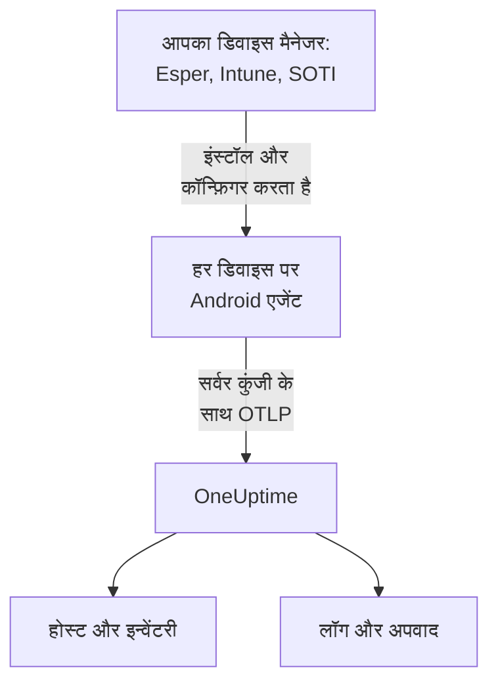

# Android एजेंट

OneUptime Android एजेंट आपके संगठन के स्वामित्व वाले किसी Android डिवाइस, जैसे ऑर्डरिंग कियोस्क, POS टर्मिनल, हैंडहेल्ड या साइनेज प्लेयर, की जानकारी OneUptime को भेजता है: उसकी मेमोरी, स्टोरेज, नेटवर्क, बैटरी और तापमान, उसके रीस्टार्ट, उस पर इंस्टॉल किए गए ऐप, और उन ऐप के क्रैश और लॉग। आपका डिवाइस मैनेजर इसे एक ही बार में पूरे बेड़े पर इंस्टॉल और कॉन्फ़िगर करता है। हर डिवाइस आपके सर्वर और Windows मशीनों के साथ **होस्ट** में एक होस्ट और **इन्वेंटरी** में एक आइटम बन जाता है।

:::cards
- [इसे कब इस्तेमाल करें](#एजेंट-या-ऐप-इंस्ट्रुमेंटेशन): एजेंट डिवाइस को देखता है, ऐप इंस्ट्रुमेंटेशन आपके ऐप को।
- [Esper से तैनात करें](#esper-से-तैनात-करें): APK अपलोड करें, उसकी सेटिंग्स भेजें, उसे एक बार शुरू करें।
- [सेटिंग्स](#सेटिंग्स): इसके मैनेज्ड कॉन्फ़िगरेशन की हर कुंजी।
- [दूसरे ऐप के लॉग पढ़ें](#दूसरे-ऐप-के-लॉग-पढ़ें): adb या अपने डिवाइस मैनेजर से एक बार READ_LOGS अनुमति दें।
- [लॉग सेशन](#लॉग-सेशन): कुछ समय तक हर ऐप के लॉग, डिवाइस के सामने मौजूद व्यक्ति की अनुमति से।
:::

## यह कैसे काम करता है

एजेंट एक छोटा ऐप है जो फ़ोरग्राउंड सेवा के रूप में चलता है। हर मिनट यह डिवाइस का स्वास्थ्य पढ़ता है और उसे डिवाइस के रीस्टार्ट, इंस्टॉल ऐप और लॉग के साथ **सर्वर** इंजेशन कुंजी से OTLP पर आपके OneUptime को भेजता है। डिवाइस बूट होने पर यह अपने आप शुरू होता है, नेटवर्क बंद रहने तक जो इकट्ठा करता है उसे डिवाइस पर ही रखता है, और नेटवर्क लौटते ही उसे भेज देता है। यह डिवाइस को स्लीप में जाने से कभी नहीं रोकता, और जो भेजता है उसे कंप्रेस करता है।



## एजेंट या ऐप इंस्ट्रुमेंटेशन

| | आपके ऐप में [OpenTelemetry Android](/docs/rum/android-setup) | Android एजेंट |
| --- | --- | --- |
| यह क्या देखता है | आपका ऐप: उसके क्रैश, ANR, स्क्रीन, सेशन, अनुरोध और वर्कफ़्लो | डिवाइस: मेमोरी, स्टोरेज, नेटवर्क, बैटरी, रीस्टार्ट, इंस्टॉल ऐप, और हर ऐप के क्रैश और ANR |
| यह कहाँ दिखता है | **वास्तविक उपयोगकर्ता मॉनिटरिंग**, **ट्रेस** और **अपवाद** | **होस्ट**, **इन्वेंटरी**, **लॉग** और **अपवाद** |
| आप इसे कैसे इंस्टॉल करते हैं | अपने ऐप के कोड में | एक ऐप के रूप में, अपने डिवाइस मैनेजर के ज़रिए |

अपने स्वामित्व वाले डिवाइसों पर दोनों का इस्तेमाल करें, और दोनों में डिवाइस को एक ही नाम दें: एजेंट की `device_name` सेटिंग में, और उस `host.name` में जो आपका ऐप सेट करता है। तब डिवाइस **इन्वेंटरी** में एक ही आइटम होता है, जिसमें ऐप की और डिवाइस की टेलीमेट्री साथ-साथ होती है।

## शुरू करने से पहले

- Android 7.0 या उसके बाद के संस्करण वाले डिवाइस, जिन्हें ऐसा डिवाइस मैनेजर संभालता हो जो Android के मैनेज्ड कॉन्फ़िगरेशन सपोर्ट करता है: Esper, Microsoft Intune, Workspace ONE, SOTI और दूसरे Android Enterprise डिवाइस मैनेजर। एक अकेले डिवाइस के लिए adb काफ़ी है।
- एक **सर्वर** इंजेशन कुंजी, जो **प्रोजेक्ट सेटिंग्स → टेलीमेट्री और APM → इंजेशन कुंजियाँ** में **इंजेशन कुंजी बनाएँ** से बनाई गई हो।
- एजेंट: `oneuptime-android-agent.apk`, जो हर [OneUptime रिलीज़](https://github.com/OneUptime/oneuptime/releases/latest) के साथ संलग्न है।
- डिवाइसों से आपके OneUptime URL तक आउटबाउंड HTTPS। एजेंट ऐसा URL स्वीकार नहीं करता जो `https://` न हो, क्योंकि हर अनुरोध में इंजेशन कुंजी होती है।

## Esper से तैनात करें

:::steps
### APK अपलोड करें

Esper कंसोल में `oneuptime-android-agent.apk` को **App Library** में अपलोड करें, और उसे उन डिवाइसों के blueprint में जोड़ें जिन्हें मॉनिटर करना है।

### उसकी सेटिंग्स भेजें

blueprint में एजेंट का **Managed Configuration** खोलें और उसकी सेटिंग्स पेस्ट करें। Esper Agent 8.00.0764 या उसके बाद के संस्करण के साथ, Esper हर डिवाइस पर प्लेसहोल्डर भर देता है:

```json title="Managed configuration"
{
  "oneuptime_url": "https://oneuptime.com",
  "oneuptime_token": "YOUR_TELEMETRY_INGESTION_TOKEN",
  "device_name": "${esper.deviceName}",
  "device_serial": "${esper.serialNumber}",
  "device_type": "kiosk",
  "labels": "region=emea"
}
```

अगर आप OneUptime खुद होस्ट करते हैं, तो `oneuptime_url` में अपना URL डालें। फिर डिवाइसों पर Converge चलाएँ, ताकि वे नई सेटिंग्स पढ़ें।

### उसे एक बार शुरू करें

Android नए इंस्टॉल हुए ऐप को बूट पर तब तक शुरू नहीं करता, जब तक उसे एक बार खोला न गया हो। blueprint में Multi-App mode के अंतर्गत एजेंट के लिए **Launch on Start** चालू करें, या हर डिवाइस पर एजेंट को एक बार खोलें। उसके बाद, जब भी डिवाइस बूट होता है और हर अपडेट के बाद, यह अपने आप शुरू हो जाता है।

### OneUptime में डिवाइस ढूँढें

एक मिनट के अंदर हर डिवाइस अपने `device_name` के नाम से **होस्ट** में, और **इन्वेंटरी** में दिखाई देता है। डिवाइस पर एजेंट की अपनी स्क्रीन बताती है कि वह रिपोर्ट कर रहा है या नहीं, और अगर नहीं, तो उसे क्या रोक रहा है।
:::

दूसरे डिवाइस मैनेजर भी इसी तरह काम करते हैं: APK को line-of-business या इंटरनल ऐप के रूप में जोड़ें, उसके ऐप कॉन्फ़िगरेशन में वही कुंजियाँ सेट करें, और हर डिवाइस पर उसे एक बार खोलें।

## सेटिंग्स

एजेंट ये कुंजियाँ अपने मैनेज्ड कॉन्फ़िगरेशन से पढ़ता है। जिस डिवाइस पर ऐसा कॉन्फ़िगरेशन नहीं है, उसे इसके बजाय एजेंट की अपनी स्क्रीन पर URL, इंजेशन कुंजी और डिवाइस के नाम से सेट किया जा सकता है। वहाँ डाली गई कुंजी Android Keystore से एन्क्रिप्ट करके सहेजी जाती है।

| कुंजी | यह क्या सेट करती है | डिफ़ॉल्ट |
| --- | --- | --- |
| `oneuptime_url` | आपका OneUptime URL | `https://oneuptime.com` |
| `oneuptime_token` | एक **सर्वर** इंजेशन कुंजी | कोई नहीं: इसके बिना एजेंट कुछ नहीं भेजता |
| `device_name` | **होस्ट** और **इन्वेंटरी** में डिवाइस का नाम, जो वहाँ उसकी पहचान है | उसका मॉडल और उसकी Android ID की शुरुआत |
| `device_serial` | उसका सीरियल नंबर, जो Android 10 और उसके बाद के संस्करणों पर ऐप को नहीं मिलता | कोई नहीं |
| `device_type` | वह क्या है, जैसे कियोस्क, POS टर्मिनल या हैंडहेल्ड | `Android device` |
| `device_location` | वह कहाँ है, जैसे किसी स्टोर का नंबर | कोई नहीं |
| `labels` | होस्ट के लेबल, कॉमा से अलग किए गए `name=value` जोड़ों के रूप में | कोई नहीं |
| `collection_interval_seconds` | यह कितनी बार रिपोर्ट करता है, 30 से 600 सेकंड तक | `60` |
| `logcat_enabled` | Logcat से पढ़ा गया डेटा भेजना है या नहीं | `true` |
| `logcat_min_level` | Android 12 और उससे पहले के संस्करणों पर भेजी जाने वाली Logcat पंक्तियों की सबसे कम गंभीरता: `verbose`, `debug`, `info`, `warn`, `error` या `fatal` | `warn` |
| `installed_apps_enabled` | इंस्टॉल ऐप की सूची भेजनी है या नहीं | `true` |

ऐसा प्लेसहोल्डर जिसे आपके डिवाइस मैनेजर ने नहीं भरा, जैसे जस-का-तस भेजा गया `${esper.deviceName}`, अनदेखा कर दिया जाता है, और एजेंट की स्क्रीन यह बताती है। जब कोई डिवाइस रिपोर्ट करने लगे, तो उसका `device_name` न बदलें: नया नाम एक नया होस्ट है।

एजेंट की स्क्रीन, उसकी सूचनाएं, और आपका डिवाइस मैनेजर इन कुंजियों के लिए जो शीर्षक और विवरण दिखाता है, वे सब डिवाइस की भाषा में होते हैं, उन सभी भाषाओं में जिनमें OneUptime का डैशबोर्ड उपलब्ध है।

## दूसरे ऐप के लॉग पढ़ें

Android किसी ऐप को दूसरे ऐप के लॉग सिर्फ़ READ_LOGS अनुमति के साथ पढ़ने देता है, और यह अनुमति सिर्फ़ adb दे सकता है: न ऐप खुद, न कोई डिवाइस पॉलिसी। इसे हर डिवाइस पर एक बार दें, और यह रीस्टार्ट और अपडेट के बाद भी बनी रहती है:

```bash
adb shell pm grant com.oneuptime.androidagent android.permission.READ_LOGS
```

Esper में यह कमांड **Secure Remote ADB** पर चलाएँ: डिवाइस के लिए ADB एक्सेस चालू करें, `espercli secureadb connect --device DEVICE_ID` से कनेक्ट करें, फिर कमांड चलाएँ। अनुमति मिलते ही Android एजेंट को रीस्टार्ट करता है, और एजेंट तुरंत पढ़ना शुरू कर देता है। इन्वेंटरी का **डिवाइस मैनेजर ID** कॉलम हर डिवाइस का `DEVICE_ID` रखता है।

इसके बाद एजेंट क्या पढ़ता है, यह Android संस्करण पर निर्भर करता है:

- Android 13 और उसके बाद: हर ऐप के क्रैश और ANR। Android दूसरे ऐप की लॉग पंक्तियाँ सिर्फ़ उसी ऐप को दिखाता है जो स्क्रीन पर है, और वह भी डिवाइस के सामने मौजूद व्यक्ति की अनुमति के बाद, इसलिए बैकग्राउंड में चल रहा एजेंट उन्हें नहीं पढ़ सकता। कुछ समय के लिए उन्हें [लॉग सेशन](#लॉग-सेशन) से माँगें।
- Android 12 और उससे पहले: हर ऐप के क्रैश और ANR, और हर ऐप की `logcat_min_level` और उससे ऊपर के स्तर वाली लॉग पंक्तियाँ।

READ_LOGS के बिना एजेंट बाकी सब कुछ रिपोर्ट करता है, और उसकी स्क्रीन और डिवाइस के लॉग बताते हैं कि यह अनुमति कैसे दें।

### क्रैश के स्टैक ट्रेस और रीबूट के कारण

Android हर ऐप क्रैश, नेटिव क्रैश और ANR की पूरी रिपोर्ट, और हर रीबूट का कारण, अपने DropBox में रखता है। एजेंट इन्हें हर ऐप के लिए तब पढ़ता है जब उसके पास READ_LOGS और इस्तेमाल का ऐक्सेस हो, और Android 15 और उसके बाद READ_DROPBOX_DATA भी। READ_LOGS की तरह, ये अनुमतियाँ adb से एक बार दें:

```bash
adb shell pm grant com.oneuptime.androidagent android.permission.READ_DROPBOX_DATA
adb shell appops set com.oneuptime.androidagent GET_USAGE_STATS allow
```

पहली कमांड Android 15 और उसके बाद के लिए है; इस्तेमाल का ऐक्सेस डिवाइस की **सेटिंग → इस्तेमाल का ऐक्सेस** में भी चालू किया जा सकता है। कोई डिवाइस पॉलिसी ये अनुमतियाँ नहीं दे सकती, और एजेंट की स्क्रीन वे कमांड दिखाती है जो अभी चलानी बाकी हैं। इनके साथ, **अपवाद** में हर क्रैश का पूरा स्टैक ट्रेस होता है, नेटिव क्रैश का सिग्नल और वह लाइब्रेरी जिसमें वह क्रैश हुआ, ANR के मुख्य थ्रेड का स्टैक, और **लॉग** में हर रीस्टार्ट का वह कारण जो Android उसके लिए बताता है। एजेंट जो पढ़ता है, उसमें कार्ड नंबर, ईमेल पते, टोकन और पासवर्ड भेजे जाने से पहले `[card number]`, `[email]`, `[token]` और `[redacted]` से बदल दिए जाते हैं।

### पूरे बेड़े में ये अनुमतियाँ दें

एजेंट की हर रिपोर्ट बताती है कि इनमें से कौन-सी अनुमतियाँ उसके पास अभी भी नहीं हैं। जिन डिवाइसों को इनकी ज़रूरत है, उनकी सूची के लिए **इन्वेंटरी** खोलें, फिर **सभी आइटम**, और **एजेंट अनुमतियाँ** फ़िल्टर में **गायब** चुनें। हर डिवाइस में क्या कमी है, यह देखने के लिए **एजेंट अनुमतियाँ** कॉलम चालू करें, और सूची को CSV के रूप में निर्यात करें। **डिवाइस मैनेजर ID** कॉलम भी चालू करें, तो निर्यात में हर डिवाइस की Esper ID होती है, यानी वह `DEVICE_ID` जो `espercli secureadb connect --device` लेता है।

कोई डिवाइस पॉलिसी ये अनुमतियाँ नहीं दे सकती: READ_LOGS और READ_DROPBOX_DATA ऐसी अनुमतियाँ हैं जिन्हें सिर्फ़ adb, सिस्टम या डिवाइस का निर्माता दे सकता है, और इस्तेमाल का ऐक्सेस adb से या डिवाइस के सामने मौजूद व्यक्ति द्वारा सेट किया जाता है। Esper क्या-क्या देता है, और उनमें से कोई भी इन्हें क्यों नहीं दे पाता:

- **ऐप अनुमतियाँ**, चाहे blueprint में हों या `SET_APP_PERMISSION` कमांड से, Android के डिवाइस ओनर API से होकर जाती हैं, जो सिर्फ़ वही अनुमतियाँ देता है जो कोई ऐप डिवाइस के सामने मौजूद व्यक्ति से माँगता है। Android इन अनुमतियों को देने से मना कर देता है।
- **मैनेज्ड कॉन्फ़िगरेशन** एजेंट की अपनी सेटिंग्स सेट करता है, Android की अनुमतियाँ कभी नहीं।
- **Run Shell Script** Linux और Windows डिवाइसों पर चलता है, Android डिवाइसों पर नहीं।
- **Secure Remote ADB** एक बार में एक ही डिवाइस तक पहुँचता है, ऐसे कंप्यूटर से जिस पर `espercli` चलता हो। Esper Foundation डिवाइसों पर इसके लिए डिवाइस के सामने किसी के होने की ज़रूरत नहीं होती। दूसरे डिवाइसों पर, पहली बार डिवाइस के सामने मौजूद किसी व्यक्ति को **Allow USB debugging?** स्वीकार करना होता है।

इसलिए ये अनुमतियाँ adb से दें:

- **डिवाइस भेजे जाने से पहले**, जब उसे USB केबल से तैयार किया जा रहा हो। यह कंप्यूटर से जुड़े हर डिवाइस पर तीनों अनुमतियाँ देता है:

  ```bash
  for serial in $(adb devices | awk 'NR > 1 && $2 == "device" { print $1 }'); do
    adb -s "$serial" shell pm grant com.oneuptime.androidagent android.permission.READ_LOGS
    adb -s "$serial" shell pm grant com.oneuptime.androidagent android.permission.READ_DROPBOX_DATA
    adb -s "$serial" shell appops set com.oneuptime.androidagent GET_USAGE_STATS allow
  done
  ```

  Android 14 और उससे पहले, दूसरी कमांड बताती है कि यह अनुमति अज्ञात है: उस डिवाइस को इसकी ज़रूरत नहीं है।
- **फ़ील्ड में लगे डिवाइस पर**, Secure Remote ADB से, **गायब** सूची के डिवाइसों पर एक-एक करके।
- **सिर्फ़ इस्तेमाल का ऐक्सेस** डिवाइस के सामने मौजूद व्यक्ति खुद चालू कर सकता है, **सेटिंग → इस्तेमाल का ऐक्सेस** में, या एजेंट की स्क्रीन पर दिए गए बटन से।

डिवाइस की अगली रिपोर्ट, एक मिनट के अंदर, उसे **गायब** सूची से हटा देती है।

### CPU उपयोग

Android 8 और उसके बाद के संस्करण डिवाइस का CPU उपयोग ऐप से छिपाते हैं। इसे सिर्फ़ डिवाइस ओनर ऐप पढ़ सकता है, और वह भी सिर्फ़ उन डिवाइस पर जिनका हार्डवेयर इसे रिपोर्ट करता है। एजेंट इसे तब पढ़ता है जब वह डिवाइस ओनर हो, जिसे आप adb से ऐसे डिवाइस पर सेट करते हैं जिस पर कोई खाता न हो और कोई दूसरा डिवाइस ओनर न हो:

```bash
adb shell dpm set-device-owner com.oneuptime.androidagent/.admin.AgentDeviceAdminReceiver
```

जिस डिवाइस का मालिक पहले से आपका डिवाइस मैनेजर है, उसका कोई दूसरा मालिक नहीं हो सकता, इसलिए उसका CPU उपयोग उपलब्ध नहीं होता, और एजेंट की स्क्रीन यह बताती है। तब होस्ट सूची में उसका CPU उपयोग नहीं दिखता, और उसके लिए **High CPU Utilization** टेम्पलेट नहीं दिया जाता।

## लॉग सेशन

लॉग सेशन किसी डिवाइस से कुछ समय तक हर ऐप के लॉग भेजता है, ताकि उसकी समस्या का पता लगाया जा सके। Android 13 और उसके बाद, दूसरे ऐप की लॉग पंक्तियाँ पढ़ने का यही एकमात्र तरीका है, क्योंकि Android उन्हें सिर्फ़ उसी ऐप को दिखाता है जो स्क्रीन पर है, और वह भी डिवाइस के सामने मौजूद व्यक्ति की अनुमति के बाद।

:::steps
### सेशन का अनुरोध करें

**होस्ट** में डिवाइस खोलें, फिर **लॉग**, और **लॉग सेशन** में **लॉग सेशन का अनुरोध करें** पर क्लिक करें। चुनें कि डिवाइस कितनी देर तक अपने लॉग भेजे, 15 मिनट से 4 घंटे तक, और वह सबसे निचला स्तर जो वह भेजे: **जानकारी**, **डीबग** या **विस्तृत**। आप यह क्यों माँग रहे हैं, यह बताने के लिए एक **नोट** जोड़ें, जैसे "जाँच रहे हैं कि भुगतान ऐप शाम 6 बजे के बाद क्यों क्रैश होता है"।

### डिवाइस पर अनुमति दें

एक मिनट के अंदर डिवाइस एक सूचना दिखाता है कि किसी ने उसके लॉग माँगे हैं, साथ में उस व्यक्ति का नाम और आपका नोट। डिवाइस के सामने मौजूद व्यक्ति एजेंट खोलता है, जहाँ अनुरोध के नीचे आपका नोट दिखता है, और **अनुमति दें** पर टैप करता है। Android 13 और उसके बाद, Android फिर डिवाइस के सभी लॉग का ऐक्सेस देने के लिए पूछता है, और वह व्यक्ति इसकी भी अनुमति देता है।

### पंक्तियाँ पढ़ें

सेशन **इकट्ठा हो रहा है** दिखाता है, और हर ऐप की पंक्तियाँ डिवाइस के लॉग में आने लगती हैं। सिर्फ़ सेशन की पंक्तियाँ अलग से देखने के लिए **पंक्तियाँ दिखाएं** पर क्लिक करें, या उन्हें फ़ाइल के रूप में सहेजने के लिए **पंक्तियाँ डाउनलोड करें** पर। सेशन तब खत्म होता है जब उसका समय पूरा हो जाता है, या जब कोई उसे डिवाइस पर रोक देता है या OneUptime में रद्द कर देता है।
:::

नोट एक ही पंक्ति का होता है, जिसमें ज़्यादा से ज़्यादा 200 वर्ण हो सकते हैं। जब तक सेशन प्रतीक्षा में रहता है या चलता है, डिवाइस उसे सूचना में और एजेंट की स्क्रीन पर उद्धरण चिह्नों में ठीक वैसे ही दिखाता है जैसे आपने लिखा; उसका कभी अनुवाद नहीं होता। लाइन ब्रेक स्पेस बन जाते हैं, और उसमें मौजूद कार्ड नंबर, ईमेल पते, टोकन और पासवर्ड सहेजे जाने से पहले `[card number]`, `[email]`, `[token]` और `[redacted]` से बदल दिए जाते हैं, वैसे ही जैसे एजेंट के भेजे डेटा में। सेशन की सूची उसे अनुरोध करने वाले के नाम के नीचे दिखाती है, और होस्ट के **ऑडिट लॉग** उसे अनुरोध के साथ रखते हैं।

**पंक्तियाँ डाउनलोड करें** बटन सेशन की पंक्तियों को एक टेक्स्ट फ़ाइल में उसी प्रारूप में सहेजता है जिसमें `logcat -v threadtime` उन्हें प्रिंट करता है, और जिसे किसी वेंडर की सपोर्ट टीम पढ़ सकती है: हर पंक्ति के साथ मिलीसेकंड तक उसका समय, उसकी प्रोसेस और थ्रेड, उसका स्तर, उसका टैग और उसका संदेश। समय UTC में होता है। फ़ाइल की पहली पंक्तियाँ बताती हैं कि वह किस सेशन, डिवाइस और नोट की है, और अनुरोध किसने किया। इसमें वही पंक्तियाँ होती हैं जो **लॉग** दिखाता है, उसी रूप में जिसमें एजेंट ने संवेदनशील जानकारी बदली, इसलिए इसके लिए वही अनुमति चाहिए जो डिवाइस के लॉग पढ़ने के लिए चाहिए। एक फ़ाइल में ज़्यादा से ज़्यादा 100,000 पंक्तियाँ और 32 MB होते हैं; इससे लंबे सेशन की फ़ाइल के आख़िर में लिखा होता है कि सेशन में कुल कितनी पंक्तियाँ हैं।

सेशन के लिए READ_LOGS और `logcat_enabled` चाहिए; इनके बिना वह **अनुपलब्ध** दिखाता है। किसी डिवाइस पर एक समय में एक ही सेशन चलता है। जिस अनुरोध की एक घंटे के अंदर कोई अनुमति नहीं देता, उसकी समय-सीमा खत्म हो जाती है, और जिस सेशन के दौरान डिवाइस रीस्टार्ट होता है, वह उसी के साथ खत्म हो जाता है, क्योंकि Android की अनुमति एजेंट की प्रोसेस के साथ खत्म हो जाती है। सेशन माँगने के लिए होस्ट को संपादित करने की अनुमति चाहिए, और होस्ट के **ऑडिट लॉग** में दर्ज रहता है कि किसने और कब माँगा।

## यह क्या रिपोर्ट करता है

| क्या | OneUptime में यह कहाँ दिखता है |
| --- | --- |
| मेमोरी, स्टोरेज, नेटवर्क और अपटाइम | **होस्ट** में डिवाइस का पेज: वही मेट्रिक्स जो किसी सर्वर का कलेक्टर भेजता है, इसलिए होस्ट अलर्ट टेम्पलेट काम करते हैं |
| बैटरी चार्ज और तापमान, और डिवाइस बाहरी पावर पर है या नहीं | मेट्रिक्स `hw.battery.charge`, `hw.temperature` और `android.battery.plugged` |
| थर्मल स्थिति | मेट्रिक्स `android.thermal.status` और `android.thermal.headroom` |
| CPU उपयोग | मेट्रिक `system.cpu.utilization`: Android 7 पर, और Android 8 और उसके बाद तब, जब एजेंट [डिवाइस ओनर](#cpu-उपयोग) हो |
| रीस्टार्ट | **लॉग**, `@event.name:device.boot` के साथ: डिवाइस कितनी देर से चालू था, क्या वह ठीक से बंद हुआ, वह कितनी देर बंद रहा, वह क्यों रीबूट हुआ, और रीस्टार्ट लूप |
| इंस्टॉल ऐप | **लॉग**, `@event.name:android.package.inventory` के साथ, दिन में एक बार, और हर इंस्टॉल, अपडेट और अनइंस्टॉल |
| हर ऐप के क्रैश और ANR | **अपवाद**, अनहैंडल्ड के रूप में, ऐप के नाम से, और जब एजेंट [DropBox](#क्रैश-के-स्टैक-ट्रेस-और-रीबूट-के-कारण) पढ़ता है, तो उनके स्टैक के साथ |
| निर्माता, मॉडल, सीरियल नंबर, OS संस्करण, सुरक्षा पैच स्तर और फ़र्मवेयर | **इन्वेंटरी** में डिवाइस का आइटम, **सुरक्षा पैच स्तर** फ़िल्टर और कॉलम के साथ |
| उसका सुरक्षा पैच स्तर कितना पुराना है | मेट्रिक `android.os.security_patch.age`, दिनों में |
| वे अनुमतियाँ जो एजेंट के पास अभी भी नहीं हैं | **इन्वेंटरी** में डिवाइस का आइटम, **एजेंट अनुमतियाँ** फ़िल्टर और कॉलम के साथ |

**होस्ट** में डिवाइस का OS Android दिखता है, Android के निशान के साथ।

किसी डिवाइस के सुरक्षा पैच तब पीछे माने जाते हैं, जब उसका सुरक्षा पैच स्तर 90 दिनों से ज़्यादा पुराना हो। Google हर महीने एक Android सुरक्षा बुलेटिन प्रकाशित करता है, और Android Enterprise Recommended के तहत डिवाइस के निर्माता को हर बुलेटिन के सुधार 90 दिनों के अंदर जारी करने होते हैं, इसलिए इससे ज़्यादा पीछे चल रहे डिवाइस में वे सुधार नहीं हैं जो उसके निर्माता को जारी कर देने चाहिए थे। **इन्वेंटरी** में **सुरक्षा पैच स्तर** फ़िल्टर उन डिवाइसों की सूची देता है जो **अप टू डेट नहीं** के अंतर्गत आते हैं; **Security Patch Out of Date** टेम्पलेट उनमें से हर एक पर अलर्ट करता है। जिस Android डिवाइस को कोई डिवाइस मैनेजर आयात करता है और जिस पर एजेंट नहीं चलता, उस पर उसके कनेक्शन का अपना टेम्पलेट, जैसे **Esper Security Patch Out of Date**, डिवाइस मैनेजर के बताए पैच स्तर से अलर्ट करता है; जिस डिवाइस पर एजेंट चलता है, उसे इसी टेम्पलेट पर छोड़ दिया जाता है, ताकि वह कभी दो बार अलर्ट न करे।

पिछले एक घंटे में डिवाइस के बूट की संख्या मेट्रिक `android.boot.recent_count` है, और बार-बार रीस्टार्ट होने वाला डिवाइस हर बूट पर एक चेतावनी लॉग करता है। **होस्ट** में Android डिवाइस को उसके अपने अलर्ट टेम्पलेट दिए जाते हैं: Device Unplugged, Low Battery, Device Overheating, Restart Loop, Storage Nearly Full और Security Patch Out of Date, साथ में Host Stopped Reporting, Host Restarted और High Memory Utilization, और CPU उपयोग रिपोर्ट करने पर High CPU Utilization भी। हर अलर्ट की पहली डीबग कमांड adb कमांड होती हैं। देखें [होस्ट मॉनिटर](/docs/monitor/host-monitor#android-डिवाइस)।

## समस्या निवारण

:::details कोई डिवाइस होस्ट में नहीं दिखता
डिवाइस पर एजेंट खोलें: उसकी स्क्रीन बताती है कि क्या कमी है, जैसे इंजेशन कुंजी, ऐसा URL जिसे वह इस्तेमाल नहीं कर सकता, या कोई विफल अपलोड और उसकी वजह। जिस डिवाइस पर इंस्टॉल होने के बाद एजेंट कभी खोला नहीं गया, उस पर वह शुरू ही नहीं हुआ है: उसे एक बार खोलें, या **Launch on Start** चालू करें।
:::

:::details एजेंट कहता है कि OneUptime ने इंजेशन कुंजी अस्वीकार कर दी
ऐसी **सर्वर** कुंजी इस्तेमाल करें जो चालू हो और समाप्त न हुई हो। डिवाइस से आई **ब्राउज़र** कुंजी अस्वीकार हो जाती है।
:::

:::details दूसरे ऐप से कोई लॉग नहीं आते
READ_LOGS अनुमति दें, जैसा [दूसरे ऐप के लॉग पढ़ें](#दूसरे-ऐप-के-लॉग-पढ़ें) में बताया गया है। Android 13 और उसके बाद, दूसरे ऐप के सिर्फ़ क्रैश और ANR पढ़े जाते हैं, जब तक कोई [लॉग सेशन](#लॉग-सेशन) न चल रहा हो।
:::

:::details लॉग सेशन स्वीकृति की प्रतीक्षा में ही अटका रहता है
डिवाइस के सामने मौजूद किसी व्यक्ति ने अभी तक उसकी अनुमति नहीं दी है। किसी को डिवाइस पर एजेंट खोलकर **अनुमति दें** पर टैप करना होगा, और Android 13 और उसके बाद, एजेंट के स्क्रीन पर रहते हुए Android के प्रॉम्प्ट में भी अनुमति देनी होगी। जिस सेशन को Android के प्रॉम्प्ट में अस्वीकार किया गया, वह **अस्वीकृत** दिखाता है: नया सेशन माँगें।
:::

:::details दो डिवाइस एक ही होस्ट के रूप में दिखते हैं
उनका `device_name` एक ही है। ऐसा प्लेसहोल्डर इस्तेमाल करें जो हर डिवाइस के लिए अलग हो, जैसे `${esper.deviceName}` या `${esper.serialNumber}`।
:::

## अगले कदम

:::cards
- [Android सेटअप](/docs/rum/android-setup): अपने खुद के ऐप को OpenTelemetry Android से इंस्ट्रुमेंट करें।
- [होस्ट](/docs/telemetry/hosts): किसी होस्ट के पेज, रीडिंग और अलर्ट।
- [होस्ट मॉनिटर](/docs/monitor/host-monitor): जब कोई डिवाइस रिपोर्ट करना बंद कर दे या उसका स्टोरेज कम पड़ने लगे, तो अलर्ट पाएँ।
- [अपवाद](/docs/telemetry/exceptions): आपके डिवाइसों के रिपोर्ट किए क्रैश और ANR छाँटें।
:::
