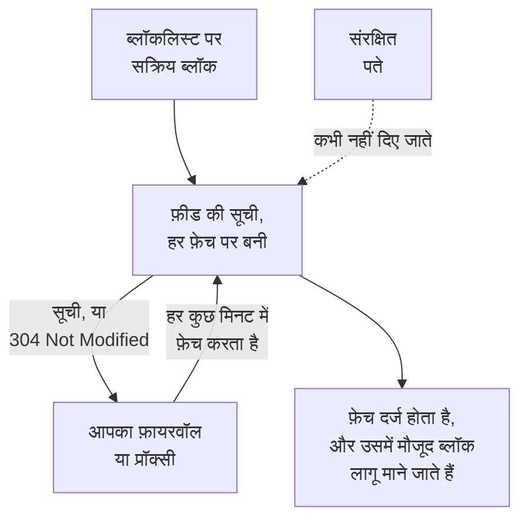

# फ़ायरवॉल और प्रॉक्सी के लिए ब्लॉकलिस्ट फ़ीड

ब्लॉकलिस्ट फ़ीड एक गुप्त URL है, जिससे आपका फ़ायरवॉल या प्रॉक्सी हर कुछ मिनट में आपके प्रोजेक्ट की [ब्लॉकलिस्ट](/docs/telemetry/security-cases#ब्लॉकलिस्ट) पढ़ता है। Palo Alto Networks, FortiGate, Check Point, Cisco Secure Firewall, OPNsense और pfSense इसे एक बाहरी सूची के रूप में पढ़ते हैं, और OneUptime से कॉपी किए गए कमांड इसे nftables, ipset, nginx, HAProxy या Windows फ़ायरवॉल से लागू करते हैं। कनेक्शन आपका फ़ायरवॉल बनाता है: OneUptime को कभी भी आपके नेटवर्क में आने का रास्ता या आपके फ़ायरवॉल का पासवर्ड नहीं चाहिए।

:::cards
- [फ़ीड बनाएँ](#फ़ीड-बनाएँ): फ़ायरवॉल चुनें, रहस्य कॉपी करें और उसके चरणों का पालन करें।
- [अपना फ़ायरवॉल सेट करें](#अपना-फ़ायरवॉल-सेट-करें): हर फ़ायरवॉल और प्रॉक्सी के चरण, और वह कितनी बार फ़ेच करता है।
- [ब्लॉक कब लागू होता है](#ब्लॉक-कब-लागू-होता-है): तभी, जब कोई फ़ायरवॉल ऐसी सूची फ़ेच कर ले जिसमें वह ब्लॉक हो।
- [रहस्य बदलें या रद्द करें](#रहस्य-बदलें-या-रद्द-करें): एक दिन के ओवरलैप वाला नया रहस्य, या तुरंत कोई भी नहीं।
:::

## यह कैसे काम करता है



हर फ़ेच उस पल सक्रिय ब्लॉक से सूची बनाता है। जिस ब्लॉक की अवधि खत्म हो जाए या जिसे अनब्लॉक किया जाए, वह अगले फ़ेच से हट जाता है, और कोई संरक्षित पता उसमें कभी नहीं होता, वह भी नहीं जिसे ब्लॉक होने के बाद संरक्षित किया गया। कोई ब्लॉक फ़ीड पर तभी लागू माना जाता है, जब कोई फ़ायरवॉल ऐसी सूची फ़ेच कर ले जिसमें वह हो।

## शुरू करने से पहले

- ऐसा फ़ायरवॉल या प्रॉक्सी जो किसी `https` URL से पतों की सूची पढ़ता हो, या कोई Linux या Windows होस्ट जहाँ आप root या एडमिनिस्ट्रेटर के रूप में कमांड चला सकें।
- फ़ायरवॉल से HTTPS पर OneUptime तक बाहर जाने का रास्ता: `https://oneuptime.com`, या आपके अपने OneUptime सर्वर का पता।
- फ़ीड बना सकने वाली भूमिका: प्रोजेक्ट स्वामी, प्रोजेक्ट एडमिन या सुरक्षा एडमिन। सुरक्षा सदस्य और सुरक्षा दर्शक फ़ीड और उनके फ़ेच पढ़ सकते हैं। देखें [भूमिकाएँ](/docs/permissions/reference#भूमिकाएँ)।

## फ़ीड बनाएँ

:::steps
### ब्लॉकलिस्ट फ़ीड खोलें

**उत्पाद → सुरक्षा इवेंट → प्लेबुक → ब्लॉकलिस्ट फ़ीड** खोलें।

### नई फ़ीड बनाएँ

**ब्लॉकलिस्ट फ़ीड बनाएँ** पर क्लिक करें और वह **फ़ायरवॉल** चुनें जो इसे पढ़ता है। **नाम** वह नाम है जिससे ब्लॉकलिस्ट किसी ब्लॉक के लागू होने की जगह पर इस फ़ीड को दिखाती है; खाली छोड़ने पर इसका नाम फ़ायरवॉल के नाम पर रखा जाता है, जैसे "FortiGate feed"। **और फ़ील्ड** के अंदर, **देती है** से IPv4 और IPv6, केवल IPv4 या केवल IPv6 चुना जाता है, और **अनुमत स्रोत पते** सीमित करता है कि फ़ीड कौन पढ़ सकता है।

### रहस्य कॉपी करें

फ़ीड का पेज उसके रहस्य के साथ खुलता है, जो एक बार दिखाया जाता है: OneUptime केवल उसका हैश रखता है। इसे कॉपी करें, फिर **हो गया** पर क्लिक करें। जब तक आप पेज नहीं छोड़ते, उस पर दिए चरणों में रहस्य आपके लिए भरा रहता है।

### अपने फ़ायरवॉल के चरणों का पालन करें

**अपना फ़ायरवॉल सेट करें** पेस्ट करने के लिए URL, आपका फ़ायरवॉल रहस्य कैसे भेजता है, और उसके अपने कंसोल के चरण, सब भरे हुए दिखाता है। किसी दूसरे फ़ायरवॉल के चरण देखने के लिए वहाँ वह फ़ायरवॉल चुनें। आपके फ़ायरवॉल के पहले फ़ेच के बाद फ़ीड की स्थिति **पढ़ा जा रहा है** दिखाती है, और **फ़ेच** में वह फ़ेच दिखता है।
:::

## फ़ीड क्या देती है

| फ़ाइल | किसके लिए | इसमें क्या होता है |
| --- | --- | --- |
| `blocklist.txt` | Palo Alto Networks, pfSense, ipset, HAProxy, Windows फ़ायरवॉल और कोई भी दूसरा फ़ायरवॉल | हर पंक्ति में एक पता या रेंज। |
| `blocklist.txt?comments=1` | FortiGate, Check Point, Cisco Secure Firewall और OPNsense, जो `#` से शुरू होने वाली पंक्तियाँ छोड़ देते हैं | हर पता या रेंज, एक ऐसी पंक्ति के बाद जो बताती है कि उसे क्यों ब्लॉक किया गया। |
| `nftables.nft` | nftables | `nft -f` के लिए एक फ़ाइल, जो टेबल `inet oneuptime` के सेट `blocklist_v4` और `blocklist_v6` को खाली करके फिर से भरती है। |
| `nginx.conf` | nginx | हर पते या रेंज के लिए एक `deny` पंक्ति। |
| किसी फ़ाइल का नाम और उसके बाद `.md5`, जैसे `blocklist.txt.md5` | Cisco Secure Firewall | फ़ाइल का MD5, ताकि फ़ायरवॉल सूची तभी डाउनलोड करे जब वह बदली हो। |

फ़ीड का URL `https://oneuptime.com/api/blocklist-feed/<feed ID>/<file>` है, और फ़ीड का पेज इसे आपके फ़ायरवॉल के लिए भरकर दिखाता है। `?comments=1` के साथ सूची ऐसी दिखती है:

```text
# OneUptime case CASE-42 until 2026-11-21 10:42 UTC
203.0.113.7
# OneUptime blocklist until lifted
198.51.100.0/24
```

फ़ीड वे सक्रिय ब्लॉक देती है जिनकी कार्रवाई **ब्लॉक करें** है। वह कभी कोई चैलेंज नहीं देती, जो फ़ायरवॉल नहीं कर सकता, और केवल IPv4 या केवल IPv6 देने वाली फ़ीड दूसरे पते छोड़ देती है। nftables फ़ाइल ऐसा पता छोड़ देती है जो सूची की किसी रेंज में पहले से शामिल है, क्योंकि nftables किसी सेट में ओवरलैप होने वाली प्रविष्टियाँ स्वीकार नहीं करता।

जब कुछ भी ब्लॉक नहीं होता, तो `blocklist.txt` में एक पता होता है, `192.0.2.1` (केवल IPv6 देने वाली फ़ीड के लिए `2001:db8::1`)। यह दस्तावेज़ों के लिए अलग रखा गया पता है, जिससे इंटरनेट पर कोई ट्रैफ़िक नहीं आता: सूची खाली आने पर Palo Alto Networks और Cisco पिछली पढ़ी गई सूची रखे रहते हैं, इसलिए खाली सूची वह भी ब्लॉक करती रहती जिसे आपने अनब्लॉक किया।

हर जवाब में एक `ETag` होता है। जो फ़ायरवॉल इसे `If-None-Match` में वापस भेजता है, उसे सूची न बदलने तक `304 Not Modified` मिलता है, और OneUptime जो कमांड देता है वे ऐसा ही करते हैं।

## फ़ायरवॉल रहस्य कैसे भेजता है

| तरीका | फ़ायरवॉल क्या भेजता है | कौन इस्तेमाल करता है |
| --- | --- | --- |
| बेसिक ऑथेंटिकेशन | कोई भी यूज़रनेम, जैसे `oneuptime`, और पासवर्ड के रूप में रहस्य | Palo Alto Networks (केवल HTTPS पर), FortiGate और Check Point |
| Bearer टोकन | `Authorization: Bearer <secret>` | nftables, ipset, nginx, HAProxy और Windows फ़ायरवॉल के कमांड |
| URL में रहस्य | `https://oneuptime.com/api/blocklist-feed/<feed ID>/<secret>/blocklist.txt` | Cisco Secure Firewall, OPNsense और pfSense, जिनके दस्तावेज़ों में रहस्य भेजने का कोई तरीका नहीं बताया गया |

बिना रहस्य या गलत रहस्य वाले अनुरोध को `401 Unauthorized` मिलता है। गलत रहस्य वाले URL को `404 Not Found` मिलता है, ठीक वैसे ही जैसे किसी ऐसे पते को जो मौजूद नहीं है। OneUptime का अपना वेब सर्वर फ़ीड URL अपने एक्सेस लॉग में नहीं लिखता, इसलिए URL में रखा रहस्य वहाँ नहीं पहुँचता।

## सीमित करें कि फ़ीड कौन पढ़ सकता है

**और फ़ील्ड** के अंदर **अनुमत स्रोत पते** में हर पंक्ति में एक करके अधिकतम 50 पते और रेंज डाले जा सकते हैं, जैसे `203.0.113.7` या `198.51.100.0/24`। किसी भी दूसरे पते से आए अनुरोध को सही रहस्य होने पर भी `403 Forbidden` मिलता है। रहस्य वाले किसी भी पते को फ़ीड पढ़ने देने के लिए इसे खाली छोड़ें।

हर पता किसी एक फ़ीड को एक मिनट में 60 बार, और सभी फ़ीड को कुल मिलाकर एक मिनट में 600 बार फ़ेच कर सकता है। इससे ज़्यादा होने पर उसे `Retry-After` हेडर के साथ `429 Too Many Requests` मिलता है।

## ब्लॉक कब लागू होता है

कोई ब्लॉक किसी फ़ीड पर तब लागू माना जाता है, जब ब्लॉक बनने के बाद कोई फ़ायरवॉल ऐसी सूची फ़ेच कर ले जिसमें वह हो, और हर ऐसे फ़ेच के बाद दस मिनट तक लागू माना जाता है। `304 Not Modified` जवाब उसी सूची का फ़ेच माना जाता है। तब **ब्लॉकलिस्ट** पर **कहाँ लागू है** में फ़ीड का चिप हरा हो जाता है, और उसका टूलटिप बताता है कि ब्लॉक बनने के कितनी देर बाद फ़ायरवॉल ने उसे फ़ेच किया, जैसे "एक फ़ायरवॉल ने यह ब्लॉक बनने के 3 मि॰ बाद FortiGate feed से फ़ेच किया। आख़िरी फ़ेच 2 मिनट पहले।"

दस मिनट तक कोई फ़ेच न होने पर चिप बताता है कि तब से फ़ायरवॉल ने फ़ीड फ़ेच नहीं की है: हो सकता है फ़ायरवॉल अब भी पते को ब्लॉक कर रहा हो, पर OneUptime यह नहीं जान सकता। इसलिए अपने फ़ायरवॉल से फ़ीड हर पाँच मिनट या उससे जल्दी फ़ेच करवाएँ। जो फ़ायरवॉल कम बार फ़ेच करता है, जैसे OPNsense, वह अपने फ़ेच के बीच भी ब्लॉक करता रहता है, और OneUptime वहाँ ब्लॉक को हर फ़ेच के बाद केवल दस मिनट तक लागू मानता है।

जिस ब्लॉक की अवधि खत्म हो जाए या जिसे अनब्लॉक किया जाए, वह अगले फ़ेच से हट जाता है, और उसका चिप किसी फ़ायरवॉल द्वारा उसके बिना सूची फ़ेच किए जाने की प्रतीक्षा करता है। जब OneUptime यह नहीं पढ़ पाता कि कौन-से पते संरक्षित हैं, तो फ़ीड ऐसी सूची के बजाय जिसमें कोई संरक्षित पता हो सकता है, `Retry-After: 60` के साथ `503 Service Unavailable` जवाब देती है, और फ़ायरवॉल अपने पास मौजूद सूची रखता है।

## जब फ़ायरवॉल पढ़ना बंद कर दे

OneUptime सीखता है कि हर फ़ीड कितनी बार फ़ेच होती है। जब कोई फ़ीड अपने सामान्य अंतराल के तीन गुना समय तक, और कम से कम दस मिनट तक, फ़ेच नहीं होती, तो उसकी स्थिति **पढ़ना बंद हो गया** दिखाती है, **ब्लॉकलिस्ट** अपनी सूची के ऊपर उसका नाम दिखाती है, और प्रोजेक्ट स्वामी एक ईमेल पाते हैं: "Your firewall stopped reading the blocklist feed _फ़ीड का नाम_"। जब तक कोई फ़ायरवॉल किसी फ़ीड को दो बार फ़ेच नहीं कर लेता, OneUptime हर पाँच मिनट में, OPNsense से हर घंटे और pfSense से हर दिन एक फ़ेच की उम्मीद करता है।

अगला फ़ेच इसे हटा देता है, और बाद में फिर से रुकने पर एक और ईमेल भेजा जाता है। जिस फ़ीड का रहस्य रद्द कर दिया गया हो, उसे कभी रुका हुआ नहीं माना जाता।

## रहस्य बदलें या रद्द करें

फ़ीड के पेज पर **रहस्य बदलें** एक नया रहस्य बनाता है और उसे एक बार दिखाता है। जिस रहस्य की जगह यह लेता है, वह 24 घंटे तक काम करता रहता है, ताकि आप हर फ़ायरवॉल को नया रहस्य दे सकें; **फ़ेच** उस फ़ेच को **पिछला रहस्य** के रूप में चिह्नित करता है जिसने अब भी पुराना रहस्य भेजा। उन 24 घंटों के भीतर फिर से बदलने पर सबसे पुराना रहस्य तुरंत खत्म हो जाता है।

**रहस्य रद्द करें** रहस्य को, और उससे पहले वाले रहस्य को, तुरंत खत्म कर देता है: रहस्य लीक होने पर इसका इस्तेमाल करें। इसके बाद फ़ीड किसी को जवाब नहीं देती, और उसके फ़ायरवॉल अपने पास मौजूद सूची को रिफ़्रेश किए बिना तब तक रखते हैं, जब तक **रहस्य बदलें** नया रहस्य नहीं बनाता। फ़ीड हटाने पर फ़ीड, उसका रहस्य और उसके फ़ेच, सब खत्म हो जाते हैं।

## अपना फ़ायरवॉल सेट करें

फ़ीड का पेज आपके चुने गए फ़ायरवॉल के लिए ये चरण दिखाता है, जिनमें URL, यूज़रनेम और, रहस्य बनने के ठीक बाद, रहस्य भी भरा होता है।

| फ़ायरवॉल | फ़ाइल | रहस्य | कितनी बार फ़ेच करें | अधिकतम क्षमता |
| --- | --- | --- | --- | --- |
| Palo Alto Networks | `blocklist.txt` | बेसिक ऑथेंटिकेशन | 5 मिनट, इसका सबसे छोटा विकल्प | 30 कस्टम सूचियाँ, और कुल 50,000 पते (PA-3200, PA-5200 और PA-7000 सीरीज़ पर 150,000) |
| FortiGate | `blocklist.txt?comments=1` | बेसिक ऑथेंटिकेशन | 5 मिनट (1 से 43,200; डिफ़ॉल्ट 5) | सभी थ्रेट फ़ीड में कुल मिलाकर 300,000 पते |
| Check Point | `blocklist.txt?comments=1`, IPv4 | बेसिक ऑथेंटिकेशन | 5 मिनट (डिफ़ॉल्ट हर घंटे) | एक फ़ीड में 50,000 पते |
| Cisco Secure Firewall | `blocklist.txt?comments=1` और उसका MD5 | URL में | 5 मिनट (डिफ़ॉल्ट 2 घंटे) | |
| OPNsense | `blocklist.txt?comments=1` | URL में | 1 घंटा, इसका सबसे छोटा विकल्प | |
| pfSense | `blocklist.txt` | URL में | 1 दिन, इसका सबसे छोटा विकल्प | |
| nftables, ipset, nginx, HAProxy, Windows फ़ायरवॉल | उनकी अपनी फ़ाइलें | Bearer टोकन | 1 मिनट | |

### Palo Alto Networks

1. वेब इंटरफ़ेस में **Objects → External Dynamic Lists** पर जाएँ और **Add** पर क्लिक करें।
2. **Type** को **IP List** पर और **Source** को फ़ीड के URL, `https://oneuptime.com/api/blocklist-feed/<feed ID>/blocklist.txt` पर सेट करें।
3. **Client Authentication** चालू करें, **Username** `oneuptime` और **Password** के रूप में फ़ीड के रहस्य के साथ।
4. **Check for updates** को **Every Five Minutes** पर सेट करें, **OK** पर क्लिक करें और commit करें।
5. **Policies → Security** में एक नियम जोड़ें जिसका **Source Address** यह सूची हो और action **Deny** हो, फिर commit करें।

Palo Alto Networks यूज़रनेम और पासवर्ड केवल HTTPS पर भेजता है। वह टिप्पणी केवल किसी पते के बाद पढ़ता है, अलग पंक्ति पर कभी नहीं, इसलिए उसकी फ़ीड सादी सूची है। देखें [Configure the Firewall to Access an External Dynamic List](https://docs.paloaltonetworks.com/pan-os/11-1/pan-os-admin/policy/use-an-external-dynamic-list-in-policy/configure-the-firewall-to-access-an-external-dynamic-list)।

### FortiGate

1. **Security Fabric → External Connectors** पर जाएँ, **Create New** पर क्लिक करें और **Threat Feeds** के अंतर्गत **IP Address** चुनें।
2. **URL of external resource** को फ़ीड के URL, `https://oneuptime.com/api/blocklist-feed/<feed ID>/blocklist.txt?comments=1` पर सेट करें।
3. **HTTP basic authentication** चालू करें, **Username** `oneuptime` और **Password** के रूप में फ़ीड के रहस्य के साथ।
4. **Refresh Rate** को 5 मिनट पर सेट करें और **OK** पर क्लिक करें।
5. **Policy & Objects → Firewall Policy** में फ़ीड को किसी policy के **Source** के रूप में इस्तेमाल करें और **Action** को **DENY** पर सेट करें।

देखें [Configuring a threat feed](https://docs.fortinet.com/document/fortigate/7.6.0/administration-guide/379433/configuring-a-threat-feed)।

### Check Point

1. SmartConsole में **Object Explorer** खोलें और **New → More → Network Object → Network Feed** चुनें।
2. **Feed URL** को फ़ीड के URL, `https://oneuptime.com/api/blocklist-feed/<feed ID>/blocklist.txt?comments=1` पर, **Format** को **Flat list** पर और **Data type** को **IP Address** पर सेट करें।
3. **Advanced Settings** में **Username** `oneuptime` और **Authentication** के पासवर्ड के रूप में फ़ीड का रहस्य दर्ज करें।
4. **Check feed interval** को 5 मिनट पर सेट करें, **Test Feed** पर क्लिक करें, फिर **OK** पर।
5. फ़ीड को ऐसे Access Control नियम के **Source** के रूप में इस्तेमाल करें जिसका action **Drop** हो, और policy इंस्टॉल करें।

Check Point नेटवर्क फ़ीड के लिए केवल IPv4 पतों का दस्तावेज़ देता है, इसलिए उसके लिए बनी फ़ीड केवल IPv4 देती है। देखें [Network Feed](https://sc1.checkpoint.com/documents/R82/WebAdminGuides/EN/CP_R82_SecurityManagement_AdminGuide/Content/Topics-SECMG/Network_Feed.htm)।

### Cisco Secure Firewall

1. मैनेजमेंट सेंटर में **Objects → Security Intelligence** चुनें और **Add Network Lists and Feeds** पर क्लिक करें।
2. **Type** को **Feed** पर, **Feed URL** को फ़ीड के URL, `https://oneuptime.com/api/blocklist-feed/<feed ID>/<secret>/blocklist.txt?comments=1` पर, और **MD5 URL** को उसी URL पर सेट करें जिसमें `blocklist.txt` के बाद `.md5` हो।
3. **Update Frequency** को 5 मिनट पर सेट करें और सहेजें।
4. अपनी access control policy में **Security Intelligence → Networks** खोलें, फ़ीड को **Block List** में जोड़ें, फिर सहेजें और deploy करें।

30 मिनट या उससे कम की update frequency के लिए Cisco को MD5 URL चाहिए, और उसके प्रबंधित डिवाइस हर 30 मिनट में मैनेजमेंट सेंटर से अपडेट लेते हैं, इसलिए फ़ीड फ़ेच होने के बाद ब्लॉक उन तक 30 मिनट के भीतर पहुँचता है। देखें [Creating Security Intelligence feeds](https://docs.manage.security.cisco.com/cdfmc/t_creating_security_intelligence_feeds.html)।

### OPNsense

1. **Firewall → Aliases** पर जाएँ और **URL Table (IPs)** प्रकार का एक alias जोड़ें।
2. **Content** को फ़ीड के URL, `https://oneuptime.com/api/blocklist-feed/<feed ID>/<secret>/blocklist.txt?comments=1` पर और **Refresh Frequency** को 0 दिन और 1 घंटे पर सेट करें।
3. सहेजें और **Apply** करें, फिर **Firewall → Rules** में एक नियम जोड़ें जो उस ट्रैफ़िक को ब्लॉक करे जिसका **Source** यह alias है।

OPNsense किसी URL table को अधिकतम हर घंटे एक बार फ़ेच करता है, इसलिए OneUptime उसके ब्लॉक केवल हर फ़ेच के बाद के दस मिनट तक पुष्ट करता है। बीच के समय में भी वह उन्हें ब्लॉक करता रहता है। देखें [Aliases](https://docs.opnsense.org/manual/aliases.html)।

### pfSense

1. **Firewall → Aliases** पर जाएँ, **Add** पर क्लिक करें और **URL Table (IPs)** चुनें।
2. फ़ीड का URL, `https://oneuptime.com/api/blocklist-feed/<feed ID>/<secret>/blocklist.txt`, दर्ज करें और इसे हर 1 दिन में रिफ़्रेश होने के लिए सेट करें।
3. **Save** और **Apply Changes** करें, फिर **Firewall → Rules** में एक नियम जोड़ें जिसका **Source** यह alias हो और action **Block** हो।

> [!WARNING]
> pfSense किसी URL table को अधिकतम दिन में एक बार फ़ेच करता है: किसी हमले को उसके चलते समय ब्लॉक करने के लिए यह बहुत धीमा है। इसे लंबे ब्लॉक के लिए, हर कुछ मिनट में फ़ेच करने वाले किसी फ़ायरवॉल के साथ इस्तेमाल करें।

देखें [Alias Types](https://docs.netgate.com/pfsense/en/latest/firewall/aliases-types.html)।

### nftables

फ़ीड के पेज पर दिखाए गए कमांड एक बार root के रूप में चलाएँ। ये दो सेट, `blocklist_v4` और `blocklist_v6`, वाली टेबल `inet oneuptime`, उसकी `input` और `forward` चेन में ऐसे नियम जो इन सेट के पतों से आने वाला ट्रैफ़िक ड्रॉप करते हैं, और स्क्रिप्ट `/usr/local/sbin/oneuptime-blocklist` बनाते हैं, जो रहस्य को `/etc/oneuptime-blocklist` में रखती है, जिसे केवल root पढ़ सकता है।

```bash
# Run once, as root.
install -d -m 700 /etc/oneuptime-blocklist /var/lib/oneuptime-blocklist
printf 'Authorization: Bearer %s\n' 'YOUR_FEED_SECRET' > /etc/oneuptime-blocklist/auth
chmod 600 /etc/oneuptime-blocklist/auth
cat > /usr/local/sbin/oneuptime-blocklist <<'SCRIPT'
#!/bin/sh
# Loads the OneUptime blocklist into nftables when it changed.
set -eu
URL='https://oneuptime.com/api/blocklist-feed/<feed ID>/nftables.nft'
STATE=/var/lib/oneuptime-blocklist
if ! nft list table inet oneuptime >/dev/null 2>&1; then
  rm -f "$STATE/etag"
  nft -f - <<'NFT'
table inet oneuptime {
  set blocklist_v4 { type ipv4_addr; flags interval; auto-merge; }
  set blocklist_v6 { type ipv6_addr; flags interval; auto-merge; }
  chain input {
    type filter hook input priority filter; policy accept;
    ip saddr @blocklist_v4 drop
    ip6 saddr @blocklist_v6 drop
  }
  chain forward {
    type filter hook forward priority filter; policy accept;
    ip saddr @blocklist_v4 drop
    ip6 saddr @blocklist_v6 drop
  }
}
NFT
fi
TMP=$(mktemp)
trap 'rm -f "$TMP" "$TMP.h"' EXIT
ETAG=$(cat "$STATE/etag" 2>/dev/null || true)
CODE=$(curl --silent --show-error --max-time 60 --header @/etc/oneuptime-blocklist/auth \
  ${ETAG:+--header "If-None-Match: $ETAG"} \
  --dump-header "$TMP.h" --output "$TMP" --write-out '%{http_code}' "$URL")
[ "$CODE" = 304 ] && exit 0
[ "$CODE" = 200 ] || { echo "oneuptime-blocklist: the feed answered $CODE" >&2; exit 1; }
nft -f "$TMP"
sed -n 's/^[Ee][Tt][Aa][Gg]:[[:space:]]*//p' "$TMP.h" | tr -d '\r' > "$STATE/etag"
SCRIPT
chmod 700 /usr/local/sbin/oneuptime-blocklist
echo '* * * * * root flock -n /run/oneuptime-blocklist.lock /usr/local/sbin/oneuptime-blocklist' > /etc/cron.d/oneuptime-blocklist
/usr/local/sbin/oneuptime-blocklist
```

स्क्रिप्ट `/etc/cron.d/oneuptime-blocklist` से हर मिनट चलती है। वह `nftables.nft` को केवल सूची बदलने पर, एक ही ट्रांज़ैक्शन में लोड करती है, इसलिए सेट कभी आधे भरे नहीं होते। देखें [Sets](https://wiki.nftables.org/wiki-nftables/index.php/Sets)।

### ipset और iptables

फ़ीड के पेज पर दिखाए गए कमांड एक बार root के रूप में चलाएँ। ये दो सेट, `oneuptime_v4` और `oneuptime_v6`, और iptables और ip6tables के लिए `raw` टेबल की `PREROUTING` चेन में ऐसे नियम बनाते हैं जो इन सेट के पतों से आने वाला ट्रैफ़िक ड्रॉप करते हैं।

स्क्रिप्ट cron से हर मिनट चलती है। सूची बदलने पर वह दो नए सेट भरती है और उन्हें पुराने सेट की जगह लगा देती है, ताकि नियमों को कभी आधा भरा सेट न दिखे। देखें [ipset](https://ipset.netfilter.org/ipset.man.html)।

### nginx

जिस भी साइट को सुरक्षित करना है, उसके `server` ब्लॉक में include पंक्ति जोड़ें, फिर फ़ीड के पेज पर दिखाए गए कमांड एक बार root के रूप में चलाएँ:

```nginx
server {
    include /etc/nginx/oneuptime-blocklist.conf;
}
```

```bash
# Run once, as root.
install -d -m 700 /etc/oneuptime-blocklist /var/lib/oneuptime-blocklist
printf 'Authorization: Bearer %s\n' 'YOUR_FEED_SECRET' > /etc/oneuptime-blocklist/auth
chmod 600 /etc/oneuptime-blocklist/auth
touch /etc/nginx/oneuptime-blocklist.conf
cat > /usr/local/sbin/oneuptime-blocklist <<'SCRIPT'
#!/bin/sh
# Writes the OneUptime blocklist for nginx when it changed, and reloads nginx.
set -eu
URL='https://oneuptime.com/api/blocklist-feed/<feed ID>/nginx.conf'
STATE=/var/lib/oneuptime-blocklist
TMP=$(mktemp)
trap 'rm -f "$TMP" "$TMP.h"' EXIT
ETAG=$(cat "$STATE/etag" 2>/dev/null || true)
CODE=$(curl --silent --show-error --max-time 60 --header @/etc/oneuptime-blocklist/auth \
  ${ETAG:+--header "If-None-Match: $ETAG"} \
  --dump-header "$TMP.h" --output "$TMP" --write-out '%{http_code}' "$URL")
[ "$CODE" = 304 ] && exit 0
[ "$CODE" = 200 ] || { echo "oneuptime-blocklist: the feed answered $CODE" >&2; exit 1; }
cp /etc/nginx/oneuptime-blocklist.conf "$STATE/last.conf"
cp "$TMP" /etc/nginx/oneuptime-blocklist.conf
if nginx -t -q; then nginx -s reload; else cp "$STATE/last.conf" /etc/nginx/oneuptime-blocklist.conf; exit 1; fi
sed -n 's/^[Ee][Tt][Aa][Gg]:[[:space:]]*//p' "$TMP.h" | tr -d '\r' > "$STATE/etag"
SCRIPT
chmod 700 /usr/local/sbin/oneuptime-blocklist
echo '* * * * * root flock -n /run/oneuptime-blocklist.lock /usr/local/sbin/oneuptime-blocklist' > /etc/cron.d/oneuptime-blocklist
/usr/local/sbin/oneuptime-blocklist

# Then add this line to the server block of the site to protect, and reload nginx:
#   include /etc/nginx/oneuptime-blocklist.conf;
```

स्क्रिप्ट cron से हर मिनट चलती है। सूची बदलने पर वह `/etc/nginx/oneuptime-blocklist.conf` लिखती है, `nginx -t` से कॉन्फ़िगरेशन जाँचती है और nginx को रीलोड करती है, और जाँच विफल होने पर पिछली फ़ाइल वापस रख देती है।

किसी लोड बैलेंसर या CDN के पीछे nginx को विज़िटर का नहीं, बैलेंसर का पता दिखता है, जब तक realip मॉड्यूल सेट न हो: `set_real_ip_from` को बैलेंसर के पतों पर और `real_ip_header` को उस हेडर पर सेट करें जो वह भेजता है, या इसके बजाय बैलेंसर पर ही ब्लॉक करें। देखें [ngx_http_access_module](https://nginx.org/en/docs/http/ngx_http_access_module.html)।

### HAProxy

root के रूप में सूची फ़ाइल बनाएँ और `haproxy.cfg` में दो पंक्तियाँ जोड़ें, फिर HAProxy को एक बार रीलोड करें: इसका Runtime API केवल उसी सूची को अपडेट करता है जिसे HAProxy पहले से पढ़ता है।

```text
global
    stats socket /run/haproxy/admin.sock mode 660 level admin

frontend www
    http-request deny if { src -n -f /etc/haproxy/oneuptime-blocklist.lst }
```

फिर फ़ीड के पेज पर दिखाए गए बाकी कमांड चलाएँ। स्क्रिप्ट cron से हर मिनट चलती है और सूची बदलने पर `/etc/haproxy/oneuptime-blocklist.lst` लिखती है और HAProxy को उसके Runtime API से, बिना रीलोड के, अपडेट करती है। देखें [The Runtime API](https://docs.haproxy.org/3.4/management.html#9.3)।

### Windows फ़ायरवॉल

PowerShell में एडमिनिस्ट्रेटर के रूप में फ़ीड के पेज पर दिखाए गए कमांड एक बार चलाएँ। ये एक स्क्रिप्ट और रहस्य को `C:\ProgramData\OneUptime\Blocklist` में सहेजते हैं, जिसे केवल SYSTEM और Administrators पढ़ सकते हैं, और शेड्यूल किया गया टास्क "OneUptime Blocklist" रजिस्टर करते हैं, जो स्क्रिप्ट को हर मिनट SYSTEM के रूप में चलाता है।

स्क्रिप्ट ऐसे इनबाउंड नियम बनाए रखती है जो सूची के हर पते को ब्लॉक करते हैं, हर नियम में 1,000 पते: "OneUptime blocklist 0", "OneUptime blocklist 1" और आगे। देखें [Set-NetFirewallRule](https://learn.microsoft.com/en-us/powershell/module/netsecurity/set-netfirewallrule)।

### अन्य फ़ायरवॉल

1. अपने फ़ायरवॉल या प्रॉक्सी को फ़ीड के URL, `https://oneuptime.com/api/blocklist-feed/<feed ID>/blocklist.txt` पर पॉइंट करें: हर पंक्ति में एक पता या रेंज।
2. फ़ीड का रहस्य बेसिक ऑथेंटिकेशन के पासवर्ड के रूप में किसी भी यूज़रनेम के साथ, या Bearer टोकन के रूप में भेजें।
3. इससे सूची हर 5 मिनट या उससे जल्दी फ़ेच करवाएँ: हर फ़ेच के बाद दस मिनट तक ब्लॉक वहाँ लागू माना जाता है।

### Kubernetes

क्लस्टर के सामने वाले एज या क्लाउड WAF पर ब्लॉक करें, जिसे **सुरक्षा कनेक्शन** या **क्लाउड कनेक्शन** के अंतर्गत ब्लॉकलिस्ट गंतव्य के रूप में जोड़ा गया हो, या nginx या HAProxy के कमांड से क्लस्टर के सामने चलाए जा रहे अपने प्रॉक्सी पर। समुदाय का Ingress NGINX कंट्रोलर रिटायर कर दिया गया है, और उसकी रिपॉज़िटरी मार्च 2026 में आर्काइव कर दी गई, इसलिए OneUptime उसके एनोटेशन का दस्तावेज़ नहीं देता। देखें [Ingress NGINX Retirement](https://kubernetes.io/blog/2025/11/11/ingress-nginx-retirement/)।

## सीमाएं

| क्या | सीमा |
| --- | --- |
| एक फ़ीड में प्रविष्टियाँ | 20,000 |
| अनुमत स्रोत पते | 50 पते और रेंज |
| एक पते से एक फ़ीड के फ़ेच | 60 प्रति मिनट |
| एक पते से सभी फ़ीड के फ़ेच | 600 प्रति मिनट |
| बदला गया रहस्य काम करता रहता है | 24 घंटे |
| फ़ेच के बाद ब्लॉक लागू माना जाता है | 10 मिनट |
| फ़ेच रखे जाते हैं | 30 दिन |

## समस्या निवारण

:::details फ़ायरवॉल को 401 Unauthorized मिलता है
वह जो रहस्य भेजता है, वह फ़ीड का रहस्य नहीं है। जाँचें कि पासवर्ड, या Bearer टोकन, पूरा रहस्य है, जिसके आगे या पीछे कुछ नहीं है। 24 घंटे से भी पहले बदला गया रहस्य अब काम नहीं करता: **रहस्य बदलें** एक नया रहस्य बनाता है।
:::

:::details फ़ायरवॉल को 404 Not Found मिलता है
URL किसी ऐसी फ़ीड का नाम लेता है जो मौजूद नहीं है, या ऐसी फ़ाइल का जिसे फ़ीड नहीं देती, या उसमें गलत रहस्य है। फ़ीड के पेज से URL फिर से कॉपी करें।
:::

:::details फ़ायरवॉल को 403 Forbidden मिलता है
फ़ीड के **अनुमत स्रोत पते** में वह पता नहीं है जिससे फ़ायरवॉल फ़ेच करता है। **फ़ेच** दिखाता है कि हर फ़ेच किस पते से आया।
:::

:::details किसी ब्लॉक का चिप बताता है कि वह फ़ायरवॉल के फ़ीड फ़ेच करने की प्रतीक्षा कर रहा है
ब्लॉक बनने के बाद से किसी फ़ायरवॉल ने फ़ीड फ़ेच नहीं की है। फ़ीड के पेज पर **फ़ेच** जाँचें: हर पाँच मिनट में फ़ेच करने वाले फ़ायरवॉल में ब्लॉक पाँच मिनट के भीतर आ जाता है।
:::

## अगले कदम

:::cards
- [सुरक्षा केस और प्लेबुक](/docs/telemetry/security-cases): किसी केस से, हाथ से या प्लेबुक से, कोई पता ब्लॉक करें।
- [थ्रेट इंटेलिजेंस](/docs/telemetry/threat-intelligence): ज्ञात हानिकारक पते OneUptime में लाएँ।
- [सुरक्षा इवेंट](/docs/telemetry/security-events): ब्लॉक करने लायक पते खोजें।
:::
