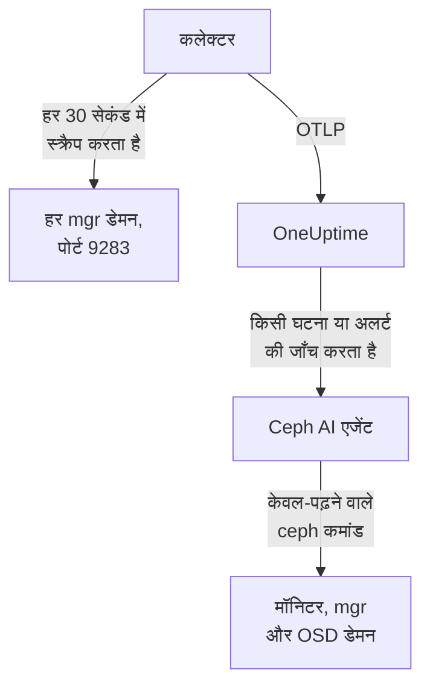

# Ceph एजेंट

OneUptime Ceph एजेंट एक Ceph क्लस्टर की निगरानी करता है: उसकी हेल्थ, मॉनिटर क्वोरम, OSD, पूल और प्लेसमेंट ग्रुप। यह हर mgr डेमन पर Ceph mgr के `prometheus` मॉड्यूल को स्क्रैप करता है, हर मेट्रिक पर आपके क्लस्टर का नाम लगाता है और उसे OneUptime को भेजता है, जहाँ क्लस्टर अपने OSD, पूल और डेमन के साथ दिखता है। [Ceph मॉनिटर](/docs/monitor/ceph-monitor) आने वाले डेटा पर अलर्ट करते हैं।

:::cards
- [एजेंट इंस्टॉल करें](#एजेंट-इंस्टॉल-करें): mgr मॉड्यूल चालू करें, फिर इंस्टॉल स्क्रिप्ट या Docker Compose।
- [एजेंट क्या एकत्र करता है](#एजेंट-क्या-इकट्ठा-करता-है): Ceph पेजों, मेट्रिक्स और अलर्ट टेम्पलेट के पीछे की सीरीज़।
- [AI एजेंट](#ai-एजेंट): जाँच के दौरान OneUptime AI को क्लस्टर पढ़ने दें।
- [समस्या निवारण](#समस्या-निवारण): एक डायग्नोस्टिक स्क्रिप्ट, और आम समस्याएँ।
:::

## यह कैसे काम करता है

एजेंट दो कंटेनर हैं जिन्हें आप एक मशीन पर Docker Compose से चलाते हैं। एक OpenTelemetry Collector हर 30 सेकंड में हर mgr डेमन पर mgr के `prometheus` मॉड्यूल को स्क्रैप करता है। मेट्रिक्स के साथ सिर्फ़ सक्रिय mgr जवाब देता है, इसलिए जब वह किसी स्टैंडबाय पर फ़ेलओवर करता है, तो बिना किसी बदलाव के मेट्रिक्स आते रहते हैं। इसके बगल का Ceph AI एजेंट OneUptime AI को किसी घटना या अलर्ट की जाँच करते समय केवल-पढ़ने वाले `ceph` कमांड चलाने देता है।



क्लस्टर अपने पहले डेटा के साथ, उस नाम के अंतर्गत खुद को रजिस्टर करता है जिसे एजेंट हर मेट्रिक पर `ceph.cluster.name` के रूप में लगाता है।

## शुरू करने से पहले

- Docker Compose v2 प्लगइन के साथ Docker Engine 20.10 या बाद का, ऐसी मशीन पर जो पोर्ट 9283 पर आपके Ceph mgr डेमन तक पहुँच सके।
- एक Ceph एडमिन नोड पर एक शेल, जहाँ `ceph` CLI एडमिन अधिकारों के साथ काम करता हो।
- एक इंजेशन कुंजी। **प्रोजेक्ट सेटिंग्स → टेलीमेट्री और APM → इंजेशन कुंजियाँ** के अंतर्गत एक बनाएँ और उसका मान कॉपी करें।
- उस मशीन से आपके OneUptime URL तक आउटबाउंड HTTPS।

## एजेंट इंस्टॉल करें

:::steps
### mgr prometheus मॉड्यूल चालू करें

एक Ceph एडमिन नोड पर:

```bash
ceph mgr module enable prometheus
```

इसके बाद हर mgr डेमन पोर्ट `9283` पर `/metrics` में Prometheus मेट्रिक्स देता है। मेट्रिक्स सिर्फ़ सक्रिय mgr लौटाता है: स्टैंडबाय mgr खाली जवाब देते हैं, या `mgr/prometheus/standby_behaviour` के `error` पर सेट होने पर HTTP त्रुटि देते हैं। इसीलिए एजेंट हर mgr को स्क्रैप करता है। उनकी सूची देखें:

```bash
ceph mgr stat                    # active mgr
ceph orch ps --daemon-type mgr   # all mgrs (cephadm clusters)
```

### एजेंट इंस्टॉल करें और शुरू करें

:::tabs
@tab install.sh
इंस्टॉल स्क्रिप्ट डाउनलोड करें और उसे उस मशीन पर चलाएँ जो एजेंट को होस्ट करेगी:

```bash
curl -sSL https://raw.githubusercontent.com/OneUptime/oneuptime/master/agents/CephAgent/install.sh -o install.sh
bash install.sh
```

स्क्रिप्ट आपका OneUptime URL, इंजेशन कुंजी, क्लस्टर का नाम और mgr एंडपॉइंट पूछती है, और यह भी कि क्या [AI एजेंट](#ai-एजेंट) सुधार लागू कर सकता है। जहाँ `ceph` एडमिन अधिकारों के साथ काम करता है, वहाँ यह AI एजेंट का अपना Ceph क्लाइंट बनाने की पेशकश भी करती है। यह `/opt/oneuptime-ceph-agent` में इंस्टॉल करती है, `0600` अनुमति वाली एक `.env` फ़ाइल लिखती है, और Docker Compose से एजेंट शुरू करती है। स्क्रिप्ट को फिर से चलाने पर वह दोबारा पूछने के बजाय उस `.env` की हर चीज़ फिर से उपयोग करती है, और इसी तरह आप [एजेंट अपग्रेड करते हैं](#एजेंट-अपग्रेड-करना)।
@tab Docker Compose
[CephAgent डायरेक्टरी](https://github.com/OneUptime/oneuptime/tree/master/agents/CephAgent) से `docker-compose.yml` और `otel-collector-config.yaml` एक नए फ़ोल्डर में डाउनलोड करें:

```bash
mkdir oneuptime-ceph-agent && cd oneuptime-ceph-agent
curl -fsSLO https://raw.githubusercontent.com/OneUptime/oneuptime/master/agents/CephAgent/docker-compose.yml
curl -fsSLO https://raw.githubusercontent.com/OneUptime/oneuptime/master/agents/CephAgent/otel-collector-config.yaml
```

उनके बगल में एक `.env` फ़ाइल बनाएँ:

```bash title=".env"
ONEUPTIME_URL=YOUR_ONEUPTIME_URL
ONEUPTIME_TELEMETRY_INGESTION_KEY=YOUR_TELEMETRY_INGESTION_TOKEN
CEPH_CLUSTER_NAME=my-ceph-cluster
CEPH_MGR_ENDPOINTS=[ceph-mon-1:9283,ceph-mon-2:9283,ceph-mon-3:9283]
```

हर mgr डेमन की सूची दें, सक्रिय और स्टैंडबाय दोनों, कॉमा से अलग और वर्गाकार कोष्ठकों में: कोष्ठकों के कारण कलेक्टर मान को स्क्रैप लक्ष्यों की सूची के रूप में पढ़ता है। एजेंट शुरू करें:

```bash
docker compose up -d
```

AI एजेंट का कंटेनर भी शुरू होता है, और अपने खुद के Ceph क्लाइंट का इंतज़ार करता है: [AI एजेंट](#ai-एजेंट) देखें।
:::

### जाँचें कि एजेंट चल रहा है

```bash
docker compose ps
docker logs -f oneuptime-ceph-agent
```

`docker compose ps` कलेक्टर (`oneuptime-ceph-agent`) और AI एजेंट (`oneuptime-ceph-ai-agent`) दिखाता है। कलेक्टर शुरू होने के बाद उसके लॉग में यह पंक्ति दिखनी चाहिए:

```text
Everything is ready. Begin running and processing data.
```

### OneUptime में क्लस्टर खोजें

**उत्पाद → बुनियादी ढांचा → Ceph → सभी क्लस्टर** खोलें। लगभग एक मिनट में क्लस्टर अपने `CEPH_CLUSTER_NAME` के अंतर्गत अपने OSD, पूल और डेमन के साथ दिखाई देता है।
:::

## एनवायरनमेंट वेरिएबल

इंस्टॉल स्क्रिप्ट इन्हें `/opt/oneuptime-ceph-agent/.env` में लिखती है; Docker Compose इंस्टॉल इन्हें `docker-compose.yml` के बगल की `.env` से पढ़ता है। कोई मान बदलने के बाद उस फ़ोल्डर में `docker compose up -d` चलाएँ।

| वेरिएबल | ज़रूरी | विवरण |
| --- | --- | --- |
| `ONEUPTIME_URL` | हाँ | आपका OneUptime URL, जैसे `https://oneuptime.com` या आपका सेल्फ़-होस्टेड इंस्टेंस। अगर इंस्टेंस सिर्फ़ HTTP पर है तो `http://` और उसका पोर्ट उपयोग करें। |
| `ONEUPTIME_TELEMETRY_INGESTION_KEY` | हाँ | **प्रोजेक्ट सेटिंग्स → टेलीमेट्री और APM → इंजेशन कुंजियाँ** से इंजेशन कुंजी। |
| `CEPH_CLUSTER_NAME` | हाँ | OneUptime में क्लस्टर का नाम, हर मेट्रिक पर `ceph.cluster.name` रिसोर्स एट्रिब्यूट के रूप में लगाया गया। इसे स्थिर रखें: बाद में बदलने से एक दूसरा क्लस्टर रजिस्टर होता है। डिफ़ॉल्ट `ceph` है। |
| `CEPH_MGR_ENDPOINTS` | हाँ | हर mgr डेमन, वर्गाकार कोष्ठकों में कॉमा से अलग `host:port` सूची के रूप में, जैसे `[ceph-mon-1:9283,ceph-mon-2:9283,ceph-mon-3:9283]`। इंस्टॉल स्क्रिप्ट आपके लिए कोष्ठक जोड़ देती है। |

AI एजेंट की अपनी सेटिंग्स [AI एजेंट](#ai-एजेंट) के अंतर्गत हैं।

## एजेंट कैसे स्क्रैप करता है

- **हर mgr, हर 30 सेकंड में।** mgr का `prometheus` मॉड्यूल हर स्क्रैप को `mgr/prometheus/scrape_interval` (डिफ़ॉल्ट रूप से 15 सेकंड) तक कैश करता है। इससे ज़्यादा बार कभी स्क्रैप न करें: आप बस कैश को फिर से पढ़ेंगे।
- **`honor_labels: true`।** Ceph जो लेबल एक्सपोर्ट करता है (`ceph_daemon`, `pool_id`, हर डेमन के इंस्टेंस लेबल) वे जैसे हैं वैसे ही रखे जाते हैं। इसके बिना `instance` लेबल हर स्क्रैप लक्ष्य के लिए फिर से लिखा जाता और सक्रिय mgr बदलने पर हर बार बदल जाता, जिससे हर सीरीज़ टूट जाती है।

## एजेंट क्या इकट्ठा करता है

एजेंट वह सब भेजता है जो mgr का `prometheus` मॉड्यूल एक्सपोर्ट करता है। OneUptime के Ceph पेज, मेट्रिक कैटलॉग और अलर्ट टेम्पलेट इन सीरीज़ पर बने हैं:

| श्रेणी | मेट्रिक्स |
| --- | --- |
| क्लस्टर हेल्थ | `ceph_health_status` (0 = OK, 1 = WARN, 2 = ERR), `ceph_health_detail` (हर सक्रिय हेल्थ चेक के लिए एक सीरीज़, `name` और `severity` लेबल के साथ, Quincy से आगे; हेल्थ-चेक अलर्ट टेम्पलेट और अवलोकन के **Active Health Checks** का आधार), `ceph_healthcheck_slow_ops`, `ceph_daemon_health_metrics` (हर डेमन के लिए, `type` से पहचाना गया), `ceph_mon_quorum_status`, `ceph_mon_metadata`, `ceph_cluster_total_bytes`, `ceph_cluster_total_used_bytes` |
| OSD | `ceph_osd_up`, `ceph_osd_in`, `ceph_osd_apply_latency_ms`, `ceph_osd_commit_latency_ms`, `ceph_osd_stat_bytes`, `ceph_osd_stat_bytes_used`, `ceph_osd_numpg`, `ceph_osd_metadata`, हर OSD के लिए `ceph_daemon` लेबल से (जैसे `osd.3`) |
| पूल | `ceph_pool_stored`, `ceph_pool_max_avail`, `ceph_pool_objects`, `ceph_pool_rd`, `ceph_pool_wr`, `ceph_pool_rd_bytes`, `ceph_pool_wr_bytes`, `ceph_pool_metadata`। डेटा सीरीज़ में सिर्फ़ `pool_id` लेबल होता है; पूल का नाम `ceph_pool_metadata` पर होता है। |
| प्लेसमेंट ग्रुप | `ceph_pg_total`, `ceph_pg_active`, `ceph_pg_clean`, `ceph_pg_degraded`, `ceph_pg_undersized` (सभी हर पूल के लिए, `pool_id` से), `ceph_num_objects_degraded`, `ceph_num_objects_misplaced` |
| डेमन | `ceph_mgr_metadata`, `ceph_mds_metadata` और `ceph_rgw_metadata`, ऊपर के मॉनिटर और OSD मेटाडेटा के साथ। हर एक किसी डेमन का नाम बताता है और `ceph_version` लेबल में उसका वर्शन रखता है: **Daemons** पेज उनकी सूची दिखाता है। |

### और स्क्रैप लक्ष्य

mgr मॉड्यूल क्लस्टर की हेल्थ और क्षमता को कवर करता है। करीब से देखने के लिए, `otel-collector-config.yaml` में `scrape_configs` के अंतर्गत और जॉब जोड़ें:

- **`ceph-exporter` (Reef 18.2 और बाद के)।** cephadm हर क्लस्टर होस्ट पर एक `ceph-exporter` डेमन चलाता है, जो पोर्ट `9926` पर हर डेमन के परफ़ॉर्मेंस काउंटर देता है। हर होस्ट के लिए एक लक्ष्य जोड़ें।
- **`node_exporter`।** हर Ceph होस्ट के CPU, मेमोरी, डिस्क और नेटवर्क मेट्रिक्स के लिए सामान्य साथी, डिफ़ॉल्ट रूप से पोर्ट `9100` पर।

दोनों को साथ आने वाले `resource` प्रोसेसर से `ceph.cluster.name` रिसोर्स एट्रिब्यूट मिलता है, इसलिए वे OneUptime में उसी क्लस्टर पर पहुँचते हैं।

## वैकल्पिक — Ceph क्लस्टर लॉग भेजें

एजेंट `/var/log/ceph/ceph.log` को फ़ॉलो करके OneUptime को भेज सकता है, जिससे क्लस्टर का **Cluster Log** पेज भरता है। यह डिफ़ॉल्ट रूप से बंद है क्योंकि तब एजेंट को ऐसे होस्ट पर चलना होगा जिस पर क्लस्टर लॉग हो: डिफ़ॉल्ट रूप से एक मॉनिटर होस्ट।

:::steps
### रिसीवर चालू करें

`otel-collector-config.yaml` में `filelog` रिसीवर और `logs` पाइपलाइन को अनकमेंट करें।

### लॉग डायरेक्टरी माउंट करें

`docker-compose.yml` में वह वॉल्यूम अनकमेंट करें जो डायरेक्टरी को कलेक्टर में माउंट करता है:

```yaml
- /var/log/ceph:/var/log/ceph:ro
```

### एजेंट फिर से शुरू करें

```bash
docker compose up -d
```
:::

पंक्तियाँ लिखे जाते ही भेजी जाती हैं। OneUptime उन्हें दिखाते समय `ceph.log` फ़ॉर्मैट (समय, डेमन, `INF`/`WRN`/`ERR` स्तर, संदेश) पढ़ता है, और `resource` प्रोसेसर `ceph.cluster.name` लगाता है, इसलिए लॉग इसी क्लस्टर पर पहुँचता है।

## क्लस्टर पर प्रोजेक्ट लेबल लगाएँ

`oneuptime.label.` से शुरू होने वाला रिसोर्स एट्रिब्यूट क्लस्टर पर एक प्रोजेक्ट लेबल बन जाता है: `oneuptime.label.<dimension>=<value>` लेबल `<dimension>:<value>` है। एट्रिब्यूट को `otel-collector-config.yaml` में `resource` प्रोसेसर में, `ceph.cluster.name` के बगल में जोड़ें:

```yaml
processors:
  resource:
    attributes:
      # ...existing attributes...
      - key: oneuptime.label.team
        value: storage
        action: upsert
      - key: oneuptime.label.env
        value: production
        action: upsert
```

कलेक्टर अपना कॉन्फ़िगरेशन सिर्फ़ शुरू होते समय पढ़ता है: `docker compose restart oneuptime-ceph-agent` चलाएँ। इसके बाद क्लस्टर `team:storage` और `env:production` लेबल दिखाता है। लेबल का मिलान अक्षरों के बड़े-छोटे होने की परवाह किए बिना होता है, इसलिए मौजूदा `Production` लेबल दोहराया नहीं जाता बल्कि फिर से उपयोग होता है, और एजेंट कभी वह लेबल नहीं हटाता जिसे किसी ने OneUptime में जोड़ा हो।

## systemd सेवा के रूप में चलाएँ

एजेंट को मशीन के साथ शुरू करने और विफल होने पर फिर से शुरू करने के लिए उसकी systemd यूनिट इंस्टॉल करें। यह मानती है कि एजेंट `/opt/oneuptime-ceph-agent` में है, जहाँ इंस्टॉल स्क्रिप्ट उसे रखती है:

```bash
sudo curl -fsSL https://raw.githubusercontent.com/OneUptime/oneuptime/master/agents/CephAgent/systemd/oneuptime-ceph-agent.service -o /etc/systemd/system/oneuptime-ceph-agent.service
sudo systemctl daemon-reload
sudo systemctl enable --now oneuptime-ceph-agent
```

## एजेंट अपग्रेड करना

एजेंट अपनी फ़ाइलों में पिन किया गया कलेक्टर संस्करण अपने **एजेंट संस्करण** के रूप में बताता है। जब वह इस OneUptime रिलीज़ के पिन किए संस्करण से पुराना हो, तो क्लस्टर के **अवलोकन** पर उसके बगल में एक चेतावनी चिह्न दिखता है। ये कमांड देखने के लिए उसे चुनें। जो एजेंट उसकी फ़ाइलों के संस्करण बताने से पहले इंस्टॉल हुआ था, वह इस तरह अपग्रेड होने तक कोई संस्करण नहीं दिखाता।

कलेक्टर इमेज `docker-compose.yml` में पिन है और उसका कॉन्फ़िगरेशन उसके बगल की एक फ़ाइल है, इसलिए सिर्फ़ पुल करने से एजेंट आगे नहीं बढ़ता। `install.sh` फिर से चलाएँ: यह आपकी मौजूदा `.env` का हर मान दोबारा उपयोग करती है (कुछ भी फिर से नहीं पूछा जाता), `docker-compose.yml` और `otel-collector-config.yaml` ताज़ा करती है (आपकी संपादित फ़ाइल `<file>.bak.<timestamp>` के रूप में रखी जाती है), इमेज पुल करती है और एजेंट दोबारा बनाती है ताकि कलेक्टर अपना नया कॉन्फ़िगरेशन पढ़े। AI एजेंट का `ceph/` फ़ोल्डर जैसा है वैसा ही रहता है।

```bash
curl -sSL https://raw.githubusercontent.com/OneUptime/oneuptime/master/agents/CephAgent/install.sh -o install.sh
bash install.sh
```

इसके बजाय Docker Compose से इंस्टॉल किया था? एजेंट के फ़ोल्डर में दोनों फ़ाइलें फिर से डाउनलोड करें (और उनमें किए गए बदलाव फिर से करें), फिर इमेज पुल करें और एजेंट दोबारा बनाएँ:

```bash
curl -fsSLO https://raw.githubusercontent.com/OneUptime/oneuptime/master/agents/CephAgent/docker-compose.yml
curl -fsSLO https://raw.githubusercontent.com/OneUptime/oneuptime/master/agents/CephAgent/otel-collector-config.yaml
docker compose pull
docker compose up -d --force-recreate
```

## एजेंट अनइंस्टॉल करना

```bash
cd /opt/oneuptime-ceph-agent
docker compose down
```

अगर आपने AI एजेंट का Ceph क्लाइंट बनाया था, तो उसे किसी एडमिन नोड पर `ceph auth del client.oneuptime-ai` से हटाएँ।

## AI एजेंट

एजेंट की `docker-compose.yml` **Ceph AI एजेंट** भी चलाती है, `oneuptime-ceph-ai-agent` (इमेज `oneuptime/resource-ai-agent:release`)। जब OneUptime AI इस क्लस्टर पर किसी घटना या अलर्ट की जाँच करता है, तो वह इसके ज़रिए केवल-पढ़ने वाले `ceph` कमांड चलाता है — `ceph health detail`, `ceph osd tree`, `ceph pg dump_stuck`, `ceph crash ls` — और, सिर्फ़ आपकी अनुमति होने पर, सुधार लागू करता है, जैसे किसी OSD को फिर से in चिह्नित करना या `noout` हटाना। यह कलेक्टर की तरह `CEPH_CLUSTER_NAME` नाम वाले क्लस्टर के रूप में रजिस्टर होता है, और OneUptime में क्लस्टर के **एआई → AI एजेंट** पेज पर दिखता है।

- **AI जाँच डिफ़ॉल्ट रूप से चालू है।** एजेंट के कनेक्ट होते ही OneUptime AI इस क्लस्टर की घटनाओं और अलर्ट की जाँच इसके साथ करता है, और क्लस्टर का **अवलोकन** एजेंट की स्थिति दिखाता है। रोकने के लिए, जहाँ एजेंट चलता है वहाँ `ONEUPTIME_AI_INVESTIGATION=false` सेट करें (AI एजेंट पेज पर **AI क्या कर सकता है** के अंतर्गत **बदलें** तरीका दिखाता है), या एजेंट को छोड़ दें।
- **इसका अपना Ceph क्लाइंट ही पक्की सीमा है।** यह `client.oneuptime-ai` के रूप में कनेक्ट होता है, क्लस्टर के न्यूनतम `ceph.conf` और उस क्लाइंट के कीरिंग के साथ, जो `docker-compose.yml` के बगल में एक `ceph/` फ़ोल्डर में होते हैं (`/etc/ceph` पर केवल-पढ़ने के लिए माउंट)। पढ़ने वाले caps के साथ, यह जो भी चलाए, क्लस्टर को बदल नहीं सकता। नए इंस्टॉल पर `install.sh` क्लाइंट बनाने की पेशकश करती है; दोबारा चलाने पर कभी नहीं बनाती। उस फ़ोल्डर में एडमिन कीरिंग कभी न रखें।
- यह **केवल-पढ़ने वाला** है, जब तक आप `ONEUPTIME_AI_ALLOW_WRITES=true` सेट न करें और क्लाइंट को सुधारों के लिए caps न दें (एजेंट का README उनकी सूची देता है); `ONEUPTIME_AI_WRITE_TARGETS` (उदाहरण के लिए `osd.*,cluster`) सीमित करता है कि कोई सुधार किसे छू सकता है। उसी `.env` में `ONEUPTIME_AI_FIXES` बताता है कि सुधार कैसे चलते हैं — `ask-for-approval` (हर एक को कोई व्यक्ति स्वीकृत करता है), `automatic` या `bypass-approval` — और AI एजेंट पेज इसे केवल-पढ़ने के रूप में दिखाता है ([AI क्या कर सकता है, एजेंट द्वारा तय](/docs/ai/infrastructure-ai-agents#what-ai-may-do-set-by-the-agent))।
- यह मॉनिटर (TCP 3300 और 6789) और mgr व OSD डेमन (TCP 6800–7300) से बाहर की ओर कनेक्ट होता है, बिना capabilities के UID 1000 के रूप में चलता है, और कभी `auth`, `config-key`, `tell` या डेटा मिटाने वाली कोई चीज़ नहीं चलाता। अगर आप OneUptime AI का उपयोग नहीं करते, तो `docker-compose.yml` से `oneuptime-ceph-ai-agent` सेवा हटा दें।

क्लाइंट को हाथ से बनाने के लिए, इसे किसी Ceph एडमिन नोड पर, एजेंट के फ़ोल्डर में चलाएँ (अगर एजेंट की मशीन कोई और है, तो दोनों फ़ाइलें उस मशीन के `ceph/` फ़ोल्डर में कॉपी करें):

```bash
mkdir -p ceph
ceph config generate-minimal-conf > ceph/ceph.conf
ceph auth get-or-create client.oneuptime-ai mon 'allow r' mgr 'allow r' osd 'allow r' -o ceph/ceph.client.oneuptime-ai.keyring
sudo chown 1000:1000 ceph/ceph.client.oneuptime-ai.keyring
sudo chmod 600 ceph/ceph.client.oneuptime-ai.keyring
docker compose up -d
```

यह क्या चला सकता है, सुधार कैसे काम करते हैं और इसकी समस्याएँ कैसे हल करें: [Infrastructure AI Agents](/docs/ai/infrastructure-ai-agents#ceph-clusters)।

## समस्या निवारण

:::details पहले डायग्नोस्टिक स्क्रिप्ट चलाएँ
एजेंट एक स्क्रिप्ट, [`troubleshoot.sh`](https://github.com/OneUptime/oneuptime/blob/master/agents/CephAgent/troubleshoot.sh), के साथ आता है, जो पूरी शृंखला जाँचती है: कंटेनर रनटाइम, आपके कॉन्फ़िगर किए हर mgr एंडपॉइंट, हर मेट्रिक पर लगा क्लस्टर नाम, टोकन का आकार, कलेक्टर के अपने मेट्रिक्स, और क्या OneUptime इंजेशन कुंजी स्वीकार करता है। जब कोई भी एंडपॉइंट `ceph_health_status` नहीं लौटाता, या सिर्फ़ एक कॉन्फ़िगर हो, तो यह चेतावनी देती है, क्योंकि मेट्रिक्स सिर्फ़ सक्रिय mgr देता है। कुंजी की जाँच सबसे अहम है। OneUptime गलत कुंजी को `401` के साथ अस्वीकार करता है (अक्षम कुंजी या ब्राउज़र कुंजी के लिए `422`), और कलेक्टर दोनों को स्थायी मानता है: वह बैच हटा देता है और एक `Exporting failed` त्रुटि लॉग करता है, जो कंटेनर के स्वस्थ रहते आसानी से छूट जाती है। स्क्रिप्ट सीधे `200` (मान्य) या `401` (अमान्य) पाने के लिए एजेंट के नेटवर्क के भीतर से `GET <url>/otlp/v1/validate` पूछती है, और पुराने सर्वर पर `POST /fluentd/v1/logs` पर लौट जाती है।

```bash
curl -sSL https://raw.githubusercontent.com/OneUptime/oneuptime/master/agents/CephAgent/troubleshoot.sh -o troubleshoot.sh
bash troubleshoot.sh    # add -d <dir> if you installed outside /opt/oneuptime-ceph-agent
```

यह सबसे संभावित कारण बताने वाले एक निष्कर्ष के साथ खत्म होती है।
:::

:::details OneUptime में कोई क्लस्टर नहीं दिखता
1. कलेक्टर के लॉग पढ़ें: `docker logs oneuptime-ceph-agent`। एक्सपोर्ट पर `401` का अर्थ है गलत इंजेशन कुंजी; अस्वीकृत कनेक्शन का अर्थ है गलत `ONEUPTIME_URL`।
2. जाँचें कि कोई mgr मेट्रिक्स दे रहा है: `curl http://ACTIVE_MGR_HOST:9283/metrics | head` को `ceph_*` पंक्तियाँ छापनी चाहिए। अगर ऐसा नहीं होता, तो `ceph mgr module enable prometheus` से मॉड्यूल चालू करें।
3. जाँचें कि `CEPH_MGR_ENDPOINTS` वर्गाकार कोष्ठकों में है। उनके बिना कलेक्टर पूरी कॉमा-से-अलग सूची को एक ही लक्ष्य के रूप में पढ़ता है, जो मौजूद नहीं है।
:::

:::details क्लस्टर डिस्कनेक्टेड दिखता है
जब OneUptime को किसी क्लस्टर से 15 मिनट तक कुछ नहीं मिलता, तो वह डिस्कनेक्टेड हो जाता है; OneUptime हर 5 मिनट में जाँच करता है, और जिस समय वह खुद डेटा नहीं पा रहा था, वह गिना नहीं जाता। जाँचें कि कलेक्टर चल रहा है (`docker compose ps`), उसके लॉग में कोई एक्सपोर्ट त्रुटि नहीं है, और मशीन अब भी आपके OneUptime URL तक पहुँचती है। अगला डेटा आते ही क्लस्टर फिर से कनेक्टेड हो जाता है।
:::

:::details mgr फ़ेलओवर के बाद मेट्रिक्स रुक जाते हैं
संभवतः आप सिर्फ़ उस mgr को स्क्रैप कर रहे हैं जो पहले सक्रिय था। `CEPH_MGR_ENDPOINTS` में हर mgr डेमन की सूची दें: स्टैंडबाय को स्क्रैप करने की लागत लगभग कुछ नहीं है, और वे खाली जवाब देते हैं।
:::

:::details कलेक्टर के लॉग में स्टैंडबाय mgr के स्क्रैप त्रुटियाँ
जब आपके क्लस्टर पर `mgr/prometheus/standby_behaviour` को `error` पर सेट किया गया हो, तो यह अपेक्षित है: तब स्टैंडबाय HTTP 500 के साथ जवाब देते हैं। सक्रिय mgr का स्क्रैप फिर भी सफल होता है, इसलिए ये त्रुटियाँ सिर्फ़ शोर हैं; इन्हें बंद करने के लिए व्यवहार को वापस `default` पर सेट करें।
:::

:::details मेट्रिक्स गलत क्लस्टर में पहुँचते हैं
OneUptime किसी Ceph क्लस्टर को उसके `ceph.cluster.name` से रजिस्टर करता है, जिसे एजेंट `CEPH_CLUSTER_NAME` से लेता है। पहले डेटा के बाद इसे बदलने से पहले क्लस्टर का नाम बदलने के बजाय एक दूसरा क्लस्टर बन जाता है।
:::

## अगले कदम

:::cards
- [Ceph मॉनिटर](/docs/monitor/ceph-monitor): हेल्थ, OSD, प्लेसमेंट ग्रुप, क्षमता, क्रैश और धीमे ऑपरेशन पर अलर्ट करें।
- [Proxmox एजेंट](/docs/telemetry/proxmox): Proxmox VE के अंतर्गत Ceph चलाते हैं? क्लस्टर की भी निगरानी करें।
- [Infrastructure AI Agents](/docs/ai/infrastructure-ai-agents): Ceph AI एजेंट क्या चला सकता है, और सुधार कैसे काम करते हैं।
- [होस्ट OpenTelemetry कलेक्टर](/docs/telemetry/host-otel-collector): हर Ceph होस्ट का ऑपरेटिंग सिस्टम स्तर का दृश्य।
:::
