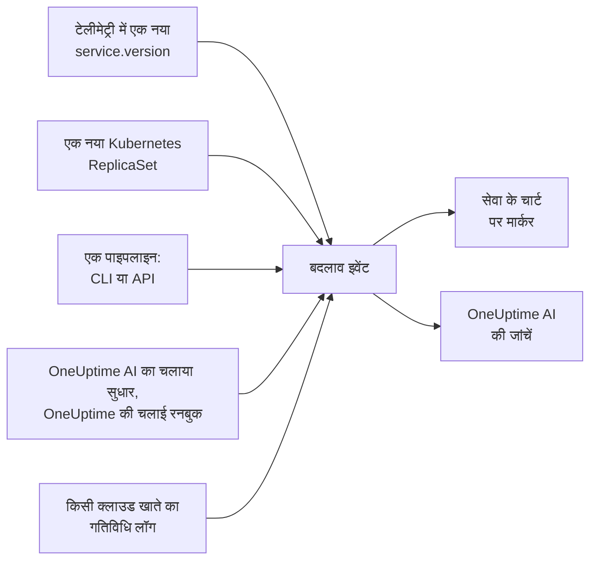

# डिप्लॉय और बदलाव

OneUptime आपके प्रोजेक्ट में हुए बदलावों का रिकॉर्ड रखता है: डिप्लॉय, Kubernetes रोलआउट, कॉन्फ़िगरेशन बदलाव, आपके कनेक्ट किए गए क्लाउड खातों में हुए बदलाव, और वे सुधार जो उसने खुद चलाए। हर बदलाव उसकी सेवा या क्लाउड संसाधन के चार्ट पर एक मार्कर के रूप में दिखाया जाता है, और OneUptime AI किसी घटना की जांच करते समय उन्हें पढ़ता है, ताकि "यह 10:02 वाले डिप्लॉय के ठीक बाद शुरू हुआ" वह पहली बात हो जो आपको पता चले, आख़िरी नहीं।

:::cards
- [OneUptime अपने आप क्या रिकॉर्ड करता है](#oneuptime-अपने-आप-क्या-रिकॉर्ड-करता-है): टेलीमेट्री से डिप्लॉय और रोलआउट, आपके क्लाउड खातों के बदलाव, और उसके अपने सुधार।
- [पाइपलाइन से डिप्लॉय रिकॉर्ड करें](#पाइपलाइन-से-डिप्लॉय-रिकॉर्ड-करें): CLI, GitHub Actions और API।
- [OneUptime AI बदलावों का उपयोग कैसे करता है](#oneuptime-ai-बदलावों-का-उपयोग-कैसे-करता-है): हर जांच में संदिग्ध बदलाव।
- [संदर्भ](#संदर्भ): फ़ील्ड, एट्रिब्यूट और सीमाएँ।
:::

## यह कैसे काम करता है



## OneUptime अपने आप क्या रिकॉर्ड करता है

इनके लिए आपको कुछ भी भेजने की ज़रूरत नहीं है। OneUptime इन्हें उस टेलीमेट्री से रिकॉर्ड करता है जो उसे पहले से मिल रही है, और उससे जो वह खुद करता है।

| बदलाव | कब रिकॉर्ड होता है | स्रोत |
| --- | --- | --- |
| डिप्लॉय | कोई सेवा ऐसा `service.version` रिपोर्ट करना शुरू करती है जो उसने अपने एनवायरनमेंट में पहले कभी रिपोर्ट नहीं किया | `service-version` |
| रोलआउट | किसी Kubernetes Deployment के पॉड ऐसा ReplicaSet चलाना शुरू करते हैं जो उन्होंने पहले कभी नहीं चलाया: नई इमेज, बदला हुआ एनवायरनमेंट वेरिएबल या कॉन्फ़िगरेशन रेफ़रेंस, या एक रीस्टार्ट | `kubernetes` |
| OneUptime AI का चलाया सुधार | कोई AI एजेंट ऐसी कमांड का नतीजा रिपोर्ट करता है जो कुछ बदलती है, जैसे `kubectl rollout restart` | `oneuptime-ai` |
| रनबुक | OneUptime की चलाई कोई रनबुक शुरू होने के बाद पूरी होती है, विफल होती है, या रद्द की जाती है | `runbook` |
| क्लाउड बदलाव | किसी कनेक्ट किए गए क्लाउड खाते का गतिविधि लॉग कोई बदलाव दर्ज करता है: AWS CloudTrail, Azure का गतिविधि लॉग या Google Cloud का Admin Activity ऑडिट लॉग | `cloud` |
| प्रदाता इवेंट | क्लाउड प्रदाता खाते के बारे में कोई हेल्थ इवेंट प्रकाशित करता है: AWS Health, Azure Service Health या Resource Health, या Google Cloud Service Health | `cloud-health` |

- **कोई सेवा जो पहला संस्करण रिपोर्ट करती है, वह उसकी बेसलाइन है, डिप्लॉय नहीं।** महीनों से चल रही कोई सेवा उस पल डिप्लॉय नहीं होती जब OneUptime उसकी टेलीमेट्री पाना शुरू करता है।
- **पिछले 30 दिनों में देखे गए किसी संस्करण पर रोलबैक रिकॉर्ड नहीं होता,** क्योंकि वह संस्करण नया नहीं है। OneUptime AI जो रोलबैक चलाता है, वह सुधार के रूप में रिकॉर्ड होता है।
- **एक घंटे में 6 से ज़्यादा नए संस्करण या ReplicaSet आने पर, घंटा पूरा होने तक वे रिकॉर्ड होना बंद हो जाते हैं।** वरना हर पॉड के साथ बदलने वाला कोई "संस्करण", जैसे बिल्ड टाइमस्टैम्प, हर पॉड के लिए एक डिप्लॉय रिकॉर्ड कर देता।

डिप्लॉय सिर्फ़ उसी सेवा के लिए रिकॉर्ड होता है जो `service.version` रिपोर्ट करती है। इसे एनवायरनमेंट और कमिट के साथ, अपने OpenTelemetry SDK या कलेक्टर के रिसोर्स एट्रिब्यूट में सेट करें:

```bash
OTEL_RESOURCE_ATTRIBUTES="service.version=2.3.1,deployment.environment.name=production,vcs.ref.head.revision=$GIT_SHA"
```

रोलआउट के लिए [Kubernetes एजेंट](/docs/telemetry/kubernetes-agent) ज़रूरी है, जो हर पॉड की टेलीमेट्री पर उसका Deployment और ReplicaSet दर्ज करता है।

क्लाउड बदलाव या प्रदाता इवेंट के लिए एक [कनेक्ट किया गया क्लाउड खाता](/docs/telemetry/cloud-accounts) चाहिए। हर एक उस क्लाउड संसाधन से जुड़ता है जिसका वह नाम लेता है, जब OneUptime उस संसाधन की सूची रखता हो, और उस संसाधन के चार्ट पर दिखाया जाता है। उसका प्रकार ऑपरेशन से तय होता है: जब ऑपरेशन का नाम ऐसा कहे तो `deployment`, `scaling` या `rollback`, नहीं तो `config-change`, और हेल्थ इवेंट के लिए `provider-event`। जिन चार्ट को किसी संसाधन तक फ़िल्टर नहीं किया गया, उनमें क्लाउड खाते का गतिविधि लॉग नहीं दिखता, ताकि कोई व्यस्त खाता आपके डिप्लॉय को दबा न दे; प्रदाता के हेल्थ इवेंट उन पर बने रहते हैं।

## पाइपलाइन से डिप्लॉय रिकॉर्ड करें

कोई पाइपलाइन डिप्लॉय, या कोई भी दूसरा बदलाव, होते ही रिकॉर्ड कर सकती है: कॉन्फ़िगरेशन बदलाव, माइग्रेशन, फ़ीचर फ़्लैग। यह आपके प्रोजेक्ट की टेलीमेट्री इंजेशन कुंजी से लिखती है, उसी तरह की कुंजी जिससे आपके ऐप्लिकेशन टेलीमेट्री भेजते हैं। इसे **प्रोजेक्ट सेटिंग्स → टेलीमेट्री और APM → इंजेशन कुंजियाँ** में बनाएँ।

किसी एक सेवा पर पिन की गई कुंजी हर बदलाव को उसी सेवा के तहत रिकॉर्ड करती है।

:::tabs
@tab CLI
```bash
oneuptime deploy \
  --service checkout \
  --service-version 2.3.1 \
  --commit "$GIT_SHA" \
  --environment production \
  --url https://oneuptime.com \
  --ingestion-key "$ONEUPTIME_TELEMETRY_INGESTION_KEY"
```
@tab GitHub Actions
```yaml title=".github/workflows/deploy.yml"
- name: Record the deploy in OneUptime
  env:
    ONEUPTIME_URL: https://oneuptime.com
    ONEUPTIME_TELEMETRY_INGESTION_KEY: ${{ secrets.ONEUPTIME_TELEMETRY_INGESTION_KEY }}
  run: |
    npx -y @oneuptime/cli deploy \
      --service checkout \
      --service-version "${{ github.ref_name }}" \
      --commit "${{ github.sha }}" \
      --repository "${{ github.server_url }}/${{ github.repository }}" \
      --environment production
```
@tab API
```bash
curl -X POST https://oneuptime.com/telemetry/change-events/v1/ingest \
  -H "Content-Type: application/json" \
  -H "x-oneuptime-token: $ONEUPTIME_TELEMETRY_INGESTION_KEY" \
  -d '{"events": [{"serviceName": "checkout", "version": "2.3.1", "commit": "1a2b3c4", "environment": "production"}]}'
```
:::

सेल्फ-होस्टेड OneUptime पर, `https://oneuptime.com` की जगह अपना पता इस्तेमाल करें। API जवाब में बताता है कि उसने कितने इवेंट सहेजे और कितने छोड़ दिए:

```json
{ "ingested": 1, "skipped": 0 }
```

CLI के हर विकल्प के लिए [`oneuptime deploy`](/docs/cli/command-reference#oneuptime-deploy) देखें।

## OneUptime AI बदलावों का उपयोग कैसे करता है

किसी घटना या अलर्ट की हर [AI जांच](/docs/ai/ai-sre) उन बदलावों से शुरू होती है जो उससे पहले के 2 घंटों में, और उसके बाद के 10 मिनट में रिकॉर्ड हुए; बाद के ये 10 मिनट उस पाइपलाइन के लिए हैं जो रोलआउट पूरा होने के बाद अपना डिप्लॉय रिकॉर्ड करती है। जिन सेवाओं, क्लस्टर, होस्ट और क्लाउड संसाधनों से घटना जुड़ी है, उन पर हुए बदलाव सबसे पहले आते हैं।

इनमें से अधिकतम 4 बदलावों के लिए, जो किसी सेवा का नाम बताते हैं, OneUptime बदलाव से पहले और बाद के 30 मिनट में उस सेवा की टेलीमेट्री पढ़ता है, और अगर बदलाव के ठीक बाद सेवा मापने लायक रूप से बिगड़ गई, तो उस बदलाव को **संदिग्ध** चिह्नित करता है:

| सिग्नल | संदिग्ध कब |
| --- | --- |
| विफल स्पैन | त्रुटि दर कम से कम दोगुनी हुई और कम से कम 1 प्रतिशत अंक बढ़ी, कम से कम 10 विफल स्पैन पर |
| लेटेंसी | p99 कम से कम 1.5 गुना हुआ, और कम से कम 100 ms बढ़ा |
| अपवाद | प्रति मिनट कम से कम 3 गुना, और कम से कम 10 |
| नए अपवाद | बदलाव ने जो संस्करण भेजा, उसमें बदलाव से 10 मिनट पहले से 30 मिनट बाद के बीच पहली बार दिखा कोई अपवाद प्रकार कम से कम 3 बार हुआ |

OneUptime इन संख्याओं से तय करता है कि कौन-सा बदलाव संदिग्ध है, इससे नहीं कि बदलाव का शीर्षक क्या कहता है। जांच सबसे पहले संदिग्ध बदलाव को परखती है, बताती है कि क्या घटना उसी से हुई, और बताती है कि क्या उसे रोलबैक करना सबसे तेज़ सुरक्षित सुधार है।

जब संदिग्ध बदलाव किसी ऐसे क्लस्टर पर Kubernetes रोलआउट हो जिसके [AI सुधार](/docs/ai/ai-sre#सुधार-कैसे-काम-करते-हैं) चालू हैं, तो OneUptime AI सबसे पहले उसे रोलबैक करता है, एक `kubectl rollout undo` से जिसे OneUptime रिकॉर्ड किए गए बदलाव से बनाता है। कोड भेजने वाले डिप्लॉय को उसके कमिट के ज़रिए रोलबैक किया जाता है: जांच उस कमिट या पुल रिक्वेस्ट का नाम बताती है जिससे चीज़ें बिगड़ीं, ताकि एक [फ़िक्स पुल रिक्वेस्ट](/docs/ai/ai-sre#स्वचालित-कोड-सुधार) ठीक उसी को वापस ले सके।

OneUptime हर डिप्लॉय को अपने आप भी परखता है, चाहे किसी को सूचित किया जाए या नहीं। डिप्लॉय के बाद के 30 मिनट बीत जाने पर, वह उन्हें उन्हीं सीमाओं के हिसाब से डिप्लॉय से पहले के 30 मिनट से मिलाता है, और अगर सेवा बिगड़ गई, तो एक [AI इनसाइट](/docs/ai/ai-sre#इनसाइट्स-सक्रिय-पहचान) उस सेवा पर हुए डिप्लॉय का नाम बताती है।

OneUptime AI ने जो सुधार पुल रिक्वेस्ट खोला हो, उसे भी इसी तरह परखा जाता है: जैसे ही किसी रिकॉर्ड किए गए डिप्लॉय में उसका कमिट होता है, OneUptime वहाँ उस पर नज़र रखता है जिसके लिए सुधार था - अपवाद, वह ऑपरेशन जिसे उसने तेज़ किया, इंसिडेंट या अलर्ट के पीछे का मॉनिटर, वह टेलीमेट्री जो वह जोड़ता है - और बताता है कि सुधार कारगर रहा या नहीं ([स्वचालित कोड सुधार](/docs/ai/ai-sre#स्वचालित-कोड-सुधार) देखें)। डिप्लॉय हुए सुधार को डिप्लॉय के संस्करण में तभी पढ़ा जाता है जब सेवा की अपनी टेलीमेट्री वह संस्करण बताती है, वरना डिप्लॉय के 10 मिनट बाद से, जब पुराने इंस्टेंस रुक चुके हों।

किसी जांच में और [AI से पूछें](/docs/ai/ask-ai) में, `recent_changes` किसी भी समय-अवधि के बदलाव सूचीबद्ध करता है, और `get_change_details` दिखाता है कि किसी डिप्लॉय ने क्या भेजा: सेवा के पिछले डिप्लॉय के बाद के कमिट, उनके लेखक, पुल रिक्वेस्ट और वे फ़ाइलें जिन्हें उन्होंने बदला। इसके लिए बदलाव पर कमिट चाहिए, और उसकी रिपॉजिटरी कोड में जुड़ी होनी चाहिए: [GitHub App](/docs/ai/github-app) से, या GitLab, Forgejo या Gitea कनेक्शन से (देखें [रिपॉजिटरी जोड़ना](/docs/ai/ai-agent#रिपॉजिटरी-जोड़ना))।

## संदर्भ

### फ़ील्ड

| फ़ील्ड | यह क्या है |
| --- | --- |
| `title` | क्या बदला, जैसे `Deploy 2.3.1`। जो डिप्लॉय `version` भेजता है, वह इसे छोड़ सकता है |
| `eventType` | बदलाव का प्रकार: `deployment` (डिफ़ॉल्ट), `config-change`, `scaling`, `rollback`, `feature-flag` या आपका अपना |
| `serviceName` | वह सेवा जिससे यह जुड़ा है। इसके बिना, बदलाव पूरे प्रोजेक्ट का होता है |
| `time` | यह कब हुआ, ISO 8601 के रूप में या epoch सेकंड या मिलीसेकंड में। डिफ़ॉल्ट वह समय है जब यह पहुँचा |
| `description` | बदलाव का विवरण |
| `version` | डिप्लॉय किया गया संस्करण |
| `previousVersion` | वह संस्करण जिसकी जगह इसने ली |
| `commit` | डिप्लॉय किया गया कमिट (`commitSha` या `sha` भी) |
| `repository` | कमिट की रिपॉजिटरी (`repositoryUrl` भी) |
| `branch` | डिप्लॉय की गई ब्रांच |
| `pullRequest` | डिप्लॉय किया गया पुल रिक्वेस्ट |
| `environment` | वह एनवायरनमेंट जिसमें डिप्लॉय किया गया |
| `attributes` | अधिकतम 50 और एट्रिब्यूट, टेक्स्ट, संख्या या बूलियन के रूप में |

टॉप-लेवल फ़ील्ड OpenTelemetry नामों के तहत एट्रिब्यूट के रूप में सहेजे जाते हैं: `version` को `service.version` के रूप में, `commit` को `vcs.ref.head.revision` के रूप में, `repository` को `vcs.repository.url.full` के रूप में, `branch` को `vcs.ref.head.name` के रूप में, `pullRequest` को `vcs.change.id` के रूप में और `environment` को `deployment.environment.name` के रूप में। इनमें से किसी नाम से भेजा गया एट्रिब्यूट अपने फ़ील्ड पर प्राथमिकता पाता है।

जिन एट्रिब्यूट के नाम `oneuptime.` से शुरू होते हैं, वे OneUptime के अपने हैं और पाइपलाइन जो भेजती है उसमें से हटा दिए जाते हैं। पाइपलाइन जो भी बदलाव रिकॉर्ड करती है, वह `oneuptime.change.source` में यह बताता है, जिसका मान `api` होता है।

किसी क्लाउड खाते से पढ़ा गया बदलाव खाते और संसाधन को OpenTelemetry के नामों `cloud.provider`, `cloud.account.id`, `cloud.region` और `cloud.resource_id` से बताता है, और ऑपरेशन को `oneuptime.cloud.operation` में, उसे चलाने वाले को `oneuptime.cloud.actor` में, वह विफल हुआ या नहीं, इसे `oneuptime.change.status` में, और उसके क्लाउड खाते को `oneuptime.cloud_account.id` में रखता है।

### सीमाएँ

| सीमा | मान |
| --- | --- |
| एक अनुरोध में इवेंट | 100 |
| शीर्षक | 500 वर्ण |
| विवरण | 5,000 वर्ण |
| एट्रिब्यूट | 50 |
| समय | 366 दिन से ज़्यादा पहले का, या 60 मिनट से ज़्यादा आगे का समय, इवेंट पहुँचने के समय से बदल दिया जाता है |

## अगले कदम

:::cards
- [AI SRE](/docs/ai/ai-sre): जांच क्या पढ़ती है, और जो पाती है उसे कैसे सुधारती है।
- [कमांड संदर्भ](/docs/cli/command-reference): CLI की हर कमांड।
- [OpenTelemetry](/docs/telemetry/open-telemetry): अपनी सेवाओं की टेलीमेट्री, उनके संस्करणों के साथ, भेजें।
- [क्लाउड खाता कनेक्ट करें](/docs/telemetry/cloud-accounts): आपके AWS, Azure और Google Cloud खातों के बदलाव और हेल्थ इवेंट।
:::
