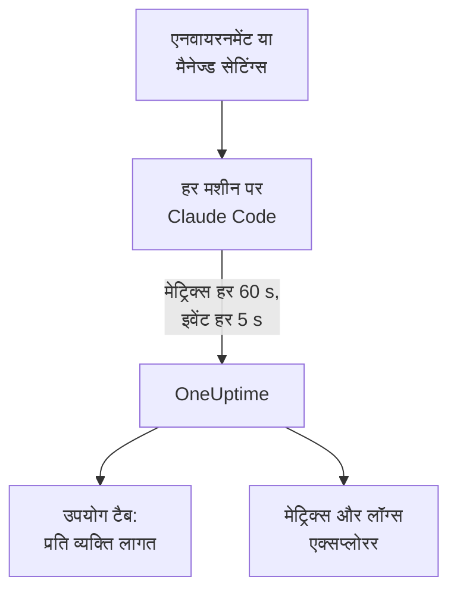

# Claude Code

Claude Code खुद OpenTelemetry मेट्रिक्स और इवेंट एक्सपोर्ट करता है, सीधे OneUptime को: बीच में न कोई collector, न कोई गेटवे। इसे कुछ एनवायरनमेंट वेरिएबल से चालू करें, या पूरे बेड़े के लिए एक मैनेज्ड सेटिंग्स फ़ाइल से, और हर डेवलपर की लागत, टोकन, सेशन, कमिट और स्वीकार किए गए संपादन देखें।

:::cards
- [एक मशीन सेट अप करें](#एक-मशीन-सेट-अप-करें): छह एनवायरनमेंट वेरिएबल और एक रीस्टार्ट।
- [पूरे बेड़े में लागू करें](#पूरे-बेड़े-में-लागू-करें): हर मशीन पर एक मैनेज्ड सेटिंग्स फ़ाइल।
- [खर्च को लोगों से जोड़ें](#उपयोग-को-लोगों-और-टीमों-से-जोड़ें): कौन साइन इन है, और कब आपको पहचान खुद सेट करनी होगी।
- [समस्या निवारण](#समस्या-निवारण): कुछ न आए तो क्या जांचें।
:::

## यह कैसे काम करता है



Claude Code भेजता है:

- **लागत और टोकन**: `claude_code.cost.usage` (USD) और `claude_code.token.usage`, मॉडल के हिसाब से, मुख्य एजेंट या सबएजेंट के हिसाब से, और उस एजेंट, स्किल, प्लगइन या MCP सर्वर के हिसाब से जिसने कॉल की।
- **गतिविधि**: सेशन, कमिट, पुल रिक्वेस्ट, जोड़ी और हटाई गई कोड की पंक्तियाँ, और सक्रिय समय।
- **संपादन के फ़ैसले**: `claude_code.code_edit_tool.decision` स्वीकार और अस्वीकार किए गए संपादन गिनता है, इसलिए स्वीकृति दर `accept / (accept + reject)` है, भाषा और टूल के हिसाब से।
- **इवेंट**: प्रॉम्प्ट, टूल के नतीजे, API अनुरोध और त्रुटियाँ, अनुमति-मोड के बदलाव और MCP सर्वर कनेक्शन, OTLP लॉग रिकॉर्ड के रूप में।

जब डेवलपर Claude खाते से साइन इन होता है, तो हर मेट्रिक डेटा पॉइंट और हर इवेंट में `user.email` होता है, और OneUptime इसे मेट्रिक्स पर कर्मचारी के रूप में पढ़ता है, जहाँ लागत और टोकन होते हैं।

## शुरू करने से पहले

1. **प्रोजेक्ट सेटिंग्स → टेलीमेट्री और APM → इंजेशन कुंजियाँ** में एक टेलीमेट्री इंजेशन कुंजी बनाएँ।
2. आपका OTLP एंडपॉइंट `https://oneuptime.com/otlp` है, या अगर आप OneUptime खुद होस्ट करते हैं तो `https://YOUR-ONEUPTIME-HOST/otlp`।
3. पूरे बेड़े के लिए एक कुंजी इस्तेमाल करें। वह हर डेवलपर मशीन पर पहुँचती है, इसलिए उसे एक साझा क्रेडेंशियल मानें जो सिर्फ़ डेटा भेज सकता है, और उसे किसी भी दूसरे क्रेडेंशियल की तरह बदलते रहें।

## एक मशीन सेट अप करें

:::steps
### वेरिएबल एक्सपोर्ट करें

इन्हें अपनी शेल प्रोफ़ाइल (`.zshrc` या `.bashrc`) में जोड़ें, या उस टर्मिनल में एक्सपोर्ट करें जिससे आप Claude Code शुरू करते हैं:

```bash
export CLAUDE_CODE_ENABLE_TELEMETRY=1
export OTEL_METRICS_EXPORTER=otlp
export OTEL_LOGS_EXPORTER=otlp
export OTEL_EXPORTER_OTLP_PROTOCOL=http/protobuf
export OTEL_EXPORTER_OTLP_ENDPOINT="https://oneuptime.com/otlp"
export OTEL_EXPORTER_OTLP_HEADERS="x-oneuptime-token=YOUR_INGESTION_TOKEN"
```

| वेरिएबल | यह क्या करता है |
| --- | --- |
| `CLAUDE_CODE_ENABLE_TELEMETRY` | मुख्य स्विच: इसके बिना कुछ भी एक्सपोर्ट नहीं होता। |
| `OTEL_METRICS_EXPORTER`, `OTEL_LOGS_EXPORTER` | `otlp` OneUptime को भेजता है। `otlp,console` भेजा गया डेटा प्रिंट भी करता है, सेट अप करते समय काम का। |
| `OTEL_EXPORTER_OTLP_PROTOCOL` | `http/protobuf`; `http/json` और `grpc` भी काम करते हैं। |
| `OTEL_EXPORTER_OTLP_ENDPOINT` | बेस URL। Claude Code `/v1/metrics` और `/v1/logs` खुद जोड़ता है। |
| `OTEL_EXPORTER_OTLP_HEADERS` | कॉमा से अलग `key=value` जोड़े; यहाँ आपकी इंजेशन कुंजी। |

### Claude Code रीस्टार्ट करें

वेरिएबल तब पढ़े जाते हैं जब Claude Code शुरू होता है। मेट्रिक्स हर 60 सेकंड में और इवेंट हर 5 सेकंड में भेजे जाते हैं, इसलिए देखने से पहले एक मिनट Claude Code इस्तेमाल करें।

### जांचें कि डेटा आ रहा है

**मेट्रिक्स** खोलें और `claude_code.token.usage` ढूंढें, फिर **उत्पाद → AI / LLM** खोलें और **उपयोग** पर जाएँ: आपकी लागत आपके ईमेल के नीचे दिखती है, **GenAI मेट्रिक्स से** के निशान के साथ।
:::

मेट्रिक्स और इवेंट को अलग-अलग जगह भेजने के लिए, इसके बजाय `OTEL_EXPORTER_OTLP_METRICS_ENDPOINT` और `OTEL_EXPORTER_OTLP_LOGS_ENDPOINT` पूरे पाथ के साथ सेट करें (`https://oneuptime.com/otlp/v1/metrics`, `https://oneuptime.com/otlp/v1/logs`)।

## पूरे बेड़े में लागू करें

किसी संगठन के लिए वही वेरिएबल एक मैनेज्ड सेटिंग्स फ़ाइल में भेजें। इसका रूप `settings.json` जैसा है, वेरिएबल एक `env` ब्लॉक में:

```json title="managed-settings.json"
{
  "env": {
    "CLAUDE_CODE_ENABLE_TELEMETRY": "1",
    "OTEL_METRICS_EXPORTER": "otlp",
    "OTEL_LOGS_EXPORTER": "otlp",
    "OTEL_EXPORTER_OTLP_PROTOCOL": "http/protobuf",
    "OTEL_EXPORTER_OTLP_ENDPOINT": "https://oneuptime.com/otlp",
    "OTEL_EXPORTER_OTLP_HEADERS": "x-oneuptime-token=YOUR_INGESTION_TOKEN",
    "OTEL_RESOURCE_ATTRIBUTES": "team.id=platform,cost_center=eng-123"
  }
}
```

:::steps
### फ़ाइल वहाँ रखें जहाँ Claude Code उसे पढ़ता है

| प्लेटफ़ॉर्म | पाथ |
| --- | --- |
| macOS | `/Library/Application Support/ClaudeCode/managed-settings.json` |
| Linux और WSL | `/etc/claude-code/managed-settings.json` |
| Windows | `C:\Program Files\ClaudeCode\managed-settings.json` |

Claude Code अब पुराना Windows पाथ `C:\ProgramData\ClaudeCode\managed-settings.json` नहीं पढ़ता। अगर आप पहले से कोई मैनेज्ड सेटिंग्स फ़ाइल भेजते हैं, तो इसके बजाय उसके बगल में `managed-settings.d/10-telemetry.json` जैसी एक ड्रॉप-इन फ़ाइल जोड़ें: Claude Code पहले `managed-settings.json` मर्ज करता है, फिर `managed-settings.d/` की हर `*.json` फ़ाइल वर्णानुक्रम में।

### एक मशीन जांचें

Claude Code में `/status` चलाएँ। `Setting sources` पंक्ति में `Enterprise managed settings (file)` लिखा होना चाहिए, या ड्रॉप-इन के लिए `(drop-ins)` या `(file + drop-ins)`। कोष्ठक में कोई दूसरा स्रोत होने का मतलब है कि ऊँची प्राथमिकता वाला स्रोत जीता, और आपका इस्तेमाल नहीं हुआ।

### बेड़े को आते देखें

**उपयोग** टैब पर हर डेवलपर नई सेटिंग्स के साथ Claude Code इस्तेमाल करते ही एक पंक्ति के रूप में दिखता है।
:::

वही JSON claude.ai एडमिन कंसोल की सर्वर-मैनेज्ड सेटिंग्स (शुरू होने पर और हर घंटे लाई जाती हैं), `com.anthropic.claudecode` डोमेन वाली macOS कॉन्फ़िगरेशन प्रोफ़ाइल, या Windows पर `HKLM\SOFTWARE\Policies\ClaudeCode` के नीचे के `Settings` मान से भी आ सकता है।

:::details कौन-सा मैनेज्ड स्रोत जीतता है, और टेलीमेट्री वेरिएबल कैसे मिलते हैं
डिफ़ॉल्ट रूप से Claude Code उस सबसे ऊँची प्राथमिकता वाले स्रोत का इस्तेमाल करता है जो कोई भी पॉलिसी कुंजी सेट करता है, और बाकी को अनदेखा करता है: सर्वर-मैनेज्ड सेटिंग्स, फिर MDM या OS पॉलिसी, फिर मैनेज्ड सेटिंग्स फ़ाइलें, फिर प्रति-उपयोगकर्ता `HKCU` रजिस्ट्री मान। `env` ब्लॉक अपवाद है: वर्ज़न 2.1.223 से यह एडमिन स्रोतों में वेरिएबल-दर-वेरिएबल मर्ज होता है।

टेलीमेट्री वेरिएबल ऐसा नहीं करते: `OTEL_EXPORTER_OTLP_*` वेरिएबल, `OTEL_LOG_*` सामग्री स्विच, `OTEL_LOGS_EXPORTER` और बीटा ट्रेसिंग वेरिएबल एक साथ उस सबसे ऊँची प्राथमिकता वाले स्रोत से आते हैं जो इनमें से कोई भी सेट करता है, ताकि एक स्रोत का एंडपॉइंट कभी दूसरे स्रोत के क्रेडेंशियल के साथ न जुड़े। अगर कोई ऊँची प्राथमिकता वाला स्रोत इनमें से कोई भी सेट करता है, तो टेलीमेट्री ड्रॉप-इन कुछ नहीं जोड़ता।

सर्वर-मैनेज्ड सेटिंग्स के लिए एक और कदम चाहिए: खाली न होने वाला `OTEL_EXPORTER_OTLP_ENDPOINT` तभी लागू होता है जब हर डेवलपर किसी इंटरैक्टिव सेशन में सुरक्षा स्वीकृति डायलॉग स्वीकार करता है, और एक्सपोर्टर सेटिंग्स के बदलाव अगली बार शुरू होने पर लागू होते हैं। फ़ाइलों और MDM पॉलिसी में कोई डायलॉग नहीं होता।
:::

:::details हर मशीन संपादित किए बिना इंजेशन कुंजी बदलना
किसी तय हेडर के बजाय सेटिंग्स में `"otelHeadersHelper": "/path/to/generate-otel-headers.sh"` सेट करें। स्क्रिप्ट हेडर का एक सपाट JSON ऑब्जेक्ट प्रिंट करती है, जैसे `{"x-oneuptime-token":"..."}`। Claude Code इसे शुरू होने पर और फिर हर `CLAUDE_CODE_OTEL_HEADERS_HELPER_DEBOUNCE_MS` मिलीसेकंड पर चलाता है (डिफ़ॉल्ट `1740000`, 29 मिनट)। विफलताएँ `/status` में दिखती हैं।
:::

## उपयोग को लोगों और टीमों से जोड़ें

**कर्मचारी `user.email` है।** जब डेवलपर Claude खाते से साइन इन होता है तो Claude Code इसे भेजता है, और इसे बंद करने का कोई वेरिएबल नहीं है। OneUptime इसे हर लागत और टोकन डेटा पॉइंट से बिना सेटअप के पढ़ता है।

**दूसरे साइन-इन कोई ईमेल नहीं भेजते।** API कुंजी के साथ, या Amazon Bedrock, Google Cloud या Microsoft Foundry पर Claude के साथ, सेशन में कोई Claude खाता नहीं होता, और Claude Code सिर्फ़ `user.id` और `session.id` भेजता है। पहचान खुद सेट करें, हर मशीन पर, मैनेज्ड सेटिंग्स में या किसी लॉन्च रैपर में:

```bash
export OTEL_RESOURCE_ATTRIBUTES="user.email=jdoe@example.com,team.id=platform"
```

**`user.id` कोई व्यक्ति नहीं है।** यह एक रैंडम ID है जिसे Claude Code पहली बार चलने पर `~/.claude.json` में लिखता है: हर इंस्टॉल के लिए एक, और फ़ाइल हटाने पर नई। ईमेल के बिना हर इंस्टॉल अपनी अलग पंक्ति के रूप में दिखता है। एक अपवाद: Claude ऐप्स गेटवे में साइन इन किया गया सेशन साइन-इन वाली पहचान भेजता है (`user.id` पहचान प्रदाता का सब्जेक्ट है, `user.email` ईमेल) और आपकी खुद सेट की गई `user.*` कुंजियों को अनदेखा करता है।

**टीमें और कॉस्ट सेंटर** `OTEL_RESOURCE_ATTRIBUTES` से आते हैं: OneUptime `team.id`, `team`, `cost_center` और `department` पढ़ता है। मानों में स्पेस नहीं हो सकते, और उद्धरण चिह्न उन्हें नहीं बचाते: `team=Platform_Engineering` लिखें, या `team=Platform%20Engineering` की तरह प्रतिशत-एन्कोडिंग इस्तेमाल करें। Claude Code इन कुंजियों को हर डेटा पॉइंट पर कॉपी करता है (`OTEL_METRICS_INCLUDE_RESOURCE_ATTRIBUTES`, डिफ़ॉल्ट रूप से चालू), और OneUptime इन्हें किसी भी तरह पढ़ लेता है। आपकी सेट की गई कुंजी कभी उस कुंजी को ओवरराइड नहीं करती जिसे Claude Code खुद सेट करता है।

## OneUptime क्या दिखाता है

**उत्पाद → AI / LLM → उपयोग** पर, `claude_code.cost.usage` **कर्मचारी** , **टीम** और **मॉडल** तालिकाओं को भरता है, और `claude_code.token.usage` टोकन के कुल को। आप क्या देखते हैं, यह दो नियम तय करते हैं:

- **मेट्रिक्स स्पैन की कमी पूरी करते हैं; उन्हें कभी स्पैन में जोड़ा नहीं जाता।** अगर उसी प्रोजेक्ट को आपके अपने ऐप से लागत वाले GenAI स्पैन मिलते हैं, तो Claude Code का खर्च नहीं दिखता। Claude Code को उसके अपने प्रोजेक्ट में भेजें। [स्पैन पहले, मेट्रिक्स कमी पूरी करते हैं](/docs/telemetry/ai-llm-observability#स्पैन-पहले-मेट्रिक्स-कमी-पूरी-करते-हैं) देखें।
- **मेट्रिक्स से आई पंक्ति में सिर्फ़ लागत होती है।** उसके कॉल और टोकन सेल `—` दिखाते हैं, और **प्रदाता** और **ऐप्लिकेशन / सेवा** तालिकाएँ खाली रहती हैं: मेट्रिक्स किसी प्रदाता का नाम नहीं बताते और किसी OneUptime सेवा के नहीं होते।

बाकी सब, जैसे प्रति डेवलपर स्वीकृति दर, कोड की पंक्तियाँ, कमिट और पुल रिक्वेस्ट, या `query_source` के हिसाब से खर्च, आप नीचे के मेट्रिक्स से किसी [डैशबोर्ड](/docs/dashboards/index) पर चार्ट करते हैं, और [मेट्रिक्स मॉनिटर](/docs/monitor/metrics-monitor) से उन पर अलर्ट लगाते हैं।

## मेट्रिक्स

हर मेट्रिक एक काउंटर है, और अपनी विशेषताओं के साथ मानक विशेषताएँ भी रखता है।

| मेट्रिक | इकाई | अपनी विशेषताएँ |
| --- | --- | --- |
| `claude_code.session.count` | कोई नहीं | `start_type`: `fresh`, `resume`, `continue`, `agents_view` |
| `claude_code.lines_of_code.count` | कोई नहीं | `type`: `added`, `removed`; `model` |
| `claude_code.commit.count` | कोई नहीं | कोई नहीं |
| `claude_code.pull_request.count` | कोई नहीं | कोई नहीं |
| `claude_code.cost.usage` | USD | `model`; `query_source`: `main`, `subagent`, `auxiliary`; `speed`: `fast`, `normal`; `effort`; `agent.name`, `skill.name`, `plugin.name`, `marketplace.name`, `mcp_server.name`, `mcp_tool.name` |
| `claude_code.token.usage` | टोकन | `type`: `input`, `output`, `cacheRead`, `cacheCreation`; और `claude_code.cost.usage` जैसी ही विशेषताएँ |
| `claude_code.code_edit_tool.decision` | कोई नहीं | `tool_name`: `Edit`, `Write`, `NotebookEdit`; `decision`: `accept`, `reject`; `source`; `language` |
| `claude_code.active_time.total` | s | `type`: `user` (कीबोर्ड पर), `cli` (टूल और मॉडल के जवाब) |

मानक विशेषताएँ `session.id`, `app.version`, `app.entrypoint`, `organization.id`, `user.account_uuid`, `user.account_id`, `user.id`, `user.email` और `terminal.type` हैं, साथ में आपके `OTEL_RESOURCE_ATTRIBUTES`। इनमें से कुछ बंद की जा सकती हैं: [मेट्रिक की मात्रा कम रखें](#मेट्रिक-की-मात्रा-कम-रखें) देखें।

- कैश टोकन के प्रकार camelCase में हैं: `cacheRead` और `cacheCreation`। OneUptime के टोकन कुल सिर्फ़ `input` और `output` गिनते हैं।
- लागत और टोकन मेट्रिक्स पर आपके अपने एजेंट और MCP सर्वर, और तृतीय-पक्ष प्लगइन और स्किल के नाम `custom` या `third-party` दिखते हैं, जब तक `OTEL_LOG_TOOL_DETAILS=1` सेट न हो (Claude Code 2.1.273 या बाद का)।

## इवेंट

इवेंट OTLP लॉग रिकॉर्ड के रूप में आते हैं, हर एक में `event.name`, `event.timestamp` और `event.sequence` होता है। जिनका आप सबसे ज़्यादा इस्तेमाल करेंगे:

| इवेंट | यह क्या रिकॉर्ड करता है |
| --- | --- |
| `claude_code.user_prompt` | एक प्रॉम्प्ट: उसकी लंबाई और कमांड; टेक्स्ट सिर्फ़ तब जब आप उसे चालू करें |
| `claude_code.api_request` | एक मॉडल अनुरोध: `model`, `cost_usd`, `cost_usd_micros`, `duration_ms`, `input_tokens`, `output_tokens`, कैश टोकन |
| `claude_code.api_error` | एक अनुरोध जो दोबारा कोशिशों के बाद भी विफल हुआ: `model`, `error`, `status_code`, `attempt` |
| `claude_code.tool_result` | एक टूल रन: `tool_name`, `success`, `duration_ms`, और वह फ़ैसला जिसने उसे अनुमति दी |
| `claude_code.tool_decision` | कोई टूल अनुमति पाया या नहीं, और किसने तय किया |
| `claude_code.mcp_server_connection` | कोई MCP सर्वर जुड़ रहा है या विफल हो रहा है |

Claude Code कई और इवेंट भेजता है, जैसे इनकार, अनुमति-मोड के बदलाव, और प्लगइन, हुक और स्किल इवेंट: Anthropic का [मॉनिटरिंग संदर्भ](https://code.claude.com/docs/en/monitoring-usage) सबकी सूची देता है। `cost_usd_micros` में लागत USD के दस-लाखवें हिस्सों की एक पूर्ण संख्या है, जो राउंडिंग की गड़बड़ी के बिना जुड़ती है।

## मेट्रिक की मात्रा कम रखें

Claude Code डिफ़ॉल्ट रूप से हर डेटा पॉइंट पर `session.id` लगाता है, और हर सेशन एक नई सीरीज़ है। पूरे बेड़े में यह एक विशेषता मेट्रिक की मात्रा बढ़ाती है, और लागत रिपोर्टिंग को इसकी ज़रूरत नहीं:

```bash
export OTEL_METRICS_INCLUDE_SESSION_ID=false
```

| वेरिएबल | डिफ़ॉल्ट | जोड़ता है |
| --- | --- | --- |
| `OTEL_METRICS_INCLUDE_SESSION_ID` | `true` | `session.id`, हर सेशन में नया मान |
| `OTEL_METRICS_INCLUDE_VERSION` | `false` | `app.version` |
| `OTEL_METRICS_INCLUDE_ACCOUNT_UUID` | `true` | `user.account_uuid` और `user.account_id` |
| `OTEL_METRICS_INCLUDE_ENTRYPOINT` | `false` | `app.entrypoint` |
| `OTEL_METRICS_INCLUDE_RESOURCE_ATTRIBUTES` | `true` | आपकी `OTEL_RESOURCE_ATTRIBUTES` कुंजियाँ |
| `OTEL_METRICS_INCLUDE_REPOSITORY` | `false` | रिपॉज़िटरी की `vcs.*` विशेषताएँ |

`user.email`, `user.id`, `organization.id` और `terminal.type` के लिए कोई स्विच नहीं है। इवेंट ज़्यादा व्यस्त सिग्नल हैं: हर सक्रिय डेवलपर हर 5 सेकंड में भेजता है (`OTEL_LOGS_EXPORT_INTERVAL`, मिलीसेकंड में)। कम लेकिन बड़े बैच भेजने के लिए इसे बढ़ाएँ, या अगर आपको सिर्फ़ लागत और उपयोग चाहिए, जो सब मेट्रिक्स में हैं, तो `OTEL_LOGS_EXPORTER=none` सेट करें।

## प्रॉम्प्ट और टूल सामग्री डिफ़ॉल्ट रूप से बंद है

Claude Code प्रॉम्प्ट, जवाब, टूल आर्गुमेंट या टूल आउटपुट तब तक एक्सपोर्ट नहीं करता जब तक आप हर एक को चालू न करें:

| वेरिएबल | डिफ़ॉल्ट | `1` क्या चालू करता है |
| --- | --- | --- |
| `OTEL_LOG_USER_PROMPTS` | बंद | प्रॉम्प्ट का टेक्स्ट |
| `OTEL_LOG_ASSISTANT_RESPONSES` | बंद | जवाब का टेक्स्ट; सेट न होने पर यह `OTEL_LOG_USER_PROMPTS` का अनुसरण करता है |
| `OTEL_LOG_TOOL_DETAILS` | बंद | टूल पैरामीटर, Bash कमांड, और एजेंट, प्लगइन, स्किल और MCP सर्वर के असली नाम |
| `OTEL_LOG_TOOL_CONTENT` | बंद | टूल का इनपुट और आउटपुट, सिर्फ़ ट्रेस स्पैन पर |
| `OTEL_LOG_RAW_API_BODIES` | बंद | पूरे API अनुरोध और प्रतिक्रिया बॉडी (`file:<dir>` इसके बजाय उन्हें डिस्क पर लिखता है) |

हम इन्हें बंद रखने की सलाह देते हैं: मेट्रिक्स और रिडैक्ट किए गए इवेंट पहले से बता देते हैं कि किसने किस मॉडल पर कितना खर्च किया और स्वीकृति दर क्या रही। सामग्री कैप्चर करने से प्रॉम्प्ट, सोर्स कोड और टूल आउटपुट ऐसे टेलीमेट्री स्टोर में चले जाते हैं जिसके एक्सेस नियंत्रण आपकी रिपॉज़िटरी से अलग हैं। अगर आप इसे किसी जांच के लिए चालू करते हैं, तो `CLAUDE_CODE_OTEL_CONTENT_MAX_LENGTH` (डिफ़ॉल्ट `61440`) सीमित करता है कि हर रिकॉर्ड में कितना जाए, और **ट्रेस → सेटिंग्स** में ट्रेस के **स्क्रब नियम** और **ड्रॉप फ़िल्टर** उसे सहेजे जाने से पहले मास्क करते या हटा देते हैं।

## मेट्रिक्स डेल्टा के रूप में आते हैं

Claude Code डिफ़ॉल्ट रूप से डेल्टा मेट्रिक्स भेजता है: हर डेटा पॉइंट पिछले एक्सपोर्ट के बाद की बढ़त है, कोई चलता हुआ कुल नहीं। जब आप उन्हें चार्ट करें या उन पर अलर्ट लगाएँ, तो विंडो में डेटा पॉइंट जोड़ें, और किसी क्यूम्युलेटिव काउंटर की तरह रेट या काउंटर-रीसेट फ़ंक्शन लागू न करें: आंकड़े गलत आते हैं, बिना टूटे दिखे।

```bash
export OTEL_EXPORTER_OTLP_METRICS_TEMPORALITY_PREFERENCE=cumulative
```

`cumulative` सिर्फ़ तभी तय करें जब आपके संगठन का हर एक्सपोर्टर इसे इस्तेमाल करता हो, और किसी बेड़े में दोनों को न मिलाएँ।

## ट्रेस (बीटा)

Claude Code में एक बीटा ट्रेस एक्सपोर्टर भी है, जो हर इंटरैक्शन को स्पैन के पेड़ की तरह बनाता है: `claude_code.interaction`, जिसके नीचे `claude_code.llm_request` और `claude_code.tool` होते हैं।

```bash
export CLAUDE_CODE_ENHANCED_TELEMETRY_BETA=1
export OTEL_TRACES_EXPORTER=otlp
```

> [!WARNING]
> ट्रेस बीटा को उस प्रोजेक्ट से दूर रखें जिसे आप खर्च के लिए इस्तेमाल करते हैं। इसके मॉडल स्पैन में `gen_ai.system` और `gen_ai.request.model` होते हैं, इसलिए OneUptime उन्हें **कॉल** में दिखाता है, लेकिन उनके टोकन `gen_ai.usage.*` कुंजियों में नहीं बल्कि `input_tokens` और `output_tokens` में होते हैं, इसलिए वे बिना टोकन और बिना लागत के आते हैं। जैसे ही वे मौजूद होते हैं, **कर्मचारी** , **टीम** और **मॉडल** तालिकाएँ मेट्रिक्स के खर्च की जगह उन्हीं की $0 वाली पंक्तियाँ दिखाती हैं।

Agent SDK और गैर-इंटरैक्टिव `-p` सेशन में Claude Code आने वाला `TRACEPARENT` उठा लेता है, ताकि उसके स्पैन कॉल करने वाले के ट्रेस से जुड़ें; इंटरैक्टिव सेशन इसे अनदेखा करते हैं। यह मॉडल को `traceparent` हेडर सिर्फ़ तब भेजता है जब `ANTHROPIC_BASE_URL` सेट न हो या Anthropic API हो; अपने खुद के प्रॉक्सी के पीछे `CLAUDE_CODE_PROPAGATE_TRACEPARENT=1` सेट करें।

## समस्या निवारण

:::details कुछ भी नहीं आता
पहले `CLAUDE_CODE_ENABLE_TELEMETRY=1` जांचें: इसके बिना कोई दूसरा वेरिएबल कुछ नहीं करता। फिर एक्सपोर्टर में `console` जोड़ें (`OTEL_METRICS_EXPORTER=otlp,console`) और टर्मिनल देखें: अगर डेटा पॉइंट प्रिंट होते हैं, तो Claude Code ठीक है और समस्या एंडपॉइंट, कुंजी या नेटवर्क में है।
:::

:::details मैनेज्ड सेटिंग्स फ़ाइल अनदेखी होती लगती है
`/status` चलाएँ और `Setting sources` पंक्ति पढ़ें। कोई मैनेज्ड स्रोत न दिखे तो फ़ाइल गलत पाथ पर है, मान्य JSON नहीं है, या डेवलपर का खाता उसे पढ़ नहीं सकता। कोई दूसरा स्रोत दिखे तो वह जीता, और आपका इस्तेमाल नहीं हुआ। सर्वर-मैनेज्ड सेटिंग्स इस बात का भी इंतज़ार करती हैं कि डेवलपर किसी इंटरैक्टिव सेशन में स्वीकृति डायलॉग स्वीकार करे।
:::

:::details खर्च बिना एट्रिब्यूशन के, या हर इंस्टॉल की एक पंक्ति के रूप में दिखता है
वे डेवलपर Claude खाते से साइन इन नहीं हैं: वे API कुंजी, Amazon Bedrock, Google Cloud या Microsoft Foundry इस्तेमाल करते हैं। उनके लिए `OTEL_RESOURCE_ATTRIBUTES` में `user.email` सेट करें, जैसा [उपयोग को लोगों और टीमों से जोड़ें](#उपयोग-को-लोगों-और-टीमों-से-जोड़ें) में दिखाया गया है।
:::

:::details टीम या कॉस्ट सेंटर नहीं दिख रहा
जांचें कि `OTEL_RESOURCE_ATTRIBUTES` मशीन पर सेट है, उसमें स्पेस नहीं हैं, और वह कोई ऐसी कुंजी दोबारा इस्तेमाल नहीं करता जिसे Claude Code खुद सेट करता है: Claude Code का मान जीतता है।
:::

:::details आंकड़े बहुत छोटे या बहुत बड़े लगते हैं
Claude Code डेल्टा भेजता है: विंडो में डेटा पॉइंट जोड़ें, जैसा [मेट्रिक्स डेल्टा के रूप में आते हैं](#मेट्रिक्स-डेल्टा-के-रूप-में-आते-हैं) बताता है। और पूरा एक मिनट इंतज़ार करें: मेट्रिक्स हर 60 सेकंड में भेजे जाते हैं।
:::

:::details कुंजी अस्वीकार हो जाती है
OneUptime गलत `x-oneuptime-token` को अस्वीकार करता है। **प्रोजेक्ट सेटिंग्स → टेलीमेट्री और APM → इंजेशन कुंजियाँ** से कुंजी फिर से कॉपी करें, और जांचें कि हेडर `=` के आसपास बिना स्पेस के `x-oneuptime-token=YOUR_INGESTION_TOKEN` है।
:::

## अगले कदम

:::cards
- [AI कोडिंग असिस्टेंट](/docs/telemetry/ai-coding-assistants): हर कोडिंग असिस्टेंट में खर्च कैसे जोड़ा जाता है।
- [AI / LLM ऑब्ज़र्वेबिलिटी](/docs/telemetry/ai-llm-observability): आपकी अपनी AI कॉल के लिए बातचीत, अलर्ट, लागत और बजट।
- [मेट्रिक्स मॉनिटर](/docs/monitor/metrics-monitor): प्रति डेवलपर खर्च या टोकन पर अलर्ट लगाएँ।
:::
