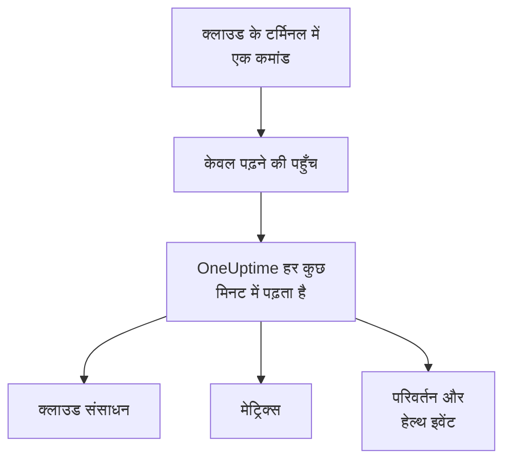

# क्लाउड खाता कनेक्ट करें

डैशबोर्ड से कोई AWS खाता, Azure सब्सक्रिप्शन या Google Cloud प्रोजेक्ट कनेक्ट करें, और OneUptime उसके हर संसाधन की सूची बनाता है, उनके मुख्य मेट्रिक्स पढ़ता है, और दर्ज करता है कि उनमें क्या बदला और आपका क्लाउड प्रदाता उनकी सेहत के बारे में क्या कहता है। आप अपने क्लाउड के ब्राउज़र टर्मिनल में एक कमांड चलाते हैं और जो वह प्रिंट करे उसे पेस्ट करते हैं: न कोई कलेक्टर चलाना है, न कुछ इंस्टॉल करना है।

:::cards
- [Amazon Web Services](#amazon-web-services): एक IAM भूमिका जिससे OneUptime साइन इन करता है, या एक एक्सेस कुंजी।
- [Microsoft Azure](#microsoft-azure): Monitoring Reader भूमिका वाला एक ऐप।
- [Google Cloud](#google-cloud): केवल पढ़ने वाली चार भूमिकाओं वाला एक सेवा खाता।
- [OneUptime क्या पढ़ता है](#oneuptime-क्या-पढ़ता-है): संसाधन, मेट्रिक्स, परिवर्तन और हेल्थ इवेंट, कितनी बार, और इसकी लागत क्या है।
- [AI को समस्याएँ ठीक करने दें](#ai-को-समस्याएँ-ठीक-करने-दें): एक और कमांड, और OneUptime AI जो पाता है उसे ठीक कर सकता है।
:::

## यह कैसे काम करता है



- **पहुँच केवल पढ़ सकती है।** कमांड ऐसी पहुँच बनाती है जो आपके संसाधन और उनका सेटअप, उनके मेट्रिक्स, क्या बदला और आपके प्रदाता के हेल्थ इवेंट पढ़ती है, और कुछ नहीं: AWS पर नीचे दी गई क्रियाएँ, Azure पर **Monitoring Reader** भूमिका और Google Cloud पर चार व्यूअर भूमिकाएँ। OneUptime इससे कभी डेटा या सीक्रेट नहीं पढ़ता, सिवाय लॉग लाइनों के, जब आप AI को किसी खाते के लॉग पढ़ने दें। OneUptime की पहुँच रोकने के लिए इसे हटा दें।
- **OneUptime तय समय पर पढ़ता है।** Azure और Google Cloud के लिए हर 5 मिनट में और AWS के लिए हर 10 मिनट में, जब तक आप कनेक्ट करते समय कोई और अंतराल न चुनें। हर रीडिंग पिछली रीडिंग के बाद से हुए बदलाव भी दर्ज करती है, और हर 30 मिनट में एक रीडिंग सभी संसाधनों की सूची फिर से बनाती है।
- **हर संसाधन का अपना पेज होता है।** संसाधन **क्लाउड → सभी संसाधन** में अपने मुख्य मेट्रिक्स, स्वामियों और लेबल के साथ दिखते हैं। सूची में आए संसाधन का पेज उसके **जुड़े हुए संसाधन** (वह किसमें चलता है, कौन उसे ट्रैफ़िक भेजता है), उसके एंडपॉइंट, टैग और सेटिंग्स, और उसकी **घटनाएं**, **अलर्ट** और **परिवर्तन** भी दिखाता है।
- **हर खाते का अपना पेज होता है।** खाते **क्लाउड → खाते** में प्रकार और क्षेत्र के अनुसार अपने संसाधनों, अपने **परिवर्तन** और इस बात की **टोपोलॉजी** के साथ दिखते हैं कि उनके संसाधन आपस में कैसे जुड़ते हैं।
- **OneUptime AI पढ़ता है कि क्या बदला।** किसी क्लाउड संसाधन से लिंक की गई घटना या अलर्ट की जाँच पहले उस संसाधन के परिवर्तन पढ़ती है, और शुरू होते समय खाते का गतिविधि लॉग फिर से पढ़ती है।

## शुरू करने से पहले

- **प्रोजेक्ट का स्वामी या एडमिन।** केवल वही क्लाउड खाते कनेक्ट, टेस्ट और संपादित कर सकते हैं।
- **आपके क्लाउड का टर्मिनल** (AWS CloudShell, Azure Cloud Shell या Google Cloud Shell), जिसमें ऐसा कोई व्यक्ति साइन इन हो जो IAM भूमिका या उपयोगकर्ता, ऐप पंजीकरण या सेवा खाता बना सकता हो।

## Amazon Web Services

:::steps
### AWS फ़ॉर्म खोलें

**क्लाउड → कनेक्ट करें** पर जाएँ और **Amazon Web Services** चुनें।

### AWS CloudShell में कमांड चलाएँ

चुनें कि OneUptime कैसे साइन इन करे। **IAM भूमिका** अनुशंसित तरीका है: कुछ भी गोपनीय संग्रहीत नहीं होता, और आप भूमिका को कभी भी हटा सकते हैं। फ़ॉर्म आपके प्रोजेक्ट के लिए लिखी कमांड दिखाता है: यह ऐसी भूमिका बनाती है जो आपके प्रोजेक्ट की बाहरी ID के साथ OneUptime के AWS खाते पर भरोसा करती है, और भूमिका का ARN प्रिंट करती है।

**क्या पढ़ना है** में यह खाता चुनें, या अपने AWS Organization का हर खाता। संगठन की कमांड उसके प्रबंधन खाते में चलाएँ: यह एक StackSet जोड़ती है जो वही भूमिका हर खाते में रखता है, अभी और जैसे-जैसे खाते जुड़ते हैं, और प्रबंधन खाते की भूमिका को खातों की सूची बनाने देती है। एक कनेक्शन अधिकतम 50 खाते पढ़ता है।

जब भूमिका संभव न हो, तो **एक्सेस कुंजी** का उपयोग करें: यह केवल अपना खाता पढ़ती है। यह कमांड समान अनुमतियों वाला उपयोगकर्ता बनाती है और उसकी कुंजी प्रिंट करती है:

```bash
aws iam create-user --user-name OneUptimeReadOnly > /dev/null 2>&1 || true
aws iam put-user-policy --user-name OneUptimeReadOnly --policy-name OneUptimeReadOnly --policy-document '{"Version":"2012-10-17","Statement":[{"Effect":"Allow","Action":["cloudwatch:GetMetricData","cloudwatch:ListMetrics","tag:GetResources","iam:ListAccountAliases","cloudformation:ListResources","ec2:DescribeInstances","ec2:DescribeVolumes","ec2:DescribeVpcs","ec2:DescribeNatGateways","autoscaling:DescribeAutoScalingGroups","elasticloadbalancing:DescribeLoadBalancers","elasticloadbalancing:DescribeLoadBalancerAttributes","elasticloadbalancing:DescribeTargetGroups","elasticloadbalancing:DescribeTargetGroupAttributes","elasticloadbalancing:DescribeTargetHealth","elasticloadbalancing:DescribeTags","ecs:ListClusters","ecs:DescribeClusters","ecs:ListServices","ecs:DescribeServices","lambda:ListFunctions","rds:DescribeDBInstances","rds:DescribeDBClusters","elasticache:DescribeReplicationGroups","sqs:ListQueues","sqs:GetQueueAttributes","sns:ListTopics","sns:GetTopicAttributes","sns:ListSubscriptionsByTopic","dynamodb:ListTables","dynamodb:DescribeTable","kinesis:ListStreams","kinesis:DescribeStreamSummary","states:ListStateMachines","states:DescribeStateMachine","cloudfront:ListDistributions","elasticfilesystem:DescribeFileSystems","es:ListDomainNames","es:DescribeDomains","apprunner:ListServices","apprunner:DescribeService","cloudtrail:LookupEvents","health:DescribeEvents","health:DescribeEventDetails","rds:DescribeEvents","autoscaling:DescribeScalingActivities","ec2:DescribeInstanceStatus","ecs:DescribeTaskDefinition","lambda:GetFunctionConfiguration","lambda:GetFunctionConcurrency","lambda:GetAlias","servicequotas:ListServiceQuotas","logs:DescribeLogGroups","logs:FilterLogEvents"],"Resource":"*"},{"Effect":"Allow","Action":["apigateway:GET"],"Resource":["arn:aws:apigateway:*::/restapis","arn:aws:apigateway:*::/restapis/*","arn:aws:apigateway:*::/apis","arn:aws:apigateway:*::/apis/*"]}]}'
aws iam create-access-key --user-name OneUptimeReadOnly
```

### AWS कमांड ने जो प्रिंट किया, उसे पेस्ट करें

कमांड ने जो कुछ प्रिंट किया, वह सब **कमांड ने क्या प्रिंट किया** में पेस्ट करें। OneUptime भूमिका का ARN, या एक्सेस कुंजी ID और उसका सीक्रेट, निकाल लेता है।

### AWS को टेस्ट और कनेक्ट करें

यह चरण खुलते ही OneUptime कनेक्शन को टेस्ट करता है: यह साइन इन करता है, मिले संसाधनों को गिनता है और बताता है कि उन्हें पढ़ने की लागत क्या है। सहेजने के लिए **कनेक्ट करें** चुनें।
:::

यह भूमिका और उपयोगकर्ता ये काम कर सकते हैं, और कुछ नहीं:

| OneUptime इनका उपयोग किसलिए करता है | क्रियाएँ |
| --- | --- |
| मेट्रिक्स रिपोर्ट करने वाले संसाधन ढूँढना, और उनके मेट्रिक्स पढ़ना | `cloudwatch:GetMetricData`, `cloudwatch:ListMetrics` |
| हर संसाधन का नाम तय करना और उसके टैग पढ़ना | `tag:GetResources`, `iam:ListAccountAliases` |
| Cloud Control के ज़रिए हर संसाधन और उसके कॉन्फ़िगरेशन की सूची बनाना | `cloudformation:ListResources`, `ec2:DescribeInstances`, `ec2:DescribeVolumes`, `ec2:DescribeVpcs`, `ec2:DescribeNatGateways`, `autoscaling:DescribeAutoScalingGroups`, `elasticloadbalancing:DescribeLoadBalancers`, `elasticloadbalancing:DescribeLoadBalancerAttributes`, `elasticloadbalancing:DescribeTargetGroups`, `elasticloadbalancing:DescribeTargetGroupAttributes`, `elasticloadbalancing:DescribeTargetHealth`, `elasticloadbalancing:DescribeTags`, `ecs:ListClusters`, `ecs:DescribeClusters`, `ecs:ListServices`, `ecs:DescribeServices`, `lambda:ListFunctions`, `rds:DescribeDBInstances`, `rds:DescribeDBClusters`, `elasticache:DescribeReplicationGroups`, `sqs:ListQueues`, `sqs:GetQueueAttributes`, `sns:ListTopics`, `sns:GetTopicAttributes`, `sns:ListSubscriptionsByTopic`, `dynamodb:ListTables`, `dynamodb:DescribeTable`, `kinesis:ListStreams`, `kinesis:DescribeStreamSummary`, `states:ListStateMachines`, `states:DescribeStateMachine`, `cloudfront:ListDistributions`, `elasticfilesystem:DescribeFileSystems`, `es:ListDomainNames`, `es:DescribeDomains`, `apprunner:ListServices`, `apprunner:DescribeService`, `apigateway:GET` |
| पढ़ना कि क्या बदला: खाते के प्रबंधन इवेंट | `cloudtrail:LookupEvents` |
| खाते के लिए AWS के अपने हेल्थ इवेंट पढ़ना | `health:DescribeEvents`, `health:DescribeEventDetails` |
| जाँच के दौरान किसी संसाधन की मौजूदा स्थिति और हाल के इवेंट पढ़ना | `rds:DescribeEvents`, `autoscaling:DescribeScalingActivities`, `ec2:DescribeInstanceStatus`, `ecs:DescribeTaskDefinition`, `lambda:GetFunctionConfiguration`, `lambda:GetFunctionConcurrency`, `lambda:GetAlias` |
| जाँच के दौरान खाते के कोटा पढ़ना | `servicequotas:ListServiceQuotas` |
| लॉग लाइनें पढ़ना, केवल तब जब आप AI को किसी खाते के लॉग पढ़ने दें | `logs:DescribeLogGroups`, `logs:FilterLogEvents` |
| संगठन के प्रबंधन खाते से उसके खातों की सूची बनाना | `organizations:ListAccounts` |

`apigateway:GET` केवल API की अपनी परिभाषाओं पर अनुमत है, उनकी कुंजियों पर कभी नहीं, और केवल प्रबंधन खाते की भूमिका संगठन के खातों की सूची बना सकती है। AWS Health केवल उन खातों को जवाब देता है जिनके पास Business, Enterprise On-Ramp या Enterprise सपोर्ट प्लान हो: इसके बिना, OneUptime एक दिन बाद फिर पूछता है।

> [!NOTE]
> सेल्फ़-होस्टेड OneUptime पर, **IAM भूमिका** वाले तरीके के लिए OneUptime की अपनी AWS पहचान चाहिए: `CLOUD_CONNECT_AWS_ACCESS_KEY_ID` और `CLOUD_CONNECT_AWS_SECRET_ACCESS_KEY` को ऐसे IAM उपयोगकर्ता की कुंजी पर सेट करें जो `sts:AssumeRole` कॉल कर सके। इनके बिना, फ़ॉर्म **एक्सेस कुंजी** देता है।

## Microsoft Azure

:::steps
### Azure फ़ॉर्म खोलें

**क्लाउड → कनेक्ट करें** पर जाएँ और **Microsoft Azure** चुनें।

### Azure Cloud Shell में कमांड चलाएँ

कमांड आपके मौजूदा सब्सक्रिप्शन पर **Monitoring Reader** भूमिका वाला एक ऐप बनाती है, और उसका विवरण उस तारीख के साथ प्रिंट करती है जब उसका सीक्रेट समाप्त होता है:

```bash
SCOPE="/subscriptions/$(az account show --query id --output tsv)"
OUT=$(az ad sp create-for-rbac --name OneUptimeReadOnly --role "Monitoring Reader" --scopes "$SCOPE")
APP=$(echo "$OUT" | jq -r .appId)
END=$(az ad app credential list --id "$APP" --query "max([].endDateTime)" --output tsv)
echo "$OUT" | jq --arg end "$END" '. + {endDateTime: $end}'
```

**क्या पढ़ना है** में इसके बजाय टेनेंट का हर सब्सक्रिप्शन चुनें, और भूमिका टेनेंट के रूट प्रबंधन समूह पर दी जाती है:

```bash
SCOPE="/providers/Microsoft.Management/managementGroups/$(az account show --query tenantId --output tsv)"
OUT=$(az ad sp create-for-rbac --name OneUptimeReadOnly --role "Monitoring Reader" --scopes "$SCOPE")
APP=$(echo "$OUT" | jq -r .appId)
END=$(az ad app credential list --id "$APP" --query "max([].endDateTime)" --output tsv)
echo "$OUT" | jq --arg end "$END" '. + {endDateTime: $end}'
```

### Azure कमांड ने जो प्रिंट किया, उसे पेस्ट करें

कमांड ने जो कुछ प्रिंट किया, वह सब **कमांड ने क्या प्रिंट किया** में पेस्ट करें। OneUptime `tenant`, `appId`, `password` और समाप्ति की तारीख निकाल लेता है।

### Azure को टेस्ट और कनेक्ट करें

यह चरण खुलते ही OneUptime कनेक्शन को टेस्ट करता है। सहेजने के लिए **कनेक्ट करें** चुनें।
:::

उसी ऐप से और सब्सक्रिप्शन पढ़ने के लिए, उनमें से हर एक पर उसे भूमिका दें:

```bash
az role assignment create --assignee <APP_ID> --role "Monitoring Reader" --scope /subscriptions/<SUBSCRIPTION_ID>
```

OneUptime हर वह सब्सक्रिप्शन पढ़ता है जिसे ऐप पढ़ सकता है, अधिकतम 50, जब तक आप **सब्सक्रिप्शन** में कुछ सूचीबद्ध न करें। ऐप का सीक्रेट अपनी समाप्ति की तारीख पर काम करना बंद कर देता है: उससे 30 दिन पहले से, हर रीडिंग इसकी चेतावनी देती है। उसे नया सीक्रेट देने के लिए कमांड फिर से चलाएँ और जो वह प्रिंट करे उसे पेस्ट करें।

## Google Cloud

:::steps
### Google Cloud फ़ॉर्म खोलें

**क्लाउड → कनेक्ट करें** पर जाएँ और **Google Cloud** चुनें।

### Google Cloud Shell में कमांड चलाएँ

इसे उस प्रोजेक्ट में चलाएँ जिसकी निगरानी करनी है। यह वे API चालू करती है जिन्हें OneUptime पढ़ता है, **Monitoring Viewer**, **Cloud Asset Viewer**, **Logs Viewer** और **Service Health Viewer** भूमिकाओं वाला एक सेवा खाता बनाती है, और उसकी कुंजी प्रिंट करती है:

```bash
PROJECT_ID=$(gcloud config get-value project)
gcloud services enable monitoring.googleapis.com cloudasset.googleapis.com logging.googleapis.com cloudresourcemanager.googleapis.com servicehealth.googleapis.com
gcloud iam service-accounts create oneuptime-read-only --display-name "OneUptime (read only)" > /dev/null 2>&1 || true
gcloud projects add-iam-policy-binding "$PROJECT_ID" --member "serviceAccount:oneuptime-read-only@$PROJECT_ID.iam.gserviceaccount.com" --role roles/monitoring.viewer --condition=None > /dev/null
gcloud projects add-iam-policy-binding "$PROJECT_ID" --member "serviceAccount:oneuptime-read-only@$PROJECT_ID.iam.gserviceaccount.com" --role roles/cloudasset.viewer --condition=None > /dev/null
gcloud projects add-iam-policy-binding "$PROJECT_ID" --member "serviceAccount:oneuptime-read-only@$PROJECT_ID.iam.gserviceaccount.com" --role roles/logging.viewer --condition=None > /dev/null
gcloud projects add-iam-policy-binding "$PROJECT_ID" --member "serviceAccount:oneuptime-read-only@$PROJECT_ID.iam.gserviceaccount.com" --role roles/servicehealth.viewer --condition=None > /dev/null
gcloud iam service-accounts keys create oneuptime-key.json --iam-account "oneuptime-read-only@$PROJECT_ID.iam.gserviceaccount.com"
cat oneuptime-key.json && rm oneuptime-key.json
```

**क्या पढ़ना है** में इसके बजाय संगठन का हर प्रोजेक्ट चुनें, और भूमिकाएँ प्रोजेक्ट के संगठन पर दी जाती हैं:

```bash
PROJECT_ID=$(gcloud config get-value project)
ORG_ID=$(gcloud projects get-ancestors "$PROJECT_ID" --format="value(id)" | tail -1)
gcloud services enable monitoring.googleapis.com cloudasset.googleapis.com logging.googleapis.com cloudresourcemanager.googleapis.com servicehealth.googleapis.com
gcloud iam service-accounts create oneuptime-read-only --display-name "OneUptime (read only)" > /dev/null 2>&1 || true
gcloud organizations add-iam-policy-binding "$ORG_ID" --member "serviceAccount:oneuptime-read-only@$PROJECT_ID.iam.gserviceaccount.com" --role roles/monitoring.viewer --condition=None > /dev/null
gcloud organizations add-iam-policy-binding "$ORG_ID" --member "serviceAccount:oneuptime-read-only@$PROJECT_ID.iam.gserviceaccount.com" --role roles/cloudasset.viewer --condition=None > /dev/null
gcloud organizations add-iam-policy-binding "$ORG_ID" --member "serviceAccount:oneuptime-read-only@$PROJECT_ID.iam.gserviceaccount.com" --role roles/logging.viewer --condition=None > /dev/null
gcloud organizations add-iam-policy-binding "$ORG_ID" --member "serviceAccount:oneuptime-read-only@$PROJECT_ID.iam.gserviceaccount.com" --role roles/servicehealth.viewer --condition=None > /dev/null
gcloud iam service-accounts keys create oneuptime-key.json --iam-account "oneuptime-read-only@$PROJECT_ID.iam.gserviceaccount.com"
cat oneuptime-key.json && rm oneuptime-key.json
```

### कुंजी पेस्ट करें

कमांड ने जो कुछ प्रिंट किया, वह सब पेस्ट करें। OneUptime कुंजी का अपना प्रोजेक्ट पढ़ता है, और कुंजी को एन्क्रिप्ट करके संग्रहीत करता है।

### Google Cloud को टेस्ट और कनेक्ट करें

यह चरण खुलते ही OneUptime कनेक्शन को टेस्ट करता है। सहेजने के लिए **कनेक्ट करें** चुनें।
:::

उसी सेवा खाते से और प्रोजेक्ट पढ़ने के लिए, उनमें से हर एक में उसे चारों भूमिकाएँ दें और उन्हें **परियोजनाएँ** में सूचीबद्ध करें:

```bash
for ROLE in roles/monitoring.viewer roles/cloudasset.viewer roles/logging.viewer roles/servicehealth.viewer; do gcloud projects add-iam-policy-binding <PROJECT_ID> --member "serviceAccount:oneuptime-read-only@<KEY_PROJECT_ID>.iam.gserviceaccount.com" --role "$ROLE"; done
```

किसी संगठन का कनेक्शन उसके अधिकतम 50 प्रोजेक्ट पढ़ता है, जब तक आप **परियोजनाएँ** में कुछ सूचीबद्ध न करें।

## OneUptime क्या पढ़ता है

| | AWS | Azure | Google Cloud |
| --- | --- | --- | --- |
| संसाधन | OneUptime को ज्ञात प्रकारों का हर संसाधन, आपके इस्तेमाल किए हर क्षेत्र में, Cloud Control से | सब्सक्रिप्शन का हर संसाधन, Resource Graph से | प्रोजेक्ट का हर संसाधन, Cloud Asset Inventory से |
| मेट्रिक्स | हर सेवा के मुख्य मेट्रिक्स, जैसे किसी इंस्टेंस का CPU, नेटवर्क और स्थिति जाँच | हर संसाधन के लिए अधिकतम 8 मुख्य मेट्रिक्स | हर संसाधन प्रकार के मुख्य मेट्रिक्स |
| परिवर्तन | CloudTrail के प्रबंधन इवेंट | गतिविधि लॉग के प्रशासनिक इवेंट | Admin Activity ऑडिट लॉग |
| हेल्थ इवेंट | AWS Health | Service Health और Resource Health | Service Health |
| हर इतने समय में पढ़ा जाता है | 10 मिनट | 5 मिनट | 5 मिनट |
| हटाया गया संसाधन | पूरी सूची में न रहने पर संग्रहीत | पूरी सूची में न रहने पर संग्रहीत | पूरी सूची में न रहने पर संग्रहीत |

हर रीडिंग वहीं से शुरू होती है जहाँ पिछली रुकी थी, इसलिए हर डेटा पॉइंट और हर परिवर्तन एक ही बार लिखा जाता है। नए कनेक्शन की पहली रीडिंग एक मिनट के भीतर शुरू होती है और मेट्रिक्स के लिए एक घंटा और परिवर्तनों के लिए 2 घंटे पीछे तक जाती है; किसी विराम के बाद, एक रीडिंग अधिकतम 6 घंटे पीछे तक जाती है। जो संसाधन केवल मेट्रिक्स रिपोर्ट करता है और किसी सूची में नहीं है, वह 7 दिन तक मेट्रिक्स न आने पर संग्रहीत हो जाता है।

OneUptime की कॉल का बिल आपके क्लाउड खाते में, आपके क्लाउड की कीमतों पर आता है। संसाधनों की सूची बनाना और परिवर्तन व हेल्थ इवेंट पढ़ना तीनों क्लाउड पर मुफ़्त है; मेट्रिक्स पढ़ने की लागत आती है। परीक्षण मिली चीज़ों की लागत का अनुमान लगाता है, और कम बार पढ़ने से लागत कम होती है: **और फ़ील्ड** में **मेट्रिक्स पढ़ने का अंतराल** बदलें।

| क्लाउड | कीमत |
| --- | --- |
| AWS | CloudWatch `GetMetricData`: हर 1,000 मेट्रिक्स पर $0.01, और किसी संसाधन का हर मुख्य मेट्रिक हर रीडिंग में एक मेट्रिक गिना जाता है |
| Azure | हर सब्सक्रिप्शन के लिए हर महीने पहली 1,000,000 मेट्रिक रीडिंग मुफ़्त हैं, फिर हर 1,000 पर $0.01 |
| Google Cloud | हर महीने पढ़ी गई पहली 1,000,000 टाइम सीरीज़ मुफ़्त हैं, फिर हर दस लाख पर $0.50 |

## OneUptime में आप क्या देखते हैं

- **खाते का पेज।** **क्लाउड → खाते** में, किसी खाते का अवलोकन उसके संसाधनों को प्रकार और क्षेत्र के अनुसार गिनता है और बताता है कि किसी कनेक्शन ने उसे आखिरी बार कब पढ़ा। उसका **संसाधन** टैब उन्हें सूचीबद्ध करता है, उसका **परिवर्तन** टैब सबसे नए पहले दिखाता है कि उसमें क्या बदला, और उसकी **टोपोलॉजी** उसके क्षेत्र, उनमें मौजूद नेटवर्क और हर एक में क्या चलता है, यह बनाती है, साथ में उन संसाधनों पर खुली घटनाएँ और अलर्ट जिनसे वे लिंक हैं।
- **किसी संसाधन के परिवर्तन।** एक परिवर्तन ऐसे परिवर्तन इवेंट के रूप में रखा जाता है जो उस संसाधन से जुड़ा होता है जिसे उसने बदला और उसके खाते से भी, और संसाधन के मेट्रिक चार्ट पर उसकी घटनाओं और अलर्ट के साथ एक मार्कर के रूप में दिखाया जाता है। जिन चार्ट को किसी संसाधन तक फ़िल्टर नहीं किया गया, उनमें क्लाउड खाते का गतिविधि लॉग नहीं दिखता, ताकि कोई व्यस्त खाता आपकी डिप्लॉय को दबा न दे; प्रदाता के हेल्थ इवेंट उन पर बने रहते हैं।
- **घटनाएँ और अलर्ट।** किसी क्लाउड संसाधन को किसी मॉनिटर, घटना या अलर्ट से उसके लिंक किए गए संसाधनों में लिंक करें, और उसकी घटनाएँ और अलर्ट संसाधन के पेज पर सूचीबद्ध होते हैं। कोई वेबसाइट, API, SSL, ping या पोर्ट मॉनिटर, जिसका होस्ट सीधे या अपने DNS के ज़रिए किसी संसाधन के एंडपॉइंट तक जाता है, अपने **लिंक किए गए संसाधन** कार्ड पर **सुझाए गए क्लाउड संसाधन** के नीचे उस संसाधन को दिखाता है: उसे लिंक करने के लिए **संसाधन लिंक करें** चुनें।

## AI को समस्याएँ ठीक करने दें

जांच के दौरान OneUptime AI ऊपर बताई गई केवल पढ़ने की पहुँच से हर कनेक्ट किए गए खाते को पढ़ता है। उसे समस्याएँ ठीक करने भी देने के लिए, जैसे किसी सेवा को रीस्टार्ट करना, उसे scale out करना या उसे रोलबैक करना, **क्लाउड → खाते** में खाता खोलें और उसके **अवलोकन** के **AI एजेंट** कार्ड में **AI को समस्याएँ ठीक करने दें** चुनें।

डायलॉग एक ही सवाल पूछता है — **AI कहाँ तक जा सकता है?** डिफ़ॉल्ट **पहले मुझसे पूछें**, जिसमें OneUptime AI हर सुधार प्रस्तावित करता है और कोई व्यक्ति एक क्लिक में उसे अनुमोदित करता है, या **कम जोखिम वाली समस्याएँ अपने आप ठीक करें**, जिसमें सुरक्षित बदलाव अपने आप चलते हैं और ज़्यादा जोखिम वाले बदलाव अब भी अनुमोदन का इंतज़ार करते हैं। बाकी हर चीज़ का **उन्नत** में एक सुरक्षित डिफ़ॉल्ट है। फिर यह एक कमांड दिखाता है, जो इसी खाते के लिए लिखी गई है: इसे AWS CloudShell, Azure Cloud Shell या Google Cloud Shell में, ऐसे व्यक्ति के रूप में साइन इन करके चलाएँ जो खाते में भूमिकाएँ बना सकता है। कमांड ऐसी भूमिका बनाती है जो केवल चालू किए गए बदलाव कर सकती है, और उसी के साथ आपके खाते में क्लाउड AI एजेंट शुरू करती है। एजेंट कुछ ही मिनटों में अपने आप कनेक्ट हो जाता है, और डायलॉग यह बताता है: वापस कुछ पेस्ट नहीं करना है।

एजेंट एक छोटा कंटेनर है जो पूरे महीने आपके खाते में चलता है, और आपका क्लाउड अपनी सूची कीमतों पर उसका बिल भेजता है:

| क्लाउड | क्या चलता है | लगभग |
| --- | --- | --- |
| AWS | 0.25 vCPU और 0.5 GB का एक ECS Fargate टास्क, और उसका सार्वजनिक IPv4 पता, `us-east-1` की कीमतों पर | $13 प्रति माह |
| Azure | 0.25 vCPU और 0.5 GiB की एक Container Apps रेप्लिका, सब्सक्रिप्शन के हर महीने के 180,000 vCPU-सेकंड और 360,000 GiB-सेकंड के मुफ़्त अनुदान के बाद | $14 प्रति माह |
| Google Cloud | 1 vCPU और 0.5 GiB का एक Cloud Run इंस्टेंस जिसे CPU हमेशा आवंटित रहता है, जो पूरा एक vCPU लेता है, हर महीने के 240,000 vCPU-सेकंड और 450,000 GiB-सेकंड के मुफ़्त टियर के बाद | $45 प्रति माह |

एजेंट क्या बदल सकता है, हर बदलाव का स्तर कैसे तय होता है और उसे कैसे पलटा जाता है, और उसके लॉग कैसे पढ़ें: [बुनियादी ढांचे के AI एजेंट](/docs/ai/infrastructure-ai-agents#किसी-क्लाउड-खाते-में)।

## समस्या निवारण

:::details परीक्षण बताता है कि कुंजी या सीक्रेट स्वीकार नहीं हुआ
कमांड ने जो कुछ प्रिंट किया, वह सब कॉपी करें और फिर से पेस्ट करें। एक मिनट पहले बनी कुंजी को काम करने में एक मिनट लग सकता है। समाप्त हो चुका Azure सीक्रेट भी अस्वीकार होता है: कमांड फिर से चलाएँ।
:::

:::details परीक्षण साइन इन करता है, पर पढ़ नहीं पाता
कमांड फिर से चलाएँ: यह OneUptime को ज़रूरी भूमिकाएँ देती है। AWS पर, वही कमांड चलाएँ जो फ़ॉर्म इस प्रोजेक्ट के लिए दिखाता है: किसी दूसरे प्रोजेक्ट के लिए बनी भूमिका उस प्रोजेक्ट की बाहरी ID पर भरोसा करती है, इस प्रोजेक्ट की नहीं।
:::

:::details Google Cloud कमांड को कुंजी बनाने नहीं देता
एक संगठन नीति, `iam.disableServiceAccountKeyCreation`, सेवा खाता कुंजियों पर रोक लगा सकती है। अपने संगठन के एडमिन से प्रोजेक्ट के लिए छूट माँगें, या [अपने खुद के कलेक्टर से मेट्रिक्स भेजें](/docs/telemetry/cloud-resources)।
:::

:::details कोई संसाधन नहीं दिखता
पहली रीडिंग खाते के हर संसाधन की सूची बनाती है, चाहे वह मेट्रिक्स रिपोर्ट करे या नहीं। अगर कोई कनेक्शन काम नहीं कर रहा, तो **क्लाउड → कनेक्ट करें** में **View error** बताता है कि उसकी पिछली रीडिंग क्यों विफल हुई।
:::

:::details संगठन के कुछ खाते नहीं दिख रहे
एक कनेक्शन अधिकतम 50 खाते, सब्सक्रिप्शन या प्रोजेक्ट पढ़ता है, और जब इससे ज़्यादा हों तो हर रीडिंग यह बताती है। बाकी को उनके अपने कनेक्शन से कनेक्ट करें।
:::

## अगले कदम

:::cards
- [क्लाउड संसाधन](/docs/telemetry/cloud-resources): इसके बजाय अपना OpenTelemetry Collector चलाएँ, या CloudWatch मेट्रिक्स स्ट्रीम करें।
- [डिप्लॉय और बदलाव](/docs/telemetry/change-events): OneUptime जो हर परिवर्तन दर्ज करता है, और OneUptime AI उन्हें कैसे पढ़ता है।
- [मेट्रिक्स मॉनिटर](/docs/monitor/metrics-monitor): किसी संसाधन के मेट्रिक्स पर अलर्ट पाएँ।
:::
