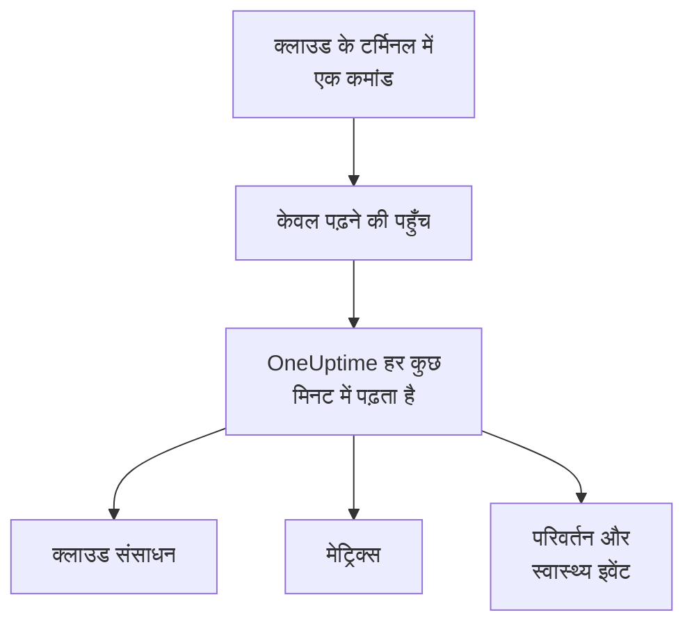

# क्लाउड खाता कनेक्ट करें

डैशबोर्ड से कोई AWS खाता, Azure सब्सक्रिप्शन या Google Cloud प्रोजेक्ट कनेक्ट करें, और OneUptime उसके हर संसाधन की सूची बनाता है, उनके मुख्य मेट्रिक्स पढ़ता है और बताता है कि हर एक की हालत कैसी है, दर्ज करता है कि उनमें क्या बदला और आपका क्लाउड प्रदाता उनके स्वास्थ्य के बारे में क्या कहता है, और पढ़ता है कि खाते की लागत कितनी है और वह कैसे कम हो सकती है। आप अपने क्लाउड के ब्राउज़र टर्मिनल में एक कमांड चलाते हैं और जो वह प्रिंट करे उसे पेस्ट करते हैं: न कोई कलेक्टर चलाना है, न कुछ इंस्टॉल करना है।

:::cards
- [Amazon Web Services](#amazon-web-services): एक IAM भूमिका जिससे OneUptime साइन इन करता है, या एक एक्सेस कुंजी।
- [Microsoft Azure](#microsoft-azure): Monitoring Reader और Cost Management Reader भूमिकाओं वाला एक ऐप।
- [Google Cloud](#google-cloud): केवल पढ़ने वाली छह भूमिकाओं वाला एक सेवा खाता।
- [OneUptime क्या पढ़ता है](#oneuptime-क्या-पढ़ता-है): संसाधन, मेट्रिक्स, परिवर्तन, स्वास्थ्य इवेंट और लागत, कितनी बार, और उन्हें पढ़ने की लागत क्या है।
- [क्लाउड लागत और बचत](/docs/telemetry/cloud-costs): हर खाते की लागत, कम खर्च करने के तरीके, और अलर्ट देने वाले बजट।
- [CloudWatch मेट्रिक्स और लॉग स्ट्रीम करें](/docs/telemetry/cloud-streaming): हर मेट्रिक मिनटों में, और CloudWatch Logs, Amazon Data Firehose के ज़रिए।
- [Azure Monitor मेट्रिक्स और लॉग स्ट्रीम करें](/docs/telemetry/cloud-streaming-azure): मिनटों में मुख्य मेट्रिक्स और संसाधन लॉग, आपके सब्सक्रिप्शन के इवेंट हब से पढ़े गए।
- [Google Cloud लॉग स्ट्रीम करें](/docs/telemetry/cloud-streaming-google-cloud): हर लॉग लिखे जाते ही, Pub/Sub के ज़रिए पुश किया गया।
- [डेटा सुरक्षा](#डेटा-सुरक्षा): कनेक्शन डेटा सुरक्षा को क्या पढ़ने देता है, और हर स्तर कमांड में क्या जोड़ता है।
- [AI को समस्याएँ ठीक करने दें](#ai-को-समस्याएँ-ठीक-करने-दें): एक और कमांड, और OneUptime AI जो पाता है उसे ठीक कर सकता है।
:::

## यह कैसे काम करता है



- **पहुँच केवल पढ़ सकती है।** कमांड ऐसी पहुँच बनाती है जो आपके संसाधन और उनका सेटअप, उनके मेट्रिक्स, क्या बदला, आपके प्रदाता के स्वास्थ्य इवेंट और खाते की लागत पढ़ती है, और कुछ नहीं: AWS पर नीचे दी गई क्रियाएँ, Azure पर **Monitoring Reader** और **Cost Management Reader** भूमिकाएँ और Google Cloud पर छह व्यूअर भूमिकाएँ। OneUptime इससे कभी डेटा या सीक्रेट नहीं पढ़ता, सिवाय लॉग लाइनों के, जब आप AI को किसी खाते के लॉग पढ़ने दें, और सामग्री के नमूनों के, जब आप उन्हें [डेटा सुरक्षा](#डेटा-सुरक्षा) के लिए चालू करें। OneUptime की पहुँच रोकने के लिए इसे हटा दें।
- **OneUptime तय समय पर पढ़ता है।** Azure और Google Cloud के लिए हर 5 मिनट में और AWS के लिए हर 10 मिनट में, जब तक आप कनेक्ट करते समय कोई और अंतराल न चुनें। हर रीडिंग पिछली रीडिंग के बाद से हुए बदलाव भी दर्ज करती है, और हर 30 मिनट में एक रीडिंग सभी संसाधनों की सूची फिर से बनाती है।
- **हर संसाधन का अपना पेज होता है।** संसाधन **क्लाउड → सभी संसाधन** में अपने स्वास्थ्य, मुख्य मेट्रिक्स, स्वामियों और लेबल के साथ दिखते हैं। सूची में आए संसाधन का पेज उसके **जुड़े हुए संसाधन** (वह किसमें चलता है, कौन उसे ट्रैफ़िक भेजता है), उसके एंडपॉइंट, टैग और सेटिंग्स, और उसकी **घटनाएं**, **अलर्ट** और **परिवर्तन** भी दिखाता है।
- **हर खाते का अपना पेज होता है।** खाते **क्लाउड → खाते** में प्रकार और क्षेत्र के अनुसार अपने संसाधनों, अपनी **लागत**, अपने **परिवर्तन** और इस बात की **टोपोलॉजी** के साथ दिखते हैं कि उनके संसाधन आपस में कैसे जुड़ते हैं।
- **क्लाउड अपने अवलोकन पर खुलता है।** **क्लाउड → अवलोकन** उन संसाधनों की सूची देता है जिन पर ध्यान देना है और क्यों, इस महीने खातों की लागत क्या है, और आपके क्लाउड क्या कहते हैं कि कितना बचाया जा सकता है। [क्लाउड लागत और बचत](/docs/telemetry/cloud-costs) बताता है कि लागत, बचत और बजट कैसे पढ़े जाते हैं। जब आपके खाते प्रबंधित ऐप प्लेटफ़ॉर्म पर ऐप चलाते हैं, तो **ऐप प्लेटफ़ॉर्म** कार्ड उनके परिवेशों और ऐप की गिनती करता है, और हर गिनती ऐप प्लेटफ़ॉर्म में वह सूची खोलती है, जो पहले से उन खातों पर फ़िल्टर होती है।
- **OneUptime AI पढ़ता है कि क्या बदला।** किसी क्लाउड संसाधन से लिंक की गई घटना या अलर्ट की जाँच पहले उस संसाधन के परिवर्तन पढ़ती है, और शुरू होते समय खाते का गतिविधि लॉग फिर से पढ़ती है।

## शुरू करने से पहले

- **प्रोजेक्ट स्वामी या प्रोजेक्ट एडमिन।** केवल वही क्लाउड खाते कनेक्ट, टेस्ट और संपादित कर सकते हैं।
- **आपके क्लाउड का टर्मिनल** (AWS CloudShell, Azure Cloud Shell या Google Cloud Shell), जिसमें ऐसा कोई व्यक्ति साइन इन हो जो IAM भूमिका या उपयोगकर्ता, ऐप पंजीकरण या सेवा खाता बना सकता हो।

## Amazon Web Services

:::steps
### AWS फ़ॉर्म खोलें

**क्लाउड → कनेक्ट करें** पर जाएँ और **Amazon Web Services** चुनें।

### AWS CloudShell में कमांड चलाएँ

चुनें कि OneUptime कैसे साइन इन करे। **IAM भूमिका** अनुशंसित तरीका है: कुछ भी गोपनीय संग्रहीत नहीं होता, और आप भूमिका को कभी भी हटा सकते हैं। फ़ॉर्म आपके प्रोजेक्ट के लिए लिखी कमांड दिखाता है: यह ऐसी भूमिका बनाती है जो आपके प्रोजेक्ट की बाहरी ID के साथ OneUptime के AWS खाते पर भरोसा करती है, और भूमिका का ARN प्रिंट करती है।

**क्या पढ़ना है** में यह खाता चुनें, या अपने AWS Organization का हर खाता। संगठन की कमांड उसके प्रबंधन खाते में चलाएँ: यह एक StackSet जोड़ती है जो वही भूमिका हर खाते में रखता है, अभी और जैसे-जैसे खाते जुड़ते हैं, और प्रबंधन खाते की भूमिका को खातों की सूची बनाने देती है। एक कनेक्शन अधिकतम 50 खाते पढ़ता है।

जब भूमिका संभव न हो, तो **एक्सेस कुंजी** का उपयोग करें: यह केवल अपना खाता पढ़ती है। यह कमांड समान अनुमतियों वाला उपयोगकर्ता बनाती है और उसकी कुंजी प्रिंट करती है:

```bash
aws iam create-user --user-name OneUptimeReadOnly > /dev/null 2>&1 || true
aws iam put-user-policy --user-name OneUptimeReadOnly --policy-name OneUptimeReadOnly --policy-document '{"Version":"2012-10-17","Statement":[{"Effect":"Allow","Action":["cloudwatch:GetMetricData","cloudwatch:ListMetrics","tag:GetResources","iam:ListAccountAliases","cloudformation:ListResources","ec2:DescribeInstances","ec2:DescribeVolumes","ec2:DescribeVpcs","ec2:DescribeSubnets","ec2:DescribeSecurityGroups","ec2:DescribeNatGateways","ec2:DescribeAddresses","autoscaling:DescribeAutoScalingGroups","elasticloadbalancing:Describe*","ecs:ListClusters","ecs:DescribeClusters","ecs:ListServices","ecs:DescribeServices","eks:ListClusters","eks:DescribeCluster","lambda:ListFunctions","rds:DescribeDBInstances","rds:DescribeDBClusters","elasticache:DescribeReplicationGroups","sqs:ListQueues","sqs:GetQueueAttributes","sns:ListTopics","sns:GetTopicAttributes","sns:ListSubscriptionsByTopic","dynamodb:ListTables","dynamodb:DescribeTable","kinesis:ListStreams","kinesis:DescribeStreamSummary","states:ListStateMachines","states:DescribeStateMachine","cloudfront:ListDistributions","elasticfilesystem:DescribeFileSystems","es:ListDomainNames","es:DescribeDomains","apprunner:ListServices","apprunner:DescribeService","elasticbeanstalk:DescribeEnvironments","wafv2:ListWebACLs","wafv2:GetWebACL","network-firewall:ListFirewalls","globalaccelerator:ListAccelerators","cognito-idp:ListUserPools","appsync:ListGraphqlApis","sagemaker:ListEndpoints","cloudtrail:LookupEvents","health:DescribeEvent*","ce:GetCostAndUsage","ce:GetCostAndUsageWithResources","ce:GetSavingsPlansCoverage","ce:GetSavingsPlansUtilization","ce:GetReservationCoverage","ce:GetReservationUtilization","cost-optimization-hub:ListRecommendations","rds:DescribeEvents","autoscaling:DescribeScalingActivities","ec2:DescribeInstanceStatus","ecs:DescribeTaskDefinition","lambda:GetFunctionConfiguration","lambda:GetFunctionConcurrency","lambda:GetAlias","servicequotas:ListServiceQuotas","logs:DescribeLogGroups","logs:FilterLogEvents"],"Resource":"*"},{"Effect":"Allow","Action":["apigateway:GET"],"Resource":["arn:aws:apigateway:*::/restapis*","arn:aws:apigateway:*::/apis*"]}]}'
aws iam create-access-key --user-name OneUptimeReadOnly
```

### AWS कमांड ने जो प्रिंट किया, उसे पेस्ट करें

कमांड ने जो कुछ प्रिंट किया, वह सब **कमांड ने क्या प्रिंट किया** में पेस्ट करें। OneUptime भूमिका का ARN, या एक्सेस कुंजी ID और उसका सीक्रेट, निकाल लेता है।

### AWS को टेस्ट और कनेक्ट करें

यह चरण खुलते ही OneUptime कनेक्शन को टेस्ट करता है: यह साइन इन करता है, मिले संसाधनों को गिनता है और बताता है कि उन्हें पढ़ने की लागत क्या है। सहेजने के लिए **कनेक्ट करें** चुनें।
:::

यह भूमिका और उपयोगकर्ता ये काम कर सकते हैं, और कुछ नहीं:

| OneUptime इनका उपयोग किसलिए करता है | क्रियाएँ |
| --- | --- |
| मेट्रिक्स रिपोर्ट करने वाले संसाधन ढूँढना, और उनके मेट्रिक्स पढ़ना | `cloudwatch:GetMetricData`, `cloudwatch:ListMetrics` |
| हर संसाधन का नाम तय करना और उसके टैग पढ़ना | `tag:GetResources`, `iam:ListAccountAliases` |
| Cloud Control के ज़रिए हर संसाधन और उसके कॉन्फ़िगरेशन की सूची बनाना | `cloudformation:ListResources`, `ec2:DescribeInstances`, `ec2:DescribeVolumes`, `ec2:DescribeVpcs`, `ec2:DescribeSubnets`, `ec2:DescribeSecurityGroups`, `ec2:DescribeNatGateways`, `ec2:DescribeAddresses`, `autoscaling:DescribeAutoScalingGroups`, `elasticloadbalancing:Describe*`, `ecs:ListClusters`, `ecs:DescribeClusters`, `ecs:ListServices`, `ecs:DescribeServices`, `eks:ListClusters`, `eks:DescribeCluster`, `lambda:ListFunctions`, `rds:DescribeDBInstances`, `rds:DescribeDBClusters`, `elasticache:DescribeReplicationGroups`, `sqs:ListQueues`, `sqs:GetQueueAttributes`, `sns:ListTopics`, `sns:GetTopicAttributes`, `sns:ListSubscriptionsByTopic`, `dynamodb:ListTables`, `dynamodb:DescribeTable`, `kinesis:ListStreams`, `kinesis:DescribeStreamSummary`, `states:ListStateMachines`, `states:DescribeStateMachine`, `cloudfront:ListDistributions`, `elasticfilesystem:DescribeFileSystems`, `es:ListDomainNames`, `es:DescribeDomains`, `apprunner:ListServices`, `apprunner:DescribeService`, `elasticbeanstalk:DescribeEnvironments`, `wafv2:ListWebACLs`, `wafv2:GetWebACL`, `network-firewall:ListFirewalls`, `globalaccelerator:ListAccelerators`, `cognito-idp:ListUserPools`, `appsync:ListGraphqlApis`, `sagemaker:ListEndpoints`, `apigateway:GET` |
| पढ़ना कि क्या बदला: खाते के प्रबंधन इवेंट | `cloudtrail:LookupEvents` |
| खाते के लिए AWS के अपने स्वास्थ्य इवेंट पढ़ना | `health:DescribeEvent*` |
| खाते की लागत पढ़ना, Cost Explorer से | `ce:GetCostAndUsage`, `ce:GetCostAndUsageWithResources`, `ce:GetSavingsPlansCoverage`, `ce:GetSavingsPlansUtilization`, `ce:GetReservationCoverage`, `ce:GetReservationUtilization` |
| कम खर्च करने के तरीके पढ़ना, Cost Optimization Hub से | `cost-optimization-hub:ListRecommendations` |
| जाँच के दौरान किसी संसाधन की मौजूदा स्थिति और हाल के इवेंट पढ़ना | `rds:DescribeEvents`, `autoscaling:DescribeScalingActivities`, `ec2:DescribeInstanceStatus`, `ecs:DescribeTaskDefinition`, `lambda:GetFunctionConfiguration`, `lambda:GetFunctionConcurrency`, `lambda:GetAlias` |
| जाँच के दौरान खाते के कोटा पढ़ना | `servicequotas:ListServiceQuotas` |
| लॉग लाइनें पढ़ना, केवल तब जब आप AI को किसी खाते के लॉग पढ़ने दें | `logs:DescribeLogGroups`, `logs:FilterLogEvents` |
| संगठन के प्रबंधन खाते से उसके खातों की सूची बनाना | `organizations:ListAccounts` |

`apigateway:GET` केवल API की अपनी परिभाषाओं पर अनुमत है, उनकी कुंजियों पर कभी नहीं, और केवल प्रबंधन खाते की भूमिका संगठन के खातों की सूची बना सकती है। AWS Health केवल उन खातों को जवाब देता है जिनके पास Business, Enterprise On-Ramp या Enterprise सपोर्ट प्लान हो: इसके बिना, OneUptime एक दिन बाद फिर पूछता है।

हर Region में OneUptime EC2 इंस्टेंस और वॉल्यूम, VPC, सबनेट और सिक्योरिटी ग्रुप, NAT गेटवे, Auto Scaling ग्रुप, लोड बैलेंसर (Application, Network, Gateway और Classic), EKS क्लस्टर, ECS क्लस्टर और सर्विस, Lambda फ़ंक्शन, RDS डेटाबेस, ElastiCache, SQS क्यू, SNS टॉपिक, DynamoDB टेबल, Kinesis स्ट्रीम, Step Functions स्टेट मशीन, API Gateway API, EFS फ़ाइल सिस्टम, OpenSearch डोमेन, App Runner सर्विस, Elastic Beanstalk एनवायरनमेंट, WAF वेब ACL, Network Firewall फ़ायरवॉल, Cognito यूज़र पूल, AppSync GraphQL API और SageMaker एंडपॉइंट को उनके टैग के साथ सूचीबद्ध करता है, CloudFront डिस्ट्रिब्यूशन और उनके वेब ACL को एक बार, us-east-1 में, और Global Accelerator एक्सेलेरेटर को एक बार, us-west-2 में। यह यह भी दर्ज करता है कि वे कैसे जुड़े हैं: हर रिसोर्स किस सबनेट और VPC में चलता है और कौन से सिक्योरिटी ग्रुप उसकी रक्षा करते हैं, हर लोड बैलेंसर ट्रैफ़िक कहाँ भेजता है, और हर EKS क्लस्टर का नेटवर्क और नोड इंस्टेंस। OneUptime के किसी टाइप को सूचीबद्ध करने से पहले बनाया गया रोल अब भी उसके बिना और बिना किसी चेतावनी के पढ़ा जाता है: वह टाइप भी सूचीबद्ध करने के लिए कमांड फिर से चलाएँ, जैसे सबनेट, सिक्योरिटी ग्रुप और EKS क्लस्टर, या वेब ACL, फ़ायरवॉल, एक्सेलेरेटर, यूज़र पूल, GraphQL API और एंडपॉइंट, जो तब कोई मेट्रिक रिपोर्ट करने से पहले ही सूचीबद्ध हो जाते हैं।

OneUptime किसी भूमिका में तभी साइन इन करता है जब उसकी ट्रस्ट पॉलिसी आपके प्रोजेक्ट की बाहरी ID माँगती है, उस `sts:ExternalId` शर्त के साथ जो कमांड लिखती है। किसी भूमिका से कुछ भी पढ़ने से पहले, और फिर हर दिन, OneUptime एक बार ऐसी बाहरी ID से साइन इन करता है जो किसी प्रोजेक्ट की नहीं है: AWS का उस साइन इन को ठुकराना ही जाँच में पास होना है, इसलिए उसे कितने भी OneUptime सर्वर पढ़ें, भूमिका का CloudTrail दिन में लगभग एक बार OneUptime का एक `AccessDenied` दिखाता है। जो भूमिका उस साइन इन को आने देती है, वह उसका ARN जानने वाले किसी भी प्रोजेक्ट को OneUptime के ज़रिए आपका खाता पढ़ने देती, इसलिए OneUptime उसे ठुकरा देता है, उसके ज़रिए कुछ नहीं पढ़ता, और बताता है कि कौन-सी शर्त जोड़नी है।

> [!NOTE]
> सेल्फ़-होस्टेड OneUptime पर, **IAM भूमिका** वाले तरीके के लिए OneUptime की अपनी ऐसी AWS पहचान चाहिए जो `sts:AssumeRole` कॉल कर सके: वह IAM भूमिका जिससे सर्वर चलता है (Amazon EKS पर उसके पॉड की भूमिका, जो Helm चार्ट के `serviceAccount.annotations` में सेट होती है, Amazon ECS पर उसकी टास्क भूमिका, या Amazon EC2 पर उसकी इंस्टेंस प्रोफ़ाइल), या `CLOUD_CONNECT_AWS_ACCESS_KEY_ID` और `CLOUD_CONNECT_AWS_SECRET_ACCESS_KEY` में किसी IAM उपयोगकर्ता की कुंजी, जो सेट होने पर हमेशा इस्तेमाल होती है। इनमें से किसी के बिना, फ़ॉर्म **एक्सेस कुंजी** देता है।

## Microsoft Azure

:::steps
### Azure फ़ॉर्म खोलें

**क्लाउड → कनेक्ट करें** पर जाएँ और **Microsoft Azure** चुनें।

### Azure Cloud Shell में कमांड चलाएँ

कमांड आपके मौजूदा सब्सक्रिप्शन पर **Monitoring Reader** और **Cost Management Reader** भूमिकाओं वाला एक ऐप बनाती है, और उसका विवरण उस तारीख के साथ प्रिंट करती है जब उसका सीक्रेट समाप्त होता है:

```bash
SCOPE="/subscriptions/$(az account show --query id --output tsv)"
OUT=$(az ad sp create-for-rbac --name OneUptimeReadOnly --role "Monitoring Reader" --scopes "$SCOPE")
APP=$(echo "$OUT" | jq -r .appId)
az role assignment create --assignee "$APP" --role "Cost Management Reader" --scope "$SCOPE" > /dev/null
END=$(az ad app credential list --id "$APP" --query "max([].endDateTime)" --output tsv)
echo "$OUT" | jq --arg end "$END" '. + {endDateTime: $end}'
```

**क्या पढ़ना है** में इसके बजाय टेनेंट का हर सब्सक्रिप्शन चुनें, और भूमिका टेनेंट के रूट प्रबंधन समूह पर दी जाती है:

```bash
SCOPE="/providers/Microsoft.Management/managementGroups/$(az account show --query tenantId --output tsv)"
OUT=$(az ad sp create-for-rbac --name OneUptimeReadOnly --role "Monitoring Reader" --scopes "$SCOPE")
APP=$(echo "$OUT" | jq -r .appId)
az role assignment create --assignee "$APP" --role "Cost Management Reader" --scope "$SCOPE" > /dev/null
END=$(az ad app credential list --id "$APP" --query "max([].endDateTime)" --output tsv)
echo "$OUT" | jq --arg end "$END" '. + {endDateTime: $end}'
```

### Azure कमांड ने जो प्रिंट किया, उसे पेस्ट करें

कमांड ने जो कुछ प्रिंट किया, वह सब **कमांड ने क्या प्रिंट किया** में पेस्ट करें। OneUptime `tenant`, `appId`, `password` और समाप्ति की तारीख निकाल लेता है।

### Azure को टेस्ट और कनेक्ट करें

यह चरण खुलते ही OneUptime कनेक्शन को टेस्ट करता है। सहेजने के लिए **कनेक्ट करें** चुनें।
:::

उसी ऐप से और सब्सक्रिप्शन पढ़ने के लिए, उनमें से हर एक पर उसे दोनों भूमिकाएँ दें:

```bash
az role assignment create --assignee <APP_ID> --role "Monitoring Reader" --scope /subscriptions/<SUBSCRIPTION_ID>
az role assignment create --assignee <APP_ID> --role "Cost Management Reader" --scope /subscriptions/<SUBSCRIPTION_ID>
```

OneUptime हर वह सब्सक्रिप्शन पढ़ता है जिसे ऐप पढ़ सकता है, अधिकतम 50, जब तक आप **सब्सक्रिप्शन** में कुछ सूचीबद्ध न करें। ऐप का सीक्रेट अपनी समाप्ति की तारीख पर काम करना बंद कर देता है: उससे 30 दिन पहले से, हर रीडिंग इसकी चेतावनी देती है। उसे नया सीक्रेट देने के लिए कमांड फिर से चलाएँ और जो वह प्रिंट करे उसे पेस्ट करें।

हर सब्सक्रिप्शन में OneUptime हर उस टाइप के रिसोर्स को उनके टैग, रीजन और रिसोर्स ग्रुप के साथ सूचीबद्ध करता है जिसके मेट्रिक्स वह पढ़ता है, और साथ ही हर वर्चुअल नेटवर्क के सबनेट और हर नेटवर्क सिक्योरिटी ग्रुप को उसके नियमों के साथ। यह यह भी दर्ज करता है कि वे कैसे जुड़े हैं: हर वर्चुअल मशीन, नेटवर्क इंटरफ़ेस और स्केल सेट किस सबनेट और वर्चुअल नेटवर्क में चलता है और कौन से नेटवर्क सिक्योरिटी ग्रुप उसकी रक्षा करते हैं, उसके इंटरफ़ेस पर और उसके सबनेट पर, हर लोड बैलेंसर और एप्लिकेशन गेटवे ट्रैफ़िक कहाँ भेजता है, और हर AKS क्लस्टर का नेटवर्क और नोड स्केल सेट। **Monitoring Reader** यह सब पढ़ लेता है, इसलिए और कुछ देने की ज़रूरत नहीं है।

## Google Cloud

:::steps
### Google Cloud फ़ॉर्म खोलें

**क्लाउड → कनेक्ट करें** पर जाएँ और **Google Cloud** चुनें।

### Google Cloud Shell में कमांड चलाएँ

इसे उस प्रोजेक्ट में चलाएँ जिसकी निगरानी करनी है। यह वे API चालू करती है जिन्हें OneUptime पढ़ता है, **Monitoring Viewer**, **Cloud Asset Viewer**, **Logs Viewer**, **Service Health Viewer**, **BigQuery Job User** और **Compute Recommender Viewer** भूमिकाओं वाला एक सेवा खाता बनाती है, और उसकी कुंजी प्रिंट करती है:

```bash
PROJECT_ID=$(gcloud config get-value project)
gcloud services enable monitoring.googleapis.com cloudasset.googleapis.com logging.googleapis.com cloudresourcemanager.googleapis.com servicehealth.googleapis.com bigquery.googleapis.com recommender.googleapis.com
gcloud iam service-accounts create oneuptime-read-only --display-name "OneUptime (read only)" > /dev/null 2>&1 || true
gcloud projects add-iam-policy-binding "$PROJECT_ID" --member "serviceAccount:oneuptime-read-only@$PROJECT_ID.iam.gserviceaccount.com" --role roles/monitoring.viewer --condition=None > /dev/null
gcloud projects add-iam-policy-binding "$PROJECT_ID" --member "serviceAccount:oneuptime-read-only@$PROJECT_ID.iam.gserviceaccount.com" --role roles/cloudasset.viewer --condition=None > /dev/null
gcloud projects add-iam-policy-binding "$PROJECT_ID" --member "serviceAccount:oneuptime-read-only@$PROJECT_ID.iam.gserviceaccount.com" --role roles/logging.viewer --condition=None > /dev/null
gcloud projects add-iam-policy-binding "$PROJECT_ID" --member "serviceAccount:oneuptime-read-only@$PROJECT_ID.iam.gserviceaccount.com" --role roles/servicehealth.viewer --condition=None > /dev/null
gcloud projects add-iam-policy-binding "$PROJECT_ID" --member "serviceAccount:oneuptime-read-only@$PROJECT_ID.iam.gserviceaccount.com" --role roles/bigquery.jobUser --condition=None > /dev/null
gcloud projects add-iam-policy-binding "$PROJECT_ID" --member "serviceAccount:oneuptime-read-only@$PROJECT_ID.iam.gserviceaccount.com" --role roles/recommender.computeViewer --condition=None > /dev/null
gcloud iam service-accounts keys create oneuptime-key.json --iam-account "oneuptime-read-only@$PROJECT_ID.iam.gserviceaccount.com"
cat oneuptime-key.json && rm oneuptime-key.json
```

**क्या पढ़ना है** में इसके बजाय संगठन का हर प्रोजेक्ट चुनें, और भूमिकाएँ प्रोजेक्ट के संगठन पर दी जाती हैं:

```bash
PROJECT_ID=$(gcloud config get-value project)
ORG_ID=$(gcloud projects get-ancestors "$PROJECT_ID" --format="value(id)" | tail -1)
gcloud services enable monitoring.googleapis.com cloudasset.googleapis.com logging.googleapis.com cloudresourcemanager.googleapis.com servicehealth.googleapis.com bigquery.googleapis.com recommender.googleapis.com
gcloud iam service-accounts create oneuptime-read-only --display-name "OneUptime (read only)" > /dev/null 2>&1 || true
gcloud organizations add-iam-policy-binding "$ORG_ID" --member "serviceAccount:oneuptime-read-only@$PROJECT_ID.iam.gserviceaccount.com" --role roles/monitoring.viewer --condition=None > /dev/null
gcloud organizations add-iam-policy-binding "$ORG_ID" --member "serviceAccount:oneuptime-read-only@$PROJECT_ID.iam.gserviceaccount.com" --role roles/cloudasset.viewer --condition=None > /dev/null
gcloud organizations add-iam-policy-binding "$ORG_ID" --member "serviceAccount:oneuptime-read-only@$PROJECT_ID.iam.gserviceaccount.com" --role roles/logging.viewer --condition=None > /dev/null
gcloud organizations add-iam-policy-binding "$ORG_ID" --member "serviceAccount:oneuptime-read-only@$PROJECT_ID.iam.gserviceaccount.com" --role roles/servicehealth.viewer --condition=None > /dev/null
gcloud organizations add-iam-policy-binding "$ORG_ID" --member "serviceAccount:oneuptime-read-only@$PROJECT_ID.iam.gserviceaccount.com" --role roles/bigquery.jobUser --condition=None > /dev/null
gcloud organizations add-iam-policy-binding "$ORG_ID" --member "serviceAccount:oneuptime-read-only@$PROJECT_ID.iam.gserviceaccount.com" --role roles/recommender.computeViewer --condition=None > /dev/null
gcloud iam service-accounts keys create oneuptime-key.json --iam-account "oneuptime-read-only@$PROJECT_ID.iam.gserviceaccount.com"
cat oneuptime-key.json && rm oneuptime-key.json
```

### कुंजी पेस्ट करें

कमांड ने जो कुछ प्रिंट किया, वह सब पेस्ट करें। OneUptime कुंजी का अपना प्रोजेक्ट पढ़ता है, और कुंजी को एन्क्रिप्ट करके संग्रहीत करता है।

### Google Cloud को टेस्ट और कनेक्ट करें

यह चरण खुलते ही OneUptime कनेक्शन को टेस्ट करता है। सहेजने के लिए **कनेक्ट करें** चुनें।
:::

उसी सेवा खाते से और प्रोजेक्ट पढ़ने के लिए, उनमें से हर एक में उसे ये भूमिकाएँ दें और उन्हें **परियोजनाएँ** में सूचीबद्ध करें:

```bash
for ROLE in roles/monitoring.viewer roles/cloudasset.viewer roles/logging.viewer roles/servicehealth.viewer roles/recommender.computeViewer; do gcloud projects add-iam-policy-binding <PROJECT_ID> --member "serviceAccount:oneuptime-read-only@<KEY_PROJECT_ID>.iam.gserviceaccount.com" --role "$ROLE"; done
```

किसी संगठन का कनेक्शन उसके अधिकतम 50 प्रोजेक्ट पढ़ता है, जब तक आप **परियोजनाएँ** में कुछ सूचीबद्ध न करें।

हर प्रोजेक्ट में OneUptime Compute Engine इंस्टेंस, VPC नेटवर्क, सबनेट और फ़ायरवॉल नियम, लोड बैलेंसर उनके फ़ॉरवर्डिंग नियमों और बैकएंड सेवाओं के साथ, Cloud Storage बकेट, GKE क्लस्टर, Cloud SQL, Memorystore और Spanner इंस्टेंस, Cloud Run सेवाएँ, Cloud Functions, और Pub/Sub टॉपिक और सब्सक्रिप्शन उनके लेबल, क्षेत्रों और ज़ोन के साथ सूचीबद्ध करता है। यह यह भी दर्ज करता है कि वे कैसे जुड़े हैं: कोई इंस्टेंस किस सबनेट और नेटवर्क में चलता है और उस पर कौन-से फ़ायरवॉल नियम लागू होते हैं, हर लोड बैलेंसर ट्रैफ़िक कहाँ भेजता है, और हर GKE क्लस्टर का नेटवर्क और नोड VM। जिस प्रोजेक्ट में Cloud Asset API बंद है, वह फिर भी जुड़ता है, एक चेतावनी के साथ जो उसे चालू करने का कमांड देती है: `gcloud services enable cloudasset.googleapis.com`।

Google Cloud में किसी प्रोजेक्ट की लागत के लिए कोई API नहीं है: OneUptime उसे आपके बिलिंग खाते के BigQuery में निर्यात से पढ़ता है, जैसे ही आप उसकी तालिका **बिलिंग निर्यात तालिका** में बताते हैं। [क्लाउड लागत और बचत](/docs/telemetry/cloud-costs#google-cloud) बताता है कैसे।

## डेटा सुरक्षा

यही कनेक्शन [डेटा सुरक्षा](/docs/data-security/index) को खाते के डेटा स्टोर पढ़ने दे सकता है: उसके बकेट, डेटाबेस और वेयरहाउस। **और फ़ील्ड** के नीचे, **डेटा सुरक्षा** तब तक **बंद** रहती है जब तक आप कुछ और न चुनें, और फ़ॉर्म जो कमांड दिखाता है, वह इसके साथ बदलती है:

| डेटा सुरक्षा | डेटा सुरक्षा क्या पढ़ सकती है | कमांड क्या जोड़ती है |
| --- | --- | --- |
| **बंद** | खाते का कोई भी स्टोर नहीं | कुछ नहीं |
| **केवल कॉन्फ़िगरेशन** | हर स्टोर तक कौन पहुंच सकता है, और उसका एन्क्रिप्शन, बैकअप और लॉगिंग कैसे सेट है। डेटा कभी नहीं। | AWS पर, पढ़ने वाली क्रियाओं की एक दूसरी इनलाइन नीति, `OneUptimeDataSecurity`। Azure और Google Cloud पर, कुछ नहीं: **Monitoring Reader** और **Cloud Asset Viewer** इसे पहले से पढ़ते हैं। |
| **कॉन्फ़िगरेशन और सामग्री के नमूने** | वह सब, और ऑब्जेक्ट और पंक्तियों के नमूने, ताकि उनमें संवेदनशील डेटा ढूँढा जा सके | AWS पर, वही नीति, `s3:ListBucket`, `s3:GetObject` और सिर्फ़ S3 के ज़रिए `kms:Decrypt` के साथ। Azure पर, **Storage Blob Data Reader**। Google Cloud पर, `roles/storage.objectViewer` और `roles/bigquery.dataViewer`। |

AWS पर, भूमिका की कमांड एक और पंक्ति से नीति जोड़ती है। सामग्री स्तर पर, वह यह है:

```bash
aws iam put-role-policy --role-name "$ROLE" --policy-name OneUptimeDataSecurity --policy-document '{"Version":"2012-10-17","Statement":[{"Effect":"Allow","Action":["s3:ListAllMyBuckets","s3:GetBucketLocation","s3:GetBucketPolicyStatus","s3:GetBucketPublicAccessBlock","s3:GetAccountPublicAccessBlock","s3:GetBucketAcl","s3:GetBucketPolicy","s3:GetEncryptionConfiguration","s3:GetBucketVersioning","s3:GetBucketLogging","s3:GetBucketOwnershipControls","s3:GetReplicationConfiguration","s3:GetBucketTagging","rds:DescribeDBInstances","rds:DescribeDBClusters","rds:DescribeDBSnapshots","rds:DescribeDBSnapshotAttributes","rds:DescribeDBClusterSnapshots","rds:DescribeDBClusterSnapshotAttributes","dynamodb:ListTables","dynamodb:DescribeTable","dynamodb:DescribeContinuousBackups","redshift:DescribeClusters","redshift:DescribeLoggingStatus","es:ListDomainNames","es:DescribeDomains","elasticache:DescribeReplicationGroups","elasticfilesystem:DescribeFileSystems","kms:ListAliases","iam:GetAccountAuthorizationDetails","iam:GenerateCredentialReport","iam:GetCredentialReport"],"Resource":"*"},{"Effect":"Allow","Action":["s3:ListBucket"],"Resource":"arn:aws:s3:::*"},{"Effect":"Allow","Action":["s3:GetObject"],"Resource":"arn:aws:s3:::*/*"},{"Effect":"Allow","Action":["kms:Decrypt"],"Resource":"*","Condition":{"StringLike":{"kms:ViaService":"s3.*.amazonaws.com"}}}]}'
```

IAM किसी उपयोगकर्ता की अपनी इनलाइन नीतियों को कुल मिलाकर 2,048 अक्षरों तक सीमित रखता है, इसलिए **एक्सेस कुंजी** के साथ नीति एक समूह, `OneUptimeDataSecurity`, पर लगती है, जिसमें उपयोगकर्ता शामिल होता है:

```bash
aws iam create-user --user-name OneUptimeReadOnly > /dev/null 2>&1 || true
aws iam put-user-policy --user-name OneUptimeReadOnly --policy-name OneUptimeReadOnly --policy-document '{"Version":"2012-10-17","Statement":[{"Effect":"Allow","Action":["cloudwatch:GetMetricData","cloudwatch:ListMetrics","tag:GetResources","iam:ListAccountAliases","cloudformation:ListResources","ec2:DescribeInstances","ec2:DescribeVolumes","ec2:DescribeVpcs","ec2:DescribeSubnets","ec2:DescribeSecurityGroups","ec2:DescribeNatGateways","ec2:DescribeAddresses","autoscaling:DescribeAutoScalingGroups","elasticloadbalancing:Describe*","ecs:ListClusters","ecs:DescribeClusters","ecs:ListServices","ecs:DescribeServices","eks:ListClusters","eks:DescribeCluster","lambda:ListFunctions","rds:DescribeDBInstances","rds:DescribeDBClusters","elasticache:DescribeReplicationGroups","sqs:ListQueues","sqs:GetQueueAttributes","sns:ListTopics","sns:GetTopicAttributes","sns:ListSubscriptionsByTopic","dynamodb:ListTables","dynamodb:DescribeTable","kinesis:ListStreams","kinesis:DescribeStreamSummary","states:ListStateMachines","states:DescribeStateMachine","cloudfront:ListDistributions","elasticfilesystem:DescribeFileSystems","es:ListDomainNames","es:DescribeDomains","apprunner:ListServices","apprunner:DescribeService","elasticbeanstalk:DescribeEnvironments","wafv2:ListWebACLs","wafv2:GetWebACL","network-firewall:ListFirewalls","globalaccelerator:ListAccelerators","cognito-idp:ListUserPools","appsync:ListGraphqlApis","sagemaker:ListEndpoints","cloudtrail:LookupEvents","health:DescribeEvent*","ce:GetCostAndUsage","ce:GetCostAndUsageWithResources","ce:GetSavingsPlansCoverage","ce:GetSavingsPlansUtilization","ce:GetReservationCoverage","ce:GetReservationUtilization","cost-optimization-hub:ListRecommendations","rds:DescribeEvents","autoscaling:DescribeScalingActivities","ec2:DescribeInstanceStatus","ecs:DescribeTaskDefinition","lambda:GetFunctionConfiguration","lambda:GetFunctionConcurrency","lambda:GetAlias","servicequotas:ListServiceQuotas","logs:DescribeLogGroups","logs:FilterLogEvents"],"Resource":"*"},{"Effect":"Allow","Action":["apigateway:GET"],"Resource":["arn:aws:apigateway:*::/restapis*","arn:aws:apigateway:*::/apis*"]}]}'
aws iam create-group --group-name OneUptimeDataSecurity > /dev/null 2>&1 || true
aws iam put-group-policy --group-name OneUptimeDataSecurity --policy-name OneUptimeDataSecurity --policy-document '{"Version":"2012-10-17","Statement":[{"Effect":"Allow","Action":["s3:ListAllMyBuckets","s3:GetBucketLocation","s3:GetBucketPolicyStatus","s3:GetBucketPublicAccessBlock","s3:GetAccountPublicAccessBlock","s3:GetBucketAcl","s3:GetBucketPolicy","s3:GetEncryptionConfiguration","s3:GetBucketVersioning","s3:GetBucketLogging","s3:GetBucketOwnershipControls","s3:GetReplicationConfiguration","s3:GetBucketTagging","rds:DescribeDBInstances","rds:DescribeDBClusters","rds:DescribeDBSnapshots","rds:DescribeDBSnapshotAttributes","rds:DescribeDBClusterSnapshots","rds:DescribeDBClusterSnapshotAttributes","dynamodb:ListTables","dynamodb:DescribeTable","dynamodb:DescribeContinuousBackups","redshift:DescribeClusters","redshift:DescribeLoggingStatus","es:ListDomainNames","es:DescribeDomains","elasticache:DescribeReplicationGroups","elasticfilesystem:DescribeFileSystems","kms:ListAliases","iam:GetAccountAuthorizationDetails","iam:GenerateCredentialReport","iam:GetCredentialReport"],"Resource":"*"},{"Effect":"Allow","Action":["s3:ListBucket"],"Resource":"arn:aws:s3:::*"},{"Effect":"Allow","Action":["s3:GetObject"],"Resource":"arn:aws:s3:::*/*"},{"Effect":"Allow","Action":["kms:Decrypt"],"Resource":"*","Condition":{"StringLike":{"kms:ViaService":"s3.*.amazonaws.com"}}}]}'
aws iam add-user-to-group --user-name OneUptimeReadOnly --group-name OneUptimeDataSecurity
aws iam create-access-key --user-name OneUptimeReadOnly
```

Azure पर, सामग्री स्तर **Storage Blob Data Reader** को उसी स्कोप पर जोड़ता है जिस पर **Monitoring Reader** है:

```bash
SCOPE="/subscriptions/$(az account show --query id --output tsv)"
OUT=$(az ad sp create-for-rbac --name OneUptimeReadOnly --role "Monitoring Reader" --scopes "$SCOPE")
APP=$(echo "$OUT" | jq -r .appId)
az role assignment create --assignee "$APP" --role "Cost Management Reader" --scope "$SCOPE" > /dev/null
az role assignment create --assignee "$APP" --role "Storage Blob Data Reader" --scope "$SCOPE" > /dev/null
END=$(az ad app credential list --id "$APP" --query "max([].endDateTime)" --output tsv)
echo "$OUT" | jq --arg end "$END" '. + {endDateTime: $end}'
```

Google Cloud पर, यह दोनों भूमिकाएँ जोड़ता है:

```bash
PROJECT_ID=$(gcloud config get-value project)
gcloud services enable monitoring.googleapis.com cloudasset.googleapis.com logging.googleapis.com cloudresourcemanager.googleapis.com servicehealth.googleapis.com bigquery.googleapis.com recommender.googleapis.com
gcloud iam service-accounts create oneuptime-read-only --display-name "OneUptime (read only)" > /dev/null 2>&1 || true
gcloud projects add-iam-policy-binding "$PROJECT_ID" --member "serviceAccount:oneuptime-read-only@$PROJECT_ID.iam.gserviceaccount.com" --role roles/monitoring.viewer --condition=None > /dev/null
gcloud projects add-iam-policy-binding "$PROJECT_ID" --member "serviceAccount:oneuptime-read-only@$PROJECT_ID.iam.gserviceaccount.com" --role roles/cloudasset.viewer --condition=None > /dev/null
gcloud projects add-iam-policy-binding "$PROJECT_ID" --member "serviceAccount:oneuptime-read-only@$PROJECT_ID.iam.gserviceaccount.com" --role roles/logging.viewer --condition=None > /dev/null
gcloud projects add-iam-policy-binding "$PROJECT_ID" --member "serviceAccount:oneuptime-read-only@$PROJECT_ID.iam.gserviceaccount.com" --role roles/servicehealth.viewer --condition=None > /dev/null
gcloud projects add-iam-policy-binding "$PROJECT_ID" --member "serviceAccount:oneuptime-read-only@$PROJECT_ID.iam.gserviceaccount.com" --role roles/bigquery.jobUser --condition=None > /dev/null
gcloud projects add-iam-policy-binding "$PROJECT_ID" --member "serviceAccount:oneuptime-read-only@$PROJECT_ID.iam.gserviceaccount.com" --role roles/recommender.computeViewer --condition=None > /dev/null
gcloud projects add-iam-policy-binding "$PROJECT_ID" --member "serviceAccount:oneuptime-read-only@$PROJECT_ID.iam.gserviceaccount.com" --role roles/storage.objectViewer --condition=None > /dev/null
gcloud projects add-iam-policy-binding "$PROJECT_ID" --member "serviceAccount:oneuptime-read-only@$PROJECT_ID.iam.gserviceaccount.com" --role roles/bigquery.dataViewer --condition=None > /dev/null
gcloud iam service-accounts keys create oneuptime-key.json --iam-account "oneuptime-read-only@$PROJECT_ID.iam.gserviceaccount.com"
cat oneuptime-key.json && rm oneuptime-key.json
```

निचले स्तर की कमांड AWS नीति को निचले स्तर वाली नीति से बदल देती है। **बंद** कुछ नहीं जोड़ता, इसलिए पिछली कमांड ने जो दिया था, उसे तब तक वैसा ही छोड़ देता है जब तक आप उसे हटा न दें: AWS पर `OneUptimeDataSecurity` नीति, `aws iam delete-role-policy --role-name <your role> --policy-name OneUptimeDataSecurity` से, और Azure और Google Cloud पर सामग्री स्तर की भूमिकाएँ। दोनों ही स्थितियों में डेटा सुरक्षा तुरंत पढ़ना बंद कर देती है: यह सिर्फ़ वही पढ़ती है जो कनेक्शन का स्तर कहता है। [डेटा सुरक्षा सेट अप करें](/docs/data-security/setup) नीति की हर क्रिया बताता है, और यह भी कि डेटा सुरक्षा जो पढ़ती है उसमें से क्या रखती है।

## OneUptime क्या पढ़ता है

| | AWS | Azure | Google Cloud |
| --- | --- | --- | --- |
| संसाधन | OneUptime को ज्ञात प्रकारों का हर संसाधन, आपके इस्तेमाल किए हर क्षेत्र में, Cloud Control से | सब्सक्रिप्शन का हर संसाधन, Resource Graph से | प्रोजेक्ट का हर संसाधन, Cloud Asset Inventory से |
| मेट्रिक्स | हर सेवा के मुख्य मेट्रिक्स, जैसे किसी इंस्टेंस का CPU, नेटवर्क और स्थिति जाँच | हर संसाधन के लिए अधिकतम 20 मुख्य मेट्रिक्स | हर संसाधन प्रकार के मुख्य मेट्रिक्स |
| परिवर्तन | CloudTrail के प्रबंधन इवेंट | गतिविधि लॉग के प्रशासनिक इवेंट | Admin Activity ऑडिट लॉग |
| स्वास्थ्य इवेंट | AWS Health | Service Health और Resource Health | Service Health |
| लागत | हर दिन की, सेवा और क्षेत्र के अनुसार, और प्रति संसाधन लागत चालू होने पर संसाधन के अनुसार भी, Cost Explorer से | हर दिन की, संसाधन और सेवा के अनुसार, Cost Management से | हर दिन की, सेवा, क्षेत्र और संसाधन के अनुसार, BigQuery में आपके बिलिंग निर्यात से |
| कम खर्च करने के तरीके | Cost Optimization Hub | Azure Advisor | Recommender |
| प्रतिबद्धताएँ | Savings Plans और Reserved Instances: वे कितना कवर करते हैं और उनका कितना इस्तेमाल होता है, Cost Explorer से | बचत योजनाएँ और आरक्षण, Cost Management से | प्रतिबद्ध उपयोग छूट, BigQuery में आपके बिलिंग निर्यात से |
| हर इतने समय में पढ़ा जाता है | 10 मिनट | 5 मिनट | 5 मिनट |
| हटाया गया संसाधन | पूरी सूची में न रहने पर संग्रहीत | पूरी सूची में न रहने पर संग्रहीत | पूरी सूची में न रहने पर संग्रहीत |

हर रीडिंग वहीं से शुरू होती है जहाँ पिछली रुकी थी, इसलिए हर डेटा पॉइंट और हर परिवर्तन एक ही बार लिखा जाता है। सुरक्षा इवेंट में **क्लाउड ऑडिट लॉग** चालू होने पर, वही रीडिंग खातों के ऑडिट लॉग को [सुरक्षा इवेंट](/docs/telemetry/security-events#अपने-क्लाउड-खातों-के-ऑडिट-लॉग-पढ़ें) के रूप में भी रखती हैं। नए कनेक्शन की पहली रीडिंग एक मिनट के भीतर शुरू होती है और मेट्रिक्स के लिए एक घंटा और परिवर्तनों के लिए 2 घंटे पीछे तक जाती है; किसी विराम के बाद, एक रीडिंग अधिकतम 6 घंटे पीछे तक जाती है। जो संसाधन केवल मेट्रिक्स रिपोर्ट करता है और किसी सूची में नहीं है, वह 7 दिन तक मेट्रिक्स न आने पर संग्रहीत हो जाता है। लागत दिन में दो बार पढ़ी जाती है, और कम खर्च करने के तरीके और प्रतिबद्धताएँ दिन में एक बार।

OneUptime की कॉल का बिल आपके क्लाउड खाते में, आपके क्लाउड की कीमतों पर आता है। संसाधनों की सूची बनाना, परिवर्तन और स्वास्थ्य इवेंट पढ़ना, कम खर्च करने के तरीके पढ़ना और Azure की लागत पढ़ना मुफ़्त है; मेट्रिक्स पढ़ने की लागत आती है, और AWS व Google Cloud की लागत पढ़ने की भी। परीक्षण मिली चीज़ों की लागत का अनुमान लगाता है, और कम बार पढ़ने से लागत कम होती है: **और फ़ील्ड** में **मेट्रिक्स पढ़ने का अंतराल** बदलें।

| क्लाउड | कीमत |
| --- | --- |
| AWS | CloudWatch `GetMetricData`: हर 1,000 मेट्रिक्स पर $0.01, और किसी संसाधन का हर मुख्य मेट्रिक हर रीडिंग में एक मेट्रिक गिना जाता है |
| AWS की लागत | Cost Explorer: हर अनुरोध पर $0.01। लागत की एक रीडिंग कुछ अनुरोध करती है, प्रतिबद्धताएँ दिन में चार, और प्रति संसाधन लागत दिन में कुछ और |
| Azure | हर सब्सक्रिप्शन के लिए हर महीने पहली 1,000,000 मेट्रिक रीडिंग मुफ़्त हैं, फिर हर 1,000 पर $0.01 |
| Google Cloud | हर महीने पढ़ी गई पहली 1,000,000 टाइम सीरीज़ मुफ़्त हैं, फिर हर दस लाख पर $0.50 |
| Google Cloud की लागत | BigQuery आपके बिलिंग निर्यात की क्वेरी का शुल्क लेता है: हर महीने पहला 1 TiB मुफ़्त है, फिर हर TiB पर $6.25 |

किसी Service Bus या Event Hubs नेमस्पेस की मुख्य मेट्रिक्स `EntityName` डाइमेंशन के हिसाब से बँटकर उसकी हर क्यू, टॉपिक और इवेंट हब के लिए पढ़ी जाती हैं, हर रीड में हर नेमस्पेस के लिए उसी एक कॉल में: हर 5 मिनट पर पढ़ने से 50 क्यू वाले नेमस्पेस की लागत घंटे में 12 कॉल है, उतनी ही जितनी एक क्यू वाले नेमस्पेस की। एक रीड हर नेमस्पेस के लिए इनमें से अधिकतम 1,000 लेती है, और ज़्यादा होने पर यह बताती है। हर एक की मेट्रिक्स [क्यू](/docs/telemetry/queues#azure-service-bus) के नीचे उसके अपने पेज पर दिखती हैं, उसी तरह बाँटी हुई जैसे कलेक्टर का `azure_monitor` रिसीवर बाँटता है, और जहाँ वह रिसीवर भी किसी क्यू की कोई मेट्रिक पढ़ता है, वहाँ उसके मान रखे जाते हैं और कनेक्शन के छोड़ दिए जाते हैं, इसलिए कुछ भी दो बार नहीं गिना जाता।

Azure Monitor के मेट्रिक्स वैसे पढ़े जाते हैं जैसे Microsoft बहुत से संसाधन पढ़ने के लिए सुझाता है। किसी सब्सक्रिप्शन, क्षेत्र और प्रकार के जो संसाधन एक जैसे मेट्रिक्स के साथ पढ़े जाते हैं, वे 50 तक के `metrics:getBatch` कॉल साझा करते हैं, हर कॉल केवल वे एग्रीगेशन माँगता है जिनके साथ उसका हर मेट्रिक दिया जाता है, और किसी सब्सक्रिप्शन के एक क्षेत्र में एक साथ अधिकतम 4 कॉल चलते हैं, और जब तक Azure कहे कि वह व्यस्त है, तब तक कम। जिस कॉल को Azure सीमित करता है, वह कुछ देर रुककर, या जितनी देर Azure कहे, फिर से भेजा जाता है, और जिस मेट्रिक के लिए Azure बहुत व्यस्त था, वह उसी रीडिंग में और अगली में फिर से माँगा जाता है। जिस मेट्रिक के बारे में Azure कहे कि वह उसे किसी संसाधन के लिए नहीं देता, वह एक दिन तक फिर से नहीं माँगा जाता। बैच में पढ़ने के लिए सब्सक्रिप्शन पर ही **Monitoring Reader** भूमिका चाहिए, जो सेटअप कमांड देती है: जहाँ ऐप के पास यह केवल कुछ संसाधनों पर है, वहाँ वे एक-एक करके पढ़े जाते हैं, और रीडिंग यह बताती है। किसी संसाधन के मेट्रिक्स के ऊपर उसका पेज बताता है कि वे पिछली बार कब पढ़े गए, और **कारण दिखाएँ** उन्हें सूचीबद्ध करता है जो पढ़े नहीं जा सके, Azure के जवाब के साथ।

कुछ मुख्य मेट्रिक्स, जिन्हें Azure Monitor सबसे बारीकी से भी पाँच मिनट पर ही रखता है, जैसे किसी App Service ऐप का स्वास्थ्य जाँच और किसी Azure Cosmos DB अकाउंट का स्टोरेज, हर 15 मिनट पर एक अलग कॉल में पढ़े जाते हैं, हर कॉल में 3 पॉइंट: हर 5 मिनट पर पढ़ने पर ऐसा रिसोर्स घंटे में 4 कॉल ज़्यादा लेता है, और जिस रिसोर्स के पास ये नहीं हैं उसका कुछ नहीं बढ़ता। रिसोर्स के पेज पर इनमें से हर एक की पंक्ति बताती है कि यह हर 5 मिनट पर आता है; इनमें से किसी के मॉनिटर को 30 मिनट या उससे ज़्यादा की विंडो दें। उनकी कॉल के बीच रिसोर्स उनके आख़िरी मान तब तक रखता है जब तक वे 40 मिनट पुराने न हो जाएँ, ताकि वे उसके पेज और उसके स्वास्थ्य से आते-जाते न रहें, और हर एक की टाइल बताती है कि उसका मान कितना पुराना है। स्वास्थ्य जाँच वाला App Service ऐप उसी से आँका जाता है: कोई इंस्टेंस उसमें विफल होते ही **प्रदर्शन में गिरावट**, और आधे से कम इंस्टेंस उसमें पास होने पर **अस्वस्थ**। किसी Azure Cosmos DB अकाउंट का पेज उसके डेटा आकार, इंडेक्स आकार और दस्तावेज़ों से शुरू होता है। कुछ मुख्य मेट्रिक्स Azure Monitor घंटे भर के हिसाब से रखता है, जैसे किसी Azure Storage अकाउंट की इस्तेमाल हुई क्षमता: ये घंटे में एक बार पढ़े जाते हैं, जब वे 2 घंटे पुराने होते हैं, और 4 घंटे पुराने होने तक रखे जाते हैं। App Service ऐप का फ़ाइल सिस्टम उपयोग, जिसे Azure Monitor छह-छह घंटे की अवधियों में रखता है, हर 6 घंटे में आता है, जिस अवधि को यह मापता है उसके 12 से 18 घंटे बाद, और 19 घंटे पुराना होने तक रखा जाता है।

Compute Engine VM की मेमोरी और डिस्क का इस्तेमाल Google Cloud के अपने मेट्रिक्स नहीं हैं: इन्हें VM के अंदर से [Ops Agent](https://docs.cloud.google.com/stackdriver/docs/solutions/agents/ops-agent/installation) रिपोर्ट करता है। OneUptime इन्हें हर उस VM से पढ़ता है जिस पर यह चलता है, और आँकता है कि उसकी मेमोरी और सबसे भरी डिस्क कितनी भरी है; जिस VM पर यह नहीं है, उसका पेज बताता है कि उसे एजेंट चाहिए, और इसे इंस्टॉल करने के Google के निर्देशों का लिंक देता है। जिस प्रोजेक्ट की किसी VM पर यह नहीं चलता, उससे हर रीड पर नहीं, घंटे में एक बार पूछा जाता है। जो VM इन्हें रिपोर्ट करता है, उसे तीन और सुझाए गए मॉनिटर दिए जाते हैं, हर एक 15 मिनट पर: उसकी मेमोरी 95% या उससे ज़्यादा, और उसकी कोई भी डिस्क 90% या उससे ज़्यादा और 95% या उससे ज़्यादा। हर एक की घटना `gcloud compute ssh` कमांड देती है, जो दिखाती है कि VM को क्या भर रहा है, Google Cloud Shell में चलाने के लिए। जिस VM पर एजेंट नहीं है, उसे इन तीनों में से कोई नहीं दिया जाता।

किसी संसाधन का **मेट्रिक्स** टैब, **मेट्रिक्स सूचीबद्ध करें** चुनने पर, **और मेट्रिक्स** के नीचे वे दूसरे मेट्रिक्स सूचीबद्ध करता है जिन्हें उसका क्लाउड उसके लिए प्रकाशित करता है, और इसका कोई शुल्क नहीं लगता। इनमें से किसी पर **जोड़ें** चुनने पर वह अगली रीडिंग से मुख्य मेट्रिक्स के साथ पढ़ा जाने लगता है, उसी संसाधन के लिए या उसके प्रकार के हर उस संसाधन के लिए जिसे कनेक्शन पढ़ता है, ताकि आप किसी मुख्य मेट्रिक की तरह उसका चार्ट बना सकें और उस पर अलर्ट लगा सकें; डायलॉग पहले ही बता देता है कि इससे बिल में कितना जुड़ेगा। जिस मेट्रिक में डाइमेंशन हों, उसे उनमें से किसी एक के हिसाब से बाँटकर भी जोड़ा जा सकता है, जैसे Azure का `ApiName` या किसी AWS लोड बैलेंसर का `AvailabilityZone`, हर मान के लिए एक सीरीज़ के रूप में, हर संसाधन के लिए अधिकतम 10। Google Cloud पढ़ने पर लौटी हर टाइम सीरीज़ का बिल बनाता है, इसलिए OneUptime हर संसाधन के केवल 10 सबसे व्यस्त मान माँगता है, और हर घंटे जाँचता है कि वे कौन-से हैं। जिस VM पर Ops Agent चलने लगे और वह ऐसा मेट्रिक भेजने लगे, उसे अगली बार पढ़ने से ही पढ़ा जाता है। जिस मेट्रिक के मानों को Google Cloud क्रम में नहीं लगा सकता, उसके सबसे व्यस्त मान हर घंटे सभी मानों में से ढूँढे जाते हैं, जिनका Google Cloud बिल बनाता है: जोड़ने से पहले डायलॉग यह बताता है, और इन्हें लागत में गिनता है। **हटाएं** पहले उन मॉनिटर, डैशबोर्ड विजेट, SLO और रिकॉर्डिंग नियमों के नाम बताता है जो उस मेट्रिक को पढ़ते हैं, हर नाम एक लिंक के रूप में, क्योंकि मेट्रिक हटाने के बाद उन्हें नया डेटा नहीं मिलता। जो मेट्रिक अपने प्रकार के हर संसाधन के लिए जोड़ा गया हो, उसे **हटाएं** इसके बजाय केवल उन संसाधनों के लिए रख सकता है जिन्हें वे पढ़ते हैं, ताकि बाकी पर कोई खर्च न आए। एक संसाधन के लिए अधिकतम 10 जोड़े गए मेट्रिक्स पढ़े जाते हैं, और एक कनेक्शन के लिए 50; प्रोजेक्ट स्वामी और प्रोजेक्ट एडमिन इन्हें जोड़ और हटा सकते हैं। किसी संसाधन के मेट्रिक्स का हर सेक्शन यह भी गिनता है कि दिखाई गई समय सीमा में संसाधन ने कितने मुख्य मेट्रिक्स रिपोर्ट नहीं किए: गिनती खोलकर देखें कि वे कब से रिपोर्ट नहीं हुए और उनका संभावित कारण क्या है, जैसे कोई मेट्रिक जिसे केवल रेप्लिका रिपोर्ट करती है या कोई रीड जिसे क्लाउड ने अस्वीकार कर दिया, और उसे क्या ठीक करेगा।

दो मुख्य मेट्रिक्स, जिन्हें उनके क्लाउड बंद कर रहे हैं, अब नहीं पढ़े जाते: किसी Azure Cosmos DB अकाउंट का `ServerSideLatency`, जिसकी जगह `ServerSideLatencyDirect` और `ServerSideLatencyGateway` लेते हैं, और किसी Pub/Sub टॉपिक का `pubsub.googleapis.com/topic/send_message_operation_count`, जिसकी जगह `pubsub.googleapis.com/topic/message_sizes_count` लेता है। इनमें से किसी एक को पढ़ने वाला Metrics मॉनिटर अब उसकी जगह लेने वाले को पढ़ता है, और उसके **अवलोकन** पर **हाल की गतिविधि** बताती है कि क्या बदला: Cosmos DB मॉनिटर उन्हीं सीमाओं के साथ वह लेटेंसी पढ़ता है जो उसका अकाउंट रिपोर्ट करता है, direct या gateway, और Pub/Sub मॉनिटर प्रति सेकंड पब्लिश ऑपरेशन की जगह प्रति मिनट पब्लिश हुए मैसेज पढ़ता है, इसलिए उससे तुलना की जाने वाली हर सीमा पहले से 60 गुना है। ले जाए गए मॉनिटर के मानदंड की समीक्षा करें। डैशबोर्ड के चार्ट और SLO की मेट्रिक भी इसी तरह ले जाए जाते हैं। जिस मॉनिटर को ले जाया नहीं जा सका, जैसे रिस्पॉन्स कोड के हिसाब से पब्लिश पढ़ने वाला Pub/Sub मॉनिटर, उसके लिए उसकी मेट्रिक पढ़ी जाती रहती है, और उसका **अवलोकन** बताता है कि उसकी जगह क्या पढ़ें; जिस Cosmos DB अकाउंट ने दोनों में से कोई लेटेंसी रिपोर्ट नहीं की थी, उसका मॉनिटर अकाउंट के एक लेटेंसी रिपोर्ट करने के एक घंटे के भीतर ले जाया जाता है।

## OneUptime में आप क्या देखते हैं

- **खाते का पेज।** **क्लाउड → खाते** में, किसी खाते का अवलोकन उसके संसाधनों को प्रकार और क्षेत्र के अनुसार गिनता है और बताता है कि किसी कनेक्शन ने उसे आखिरी बार कब पढ़ा। उसका **संसाधन** टैब उन्हें सूचीबद्ध करता है, उसका **परिवर्तन** टैब सबसे नए पहले दिखाता है कि उसमें क्या बदला, और उसकी **टोपोलॉजी** उसके क्षेत्र, उनमें मौजूद नेटवर्क और हर एक में क्या चलता है, यह बनाती है, साथ में उन संसाधनों पर खुली घटनाएँ और अलर्ट जिनसे वे लिंक हैं। **परिवर्तन** में, OneUptime AI के किए बदलाव पर **OneUptime AI** लिखा होता है, साथ में वह घटना या अलर्ट जिसे उसने ठीक किया, किसने उसे अनुमोदित किया या कि वह अपने आप चला, और खाते के **AI लॉग** में उसकी प्रविष्टि का लिंक। उसकी **फ़ीड** दर्ज करती है कि खाता OneUptime में कैसे आया, उसका क्लाउड AI एजेंट कब कनेक्ट या रीसेट हुआ, और किसने बदला कि OneUptime AI उसमें क्या कर सकता है। इसका **कनेक्शन** हर संसाधन के चारों ओर दिखाता है कि वह किससे जुड़ा है: पहले खाते के सबसे ज़्यादा जुड़े संसाधन, फिर आपका चुना संसाधन, आपकी खोज या जिस पर ध्यान देना है, और एक क्लिक किसी संसाधन को बीच में ले आता है। किसी संसाधन के **जुड़े हुए संसाधन** कार्ड पर **टोपोलॉजी में खोलें** उसे वहीं खोलता है।
- **किसी संसाधन के परिवर्तन।** एक परिवर्तन ऐसे परिवर्तन इवेंट के रूप में रखा जाता है जो उस संसाधन से जुड़ा होता है जिसे उसने बदला और उसके खाते से भी, और संसाधन के मेट्रिक चार्ट पर उसकी घटनाओं और अलर्ट के साथ एक मार्कर के रूप में दिखाया जाता है। जिन चार्ट को किसी संसाधन तक फ़िल्टर नहीं किया गया, उनमें क्लाउड खाते का गतिविधि लॉग नहीं दिखता, ताकि कोई व्यस्त खाता आपकी डिप्लॉय को दबा न दे; प्रदाता के स्वास्थ्य इवेंट उन पर बने रहते हैं।
- **घटनाएँ और अलर्ट।** किसी क्लाउड संसाधन को किसी मॉनिटर, घटना या अलर्ट से उसके लिंक किए गए संसाधनों में लिंक करें, और उसकी घटनाएँ और अलर्ट संसाधन के पेज पर सूचीबद्ध होते हैं। कोई वेबसाइट, API, SSL, ping या पोर्ट मॉनिटर, जिसका होस्ट सीधे या अपने DNS के ज़रिए किसी संसाधन के एंडपॉइंट तक जाता है, अपने **लिंक किए गए संसाधन** कार्ड पर **सुझाए गए क्लाउड संसाधन** के नीचे उस संसाधन को दिखाता है: उसे लिंक करने के लिए **संसाधन लिंक करें** चुनें।
- **किसी संसाधन का स्वास्थ्य।** हर रीडिंग किसी संसाधन के मुख्य मेट्रिक्स का नवीनतम मान रखती है और उनका आकलन करती है: संसाधन **स्वस्थ**, **प्रदर्शन में गिरावट** या **अस्वस्थ** दिखाता है, कारण के साथ, जैसे विफल स्टेटस जाँचें या लगभग भरा स्टोरेज, और जब उसके मेट्रिक्स रुक जाएँ तो **रिपोर्ट नहीं कर रहा**। **क्लाउड → अवलोकन** और किसी खाते का अवलोकन वह सूचीबद्ध करते हैं जिस पर ध्यान देना है, सबसे ज़रूरी पहले। किसी संसाधन का पेज उन संख्याओं से शुरू होता है जिनसे उसकी किस्म पढ़ी जाती है, जैसे किसी वर्चुअल मशीन का CPU, मेमोरी, नेटवर्क और डिस्क, और जो संख्या पिछली रीड में नहीं आई वह **रिपोर्ट नहीं किया गया** दिखाती है।
- **सुझाए गए मॉनिटर।** किसी खाते के **सुझाव** में वे मॉनिटर दिखते हैं जो OneUptime उसके संसाधनों के लिए सुझाता है, संसाधन के प्रकार के अनुसार, साथ में यह कि हर एक किन संसाधनों के लिए है और कितनों में वह पहले से है: एक को किसी एक संसाधन में जोड़ें, या उसके प्रकार के सभी संसाधनों में एक साथ, और साइड मेन्यू अभी सेट अप होने वाले मॉनिटर गिनता है। किसी संसाधन का अपना **सुझाव** टैब उसके अपने मॉनिटर देता है। हर मॉनिटर कनेक्शन द्वारा पढ़े जाने वाले मुख्य मेट्रिक्स हर 5 मिनट में पढ़ता है, AWS पर पिछले 30 मिनट और Azure व Google Cloud पर पिछले 15 मिनट के, और अपने संसाधन से जुड़ा रहता है। कम बार पढ़े जाने वाले कनेक्शन में हर मॉनिटर लंबी अवधि पढ़ता है, इतनी कि एक बार में आए हर मान को परखा जा सके: हर घंटे पढ़ने पर पिछले 2 घंटे। अंतराल बदलने से पहले बना मॉनिटर अपनी अवधि रखता है। कोई गिनती, जैसे त्रुटियाँ या थ्रॉटल किए गए अनुरोध, उस पूरी अवधि में जोड़ी जाती है, इसलिए [अपने मेट्रिक्स स्ट्रीम करने वाला](/docs/telemetry/cloud-streaming) खाता और पढ़ा जाने वाला खाता एक जैसा अलर्ट करते हैं, स्ट्रीम करने वाला पहले। किसी प्रमाणपत्र के बचे हुए दिन, जिन्हें ACM दिन में दो बार प्रकाशित करता है, हर घंटे पढ़े जाते हैं: उसका मॉनिटर पिछले 2 दिन पढ़ता है और तब अलर्ट करता है जब प्रमाणपत्र के 30 या उससे कम दिन बचे हों, या जब प्रमाणपत्र की अवधि ख़त्म होने पर ACM उन्हें प्रकाशित करना बंद कर दे। किसी RDS डेटाबेस के कनेक्शन उसकी क्लास और इंजन की कनेक्शन सीमा के 90% से आँके जाते हैं। जब तक कोई [रखरखाव इवेंट](/docs/scheduled-maintenance/creating-events) किसी संसाधन को रखता है, उसके मॉनिटर कोई घटना या अलर्ट नहीं खोलते। स्वास्थ्य जाँच वाले App Service ऐप को दो और मॉनिटर सुझाए जाते हैं, पिछले 30 मिनट पर, क्योंकि Azure Monitor उसकी मेट्रिक पाँच मिनट पर रखता है: एक तब के लिए जब कोई इंस्टेंस स्वास्थ्य जाँच में फ़ेल होता है, और एक तब के लिए जब उसके आधे से कम इंस्टेंस उसे पास करते हैं; हर घटना Azure Cloud Shell के लिए वह कमांड देती है जो फ़ेल होने वाले इंस्टेंस का नाम बताता है।
- **खातों की लागत।** **क्लाउड → खर्च → लागत** हर दिन का खर्च और वह कहाँ जाता है दिखाता है, **क्लाउड → खर्च → बचत** कम खर्च करने के तरीके सूचीबद्ध करता है, और **क्लाउड → खर्च → बजट** किसी महीने की लागत ज़रूरत से ज़्यादा होने से पहले अलर्ट देता है: [क्लाउड लागत और बचत](/docs/telemetry/cloud-costs)।

## AI को समस्याएँ ठीक करने दें

जांच के दौरान OneUptime AI ऊपर बताई गई केवल पढ़ने की पहुँच से हर कनेक्ट किए गए खाते को पढ़ता है। उसे समस्याएँ ठीक करने भी देने के लिए, जैसे किसी सेवा को रीस्टार्ट करना, उसे scale out करना या उसे रोलबैक करना, **क्लाउड → खाते** में खाता खोलें और उसके **अवलोकन** के **AI एजेंट** कार्ड में **AI को समस्याएँ ठीक करने दें** चुनें।

डायलॉग एक ही सवाल पूछता है — **AI कहाँ तक जा सकता है?** डिफ़ॉल्ट **पहले मुझसे पूछें**, जिसमें OneUptime AI हर सुधार प्रस्तावित करता है और कोई व्यक्ति एक क्लिक में उसे अनुमोदित करता है, या **कम जोखिम वाली समस्याएँ अपने आप ठीक करें**, जिसमें सुरक्षित बदलाव अपने आप चलते हैं और ज़्यादा जोखिम वाले बदलाव अब भी अनुमोदन का इंतज़ार करते हैं। बाकी हर चीज़ का **और फ़ील्ड** में एक सुरक्षित डिफ़ॉल्ट है। फिर यह एक कमांड दिखाता है, जो इसी खाते के लिए लिखी गई है: इसे AWS CloudShell, Azure Cloud Shell या Google Cloud Shell में, ऐसे व्यक्ति के रूप में साइन इन करके चलाएँ जो खाते में भूमिकाएँ बना सकता है। कमांड ऐसी भूमिका बनाती है जो केवल चालू किए गए बदलाव कर सकती है, और उसी के साथ आपके खाते में क्लाउड AI एजेंट शुरू करती है। एजेंट कुछ ही मिनटों में अपने आप कनेक्ट हो जाता है, और डायलॉग यह बताता है: वापस कुछ पेस्ट नहीं करना है।

कमांड में केवल इस खाते के एजेंट के लिए बनाई गई कुंजी होती है, जो एजेंट के इससे कनेक्ट होने तक एक दिन तक काम करती है: नई कुंजी के लिए डायलॉग फिर से खोलें। कुंजी केवल उसी को मिलती है जो एजेंट को रीसेट कर सकता है और खाते को संपादित कर सकता है।

ऐसे AWS खाते पर जिसे AWS Organization पढ़ने वाले कनेक्शन ने खोजा है, डायलॉग यह भी पूछता है: **कौन से खाते?** **संगठन का हर खाता** प्रबंधन खाते के AWS CloudShell में एक ही कमांड से उसके हर खाते में एक एजेंट सेट करता है, हर एजेंट अपनी कुंजी और उसी न्यूनतम-अधिकार वाली भूमिका के साथ, और बताता है कि किन खातों के एजेंट कनेक्ट हुए।

एजेंट पूरे महीने आपके खाते में चलता है, और आपका क्लाउड अपनी सूची कीमतों पर उसका बिल भेजता है। Google Cloud पर यह अपनी एक छोटी VM पर चलता है, ऐसे नेटवर्क में जो किसी को अंदर नहीं आने देता; जिस प्रोजेक्ट का संगठन किसी VM को बाहरी IP पता नहीं देता, उसके लिए **और फ़ील्ड** में **एजेंट कहाँ चलता है** के तहत **Cloud Run** चुनें:

| क्लाउड | क्या चलता है | लगभग |
| --- | --- | --- |
| AWS | 0.25 vCPU और 0.5 GB का एक ECS Fargate टास्क, और उसका सार्वजनिक IPv4 पता, `us-east-1` की कीमतों पर | $13 प्रति माह |
| Azure | 0.25 vCPU और 0.5 GiB की एक Container Apps रेप्लिका, सब्सक्रिप्शन के हर महीने के 180,000 vCPU-सेकंड और 360,000 GiB-सेकंड के मुफ़्त अनुदान के बाद | $14 प्रति माह |
| Google Cloud | एक `e2-micro` Compute Engine VM, उसकी 10 GB की स्टैंडर्ड बूट डिस्क और उसके बाहरी IPv4 पते के साथ, `us-central1` की कीमतों पर। Google Cloud का मुफ़्त टियर `us-central1`, `us-west1` और `us-east1` में हर महीने एक `e2-micro` VM को कवर करता है | $10 प्रति माह |
| Google Cloud, Cloud Run पर | 1 vCPU और 0.5 GiB का एक Cloud Run इंस्टेंस जिसे CPU हमेशा आवंटित रहता है, जो पूरा एक vCPU लेता है, हर महीने के 240,000 vCPU-सेकंड और 450,000 GiB-सेकंड के मुफ़्त टियर के बाद | $45 प्रति माह |

एजेंट क्या बदल सकता है, हर बदलाव का स्तर कैसे तय होता है और उसे कैसे पलटा जाता है, और उसके लॉग कैसे पढ़ें: [बुनियादी ढांचे के AI एजेंट](/docs/ai/infrastructure-ai-agents#किसी-क्लाउड-खाते-में)।

## समस्या निवारण

:::details परीक्षण बताता है कि कुंजी या सीक्रेट स्वीकार नहीं हुआ
कमांड ने जो कुछ प्रिंट किया, वह सब कॉपी करें और फिर से पेस्ट करें। एक मिनट पहले बनी कुंजी को काम करने में एक मिनट लग सकता है। समाप्त हो चुका Azure सीक्रेट भी अस्वीकार होता है: कमांड फिर से चलाएँ।
:::

:::details परीक्षण साइन इन करता है, पर पढ़ नहीं पाता
कमांड फिर से चलाएँ: यह OneUptime को ज़रूरी भूमिकाएँ देती है। AWS पर, वही कमांड चलाएँ जो फ़ॉर्म इस प्रोजेक्ट के लिए दिखाता है: किसी दूसरे प्रोजेक्ट के लिए बनी भूमिका उस प्रोजेक्ट की बाहरी ID पर भरोसा करती है, इस प्रोजेक्ट की नहीं।
:::

:::details भूमिका OneUptime को आपके प्रोजेक्ट की बाहरी ID के बिना साइन इन करने देती है
इसकी ट्रस्ट पॉलिसी `sts:ExternalId` शर्त के साथ आपके प्रोजेक्ट की बाहरी ID नहीं माँगती, इसलिए भूमिका का ARN जानने वाला कोई भी प्रोजेक्ट OneUptime के ज़रिए आपका खाता पढ़ सकता है, और OneUptime भूमिका का उपयोग नहीं करता। संदेश में दिखाई गई शर्त को ट्रस्ट पॉलिसी के उस हिस्से में जोड़ें जो OneUptime पर भरोसा करता है, या कमांड फिर से चलाएँ और उसके द्वारा प्रिंट की गई भूमिका कनेक्ट करें। परीक्षण भूमिका को तुरंत फिर से जाँचता है, और उसके पास होते ही रीड उसी समय भूमिका का उपयोग करने लगते हैं; परीक्षण के बिना, रीड उसे एक घंटे के भीतर फिर से जाँचते हैं।
:::

:::details Google Cloud कमांड को कुंजी बनाने नहीं देता
एक संगठन नीति, `iam.disableServiceAccountKeyCreation`, सेवा खाता कुंजियों पर रोक लगा सकती है। अपने संगठन के एडमिन से प्रोजेक्ट के लिए छूट माँगें, या [अपने खुद के कलेक्टर से मेट्रिक्स भेजें](/docs/telemetry/cloud-resources)।
:::

:::details कोई संसाधन नहीं दिखता
पहली रीडिंग खाते के हर संसाधन की सूची बनाती है, चाहे वह मेट्रिक्स रिपोर्ट करे या नहीं। अगर कोई कनेक्शन काम नहीं कर रहा, तो **क्लाउड → कनेक्ट करें** में **त्रुटि देखें** बताता है कि उसकी पिछली रीडिंग क्यों विफल हुई।
:::

:::details संगठन के कुछ खाते नहीं दिख रहे
एक कनेक्शन अधिकतम 50 खाते, सब्सक्रिप्शन या प्रोजेक्ट पढ़ता है, और जब इससे ज़्यादा हों तो हर रीडिंग यह बताती है। बाकी को उनके अपने कनेक्शन से कनेक्ट करें।
:::

:::details रीडिंग में चेतावनियाँ हैं
काम करने वाली रीडिंग भी कुछ छोड़ सकती है, जैसे कोई मेट्रिक जो क्लाउड ने कुछ संसाधनों के लिए नहीं लौटाया, या किसी नेमस्पेस की पहली 1,000 के बाद की क्यू। तब **क्लाउड → कनेक्ट करें** में कनेक्शन की स्थिति बताती है कि उसकी पिछली रीडिंग में कितनी चेतावनियाँ थीं: हर एक को पढ़ने के लिए उन्हें चुनें।
:::

## अगले कदम

:::cards
- [क्लाउड संसाधन](/docs/telemetry/cloud-resources): इसके बजाय अपना OpenTelemetry Collector चलाएँ, या CloudWatch मेट्रिक्स स्ट्रीम करें।
- [डिप्लॉय और बदलाव](/docs/telemetry/change-events): OneUptime जो हर परिवर्तन दर्ज करता है, और OneUptime AI उन्हें कैसे पढ़ता है।
- [मेट्रिक्स मॉनिटर](/docs/monitor/metrics-monitor): किसी संसाधन के मेट्रिक्स पर अलर्ट पाएँ।
:::
