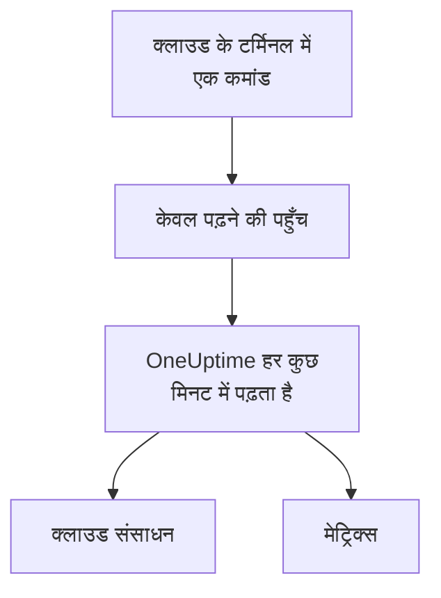

# क्लाउड खाता कनेक्ट करें

डैशबोर्ड से कोई AWS खाता, Azure सब्सक्रिप्शन या Google Cloud प्रोजेक्ट कनेक्ट करें, और OneUptime उसके संसाधनों की सूची बनाता है और तय समय पर उनके मुख्य मेट्रिक्स पढ़ता है। आप अपने क्लाउड के ब्राउज़र टर्मिनल में एक कमांड चलाते हैं और जो वह प्रिंट करे उसे पेस्ट करते हैं: न कोई कलेक्टर चलाना है, न कुछ इंस्टॉल करना है।

:::cards
- [Amazon Web Services](#amazon-web-services): एक IAM भूमिका जिससे OneUptime साइन इन करता है, या एक एक्सेस कुंजी।
- [Microsoft Azure](#microsoft-azure): Monitoring Reader भूमिका वाला एक ऐप।
- [Google Cloud](#google-cloud): Monitoring Viewer भूमिका वाला एक सेवा खाता।
- [OneUptime क्या पढ़ता है](#oneuptime-क्या-पढ़ता-है): कौन-से संसाधन और मेट्रिक्स, कितनी बार, और इसकी लागत क्या है।
:::

## यह कैसे काम करता है



- **पहुँच केवल पढ़ सकती है।** कमांड ऐसी पहुँच बनाती है जो मेट्रिक्स पढ़ती है और कुछ नहीं: AWS पर तीन पढ़ने की क्रियाएँ, Azure पर **Monitoring Reader** भूमिका और Google Cloud पर **Monitoring Viewer** भूमिका। OneUptime की पहुँच रोकने के लिए इसे हटा दें।
- **OneUptime तय समय पर पढ़ता है।** Azure और Google Cloud के लिए हर 5 मिनट में और AWS के लिए हर 10 मिनट में, जब तक आप कनेक्ट करते समय कोई और अंतराल न चुनें।
- **हर संसाधन का अपना पेज होता है।** संसाधन **क्लाउड → सभी संसाधन** में अपने मुख्य मेट्रिक्स, स्वामियों और लेबल के साथ दिखते हैं, ठीक वैसे ही जैसे किसी कलेक्टर से रिपोर्ट किए गए संसाधन।

## शुरू करने से पहले

- **प्रोजेक्ट का स्वामी या एडमिन।** केवल वही क्लाउड खाते कनेक्ट, टेस्ट और संपादित कर सकते हैं।
- **आपके क्लाउड का टर्मिनल** (AWS CloudShell, Azure Cloud Shell या Google Cloud Shell), जिसमें ऐसा कोई व्यक्ति साइन इन हो जो IAM भूमिका या उपयोगकर्ता, ऐप पंजीकरण या सेवा खाता बना सकता हो।

## Amazon Web Services

:::steps
### AWS फ़ॉर्म खोलें

**क्लाउड → कनेक्ट करें** पर जाएँ और **Amazon Web Services** चुनें।

### AWS CloudShell में कमांड चलाएँ

चुनें कि OneUptime कैसे साइन इन करे। **IAM भूमिका** अनुशंसित तरीका है: कुछ भी गोपनीय संग्रहीत नहीं होता, और आप भूमिका को कभी भी हटा सकते हैं। फ़ॉर्म आपके प्रोजेक्ट के लिए लिखी कमांड दिखाता है: यह ऐसी भूमिका बनाती है जो आपके प्रोजेक्ट की बाहरी ID के साथ OneUptime के AWS खाते पर भरोसा करती है, और भूमिका का ARN प्रिंट करती है। जब भूमिका संभव न हो, तो **एक्सेस कुंजी** का उपयोग करें। यह कमांड समान अनुमतियों वाला उपयोगकर्ता बनाती है और उसकी कुंजी प्रिंट करती है:

```bash
aws iam create-user --user-name OneUptimeReadOnly > /dev/null 2>&1 || true
aws iam put-user-policy --user-name OneUptimeReadOnly --policy-name OneUptimeReadOnly --policy-document '{"Version":"2012-10-17","Statement":[{"Effect":"Allow","Action":["cloudwatch:GetMetricData","cloudwatch:ListMetrics","tag:GetResources"],"Resource":"*"}]}'
aws iam create-access-key --user-name OneUptimeReadOnly
```

### AWS कमांड ने जो प्रिंट किया उसे पेस्ट करें

कमांड ने जो कुछ प्रिंट किया, वह सब **कमांड ने क्या प्रिंट किया** में पेस्ट करें। OneUptime उसमें से भूमिका का ARN, या एक्सेस कुंजी ID और उसका सीक्रेट निकाल लेता है।

### AWS का परीक्षण करें और कनेक्ट करें

यह चरण खुलते ही OneUptime कनेक्शन का परीक्षण करता है: साइन इन करता है, मिले संसाधनों को गिनता है और बताता है कि उन्हें पढ़ने की लागत क्या है। सहेजने के लिए **कनेक्ट करें** चुनें।
:::

यह भूमिका और उपयोगकर्ता तीन काम कर सकते हैं, और कुछ नहीं:

| क्रिया | OneUptime इसका उपयोग किसलिए करता है |
| --- | --- |
| `cloudwatch:ListMetrics` | हर क्षेत्र में मेट्रिक्स रिपोर्ट करने वाले संसाधन ढूँढना |
| `cloudwatch:GetMetricData` | उनके मुख्य मेट्रिक्स पढ़ना |
| `tag:GetResources` | हर संसाधन को उसके `Name` टैग से नाम देना |

> [!NOTE]
> सेल्फ़-होस्टेड OneUptime पर, **IAM भूमिका** वाले तरीके के लिए OneUptime की अपनी AWS पहचान चाहिए: `CLOUD_CONNECT_AWS_ACCESS_KEY_ID` और `CLOUD_CONNECT_AWS_SECRET_ACCESS_KEY` को ऐसे IAM उपयोगकर्ता की कुंजी पर सेट करें जो `sts:AssumeRole` कॉल कर सके। इनके बिना, फ़ॉर्म **एक्सेस कुंजी** देता है।

## Microsoft Azure

:::steps
### Azure फ़ॉर्म खोलें

**क्लाउड → कनेक्ट करें** पर जाएँ और **Microsoft Azure** चुनें।

### Azure Cloud Shell में कमांड चलाएँ

यह कमांड आपके मौजूदा सब्सक्रिप्शन पर **Monitoring Reader** भूमिका वाला ऐप बनाती है, और उसका विवरण प्रिंट करती है:

```bash
az ad sp create-for-rbac --name OneUptimeReadOnly --role "Monitoring Reader" --scopes "/subscriptions/$(az account show --query id --output tsv)"
```

### Azure कमांड ने जो प्रिंट किया उसे पेस्ट करें

कमांड ने जो कुछ प्रिंट किया, वह सब **कमांड ने क्या प्रिंट किया** में पेस्ट करें। OneUptime उसमें से `tenant`, `appId` और `password` निकाल लेता है।

### Azure का परीक्षण करें और कनेक्ट करें

यह चरण खुलते ही OneUptime कनेक्शन का परीक्षण करता है। सहेजने के लिए **कनेक्ट करें** चुनें।
:::

उसी ऐप से और सब्सक्रिप्शन पढ़ने के लिए, हर सब्सक्रिप्शन पर उसे भूमिका दें:

```bash
az role assignment create --assignee <APP_ID> --role "Monitoring Reader" --scope /subscriptions/<SUBSCRIPTION_ID>
```

OneUptime वे सभी सब्सक्रिप्शन पढ़ता है जिन्हें ऐप पढ़ सकता है, जब तक आप **सब्सक्रिप्शन** में कुछ सूचीबद्ध न करें।

## Google Cloud

:::steps
### Google Cloud फ़ॉर्म खोलें

**क्लाउड → कनेक्ट करें** पर जाएँ और **Google Cloud** चुनें।

### Google Cloud Shell में कमांड चलाएँ

इसे उस प्रोजेक्ट में चलाएँ जिसकी निगरानी करनी है। यह Cloud Monitoring API चालू करती है, **Monitoring Viewer** भूमिका वाला सेवा खाता बनाती है, और उसकी कुंजी प्रिंट करती है:

```bash
PROJECT_ID=$(gcloud config get-value project)
gcloud services enable monitoring.googleapis.com
gcloud iam service-accounts create oneuptime-read-only --display-name "OneUptime (read only)"
gcloud projects add-iam-policy-binding "$PROJECT_ID" --member "serviceAccount:oneuptime-read-only@$PROJECT_ID.iam.gserviceaccount.com" --role roles/monitoring.viewer --condition=None > /dev/null
gcloud iam service-accounts keys create oneuptime-key.json --iam-account "oneuptime-read-only@$PROJECT_ID.iam.gserviceaccount.com"
cat oneuptime-key.json && rm oneuptime-key.json
```

### कुंजी पेस्ट करें

कमांड ने जो कुछ प्रिंट किया, वह सब पेस्ट करें। OneUptime कुंजी का अपना प्रोजेक्ट पढ़ता है, और कुंजी को एन्क्रिप्ट करके संग्रहीत करता है।

### Google Cloud का परीक्षण करें और कनेक्ट करें

यह चरण खुलते ही OneUptime कनेक्शन का परीक्षण करता है। सहेजने के लिए **कनेक्ट करें** चुनें।
:::

उसी सेवा खाते से और प्रोजेक्ट पढ़ने के लिए, हर प्रोजेक्ट में उसे भूमिका दें और उन्हें **परियोजनाएँ** में सूचीबद्ध करें:

```bash
gcloud projects add-iam-policy-binding <PROJECT_ID> --member "serviceAccount:oneuptime-read-only@<KEY_PROJECT_ID>.iam.gserviceaccount.com" --role roles/monitoring.viewer
```

## OneUptime क्या पढ़ता है

| | AWS | Azure | Google Cloud |
| --- | --- | --- | --- |
| संसाधन | वे जो आपके इस्तेमाल किए हर क्षेत्र में CloudWatch को मेट्रिक्स रिपोर्ट करते हैं | सब्सक्रिप्शन का हर संसाधन | वे जो Cloud Monitoring को मेट्रिक्स रिपोर्ट करते हैं |
| मेट्रिक्स | हर सेवा के मुख्य मेट्रिक्स, जैसे किसी इंस्टेंस का CPU, नेटवर्क और स्थिति जाँच | हर संसाधन के लिए अधिकतम 8 मुख्य मेट्रिक्स | हर संसाधन प्रकार के मुख्य मेट्रिक्स |
| हर इतने समय में पढ़ा जाता है | 10 मिनट | 5 मिनट | 5 मिनट |
| हटाया गया संसाधन | 7 दिन तक मेट्रिक्स न आने पर संग्रहीत | अगली रीडिंग पर संग्रहीत | 7 दिन तक मेट्रिक्स न आने पर संग्रहीत |

हर रीडिंग वहीं से शुरू होती है जहाँ पिछली रुकी थी, इसलिए हर डेटा पॉइंट एक ही बार लिखा जाता है। नए कनेक्शन की पहली रीडिंग एक मिनट के भीतर शुरू होती है और एक घंटा पीछे तक जाती है; किसी विराम के बाद, एक रीडिंग अधिकतम 6 घंटे पीछे तक जाती है।

OneUptime की कॉल का बिल आपके क्लाउड खाते में, आपके क्लाउड की कीमतों पर आता है। परीक्षण मिली चीज़ों की लागत का अनुमान लगाता है, और कम बार पढ़ने से लागत कम होती है: **और फ़ील्ड** में **मेट्रिक्स पढ़ने का अंतराल** बदलें।

| क्लाउड | कीमत |
| --- | --- |
| AWS | CloudWatch `GetMetricData`: हर 1,000 मेट्रिक्स पर $0.01, और किसी संसाधन का हर मुख्य मेट्रिक हर रीडिंग में एक मेट्रिक गिना जाता है |
| Azure | हर सब्सक्रिप्शन के लिए हर महीने पहली 1,000,000 मेट्रिक रीडिंग मुफ़्त हैं, फिर हर 1,000 पर $0.01 |
| Google Cloud | हर महीने पढ़ी गई पहली 1,000,000 टाइम सीरीज़ मुफ़्त हैं, फिर हर दस लाख पर $0.50 |

## समस्या निवारण

:::details परीक्षण बताता है कि कुंजी या सीक्रेट स्वीकार नहीं हुआ
कमांड ने जो कुछ प्रिंट किया, वह सब कॉपी करें और फिर से पेस्ट करें। एक मिनट पहले बनी कुंजी को काम करने में एक मिनट लग सकता है।
:::

:::details परीक्षण साइन इन करता है, पर पढ़ नहीं पाता
कमांड फिर से चलाएँ: यह OneUptime को ज़रूरी भूमिका देती है। AWS पर, वही कमांड चलाएँ जो फ़ॉर्म इस प्रोजेक्ट के लिए दिखाता है: किसी दूसरे प्रोजेक्ट के लिए बनी भूमिका उस प्रोजेक्ट की बाहरी ID पर भरोसा करती है, इस प्रोजेक्ट की नहीं।
:::

:::details Google Cloud कमांड को कुंजी बनाने नहीं देता
एक संगठन नीति, `iam.disableServiceAccountKeyCreation`, सेवा खाता कुंजियों पर रोक लगा सकती है। अपने संगठन के एडमिन से प्रोजेक्ट के लिए छूट माँगें, या [अपने खुद के कलेक्टर से मेट्रिक्स भेजें](/docs/telemetry/cloud-resources)।
:::

:::details कोई संसाधन नहीं दिखता
AWS और Google Cloud पर, कोई संसाधन मेट्रिक्स रिपोर्ट करते ही दिखता है। अगर कोई कनेक्शन काम नहीं कर रहा, तो **क्लाउड → कनेक्ट करें** में **View error** बताता है कि उसकी पिछली रीडिंग क्यों विफल हुई।
:::

## अगले कदम

:::cards
- [क्लाउड संसाधन](/docs/telemetry/cloud-resources): इसके बजाय अपना OpenTelemetry Collector चलाएँ, या CloudWatch मेट्रिक्स स्ट्रीम करें।
- [मेट्रिक्स मॉनिटर](/docs/monitor/metrics-monitor): किसी संसाधन के मेट्रिक्स पर अलर्ट पाएँ।
:::
