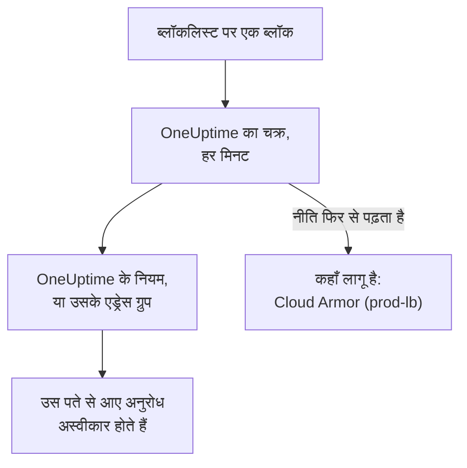

# Cloud Armor में पते ब्लॉक करें

आपके प्रोजेक्ट की ब्लॉकलिस्ट आपके लोड बैलेंसर की Google Cloud Armor सुरक्षा नीतियों में लागू की जा सकती है। इसे अपने किसी मौजूदा Google Cloud कनेक्शन के लिए चालू करें, सुरक्षा नीतियाँ चुनें, और ब्लॉकलिस्ट जिस भी पते को ब्लॉक करती है, वह वहाँ भी ब्लॉक हो जाता है, चाहे उसे किसी व्यक्ति ने ब्लॉक किया हो, किसी प्लेबुक ने या OneUptime AI ने।

:::cards
- [इसे चालू करें](#इसे-चालू-करें): Google Cloud कनेक्शन पर एक सेटिंग, और वह भूमिका जिसकी उसे ज़रूरत है।
- [OneUptime क्या बनाता है](#oneuptime-क्या-बनाता-है): हर नीति में उसके अपने नियम, या Cloud Armor Enterprise के साथ एड्रेस ग्रुप।
- [किस पते का मिलान होता है](#किस-पते-का-मिलान-होता-है): वह पता जो कनेक्ट हुआ, या प्रॉक्सी के पीछे का उपयोगकर्ता IP।
:::

## यह कैसे काम करता है

OneUptime आपकी चुनी हर सुरक्षा नीति में अपने नियम रखता है, और ब्लॉकलिस्ट जिन पतों को ब्लॉक करती है उन्हें उनमें डालता है। हर मिनट वह, एक बार में एक नियम, वही बदलता है जो बदला है, फिर नीति को वापस पढ़ता है। **ब्लॉकलिस्ट** पेज पर किसी ब्लॉक के **कहाँ लागू है** कॉलम में Cloud Armor (prod-lb) तभी दिखता है जब नीति में वह ब्लॉक मौजूद हो; तब तक वह ब्लॉक लागू नहीं होता।

## शुरू करने से पहले

- OneUptime से कनेक्ट किया गया एक Google Cloud प्रोजेक्ट (देखें [क्लाउड खाता कनेक्ट करें](/docs/telemetry/cloud-accounts#google-cloud))।
- ऐसी भूमिका जो बदल सके कि ब्लॉकलिस्ट कहाँ लागू हो: **प्रोजेक्ट स्वामी**, **प्रोजेक्ट एडमिन** या **सुरक्षा एडमिन**।
- कोई ऐसा व्यक्ति जो Google Cloud प्रोजेक्ट में भूमिकाएँ बना और दे सके, ताकि Cloud Shell में एक कमांड चलाई जा सके।

## इसे चालू करें

:::steps
### कनेक्शन खोलें
**क्लाउड → कनेक्ट करें** खोलें और Google Cloud कनेक्शन संपादित करें।

### सेटिंग चालू करें
**और फ़ील्ड** में, **Cloud Armor में पते ब्लॉक करें** को **चालू** पर सेट करें, और सहेजें। फ़ॉर्म अब जो सेटअप कमांड दिखाता है, वह नीचे दी गई भूमिका वहीं देता है जहाँ वह बाकी भूमिकाएँ देता है। आपके मौजूदा कनेक्शन को इसे फिर से चलाने की ज़रूरत नहीं है: **WAF जोड़ें** डायलॉग वे पंक्तियाँ देता है जो यह भूमिका नीति के प्रोजेक्ट में देती हैं।

### सुरक्षा नीतियाँ जोड़ें
**सुरक्षा इवेंट → प्लेबुक → ब्लॉकलिस्ट** खोलें। **क्लाउड WAF** के अंदर **WAF जोड़ें** पर क्लिक करें और कोई सुरक्षा नीति चुनें। OneUptime कुछ भी लिखे बिना Google Cloud से पूछता है कि कनेक्शन उसमें लिख सकता है या नहीं।

### भूमिका दें, अगर वह नहीं है
जब कोई अनुमति नहीं होती, तो डायलॉग वे पंक्तियाँ दिखाता है जो उसे नीति के प्रोजेक्ट में देती हैं। उन्हें Cloud Shell में चलाएँ, **फिर से जाँचें** पर क्लिक करें, फिर नीति जोड़ें। OneUptime के उसे सेट कर लेने के बाद उसकी **स्थिति** में **लागू है** दिखता है।
:::

सुरक्षा नीतियाँ कनेक्शन की इन्वेंट्री से आती हैं: जिसे OneUptime ने अभी तक नहीं पढ़ा है, वह अगली रीडिंग के बाद दिखती है। जब तक कोई नीति ब्लॉकलिस्ट लागू करती है, उसके कनेक्शन की सेटिंग बंद नहीं की जा सकती और कनेक्शन हटाया नहीं जा सकता: पहले नीति हटाएँ, ताकि OneUptime अपने नियम निकाल ले।

## OneUptime क्या बनाता है

जब आप कोई नीति जोड़ते हैं, तब OneUptime तय करता है कि वह नीति ब्लॉकलिस्ट को कैसे रखेगी।

| क्या | नाम | कहाँ |
| --- | --- | --- |
| 403 के साथ अस्वीकार करने वाले नियम, हर एक में अधिकतम 10 पते या रेंज | इनका विवरण `OneUptime blocklist <project> #1`, `#2`, ... से शुरू होता है | आपकी चुनी हर नीति में, अधिकतम 20। |
| दो एड्रेस ग्रुप, IPv4 और IPv6 | `oneuptime-<project>-block-ipv4`, `oneuptime-<project>-block-ipv6` | ग्लोबल, नीति के प्रोजेक्ट में। केवल Cloud Armor Enterprise के साथ। |
| एक नियम जो किसी भी ग्रुप में मौजूद हर चीज़ को 403 के साथ अस्वीकार करता है | इसका विवरण `OneUptime blocklist <project>, address groups` से शुरू होता है | आपकी चुनी हर ग्लोबल बैकएंड नीति में, Cloud Armor Enterprise के साथ। |

`<project>` आपके प्रोजेक्ट की बाहरी ID के पहले आठ अक्षर हैं, इसलिए एक ही नीति चुनने वाले दो OneUptime प्रोजेक्ट कभी एक-दूसरे के नियम नहीं लिखते। Cloud Armor किसी नियम को केवल उसकी प्राथमिकता से पहचानता है, इसलिए OneUptime अपने नियमों को उनके विवरण से पहचानता है।

- **नियम।** Cloud Armor एक नियम में 10 पते या रेंज रखता है, इसलिए एक नीति OneUptime के 20 नियमों में अधिकतम 200 ब्लॉक रखती है; जो ब्लॉक इसमें नहीं समाता, वह अपनी पंक्ति में यह बताता है।
- **एड्रेस ग्रुप।** Cloud Armor Enterprise वाले प्रोजेक्ट की ग्लोबल बैकएंड नीति इसके बजाय ब्लॉकलिस्ट को दो एड्रेस ग्रुप में रखती है: 10,000 IPv4 और 2,000 IPv6 रेंज। प्रोजेक्ट की हर ऐसी नीति इन्हें साझा करती है, और हर नीति में एक नियम उनमें मौजूद चीज़ों को अस्वीकार करता है। ये ग्रुप प्रोजेक्ट के एड्रेस ग्रुप कोटा की 16,000 इकाइयाँ लेते हैं।

OneUptime Cloud Armor के नियम तरीकों से अपने हर नियम को अलग से जोड़ता, बदलता और हटाता है: वह कभी पूरी नीति एक साथ नहीं लिखता, और आपका कोई नियम कभी नहीं लिखता। अकेला पता `/32` या `/128` के रूप में लिखा जाता है।

## नीति में नियमों की जगह

OneUptime अपने नियम अनुरोध को आगे जाने देने वाले आपके पहले नियम से पहले की खाली प्राथमिकताओं पर रखता है, सबसे कम से शुरू करके, ताकि आपका कोई भी नियम ब्लॉक किए गए पते को आगे न जाने दे: यानी ऐसा नियम जो अनुमति देता है, थ्रॉटल करता है, दर के आधार पर बैन करता है या उचित हिस्सा बाँटता है। आपका कोई नियम जो अस्वीकार करता है, पहले आ सकता है। OneUptime आपके किसी नियम को न कभी नया नंबर देता है, न बदलता है, न हटाता है: जब आपके ऐसे पहले नियम से पहले कोई प्राथमिकता खाली नहीं होती, तो नीति **कोई खाली प्राथमिकता नहीं** दिखाती है, और जैसे ही आप एक खाली करते हैं, OneUptime अपना नियम जोड़ देता है।

## किस पते का मिलान होता है

| सुरक्षा नीति | क्लाइंट का पता | इसे कब चुनें |
| --- | --- | --- |
| बैकएंड | **वह पता जो लोड बैलेंसर से कनेक्ट हुआ (origin.ip)** | डिफ़ॉल्ट। |
| बैकएंड | नीति के अनुरोध हेडर से उपयोगकर्ता IP (origin.user_ip) | किसी दूसरे प्रॉक्सी या CDN के पीछे के लोड बैलेंसर के लिए। |
| एज | वह पता जो लोड बैलेंसर से कनेक्ट हुआ (origin.ip) | इकलौता विकल्प: एज नीति कोई दूसरा पता नहीं पढ़ती। |

`origin.user_ip` नीति के उपयोगकर्ता IP अनुरोध हेडर (`userIpRequestHeaders`) में मौजूद पता है, जिन्हें लोड बैलेंसर के सामने का कोई प्रॉक्सी या CDN लिखता है। अगर कोई हेडर सेट नहीं है, या उनमें कोई मान्य पता नहीं है, तो यह `origin.ip` होता है। इसे तभी चुनें जब ऐसा कोई प्रॉक्सी उन्हें लिखता हो, क्योंकि जो क्लाइंट सीधे लोड बैलेंसर तक पहुँचता है, वह उन्हें ख़ुद लिख सकता है। यह विकल्प **WAF जोड़ें** डायलॉग में **और फ़ील्ड** के अंदर है, और आप इसे बाद में नीति की पंक्ति पर **क्लाइंट का पता** से बदल सकते हैं।

पासथ्रू नेटवर्क लोड बैलेंसर के लिए नेटवर्क एज सुरक्षा नीति नहीं चुनी जा सकती, और **WAF जोड़ें** डायलॉग बताता है कि क्यों: इसके नियम अनुरोधों का नहीं, पैकेट का मिलान करते हैं।

Cloud Armor में OneUptime के नियम केवल अस्वीकार करते हैं। जो ब्लॉक किसी पते को चैलेंज करने को कहता है, वह Cloud Armor में लागू नहीं होता, और यह बताता है। किसी स्वचालित प्रतिक्रिया नीति का चैलेंज वहाँ उतने ही समय के ब्लॉक के रूप में लागू होता है।

## जब कोई नियम हाथ से बदला जाता है

जब कोई OneUptime के किसी नियम को पूर्वावलोकन मोड में डालता है, उसे बदलता है या हटाता है, या उसका कोई एड्रेस ग्रुप हटाता है, तो OneUptime उसे वैसा ही छोड़ देता है जैसा उन्होंने छोड़ा। नीति **हाथ से बदला गया** दिखाती है, और उसमें रहे ब्लॉक, कारण के साथ, तब तक लागू नहीं होते जब तक कोई नीति की पंक्ति पर **वापस लगाएँ** पर क्लिक नहीं करता। वापस लगाएँ नियम को फिर से वैसे लिखता है जैसे OneUptime उसे लिखता है, उसकी अपनी प्राथमिकता पर, जब तक वह खाली हो, और हटाया गया एड्रेस ग्रुप फिर से बनाता है।

OneUptime यह नहीं जाँचता कि कोई नीति किसी बैकएंड सेवा से जुड़ी है या नहीं। जो नीति किसी से भी जुड़ी नहीं है, वह कुछ भी ब्लॉक नहीं करती।

## Terraform में नीति प्रबंधित करें

`rule` ब्लॉक वाला `google_compute_security_policy` नीति के हर नियम का मालिक होता है, इसलिए उसका अगला plan OneUptime के नियम हटा देता है। अपने नियमों को `google_compute_security_policy_rule` रिसोर्स के रूप में रखें, जो दूसरे नियमों को नहीं छूते, या नीति के `lifecycle` ब्लॉक में `ignore_changes = [rule]` जोड़ें।

## अनुमतियां

सेटअप कमांड एक कस्टम भूमिका, `oneuptimeCloudArmorBlocklist`, वहाँ जोड़ता है जहाँ वह कनेक्शन की बाकी भूमिकाएँ देता है, और उसे कनेक्शन के सेवा खाते को देता है। **WAF जोड़ें** डायलॉग जो पंक्तियाँ दिखाता है, वे यही भूमिका नीति के प्रोजेक्ट में जोड़ती हैं। जो नीति ब्लॉकलिस्ट को एड्रेस ग्रुप में नहीं, नियमों में रखती है, उसे केवल अपनी अनुमतियाँ चाहिए।

| अनुमति | क्यों |
| --- | --- |
| `compute.securityPolicies.get`, `compute.securityPolicies.update` | ग्लोबल नीति पढ़ना और उसमें OneUptime के नियम बदलना। |
| `compute.regionSecurityPolicies.get`, `compute.regionSecurityPolicies.update` | क्षेत्रीय नीति पढ़ना और उसमें OneUptime के नियम बदलना। |
| `compute.globalOperations.get`, `compute.regionOperations.get` | किसी बदलाव के पूरा होने तक प्रतीक्षा करना। |
| `compute.projects.get` | यह पढ़ना कि प्रोजेक्ट में Cloud Armor Enterprise है या नहीं। |
| `networksecurity.addressGroups.get`, `networksecurity.addressGroups.list`, `networksecurity.addressGroups.create`, `networksecurity.addressGroups.update`, `networksecurity.addressGroups.delete`, `networksecurity.addressGroups.use` | OneUptime के एड्रेस ग्रुप बनाए रखना, और अपने नियम से उनका संदर्भ देना। केवल Cloud Armor Enterprise के साथ। |
| `networksecurity.operations.get` | किसी एड्रेस ग्रुप के बदलाव के पूरा होने तक प्रतीक्षा करना। |

यह भूमिका कोई नीति नहीं हटा सकती, और OneUptime कभी कुछ और नहीं लिखता। सेटअप कमांड Compute Engine और Network Security API भी चालू करता है।

## इसे हटाएँ

:::steps
### सुरक्षा नीति हटाएँ
**सुरक्षा इवेंट → प्लेबुक → ब्लॉकलिस्ट** पर, नीति की पंक्ति में **हटाएं** पर क्लिक करें। OneUptime नीति से अपने नियम निकाल देता है, और जब प्रोजेक्ट की कोई दूसरी नीति उसके एड्रेस ग्रुप इस्तेमाल नहीं करती, तब उन्हें मिटा देता है।

### सेटिंग बंद करें
कनेक्शन संपादित करें, **Cloud Armor में पते ब्लॉक करें** को **बंद** पर सेट करें, और सहेजें। जब कनेक्शन की कोई भी नीति ब्लॉकलिस्ट लागू नहीं करती, तब यह सेटिंग बंद की जा सकती है।
:::

जब OneUptime अब नीति में नहीं लिख सकता, तो **WAF हटाएँ** डायलॉग में **सिर्फ़ OneUptime से हटाएँ** चुनें। OneUptime नीति को ब्लॉकलिस्ट से हटा देता है और उन नियमों और एड्रेस ग्रुप के नाम बताता है जो उसने छोड़े हैं: जब तक आप उन्हें Google Cloud में नहीं हटाते, वे अपने अंदर के पतों को ब्लॉक करते रहते हैं।

## समस्या निवारण

:::details लागू नहीं है
नीति की स्थिति बताती है कि Google Cloud ने क्या जवाब दिया और क्या करना है। अस्वीकृति उस अनुमति का नाम बताती है जो नहीं है: **WAF जोड़ें** इस नीति के लिए जो पंक्तियाँ दिखाता है, उन्हें चलाएँ, फिर **फिर से जाँचें** पर क्लिक करें। कोटा के कारण हुई अस्वीकृति उस कोटा का नाम बताती है: Google Cloud से और कोटा माँगें, या वे नियम हटाएँ जिनका आप अब इस्तेमाल नहीं करते।
:::

:::details कोई खाली प्राथमिकता नहीं
अनुरोध को आगे जाने देने वाले आपके पहले नियम से पहले की हर प्राथमिकता भरी हुई है। उस नियम को ज़्यादा संख्या पर ले जाएँ, फिर **फिर से जाँचें** पर क्लिक करें।
:::

:::details कोई नीति सूची में नहीं है
OneUptime उन कनेक्शन की सुरक्षा नीतियाँ दिखाता है जिनकी सेटिंग चालू है, उन्हें पढ़ लेने के बाद। इसके बाद जोड़ी गई नीति कनेक्शन की अगली रीडिंग के बाद दिखती है।
:::

## अगले कदम

:::cards
- [सुरक्षा केस और प्लेबुक](/docs/telemetry/security-cases): किसी केस से कोई पता ब्लॉक करें, और उसका चरण जाँचा गया देखें।
- [क्लाउड खाता कनेक्ट करें](/docs/telemetry/cloud-accounts): वह कनेक्शन जिसका हिस्सा यह सेटिंग है।
:::
