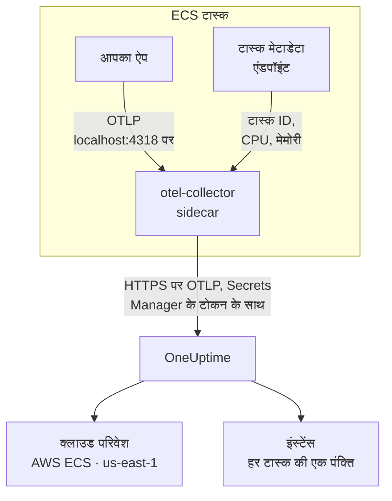

# AWS ECS / Fargate

अपने Amazon ECS टास्क के ट्रेस, लॉग और मेट्रिक्स OneUptime पर भेजें, Fargate और EC2 दोनों लॉन्च टाइप पर। `cloud.platform=aws_ecs` रिपोर्ट करने वाला हर टास्क हर AWS खाते और क्षेत्र के लिए एक **Cloud Environment** में आता है, जैसे _AWS ECS · us-east-1 · 123456789012_, चाहे उसमें एक सेवा चले या पचास।

:::cards
- [यह कैसे काम करता है](#यह-कैसे-काम-करता-है): ECS डिटेक्टर और sidecar कलेक्टर क्या करते हैं।
- [सेटअप करें](#सेटअप-करें): टोकन सहेजें, टास्क परिभाषा में सेटिंग्स जोड़ें, डिप्लॉय करें और जांचें।
- [पूरी टास्क परिभाषा](#पूरी-टास्क-परिभाषा): रजिस्टर करने के लिए एक पूरी Fargate टास्क परिभाषा।
- [समस्या निवारण](#समस्या-निवारण): PENDING में अटके टास्क, अस्वीकृत एक्सपोर्ट, खाली इंस्टेंस या टाइलें।
:::

## यह कैसे काम करता है



- **ECS डिटेक्टर परिवेश का नाम तय करता है।** SDK या कलेक्टर में मौजूद OpenTelemetry ECS रिसोर्स डिटेक्टर वह टास्क मेटाडेटा एंडपॉइंट पढ़ता है जो ECS हर कंटेनर को देता है, और टास्क जो कुछ भी भेजता है, उस पर खाता, क्षेत्र और टास्क लगा देता है। कुछ भी हार्ड-कोड नहीं होता।
- **टास्क हर इंस्टेंस का नाम तय करता है।** परिवेश का **इंस्टेंस** टैब चल रहे टास्क को टास्क ID के अनुसार दिखाता है, उनके CPU और मेमोरी के साथ।
- **sidecar कलेक्टर CPU और मेमोरी जोड़ता है।** इसका `awsecscontainermetrics` रिसीवर उसी एंडपॉइंट से हर टास्क का CPU और मेमोरी पढ़ता है, और टोकन इसी के पास रहता है, इसलिए एप्लिकेशन उसे कभी नहीं देखता।

ECS डिटेक्टर ये रिसोर्स एट्रिब्यूट सेट करता है:

| एट्रिब्यूट | ECS डिटेक्टर द्वारा सेट | किसलिए |
| ------------------------------------------------------------------ | ----------------------- | --------------------------------------------------------------------------------------------------------- |
| `cloud.platform` | `aws_ecs` | टेलीमेट्री को **क्लाउड परिवेश** में दर्ज करता है। मान बिल्कुल सटीक होना चाहिए |
| `cloud.account.id` | `123456789012` | एनवायरनमेंट कुंजी का हिस्सा |
| `cloud.region` | `us-east-1` | एनवायरनमेंट कुंजी का हिस्सा |
| `aws.ecs.task.arn` | टास्क ARN | अंत में मौजूद टास्क ID से **इंस्टेंस** में एक चल रहे टास्क का नाम रखता है |
| `aws.ecs.task.id` | टास्क ID | वही; नए डिटेक्टर संस्करण दोनों सेट करते हैं |
| `aws.ecs.cluster.arn`, `aws.ecs.task.family`, `aws.ecs.launchtype` | क्लस्टर और टास्क | हर स्पैन, लॉग और मेट्रिक पर खोज के लिए रखे जाते हैं; परिवेश का हिस्सा नहीं |

एनवायरनमेंट कुंजी `aws_ecs|123456789012|us-east-1` है। SDK के `service.instance.id` भी सेट करने पर भी टास्क ID ही इंस्टेंस का नाम रखता है: sidecar के कंटेनर मेट्रिक्स में सिर्फ़ टास्क ID होता है, इसलिए उसे कुंजी बनाने से किसी टास्क के स्पैन और उसका CPU और मेमोरी एक ही पंक्ति में रहते हैं। पूरा नियम [क्लाउड परिवेश](/docs/telemetry/cloud-environments) में देखें।

## शुरू करने से पहले

- **एक इंजेशन कुंजी।** **प्रोजेक्ट सेटिंग्स → टेलीमेट्री और APM → इंजेशन कुंजियाँ** में एक **सर्वर** कुंजी बनाएं और उसका टोकन कॉपी करें।
- **एक ECS क्लस्टर और एक टास्क परिभाषा जिसे आप संशोधित कर सकें**, और उस खाते के लिए कॉन्फ़िगर किया गया AWS CLI।
- **OpenTelemetry SDK से इंस्ट्रूमेंट किया गया आपका एप्लिकेशन**, जो OTLP एक्सपोर्ट करता हो, किसी भी भाषा में।

## चुनें कि टेलीमेट्री टास्क से कैसे बाहर जाए

| | Sidecar collector | SDK direct |
| ----------------------- | ---------------------------------------------- | ----------------------------------------------- |
| अतिरिक्त कंटेनर | हर टास्क में `otel-collector` | कोई नहीं |
| हर टास्क का CPU और मेमोरी | हाँ, `awsecscontainermetrics` रिसीवर से | नहीं |
| टोकन किसके पास | कलेक्टर | एप्लिकेशन |
| सीक्रेट में क्या है | सिर्फ़ टोकन | पूरा हेडर `x-oneuptime-token=...` |

ज़्यादातर टीमें sidecar कलेक्टर इस्तेमाल करती हैं: यह उन लाइब्रेरी की टेलीमेट्री पर भी `cloud.*` एट्रिब्यूट लगा देता है जो ECS के बारे में कुछ नहीं जानतीं। एक अकेली सेवा के लिए SDK direct सबसे आसान विकल्प है। नीचे हर चरण में दोनों के लिए एक टैब है; एक चुनें और हर चरण उसी का पालन करेगा।

## सेटअप करें

:::steps
### Secrets Manager में टोकन सहेजें

> [!IMPORTANT]
> टोकन एक सीक्रेट है। इसे AWS Secrets Manager में रखें और टास्क परिभाषा से `secrets` और `valueFrom` के ज़रिए इसका संदर्भ दें। किसी सामान्य `environment` प्रविष्टि में रखा टोकन टास्क परिभाषा पढ़ सकने वाले हर व्यक्ति को दिखता है, और हर `describe-task-definition` आउटपुट और CloudFormation diff में दिखाई देता है।

:::tabs
@tab Sidecar collector
```bash
aws secretsmanager create-secret \
  --name oneuptime/ingestion-token \
  --region us-east-1 \
  --secret-string "YOUR_TELEMETRY_INGESTION_TOKEN"
```

कलेक्टर का कॉन्फ़िगरेशन हेडर का नाम जोड़ता है, इसलिए इस सीक्रेट में सिर्फ़ टोकन रहता है।
@tab SDK direct
```bash
aws secretsmanager create-secret \
  --name oneuptime/ingestion-token \
  --region us-east-1 \
  --secret-string "x-oneuptime-token=YOUR_TELEMETRY_INGESTION_TOKEN"
```

ECS सीक्रेट का मान जैसा है वैसा ही वेरिएबल में डालता है, और `OTEL_EXPORTER_OTLP_HEADERS` को पूरा `name=value` जोड़ा चाहिए, इसलिए इस सीक्रेट में पूरा हेडर रहता है।
:::

कमांड जो ARN प्रिंट करता है, उसे नोट कर लें। यह एक रैंडम प्रत्यय पर खत्म होता है, जैसे `oneuptime/ingestion-token-AbCdEf`, और आप इसे टास्क परिभाषा में पेस्ट करते हैं।

### टास्क को सीक्रेट पढ़ने दें

टास्क एक्ज़ीक्यूशन रोल (वह रोल जिससे ECS टास्क शुरू करता है, न कि वह रोल जिसके रूप में आपका कोड चलता है) को सीक्रेट पढ़ने की अनुमति चाहिए। यह पॉलिसी `ecsTaskExecutionRole` से जोड़ें:

```json title="secret-access-policy.json"
{
  "Version": "2012-10-17",
  "Statement": [
    {
      "Effect": "Allow",
      "Action": ["secretsmanager:GetSecretValue"],
      "Resource": "arn:aws:secretsmanager:us-east-1:123456789012:secret:oneuptime/ingestion-token-*"
    }
  ]
}
```

अगर कोई ग्राहक-प्रबंधित KMS कुंजी सीक्रेट को एन्क्रिप्ट करती है, तो रोल को उस कुंजी पर `kms:Decrypt` भी चाहिए। इनमें से किसी के भी बिना टास्क शुरू नहीं होता: वह `ResourceInitializationError: unable to pull secrets` के साथ रुक जाता है।

### टास्क परिभाषा में सेटिंग्स जोड़ें

:::tabs
@tab Sidecar collector
1. **AWS Console → Amazon Elastic Container Service → Task definitions** → फ़ैमिली चुनें → **Create new revision**।
2. **Container - 1** (आपका एप्लिकेशन) के नीचे **Environment variables** खोलें और नीचे दिए एप्लिकेशन वेरिएबल जोड़ें।
3. **+ Add container**: नाम `otel-collector`, इमेज `otel/opentelemetry-collector-contrib:latest` (काम करने लगे तो एक संस्करण पिन करें), **Essential container: No**। **Docker configuration → Command** में `--config=env:OTEL_COLLECTOR_CONFIG` डालें।
4. कलेक्टर कंटेनर पर एनवायरनमेंट वेरिएबल `ONEUPTIME_TOKEN` को **Value type: ValueFrom** और सीक्रेट ARN के साथ जोड़ें, और `OTEL_COLLECTOR_CONFIG` को **Value type: Value** और नीचे दिए कलेक्टर कॉन्फ़िगरेशन के साथ।
5. एप्लिकेशन कंटेनर पर **Startup dependency ordering** के नीचे `otel-collector` को शर्त **Start** के साथ जोड़ें, ताकि पोर्ट 4318 पर कुछ सुनने से पहले एप्लिकेशन कभी शुरू न हो।
6. **Task execution role** के नीचे जांचें कि यह वही रोल है जिससे आपने पॉलिसी जोड़ी थी।

एप्लिकेशन वेरिएबल। `awsvpc` नेटवर्क मोड में (Fargate पर हमेशा) एक टास्क के कंटेनर एक ही नेटवर्क साझा करते हैं, इसलिए `localhost` ही sidecar है:

```bash
OTEL_SERVICE_NAME=checkout-api
OTEL_EXPORTER_OTLP_ENDPOINT=http://localhost:4318
OTEL_EXPORTER_OTLP_PROTOCOL=http/protobuf
```

कलेक्टर कॉन्फ़िगरेशन। कलेक्टर यह सब `OTEL_COLLECTOR_CONFIG` वेरिएबल से पढ़ता है, इसलिए इमेज में कोई फ़ाइल नहीं डालनी पड़ती, और यह `${env:ONEUPTIME_TOKEN}` को उस सीक्रेट से भरता है जो ECS इसके एनवायरनमेंट में डालता है:

```yaml title="OTEL_COLLECTOR_CONFIG"
receivers:
  otlp:
    protocols:
      http:
        endpoint: 0.0.0.0:4318
      grpc:
        endpoint: 0.0.0.0:4317
  # Per-task and per-container CPU / memory from the ECS task metadata
  # endpoint. This is what fills the CPU and memory tiles in OneUptime.
  awsecscontainermetrics:
    collection_interval: 20s
processors:
  # Stamps cloud.provider, cloud.platform=aws_ecs, cloud.account.id,
  # cloud.region and aws.ecs.task.arn on every span, log and metric.
  resourcedetection:
    detectors: [env, ecs]
    timeout: 5s
  batch: {}
exporters:
  otlphttp/oneuptime:
    endpoint: https://oneuptime.com/otlp
    headers:
      x-oneuptime-token: ${env:ONEUPTIME_TOKEN}
service:
  pipelines:
    traces:
      receivers: [otlp]
      processors: [resourcedetection, batch]
      exporters: [otlphttp/oneuptime]
    metrics:
      receivers: [otlp, awsecscontainermetrics]
      processors: [resourcedetection, batch]
      exporters: [otlphttp/oneuptime]
    logs:
      receivers: [otlp]
      processors: [resourcedetection, batch]
      exporters: [otlphttp/oneuptime]
```

न `ecs` डिटेक्टर को और न `awsecscontainermetrics` रिसीवर को किसी IAM अनुमति की ज़रूरत है: दोनों वह मेटाडेटा एंडपॉइंट पढ़ते हैं जो ECS हर कंटेनर को `ECS_CONTAINER_METADATA_URI_V4` में देता है।
@tab SDK direct
1. **AWS Console → Amazon Elastic Container Service → Task definitions** → फ़ैमिली चुनें → **Create new revision**।
2. **Container - 1** (आपका एप्लिकेशन) के नीचे **Environment variables** खोलें और नीचे दिए वेरिएबल जोड़ें। `OTEL_EXPORTER_OTLP_HEADERS` को **Value type: ValueFrom** और मान के रूप में सीक्रेट ARN के साथ जोड़ें।
3. नीचे की तालिका से वह स्विच जोड़ें जो आपकी भाषा का ECS रिसोर्स डिटेक्टर चालू करता है।
4. **Task execution role** के नीचे जांचें कि यह वही रोल है जिससे आपने पॉलिसी जोड़ी थी।

```bash
OTEL_SERVICE_NAME=checkout-api
OTEL_EXPORTER_OTLP_ENDPOINT=https://oneuptime.com/otlp
OTEL_EXPORTER_OTLP_PROTOCOL=http/protobuf
# Injected from Secrets Manager (secrets / valueFrom), not typed here.
OTEL_EXPORTER_OTLP_HEADERS=x-oneuptime-token=YOUR_TELEMETRY_INGESTION_TOKEN
```

| भाषा | ECS डिटेक्टर चालू करें |
| -------- | --------------------------------------------------------------------------------------------------------------- |
| Node.js | `OTEL_NODE_RESOURCE_DETECTORS=env,host,os,aws` (auto-instrumentations-node) |
| Python | `pip install opentelemetry-sdk-extension-aws`, फिर `OTEL_EXPERIMENTAL_RESOURCE_DETECTORS=aws_ecs` |
| Java | `-Dotel.resource.providers.aws.enabled=true` (एजेंट में यह प्रोवाइडर बंद आता है) |
| Go | `import "go.opentelemetry.io/contrib/detectors/aws/ecs"` और `ecs.NewResourceDetector()` को `resource.New` में पास करें |
| .NET | `OpenTelemetry.Resources.AWS` पैकेज: `.ConfigureResource(r => r.AddAWSECSDetector())` |

टास्क परिभाषा फ़ाइल में सीक्रेट यह है: `"secrets": [{ "name": "OTEL_EXPORTER_OTLP_HEADERS", "valueFrom": "<secret ARN>" }]`।
:::

अगर आप OneUptime को खुद होस्ट करते हैं, तो एंडपॉइंट के रूप में `https://YOUR-ONEUPTIME-HOST/otlp` इस्तेमाल करें।

### नया संशोधन डिप्लॉय करें

**Create** पर क्लिक करें, फिर **Clusters → your cluster → Services → select the service → Update → Task definition revision: latest → Deploy**। या CLI से:

```bash
aws ecs update-service \
  --cluster production \
  --service checkout-api \
  --task-definition checkout-api
```

### कनेक्शन जांचें

पहले टोकन जांचें: यह सबसे आसान जांच है, और इसके बिना आगे कुछ भी काम नहीं करता।

```bash
curl -i https://oneuptime.com/otlp/v1/validate \
  -H "x-oneuptime-token: YOUR_TELEMETRY_INGESTION_TOKEN"
```

`"valid": true` के साथ `200` का मतलब है कि टोकन स्वीकार हो गया। `401` का मतलब है कि टोकन अज्ञात, रद्द, निष्क्रिय या समाप्त है। यह साबित करने के लिए कि टास्क खुद OneUptime तक पहुँच सकता है, ECS Exec से टास्क के अंदर वही कमांड चलाएं:

```bash
aws ecs execute-command --cluster production --task <task id> \
  --container app --interactive --command "sh"
```

कलेक्टर की CloudWatch लॉग स्ट्रीम (`otel/otel-collector/...`) में `Everything is ready` दिखना चाहिए, और `401` या `connection refused` वाली कोई पंक्ति नहीं होनी चाहिए। पहला स्पैन, लॉग या मेट्रिक आने के एक मिनट के भीतर परिवेश **क्लाउड → All Environments** में _AWS ECS · us-east-1 · 123456789012_ के रूप में दिखता है।
:::

## पूरी टास्क परिभाषा

sidecar सेटअप एक फ़ाइल के रूप में, जिसे आप `aws ecs register-task-definition --cli-input-json file://task-definition.json` से रजिस्टर करते हैं। खाता ID, क्षेत्र, इमेज और सीक्रेट ARN बदलें:

```json title="task-definition.json"
{
  "family": "checkout-api",
  "requiresCompatibilities": ["FARGATE"],
  "networkMode": "awsvpc",
  "cpu": "512",
  "memory": "1024",
  "executionRoleArn": "arn:aws:iam::123456789012:role/ecsTaskExecutionRole",
  "taskRoleArn": "arn:aws:iam::123456789012:role/checkout-api-task-role",
  "containerDefinitions": [
    {
      "name": "app",
      "image": "123456789012.dkr.ecr.us-east-1.amazonaws.com/checkout-api:1.4.2",
      "essential": true,
      "portMappings": [{ "containerPort": 8080, "protocol": "tcp" }],
      "environment": [
        { "name": "OTEL_SERVICE_NAME", "value": "checkout-api" },
        {
          "name": "OTEL_EXPORTER_OTLP_ENDPOINT",
          "value": "http://localhost:4318"
        },
        { "name": "OTEL_EXPORTER_OTLP_PROTOCOL", "value": "http/protobuf" }
      ],
      "dependsOn": [
        { "containerName": "otel-collector", "condition": "START" }
      ],
      "logConfiguration": {
        "logDriver": "awslogs",
        "options": {
          "awslogs-group": "/ecs/checkout-api",
          "awslogs-region": "us-east-1",
          "awslogs-stream-prefix": "app"
        }
      }
    },
    {
      "name": "otel-collector",
      "image": "otel/opentelemetry-collector-contrib:latest",
      "essential": false,
      "command": ["--config=env:OTEL_COLLECTOR_CONFIG"],
      "secrets": [
        {
          "name": "ONEUPTIME_TOKEN",
          "valueFrom": "arn:aws:secretsmanager:us-east-1:123456789012:secret:oneuptime/ingestion-token-AbCdEf"
        }
      ],
      "environment": [
        {
          "name": "OTEL_COLLECTOR_CONFIG",
          "value": "receivers:\n  otlp:\n    protocols:\n      http:\n        endpoint: 0.0.0.0:4318\n      grpc:\n        endpoint: 0.0.0.0:4317\n  awsecscontainermetrics:\n    collection_interval: 20s\nprocessors:\n  resourcedetection:\n    detectors: [env, ecs]\n    timeout: 5s\n  batch: {}\nexporters:\n  otlphttp/oneuptime:\n    endpoint: https://oneuptime.com/otlp\n    headers:\n      x-oneuptime-token: ${env:ONEUPTIME_TOKEN}\nservice:\n  pipelines:\n    traces:\n      receivers: [otlp]\n      processors: [resourcedetection, batch]\n      exporters: [otlphttp/oneuptime]\n    metrics:\n      receivers: [otlp, awsecscontainermetrics]\n      processors: [resourcedetection, batch]\n      exporters: [otlphttp/oneuptime]\n    logs:\n      receivers: [otlp]\n      processors: [resourcedetection, batch]\n      exporters: [otlphttp/oneuptime]\n"
        }
      ],
      "logConfiguration": {
        "logDriver": "awslogs",
        "options": {
          "awslogs-group": "/ecs/checkout-api",
          "awslogs-region": "us-east-1",
          "awslogs-stream-prefix": "otel"
        }
      }
    }
  ]
}
```

`OTEL_COLLECTOR_CONFIG` का मान एक JSON स्ट्रिंग के रूप में कलेक्टर कॉन्फ़िगरेशन है। हाथ से एस्केप करने के बजाय YAML को `collector.yaml` में रखें और यह काम `jq` को करने दें:

```bash
jq --rawfile cfg collector.yaml \
  '.containerDefinitions[1].environment[0].value = $cfg' \
  task-definition.json > task-definition.rendered.json
aws ecs register-task-definition --cli-input-json file://task-definition.rendered.json
```

## नेटवर्किंग

टास्क को आपके VPC के बाहर दो चीज़ों तक पहुँचना होता है: शुरू होने के लिए Secrets Manager, और एक्सपोर्ट के लिए OneUptime।

- **निजी सबनेट में Fargate टास्क** को इंटरनेट तक एक रूट चाहिए: सबनेट की रूट टेबल पर एक NAT गेटवे, या `assignPublicIp=ENABLED` वाला सार्वजनिक सबनेट। इनमें से कुछ भी न होने पर टास्क सीक्रेट पर `PENDING` में अटक जाता है, कलेक्टर के कुछ भी भेजने से पहले।
- **सिक्योरिटी ग्रुप का आउटबाउंड नियम** OneUptime होस्ट के लिए TCP 443 की अनुमति दे: `oneuptime.com`, या आपका अपना होस्ट उस पोर्ट पर जिस पर वह सुनता है। डिफ़ॉल्ट सिक्योरिटी ग्रुप सारा आउटबाउंड ट्रैफ़िक अनुमति देता है; कसा हुआ ग्रुप अक्सर नहीं देता। टेलीमेट्री को किसी इनबाउंड नियम की ज़रूरत नहीं होती।
- `com.amazonaws.us-east-1.secretsmanager` (और इमेज खींचने के लिए `ecr.api`, `ecr.dkr` और S3) के लिए **VPC इंटरफ़ेस एंडपॉइंट** AWS कॉल को NAT रास्ते से दूर रखते हैं। OneUptime के लिए इंटरनेट तक का रूट फिर भी चाहिए।

```bash
aws ecs update-service \
  --cluster production \
  --service checkout-api \
  --task-definition checkout-api \
  --network-configuration "awsvpcConfiguration={subnets=[subnet-0abc1234],securityGroups=[sg-0def5678],assignPublicIp=ENABLED}"
```

## आपको क्या मिलता है

- **अवलोकन**: आपके ट्रेस से अनुरोध, त्रुटि दर और p95 लेटेंसी, **CPU** और **मेमोरी** टाइलें और **CPU के अनुसार शीर्ष इंस्टेंस**। टाइलें `awsecscontainermetrics` रिसीवर के `ecs.task.cpu.utilized` और `ecs.task.memory.utilized` से, या टास्क की पहचान वाले किसी भी `container.cpu.utilization` और `container.memory.usage` मेट्रिक से भरती हैं। SDK direct इनमें से कुछ नहीं भेजता।
- **इंस्टेंस**: हर चल रहे टास्क की एक पंक्ति, उसके टास्क ID (`aws.ecs.task.arn` का अंत) के नाम से, उसके नवीनतम CPU, मेमोरी और आखिरी बार देखे जाने के समय के साथ। जो टास्क रिपोर्ट करना बंद कर देता है, वह **Stale** हो जाता है।
- **लॉग**, **ट्रेस** और **मेट्रिक्स**: इस खाते और क्षेत्र के लिए `cloud.platform=aws_ecs` वाली हर चीज़।
- **सेवाएं**: वही टास्क, `service.name` के अनुसार बँटे हुए।

## समस्या निवारण

ECS की विफलताएँ, उसी क्रम में जिसमें वे होती हैं:

:::details कोई टास्क "unable to pull secrets" के साथ PENDING में अटका है
पूरी त्रुटि `ResourceInitializationError: unable to pull secrets` है। या तो टास्क एक्ज़ीक्यूशन रोल के पास सीक्रेट पर `secretsmanager:GetSecretValue` (या उसकी कुंजी पर `kms:Decrypt`) नहीं है, या टास्क के पास Secrets Manager तक कोई रूट नहीं है: न NAT गेटवे, न VPC एंडपॉइंट। देखें [नेटवर्किंग](#नेटवर्किंग)।
:::

:::details कलेक्टर 401 लॉग करता है
सीक्रेट में गलत मान है। sidecar कलेक्टर के लिए यह सिर्फ़ टोकन होना चाहिए; SDK direct के लिए पूरा हेडर `x-oneuptime-token=...`। टोकन को खुद [कनेक्शन जांचें](#कनेक्शन-जांचें) वाले कमांड से जांचें।
:::

:::details परिवेश दिखता है, लेकिन इंस्टेंस खाली है
टेलीमेट्री में कोई टास्क पहचान नहीं है। पक्का करें कि `ecs` डिटेक्टर चलता है: रिसोर्स पर `aws.ecs.task.arn`, `aws.ecs.task.id` या `service.instance.id` होना चाहिए।
:::

:::details इंस्टेंस भरते हैं, लेकिन CPU और मेमोरी टाइलें खाली रहती हैं
`awsecscontainermetrics` रिसीवर `metrics` पाइपलाइन में नहीं है, या वह पाइपलाइन `resourcedetection` प्रोसेसर को छोड़ देती है, इसलिए कंटेनर मेट्रिक्स `cloud.platform` के बिना आते हैं। SDK direct ये टाइलें कभी नहीं भरता।
:::

जो परिवेश कभी नहीं दिखता, **होस्ट** या **Serverless फ़ंक्शन** में पहुँच जाता है, **डिस्कनेक्टेड** दिखाता है या दो में बँट जाता है, उसे [क्लाउड समस्या निवारण](/docs/telemetry/cloud-troubleshooting) में कवर किया गया है।

## अगले कदम

:::cards
- [क्लाउड परिवेश](/docs/telemetry/cloud-environments): परिवेश और इंस्टेंस कैसे पहचाने जाते हैं।
- [क्लाउड समस्या निवारण](/docs/telemetry/cloud-troubleshooting): वे विफलताएँ जो हर प्लेटफ़ॉर्म में होती हैं।
- [क्लाउड संसाधन (IaaS और PaaS)](/docs/telemetry/cloud-resources): CloudWatch से आपके लोड बैलेंसर, RDS डेटाबेस और बकेट।
- [OpenTelemetry](/docs/telemetry/open-telemetry): अपने एप्लिकेशन को इंस्ट्रूमेंट करें, और एंडपॉइंट और सीमाएँ।
:::
