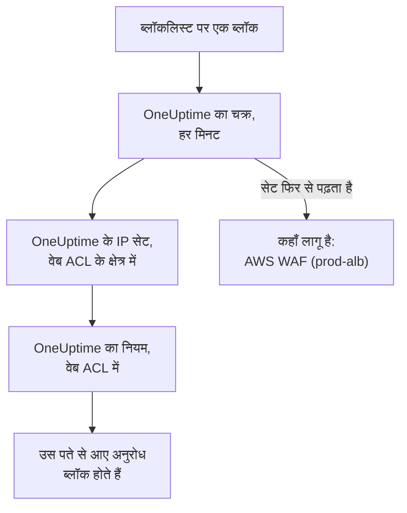

# AWS WAF में पते ब्लॉक करें

आपके प्रोजेक्ट की ब्लॉकलिस्ट उन AWS WAF वेब ACL में लागू की जा सकती है जो आपके CloudFront डिस्ट्रीब्यूशन, लोड बैलेंसर और API Gateway के सामने हैं। इसे अपने किसी मौजूदा AWS क्लाउड कनेक्शन के लिए चालू करें, वेब ACL चुनें, और ब्लॉकलिस्ट जिस भी पते को ब्लॉक करती है, वह वहाँ भी ब्लॉक हो जाता है, चाहे उसे किसी व्यक्ति ने ब्लॉक किया हो, किसी प्लेबुक ने या OneUptime AI ने।

:::cards
- [इसे चालू करें](#इसे-चालू-करें): AWS कनेक्शन पर एक सेटिंग, और उसका सेटअप कमांड फिर से।
- [OneUptime क्या बनाता है](#oneuptime-क्या-बनाता-है): हर क्षेत्र में चार IP सेट, और हर वेब ACL में दो नियम।
- [कोड में वेब ACL प्रबंधित करें](#कोड-में-वेब-acl-प्रबंधित-करें): Terraform या CloudFormation में नियम ख़ुद जोड़ें।
:::

## यह कैसे काम करता है

OneUptime हर उस क्षेत्र में अपने IP सेट रखता है जिसमें कोई चुना गया वेब ACL है, और हर वेब ACL में एक नियम रखता है जो उन सेट के पतों को ब्लॉक करता है। हर मिनट वह हर सेट में एक बार वह लिखता है जो ब्लॉकलिस्ट में है, फिर सेट को वापस पढ़ता है। **ब्लॉकलिस्ट** पेज पर किसी ब्लॉक के **कहाँ लागू है** कॉलम में AWS WAF (prod-alb) तभी दिखता है जब AWS WAF में वह ब्लॉक मौजूद हो और वेब ACL का नियम उसके सेट को ब्लॉक करता हो; तब तक वह ब्लॉक लागू नहीं होता।

## शुरू करने से पहले

- OneUptime से कनेक्ट किया गया एक AWS खाता (देखें [क्लाउड खाता कनेक्ट करें](/docs/telemetry/cloud-accounts#amazon-web-services))।
- ऐसी भूमिका जो बदल सके कि ब्लॉकलिस्ट कहाँ लागू हो: **प्रोजेक्ट स्वामी**, **प्रोजेक्ट एडमिन** या **सुरक्षा एडमिन**।
- कोई ऐसा व्यक्ति जो AWS खाते में कनेक्शन का सेटअप कमांड फिर से चला सके।

## इसे चालू करें

:::steps
### कनेक्शन खोलें
**क्लाउड → कनेक्ट करें** खोलें और AWS कनेक्शन संपादित करें।

### चुनें कि नियम कौन जोड़ेगा
**और फ़ील्ड** में, **AWS WAF में पते ब्लॉक करें** को **चालू, और OneUptime अपना नियम जोड़ता है** पर सेट करें, या अगर आपके वेब ACL Terraform या CloudFormation में प्रबंधित होते हैं तो **चालू, और नियम मेरे कोड में जोड़ा जाता है** पर।

### सेटअप कमांड फिर से चलाएँ
फ़ॉर्म अब जो कमांड दिखाता है, वह IP सेट की अनुमति देता है, और जब OneUptime नियम जोड़ता है तो नियम की भी। इसे AWS CloudShell में चलाएँ, फिर कनेक्शन सहेजें।

### वेब ACL जोड़ें
**सुरक्षा इवेंट → प्लेबुक → ब्लॉकलिस्ट** खोलें। **क्लाउड WAF** के अंदर **WAF जोड़ें** पर क्लिक करें, कोई वेब ACL चुनें और **और फ़ील्ड** में यह चुनें कि वह क्लाइंट का पता कहाँ से पढ़ता है, फिर उसे जोड़ें। OneUptime उसे तुरंत सेट कर देता है, और जब उसका नियम सेट को ब्लॉक करता है तो उसकी **स्थिति** में **लागू है** दिखता है।
:::

वेब ACL कनेक्शन की इन्वेंट्री से आते हैं: जिसे OneUptime ने अभी तक नहीं पढ़ा है, वह अगली रीडिंग के बाद दिखता है। जब तक कोई वेब ACL ब्लॉकलिस्ट लागू करता है, उसके कनेक्शन की सेटिंग न तो बंद की जा सकती है और न ही OneUptime के नियम जोड़ने से बदलकर कोड में नियम जोड़ने पर की जा सकती है, और कनेक्शन हटाया नहीं जा सकता: पहले वेब ACL हटाएँ, ताकि OneUptime अपना नियम निकाल ले।

## OneUptime क्या बनाता है

| क्या | नाम | कहाँ |
| --- | --- | --- |
| चार IP सेट: ब्लॉक और चैलेंज, IPv4 और IPv6 | `oneuptime-<project>-block-ipv4`, `oneuptime-<project>-block-ipv6`, `oneuptime-<project>-challenge-ipv4`, `oneuptime-<project>-challenge-ipv6` | हर उस क्षेत्र में जिसमें कोई चुना गया वेब ACL है। CloudFront के वेब ACL ग्लोबल होते हैं, और उनके सेट `us-east-1` में होते हैं। |
| दो नियम: एक ब्लॉक करता है, दूसरा चैलेंज करता है | `OneUptime-Blocklist-<project>`, `OneUptime-Challenge-<project>` | हर चुने गए वेब ACL में, जब OneUptime अपना नियम जोड़ता है। |

`<project>` आपके प्रोजेक्ट की बाहरी ID के पहले आठ अक्षर हैं, इसलिए एक ही खाते में दो OneUptime प्रोजेक्ट कभी एक-दूसरे के सेट में नहीं लिखते। एक क्षेत्र के वेब ACL सेट साझा करते हैं। अकेला पता `/32` या `/128` के रूप में लिखा जाता है। AWS WAF एक सेट में 10,000 पते रखता है, और एक क्षेत्र में 100 IP सेट, जब तक AWS ने आपके लिए यह सीमा न बढ़ाई हो; जो ब्लॉक इसमें नहीं समाता, वह अपनी पंक्ति में यह बताता है।

## वेब ACL में नियम की जगह

OneUptime अपने दो नियम ऐसी खाली प्राथमिकताओं पर रखता है जिनकी संख्या आपके पहले नियम से कम है, ताकि वे आपके लिखे नियमों से पहले चलें। वेब ACL में कोई नियम न हो तो वे प्राथमिकता 0 और 1 लेते हैं। OneUptime आपके किसी नियम को न कभी नया नंबर देता है, न बदलता है, न हटाता है: जब आपके पहले नियम से पहले दो प्राथमिकताएँ खाली नहीं होतीं, तो वेब ACL **कोई खाली प्राथमिकता नहीं** दिखाता है, और जैसे ही आप दो खाली करते हैं, OneUptime अपने नियम जोड़ देता है।

हर नियम तब मेल खाता है जब उसके सेट में से कोई एक, IPv4 या IPv6, क्लाइंट का पता रखता हो। AWS WAF किसी वेब ACL को पूरा एक साथ अपडेट करता है, इसलिए OneUptime उसे पढ़ता है, अपने नियम जोड़ता है और वेब ACL के लॉक टोकन के साथ उसे वापस लिखता है, और अगर बीच में किसी और ने उसे लिखा हो तो उसे फिर से पढ़ता है।

## फ़ॉरवर्ड किए गए पते

किसी दूसरे प्रॉक्सी या CDN के पीछे का वेब ACL क्लाइंट का नहीं, बल्कि प्रॉक्सी का पता देखता है। **क्लाइंट का पता** में चुनें कि वह क्लाइंट का पता कहाँ से पढ़े:

| क्लाइंट का पता | नियम क्या पढ़ता है |
| --- | --- |
| **अनुरोध का स्रोत पता** | वह पता जिससे अनुरोध आया। डिफ़ॉल्ट। |
| `X-Forwarded-For` हेडर का आख़िरी पता | वह पता जिसे आख़िरी प्रॉक्सी ने जोड़ा। उससे पहले का पता वह है जिसका दावा अनुरोध ने किया। |
| `CF-Connecting-IP` हेडर | वह इकलौता पता जिसे Cloudflare लिखता है। |
| `True-Client-IP` हेडर | वह इकलौता पता जिसे Akamai या Cloudflare Enterprise लिखता है। |

हेडर के बिना अनुरोध मेल नहीं खाता: AWS WAF किसी प्रॉक्सी का पता ब्लॉक करने के बजाय उसे जाने देता है।

## कोड में वेब ACL प्रबंधित करें

**चालू, और नियम मेरे कोड में जोड़ा जाता है** के साथ, OneUptime केवल IP सेट बनाता है और आपके वेब ACL में कभी नहीं लिखता। वेब ACL की पंक्ति पर **नियम दिखाएँ** पर क्लिक करें: यह दोनों नियम Terraform (`aws_wafv2_web_acl` के `rule` ब्लॉक) और CloudFormation के रूप में देता है, हर सेट के ARN और उस हेडर के साथ जिसे वेब ACL पढ़ता है। उन्हें अपने बाकी नियमों से पहले अपने कोड में जोड़ें और उसे लागू करें।

जब तक नियम वहाँ नहीं होते, वेब ACL **आपके नियम की प्रतीक्षा** दिखाता है, और उसके ब्लॉक लागू नहीं होते। OneUptime हर चक्र में वेब ACL पढ़ता है, और उसके ब्लॉक उस पहले चक्र से लागू होते हैं जिसे हर सेट को ब्लॉक करने वाला नियम मिल जाता है, चाहे आपने उसका नाम कुछ भी रखा हो।

## अनुमतियां

सेटअप कमांड भूमिका में एक इनलाइन नीति, `OneUptimeWafBlocklist`, जोड़ता है। एक्सेस कुंजी के साथ, उपयोगकर्ता की अपनी नीतियों पर IAM की सीमा के कारण यह नीति एक समूह, `OneUptimeWafBlocklist-<project>`, पर लगती है, जिसमें उपयोगकर्ता शामिल होता है।

| कार्रवाई | संसाधन | क्यों |
| --- | --- | --- |
| `wafv2:ListIPSets` | कोई भी | किसी क्षेत्र में OneUptime के IP सेट खोजना। |
| `wafv2:GetIPSet`, `wafv2:CreateIPSet`, `wafv2:UpdateIPSet`, `wafv2:DeleteIPSet` | केवल OneUptime के IP सेट (`oneuptime-<project>-*`) | सेट बनाए रखना, और किसी क्षेत्र का आख़िरी वेब ACL हटाने पर उन्हें मिटाना। |
| `wafv2:GetSampledRequests` | वेब ACL | उन अनुरोधों को पढ़ना जिन्हें किसी नियम ने लौटा दिया: वह सबूत जिससे किसी केस के ब्लॉक चरण की जाँच होती है। |
| `wafv2:UpdateWebACL` | वेब ACL, और वे IP सेट, regex सेट और नियम समूह जिनका वे संदर्भ देते हैं | OneUptime के नियम जोड़ना। केवल **चालू, और OneUptime अपना नियम जोड़ता है** के साथ। |

वेब ACL को पढ़ना, `wafv2:GetWebACL`, पहले से ही कनेक्शन की केवल-पढ़ने वाली नीति में है।

## इसे हटाएँ

:::steps
### वेब ACL हटाएँ
**सुरक्षा इवेंट → प्लेबुक → ब्लॉकलिस्ट** पर, वेब ACL की पंक्ति में **हटाएं** पर क्लिक करें। OneUptime वेब ACL से अपने नियम निकाल देता है, और जब क्षेत्र का कोई दूसरा वेब ACL उसके IP सेट इस्तेमाल नहीं करता, तब उन्हें खाली करके मिटा देता है।

### सेटिंग बंद करें
कनेक्शन संपादित करें, **AWS WAF में पते ब्लॉक करें** को **बंद** पर सेट करें, और सहेजें। जब कनेक्शन का कोई भी वेब ACL ब्लॉकलिस्ट लागू नहीं करता, तब यह सेटिंग बंद की जा सकती है।
:::

जब OneUptime अब वेब ACL में नहीं लिख सकता, तो **WAF हटाएँ** डायलॉग में **सिर्फ़ OneUptime से हटाएँ** चुनें। OneUptime वेब ACL को ब्लॉकलिस्ट से हटा देता है और उन नियमों और IP सेट के नाम बताता है जो उसने AWS WAF में छोड़े हैं: जब तक आप उन्हें वहाँ नहीं हटाते, वे अपने अंदर के पतों को ब्लॉक करते रहते हैं। आपका कोई नियम जो अब भी किसी सेट का संदर्भ देता है, उस सेट को भी बनाए रखता है: OneUptime उसे खाली कर देता है, और उसका नाम बताता है।

## समस्या निवारण

:::details लागू नहीं है
वेब ACL की स्थिति बताती है कि AWS ने क्या जवाब दिया और क्या करना है। अस्वीकृति उस कार्रवाई और उस सेटिंग का नाम बताती है जो उसकी अनुमति देती है: सेटिंग चालू करें, या **चालू, और OneUptime अपना नियम जोड़ता है** चुनें, फिर कनेक्शन का सेटअप कमांड फिर से चलाएँ और **फिर से जाँचें** पर क्लिक करें।
:::

:::details कोई खाली प्राथमिकता नहीं
आपका पहला नियम प्राथमिकता 0 या 1 पर है, इसलिए उससे पहले दो प्राथमिकताएँ खाली नहीं हैं। अपने नियमों की प्राथमिकता संख्या दो से बढ़ाएँ, फिर **फिर से जाँचें** पर क्लिक करें।
:::

:::details कोई वेब ACL सूची में नहीं है
OneUptime उन कनेक्शन के वेब ACL दिखाता है जिनकी सेटिंग चालू है, उन्हें पढ़ लेने के बाद। जो वेब ACL केवल अपने मेट्रिक्स से दिखे हैं, उनके लिए कनेक्शन का सेटअप कमांड फिर से चलाना होगा, जिससे OneUptime उन्हें पढ़ सके।
:::

## अगले कदम

:::cards
- [सुरक्षा केस और प्लेबुक](/docs/telemetry/security-cases): किसी केस से कोई पता ब्लॉक करें, और उसका चरण जाँचा गया देखें।
- [क्लाउड खाता कनेक्ट करें](/docs/telemetry/cloud-accounts): वह कनेक्शन जिसका हिस्सा यह सेटिंग है।
:::
