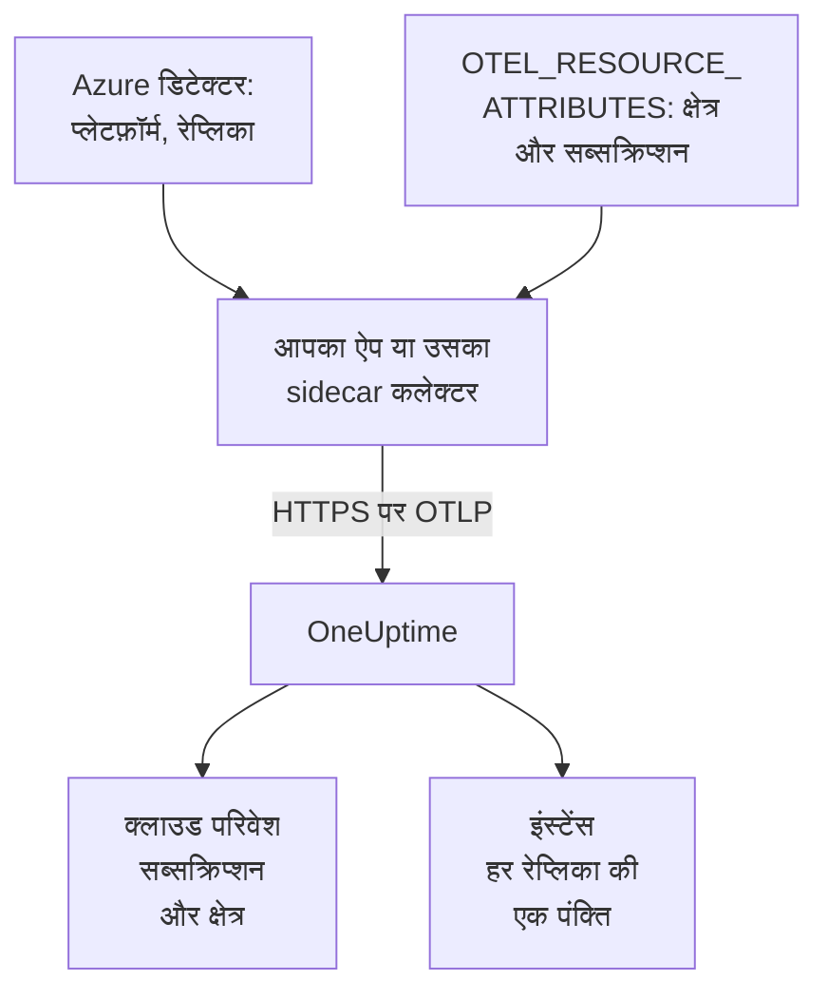

# Azure Container Apps

अपने Azure Container Apps के ट्रेस, लॉग और मेट्रिक्स OneUptime पर भेजें। `cloud.platform=azure_container_apps` रिपोर्ट करने वाली हर रेप्लिका हर Azure सब्सक्रिप्शन और क्षेत्र के लिए एक **Cloud Environment** में आती है, जैसे _Azure Container Apps · eastus · 00000000-0000-0000-0000-000000000000_, और चल रही रेप्लिका **इंस्टेंस** में दिखती हैं।

:::cards
- [यह कैसे काम करता है](#यह-कैसे-काम-करता-है): डिटेक्टर क्या सेट करते हैं, और वे दो एट्रिब्यूट जो आप खुद सेट करते हैं।
- [सेटअप करें](#सेटअप-करें): टोकन सहेजें, Azure CLI या पोर्टल से ऐप कॉन्फ़िगर करें, और जांचें।
- [परिवेश के प्रबंधित OpenTelemetry एजेंट का उपयोग करें](#परिवेश-के-प्रबंधित-opentelemetry-एजेंट-का-उपयोग-करें): बिना sidecar के परिवेश के हर ऐप का डेटा आगे भेजें।
- [समस्या निवारण](#समस्या-निवारण): अस्वीकृत एक्सपोर्ट, गायब परिवेश और खाली इंस्टेंस।
:::

## यह कैसे काम करता है



Container Apps के रिसोर्स डिटेक्टर हैं: कलेक्टर का `azurecontainerapps` डिटेक्टर, और Node.js (`@opentelemetry/resource-detector-azure`) व .NET (`OpenTelemetry.Resources.Azure`) वाले डिटेक्टर। ये `CONTAINER_APP_NAME` और `CONTAINER_APP_REPLICA_NAME` पढ़ते हैं, और `cloud.provider`, `cloud.platform`, `service.name` और रेप्लिका ID सेट करते हैं। इनमें से कोई भी क्षेत्र या सब्सक्रिप्शन नहीं जानता, इसलिए `cloud.region` और `cloud.account.id` आप खुद `OTEL_RESOURCE_ATTRIBUTES` में सेट करते हैं।

| एट्रिब्यूट | मान | किसलिए |
| --------------------------------- | ------------------------------------------------------------------------- | ------------------------------------------------------------ |
| `cloud.provider` | `azure` | अवलोकन पर दिखता है |
| `cloud.platform` | `azure_container_apps` | टेलीमेट्री को **क्लाउड परिवेश** में दर्ज करता है |
| `cloud.region` | परिवेश का क्षेत्र, जैसे `eastus`: आप सेट करते हैं | एनवायरनमेंट कुंजी का हिस्सा |
| `cloud.account.id` | सब्सक्रिप्शन ID: आप सेट करते हैं | एनवायरनमेंट कुंजी का हिस्सा |
| `azure.container_app.instance.id` | रेप्लिका का नाम, जिसे डिटेक्टर `CONTAINER_APP_REPLICA_NAME` से सेट करते हैं | एक चल रही रेप्लिका का नाम रखता है: **इंस्टेंस** में हर एक की एक पंक्ति |
| `service.instance.id` | रेप्लिका का नाम, अगर आप इसे खुद सेट करते हैं | तब इस्तेमाल होता है जब किसी डिटेक्टर ने रेप्लिका ID सेट नहीं किया |

- **बिंदु वाली वर्तनी भी चलती है।** Node.js और .NET डिटेक्टर प्लेटफ़ॉर्म को बिंदु के साथ `azure.container_apps` लिखते हैं। OneUptime इसे मिलते ही `azure_container_apps` में बदल देता है, इसलिए दोनों वर्तनियाँ एक ही परिवेश में आती हैं।
- **होस्टनेम ही रेप्लिका का नाम है।** जो SDK सिर्फ़ `host` डिटेक्टर चलाता है, वह रेप्लिका के नाम को `host.name` के रूप में रिपोर्ट करता है, और जब इससे ज़्यादा खास कुछ नहीं होता, तो OneUptime इसी से इंस्टेंस का नाम रखता है।

एनवायरनमेंट कुंजी `azure_container_apps|<subscription id>|eastus` है।

## शुरू करने से पहले

- **एक इंजेशन कुंजी।** **प्रोजेक्ट सेटिंग्स → टेलीमेट्री और APM → इंजेशन कुंजियाँ** में एक **सर्वर** कुंजी बनाएं और उसका टोकन कॉपी करें।
- **`containerapp` एक्सटेंशन वाला Azure CLI** (`az extension add --name containerapp --upgrade`), सब्सक्रिप्शन में साइन इन किया हुआ, या Azure पोर्टल।
- **OpenTelemetry SDK से इंस्ट्रूमेंट किया गया आपका एप्लिकेशन**, जो OTLP एक्सपोर्ट करता हो।

## चुनें कि टेलीमेट्री ऐप से कैसे बाहर जाए

| | SDK direct | Sidecar collector |
| ------------------ | ------------------------------------------- | ------------------------------------------------------------ |
| अतिरिक्त कंटेनर | कोई नहीं | ऐप में `otel-collector`, जो रेप्लिका का CPU और मेमोरी साझा करता है |
| एट्रिब्यूट कौन सेट करता है | SDK और ऐप पर `OTEL_RESOURCE_ATTRIBUTES` | कलेक्टर, उससे गुज़रने वाली हर चीज़ के लिए |
| सीक्रेट | `oneuptime-otlp-headers`, पूरा हेडर | `oneuptime-token`, सिर्फ़ टोकन |

तीसरा तरीका, परिवेश का प्रबंधित OpenTelemetry एजेंट, बिना sidecar के परिवेश के हर ऐप का डेटा आगे भेजता है: देखें [परिवेश के प्रबंधित OpenTelemetry एजेंट का उपयोग करें](#परिवेश-के-प्रबंधित-opentelemetry-एजेंट-का-उपयोग-करें)। नीचे हर चरण में SDK direct और sidecar कलेक्टर के लिए एक-एक टैब है; एक चुनें और हर चरण उसी का पालन करेगा।

## सेटअप करें

:::steps
### टोकन को Container Apps सीक्रेट के रूप में सहेजें

> [!IMPORTANT]
> टोकन एक सीक्रेट है। इसे Container Apps सीक्रेट के रूप में सहेजें और एनवायरनमेंट वेरिएबल से `secretref:` के ज़रिए इसका संदर्भ दें। एक बार सेट होने के बाद सीक्रेट `az containerapp show` में या पोर्टल में नहीं दिखता; सामान्य एनवायरनमेंट वेरिएबल दिखता है।

:::tabs
@tab SDK direct
```bash
az containerapp secret set \
  --name checkout-api \
  --resource-group my-rg \
  --secrets oneuptime-otlp-headers="x-oneuptime-token=YOUR_TELEMETRY_INGESTION_TOKEN"
```

SDK के `OTEL_EXPORTER_OTLP_HEADERS` को पूरा `name=value` हेडर चाहिए, इसलिए सीक्रेट में वही रहता है।
@tab Sidecar collector
```bash
az containerapp secret set \
  --name checkout-api \
  --resource-group my-rg \
  --secrets oneuptime-token=YOUR_TELEMETRY_INGESTION_TOKEN
```

कलेक्टर हेडर का नाम खुद जोड़ता है, इसलिए सीक्रेट में सिर्फ़ टोकन रहता है।
:::

पोर्टल में: **Azure portal → Container Apps → your app → Settings → Secrets → + Add**। कुंजी लिखें, प्रकार **Container Apps secret** चुनें, मान पेस्ट करें और **Add** पर क्लिक करें।

अगर आप सीक्रेट Key Vault में रखते हैं, तो उसका मान कॉपी करने के बजाय सीक्रेट का संदर्भ दें। ऐप की प्रबंधित पहचान को वॉल्ट पर **Key Vault Secrets User** रोल चाहिए:

```bash
az containerapp secret set \
  --name checkout-api --resource-group my-rg \
  --secrets "oneuptime-token=keyvaultref:https://my-vault.vault.azure.net/secrets/oneuptime-token,identityref:system"
```

### कंटेनर ऐप कॉन्फ़िगर करें

:::tabs
@tab SDK direct
एप्लिकेशन कंटेनर पर एक्सपोर्टर, और वे एट्रिब्यूट जिन्हें कोई डिटेक्टर नहीं जानता, सेट करें। क्षेत्र और सब्सक्रिप्शन ID को अपने मानों से बदलें:

```bash
az containerapp update \
  --name checkout-api \
  --resource-group my-rg \
  --set-env-vars \
    OTEL_SERVICE_NAME=checkout-api \
    OTEL_EXPORTER_OTLP_ENDPOINT=https://oneuptime.com/otlp \
    OTEL_EXPORTER_OTLP_PROTOCOL=http/protobuf \
    OTEL_EXPORTER_OTLP_HEADERS=secretref:oneuptime-otlp-headers \
    "OTEL_RESOURCE_ATTRIBUTES=cloud.provider=azure,cloud.platform=azure_container_apps,cloud.region=eastus,cloud.account.id=00000000-0000-0000-0000-000000000000"
```

रेप्लिका की पहचान के लिए SDK का Azure डिटेक्टर चालू करें: Node.js में `OTEL_NODE_RESOURCE_DETECTORS=env,host,os,azure`, या .NET में `OpenTelemetry.Resources.Azure` के साथ `.ConfigureResource(r => r.AddAzureContainerAppsDetector())`। यह `CONTAINER_APP_REPLICA_NAME` से `azure.container_app.instance.id` सेट करता है।

Container Apps एक एनवायरनमेंट वेरिएबल को दूसरे के अंदर नहीं डाल सकता, इसलिए दूसरी भाषाओं में `service.instance.id` को `OTEL_RESOURCE_ATTRIBUTES` में नहीं डाला जा सकता। होस्ट डिटेक्टर चालू करें (उसका `host.name` ही रेप्लिका का नाम है), या इसे कोड में सेट करें:

```js title="tracing.js"
// Node.js: the file you load with --require before the app starts
const { NodeSDK } = require("@opentelemetry/sdk-node");
const { resourceFromAttributes } = require("@opentelemetry/resources");

const sdk = new NodeSDK({
  resource: resourceFromAttributes({
    "service.instance.id": process.env.CONTAINER_APP_REPLICA_NAME,
  }),
});
sdk.start();
```

```python title="tracing.py"
# Python: before the tracer provider is created
import os
from opentelemetry.sdk.resources import Resource

resource = Resource.create({"service.instance.id": os.environ.get("CONTAINER_APP_REPLICA_NAME", "")})
```

आप कोई भी डिटेक्टर इस्तेमाल करें, `cloud.region` और `cloud.account.id` को `OTEL_RESOURCE_ATTRIBUTES` में ही रखें: Container Apps का कोई डिटेक्टर इन्हें सेट नहीं करता, और एनवायरनमेंट कुंजी को इनकी ज़रूरत है।

या पोर्टल में:

1. **Application → Containers → Edit and deploy** खोलें, **Container** टैब पर अपना कंटेनर चुनें और **Edit** पर क्लिक करें।
2. **Environment variables** के नीचे ऊपर दिए हर वेरिएबल को स्रोत **Manual entry** के साथ जोड़ें, और `OTEL_EXPORTER_OTLP_HEADERS` को स्रोत **Reference a secret** के साथ, जो `oneuptime-otlp-headers` की ओर इशारा करे।
3. **Save** पर क्लिक करें।
@tab Sidecar collector
sidecar उसी रेप्लिका में चलता है, इसलिए वह वही `CONTAINER_APP_NAME` और `CONTAINER_APP_REPLICA_NAME` देखता है। उसका `azurecontainerapps` डिटेक्टर इन्हें `cloud.provider`, `cloud.platform`, `service.name` और `azure.container_app.instance.id` में बदलता है, और उसका `env` डिटेक्टर कलेक्टर के अपने एनवायरनमेंट में मौजूद `OTEL_RESOURCE_ATTRIBUTES` से `cloud.region` और `cloud.account.id` पढ़ता है। एप्लिकेशन सिर्फ़ `http://localhost:4318` पर एक्सपोर्ट करता है।

ऐप की परिभाषा एक्सपोर्ट करें, कलेक्टर को `template.containers` में जोड़ें, और उसे लागू करें:

```bash
az containerapp show --name checkout-api --resource-group my-rg -o yaml > checkout-api.yaml
# edit checkout-api.yaml as below
az containerapp update --name checkout-api --resource-group my-rg --yaml checkout-api.yaml
```

```yaml title="checkout-api.yaml"
properties:
  configuration:
    secrets:
      - name: oneuptime-token
        value: YOUR_TELEMETRY_INGESTION_TOKEN
  template:
    containers:
      - name: app
        image: myregistry.azurecr.io/checkout-api:1.4.2
        env:
          - name: OTEL_SERVICE_NAME
            value: checkout-api
          - name: OTEL_EXPORTER_OTLP_ENDPOINT
            value: http://localhost:4318
          - name: OTEL_EXPORTER_OTLP_PROTOCOL
            value: http/protobuf
        resources:
          cpu: 0.5
          memory: 1Gi
      - name: otel-collector
        image: otel/opentelemetry-collector-contrib:latest
        args:
          - --config=env:OTEL_COLLECTOR_CONFIG
        env:
          - name: ONEUPTIME_TOKEN
            secretRef: oneuptime-token
          # Read by the resourcedetection processor's env detector.
          - name: OTEL_RESOURCE_ATTRIBUTES
            value: cloud.provider=azure,cloud.platform=azure_container_apps,cloud.region=eastus,cloud.account.id=00000000-0000-0000-0000-000000000000
          - name: OTEL_COLLECTOR_CONFIG
            value: |
              receivers:
                otlp:
                  protocols:
                    http:
                      endpoint: 0.0.0.0:4318
                    grpc:
                      endpoint: 0.0.0.0:4317
              processors:
                # env: cloud.region + cloud.account.id from OTEL_RESOURCE_ATTRIBUTES.
                # azurecontainerapps: cloud.provider, cloud.platform, service.name
                # and azure.container_app.instance.id from the CONTAINER_APP_*
                # variables. override: false keeps the service.name the
                # application set instead of the Container App's name.
                resourcedetection:
                  detectors: [env, azurecontainerapps]
                  timeout: 2s
                  override: false
                batch: {}
              exporters:
                otlphttp/oneuptime:
                  endpoint: https://oneuptime.com/otlp
                  headers:
                    x-oneuptime-token: ${env:ONEUPTIME_TOKEN}
              service:
                pipelines:
                  traces:
                    receivers: [otlp]
                    processors: [resourcedetection, batch]
                    exporters: [otlphttp/oneuptime]
                  metrics:
                    receivers: [otlp]
                    processors: [resourcedetection, batch]
                    exporters: [otlphttp/oneuptime]
                  logs:
                    receivers: [otlp]
                    processors: [resourcedetection, batch]
                    exporters: [otlphttp/oneuptime]
        resources:
          cpu: 0.25
          memory: 0.5Gi
```

`az containerapp show` सीक्रेट के मान एक्सपोर्ट नहीं करता, इसलिए `secrets` प्रविष्टि हाथ से वापस जोड़ें, या अगर आपने पहले चरण में सीक्रेट सेट कर दिया था तो उसे छोड़ दें: अपडेट मौजूदा सीक्रेट बनाए रखता है। Container Apps किसी रेप्लिका के सभी कंटेनरों का CPU और मेमोरी जोड़ता है, इसलिए sidecar के `resources` ऐप के हिस्से में गिने जाते हैं।

या पोर्टल में:

1. **Application → Containers → Edit and deploy** खोलें। **Container** टैब पर **+ Add** से `otel-collector` नाम का एक कंटेनर जोड़ें, इमेज `otel/opentelemetry-collector-contrib:latest` और **Arguments override** `--config=env:OTEL_COLLECTOR_CONFIG` के साथ।
2. इसके एनवायरनमेंट वेरिएबल जोड़ें: `ONEUPTIME_TOKEN` (**Reference a secret**: `oneuptime-token`), `OTEL_RESOURCE_ATTRIBUTES` और `OTEL_COLLECTOR_CONFIG` (**Manual entry**, ऊपर दिए मानों के साथ)।
3. **Save** पर क्लिक करें।
:::

अगर आप OneUptime को खुद होस्ट करते हैं, तो एंडपॉइंट के रूप में `https://YOUR-ONEUPTIME-HOST/otlp` इस्तेमाल करें।

### नया संशोधन डिप्लॉय करें

`az containerapp update` अपने आप नया संशोधन डिप्लॉय करता है। पोर्टल में **Create** पर क्लिक करें। अगर कई संशोधन सक्रिय हैं, तो **Revisions and replicas** के नीचे ट्रैफ़िक नए संशोधन पर ले जाएं।

### कनेक्शन जांचें

```bash
curl -i https://oneuptime.com/otlp/v1/validate \
  -H "x-oneuptime-token: YOUR_TELEMETRY_INGESTION_TOKEN"
```

`"valid": true` के साथ `200` का मतलब है कि टोकन स्वीकार हो गया। `401` का मतलब है कि टोकन अज्ञात, रद्द, निष्क्रिय या समाप्त है। फिर कलेक्टर का आउटपुट पढ़ें:

```bash
az containerapp logs show --name checkout-api --resource-group my-rg \
  --container otel-collector --follow
```

`Everything is ready` देखें, और यह कि कोई `401` या `connection refused` न हो। पहला स्पैन, लॉग या मेट्रिक आने के एक मिनट के भीतर परिवेश **क्लाउड → All Environments** में _Azure Container Apps · eastus · 00000000-0000-0000-0000-000000000000_ के रूप में दिखता है।
:::

## परिवेश के प्रबंधित OpenTelemetry एजेंट का उपयोग करें

Container Apps परिवेश Azure का प्रबंधित OpenTelemetry एजेंट चला सकता है। यह परिवेश के हर ऐप से OTLP लेता है और उसे आपके कॉन्फ़िगर किए एंडपॉइंट पर भेजता है, हर ऐप में sidecar के बिना। एजेंट **सिर्फ़ OTLP/gRPC** पर एक्सपोर्ट करता है, इसलिए यह HTTP पाथ `/otlp` का उपयोग नहीं कर सकता। इसके बजाय इसे पोर्ट 443 पर OneUptime होस्ट की ओर करें, जहाँ OneUptime TLS पर OTLP/gRPC देता है:

```bash
az containerapp env telemetry otlp add \
  --name my-aca-env \
  --resource-group my-rg \
  --otlp-name oneuptime \
  --endpoint oneuptime.com:443 \
  --insecure false \
  --headers "x-oneuptime-token=YOUR_TELEMETRY_INGESTION_TOKEN" \
  --enable-open-telemetry-traces true \
  --enable-open-telemetry-logs true \
  --enable-open-telemetry-metrics true
```

- **सेल्फ़-होस्टेड:** `YOUR-ONEUPTIME-HOST:443` इस्तेमाल करें। सेल्फ़-होस्टेड OneUptime OTLP/gRPC सिर्फ़ TLS पर लेता है: देखें [gRPC पर OTLP](/docs/telemetry/open-telemetry#grpc-पर-otlp)।
- **एट्रिब्यूट अब भी ऐप ही सेट करते हैं।** एजेंट हर ऐप में अपना `OTEL_EXPORTER_OTLP_ENDPOINT` और `OTEL_EXPORTER_OTLP_PROTOCOL=grpc` डालता है, इसलिए ये दोनों ऐप से हटा दें और `OTEL_SERVICE_NAME` व `OTEL_RESOURCE_ATTRIBUTES` रखें। एजेंट वही आगे भेजता है जो ऐप भेजते हैं, इसलिए `cloud.*` और रेप्लिका ID अब भी हर ऐप से आते हैं।
- **आपका `OTEL_RESOURCE_ATTRIBUTES` जीतता है।** एजेंट भी `OTEL_RESOURCE_ATTRIBUTES` सेट करता है, और ऐप पर सेट मान उसकी जगह ले लेता है: अपने मान में Container App का नाम और रेप्लिका ID शामिल करें, या उन्हें कोड में सेट करें।

## नेटवर्किंग

- **आउटबाउंड ट्रैफ़िक डिफ़ॉल्ट रूप से खुला है।** कोई रेप्लिका बिना किसी कॉन्फ़िगरेशन के `oneuptime.com:443` तक पहुँचती है, चाहे परिवेश का इनग्रेस बाहरी हो या आंतरिक।
- **कस्टम VNet अपवाद हैं।** ऐसे VNet पर जिसमें `0.0.0.0/0` को फ़ायरवॉल या NAT गेटवे पर भेजने वाला उपयोगकर्ता-परिभाषित रूट हो, या जिसके सबनेट पर नेटवर्क सिक्योरिटी ग्रुप हो, फ़ायरवॉल या NSG पर OneUptime होस्ट (या आपके अपने होस्ट के पोर्ट) के लिए TCP 443 की अनुमति दें।
- **VNet के अंदर सेल्फ़-होस्टेड OneUptime** परिवेश के सबनेट से रिज़ॉल्व और रूट होने लायक होना चाहिए।
- **टेलीमेट्री के लिए किसी Azure रोल की ज़रूरत नहीं।** सिर्फ़ Key Vault संदर्भों के लिए ऐप की प्रबंधित पहचान के पास वॉल्ट पर **Key Vault Secrets User** होना चाहिए।

## आपको क्या मिलता है

- **अवलोकन**: आपके ट्रेस से अनुरोध, त्रुटि दर और p95 लेटेंसी। Container Apps किसी sidecar को रेप्लिका का संसाधन उपयोग नहीं दिखाता, इसलिए **CPU** और **मेमोरी** टाइलें तभी भरती हैं जब आप रेप्लिका की पहचान वाले `container.cpu.utilization` और `container.memory.usage` मेट्रिक्स भेजते हैं। ज़्यादातर टीमें इन्हें Azure Monitor पर छोड़ देती हैं।
- **इंस्टेंस**: हर रेप्लिका की एक पंक्ति, जिसका नाम डिटेक्टर के `azure.container_app.instance.id` से, आपके खुद सेट किए `service.instance.id` से, या सिर्फ़ होस्ट डिटेक्टर चलने पर `host.name` से आता है।
- **लॉग**, **ट्रेस** और **मेट्रिक्स**, परिवेश के अनुसार फ़िल्टर किए हुए, और **सेवाएं** में हर सेवा का दृश्य।

## समस्या निवारण

:::details कुछ नहीं दिखता, और कलेक्टर 401 लॉग करता है
सीक्रेट में गलत मान है। `oneuptime-token` में सिर्फ़ टोकन होना चाहिए; `oneuptime-otlp-headers` में पूरा हेडर `x-oneuptime-token=...`।
:::

:::details ऐप सेवाएं में है, लेकिन कोई परिवेश नहीं है
`OTEL_RESOURCE_ATTRIBUTES` गायब है, या `cloud.platform` बिल्कुल `azure_container_apps` नहीं है। ऐप के पास क्या है, यह `az containerapp show ... --query properties.template.containers[].env` से देखें।
:::

:::details परिवेश मौजूद है, लेकिन इंस्टेंस खाली है
रिसोर्स पर `service.instance.id`, `azure.container_app.instance.id` या `host.name` में से कुछ भी नहीं है। कलेक्टर में `azurecontainerapps` डिटेक्टर जोड़ें, SDK का Azure या होस्ट डिटेक्टर चालू करें, या कोड में `service.instance.id` सेट करें।
:::

:::details एक सब्सक्रिप्शन के लिए दो परिवेश
एक ऐप `cloud.region` (या `cloud.account.id`) सेट करता है और दूसरा नहीं, या कोई क्षेत्र को अलग तरह से लिखता है (`eastus` और `East US`)। मान अक्षरशः मेल खाने चाहिए।
:::

बाकी सब कुछ [क्लाउड समस्या निवारण](/docs/telemetry/cloud-troubleshooting) में है।

## अगले कदम

:::cards
- [क्लाउड परिवेश](/docs/telemetry/cloud-environments): परिवेश और इंस्टेंस कैसे पहचाने जाते हैं।
- [अन्य क्लाउड प्लेटफ़ॉर्म](/docs/telemetry/cloud-other-platforms): Azure App Service और Azure Container Instances।
- [क्लाउड समस्या निवारण](/docs/telemetry/cloud-troubleshooting): वे विफलताएँ जो हर प्लेटफ़ॉर्म में होती हैं।
- [क्लाउड संसाधन (IaaS और PaaS)](/docs/telemetry/cloud-resources): Azure Monitor से आपके सब्सक्रिप्शन का हर संसाधन।
:::
