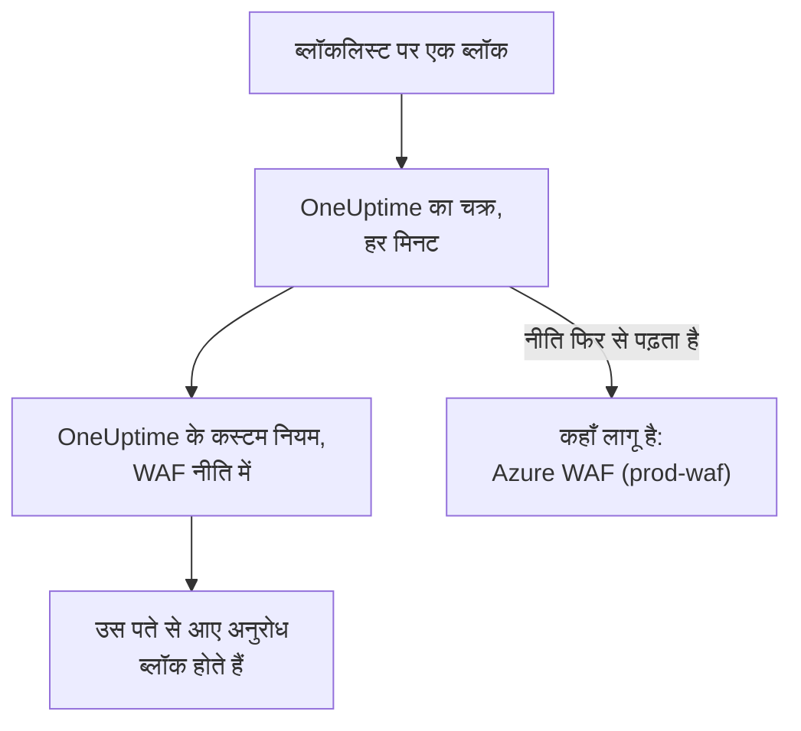

# Azure WAF में पते ब्लॉक करें

आपके प्रोजेक्ट की ब्लॉकलिस्ट आपके Application Gateway और Front Door की Azure WAF नीतियों में लागू की जा सकती है। इसे अपने किसी मौजूदा Azure क्लाउड कनेक्शन के लिए चालू करें, WAF नीतियाँ चुनें, और ब्लॉकलिस्ट जिस भी पते को ब्लॉक करती है, वह वहाँ भी ब्लॉक हो जाता है, चाहे उसे किसी व्यक्ति ने ब्लॉक किया हो, किसी प्लेबुक ने या OneUptime AI ने।

:::cards
- [इसे चालू करें](#इसे-चालू-करें): Azure कनेक्शन पर एक सेटिंग, और वह भूमिका जिसकी उसे ज़रूरत है।
- [OneUptime क्या बनाता है](#oneuptime-क्या-बनाता-है): आपकी चुनी हर नीति में उसके अपने कस्टम नियम।
- [किस पते का मिलान होता है](#किस-पते-का-मिलान-होता-है): वह पता जो कनेक्ट हुआ, या प्रॉक्सी के पीछे का मूल क्लाइंट।
:::

## यह कैसे काम करता है

OneUptime आपकी चुनी हर WAF नीति में अपने कस्टम नियम रखता है, और ब्लॉकलिस्ट जिन पतों को ब्लॉक करती है उन्हें उनमें डालता है। हर मिनट वह नीति में एक बार वह लिखता है जो ब्लॉकलिस्ट में है, फिर उसे वापस पढ़ता है। **ब्लॉकलिस्ट** पेज पर किसी ब्लॉक के **कहाँ लागू है** कॉलम में Azure WAF (prod-waf) तभी दिखता है जब नीति में वह ब्लॉक मौजूद हो और Azure ने बदलाव लागू कर दिया हो; तब तक वह ब्लॉक लागू नहीं होता।

## शुरू करने से पहले

- OneUptime से कनेक्ट किया गया एक Azure सब्सक्रिप्शन (देखें [क्लाउड खाता कनेक्ट करें](/docs/telemetry/cloud-accounts#microsoft-azure))।
- ऐसी भूमिका जो बदल सके कि ब्लॉकलिस्ट कहाँ लागू हो: **प्रोजेक्ट स्वामी**, **प्रोजेक्ट एडमिन** या **सुरक्षा एडमिन**।
- कोई ऐसा व्यक्ति जो Azure सब्सक्रिप्शन में भूमिकाएँ असाइन कर सके, ताकि Azure Cloud Shell में एक कमांड चलाई जा सके।

## इसे चालू करें

:::steps
### कनेक्शन खोलें
**क्लाउड → कनेक्ट करें** खोलें और Azure कनेक्शन संपादित करें।

### सेटिंग चालू करें
**और फ़ील्ड** में, **Azure WAF में पते ब्लॉक करें** को **चालू** पर सेट करें, और सहेजें। फ़ॉर्म अब जो सेटअप कमांड दिखाता है, वह नीचे दी गई भूमिका पूरे सब्सक्रिप्शन पर देता है। आपके मौजूदा कनेक्शन को इसे फिर से चलाने की ज़रूरत नहीं है: **WAF जोड़ें** डायलॉग वे पंक्तियाँ देता है जो यह भूमिका केवल एक नीति पर देती हैं।

### WAF नीतियाँ जोड़ें
**सुरक्षा इवेंट → प्लेबुक → ब्लॉकलिस्ट** खोलें। **क्लाउड WAF** के अंदर **WAF जोड़ें** पर क्लिक करें और कोई WAF नीति चुनें। OneUptime कुछ भी लिखे बिना Azure से पूछता है कि कनेक्शन उसमें लिख सकता है या नहीं।

### भूमिका दें, अगर वह नहीं है
जब कोई अनुमति नहीं होती, तो डायलॉग वे पंक्तियाँ दिखाता है जो उसे केवल उसी नीति पर देती हैं। उन्हें Azure Cloud Shell में चलाएँ, **फिर से जाँचें** पर क्लिक करें, फिर नीति जोड़ें। OneUptime के उसे पढ़ लेने के बाद उसकी **स्थिति** में **लागू है** दिखता है।
:::

WAF नीतियाँ कनेक्शन की इन्वेंट्री से आती हैं: जिसे OneUptime ने अभी तक नहीं पढ़ा है, वह अगली रीडिंग के बाद दिखती है। जब तक कोई नीति ब्लॉकलिस्ट लागू करती है, उसके कनेक्शन की सेटिंग बंद नहीं की जा सकती और कनेक्शन हटाया नहीं जा सकता: पहले नीति हटाएँ, ताकि OneUptime अपने नियम निकाल ले।

## OneUptime क्या बनाता है

| क्या | नाम | कहाँ |
| --- | --- | --- |
| कस्टम नियम, हर एक में Block कार्रवाई वाली एक IP मिलान शर्त | `OneUptime<project>Block1`, `OneUptime<project>Block2`, ... | आपकी चुनी हर WAF नीति में, अधिकतम 10। |

`<project>` आपके प्रोजेक्ट की बाहरी ID के पहले आठ अक्षर हैं, इसलिए एक ही नीति चुनने वाले दो OneUptime प्रोजेक्ट कभी एक-दूसरे के नियम नहीं लिखते। Application Gateway पर एक नियम में 540 पते या रेंज आते हैं, CRS 3.2 या Default Rule Set के साथ 600, और Front Door पर 600। दस नियमों के साथ एक नीति में 5,400 या 6,000 ब्लॉक आते हैं; जो ब्लॉक इसमें नहीं समाता, वह अपनी पंक्ति में यह बताता है।

OneUptime किसी नीति में अपने नियमों के अलावा कुछ नहीं बदलता। Azure WAF नीति को केवल पूरा का पूरा लिखता है, इसलिए OneUptime नीति को उसके ETag के साथ पढ़ता है, अपने नियम बदलता है, और उसे `If-Match` में ETag के साथ वापस लिखता है: बाकी हर नियम, सेटिंग और प्रबंधित नियम सेट वैसे ही लिखा जाता है जैसा पढ़ा गया था। अगर बीच में किसी और ने नीति लिखी हो, तो Azure लिखने से मना कर देता है, और OneUptime उसे फिर से पढ़कर उनके लिखे पर अपना बदलाव करता है।

## नीति में नियमों की जगह

OneUptime अपने नियम ट्रैफ़िक की अनुमति देने वाले आपके पहले नियम से पहले की खाली प्राथमिकताओं पर रखता है, सबसे कम से शुरू करके, ताकि आपका कोई भी नियम ब्लॉक किए गए पते को आगे न जाने दे। आपका कोई नियम जो ब्लॉक या लॉग करता है, पहले आ सकता है। OneUptime आपके किसी नियम को न कभी नया नंबर देता है, न बदलता है, न हटाता है: जब आपके पहले Allow नियम से पहले कोई प्राथमिकता खाली नहीं होती, तो नीति **कोई खाली प्राथमिकता नहीं** दिखाती है, और जैसे ही आप एक खाली करते हैं, OneUptime अपना नियम जोड़ देता है।

## किस पते का मिलान होता है

| WAF नीति | क्लाइंट का पता | इसे कब चुनें |
| --- | --- | --- |
| Front Door | **वह पता जो Front Door से कनेक्ट हुआ (SocketAddr)** | डिफ़ॉल्ट। |
| Front Door | मूल क्लाइंट, X-Forwarded-For से (RemoteAddr) | किसी दूसरे प्रॉक्सी या CDN के पीछे के Front Door के लिए। |
| Application Gateway | वह पता जो गेटवे से कनेक्ट हुआ (RemoteAddr) | इकलौता विकल्प: इसका IP मिलान कोई दूसरा पता नहीं पढ़ता। |

Front Door `RemoteAddr` को `X-Forwarded-For` हेडर से लेता है, जिसे Front Door से सीधे कनेक्ट होने वाला क्लाइंट ख़ुद लिखता है। इसे तभी चुनें जब Front Door के सामने का कोई दूसरा प्रॉक्सी या CDN वह हेडर लिखता हो। यह विकल्प **WAF जोड़ें** डायलॉग में **और फ़ील्ड** के अंदर है, और आप इसे बाद में नीति की पंक्ति पर **क्लाइंट का पता** से बदल सकते हैं।

Application Gateway का IP मिलान केवल IPv4 पते पढ़ता है, इसलिए IPv6 ब्लॉक वहाँ लागू नहीं होता, और उसकी पंक्ति बताती है कि क्यों।

Azure WAF में OneUptime के नियम केवल ब्लॉक करते हैं। जो ब्लॉक किसी पते को चैलेंज करने को कहता है, वह Azure WAF में लागू नहीं होता, और यह बताता है। किसी स्वचालित प्रतिक्रिया नीति का चैलेंज वहाँ उतने ही समय के ब्लॉक के रूप में लागू होता है।

## बदलाव में कितना समय लगता है

Application Gateway बदलाव को उसी समय लागू करता है जब Azure उसे लिखता है। Front Door बदलाव स्वीकार करता है और अगले कुछ मिनटों में उसे अपने एज तक फैलाता है: नीति **लागू हो रहा है** दिखाती है, और नए ब्लॉक का **कहाँ लागू है** तब तक नीति की प्रतीक्षा करता है जब तक Azure उसे प्रोविज़न किया हुआ नहीं बताता। उसके बाद से वह ब्लॉक लागू होता है।

## जब कोई नियम हाथ से बदला जाता है

जब कोई Azure में OneUptime के किसी नियम को बंद करता है, बदलता है या हटाता है, तो OneUptime उसे वैसा ही छोड़ देता है जैसा उन्होंने छोड़ा। नीति **हाथ से बदला गया** दिखाती है, और उस नियम में रहे ब्लॉक, कारण के साथ, तब तक लागू नहीं होते जब तक कोई नीति की पंक्ति पर **वापस लगाएँ** पर क्लिक नहीं करता। वापस लगाएँ नियम को फिर से वैसे लिखता है जैसे OneUptime उसे लिखता है, उसकी अपनी प्राथमिकता पर, जब तक वह खाली हो।

जो नीति कुछ भी ब्लॉक नहीं करती, वह भी यह बताती है, और उसके ब्लॉक लागू नहीं होते:

- ऐसी नीति जो बंद है।
- **Detection** मोड में नीति, जो केवल वह लॉग करती है जिससे OneUptime के नियम मेल खाते हैं।
- ऐसी नीति जो किसी एप्लिकेशन गेटवे, लिसनर, पाथ नियम या Front Door डोमेन से जुड़ी नहीं है।

## Terraform में नीति प्रबंधित करें

Terraform भी WAF नीति को पूरा का पूरा लिखता है, इसलिए उसका अगला plan OneUptime के नियम हटा देता है। OneUptime को उन्हें रखने देने के लिए, `azurerm_web_application_firewall_policy` के `lifecycle` ब्लॉक में `ignore_changes = [custom_rules]` जोड़ें, या `azurerm_cdn_frontdoor_firewall_policy` के उसी ब्लॉक में `ignore_changes = [custom_rule]`, और अपने कस्टम नियम उस नीति के कोड से बाहर रखें।

## अनुमतियां

सेटअप कमांड एक कस्टम भूमिका, `OneUptime WAF Blocklist`, जोड़ता है और उसे सब्सक्रिप्शन पर कनेक्शन के ऐप को असाइन करता है। **WAF जोड़ें** डायलॉग जो पंक्तियाँ दिखाता है, वे यही भूमिका केवल एक नीति पर असाइन करती हैं।

| कार्रवाई | क्यों |
| --- | --- |
| `Microsoft.Network/ApplicationGatewayWebApplicationFirewallPolicies/read`, `Microsoft.Network/ApplicationGatewayWebApplicationFirewallPolicies/write` | Application Gateway की WAF नीति पढ़ना और उसमें OneUptime के नियम लिखना। |
| `Microsoft.Network/FrontDoorWebApplicationFirewallPolicies/read`, `Microsoft.Network/FrontDoorWebApplicationFirewallPolicies/write` | Front Door की WAF नीति पढ़ना और उसमें OneUptime के नियम लिखना। |

यह भूमिका कोई नीति नहीं हटा सकती, और OneUptime कभी कुछ और नहीं लिखता।

## इसे हटाएँ

:::steps
### WAF नीति हटाएँ
**सुरक्षा इवेंट → प्लेबुक → ब्लॉकलिस्ट** पर, नीति की पंक्ति में **हटाएं** पर क्लिक करें। OneUptime नीति से अपने नियम निकाल देता है, और उसमें कुछ और नहीं बदलता।

### सेटिंग बंद करें
कनेक्शन संपादित करें, **Azure WAF में पते ब्लॉक करें** को **बंद** पर सेट करें, और सहेजें। जब कनेक्शन की कोई भी नीति ब्लॉकलिस्ट लागू नहीं करती, तब यह सेटिंग बंद की जा सकती है।
:::

जब OneUptime अब नीति में नहीं लिख सकता, तो **WAF हटाएँ** डायलॉग में **सिर्फ़ OneUptime से हटाएँ** चुनें। OneUptime नीति को ब्लॉकलिस्ट से हटा देता है और उन नियमों के नाम बताता है जो उसने उसमें छोड़े हैं: जब तक आप उन्हें Azure में नहीं हटाते, वे अपने अंदर के पतों को ब्लॉक करते रहते हैं।

## समस्या निवारण

:::details लागू नहीं है
नीति की स्थिति बताती है कि Azure ने क्या जवाब दिया और क्या करना है। अस्वीकृति उस अनुमति का नाम बताती है जो नहीं है: **WAF जोड़ें** इस नीति के लिए जो पंक्तियाँ दिखाता है, उन्हें चलाएँ, फिर **फिर से जाँचें** पर क्लिक करें।
:::

:::details कोई खाली प्राथमिकता नहीं
ट्रैफ़िक की अनुमति देने वाला आपका पहला नियम प्राथमिकता 1 पर है, या उससे पहले की हर प्राथमिकता भरी हुई है। उसे ज़्यादा प्राथमिकता संख्या दें, फिर **फिर से जाँचें** पर क्लिक करें।
:::

:::details कोई नीति सूची में नहीं है
OneUptime उन कनेक्शन की WAF नीतियाँ दिखाता है जिनकी सेटिंग चालू है, उन्हें पढ़ लेने के बाद। इसके बाद जोड़ी गई नीति कनेक्शन की अगली रीडिंग के बाद दिखती है।
:::

## अगले कदम

:::cards
- [सुरक्षा केस और प्लेबुक](/docs/telemetry/security-cases): किसी केस से कोई पता ब्लॉक करें, और उसका चरण जाँचा गया देखें।
- [क्लाउड खाता कनेक्ट करें](/docs/telemetry/cloud-accounts): वह कनेक्शन जिसका हिस्सा यह सेटिंग है।
:::
