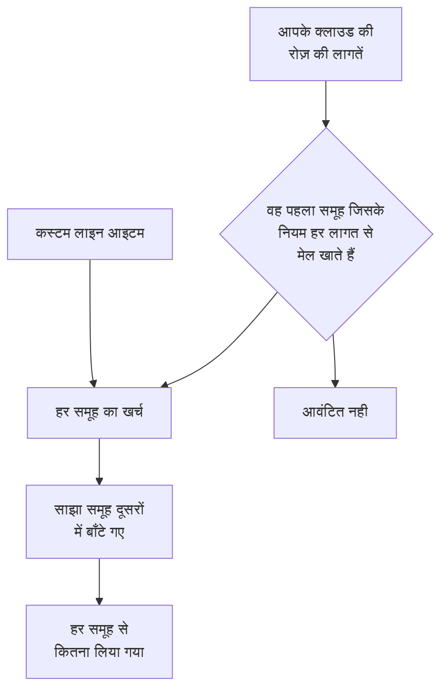

# क्लाउड लागत आवंटन

लागत समूह हर महीने के क्लाउड बिल के पहले सवाल का जवाब देते हैं: खर्च किसने किया। "टीम के अनुसार" या "लागत केंद्र के अनुसार" जैसा **लागत व्यू** आपके कनेक्ट किए गए खातों के खर्च को नियमों से **लागत समूहों** में बाँटता है, और कुछ भी दो बार नहीं गिनता। जिससे कोई नियम मेल नहीं खाता, वह अनावंटित खर्च के रूप में साफ़ दिखता रहता है, और साझा लागतें समूहों में बाँटी जाती हैं। ये **क्लाउड → खर्च → लागत समूह** में मिलते हैं।

:::cards
- [व्यू बनाएँ](#व्यू-बनाएँ): पहले से तय स्वामियों से टीम के अनुसार, किसी टैग के अनुसार, या अपने समूहों के साथ।
- [समूह के नियम लिखें](#समूह-के-नियम-लिखें): खाते, सेवाएँ, टैग, स्वामी टीमें, लेबल और भी बहुत कुछ।
- [अनावंटित खर्च](#अनावंटित-खर्च): जिससे कोई नियम मेल नहीं खाता, और उसे बाँटने के लिए एक क्लिक।
- [साझा लागतें](#साझा-लागतें): सपोर्ट प्लान या साझा क्लस्टर, समूहों में बाँटा गया।
:::

## यह कैसे काम करता है



- **पहला मेल खाने वाला समूह लागत लेता है।** किसी व्यू के समूह एक क्रम में होते हैं, और हर लागत उस पहले समूह में जाती है जिसके नियम उससे मेल खाते हैं, इसलिए कुछ भी दो बार नहीं गिना जाता। समूह और अनावंटित खर्च मिलकर हमेशा अवधि का कुल बनाते हैं।
- **नियम लागत के साथ आने वाली हर जानकारी पढ़ते हैं।** खाता, क्लाउड, सेवा, क्षेत्र, संसाधन और उसके टैग, और OneUptime संसाधन के बारे में जो जानता है: उसकी स्वामी टीमें, उसके लेबल, उसका App Platforms परिवेश और ऐप।
- **सब कुछ देखते समय गिना जाता है।** किसी लागत के लिए कुछ भी लिखा नहीं जाता। आप जो नियम बदलते हैं, वह OneUptime के रखे हर महीने को फिर से बाँटता है, 400 दिन पीछे तक, बिना किसी इंतज़ार के।
- **कई व्यू एक ही खर्च को बाँट सकते हैं।** "टीम के अनुसार" और "लागत केंद्र के अनुसार" दोनों पूरा खर्च अपने-अपने तरीके से बाँटते हैं।

## शुरू करने से पहले

- **पढ़ी जाने वाली लागतें।** [क्लाउड खाता कनेक्ट करें](/docs/telemetry/cloud-accounts) और उसे [उसकी लागतें पढ़ने दें](/docs/telemetry/cloud-costs)।
- **टैग या स्वामी, अगर आप चाहें।** टैग वाले नियमों के लिए उन टैग वाली लागतें चाहिए; AWS पर [संसाधन के अनुसार लागत](/docs/telemetry/cloud-costs#प्रति-संसाधन-लागत) चालू करें। स्वामी टीमें हर संसाधन के स्वामियों से आती हैं, जिन्हें हाथ से या [स्वामी नियमों](/docs/configuration/label-and-owner-rules) से तय किया जाता है।

## व्यू बनाएँ

**क्लाउड → खर्च → लागत समूह** खोलें। जिस प्रोजेक्ट में अभी कोई व्यू नहीं है, उसे शुरू करने के तीन तरीके दिखते हैं:

| शुरुआत | यह क्या बनाता है |
| --- | --- |
| **टीम के अनुसार, स्वामियों से** | क्लाउड संसाधनों की मालिक हर टीम के लिए एक समूह, उस टीम से जुड़ा हुआ। |
| **किसी टैग के अनुसार** | आपकी लागतों पर लगे किसी टैग के हर मान के लिए एक समूह, जैसे `team` या `cost-center`। |
| **आपके अपने समूह** | एक खाली व्यू। हर समूह के नियम आप खुद लिखते हैं। |

टैग या स्वामी टीम के अनुसार वाले व्यू के समूह OneUptime सेव करते समय बनाता है, और फिर हर घंटे नए टैग मान और स्वामी आने पर बनाता है। आप इन समूहों का नाम बदल सकते हैं, उन्हें किसी टीम से जोड़ सकते हैं या साझा बना सकते हैं। उनके नियम OneUptime के ही रहते हैं। छूटे हुए समूह अभी बनाने के लिए व्यू खोलें और **अभी समूह बनाएँ** दबाएँ।

## समूह के नियम लिखें

कोई व्यू खोलें, फिर **समूह** में **लागत समूह बनाएँ** चुनें। कोई लागत समूह की होती है जब उसके नियमों में से **कोई भी** उससे मेल खाए, और कोई नियम तब मेल खाता है जब उसकी **सभी** शर्तें मेल खाएँ। शर्त लागत की किसी एक जानकारी की तुलना उन मानों से करती है जिन्हें आप चुनते या लिखते हैं:

| फ़ील्ड | यह क्या पढ़ता है |
| --- | --- |
| **टैग** | टैग की कुंजी से किसी टैग का मान। **सेट है** और **सेट नहीं है** पूछते हैं कि लागत पर वह टैग है या नहीं। |
| **खाता** | वह कनेक्ट किया गया खाता जिस पर लागत बिल की जाती है। |
| **स्वामी टीम** | वे टीमें जो OneUptime में संसाधन की मालिक हैं। |
| **सेवा** | सेवा, जैसा आपके क्लाउड की बिलिंग उसे नाम देती है। |
| **लेबल** | OneUptime में संसाधन के, या उसके खाते के लेबल। |
| **क्षेत्र** | क्षेत्र। किसी ग्लोबल सेवा के लिए मान खाली छोड़ें। |
| **क्लाउड** | AWS, Azure या Google Cloud। |
| **संसाधन** | संसाधन, जैसा आपका क्लाउड उसे नाम देता है। |
| **App Platforms परिवेश** और **ऐप** | किसी परिवेश या ऐप पर जितना बिल किया गया, जैसा **क्लाउड → खर्च → लागत** उसे गिनता है। |
| **Kubernetes नेमस्पेस** और **Kubernetes क्लस्टर** | किसी क्लस्टर के नेमस्पेस, जब कोई साझा समूह उनके अनुसार बाँटा जाता है। [Kubernetes क्लस्टर](#kubernetes-क्लस्टर) देखें। |

टेक्स्ट की तुलना अक्षरों के छोटे-बड़े होने की परवाह किए बिना होती है: `Payments` और `payments` एक ही टीम हैं। टैग की कुंजी की तुलना वैसे ही होती है जैसी वह लिखी है, जैसा आपके क्लाउड उसे रखते हैं।

उदाहरण के लिए, तीन नियमों वाला **भुगतान** समूह वह लागत लेता है जिस पर `team: payments` टैग है, **या** जो payments खाते पर बिल की गई है, **या** जिसकी मालिक भुगतान टीम है।

### समूहों का क्रम

क्रम बदलने के लिए **समूह** में समूहों को खींचें। जिस समूह के नियम पहले का कोई समूह पहले ही ढक लेता है, वह कभी कोई लागत नहीं ले सकता, और उसकी पंक्ति बताती है कि सब कुछ कौन-सा समूह लेता है। जिस समूह के नियम उन लागतों से भी मेल खाते हैं जिन्हें पहले का कोई समूह लेता है, वह बताता है कि उसे उनमें से कितना मिलता है।

### कई स्वामी टीमों वाले संसाधन

दो टीमों के संसाधन की लागत उनमें बराबर बाँटी जाती है: हर टीम का आधा हिस्सा अलग से नियमों से गुज़रता है। जो नियम स्वामियों के बारे में कुछ नहीं पूछता, जैसे कोई टैग या खाता, वह अब भी पूरी लागत लेता है। जिस आधे हिस्से की टीम का कोई समूह नहीं है, वह अनावंटित रहता है।

## अनावंटित खर्च

व्यू का पेज वह सूची दिखाता है जिससे अभी कोई नियम मेल नहीं खाता: वे सेवाएँ, खाते, टैग मान और स्वामी टीमें जिनसे वह बना है, सबसे महँगे पहले। किसी एक के बगल में **समूह में जोड़ें** दबाकर उसके लिए एक नियम किसी समूह में, या नए समूह में जोड़ें। उसकी लागतें तुरंत समूह में चली जाती हैं, पिछले महीनों की भी।

## साझा लागतें

सपोर्ट प्लान, साझा क्लस्टर या नेटवर्क हब सबका होता है। उसका अपना एक समूह बनाएँ, फिर **और फ़ील्ड** में **साझा** चालू करें और चुनें कि उसकी लागतें व्यू के दूसरे समूहों में कैसे बाँटी जाएँ:

| बँटवारा | कैसे |
| --- | --- |
| **खर्च के हिस्से के अनुसार बाँटें** | हर समूह उस महीने दूसरे समूहों के क्लाउड खर्च में अपना हिस्सा लेता है। जिस महीने उन्होंने कुछ खर्च नहीं किया, वह बराबर बाँटा जाता है। |
| **बराबर बाँटें** | हर समूह को उतनी ही राशि। |
| **तय प्रतिशतों से बाँटें** | हर समूह के लिए आपके तय किए प्रतिशत, जिनका कुल 100 होता है। |
| **Kubernetes नेमस्पेस के अनुसार बाँटें** | उस महीने किसी क्लस्टर के हर नेमस्पेस की लागत। नीचे देखें। |

साझा समूह की लागतें हर महीने के हिस्सों के साथ दिन-ब-दिन बाँटी जाती हैं, इसलिए महीना दिन के अनुसार पढ़ें या महीने के अनुसार, आँकड़े एक जैसे आते हैं। अनावंटित खर्च को कभी कोई हिस्सा नहीं मिलता।

### Kubernetes क्लस्टर

क्लस्टर के नोड आपका क्लाउड बिल करता है, जबकि क्लस्टर का अपना लागत इंजन बताता है कि हर नेमस्पेस ने कितना इस्तेमाल किया। किसी साझा क्लस्टर के भीतर हर टीम से उसके वर्कलोड का शुल्क लेने के लिए:

1. ऐसा समूह बनाएँ जिसके नियम क्लस्टर के नोड से मेल खाएँ, उदाहरण के लिए **टैग** `eks:cluster-name` **इनमें से कोई एक है** `prod`।
2. **साझा** चालू करें, **Kubernetes नेमस्पेस के अनुसार बाँटें** चुनें, और **Kubernetes क्लस्टर** चुनें।
3. टीमों के समूहों को ऐसे नियम दें जो नेमस्पेस के लेबल पढ़ें, जो टैग की तरह गिने जाते हैं। उदाहरण के लिए, **टैग** `team` **इनमें से कोई एक है** `payments`, या **Kubernetes नेमस्पेस** **इससे शुरू होता है** `payments-`।

हर महीने नोड की लागतें इस आधार पर बाँटी जाती हैं कि क्लस्टर के [लागत इंजन](/docs/telemetry/kubernetes-cost) में हर नेमस्पेस की लागत कितनी रही, और हर नेमस्पेस का हिस्सा उस पहले समूह में जाता है जिसके नियम उससे मेल खाते हैं। खाली क्षमता, और ऐसा नेमस्पेस जिसे कोई समूह नहीं लेता, क्लस्टर के समूह में ही रहते हैं। क्लस्टर की अपनी आँकी गई लागतें आपके बिल में कभी नहीं जोड़ी जातीं, इसलिए कुछ भी दो बार नहीं गिना जाता।

## कस्टम लाइन आइटम

**क्लाउड → खर्च → लागत समूह → कस्टम लाइन आइटम** में ऐसा शुल्क या क्रेडिट जोड़ें जो आपके क्लाउड के बिलों में नहीं होता: सपोर्ट अनुबंध का हिस्सा, एंटरप्राइज़ छूट, आंतरिक मार्कअप या प्लेटफ़ॉर्म शुल्क।

- **एक बार या हर महीने।** मासिक आइटम हर महीने के दिनों में बाँटा जाता है, इसलिए महीने के एक हिस्से पर उतना ही हिस्सा आता है।
- **किसी खाते या समूह पर।** खाते में जोड़ा गया आइटम हर व्यू के नियमों से वैसे ही गुज़रता है जैसे खाते की लागतें। समूह में जोड़ा गया आइटम सीधे उसी में जाता है।
- **हमेशा अलग।** हर आँकड़ा लाइन आइटम को क्लाउड के बिल किए गए हिस्से से अलग रखता है, इसलिए क्लाउड के अपने आँकड़े अब भी उनके कंसोल से मेल खाते हैं।

## हर समूह का खर्च देखें

- **क्लाउड → खर्च → लागत**: **पैसा कहाँ जाता है** में **लागत समूह** और कोई व्यू चुनें। हर समूह का खर्च, पिछली अवधि की तुलना में।
- **व्यू का पेज**: हर समूह से कितना लिया गया, साझा लागतों सहित, जिससे कोई नियम मेल नहीं खाता, और महीने के चार्जबैक के लिए **CSV डाउनलोड करें**।
- **समूह का पेज**: उसका दिन-ब-दिन खर्च, सबसे ज़्यादा बिल की गई सेवाएँ, संसाधन और खाते, और उसके नियम। यह केवल उस समूह का खर्च दिखाता है, इसलिए समूह को उसकी **टीम** से जोड़ें और टीम को उसका पेज भेजें: जो कोई क्लाउड खर्च पढ़ सकता है, वह इसे खोल सकता है।

## API, CLI और MCP

व्यू, समूह और लाइन आइटम API संसाधन हैं (`cloud-cost-view`, `cloud-cost-group`, `cloud-cost-line-item`), और हर संसाधन की तरह इनके CLI कमांड और MCP टूल हैं। किसी समूह के नियम JSON होते हैं:

```json
[
  { "conditions": [{ "field": "tag", "key": "team", "operator": "is", "values": ["payments"] }] },
  { "conditions": [{ "field": "ownerTeam", "operator": "is", "values": ["<team ID>"] }] }
]
```

किसी व्यू का बँटवारा `startDate` से `endDate` तक पूरे UTC दिनों के लिए पढ़ने के लिए:

```bash
curl -X POST "https://oneuptime.com/api/cloud-cost-view/<view ID>/allocation" \
  -H "apikey: <API key>" -H "tenantid: <project ID>" -H "Content-Type: application/json" \
  -d '{"startDate": "2026-11-01", "endDate": "2026-11-30", "currency": "USD"}'
```

जवाब में हर समूह का `total` और वह किन चीज़ों से बना है (`cloud`, `lineItems`, `sharedIn`, `sharedOut`), दिन या महीने के अनुसार उसके आँकड़े, पिछली अवधि, और अनावंटित खर्च किन चीज़ों से बना है, यह सब होता है। `POST /cloud-cost-group/<group ID>/spend` किसी एक समूह का जवाब देता है।

## सीमाएँ

- एक व्यू में अधिकतम 500 समूह होते हैं। टैग के अनुसार वाला व्यू सबसे महँगे 500 मानों के लिए समूह बनाता है।
- एक समूह में अधिकतम 25 नियम, एक नियम में 20 शर्तें, और एक शर्त में 200 मान होते हैं।
- लागतें 400 दिन तक रखी जाती हैं, इसलिए कोई व्यू अधिकतम 400 दिन पढ़ता है।

## समस्या निवारण

:::details किसी समूह को कुछ नहीं मिलता
हो सकता है उसके नियम अभी किसी लागत से मेल न खाते हों, या पहले का कोई समूह वे सारी लागतें ले लेता हो जिनसे वे मेल खाते हैं। तब **समूह** में उसकी पंक्ति उस समूह का नाम बताती है: इस समूह को उसके ऊपर खींचें, या पहले वाले समूह के नियम सीमित करें।
:::

:::details कोई लागत गलत समूह में है
हर लागत उस पहले समूह में जाती है जिसके नियम उससे मेल खाते हैं। जिस समूह की वह लागत है, उसे उस समूह के ऊपर खींचें जो उसे लेता है, या उस समूह के नियम सीमित करें।
:::

:::details टैग वाला नियम किसी से मेल नहीं खाता
लागत पर वे टैग बने रहते हैं जो उसे पढ़ते समय थे: Google Cloud बिलिंग एक्सपोर्ट के लेबल, नहीं तो उस संसाधन के टैग जिस पर वह बिल की गई है, जिसके लिए AWS पर [संसाधन के अनुसार लागत](/docs/telemetry/cloud-costs#प्रति-संसाधन-लागत) चाहिए। टैग की कुंजी की तुलना वैसे ही होती है जैसी वह लिखी है।
:::

:::details टैग या स्वामी टीम के अनुसार वाले व्यू में कोई समूह नहीं है
OneUptime छूटे हुए समूह हर घंटे बनाता है: पिछले 400 दिनों की लागतों के हर टैग मान के लिए, या क्लाउड संसाधनों की मालिक हर टीम के लिए एक, अधिकतम 500 समूह तक। उन्हें तुरंत बनाने के लिए व्यू के पेज पर **अभी समूह बनाएँ** दबाएँ।
:::

:::details आँकड़ों में कोई खाता नहीं है
व्यू के आँकड़े उस मुद्रा में होते हैं जिसमें आपके ज़्यादातर खाते बिल किए जाते हैं। किसी दूसरी मुद्रा में बिल किया गया खाता उनमें शामिल नहीं होता, और न ही किसी दूसरी मुद्रा का लाइन आइटम।
:::

## अगले कदम

:::cards
- [क्लाउड लागत और बचत](/docs/telemetry/cloud-costs): आपके कनेक्ट किए गए खातों की लागत, और कम खर्च करने के तरीके।
- [लेबल और स्वामी नियम](/docs/configuration/label-and-owner-rules): संसाधनों को ऐसी स्वामी टीमें और लेबल दें जिन्हें नियम पढ़ें।
- [Kubernetes लागत ऑब्ज़र्वेबिलिटी](/docs/telemetry/kubernetes-cost): हर Kubernetes वर्कलोड की लागत।
:::
