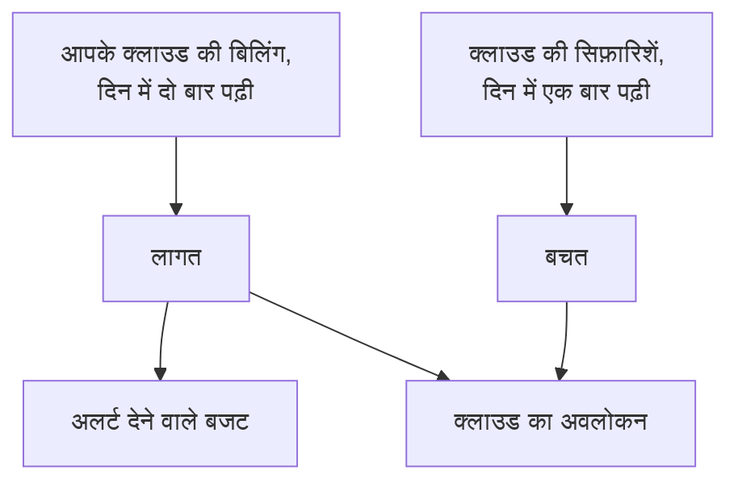

# क्लाउड लागत और बचत

कनेक्ट किया गया क्लाउड खाता यह भी बताता है कि उसकी लागत कितनी है और वह कैसे कम हो सकती है। OneUptime हर दिन की लागत आपके क्लाउड की अपनी बिलिंग से और सिफ़ारिशें आपके क्लाउड की अपनी सिफ़ारिश सेवा से पढ़ता है, उन्हें **क्लाउड → खर्च → लागत** और **क्लाउड → खर्च → बचत** में दिखाता है, और किसी महीने की लागत उसके बजट से ज़्यादा होने से पहले **क्लाउड → खर्च → बजट** में अलर्ट देता है।

:::cards
- [Amazon Web Services](#amazon-web-services): Cost Explorer और Cost Optimization Hub, हर एक एक बार चालू किया जाता है।
- [Microsoft Azure](#microsoft-azure): Cost Management और Azure Advisor, एक और भूमिका के साथ।
- [Google Cloud](#google-cloud): BigQuery में आपका बिलिंग निर्यात, और Recommender।
- [बजट](#बजट): जब किसी महीने का खर्च उसके बजट का कोई हिस्सा पार कर ले, तब एक अलर्ट।
:::

## यह कैसे काम करता है



- **लागत आपके क्लाउड की अपनी बिलिंग से आती है।** AWS Cost Explorer, Azure Cost Management और Google Cloud का BigQuery में बिलिंग निर्यात, क्रेडिट और रिफ़ंड से पहले, उस मुद्रा में जिसमें खाते का बिल बनता है। हर राशि एक दिन की होती है, UTC दिनों में, जैसे आपका क्लाउड उनका बिल बनाता है।
- **क्लाउड आख़िरी एक-दो दिन देर से बताता है।** हर रीडिंग पिछला हफ़्ता फिर से लेती है, और महीने के पहले दिनों में पूरा पिछला महीना, ताकि किसी दिन की लागत तब तक पक्की होती रहे जब तक आपका क्लाउड उसे बंद न कर दे। किसी कनेक्शन की पहली रीडिंग पिछले से पिछले महीने की शुरुआत तक पीछे जाती है।
- **महीने का अनुमान पिछले हफ़्ते की रफ़्तार पर चलता है।** यह अब तक महीने की लागत है, साथ में बाकी हर दिन पिछले सात पूरे दिनों के औसत पर।
- **बचत आपके क्लाउड की अपनी सिफ़ारिश सेवा से आती है।** AWS Cost Optimization Hub, Azure Advisor और Google Cloud का Recommender: छोटा आकार, बेकार पड़ा संसाधन, फ़ायदेमंद प्रतिबद्धता, हर एक के साथ यह कि वह हर महीने कितना बचाएगी। जिस सिफ़ारिश को आप अपने क्लाउड के कंसोल में लागू करें या ख़ारिज करें, वह अगली रीडिंग में हट जाती है।

## शुरू करने से पहले

- **एक कनेक्ट किया गया खाता।** आज के सेटअप कमांड से [क्लाउड खाता कनेक्ट करें](/docs/telemetry/cloud-accounts): यह कनेक्शन को लागत और सिफ़ारिशें पढ़ने देता है। पहले बना कनेक्शन तब तक दोनों में से कुछ नहीं पढ़ता, जब तक आप उसका कमांड फिर से न चलाएँ।

## Amazon Web Services

कनेक्शन लागत `ce:GetCostAndUsage` से और सिफ़ारिशें `cost-optimization-hub:ListRecommendations` से पढ़ता है। हर एक के लिए पहले खाते में कुछ चालू करना होता है:

:::steps
### Cost Explorer चालू करें

AWS Billing and Cost Management कंसोल में Cost Explorer एक बार खोलें: AWS एक दिन के भीतर खाते की लागत तैयार करता है। हर सदस्य खाते की लागत पढ़ने के लिए संगठन का प्रबंधन खाता कनेक्ट करें।

### Cost Optimization Hub में शामिल हों

उसी कंसोल में Cost Optimization Hub खोलें और उसमें शामिल हों, संगठन के लिए उसके प्रबंधन खाते से या सिर्फ़ इसी खाते के लिए। उसकी सिफ़ारिशें एक दिन के भीतर आती हैं।
:::

Cost Explorer हर अनुरोध पर $0.01 लेता है, और लागत की एक रीडिंग कुछ अनुरोध करती है। Cost Optimization Hub मुफ़्त है।

## Microsoft Azure

ऐप लागत **Cost Management Reader** भूमिका से पढ़ता है, उसी दायरे पर जिस पर **Monitoring Reader** है: सेटअप कमांड दोनों देता है। Azure Advisor की सिफ़ारिशें **Monitoring Reader** से पढ़ी जाती हैं, इसलिए कुछ चालू नहीं करना है। पहले बने ऐप को यह भूमिका देने के लिए चलाएँ:

```bash
az role assignment create --assignee <APP_ID> --role "Cost Management Reader" --scope /subscriptions/<SUBSCRIPTION_ID>
```

Cost Management हर सब्सक्रिप्शन के लिए जवाब देता है, उस संसाधन के साथ जिसके लिए हर लागत है, और इसे पढ़ना मुफ़्त है। जब वह किसी सब्सक्रिप्शन के लिए जवाब न दे पाए, तो खाते की **लागत** बताती है क्यों।

## Google Cloud

Google Cloud में किसी प्रोजेक्ट की लागत के लिए कोई API नहीं है: OneUptime उसे आपके बिलिंग खाते के BigQuery में निर्यात से पढ़ता है।

:::steps
### अपनी बिलिंग BigQuery में निर्यात करें

Google Cloud कंसोल में Billing, फिर Billing export खोलें, और विस्तृत उपयोग लागत का निर्यात किसी BigQuery डेटासेट में चालू करें। Google इसे कुछ घंटे पीछे लिखता है, उस दिन से जब आप इसे चालू करते हैं।

### सेवा खाते को इसे पढ़ने दें

कनेक्शन के सेवा खाते को निर्यात के डेटासेट पर **BigQuery Data Viewer** दें। सेटअप कमांड उसे पहले ही **BigQuery Job User** दे चुका है, ताकि वह क्वेरी अपने प्रोजेक्ट में चला सके।

### निर्यात की तालिका बताएँ

**क्लाउड → कनेक्ट करें** में कनेक्शन संपादित करें, और **और फ़ील्ड** में **बिलिंग निर्यात तालिका** को तालिका के पूरे नाम पर सेट करें: `<PROJECT_ID>.<DATASET>.gcp_billing_export_resource_v1_<BILLING_ACCOUNT_ID>`।
:::

विस्तृत निर्यात उस संसाधन का नाम बताता है जिसके लिए हर लागत है; मानक निर्यात सिर्फ़ सेवा और क्षेत्र बताता है। BigQuery क्वेरी का शुल्क लेता है: हर महीने पहला 1 TiB मुफ़्त है, फिर हर TiB पर $6.25, और किसी निर्यात का एक महीना कुछ मेगाबाइट से कुछ गीगाबाइट तक होता है। Recommender की मशीन टाइप और बेकार संसाधनों वाली सिफ़ारिशें **Compute Recommender Viewer** से पढ़ी जाती हैं, जिसे सेटअप कमांड देता है, और उनकी कोई लागत नहीं है।

## कम खर्च करने के तरीके

**क्लाउड → खर्च → बचत** हर सिफ़ारिश की सूची देता है, सबसे बड़ी बचत पहले: क्या करना है, किस संसाधन पर, क्या बदलेगा और वह हर महीने कितना बचाती है। उसके ऊपर की पट्टी उन्हें जोड़ती है, कुल मिलाकर और प्रकार के अनुसार: छोटा आकार, बेकार पड़ा संसाधन, प्रतिबद्धता। जब OneUptime के पास वह संसाधन हो, तो सिफ़ारिश उसके संसाधन के पेज से लिंक होती है।

## बजट

:::steps
### एक बजट बनाएँ

**क्लाउड → खर्च → बजट** में एक बजट बनाएँ: उसकी **मासिक राशि**, और वह **खाता** जिसके लिए वह है, या सभी खातों के लिए कोई नहीं।

### चुनें कि वह कब अलर्ट दे

**अलर्ट इस पर** बजट के वे हिस्से लेता है जिन पर अलर्ट देना है, प्रतिशत में: शुरुआत में 80 और 100। **पार होने की राह पर हो तो अलर्ट** महीने में एक बार तब भी अलर्ट देता है, जब पिछले हफ़्ते की रफ़्तार महीने को बजट से आगे ले जाए। **अलर्ट गंभीरता** और **ऑन-कॉल नीतियां** बताते हैं कि अलर्ट कितने गंभीर हैं और किसे बुलाया जाता है।
:::

बजट की जाँच लागत की हर रीडिंग के बाद और हर घंटे होती है। जब महीने का खर्च कोई सीमा पार करता है, तो उसके लिए एक अलर्ट बनता है, सबसे ऊँची सीमा के लिए जब कोई रीडिंग एक साथ कई सीमाएँ पार करे, और नया महीना पिछले महीने के अलर्ट सुलझा देता है। बजट सिर्फ़ उन खातों को गिनता है जिनका बिल उसकी मुद्रा में बनता है।

## OneUptime में आप क्या देखते हैं

- **क्लाउड का अवलोकन।** **क्लाउड → अवलोकन** महीने के खर्च को पिछले महीने के उसी दिन तक के खर्च के मुक़ाबले, सबसे महँगी सेवाओं और कम खर्च करने के सबसे बड़े तरीकों को, ध्यान देने वाली चीज़ों के बगल में दिखाता है।
- **हर दिन का खर्च।** **क्लाउड → खर्च → लागत** पिछले 30 दिनों में से हर दिन दिखाता है और किसी अवधि को सेवा, क्षेत्र, खाते या संसाधन के अनुसार बाँटता है। जिन खातों की लागत नहीं पढ़ी जाती, वे नीचे सूचीबद्ध होते हैं, हर एक कारण के साथ।
- **किसी खाते की लागत।** किसी खाते की **लागत** यही चीज़ सिर्फ़ उस खाते के लिए दिखाती है, उसके कम खर्च करने के तरीकों के साथ।
- **किसी संसाधन की लागत।** जब उसका क्लाउड उसका बिल नाम से बनाता है, तो किसी संसाधन का पेज दिखाता है कि इस महीने और पिछले 30 दिनों में उसकी लागत कितनी रही, उसके कम खर्च करने के तरीकों के साथ।

## समस्या निवारण

:::details कोई खाता अनुमति चाहिए दिखाता है
कनेक्शन अभी खाते की लागत नहीं पढ़ सकता। **क्लाउड → कनेक्ट करें** से उसका सेटअप कमांड फिर से चलाएँ: यह वह जोड़ता है जो लागत पढ़ने के लिए चाहिए। Google Cloud पर, सेवा खाते को निर्यात के डेटासेट पर **BigQuery Data Viewer** भी दें।
:::

:::details कोई खाता सेट अप नहीं है दिखाता है
उसके क्लाउड के पास अभी देने के लिए कोई लागत नहीं है। AWS पर, Cost Explorer चालू करें; Google Cloud पर, निर्यात की तालिका **बिलिंग निर्यात तालिका** में बताएँ। पहली राशियाँ अगली रीडिंग के साथ, 12 घंटे के भीतर आती हैं।
:::

:::details राशियों में कोई खाता छूट जाता है
राशियाँ उस मुद्रा में हैं जिसमें आपके ज़्यादातर खातों का बिल बनता है। किसी दूसरी मुद्रा में बिल वाला खाता उनके नीचे अपनी मुद्रा के साथ सूचीबद्ध होता है, और बजट सिर्फ़ उन खातों को गिनता है जिनका बिल उसकी अपनी मुद्रा में बनता है।
:::

:::details यह महीना आपके क्लाउड के कंसोल से कम है
आपका क्लाउड आख़िरी एक-दो दिन देर से बताता है, और राशियाँ क्रेडिट और रिफ़ंड से पहले की हैं। अगली रीडिंग बराबर कर लेती हैं।
:::

## अगले कदम

:::cards
- [क्लाउड खाता कनेक्ट करें](/docs/telemetry/cloud-accounts): कोई दूसरा खाता कनेक्ट करें, या उसका कमांड फिर से चलाएँ।
- [क्लाउड संसाधन](/docs/telemetry/cloud-resources): हर संसाधन के मेट्रिक्स, आपके अपने कलेक्टर से।
- [Kubernetes लागत ऑब्ज़र्वेबिलिटी](/docs/telemetry/kubernetes-cost): हर Kubernetes वर्कलोड की लागत।
:::
