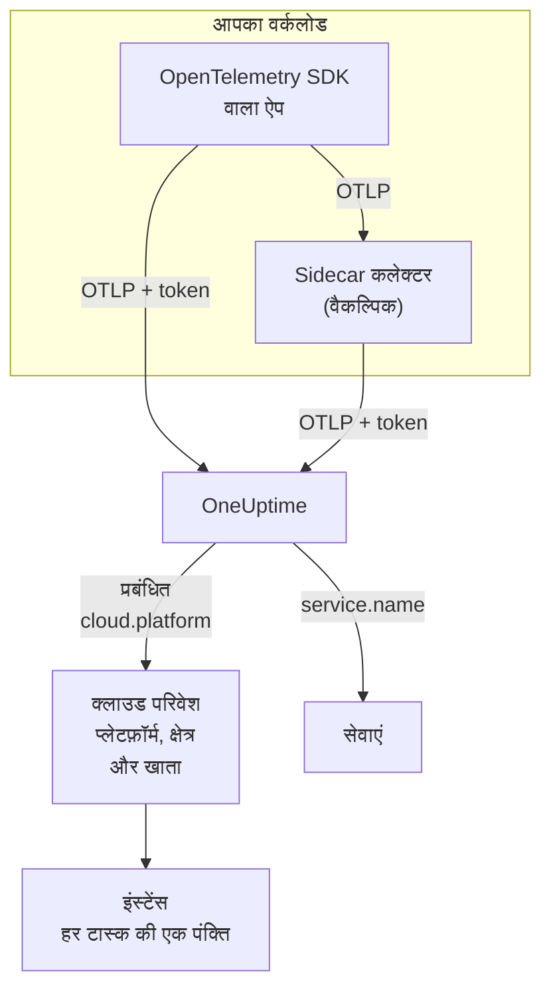

# क्लाउड परिवेश

**Cloud Environment** वह जगह है जहाँ आपके कंटेनर किसी प्रबंधित क्लाउड प्लेटफ़ॉर्म पर चलते हैं: किसी ECS क्लस्टर का खाता और क्षेत्र, Cloud Run का प्रोजेक्ट और क्षेत्र, Container Apps का सब्सक्रिप्शन और क्षेत्र। जब आपकी टेलीमेट्री पहली बार सही रिसोर्स एट्रिब्यूट के साथ आती है, तो OneUptime एक परिवेश बनाता है और वहाँ चलने वाले हर वर्कलोड को उसमें एक साथ रखता है। हाथ से कुछ भी रजिस्टर करने की ज़रूरत नहीं है।

:::cards
- [AWS ECS / Fargate](/docs/telemetry/cloud-aws-ecs): Fargate या EC2 पर टास्क, हर टास्क के CPU और मेमोरी के साथ।
- [Google Cloud Run](/docs/telemetry/cloud-gcp-cloud-run): सेवाएं और जॉब, जो serverless फ़ंक्शन के रूप में भी दिखते हैं।
- [Azure Container Apps](/docs/telemetry/cloud-azure-container-apps): रेप्लिका, जिनका क्षेत्र और सब्सक्रिप्शन हाथ से सेट होता है।
- [अन्य क्लाउड प्लेटफ़ॉर्म](/docs/telemetry/cloud-other-platforms): Elastic Beanstalk, App Runner, App Engine, App Service और Container Instances।
:::

## यह कैसे काम करता है



- **रिसोर्स डिटेक्टर बताता है कि वर्कलोड कहाँ चल रहा है।** SDK या कलेक्टर में मौजूद OpenTelemetry रिसोर्स डिटेक्टर प्लेटफ़ॉर्म का मेटाडेटा पढ़ता है और वर्कलोड जो कुछ भी भेजता है, उस पर `cloud.platform`, `cloud.account.id` और `cloud.region` सेट करता है। जहाँ कोई डिटेक्टर नहीं है, वहाँ इन्हें आप खुद सेट करते हैं।
- **परिवेश सब कुछ एक साथ रखता है।** एक ही प्लेटफ़ॉर्म, खाते और क्षेत्र वाले सभी वर्कलोड एक परिवेश में आते हैं। सेवाओं की अपनी पंक्तियाँ **सेवाएं** में बनी रहती हैं।
- **हर चलता हुआ टास्क एक इंस्टेंस है।** परिवेश का **इंस्टेंस** टैब उसके चल रहे टास्क, इंस्टेंस या रेप्लिका दिखाता है, और जहाँ प्लेटफ़ॉर्म दे सकता है, वहाँ लाइव CPU और मेमोरी भी।

## शुरू करने से पहले

- **एक इंजेशन कुंजी।** **प्रोजेक्ट सेटिंग्स → टेलीमेट्री और APM → इंजेशन कुंजियाँ** में एक **सर्वर** कुंजी बनाएं और उसका टोकन कॉपी करें: देखें [एक इंजेशन कुंजी बनाएं](/docs/telemetry/open-telemetry#एक-इंजेशन-कुंजी-बनाएं)। यह एक सीक्रेट है: हर प्लेटफ़ॉर्म पेज बताता है कि उस क्लाउड के सीक्रेट स्टोर में इसे कहाँ रखें।
- **आपके एप्लिकेशन में OpenTelemetry।** OTLP एक्सपोर्ट करने वाला OpenTelemetry SDK, या एप्लिकेशन के साथ चलने वाला OpenTelemetry Collector।

## समर्थित प्लेटफ़ॉर्म

| प्लेटफ़ॉर्म | `cloud.platform` | `cloud.*` कौन भरता है | इंस्टेंस पहचान | गाइड |
| ------------------------- | --------------------------- | ---------------------- | --------------------------------- | ------------------------------------------------------------------ |
| AWS ECS / Fargate | `aws_ecs` | रिसोर्स डिटेक्टर | `aws.ecs.task.arn` | [AWS ECS / Fargate](/docs/telemetry/cloud-aws-ecs) |
| AWS Elastic Beanstalk | `aws_elastic_beanstalk` | रिसोर्स डिटेक्टर | `host.id` | [अन्य क्लाउड प्लेटफ़ॉर्म](/docs/telemetry/cloud-other-platforms) |
| AWS App Runner | `aws_app_runner` | हाथ से | `host.name` | [अन्य क्लाउड प्लेटफ़ॉर्म](/docs/telemetry/cloud-other-platforms) |
| Google Cloud Run | `gcp_cloud_run` | रिसोर्स डिटेक्टर | `faas.instance` | [Google Cloud Run](/docs/telemetry/cloud-gcp-cloud-run) |
| Google App Engine | `gcp_app_engine` | रिसोर्स डिटेक्टर | `faas.instance` | [अन्य क्लाउड प्लेटफ़ॉर्म](/docs/telemetry/cloud-other-platforms) |
| Azure Container Apps | `azure_container_apps` | रिसोर्स डिटेक्टर | `azure.container_app.instance.id` | [Azure Container Apps](/docs/telemetry/cloud-azure-container-apps) |
| Azure Container Instances | `azure_container_instances` | हाथ से | `host.name` | [अन्य क्लाउड प्लेटफ़ॉर्म](/docs/telemetry/cloud-other-platforms) |
| Azure App Service | `azure_app_service` | रिसोर्स डिटेक्टर | `host.id` | [अन्य क्लाउड प्लेटफ़ॉर्म](/docs/telemetry/cloud-other-platforms) |

- **रिसोर्स डिटेक्टर:** SDK में या कलेक्टर के `resourcedetection` प्रोसेसर में मौजूद OpenTelemetry रिसोर्स डिटेक्टर आपके लिए `cloud.*` एट्रिब्यूट सेट करता है।
- **हाथ से:** कोई डिटेक्टर नहीं है, इसलिए आप एट्रिब्यूट `OTEL_RESOURCE_ATTRIBUTES` में डालते हैं। प्लेटफ़ॉर्म का पेज सटीक लाइन दिखाता है।
- **Azure डिटेक्टर कम जानते हैं।** Container Apps डिटेक्टर न क्षेत्र जानते हैं न सब्सक्रिप्शन, और App Service डिटेक्टर सब्सक्रिप्शन नहीं जानते: जो कमी है, उसे आप खुद सेट करें।
- **बिंदु वाली Azure वर्तनी भी चलती है।** Node.js और .NET के Azure डिटेक्टर `azure.container_apps` और `azure.app_service` लिखते हैं। OneUptime इन्हें मिलते ही ऊपर दिए अंडरस्कोर वाले मानों में बदल देता है।

## OneUptime परिवेश को कैसे पहचानता है

तीन रिसोर्स एट्रिब्यूट के हर संयोजन के लिए एक परिवेश होता है:

| एट्रिब्यूट | ज़रूरी | यह क्या है |
| ------------------ | -------- | ------------------------------------------------------------------------------------------- |
| `cloud.platform` | हाँ | [समर्थित प्लेटफ़ॉर्म](#समर्थित-प्लेटफ़ॉर्म) में दिए मानों में से एक |
| `cloud.account.id` | नहीं | AWS खाता ID, Google Cloud प्रोजेक्ट ID या Azure सब्सक्रिप्शन ID |
| `cloud.region` | नहीं | क्षेत्र, जैसे `us-east-1`, `us-central1` या `eastus` |

OneUptime इन तीनों को `|` से जोड़कर **एनवायरनमेंट कुंजी** बनाता है, और उन्हीं मानों से परिवेश का नाम रखता है, जैसे _AWS ECS · us-east-1 · 123456789012_:

```text title="Environment keys"
aws_ecs|123456789012|us-east-1
gcp_cloud_run|my-project|us-central1
azure_container_apps|00000000-0000-0000-0000-000000000000|eastus
```

> [!IMPORTANT]
> कोई गायब हिस्सा कुंजी में खाली सेगमेंट के रूप में रहता है: `aws_ecs||us-east-1`। इसलिए जो वर्कलोड `cloud.account.id` छोड़ देता है, वह उसे सेट करने वाले वर्कलोड से अलग परिवेश में जाता है। एक परिवेश की उम्मीद में दो परिवेश दिखने की यही आम वजह है।

### इंस्टेंस पहचान

किसी परिवेश में हर चलते हुए टास्क, इंस्टेंस या रेप्लिका को **इंस्टेंस** में एक पंक्ति मिलती है। उसका नाम टेलीमेट्री में मौजूद इन रिसोर्स एट्रिब्यूट में से पहले मिलने वाले से आता है:

1. `aws.ecs.task.id`
2. `aws.ecs.task.arn` (टास्क ID तक छोटा किया गया)
3. `faas.instance`
4. `azure.container_app.instance.id`
5. `service.instance.id`
6. `container.id`
7. `host.id`
8. `host.name`

प्लेटफ़ॉर्म की अपनी पहचान जानबूझकर सबसे पहले आती है। sidecar कलेक्टर और एप्लिकेशन का SDK दोनों इसे देखते हैं, और यह रीस्टार्ट के बाद भी बनी रहती है। SDK आम तौर पर हर प्रोसेस के लिए एक नया `service.instance.id` बना लेता है (Node.js SDK डिफ़ॉल्ट रूप से ऐसा करता है), इसलिए अगर उसे पहले कुंजी बनाया जाए, तो एक ECS टास्क दो पंक्तियों में बँट जाएगा। `service.instance.id` तब इस्तेमाल होता है जब प्लेटफ़ॉर्म अपनी कोई पहचान सेट नहीं करता। [समर्थित प्लेटफ़ॉर्म](#समर्थित-प्लेटफ़ॉर्म) का **इंस्टेंस पहचान** कॉलम बताता है कि हर प्लेटफ़ॉर्म पर एक सामान्य सेटअप कौन-सा एट्रिब्यूट इस्तेमाल करता है।

### हाथ से बनाए गए परिवेश

इसकी ज़रूरत कम ही पड़ती है: इंजेशन आपके लिए परिवेश बनाता है। टेलीमेट्री आने से पहले परिवेश बनाने के लिए **क्लाउड → All Environments** खोलें और **क्लाउड संसाधन बनाएँ** पर क्लिक करें। **क्लाउड प्लेटफ़ॉर्म** चुनें, फिर **क्लाउड खाता ID** और **क्लाउड क्षेत्र** ठीक वैसे ही लिखें जैसे आपकी टेलीमेट्री उन्हें रिपोर्ट करती है। OneUptime इन तीनों से कुंजी `platform|account|region` बनाता है, और इंजेशन किसी परिवेश को सिर्फ़ उसकी कुंजी से मिलाता है। परिवेश को वही नाम मिलता है जो इंजेशन देता; कोई दूसरा नाम दिखाने के लिए **और फ़ील्ड** खोलें और **प्रदर्शन नाम** लिखें।

## क्या क्लाउड परिवेश नहीं है

| आप किस पर चलाते हैं | कहाँ दिखता है | क्यों |
| ------------------------------------------------------------------------------------------------- | ------------------------ | ---------------------------------------------------------------------------------------------------- |
| EC2, Compute Engine, Azure VM (`aws_ec2`, `gcp_compute_engine`, `azure_vm`) | **होस्ट** | वर्चुअल मशीन एक होस्ट है। देखें [होस्ट OpenTelemetry कलेक्टर](/docs/telemetry/host-otel-collector) |
| EKS, GKE, AKS, सेल्फ़-मैनेज्ड Kubernetes | **Kubernetes** | `k8s.*` एट्रिब्यूट से रूट होता है। देखें [Kubernetes एजेंट](/docs/telemetry/kubernetes-agent) |
| Lambda, Cloud Functions, Azure Functions (`aws_lambda`, `gcp_cloud_functions`, `azure_functions`) | **Serverless फ़ंक्शन** | `faas.name` से, या FaaS वाले `cloud.platform` पर `service.name` से रूट होता है। देखें [Serverless फ़ंक्शन](/docs/telemetry/serverless-functions) |
| लोड बैलेंसर, बकेट, प्रबंधित डेटाबेस और अन्य IaaS या PaaS संसाधन | **Cloud Resources** | Azure Monitor, CloudWatch और Cloud Monitoring जो मेट्रिक्स प्रकाशित करते हैं, उनसे खोजे जाते हैं। देखें [क्लाउड संसाधन](/docs/telemetry/cloud-resources) |

> [!NOTE]
> Cloud Run और App Engine जानबूझकर दो जगह दिखते हैं। उनका डिटेक्टर प्रबंधित `cloud.platform` और `faas.name` दोनों सेट करता है, इसलिए हर सेवा अपने आप में एक **Serverless फ़ंक्शन** भी है, जबकि **Cloud Environment** उस प्रोजेक्ट और क्षेत्र की सभी सेवाओं को एक साथ रखता है। वही टेलीमेट्री दोनों जगह दर्ज होती है।

## वर्कलोड कनेक्ट करें

हर प्लेटफ़ॉर्म पेज में ये चरण उस क्लाउड के अपने कमांड और कंसोल स्क्रीन के साथ दिए गए हैं। संक्षेप में:

:::steps
### अपनी टेलीमेट्री पर क्लाउड एट्रिब्यूट लगाएं

:::tabs
@tab Sidecar collector
टास्क, इंस्टेंस या रेप्लिका में एक दूसरा कंटेनर। एप्लिकेशन `localhost:4318` पर एक्सपोर्ट करता है, और कलेक्टर का `resourcedetection` प्रोसेसर उससे गुज़रने वाली हर चीज़ पर `cloud.*` लगाता है। टोकन कलेक्टर के पास रहता है, और ECS पर यह हर टास्क का CPU और मेमोरी भी भेजता है:

```yaml title="collector.yaml"
processors:
  resourcedetection:
    detectors: [env, ecs] # [env, gcp] on Cloud Run and App Engine; [env, azurecontainerapps] on Container Apps
    timeout: 5s
```
@tab SDK direct
एप्लिकेशन का SDK सीधे OneUptime पर एक्सपोर्ट करता है। SDK में प्लेटफ़ॉर्म का रिसोर्स डिटेक्टर चालू करें, जैसे Node.js में `OTEL_NODE_RESOURCE_DETECTORS=env,host,os,aws`: हर प्लेटफ़ॉर्म पेज हर भाषा के लिए यह स्विच बताता है। कोई अतिरिक्त कंटेनर नहीं होता, और कंटेनर का CPU या मेमोरी भी नहीं।
:::

### OneUptime पर OTLP एक्सपोर्ट करें

:::tabs
@tab Sidecar collector
```yaml title="collector.yaml"
exporters:
  otlphttp/oneuptime:
    endpoint: https://oneuptime.com/otlp
    headers:
      x-oneuptime-token: ${env:ONEUPTIME_TOKEN}

service:
  pipelines:
    traces:
      receivers: [otlp]
      processors: [resourcedetection, batch]
      exporters: [otlphttp/oneuptime]
    metrics:
      receivers: [otlp]
      processors: [resourcedetection, batch]
      exporters: [otlphttp/oneuptime]
    logs:
      receivers: [otlp]
      processors: [resourcedetection, batch]
      exporters: [otlphttp/oneuptime]
```

कलेक्टर `${env:ONEUPTIME_TOKEN}` को एक एनवायरनमेंट वेरिएबल से भरता है, जिसे प्लेटफ़ॉर्म अपने सीक्रेट स्टोर से भरता है: Secrets Manager, Secret Manager या Container Apps सीक्रेट।
@tab SDK direct
```bash
OTEL_EXPORTER_OTLP_ENDPOINT="https://oneuptime.com/otlp"
OTEL_EXPORTER_OTLP_HEADERS="x-oneuptime-token=YOUR_TELEMETRY_INGESTION_TOKEN"
```
:::

अगर आप OneUptime को खुद होस्ट करते हैं, तो `https://YOUR-ONEUPTIME-HOST/otlp` इस्तेमाल करें।

### कनेक्शन जांचें

```bash
curl -i https://oneuptime.com/otlp/v1/validate \
  -H "x-oneuptime-token: YOUR_TELEMETRY_INGESTION_TOKEN"
```

`"valid": true` के साथ `200` का मतलब है कि टोकन स्वीकार हो गया। `401` का मतलब है कि टोकन अज्ञात, रद्द, निष्क्रिय या समाप्त है, और जवाब का `message` बताता है कि कौन-सा। पहला स्पैन, लॉग या मेट्रिक आने के एक मिनट के भीतर परिवेश **क्लाउड → All Environments** में दिखता है।
:::

> [!TIP]
> यही चरण डैशबोर्ड में भी हैं, आपके टोकन के साथ: पहला परिवेश आने तक **क्लाउड → All Environments** में, और उसके बाद हर परिवेश के **दस्तावेज़ीकरण** टैब पर।

## आपको क्या मिलता है

किसी परिवेश का **अवलोकन** दिखाता है:

- आपके ट्रेस से **अनुरोध**, **त्रुटि दर** और **p95 latency**, साथ में आपकी चुनी गई समय-सीमा में अनुरोधों, त्रुटियों और मेमोरी के चार्ट।
- चल रहे इंस्टेंस का **CPU** और **मेमोरी**, और **CPU के अनुसार शीर्ष इंस्टेंस** की सूची। ये इंस्टेंस पहचान वाले `container.cpu.utilization` और `container.memory.usage` मेट्रिक्स से आते हैं; ECS पर `awsecscontainermetrics` रिसीवर के `ecs.task.cpu.utilized` और `ecs.task.memory.utilized` से।
- **इंस्टेंस**: पिछले 15 मिनट में कितने इंस्टेंस ने रिपोर्ट किया। **इंस्टेंस** टैब में हर एक की एक पंक्ति है।
- **लॉग**, **ट्रेस** और **मेट्रिक्स** टैब, परिवेश के अनुसार फ़िल्टर किए हुए।

जिस परिवेश की टेलीमेट्री 15 मिनट तक रुकी रहती है, वह **डिस्कनेक्टेड** दिखाता है, और अगला स्पैन, लॉग या मेट्रिक उसे वापस **कनेक्टेड** कर देता है। जिस समय OneUptime खुद बंद था या बकाया डेटा निपटा रहा था, वह इन 15 मिनटों में नहीं गिना जाता।

### लेबल और स्वामी

- **आपकी टेलीमेट्री से:** `oneuptime.label.team=payments` जैसा रिसोर्स एट्रिब्यूट परिवेश पर `team:payments` लेबल जोड़ता है।
- **नियमों से:** **क्लाउड → सेटिंग्स → लेबल नियम** और **स्वामी नियम** मेल खाने वाले परिवेशों पर लेबल और स्वामी जोड़ते हैं। देखें [लेबल और स्वामी नियम](/docs/configuration/label-and-owner-rules)।

## समस्या निवारण

[क्लाउड समस्या निवारण](/docs/telemetry/cloud-troubleshooting) हर विफलता को उसी क्रम में बताता है जिसमें वह होती है: कोई परिवेश जो कभी नहीं दिखता, **होस्ट** में या सिर्फ़ **Serverless फ़ंक्शन** में पहुँच जाता है, जिसमें कोई इंस्टेंस या CPU और मेमोरी नहीं है, जो **डिस्कनेक्टेड** दिखाता है, दो में बँट जाता है, या हाथ से बनाया गया था और कभी मेल नहीं खाता।

## अगले कदम

:::cards
- [AWS ECS / Fargate](/docs/telemetry/cloud-aws-ecs): सबसे आम सेटअप, पूरी टास्क परिभाषा के साथ।
- [क्लाउड समस्या निवारण](/docs/telemetry/cloud-troubleshooting): जब कोई परिवेश गायब हो या गलत हो, तो क्या जांचें।
- [क्लाउड संसाधन (IaaS और PaaS)](/docs/telemetry/cloud-resources): आपके क्लाउड की अपनी निगरानी से लोड बैलेंसर, बकेट और प्रबंधित डेटाबेस।
- [Serverless फ़ंक्शन](/docs/telemetry/serverless-functions): Lambda, Cloud Functions और Azure Functions।
:::
