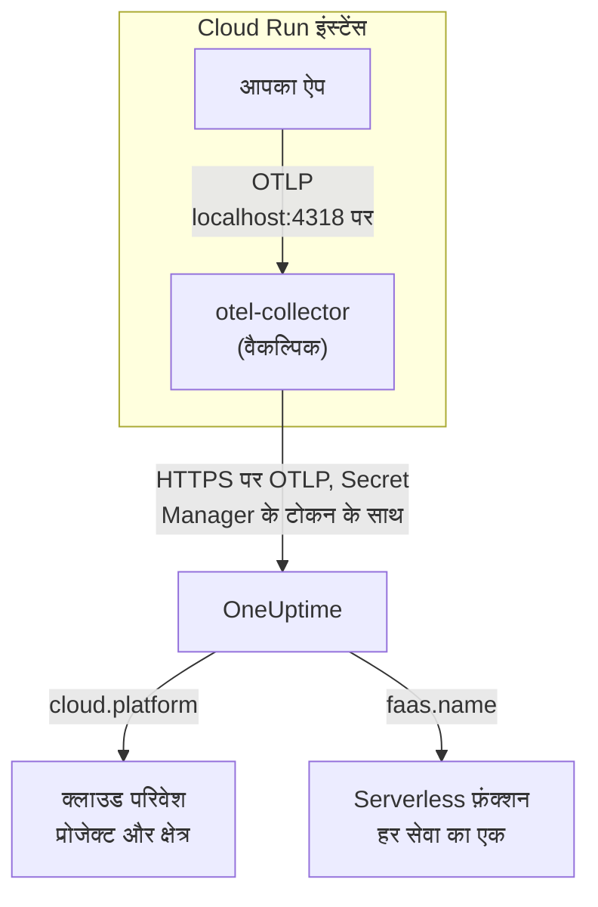

# Google Cloud Run

अपनी Cloud Run सेवाओं और जॉब के ट्रेस, लॉग और मेट्रिक्स OneUptime पर भेजें। `cloud.platform=gcp_cloud_run` रिपोर्ट करने वाली हर चीज़ हर Google Cloud प्रोजेक्ट और क्षेत्र के लिए एक **Cloud Environment** में आती है, जैसे _GCP Cloud Run · us-central1 · my-project_, और हर सेवा **Serverless फ़ंक्शन** में भी दिखती है।

:::cards
- [यह कैसे काम करता है](#यह-कैसे-काम-करता-है): GCP डिटेक्टर क्या सेट करता है, और कोई सेवा दो जगह क्यों दिखती है।
- [सेटअप करें](#सेटअप-करें): टोकन सहेजें, सेवा कॉन्फ़िगर करें, डिप्लॉय करें और जांचें।
- [sidecar वाली सेवा YAML](#sidecar-वाली-सेवा-yaml): एक कलेक्टर के साथ पूरी Cloud Run सेवा।
- [समस्या निवारण](#समस्या-निवारण): सीक्रेट त्रुटियाँ, sidecar का शुरू होने का क्रम और गायब परिवेश।
:::

## यह कैसे काम करता है



OpenTelemetry GCP रिसोर्स डिटेक्टर मेटाडेटा सर्वर और `K_SERVICE` व `K_REVISION` एनवायरनमेंट वेरिएबल पढ़ता है, और यह सेट करता है:

| एट्रिब्यूट | Cloud Run पर मान | किसलिए |
| ------------------ | ------------------------------ | ----------------------------------------------------------------------------------------- |
| `cloud.platform` | `gcp_cloud_run` | टेलीमेट्री को **क्लाउड परिवेश** में दर्ज करता है |
| `cloud.account.id` | प्रोजेक्ट ID | एनवायरनमेंट कुंजी का हिस्सा |
| `cloud.region` | `us-central1` | एनवायरनमेंट कुंजी का हिस्सा |
| `faas.name` | सेवा का नाम (`K_SERVICE`) | सेवा को **Serverless फ़ंक्शन** में भी दिखाता है |
| `faas.version` | संशोधन (`K_REVISION`) | सेवा के serverless फ़ंक्शन अवलोकन पर दिखता है; परिवेश इसका उपयोग नहीं करता |
| `faas.instance` | इंस्टेंस ID | एक चल रहे इंस्टेंस का नाम रखता है: **इंस्टेंस** में हर एक की एक पंक्ति |

> [!NOTE]
> Cloud Run जानबूझकर दो जगह दिखता है। क्योंकि डिटेक्टर `faas.name` सेट करता है, हर सेवा एक **Serverless फ़ंक्शन** भी है, जिसके अपने इनवोकेशन, त्रुटि दर और अवधि हैं। **Cloud Environment** उस प्रोजेक्ट और क्षेत्र की हर सेवा को एक साथ रखता है। कुछ भी दो बार संग्रहीत नहीं होता: वही टेलीमेट्री दोनों जगह दर्ज होती है।

एनवायरनमेंट कुंजी `gcp_cloud_run|my-project|us-central1` है।

## शुरू करने से पहले

- **एक इंजेशन कुंजी।** **प्रोजेक्ट सेटिंग्स → टेलीमेट्री और APM → इंजेशन कुंजियाँ** में एक **सर्वर** कुंजी बनाएं और उसका टोकन कॉपी करें।
- **`gcloud`**, प्रोजेक्ट में साइन इन किया हुआ, और Secret Manager API चालू: `gcloud services enable secretmanager.googleapis.com`।
- **OpenTelemetry SDK से इंस्ट्रूमेंट किया गया आपका एप्लिकेशन**, जो OTLP एक्सपोर्ट करता हो।

## चुनें कि टेलीमेट्री सेवा से कैसे बाहर जाए

| | SDK direct | Sidecar collector |
| --------------- | ---------------------------------------------------- | ---------------------------------------------------------------------- |
| अतिरिक्त कंटेनर | कोई नहीं | सेवा में `otel-collector` |
| किसके लिए सबसे अच्छा | एक सेवा, और Cloud Run जॉब | एक प्रोजेक्ट में कई सेवाएं, या ऐसा SDK जो डिटेक्टर नहीं चला सकता |
| टोकन किसके पास | एप्लिकेशन | कलेक्टर |
| सीक्रेट | `oneuptime-otlp-headers`, पूरा हेडर | `oneuptime-ingestion-token`, सिर्फ़ टोकन |

जॉब पूरा होने तक चलता है, इसलिए sidecar को चालू रखने की कोई वजह नहीं होती: SDK direct इस्तेमाल करें। नीचे हर चरण में दोनों के लिए एक टैब है; एक चुनें और हर चरण उसी का पालन करेगा।

## सेटअप करें

:::steps
### Secret Manager में टोकन सहेजें

> [!IMPORTANT]
> टोकन एक सीक्रेट है। इसे Secret Manager में रखें और सेवा में सीक्रेट पर आधारित एनवायरनमेंट वेरिएबल के रूप में इसका संदर्भ दें। सामान्य एनवायरनमेंट वेरिएबल प्रोजेक्ट के हर दर्शक को कंसोल में और `gcloud run services describe` में दिखता है।

:::tabs
@tab SDK direct
```bash
printf '%s' "x-oneuptime-token=YOUR_TELEMETRY_INGESTION_TOKEN" | gcloud secrets create oneuptime-otlp-headers \
  --data-file=- \
  --replication-policy=automatic

gcloud secrets add-iam-policy-binding oneuptime-otlp-headers \
  --member="serviceAccount:checkout-api@my-project.iam.gserviceaccount.com" \
  --role="roles/secretmanager.secretAccessor"
```

Cloud Run सीक्रेट का मान जैसा है वैसा ही वेरिएबल में डालता है, और `OTEL_EXPORTER_OTLP_HEADERS` को पूरा `name=value` जोड़ा चाहिए, इसलिए इस सीक्रेट में पूरा हेडर रहता है।
@tab Sidecar collector
```bash
printf '%s' "YOUR_TELEMETRY_INGESTION_TOKEN" | gcloud secrets create oneuptime-ingestion-token \
  --data-file=- \
  --replication-policy=automatic

gcloud secrets add-iam-policy-binding oneuptime-ingestion-token \
  --member="serviceAccount:checkout-api@my-project.iam.gserviceaccount.com" \
  --role="roles/secretmanager.secretAccessor"
```

कलेक्टर का कॉन्फ़िगरेशन हेडर का नाम जोड़ता है, इसलिए इस सीक्रेट में सिर्फ़ टोकन रहता है।
:::

`--member` में सेवा का रनटाइम सर्विस अकाउंट डालें, अपना यूज़र नहीं। `roles/secretmanager.secretAccessor` के बिना संशोधन डिप्लॉय नहीं होता और `Permission denied on secret` के साथ विफल होता है। अगर सेवा अब भी डिफ़ॉल्ट Compute सर्विस अकाउंट से चलती है, तो उस अकाउंट को रोल दें, और सेवा को उसका अपना अकाउंट देने पर विचार करें: डिफ़ॉल्ट अकाउंट प्रोजेक्ट की हर चीज़ के साथ साझा होता है।

### सेवा कॉन्फ़िगर करें

:::tabs
@tab SDK direct
1. **Google Cloud console → Cloud Run → click the service → Edit & deploy new revision**।
2. **Containers** टैब पर अपना कंटेनर खोलें और **Variables & Secrets** पर जाएं। नीचे दिए वेरिएबल जोड़ें।
3. **Reference a secret** पर क्लिक करें, `oneuptime-otlp-headers` और संस्करण `latest` चुनें, और इसे एनवायरनमेंट वेरिएबल `OTEL_EXPORTER_OTLP_HEADERS` के रूप में उपलब्ध कराएं।
4. **Security** टैब पर जांचें कि **Service account** वही है जिसे आपने `roles/secretmanager.secretAccessor` दिया था।

```bash
OTEL_SERVICE_NAME=checkout-api
OTEL_EXPORTER_OTLP_ENDPOINT=https://oneuptime.com/otlp
OTEL_EXPORTER_OTLP_PROTOCOL=http/protobuf
# Secret-backed (Variables & Secrets → Reference a secret), not typed here.
OTEL_EXPORTER_OTLP_HEADERS=x-oneuptime-token=YOUR_TELEMETRY_INGESTION_TOKEN
```

फिर अपनी भाषा का GCP रिसोर्स डिटेक्टर चालू करें:

| भाषा | GCP डिटेक्टर चालू करें |
| -------- | ------------------------------------------------------------------------------------------------------------------- |
| Node.js | `OTEL_NODE_RESOURCE_DETECTORS=env,host,os,gcp` (auto-instrumentations-node) |
| Python | `pip install opentelemetry-resourcedetector-gcp`, फिर `OTEL_EXPERIMENTAL_RESOURCE_DETECTORS=gcp_resource_detector` |
| Java | `-Dotel.resource.providers.gcp.enabled=true` |
| Go | `import "go.opentelemetry.io/contrib/detectors/gcp"` और `gcp.NewDetector()` को `resource.New` में पास करें |
| .NET | `OpenTelemetry.Resources.Gcp` पैकेज: `.ConfigureResource(r => r.AddGcpDetector())` |

या सब कुछ CLI से सेट करें:

```bash
gcloud run services update checkout-api --region us-central1 \
  --set-env-vars "^@^OTEL_SERVICE_NAME=checkout-api@OTEL_EXPORTER_OTLP_ENDPOINT=https://oneuptime.com/otlp@OTEL_EXPORTER_OTLP_PROTOCOL=http/protobuf@OTEL_NODE_RESOURCE_DETECTORS=env,host,os,gcp" \
  --set-secrets "OTEL_EXPORTER_OTLP_HEADERS=oneuptime-otlp-headers:latest"
```

`^@^` उपसर्ग `gcloud` को उस फ़्लैग की सूची `,` के बजाय `@` पर बाँटने को कहता है। इसके बिना `gcloud` `OTEL_NODE_RESOURCE_DETECTORS=env,host,os,gcp` को हर अल्पविराम पर बाँट देता है और `Bad syntax for dict arg [host]` के साथ विफल होता है।
@tab Sidecar collector
1. **Google Cloud console → Cloud Run → click the service → Edit & deploy new revision**।
2. **Containers** टैब पर अपना कंटेनर खोलें और **Variables & Secrets** पर जाएं। नीचे दिए एप्लिकेशन वेरिएबल जोड़ें।
3. **+ Add container** पर क्लिक करें। कंटेनर इमेज URL को `otel/opentelemetry-collector-contrib:latest` पर सेट करें, और **Container command and arguments** के नीचे आर्ग्युमेंट `--config=env:OTEL_COLLECTOR_CONFIG` जोड़ें।
4. नए कंटेनर के **Variables & Secrets** टैब पर **Reference a secret** से `oneuptime-ingestion-token` को एनवायरनमेंट वेरिएबल `ONEUPTIME_TOKEN` के रूप में दें। [sidecar वाली सेवा YAML](#sidecar-वाली-सेवा-yaml) के कलेक्टर कॉन्फ़िगरेशन के साथ वेरिएबल `OTEL_COLLECTOR_CONFIG` जोड़ें।
5. कलेक्टर के **Settings** टैब पर एक **Startup probe** (HTTP, पाथ `/`, पोर्ट `13133`) जोड़ें, और **Container start-up order** के नीचे अपने कंटेनर को `otel-collector` पर निर्भर बनाएं।
6. **Security** टैब पर जांचें कि **Service account** वही है जिसे आपने `roles/secretmanager.secretAccessor` दिया था।

एक Cloud Run इंस्टेंस के कंटेनर `localhost` साझा करते हैं, इसलिए एप्लिकेशन वहीं sidecar पर एक्सपोर्ट करता है:

```bash
OTEL_SERVICE_NAME=checkout-api
OTEL_EXPORTER_OTLP_ENDPOINT=http://localhost:4318
OTEL_EXPORTER_OTLP_PROTOCOL=http/protobuf
```

CLI से, sidecar नीचे दी गई सेवा YAML है, जिसे `gcloud run services replace service.yaml --region us-central1` से डिप्लॉय किया जाता है।
:::

अगर आप OneUptime को खुद होस्ट करते हैं, तो एंडपॉइंट के रूप में `https://YOUR-ONEUPTIME-HOST/otlp` इस्तेमाल करें।

### नया संशोधन डिप्लॉय करें

कंसोल में **Deploy** पर क्लिक करें। Cloud Run इन सेटिंग्स के साथ एक नया संशोधन शुरू करता है और तैयार होते ही उस पर ट्रैफ़िक भेजता है। `gcloud` कमांड अपने आप नया संशोधन डिप्लॉय कर देते हैं।

### कनेक्शन जांचें

```bash
curl -i https://oneuptime.com/otlp/v1/validate \
  -H "x-oneuptime-token: YOUR_TELEMETRY_INGESTION_TOKEN"
```

`"valid": true` के साथ `200` का मतलब है कि टोकन स्वीकार हो गया। `401` का मतलब है कि टोकन अज्ञात, रद्द, निष्क्रिय या समाप्त है। फिर सेवा को एक अनुरोध भेजें, और Cloud Logging में कलेक्टर के लॉग (`otel-collector` कंटेनर पर फ़िल्टर करके) में `401`, `connection refused` या `context deadline exceeded` खोजें। एक मिनट के भीतर परिवेश **क्लाउड → All Environments** में _GCP Cloud Run · us-central1 · my-project_ के रूप में दिखता है, और सेवा **Serverless फ़ंक्शन** में।
:::

## sidecar वाली सेवा YAML

कलेक्टर अपना पूरा कॉन्फ़िगरेशन `OTEL_COLLECTOR_CONFIG` (`--config=env:OTEL_COLLECTOR_CONFIG`) से पढ़ता है, और टोकन सीक्रेट से `${env:ONEUPTIME_TOKEN}` के ज़रिए। `run.googleapis.com/container-dependencies` एनोटेशन Cloud Run से पहले कलेक्टर शुरू करवाता है, और एप्लिकेशन शुरू करने से पहले उसके स्टार्टअप प्रोब का इंतज़ार करवाता है:

```yaml title="service.yaml"
apiVersion: serving.knative.dev/v1
kind: Service
metadata:
  name: checkout-api
spec:
  template:
    metadata:
      annotations:
        # "app" depends on "otel-collector": the collector starts first and
        # must pass its startup probe before the app container is started.
        run.googleapis.com/container-dependencies: '{"app":["otel-collector"]}'
    spec:
      serviceAccountName: checkout-api@my-project.iam.gserviceaccount.com
      containers:
        - name: app
          image: us-central1-docker.pkg.dev/my-project/apps/checkout-api:1.4.2
          ports:
            - containerPort: 8080
          env:
            - name: OTEL_SERVICE_NAME
              value: checkout-api
            - name: OTEL_EXPORTER_OTLP_ENDPOINT
              value: http://localhost:4318
            - name: OTEL_EXPORTER_OTLP_PROTOCOL
              value: http/protobuf
        - name: otel-collector
          image: otel/opentelemetry-collector-contrib:latest
          args:
            - --config=env:OTEL_COLLECTOR_CONFIG
          env:
            - name: ONEUPTIME_TOKEN
              valueFrom:
                secretKeyRef:
                  name: oneuptime-ingestion-token
                  key: latest
            - name: OTEL_COLLECTOR_CONFIG
              value: |
                receivers:
                  otlp:
                    protocols:
                      http:
                        endpoint: 0.0.0.0:4318
                      grpc:
                        endpoint: 0.0.0.0:4317
                processors:
                  # Stamps cloud.provider, cloud.platform=gcp_cloud_run,
                  # cloud.account.id, cloud.region and faas.* on everything.
                  resourcedetection:
                    detectors: [env, gcp]
                    timeout: 5s
                  batch: {}
                exporters:
                  otlphttp/oneuptime:
                    endpoint: https://oneuptime.com/otlp
                    headers:
                      x-oneuptime-token: ${env:ONEUPTIME_TOKEN}
                extensions:
                  health_check:
                    endpoint: 0.0.0.0:13133
                service:
                  extensions: [health_check]
                  pipelines:
                    traces:
                      receivers: [otlp]
                      processors: [resourcedetection, batch]
                      exporters: [otlphttp/oneuptime]
                    metrics:
                      receivers: [otlp]
                      processors: [resourcedetection, batch]
                      exporters: [otlphttp/oneuptime]
                    logs:
                      receivers: [otlp]
                      processors: [resourcedetection, batch]
                      exporters: [otlphttp/oneuptime]
          startupProbe:
            httpGet:
              path: /
              port: 13133
            periodSeconds: 2
            failureThreshold: 15
          resources:
            limits:
              cpu: 500m
              memory: 256Mi
```

इसे डिप्लॉय करें:

```bash
gcloud run services replace service.yaml --region us-central1
```

सिर्फ़ वह कंटेनर जो अनुरोध लेता है (`app`), `ports` घोषित करता है; sidecar को ऐसा नहीं करना चाहिए।

## नेटवर्किंग

- **डिफ़ॉल्ट रूप से**, Cloud Run सेवा सीधे इंटरनेट तक पहुँचती है, और `oneuptime.com` पर एक्सपोर्ट करने के लिए और कुछ नहीं चाहिए।
- **VPC egress: All traffic के साथ** (`--vpc-egress all-traffic`, Direct VPC egress या Serverless VPC Access कनेक्टर के ज़रिए), आउटबाउंड ट्रैफ़िक आपके VPC से होकर जाता है, जिसे फिर OneUptime होस्ट तक पहुँचने के लिए Cloud NAT (या किसी प्रॉक्सी तक का रूट) चाहिए। डिफ़ॉल्ट `private-ranges-only` के साथ सिर्फ़ निजी पते VPC इस्तेमाल करते हैं और OneUptime तक सीधे पहुँचा जाता है।
- VPC के **आउटबाउंड फ़ायरवॉल नियम** OneUptime होस्ट के लिए TCP 443 की अनुमति दें।
- **VPC के अंदर सेल्फ़-होस्टेड OneUptime** उलटा मामला है: ट्रैफ़िक को VPC से होकर भेजें (`private-ranges-only` या `all-traffic`), ताकि `https://YOUR-ONEUPTIME-HOST/otlp` वहाँ रिज़ॉल्व हो।

## आपको क्या मिलता है

- **अवलोकन**: आपके ट्रेस से अनुरोध, त्रुटि दर और p95 लेटेंसी।
- **इंस्टेंस**: हर Cloud Run इंस्टेंस की एक पंक्ति, `faas.instance` के नाम से। Cloud Run किसी sidecar को कंटेनर का संसाधन उपयोग नहीं दिखाता, इसलिए **CPU** और **मेमोरी** टाइलें तब तक खाली रहती हैं जब तक आप खुद उसी `faas.instance` के साथ `container.cpu.utilization` और `container.memory.usage` मेट्रिक्स नहीं भेजते। यहाँ अनुरोध वाली टाइलें देखें, और इंस्टेंस का CPU और मेमोरी Cloud Monitoring पर छोड़ दें।
- **लॉग**, **ट्रेस** और **मेट्रिक्स**, परिवेश के अनुसार फ़िल्टर किए हुए।
- वही सेवा **Serverless फ़ंक्शन** में (`faas.name` के अनुसार) और **सेवाएं** में (`service.name` के अनुसार)।

## समस्या निवारण

:::details संशोधन "Permission denied on secret" के साथ विफल होता है
रनटाइम सर्विस अकाउंट के पास सीक्रेट पर `roles/secretmanager.secretAccessor` नहीं है, या बाइंडिंग उस सीक्रेट से अलग किसी सीक्रेट पर है जिसका सेवा संदर्भ देती है। रनटाइम सर्विस अकाउंट को `--member` बनाकर `gcloud secrets add-iam-policy-binding` कमांड फिर से चलाएं।
:::

:::details Cloud Run container-dependencies को अस्वीकार करता है
एनोटेशन ऐसे कंटेनर का नाम लेता है जो मौजूद नहीं है, या कलेक्टर के पास कोई स्टार्टअप प्रोब नहीं है, इसलिए Cloud Run यह नहीं बता पाता कि वह कब तैयार है।
:::

:::details सेवा Serverless फ़ंक्शन में है, लेकिन कोई परिवेश नहीं है
टेलीमेट्री में `cloud.platform` नहीं है: SDK में GCP डिटेक्टर चालू नहीं है, या कलेक्टर की `detectors` सूची में `gcp` नहीं है।
:::

:::details परिवेश मौजूद है, लेकिन इंस्टेंस खाली है
टेलीमेट्री में न `faas.instance` है न `service.instance.id`। कारण वही है: डिटेक्टर नहीं चलता।
:::

जो परिवेश कभी नहीं दिखता, **डिस्कनेक्टेड** दिखाता है या दो में बँट जाता है, उसे [क्लाउड समस्या निवारण](/docs/telemetry/cloud-troubleshooting) में कवर किया गया है।

## अगले कदम

:::cards
- [क्लाउड परिवेश](/docs/telemetry/cloud-environments): परिवेश और इंस्टेंस कैसे पहचाने जाते हैं।
- [Serverless फ़ंक्शन](/docs/telemetry/serverless-functions): हर Cloud Run सेवा का सेवा-स्तर दृश्य।
- [क्लाउड समस्या निवारण](/docs/telemetry/cloud-troubleshooting): वे विफलताएँ जो हर प्लेटफ़ॉर्म में होती हैं।
- [क्लाउड संसाधन (IaaS और PaaS)](/docs/telemetry/cloud-resources): Cloud Monitoring से आपके Cloud SQL, लोड बैलेंसर और बकेट।
:::
