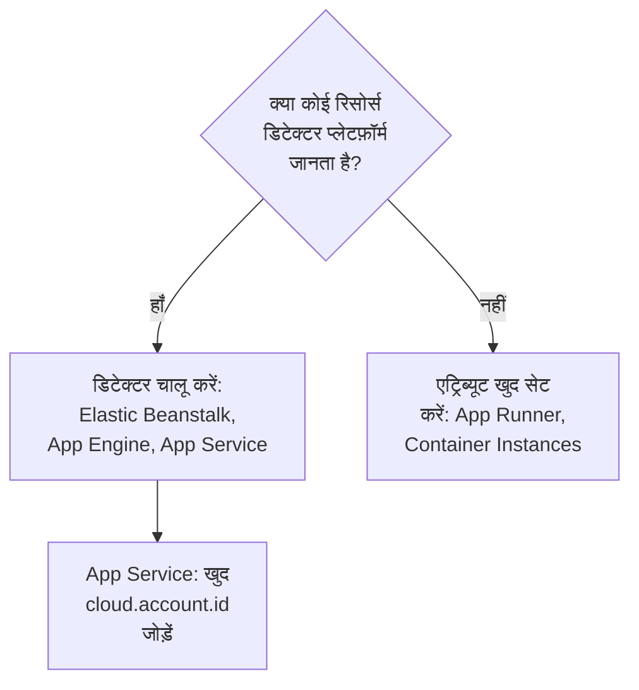

# अन्य क्लाउड प्लेटफ़ॉर्म

उन प्रबंधित प्लेटफ़ॉर्म को सेट करें जिनका अपना पेज नहीं है: AWS Elastic Beanstalk, AWS App Runner, Google App Engine, Azure App Service और Azure Container Instances। नियम हर प्लेटफ़ॉर्म जैसा ही है: जो टेलीमेट्री `cloud.account.id` और `cloud.region` के साथ कोई प्रबंधित `cloud.platform` लिए होती है, वह हर प्लेटफ़ॉर्म, खाते और क्षेत्र के लिए एक **Cloud Environment** में आती है, और इंस्टेंस पहचान हर चल रहे इंस्टेंस को **इंस्टेंस** में एक पंक्ति देती है।

:::cards
- [AWS Elastic Beanstalk](#aws-elastic-beanstalk): हर इंस्टेंस पर एक कलेक्टर, Beanstalk और EC2 डिटेक्टर के साथ।
- [AWS App Runner](#aws-app-runner): हाथ से सेट किए एट्रिब्यूट, Secrets Manager से टोकन।
- [Google App Engine](#google-app-engine): GCP डिटेक्टर, सेटिंग्स `app.yaml` में।
- [Azure App Service](#azure-app-service): Azure डिटेक्टर, Key Vault संदर्भ और हाथ से सेट सब्सक्रिप्शन।
- [Azure Container Instances](#azure-container-instances): हाथ से सेट किए एट्रिब्यूट, सुरक्षित वेरिएबल के रूप में टोकन।
:::

## हर प्लेटफ़ॉर्म को क्या चाहिए

इन प्लेटफ़ॉर्म में फ़र्क यह है कि `cloud.*` एट्रिब्यूट कौन सेट करता है, और क्लाउड के कंसोल में सेटिंग्स कहाँ जाती हैं:



| प्लेटफ़ॉर्म | `cloud.platform` | `cloud.*` कौन भरता है | इंस्टेंस पहचान |
| ------------------------- | --------------------------- | ------------------------------------------------------------------------------------------ | ----------------------------------------------------------- |
| AWS Elastic Beanstalk | `aws_elastic_beanstalk` | कलेक्टर के `elastic_beanstalk` और `ec2` डिटेक्टर; Node.js में `aws` | `host.id` (डिप्लॉयमेंट का `service.instance.id` हटाएं) |
| AWS App Runner | `aws_app_runner` | आप (कोई डिटेक्टर नहीं) | `host.name` |
| Google App Engine | `gcp_app_engine` | `gcp` डिटेक्टर (कलेक्टर का और हर SDK का) | `faas.instance` |
| Azure App Service | `azure_app_service` | कलेक्टर का `azureappservice`, Node.js और .NET के `azure` डिटेक्टर; `cloud.account.id` आप सेट करते हैं | `service.instance.id`, फिर `host.id` |
| Azure Container Instances | `azure_container_instances` | आप (कोई डिटेक्टर नहीं) | `host.name` |

नीचे हर सेक्शन के लिए **प्रोजेक्ट सेटिंग्स → टेलीमेट्री और APM → इंजेशन कुंजियाँ** से एक **सर्वर** इंजेशन कुंजी चाहिए, और OpenTelemetry SDK से इंस्ट्रूमेंट किया गया एक एप्लिकेशन। अगर आप OneUptime को खुद होस्ट करते हैं, तो `https://oneuptime.com/otlp` की जगह `https://YOUR-ONEUPTIME-HOST/otlp` इस्तेमाल करें।

> [!IMPORTANT]
> इनमें से हर प्लेटफ़ॉर्म पर टोकन एक सीक्रेट है। हर सेक्शन उस प्लेटफ़ॉर्म का सीक्रेट स्टोर बताता है। किसी सामान्य एनवायरनमेंट वेरिएबल में लिखा टोकन हर वह व्यक्ति पढ़ सकता है जो ऐप का कॉन्फ़िगरेशन पढ़ सकता है।

## AWS Elastic Beanstalk

`cloud.platform`: `aws_elastic_beanstalk`। Beanstalk डिटेक्टर इंस्टेंस पर `/var/elasticbeanstalk/xray/environment.conf` पढ़ता है और `cloud.platform`, `service.instance.id`, `service.version` और परिवेश का नाम सेट करता है। यह खाता और क्षेत्र नहीं जानता, इसलिए इसे EC2 डिटेक्टर के साथ जोड़ें, जो इन्हें जानता है और `host.id` भी सेट करता है।

हर इंस्टेंस पर इस कॉन्फ़िगरेशन के साथ एक OpenTelemetry Collector चलाएं:

```yaml title="config.yaml"
receivers:
  otlp:
    protocols:
      http:
        endpoint: 0.0.0.0:4318
      grpc:
        endpoint: 0.0.0.0:4317
processors:
  # elastic_beanstalk sets cloud.platform and service.instance.id; ec2 adds
  # cloud.account.id, cloud.region and host.id. The first detector to set an
  # attribute wins, so elastic_beanstalk comes first.
  resourcedetection:
    detectors: [env, elastic_beanstalk, ec2]
    timeout: 5s
  # The Beanstalk detector's service.instance.id is the deployment ID, shared
  # by every instance of a deployment: drop it, so that ec2's host.id names
  # each instance.
  resource:
    attributes:
      - key: service.instance.id
        action: delete
  batch: {}
exporters:
  otlphttp/oneuptime:
    endpoint: https://oneuptime.com/otlp
    headers:
      x-oneuptime-token: ${env:ONEUPTIME_TOKEN}
service:
  pipelines:
    traces:
      receivers: [otlp]
      processors: [resourcedetection, resource, batch]
      exporters: [otlphttp/oneuptime]
    metrics:
      receivers: [otlp]
      processors: [resourcedetection, resource, batch]
      exporters: [otlphttp/oneuptime]
    logs:
      receivers: [otlp]
      processors: [resourcedetection, resource, batch]
      exporters: [otlphttp/oneuptime]
```

:::steps
1. टोकन को Secrets Manager में सहेजें: `aws secretsmanager create-secret --name oneuptime/ingestion-token --secret-string "YOUR_TELEMETRY_INGESTION_TOKEN"`। Beanstalk की एनवायरनमेंट प्रॉपर्टी परिवेश के कॉन्फ़िगरेशन में रहती हैं, किसी सीक्रेट स्टोर में नहीं, इसलिए सीक्रेट को इंस्टेंस प्रोफ़ाइल के साथ किसी प्लेटफ़ॉर्म हुक से पढ़ें। इंस्टेंस प्रोफ़ाइल को उस पर `secretsmanager:GetSecretValue` चाहिए।
2. कलेक्टर को `.platform/hooks/postdeploy/` (या `.ebextensions`) की स्क्रिप्ट से इंस्टॉल करें: `otelcol-contrib` पैकेज, ऊपर दिए कॉन्फ़िगरेशन के साथ, और सीक्रेट उसके एनवायरनमेंट में `ONEUPTIME_TOKEN` के रूप में।
3. **AWS Console → Elastic Beanstalk → Environments → your environment → Configuration**।
4. **Updates, monitoring, and logging** श्रेणी में **Edit** पर क्लिक करें और **Environment properties** तक स्क्रॉल करें। `OTEL_SERVICE_NAME`, `http://localhost:4318` पर सेट `OTEL_EXPORTER_OTLP_ENDPOINT`, और `http/protobuf` पर सेट `OTEL_EXPORTER_OTLP_PROTOCOL` जोड़ें।
5. **Apply** पर क्लिक करें। Beanstalk नई प्रॉपर्टी के साथ एप्लिकेशन को फिर से शुरू करता है।
:::

Node.js एप्लिकेशन कलेक्टर के बिना भी काम कर सकते हैं: SDK के डिटेक्टर में Beanstalk और EC2 शामिल हैं। `OTEL_EXPORTER_OTLP_ENDPOINT` को `https://oneuptime.com/otlp`, `OTEL_EXPORTER_OTLP_HEADERS` को `x-oneuptime-token=YOUR_TELEMETRY_INGESTION_TOKEN` और `OTEL_NODE_RESOURCE_DETECTORS=env,host,os,aws` सेट करें। तब टोकन एक एनवायरनमेंट प्रॉपर्टी में रहता है। बाद में किसी ट्रेस के रिसोर्स एट्रिब्यूट जांचें: अगर `cloud.platform` में `aws_ec2` दिखता है, तो आपके SDK संस्करण ने EC2 डिटेक्टर को जीतने दिया, और कलेक्टर ही भरोसेमंद रास्ता है।

**नेटवर्किंग:** निजी सबनेट के इंस्टेंस को NAT गेटवे चाहिए, और इंस्टेंस के सिक्योरिटी ग्रुप को OneUptime होस्ट के लिए TCP 443 पर आउटबाउंड की अनुमति देनी चाहिए।

## AWS App Runner

`cloud.platform`: `aws_app_runner`। कोई डिटेक्टर नहीं है, इसलिए एट्रिब्यूट आप खुद सेट करते हैं। App Runner, Secrets Manager (या SSM Parameter Store) का सीक्रेट किसी एनवायरनमेंट वेरिएबल में डाल सकता है।

```bash
OTEL_SERVICE_NAME=checkout-api
OTEL_EXPORTER_OTLP_ENDPOINT=https://oneuptime.com/otlp
OTEL_EXPORTER_OTLP_PROTOCOL=http/protobuf
# From Secrets Manager: the secret holds the whole header.
OTEL_EXPORTER_OTLP_HEADERS=x-oneuptime-token=YOUR_TELEMETRY_INGESTION_TOKEN
OTEL_RESOURCE_ATTRIBUTES=cloud.provider=aws,cloud.platform=aws_app_runner,cloud.region=us-east-1,cloud.account.id=123456789012
OTEL_NODE_RESOURCE_DETECTORS=env,host,os
```

क्षेत्र और खाता ID को अपने मानों से बदलें। `host` डिटेक्टर `host.name` देता है, यानी कंटेनर का होस्टनेम, जो हर App Runner इंस्टेंस के लिए अलग होता है, और OneUptime इसी से इंस्टेंस का नाम रखता है।

:::steps
1. पूरा हेडर Secrets Manager में सहेजें: `aws secretsmanager create-secret --name oneuptime/otlp-headers --secret-string "x-oneuptime-token=YOUR_TELEMETRY_INGESTION_TOKEN"`। App Runner सीक्रेट का मान जैसा है वैसा ही वेरिएबल में डालता है।
2. **AWS Console → App Runner → Services → your service → Configuration → Configure service** (**Configuration** टैब में **Edit** पर क्लिक करें)।
3. **Environment variables** के नीचे ऊपर दिए हर सामान्य मान के लिए **Add environment variable** पर क्लिक करें।
4. `OTEL_EXPORTER_OTLP_HEADERS` को **Source: Secrets Manager** और सीक्रेट के ARN के साथ जोड़ें। **Security → Instance role** के नीचे ऐसा रोल चुनें जिसके पास सीक्रेट पर `secretsmanager:GetSecretValue` हो: इंस्टेंस रोल, न कि इमेज खींचने वाला एक्सेस रोल।
5. **Save changes** पर क्लिक करें। App Runner एक नया संस्करण डिप्लॉय करता है।
:::

**नेटवर्किंग:** बिना VPC कनेक्टर वाली सेवा सीधे इंटरनेट तक पहुँचती है। **Outgoing network traffic: Custom VPC** के साथ आउटबाउंड ट्रैफ़िक आपके VPC से होकर जाता है, जिसे NAT गेटवे और OneUptime होस्ट के लिए TCP 443 पर सिक्योरिटी ग्रुप का आउटबाउंड नियम चाहिए।

## Google App Engine

`cloud.platform`: `gcp_app_engine`। GCP डिटेक्टर `GAE_SERVICE`, `GAE_VERSION` और `GAE_INSTANCE` और मेटाडेटा सर्वर से App Engine standard और flexible को पहचानता है। यह `cloud.account.id` (प्रोजेक्ट), `cloud.region`, `faas.name`, `faas.version` और `faas.instance` सेट करता है। Cloud Run की तरह, `faas.name` की वजह से हर App Engine सेवा **Serverless फ़ंक्शन** में भी दिखती है, जबकि परिवेश प्रोजेक्ट और क्षेत्र को एक साथ रखता है।

| भाषा | GCP डिटेक्टर चालू करें |
| -------- | ------------------------------------------------------------------------------------------------------------------- |
| Node.js | `OTEL_NODE_RESOURCE_DETECTORS=env,host,os,gcp` |
| Python | `pip install opentelemetry-resourcedetector-gcp`, फिर `OTEL_EXPERIMENTAL_RESOURCE_DETECTORS=gcp_resource_detector` |
| Java | `-Dotel.resource.providers.gcp.enabled=true` |
| Go | `go.opentelemetry.io/contrib/detectors/gcp` → `gcp.NewDetector()` |
| .NET | `OpenTelemetry.Resources.Gcp` → `.AddGcpDetector()` |

App Engine के कंसोल में एनवायरनमेंट वेरिएबल के लिए कोई एडिटर नहीं है: वे `app.yaml` में रहते हैं।

```yaml title="app.yaml"
runtime: nodejs22
env_variables:
  OTEL_SERVICE_NAME: checkout-api
  OTEL_EXPORTER_OTLP_ENDPOINT: https://oneuptime.com/otlp
  OTEL_EXPORTER_OTLP_PROTOCOL: http/protobuf
  OTEL_NODE_RESOURCE_DETECTORS: env,host,os,gcp
  # Do not commit the real value. Template it in CI, or read the secret at
  # start-up with the Secret Manager client instead.
  OTEL_EXPORTER_OTLP_HEADERS: x-oneuptime-token=YOUR_TELEMETRY_INGESTION_TOKEN
```

:::steps
1. पूरा हेडर Secret Manager में सहेजें: `printf '%s' "x-oneuptime-token=YOUR_TELEMETRY_INGESTION_TOKEN" | gcloud secrets create oneuptime-otlp-headers --data-file=-`। App Engine सर्विस अकाउंट (`my-project@appspot.gserviceaccount.com`) को उस पर `roles/secretmanager.secretAccessor` दें।
2. अपनी डिप्लॉय पाइपलाइन में सीक्रेट को `app.yaml` में डालें, और कमिट की गई फ़ाइल में एक प्लेसहोल्डर रखें। या स्टार्टअप पर `projects/PROJECT_ID/secrets/oneuptime-otlp-headers/versions/latest` पढ़ें और उसे कोड में एक्सपोर्टर के `headers` विकल्प को दें।
3. `gcloud app deploy` से डिप्लॉय करें। कंसोल में **App Engine → Versions** नया संस्करण दिखाता है, और **App Engine → Services** वह सेवा दिखाता है जो **Serverless फ़ंक्शन** में दिखती है।
:::

**नेटवर्किंग:** App Engine standard सीधे इंटरनेट तक पहुँचता है। flexible परिवेश के इंस्टेंस एक VPC में रहते हैं: अगर सबनेट पर कोई बाहरी IP नहीं है, तो उन्हें Cloud NAT चाहिए, और OneUptime होस्ट के लिए TCP 443 पर एक आउटबाउंड फ़ायरवॉल नियम।

## Azure App Service

`cloud.platform`: `azure_app_service`। Node.js और .NET के Azure डिटेक्टर, और कलेक्टर का `azureappservice` डिटेक्टर, App Service द्वारा सेट किए गए `WEBSITE_*` वेरिएबल पढ़ते हैं। ये `cloud.platform`, `cloud.region`, `service.instance.id` (`WEBSITE_INSTANCE_ID` से), `deployment.environment` (स्लॉट) और `host.id` भरते हैं। इनमें से कोई भी `cloud.account.id` सेट नहीं करता: सब्सक्रिप्शन ID खुद जोड़ें, वरना एनवायरनमेंट कुंजी में खाते वाला सेगमेंट खाली रहेगा।

```bash
OTEL_SERVICE_NAME=checkout-api
OTEL_EXPORTER_OTLP_ENDPOINT=https://oneuptime.com/otlp
OTEL_EXPORTER_OTLP_PROTOCOL=http/protobuf
# The Key Vault reference, which resolves to the whole header.
OTEL_EXPORTER_OTLP_HEADERS=@Microsoft.KeyVault(SecretUri=https://my-vault.vault.azure.net/secrets/oneuptime-otlp-headers/)
OTEL_RESOURCE_ATTRIBUTES=cloud.account.id=00000000-0000-0000-0000-000000000000
# Node.js:
OTEL_NODE_RESOURCE_DETECTORS=env,host,os,azure
```

SDK डिटेक्टर प्लेटफ़ॉर्म को बिंदु के साथ `azure.app_service` लिखते हैं; OneUptime इसे मिलते ही `azure_app_service` में बदल देता है। .NET में `OpenTelemetry.Resources.Azure` जोड़ें और `.ConfigureResource(r => r.AddAzureAppServiceDetector())` कॉल करें। दूसरी भाषाएँ `OTEL_RESOURCE_ATTRIBUTES` में `cloud.provider=azure,cloud.platform=azure_app_service,cloud.region=<region>` जोड़ती हैं, और कोड में `service.instance.id` को `WEBSITE_INSTANCE_ID` से लेती हैं।

:::steps
1. ऐप की सिस्टम-असाइन्ड प्रबंधित पहचान चालू करें (**Settings → Identity**), और उसे वॉल्ट पर **Key Vault Secrets User** दें। पूरा हेडर, `x-oneuptime-token=YOUR_TELEMETRY_INGESTION_TOKEN`, सीक्रेट `oneuptime-otlp-headers` के रूप में सहेजें।
2. **Azure portal → App Services → your app → Settings → Environment variables** (पुराने पोर्टल में **Configuration → Application settings**)।
3. ऊपर दिए हर वेरिएबल को **+ Add** से जोड़ें। `OTEL_EXPORTER_OTLP_HEADERS` का मान Key Vault संदर्भ है।
4. **Apply** पर क्लिक करें, फिर **Confirm** पर: ऐप नई सेटिंग्स के साथ फिर से शुरू होता है। डिप्लॉयमेंट स्लॉट की अपनी सेटिंग्स होती हैं: अगर सिर्फ़ एक स्लॉट को टेलीमेट्री भेजनी है, तो टोकन को **deployment slot setting** के रूप में चिह्नित करें।
:::

**नेटवर्किंग:** जब तक **VNet integration** के साथ **Route All** चालू न हो, App Service सीधे इंटरनेट तक पहुँचता है। तब VNet को NAT गेटवे चाहिए, या किसी ऐसे फ़ायरवॉल तक रूट जो OneUptime होस्ट के लिए TCP 443 की अनुमति देता हो।

## Azure Container Instances

`cloud.platform`: `azure_container_instances`। कोई डिटेक्टर नहीं है, इसलिए एट्रिब्यूट आप खुद सेट करते हैं। किसी कंटेनर ग्रुप के एनवायरनमेंट वेरिएबल बनाते समय तय हो जाते हैं: एक भी बदलने का मतलब है ग्रुप को फिर से बनाना। टोकन को `--secure-environment-variables` से दें, ताकि `az container show` उसे न लौटाए:

```bash
az container create \
  --resource-group my-rg \
  --name checkout-api \
  --image myregistry.azurecr.io/checkout-api:1.4.2 \
  --location eastus \
  --environment-variables \
    OTEL_SERVICE_NAME=checkout-api \
    OTEL_EXPORTER_OTLP_ENDPOINT=https://oneuptime.com/otlp \
    OTEL_EXPORTER_OTLP_PROTOCOL=http/protobuf \
    "OTEL_RESOURCE_ATTRIBUTES=cloud.provider=azure,cloud.platform=azure_container_instances,cloud.region=eastus,cloud.account.id=00000000-0000-0000-0000-000000000000" \
    OTEL_NODE_RESOURCE_DETECTORS=env,host,os \
  --secure-environment-variables \
    "OTEL_EXPORTER_OTLP_HEADERS=x-oneuptime-token=YOUR_TELEMETRY_INGESTION_TOKEN"
```

`host` डिटेक्टर का `host.name`, यानी कंटेनर ग्रुप का होस्टनेम, इंस्टेंस का नाम रखता है। यहाँ भी sidecar कलेक्टर काम करता है, क्योंकि कंटेनर ग्रुप ECS टास्क की तरह कई कंटेनर चलाता है: [Azure Container Apps](/docs/telemetry/cloud-azure-container-apps) वाला `detectors: [env]` और `OTEL_RESOURCE_ATTRIBUTES` का तरीका इस्तेमाल करें। अगर यह ग्रुप की पहचान के साथ `container.cpu.utilization` और `container.memory.usage` भेजता है, तो **CPU** और **मेमोरी** टाइलें भी यही भरता है।

:::steps
1. **Azure portal → Container Instances → + Create**। **Basics** टैब भरें: रिसोर्स ग्रुप, नाम, क्षेत्र और इमेज।
2. **Advanced** टैब पर **Environment variables** के नीचे हर वेरिएबल जोड़ें। `OTEL_EXPORTER_OTLP_HEADERS` के लिए **Mark as secure** को **Yes** पर सेट करें, ताकि पोर्टल और API उसका मान न दिखाएं।
3. **Review + create** पर क्लिक करें, फिर **Create** पर। बाद में कोई वेरिएबल बदलने के लिए ग्रुप हटाएं और उसे फिर से बनाएं।
:::

**नेटवर्किंग:** सार्वजनिक IP वाला कंटेनर ग्रुप सीधे इंटरनेट तक पहुँचता है। VNet सबनेट वाला ग्रुप सिर्फ़ VNet के रूट से बाहर जाता है: एक NAT गेटवे जोड़ें, या फ़ायरवॉल या NSG पर OneUptime होस्ट के लिए TCP 443 की अनुमति दें।

## कनेक्शन जांचें

आपने कोई भी प्लेटफ़ॉर्म सेट किया हो, पहले टोकन जांचें, फिर परिवेश खोजें:

```bash
curl -i https://oneuptime.com/otlp/v1/validate \
  -H "x-oneuptime-token: YOUR_TELEMETRY_INGESTION_TOKEN"
```

`"valid": true` के साथ `200` का मतलब है कि टोकन स्वीकार हो गया। `401` का मतलब है कि टोकन अज्ञात, रद्द, निष्क्रिय या समाप्त है। पहला स्पैन, लॉग या मेट्रिक आने के एक मिनट के भीतर परिवेश **क्लाउड → All Environments** में दिखता है, प्लेटफ़ॉर्म, क्षेत्र और खाते के नाम पर।

## समस्या निवारण

:::details Beanstalk इंस्टेंस होस्ट में दिखते हैं
EC2 डिटेक्टर का `cloud.platform=aws_ec2` जीत गया। जो डिटेक्टर किसी एट्रिब्यूट को पहले सेट करता है, वही जीतता है, इसलिए `detectors` में `elastic_beanstalk` को `ec2` से पहले रखें। कलेक्टर के बिना Node.js SDK भी EC2 डिटेक्टर को तरजीह दे सकता है: कलेक्टर चलाएं।
:::

:::details हर Beanstalk इंस्टेंस इंस्टेंस में एक ही पंक्ति साझा करता है
Beanstalk डिटेक्टर का `service.instance.id` डिप्लॉयमेंट ID है, जो किसी डिप्लॉयमेंट के हर इंस्टेंस में साझा होता है, और यह `host.id` से पहले पढ़ा जाता है। उसे हटाने वाले `resource` प्रोसेसर को हर पाइपलाइन में रखें।
:::

:::details किसी App Service ऐप को 401 मिलता है
Key Vault संदर्भ रिज़ॉल्व नहीं हुआ, इसलिए App Service ने शाब्दिक `@Microsoft.KeyVault(...)` टेक्स्ट को ही हेडर के रूप में भेज दिया। ऐप की प्रबंधित पहचान को वॉल्ट पर **Key Vault Secrets User** दें, और जांचें कि सीक्रेट में पूरा हेडर `x-oneuptime-token=...` है।
:::

:::details किसी App Service परिवेश में खाते वाला सेगमेंट खाली है
App Service का कोई भी डिटेक्टर `cloud.account.id` सेट नहीं करता। हर ऐप पर `OTEL_RESOURCE_ATTRIBUTES` में सब्सक्रिप्शन ID जोड़ें: इसके साथ और इसके बिना वाली टेलीमेट्री दो परिवेशों में जाती है।
:::

:::details Container Instances का बदला हुआ वेरिएबल असर नहीं करता
किसी कंटेनर ग्रुप के एनवायरनमेंट वेरिएबल बनाते समय तय हो जाते हैं। ग्रुप हटाएं और नए मानों के साथ उसे फिर से बनाएं।
:::

बाकी के लिए [क्लाउड समस्या निवारण](/docs/telemetry/cloud-troubleshooting) देखें, खास तौर पर ऐसा परिवेश जो **होस्ट** में, सिर्फ़ **Serverless फ़ंक्शन** में (GCP डिटेक्टर के बिना App Engine), या दो बार (कुछ डिप्लॉयमेंट पर `cloud.account.id` सेट है और कुछ पर नहीं) दिखता है।

## अगले कदम

:::cards
- [क्लाउड परिवेश](/docs/telemetry/cloud-environments): परिवेश और इंस्टेंस कैसे पहचाने जाते हैं।
- [क्लाउड समस्या निवारण](/docs/telemetry/cloud-troubleshooting): वे विफलताएँ जो हर प्लेटफ़ॉर्म में होती हैं।
- [Serverless फ़ंक्शन](/docs/telemetry/serverless-functions): Lambda, Cloud Functions और Azure Functions।
- [क्लाउड संसाधन (IaaS और PaaS)](/docs/telemetry/cloud-resources): आपके क्लाउड की अपनी निगरानी से आपके ऐप के आसपास के संसाधन।
:::
