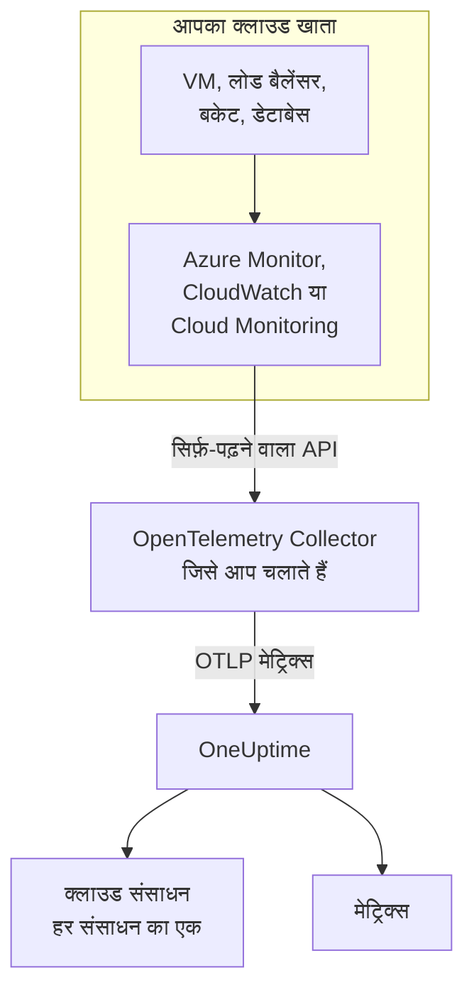
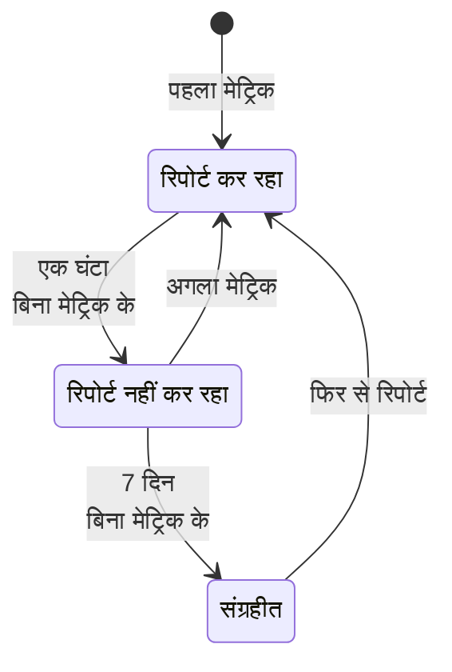

# क्लाउड संसाधन (IaaS और PaaS)

**Cloud Resources** आपके AWS, Azure और Google Cloud खातों के IaaS और PaaS संसाधनों की सूची दिखाता है: वर्चुअल मशीनें, डिस्क, लोड बैलेंसर, बकेट, प्रबंधित डेटाबेस, कैश, कतारें, API गेटवे और बाकी सब। हर संसाधन का अपना पेज होता है, जिसमें उसका प्रकार, क्षेत्र और खाता, प्रदाता की दी हुई उसकी ID, प्रदाता द्वारा उसके बारे में प्रकाशित हर मेट्रिक, और OneUptime के किसी भी दूसरे संसाधन की तरह स्वामी और लेबल होते हैं। इन्हें **क्लाउड → सभी संसाधन** में देखें।

:::cards
- [Azure कनेक्ट करें](#azure-कनेक्ट-करें): किसी सब्सक्रिप्शन का हर संसाधन Azure Monitor से पढ़ें।
- [AWS कनेक्ट करें](#aws-कनेक्ट-करें): CloudWatch को पोल करें, या उसे Amazon Data Firehose से स्ट्रीम करें।
- [Google Cloud कनेक्ट करें](#google-cloud-कनेक्ट-करें): किसी प्रोजेक्ट की सेवाएं Cloud Monitoring से पढ़ें।
- [संसाधन की पहचान कैसे होती है](#संसाधन-की-पहचान-कैसे-होती-है): OneUptime जिन संसाधन प्रकारों को पहचानता है, प्रदाता के अनुसार।
:::

## यह कैसे काम करता है



- **प्रदाता पहले से आपके संसाधनों को मापता है।** Azure Monitor, Amazon CloudWatch और Google Cloud Monitoring आपके लिए चलाए जाने वाले हर संसाधन के बारे में मेट्रिक्स प्रकाशित करते हैं।
- **आपका चलाया हुआ कलेक्टर उन्हें पढ़ता है।** उस मॉनिटरिंग सेवा तक सिर्फ़-पढ़ने की पहुँच वाला एक OpenTelemetry Collector मेट्रिक्स को OneUptime पर एक्सपोर्ट करता है। संसाधनों पर कुछ भी इंस्टॉल नहीं होता, और OneUptime आपके क्लाउड क्रेडेंशियल कभी नहीं रखता: उन्हें कलेक्टर आपके परिवेश में रखता है।
- **हर संसाधन अपने पहले मेट्रिक के साथ दिखता है।** OneUptime हर डेटा पॉइंट से समझता है कि वह किस संसाधन के बारे में है, और उसे पहली बार देखते ही क्लाउड संसाधन बनाता है।

क्लाउड संसाधन उन कई जगहों में से एक है जहाँ आपका क्लाउड दिखता है:

| आप क्या चलाते हैं | यह कहाँ दिखता है | कैसे |
| --- | --- | --- |
| ECS, Cloud Run, Container Apps, App Service, … पर कंटेनर | **क्लाउड → All Environments** | आपके वर्कलोड की अपनी टेलीमेट्री, उसके `cloud.platform` के अनुसार। देखें [क्लाउड परिवेश](/docs/telemetry/cloud-environments) |
| प्रदाता द्वारा मॉनिटर किया गया कोई भी IaaS या PaaS संसाधन | **क्लाउड → सभी संसाधन** | प्रदाता का मॉनिटरिंग API, जिसे कलेक्टर पढ़ता है: यह पेज |
| OpenTelemetry Collector वाली वर्चुअल मशीनें | **होस्ट** | होस्ट के अपने मेट्रिक्स और लॉग। देखें [होस्ट OpenTelemetry कलेक्टर](/docs/telemetry/host-otel-collector) |
| आपके एप्लिकेशन जिन कतारों और टॉपिक का उपयोग करते हैं | **Queues** | स्पैन, और वही क्लाउड मेट्रिक्स। देखें [कतारें](/docs/telemetry/queues) |

कोई संसाधन एक से ज़्यादा जगह दिख सकता है। कलेक्टर वाली वर्चुअल मशीन एक **होस्ट** है, और उसके प्लेटफ़ॉर्म मेट्रिक्स (हाइपरवाइज़र की नज़र से CPU क्रेडिट, डिस्क और नेटवर्क) उसे एक **क्लाउड संसाधन** भी बनाते हैं। कोई SQS कतार एक **Queue** भी है और एक **क्लाउड संसाधन** भी। हर दृश्य वही दिखाता है जो उसका स्रोत जानता है।

## शुरू करने से पहले

- **एक इंजेशन कुंजी।** **प्रोजेक्ट सेटिंग्स → टेलीमेट्री और APM → इंजेशन कुंजियाँ** में एक **सर्वर** कुंजी बनाएं। नीचे दिए कलेक्टर इसे एनवायरनमेंट वेरिएबल `ONEUPTIME_TOKEN` से पढ़ते हैं, अपनी कॉन्फ़िगरेशन फ़ाइल से कभी नहीं।
- **OpenTelemetry Collector चलाने की कोई जगह**: `otelcol-contrib` डिस्ट्रिब्यूशन, इमेज `otel/opentelemetry-collector-contrib`, जिसकी आपके क्लाउड प्रदाता और OneUptime तक आउटबाउंड पहुँच हो। एक छोटा VM, एक कंटेनर या आपका Kubernetes क्लस्टर काफ़ी है, और एक कलेक्टर कई खाते और प्रदाता पढ़ सकता है।
- **प्रदाता के मॉनिटरिंग API तक पढ़ने की पहुँच।** नीचे हर प्रदाता का पहला चरण इसे बनाता है।

> [!TIP]
> यही चरण डैशबोर्ड में भी हैं, आपके टोकन के साथ: पहला संसाधन आने तक **क्लाउड → सभी संसाधन** में, और उसके बाद हर संसाधन के **दस्तावेज़ीकरण** टैब पर, जो उसके अपने प्रदाता पर खुलता है।

अगर आप OneUptime को खुद होस्ट करते हैं, तो `https://oneuptime.com/otlp` की जगह `https://YOUR-ONEUPTIME-HOST/otlp` इस्तेमाल करें।

## Azure कनेक्ट करें

`azure_monitor` रिसीवर किसी सब्सक्रिप्शन के संसाधनों की सूची लेता है और हर मिनट उनके प्लेटफ़ॉर्म मेट्रिक्स पढ़ता है। `services` सूची के बिना यह हर संसाधन प्रकार पढ़ता है, इसलिए सब्सक्रिप्शन का हर संसाधन एक क्लाउड संसाधन बन जाता है।

:::steps
### Monitoring Reader सर्विस प्रिंसिपल बनाएं

**Monitoring Reader** मेट्रिक्स पढ़ता है और संसाधनों की सूची लेता है, और कुछ भी बदल नहीं सकता:

```bash
az ad sp create-for-rbac \
  --name oneuptime-cloud-collector \
  --role "Monitoring Reader" \
  --scopes /subscriptions/<SUBSCRIPTION_ID>
```

यह एक `appId` (क्लाइंट ID), एक `password` (क्लाइंट सीक्रेट) और `tenant` प्रिंट करता है। उसी सर्विस प्रिंसिपल को और सब्सक्रिप्शन पर यह रोल दें, ताकि उसी कलेक्टर से उन्हें भी पढ़ा जा सके।

### Azure Monitor रिसीवर कॉन्फ़िगर करें

इसे `config.yaml` के रूप में सहेजें:

```yaml
extensions:
  azure_auth:
    service_principal:
      tenant_id: ${env:AZURE_TENANT_ID}
      client_id: ${env:AZURE_CLIENT_ID}
      client_secret: ${env:AZURE_CLIENT_SECRET}

receivers:
  azure_monitor:
    subscription_ids: ["${env:AZURE_SUBSCRIPTION_ID}"]
    auth:
      authenticator: azure_auth
    collection_interval: 60s
    # No `services` list: every resource type in the subscription.
    # Series Azure returns per metric and resource (default 10).
    maximum_number_of_records_per_resource: 50

processors:
  batch: {}

exporters:
  otlphttp/oneuptime:
    endpoint: https://oneuptime.com/otlp
    headers:
      x-oneuptime-token: ${env:ONEUPTIME_TOKEN}

service:
  extensions: [azure_auth]
  pipelines:
    metrics:
      receivers: [azure_monitor]
      processors: [batch]
      exporters: [otlphttp/oneuptime]
```

### Azure कलेक्टर चलाएं

```bash
docker run -d --name oneuptime-cloud-collector --restart unless-stopped \
  -e ONEUPTIME_TOKEN=YOUR_TELEMETRY_INGESTION_TOKEN \
  -e AZURE_TENANT_ID=<TENANT> \
  -e AZURE_CLIENT_ID=<APP_ID> \
  -e AZURE_CLIENT_SECRET=<PASSWORD> \
  -e AZURE_SUBSCRIPTION_ID=<SUBSCRIPTION_ID> \
  -v "$(pwd)/config.yaml:/etc/otelcol-contrib/config.yaml" \
  otel/opentelemetry-collector-contrib:latest
```

कुछ ही मिनटों में संसाधन **क्लाउड → सभी संसाधन** में दिखने लगते हैं।
:::

`azure_monitor` रिसीवर के विकल्प:

| विकल्प | यह क्या करता है |
| --- | --- |
| `resource_groups`, `services`, `resource_tags` | कम पढ़ें: रिसोर्स ग्रुप की, Resource Manager प्रकारों (`Microsoft.Compute/virtualMachines`) की, या उन टैग की सूची जो किसी संसाधन पर होने चाहिए |
| `metrics` | हर संसाधन प्रकार को आपके बताए मेट्रिक्स और एग्रीगेशन तक सीमित करता है। किसी प्रकार के सूचीबद्ध होने पर उसके सिर्फ़ सूचीबद्ध मेट्रिक्स पढ़े जाते हैं |
| `discover_subscriptions: true` | `subscription_ids` के बजाय हर वह सब्सक्रिप्शन पढ़ता है जो सर्विस प्रिंसिपल देख सकता है |
| `maximum_number_of_records_per_resource` | Azure हर मेट्रिक और संसाधन के लिए कितनी सीरीज़ लौटाता है (डिफ़ॉल्ट 10)। जब कोई मेट्रिक कई मानों वाले डायमेंशन से बँटता हो, तो इसे बढ़ाएं |
| `use_batch_api: true` | बड़े सब्सक्रिप्शन के लिए। रिसीवर हर संसाधन और 20 मेट्रिक्स के हर बैच के लिए Resource Manager को एक कॉल करता है, और Resource Manager एक घंटे में लगभग 12,000 रीड की अनुमति देता है; बैच API Azure Monitor डेटा प्लेन से एक कॉल में 50 संसाधनों तक पढ़ता है, जिसकी सीमा कहीं ज़्यादा है |
| `cache_resources` | रिसीवर कितनी बार, सेकंड में, संसाधनों की सूची लेता है: डिफ़ॉल्ट रूप से दिन में एक बार। कलेक्टर शुरू होने के बाद बना संसाधन दिखने में एक दिन तक ले सकता है; उनकी सूची तुरंत लेने के लिए कलेक्टर को फिर से शुरू करें |

## AWS कनेक्ट करें

CloudWatch मेट्रिक्स दो में से किसी एक तरीके से OneUptime तक पहुँचते हैं:

| | Polling | Metric Streams |
| --- | --- | --- |
| कैसे | कलेक्टर का `aws_cloudwatch` रिसीवर CloudWatch से पूछता है | CloudWatch, Amazon Data Firehose के ज़रिए कलेक्टर के `awsfirehose` रिसीवर पर भेजता है |
| AWS की ओर क्या चाहिए | सिर्फ़ क्रेडेंशियल | हर क्षेत्र में एक Firehose स्ट्रीम और एक मेट्रिक स्ट्रीम |
| कलेक्टर AWS से पहुँचने योग्य होना चाहिए | नहीं | हाँ, पोर्ट 443 पर HTTPS से |
| देरी | 10 से 20 मिनट | कुछ मिनट |
| किसके लिए ठीक | ज़्यादातर खाते | बड़े खाते |

### aws_cloudwatch रिसीवर से पोलिंग

:::steps
#### कलेक्टर को CloudWatch पढ़ने दें

यह पॉलिसी उस रोल से जोड़ें जिसके रूप में कलेक्टर चलता है (EC2 इंस्टेंस प्रोफ़ाइल, ECS टास्क रोल, EKS सर्विस अकाउंट), या किसी IAM यूज़र से जिसकी एक्सेस कुंजियाँ आप उसे देते हैं:

```json
{
  "Version": "2012-10-17",
  "Statement": [
    {
      "Effect": "Allow",
      "Action": [
        "cloudwatch:ListMetrics",
        "cloudwatch:GetMetricData",
        "sts:GetCallerIdentity"
      ],
      "Resource": "*"
    }
  ]
}
```

`sts:GetCallerIdentity` से रिसीवर खाता ID रिपोर्ट कर पाता है, जिसकी हर संसाधन के ARN को ज़रूरत है।

#### CloudWatch रिसीवर कॉन्फ़िगर करें

एक रिसीवर एक क्षेत्र में एक नेमस्पेस पढ़ता है, इसलिए हर उस नेमस्पेस और क्षेत्र के लिए एक जोड़ें जिसे आप चाहते हैं। यह उदाहरण आम नेमस्पेस पढ़ता है; इसे `config.yaml` के रूप में सहेजें:

```yaml
receivers:
  aws_cloudwatch/ec2:
    region: ${env:AWS_REGION}
    metrics:
      collection_interval: 5m
      period: 5m
      delay: 10m
      discovery:
        filters:
          namespace: AWS/EC2
        # Metrics read per scrape, at most. Each costs 4 GetMetricData queries.
        limit: 1000
  aws_cloudwatch/ebs:
    region: ${env:AWS_REGION}
    metrics:
      collection_interval: 5m
      period: 5m
      delay: 10m
      discovery:
        filters:
          namespace: AWS/EBS
        # Metrics read per scrape, at most. Each costs 4 GetMetricData queries.
        limit: 1000
  aws_cloudwatch/applicationelb:
    region: ${env:AWS_REGION}
    metrics:
      collection_interval: 5m
      period: 5m
      delay: 10m
      discovery:
        filters:
          namespace: AWS/ApplicationELB
        # Metrics read per scrape, at most. Each costs 4 GetMetricData queries.
        limit: 1000
  aws_cloudwatch/rds:
    region: ${env:AWS_REGION}
    metrics:
      collection_interval: 5m
      period: 5m
      delay: 10m
      discovery:
        filters:
          namespace: AWS/RDS
        # Metrics read per scrape, at most. Each costs 4 GetMetricData queries.
        limit: 1000
  aws_cloudwatch/lambda:
    region: ${env:AWS_REGION}
    metrics:
      collection_interval: 5m
      period: 5m
      delay: 10m
      discovery:
        filters:
          namespace: AWS/Lambda
        # Metrics read per scrape, at most. Each costs 4 GetMetricData queries.
        limit: 1000
  aws_cloudwatch/dynamodb:
    region: ${env:AWS_REGION}
    metrics:
      collection_interval: 5m
      period: 5m
      delay: 10m
      discovery:
        filters:
          namespace: AWS/DynamoDB
        # Metrics read per scrape, at most. Each costs 4 GetMetricData queries.
        limit: 1000

processors:
  batch: {}

exporters:
  otlphttp/oneuptime:
    endpoint: https://oneuptime.com/otlp
    headers:
      x-oneuptime-token: ${env:ONEUPTIME_TOKEN}

service:
  pipelines:
    metrics:
      receivers: [aws_cloudwatch/ec2, aws_cloudwatch/ebs, aws_cloudwatch/applicationelb, aws_cloudwatch/rds, aws_cloudwatch/lambda, aws_cloudwatch/dynamodb]
      processors: [batch]
      exporters: [otlphttp/oneuptime]
```

#### CloudWatch कलेक्टर चलाएं

```bash
docker run -d --name oneuptime-cloud-collector --restart unless-stopped \
  -e ONEUPTIME_TOKEN=YOUR_TELEMETRY_INGESTION_TOKEN \
  -e AWS_REGION=us-east-1 \
  -e AWS_ACCESS_KEY_ID=<ACCESS_KEY_ID> \
  -e AWS_SECRET_ACCESS_KEY=<SECRET_ACCESS_KEY> \
  -v "$(pwd)/config.yaml:/etc/otelcol-contrib/config.yaml" \
  otel/opentelemetry-collector-contrib:latest
```

जिस EC2 इंस्टेंस, ECS टास्क या EKS पॉड के पास रोल है, वहाँ दोनों कुंजी वेरिएबल छोड़ दें।
:::

- **`stats` सेट न करें।** तब हर मेट्रिक हर अवधि के लिए एक सारांश के रूप में पढ़ा जाता है: चार स्टैटिस्टिक, चार `GetMetricData` क्वेरी, और AWS हर अनुरोधित मेट्रिक के लिए `GetMetricData` का बिल लगाता है। `discovery.limit` यह सीमित करता है कि रिसीवर हर स्क्रेप में कितने मेट्रिक्स पढ़े (इसे सेट करें: रिसीवर का अपना डिफ़ॉल्ट 100 है), और लंबा `collection_interval` उन्हें कम बार पढ़ता है।
- **डेटा देर से आता है।** `delay` CloudWatch के किसी अवधि को प्रकाशित करने का इंतज़ार करता है, इसलिए डेटा पॉइंट उस समय के 10 से 20 मिनट बाद आते हैं जिसे वे मापते हैं, और संसाधन लगभग बीस मिनट में दिखते हैं।

### CloudWatch Metric Streams से स्ट्रीमिंग

:::steps
#### Firehose रिसीवर कॉन्फ़िगर करें

कलेक्टर को अपने पते के लिए एक सर्टिफ़िकेट चाहिए: Firehose सिर्फ़ पोर्ट 443 पर `https://` को डिलीवर करता है। इसे `config.yaml` के रूप में सहेजें:

```yaml
extensions:
  awscloudwatchmetricstreams_encoding:
    format: opentelemetry1.0

receivers:
  awsfirehose:
    # Firehose delivers to HTTPS on port 443 only: expose this port as
    # 443, for example behind a load balancer.
    endpoint: 0.0.0.0:4433
    encoding: awscloudwatchmetricstreams_encoding
    access_key: ${env:FIREHOSE_ACCESS_KEY}
    tls:
      cert_file: /etc/otelcol-contrib/tls/server.crt
      key_file: /etc/otelcol-contrib/tls/server.key

processors:
  batch: {}

exporters:
  otlphttp/oneuptime:
    endpoint: https://oneuptime.com/otlp
    headers:
      x-oneuptime-token: ${env:ONEUPTIME_TOKEN}

service:
  extensions: [awscloudwatchmetricstreams_encoding]
  pipelines:
    metrics:
      receivers: [awsfirehose]
      processors: [batch]
      exporters: [otlphttp/oneuptime]
```

#### Firehose कलेक्टर चलाएं

```bash
docker run -d --name oneuptime-cloud-collector --restart unless-stopped \
  -e ONEUPTIME_TOKEN=YOUR_TELEMETRY_INGESTION_TOKEN \
  -e FIREHOSE_ACCESS_KEY=<A_LONG_RANDOM_SECRET> \
  -p 4433:4433 \
  -v "$(pwd)/tls:/etc/otelcol-contrib/tls:ro" \
  -v "$(pwd)/config.yaml:/etc/otelcol-contrib/config.yaml" \
  otel/opentelemetry-collector-contrib:latest
```

सर्टिफ़िकेट और उसकी कुंजी `tls/` में `server.crt` और `server.key` के रूप में जाती हैं। पोर्ट 4433 को किसी ऐसी चीज़ के पीछे प्रकाशित करें जो 443 पर जवाब दे, जैसे लोड बैलेंसर।

#### Firehose और मेट्रिक स्ट्रीम बनाएं

1. **Amazon Data Firehose → Create Firehose stream**: स्रोत **Direct PUT**, गंतव्य **HTTP Endpoint**। एंडपॉइंट URL कलेक्टर का `https://` पता है; एक्सेस कुंजी `FIREHOSE_ACCESS_KEY` है। विफल डिलीवरी के लिए एक S3 बकेट चुनें या बनाएं।
2. **CloudWatch → Metrics → Streams → Create metric stream**: शामिल करने वाले नेमस्पेस (या सभी), Firehose स्ट्रीम, और आउटपुट फ़ॉर्मेट **OpenTelemetry 1.0**।
3. हर क्षेत्र में दोहराएं: एक मेट्रिक स्ट्रीम सिर्फ़ अपने क्षेत्र के मेट्रिक्स ले जाती है।
:::

AWS मेट्रिक स्ट्रीम के हर डिलीवर किए मेट्रिक अपडेट का बिल लगाता है, साथ में Firehose का डेटा शुल्क, इसलिए सिर्फ़ वही नेमस्पेस शामिल करें जो आप चाहते हैं। **JSON** फ़ॉर्मेट (एन्कोडिंग एक्सटेंशन पर `format: json`) वाली स्ट्रीम भी वही संसाधन पहचानती है, लेकिन हर नेमस्पेस को `service.name` में भी लिखती है, इसलिए हर नेमस्पेस **सेवाएं** में भी दिखता है: **OpenTelemetry 1.0** को प्राथमिकता दें।

## Google Cloud कनेक्ट करें

`googlecloudmonitoring` रिसीवर एक प्रोजेक्ट के लिए वे मेट्रिक प्रकार पढ़ता है जिनके नाम उसके `metrics_list` में हैं।

:::steps
### Monitoring Viewer सर्विस अकाउंट बनाएं

**Monitoring Viewer** मेट्रिक्स पढ़ता है, और कुछ भी बदल नहीं सकता:

```bash
gcloud iam service-accounts create oneuptime-cloud-collector \
  --project <PROJECT_ID>

gcloud projects add-iam-policy-binding <PROJECT_ID> \
  --member "serviceAccount:oneuptime-cloud-collector@<PROJECT_ID>.iam.gserviceaccount.com" \
  --role roles/monitoring.viewer

gcloud iam service-accounts keys create key.json \
  --iam-account oneuptime-cloud-collector@<PROJECT_ID>.iam.gserviceaccount.com
```

खुद Google Cloud पर, कुंजी बनाने के बजाय कलेक्टर को इसी सर्विस अकाउंट के रूप में चलाएं।

### Cloud Monitoring रिसीवर कॉन्फ़िगर करें

हर फ़िल्टर किसी एक सेवा के सभी मेट्रिक प्रकार पढ़ता है। इसे `config.yaml` के रूप में सहेजें:

```yaml
receivers:
  googlecloudmonitoring:
    project_id: ${env:GCP_PROJECT_ID}
    collection_interval: 2m
    # Only the metric types these filters list are read.
    metrics_list:
      - metric_descriptor_filter: 'metric.type = starts_with("compute.googleapis.com/")'
      - metric_descriptor_filter: 'metric.type = starts_with("cloudsql.googleapis.com/")'
      - metric_descriptor_filter: 'metric.type = starts_with("loadbalancing.googleapis.com/")'
      - metric_descriptor_filter: 'metric.type = starts_with("storage.googleapis.com/")'
      - metric_descriptor_filter: 'metric.type = starts_with("redis.googleapis.com/")'
      - metric_descriptor_filter: 'metric.type = starts_with("run.googleapis.com/")'

processors:
  batch: {}

exporters:
  otlphttp/oneuptime:
    endpoint: https://oneuptime.com/otlp
    headers:
      x-oneuptime-token: ${env:ONEUPTIME_TOKEN}

service:
  pipelines:
    metrics:
      receivers: [googlecloudmonitoring]
      processors: [batch]
      exporters: [otlphttp/oneuptime]
```

### Google Cloud कलेक्टर चलाएं

```bash
docker run -d --name oneuptime-cloud-collector --restart unless-stopped \
  -e ONEUPTIME_TOKEN=YOUR_TELEMETRY_INGESTION_TOKEN \
  -e GCP_PROJECT_ID=<PROJECT_ID> \
  -e GOOGLE_APPLICATION_CREDENTIALS=/etc/otelcol-contrib/key.json \
  -v "$(pwd)/key.json:/etc/otelcol-contrib/key.json:ro" \
  -v "$(pwd)/config.yaml:/etc/otelcol-contrib/config.yaml" \
  otel/opentelemetry-collector-contrib:latest
```
:::

- **सूची कलेक्टर के शुरू होने पर पढ़ी जाती है:** बदलाव के बाद इसे फिर से शुरू करें। `metric_name: compute.googleapis.com/instance/cpu/utilization` किसी सेवा के सभी प्रकारों के बजाय एक प्रकार पढ़ता है।
- **एक रिसीवर एक प्रोजेक्ट पढ़ता है:** हर प्रोजेक्ट के लिए एक जोड़ें।
- **पढ़ने की लागत और कोटा है।** हर मेट्रिक प्रकार हर कलेक्शन अंतराल पर Cloud Monitoring API की एक रीड है। Google Cloud के अपने मेट्रिक्स पढ़ना API की मासिक छूट के भीतर मुफ़्त है; लंबा `collection_interval` किसी बड़े प्रोजेक्ट को उसके भीतर, और प्रति-मिनट कोटा के भीतर रखता है।

## पाइपलाइन को रिसोर्स डिटेक्शन से मुक्त रखें

> [!WARNING]
> क्लाउड मॉनिटरिंग पढ़ने वाली पाइपलाइन में `resourcedetection` प्रोसेसर न जोड़ें। यह कलेक्टर मशीन के अपने `host.name` और `os.type` को हर डेटा पॉइंट पर लगा देता है, और फिर OneUptime आपके क्लाउड के मेट्रिक्स को **होस्ट** में उस मशीन के नीचे भी दर्ज करता है। जो कलेक्टर अपने होस्ट की भी निगरानी करता है, उसे यह एक अलग पाइपलाइन में करना चाहिए।

## संसाधन की पहचान कैसे होती है

इन रिसीवर से आने वाला हर डेटा पॉइंट एक संसाधन का नाम लेता है, और OneUptime क्लाउड संसाधन को उस संसाधन की पहचान से जोड़ता है, उसके नाम से कभी नहीं, जिसे आप बदल सकते हैं। पहचान की तुलना बड़े-छोटे अक्षरों का ध्यान रखे बिना होती है, इसलिए दो वर्तनियों में रिपोर्ट हुआ संसाधन एक ही संसाधन है।

### Azure

हर डेटा पॉइंट अपने संसाधन का Azure रिसोर्स ID (`azuremonitor.resource_id`) लिए होता है, इसलिए रिसीवर जो भी संसाधन पढ़ता है, वह क्लाउड संसाधन बन जाता है: नीचे के प्रकार एक आसान नाम के साथ, बाकी अपने Resource Manager प्रकार के साथ। रिसोर्स ID, क्षेत्र, सब्सक्रिप्शन और रिसोर्स ग्रुप सभी संसाधन पर दिखते हैं।

:::details आसान नाम वाले Azure संसाधन प्रकार
| संसाधन प्रकार | इस रूप में दिखता है | मॉडल |
| --- | --- | --- |
| `Microsoft.Compute/virtualMachines` | Virtual Machine | IaaS |
| `Microsoft.Compute/virtualMachineScaleSets` | Virtual Machine Scale Set | IaaS |
| `Microsoft.Compute/disks` | Managed Disk | IaaS |
| `Microsoft.Network/loadBalancers` | Load Balancer | IaaS |
| `Microsoft.Network/applicationGateways` | Application Gateway | IaaS |
| `Microsoft.Network/publicIPAddresses` | Public IP Address | IaaS |
| `Microsoft.Network/natGateways` | NAT Gateway | IaaS |
| `Microsoft.Network/virtualNetworkGateways` | Virtual Network Gateway | IaaS |
| `Microsoft.Network/expressRouteCircuits` | ExpressRoute Circuit | IaaS |
| `Microsoft.Network/azureFirewalls` | Azure Firewall | IaaS |
| `Microsoft.Network/frontdoors` | Front Door (classic) | IaaS |
| `Microsoft.Cdn/profiles` | Front Door and CDN Profile | IaaS |
| `Microsoft.Network/trafficmanagerprofiles` | Traffic Manager Profile | IaaS |
| `Microsoft.Network/networkInterfaces` | Network Interface | IaaS |
| `Microsoft.Network/virtualNetworks` | Virtual Network | IaaS |
| `Microsoft.Network/privateEndpoints` | Private Endpoint | IaaS |
| `Microsoft.Network/dnszones` | DNS Zone | IaaS |
| `Microsoft.Network/bastionHosts` | Bastion | IaaS |
| `Microsoft.Storage/storageAccounts` | Storage Account | IaaS |
| `Microsoft.RecoveryServices/vaults` | Recovery Services Vault | PaaS |
| `Microsoft.Web/sites` | App Service or Function App | PaaS |
| `Microsoft.Web/serverfarms` | App Service Plan | PaaS |
| `Microsoft.Web/staticSites` | Static Web App | PaaS |
| `Microsoft.App/containerApps` | Container App | PaaS |
| `Microsoft.App/managedEnvironments` | Container Apps Environment | PaaS |
| `Microsoft.ContainerInstance/containerGroups` | Container Instance | PaaS |
| `Microsoft.ContainerService/managedClusters` | AKS Cluster | PaaS |
| `Microsoft.ContainerRegistry/registries` | Container Registry | PaaS |
| `Microsoft.SignalRService/SignalR` | SignalR Service | PaaS |
| `Microsoft.Sql/servers/databases` | SQL Database | PaaS |
| `Microsoft.Sql/servers/elasticpools` | SQL Elastic Pool | PaaS |
| `Microsoft.Sql/managedInstances` | SQL Managed Instance | PaaS |
| `Microsoft.DBforPostgreSQL/flexibleServers` | PostgreSQL Flexible Server | PaaS |
| `Microsoft.DBforMySQL/flexibleServers` | MySQL Flexible Server | PaaS |
| `Microsoft.DocumentDB/databaseAccounts` | Cosmos DB Account | PaaS |
| `Microsoft.Cache/redis` | Azure Cache for Redis | PaaS |
| `Microsoft.Cache/redisEnterprise` | Azure Managed Redis | PaaS |
| `Microsoft.ServiceBus/namespaces` | Service Bus Namespace | PaaS |
| `Microsoft.EventHub/namespaces` | Event Hubs Namespace | PaaS |
| `Microsoft.EventGrid/topics` | Event Grid Topic | PaaS |
| `Microsoft.EventGrid/systemTopics` | Event Grid System Topic | PaaS |
| `Microsoft.EventGrid/namespaces` | Event Grid Namespace | PaaS |
| `Microsoft.ApiManagement/service` | API Management | PaaS |
| `Microsoft.Logic/workflows` | Logic App | PaaS |
| `Microsoft.DataFactory/factories` | Data Factory | PaaS |
| `Microsoft.Synapse/workspaces` | Synapse Workspace | PaaS |
| `Microsoft.Kusto/clusters` | Data Explorer Cluster | PaaS |
| `Microsoft.StreamAnalytics/streamingjobs` | Stream Analytics Job | PaaS |
| `Microsoft.CognitiveServices/accounts` | Azure AI Services or OpenAI | PaaS |
| `Microsoft.Search/searchServices` | AI Search Service | PaaS |
| `Microsoft.MachineLearningServices/workspaces` | Machine Learning Workspace | PaaS |
| `Microsoft.KeyVault/vaults` | Key Vault | PaaS |
| `Microsoft.Insights/components` | Application Insights | PaaS |
| `Microsoft.OperationalInsights/workspaces` | Log Analytics Workspace | PaaS |
| `Microsoft.Automation/automationAccounts` | Automation Account | PaaS |
| `Microsoft.Devices/IotHubs` | IoT Hub | PaaS |
:::

### AWS

CloudWatch मेट्रिक अपने संसाधन का नाम ऐसे डायमेंशन में लेता है जो नेमस्पेस पर निर्भर करता है। जो डेटा पॉइंट **पहचान का आधार** के नीचे दिए डायमेंशन लिए होता है, वह उसी संसाधन का है, उसके खाते और क्षेत्र के साथ; अतिरिक्त डायमेंशन सीरीज़ को सीमित करते हैं, संसाधन को नहीं (किसी Application Load Balancer की हर टारगेट ग्रुप वाली सीरीज़ उसी लोड बैलेंसर की हैं)। किसी और चीज़ पर एग्रीगेट किया गया डेटा पॉइंट (`InstanceType`, `DatabaseClass`, पूरे खाते का कुल) किसी संसाधन का नाम नहीं लेता और खोजा नहीं जाता। सूची में न दिया गया नेमस्पेस भी नहीं: उसके मेट्रिक्स फिर भी **मेट्रिक्स** तक पहुँचते हैं।

हर संसाधन उसके ARN के साथ दिखता है जहाँ उसके मेट्रिक्स उसका पूरा नाम लेते हैं; जहाँ नहीं लेते (Auto Scaling ग्रुप के ARN में एक UUID होता है जिसे कोई मेट्रिक रिपोर्ट नहीं करता), वहाँ उसके नेमस्पेस और डायमेंशन के साथ।

:::details CloudWatch नेमस्पेस और किसी संसाधन की पहचान करने वाले डायमेंशन
| नेमस्पेस | पहचान का आधार | इस रूप में दिखता है | संसाधन प्रकार | मॉडल |
| --- | --- | --- | --- | --- |
| `AWS/EC2` | `InstanceId` | EC2 Instance | `AWS::EC2::Instance` | IaaS |
| `AWS/EC2` | `AutoScalingGroupName` (without `InstanceId`) | Auto Scaling Group | `AWS::AutoScaling::AutoScalingGroup` | IaaS |
| `AWS/AutoScaling` | `AutoScalingGroupName` | Auto Scaling Group | `AWS::AutoScaling::AutoScalingGroup` | IaaS |
| `AWS/EBS` | `VolumeId` | EBS Volume | `AWS::EC2::Volume` | IaaS |
| `AWS/ELB` | `LoadBalancerName` | Classic Load Balancer | `AWS::ElasticLoadBalancing::LoadBalancer` | IaaS |
| `AWS/ApplicationELB` | `LoadBalancer` | Elastic Load Balancer (ALB, NLB, GWLB) | `AWS::ElasticLoadBalancingV2::LoadBalancer` | IaaS |
| `AWS/NetworkELB` | `LoadBalancer` | Elastic Load Balancer (ALB, NLB, GWLB) | `AWS::ElasticLoadBalancingV2::LoadBalancer` | IaaS |
| `AWS/GatewayELB` | `LoadBalancer` | Elastic Load Balancer (ALB, NLB, GWLB) | `AWS::ElasticLoadBalancingV2::LoadBalancer` | IaaS |
| `AWS/NATGateway` | `NatGatewayId` | NAT Gateway | `AWS::EC2::NatGateway` | IaaS |
| `AWS/TransitGateway` | `TransitGateway` | Transit Gateway | `AWS::EC2::TransitGateway` | IaaS |
| `AWS/VPN` | `VpnId` | Site-to-Site VPN Connection | `AWS::EC2::VPNConnection` | IaaS |
| `AWS/DX` | `ConnectionId` | Direct Connect Connection | `AWS::DirectConnect::Connection` | IaaS |
| `AWS/CloudFront` | `DistributionId` | CloudFront Distribution | `AWS::CloudFront::Distribution` | IaaS |
| `AWS/GlobalAccelerator` | `Accelerator` (without `Listener`, `EndpointGroup`) | Global Accelerator | `AWS::GlobalAccelerator::Accelerator` | IaaS |
| `AWS/Route53` | `HealthCheckId` | Route 53 Health Check | `AWS::Route53::HealthCheck` | IaaS |
| `AWS/NetworkFirewall` | `FirewallName` | Network Firewall | `AWS::NetworkFirewall::Firewall` | IaaS |
| `AWS/WAFV2` | `WebACL` (without `Rule`, `RuleGroup`) | WAF Web ACL | `AWS::WAFv2::WebACL` | PaaS |
| `AWS/S3` | `BucketName` | S3 Bucket | `AWS::S3::Bucket` | IaaS |
| `AWS/EFS` | `FileSystemId` | EFS File System | `AWS::EFS::FileSystem` | IaaS |
| `AWS/FSx` | `FileSystemId` | FSx File System | `AWS::FSx::FileSystem` | IaaS |
| `AWS/ECS` | `ClusterName` + `ServiceName` | ECS Service | `AWS::ECS::Service` | PaaS |
| `AWS/ECS` | `ClusterName` (without `ServiceName`) | ECS Cluster | `AWS::ECS::Cluster` | PaaS |
| `AWS/AppRunner` | `ServiceName` | App Runner Service | `AWS::AppRunner::Service` | PaaS |
| `AWS/ElasticBeanstalk` | `EnvironmentName` | Elastic Beanstalk Environment | `AWS::ElasticBeanstalk::Environment` | PaaS |
| `AWS/Lambda` | `FunctionName` | Lambda Function | `AWS::Lambda::Function` | PaaS |
| `AWS/States` | `StateMachineArn` | Step Functions State Machine | `AWS::StepFunctions::StateMachine` | PaaS |
| `AWS/RDS` | `DBInstanceIdentifier` | RDS DB Instance | `AWS::RDS::DBInstance` | PaaS |
| `AWS/RDS` | `DBClusterIdentifier` (without `DBInstanceIdentifier`) | Aurora / RDS DB Cluster | `AWS::RDS::DBCluster` | PaaS |
| `AWS/DocDB` | `DBInstanceIdentifier` | DocumentDB Instance | `AWS::DocDB::DBInstance` | PaaS |
| `AWS/DocDB` | `DBClusterIdentifier` (without `DBInstanceIdentifier`) | DocumentDB Cluster | `AWS::DocDB::DBCluster` | PaaS |
| `AWS/Neptune` | `DBInstanceIdentifier` | Neptune Instance | `AWS::Neptune::DBInstance` | PaaS |
| `AWS/Neptune` | `DBClusterIdentifier` (without `DBInstanceIdentifier`) | Neptune Cluster | `AWS::Neptune::DBCluster` | PaaS |
| `AWS/DynamoDB` | `TableName` | DynamoDB Table | `AWS::DynamoDB::Table` | PaaS |
| `AWS/ElastiCache` | `CacheClusterId` | ElastiCache Cluster | `AWS::ElastiCache::CacheCluster` | PaaS |
| `AWS/ElastiCache` | `ReplicationGroupId` (without `CacheClusterId`) | ElastiCache Replication Group | `AWS::ElastiCache::ReplicationGroup` | PaaS |
| `AWS/ElastiCache` | `clusterId` (without `CacheClusterId`) | ElastiCache Serverless Cache | `AWS::ElastiCache::ServerlessCache` | PaaS |
| `AWS/MemoryDB` | `ClusterName` | MemoryDB Cluster | `AWS::MemoryDB::Cluster` | PaaS |
| `AWS/Redshift` | `ClusterIdentifier` | Redshift Cluster | `AWS::Redshift::Cluster` | PaaS |
| `AWS/ES` | `DomainName` | OpenSearch Domain | `AWS::OpenSearchService::Domain` | PaaS |
| `AWS/SQS` | `QueueName` | SQS Queue | `AWS::SQS::Queue` | PaaS |
| `AWS/SNS` | `TopicName` | SNS Topic | `AWS::SNS::Topic` | PaaS |
| `AWS/Kinesis` | `StreamName` | Kinesis Data Stream | `AWS::Kinesis::Stream` | PaaS |
| `AWS/Firehose` | `DeliveryStreamName` | Data Firehose Stream | `AWS::KinesisFirehose::DeliveryStream` | PaaS |
| `AWS/AmazonMQ` | `Broker` | Amazon MQ Broker | `AWS::AmazonMQ::Broker` | PaaS |
| `AWS/Kafka` | `Cluster Name` | MSK Cluster | `AWS::MSK::Cluster` | PaaS |
| `AWS/Events` | `RuleName` | EventBridge Rule | `AWS::Events::Rule` | PaaS |
| `AWS/ApiGateway` | `ApiName` | API Gateway REST API | `AWS::ApiGateway::RestApi` | PaaS |
| `AWS/ApiGateway` | `ApiId` (without `ApiName`) | API Gateway HTTP or WebSocket API | `AWS::ApiGatewayV2::Api` | PaaS |
| `AWS/AppSync` | `GraphQLAPIId` | AppSync GraphQL API | `AWS::AppSync::GraphQLApi` | PaaS |
| `AWS/CertificateManager` | `CertificateArn` | ACM Certificate | `AWS::CertificateManager::Certificate` | PaaS |
| `AWS/KMS` | `KeyId` | KMS Key | `AWS::KMS::Key` | PaaS |
| `AWS/Cognito` | `UserPool` | Cognito User Pool | `AWS::Cognito::UserPool` | PaaS |
| `AWS/SageMaker` | `EndpointName` | SageMaker Endpoint | `AWS::SageMaker::Endpoint` | PaaS |
| `AWS/Logs` | `LogGroupName` | CloudWatch Log Group | `AWS::Logs::LogGroup` | PaaS |
:::

### Google Cloud

Cloud Monitoring हर मेट्रिक के मॉनिटर किए गए संसाधन को एक प्रकार और लेबल से बताता है। नीचे दिए किसी प्रकार का डेटा पॉइंट उसी संसाधन का है, जिसकी पहचान सूचीबद्ध लेबल से होती है; संसाधन के दूसरे लेबल, और उसके मेटाडेटा लेबल, उसे कभी नहीं बाँटते। Kubernetes प्रकार (`k8s_container`, `k8s_pod`, …) [Kubernetes](/docs/telemetry/kubernetes-agent) प्रोडक्ट के लिए छोड़े गए हैं।

:::details Cloud Monitoring संसाधन प्रकार और उनकी पहचान करने वाले लेबल
| मॉनिटर किया गया संसाधन प्रकार | पहचान का आधार | इस रूप में दिखता है | मॉडल |
| --- | --- | --- | --- |
| `gce_instance` | `project_id`, `zone`, `instance_id` | Compute Engine VM Instance | IaaS |
| `instance_group` | `project_id`, `location`, `instance_group_id` | Instance Group | IaaS |
| `gcs_bucket` | `project_id`, `bucket_name` | Cloud Storage Bucket | IaaS |
| `filestore_instance` | `project_id`, `location`, `instance_name` | Filestore Instance | IaaS |
| `https_lb_rule` | `project_id`, `url_map_name` | External Application Load Balancer | IaaS |
| `internal_http_lb_rule` | `project_id`, `region`, `url_map_name` | Internal Application Load Balancer | IaaS |
| `vpn_gateway` | `project_id`, `region`, `gateway_id` | Cloud VPN Gateway | IaaS |
| `nat_gateway` | `project_id`, `region`, `router_id`, `gateway_name` | Cloud NAT Gateway | IaaS |
| `gce_router` | `project_id`, `region`, `router_id` | Cloud Router | IaaS |
| `cloudsql_database` | `project_id`, `database_id` | Cloud SQL Instance | PaaS |
| `alloydb.googleapis.com/Instance` | `resource_container`, `location`, `cluster_id`, `instance_id` | AlloyDB Instance | PaaS |
| `redis_instance` | `project_id`, `region`, `instance_id` | Memorystore for Redis Instance | PaaS |
| `spanner_instance` | `project_id`, `instance_id` | Spanner Instance | PaaS |
| `bigtable_table` | `project_id`, `instance` | Bigtable Instance | PaaS |
| `bigquery_dataset` | `project_id`, `dataset_id` | BigQuery Dataset | PaaS |
| `cloud_function` | `project_id`, `region`, `function_name` | Cloud Run Function | PaaS |
| `cloud_run_revision` | `project_id`, `location`, `service_name` | Cloud Run Service | PaaS |
| `cloud_run_job` | `project_id`, `location`, `job_name` | Cloud Run Job | PaaS |
| `gae_app` | `project_id`, `module_id` | App Engine Service | PaaS |
| `pubsub_topic` | `project_id`, `topic_id` | Pub/Sub Topic | PaaS |
| `pubsub_subscription` | `project_id`, `subscription_id` | Pub/Sub Subscription | PaaS |
| `cloud_tasks_queue` | `project_id`, `location`, `queue_id` | Cloud Tasks Queue | PaaS |
| `cloud_composer_environment` | `project_id`, `location`, `environment_name` | Cloud Composer Environment | PaaS |
| `dataproc_cluster` | `project_id`, `region`, `cluster_name` | Dataproc Cluster | PaaS |
| `aiplatform.googleapis.com/Endpoint` | `resource_container`, `location`, `endpoint_id` | Vertex AI Endpoint | PaaS |
:::

### नाम

किसी संसाधन का नाम वही होता है जो उसका प्रदाता उसे कहता है (`vm-prod-01`, `checkout`, `orders`)। नाम किसी प्रोजेक्ट के भीतर अनोखे होते हैं, प्रदाता के नाम नहीं: दो सब्सक्रिप्शन में एक-एक `web-01` हो सकता है, और कोई App Service प्लान और उसका ऐप दोनों `checkout` हो सकते हैं। इसलिए जिस संसाधन का नाम पहले से लिया जा चुका है, उसके नाम में उसका प्रकार, फिर उसका रिसोर्स ग्रुप या क्षेत्र, फिर उसका खाता जुड़ता है: `web-01 (Virtual Machine, rg-prod)`। किसी भी संसाधन का नाम उसके **सेटिंग्स** टैब पर बदलें: मेट्रिक्स उसकी पहचान से मिलाए जाते हैं, नाम से नहीं।

## स्थिति, संग्रह और सीमाएँ



- **रिपोर्ट कर रहा** का मतलब है कि प्रदाता ने पिछले एक घंटे में संसाधन के बारे में कोई मेट्रिक भेजा; बिना मेट्रिक के एक घंटे के बाद यह **रिपोर्ट नहीं कर रहा** दिखाता है। कुछ संसाधन स्वभाव से शांत होते हैं, जैसे कोई Key Vault जिसे किसी ने कॉल नहीं किया, या कोई बकेट जिसके स्टोरेज मेट्रिक्स CloudWatch दिन में एक बार प्रकाशित करता है, और ये अपने अगले डेटा पॉइंट के साथ लौट आते हैं।
- जो संसाधन **7 दिन तक कोई मेट्रिक नहीं भेजता**, वह अपने आप संग्रहीत हो जाता है: Auto Scaling ग्रुप द्वारा बदला गया इंस्टेंस, हटाया गया वॉल्यूम, खत्म हो चुका बकेट। वह अपने लेबल, स्वामी और इतिहास **क्लाउड → उन्नत → संग्रहीत** में रखता है, और फिर से रिपोर्ट करते ही अपने आप बहाल हो जाता है। जिस संसाधन को आप खुद संग्रहीत करते हैं, वह संग्रहीत ही रहता है; जिसे आप शांत रहते समय बहाल करते हैं, वह रिपोर्ट करने तक सूची में रहता है।
- जिस संसाधन को प्रदाता अब भी रिपोर्ट करता है, उसे हटाने का कोई फ़ायदा नहीं: वह अपने अगले मेट्रिक्स से फिर खोज लिया जाता है। इसके बजाय उसे संग्रहीत करें।
- जब किसी प्रोजेक्ट में **5,000** लाइव (संग्रहीत नहीं) संसाधन हो जाते हैं, तो खोज नए संसाधन बनाना बंद कर देती है और एक चेतावनी लॉग करती है; संग्रहीत संसाधन नहीं गिने जाते।

सेल्फ़-होस्टेड इंस्टॉलेशन इन्हें ऐप पर एनवायरनमेंट वेरिएबल से बदल सकते हैं:

| वेरिएबल | डिफ़ॉल्ट | मतलब |
| --- | --- | --- |
| `CLOUD_RESOURCE_AUTO_ARCHIVE_DAYS` | `7` | संसाधन के संग्रहीत होने से पहले बिना मेट्रिक के दिन (कम से कम 1) |
| `CLOUD_RESOURCE_AUTO_CREATE_BUDGET` | `5000` | खोज के और संसाधन बनाना बंद करने से पहले किसी प्रोजेक्ट में कितने लाइव संसाधन हो सकते हैं (`0` खोज को बंद करता है) |

## किसी संसाधन पर अलर्ट

:::steps
1. संसाधन और उसका **मेट्रिक्स** टैब खोलें, जो उसके बारे में प्रदाता द्वारा रिपोर्ट किया गया हर मेट्रिक दिखाता है।
2. मेट्रिक्स एक्सप्लोरर में चार्ट देखने के लिए कोई मेट्रिक खोलें, जो पहले से उसी संसाधन पर फ़िल्टर होता है।
3. **इस व्यू से मॉनिटर बनाएँ** पर क्लिक करें: मॉनिटर उस संसाधन के लिए उस मेट्रिक पर नज़र रखता है।
:::

> [!IMPORTANT]
> क्लाउड मॉनिटरिंग हर संख्या उस समय के कुछ मिनट बाद प्रकाशित करती है जिसे वह मापती है: ऊपर की तरह पोल किए गए CloudWatch के लिए 10 से 20 मिनट, Azure Monitor और Cloud Monitoring के लिए कुछ मिनट। संख्या उसी समय के तहत सहेजी जाती है जिसे वह मापती है। इन मेट्रिक्स पर बने मॉनिटर को इस देरी से लंबी विंडो दें (CloudWatch के लिए 30 मिनट, बाकी के लिए 15), वरना उसे कोई डेटा नहीं दिखता और वह कभी ट्रिगर नहीं होता।

## इन्वेंटरी और नियम

- **इन्वेंटरी:** क्लाउड संसाधन [इन्वेंटरी](/docs/inventory/overview) में **क्लाउड संसाधन** आइटम के रूप में दिखते हैं, प्रदाता की ID `cloud.resource.id` के रूप में और प्रकार `cloud.resource.type` के रूप में। AI एजेंट के रिसोर्स टूल भी इन्हें दिखाते हैं।
- **नियम:** **क्लाउड → सेटिंग्स → लेबल नियम** और **स्वामी नियम** इन पर वैसे ही लागू होते हैं जैसे क्लाउड परिवेशों पर।

## समस्या निवारण

### कोई संसाधन नहीं दिखता

1. टोकन जांचें: `curl -i https://oneuptime.com/otlp/v1/validate -H "x-oneuptime-token: YOUR_TELEMETRY_INGESTION_TOKEN"` को `"valid": true` के साथ `200` लौटाना चाहिए।
2. कलेक्टर का लॉग पढ़ें (`docker logs oneuptime-cloud-collector`)। कोई ऑथराइज़ेशन त्रुटि उस अनुमति का नाम लेती है जो गायब है: `AuthorizationFailed` (Azure: सब्सक्रिप्शन पर **Monitoring Reader**), `cloudwatch:GetMetricData` पर `AccessDenied` (AWS: ऊपर दी गई पॉलिसी), `PermissionDenied` (Google Cloud: **Monitoring Viewer**)।
3. **मेट्रिक्स** में प्रदाता के मेट्रिक्स (`azure_…`, `amazonaws.com/aws/…`, `compute.googleapis.com/…`) खोजें। अगर वे वहाँ हैं पर कोई संसाधन नहीं है, तो डेटा पॉइंट ऐसे किसी संसाधन का नाम नहीं लेते जिसे OneUptime पहचानता हो: ऊपर सूचीबद्ध न किया गया AWS नेमस्पेस या Google Cloud प्रकार, या किसी संसाधन के अलावा किसी और चीज़ पर एग्रीगेट किया गया डेटा पॉइंट।
4. देर से आने वाले डेटा का इंतज़ार करें: ऊपर की तरह पोल किया गया CloudWatch 10 से 20 मिनट पीछे रहता है।

### कोई संसाधन गायब है

- **Azure:** रिसीवर दिन में एक बार संसाधनों की सूची लेता है; नए संसाधनों की सूची अभी लेने के लिए कलेक्टर फिर से शुरू करें। जिस संसाधन प्रकार के Azure Monitor में कोई प्लेटफ़ॉर्म मेट्रिक्स नहीं हैं, उसके पास रिपोर्ट करने को कुछ नहीं है।
- **AWS:** हर रिसीवर एक क्षेत्र में एक नेमस्पेस पढ़ता है, और `discovery.limit` सीमित करता है कि वह कितने मेट्रिक्स पढ़े: किसी खाते में ज़्यादा हों तो इसे बढ़ाएं।
- **Google Cloud:** `metrics_list` में संसाधन की सेवा का नाम होना चाहिए।
- **कोई भी प्रदाता:** सीमा तक पहुँचा प्रोजेक्ट तब तक नए संसाधन नहीं बनाता जब तक कुछ संग्रहीत न हो जाएं। देखें [स्थिति, संग्रह और सीमाएँ](#स्थिति-संग्रह-और-सीमाएँ)।

### एक ही संसाधन दो बार दिखता है

कोई AWS संसाधन जो एक बार खाता ID के साथ और एक बार उसके बिना पढ़ा गया, दो संसाधन है: पोलिंग रिसीवर खाता तभी रिपोर्ट करता है जब वह `sts:GetCallerIdentity` कॉल कर सकता हो। हर कलेक्टर को वह अनुमति दें, और बिना खाते वाली कॉपी संग्रहीत करें।

### मेरे क्लाउड के मेट्रिक्स किसी होस्ट के नीचे दिखते हैं

पाइपलाइन में एक `resourcedetection` प्रोसेसर है। देखें [पाइपलाइन को रिसोर्स डिटेक्शन से मुक्त रखें](#पाइपलाइन-को-रिसोर्स-डिटेक्शन-से-मुक्त-रखें)।

## सीमाएँ

- **सिर्फ़ मेट्रिक्स।** प्रदाताओं के मॉनिटरिंग API किसी संसाधन के बारे में कोई लॉग या ट्रेस प्रकाशित नहीं करते। उन्हें अपने वर्कलोड से OpenTelemetry के साथ भेजें।
- **खोज मेट्रिक्स पर चलती है।** जिस संसाधन के बारे में प्रदाता कोई मेट्रिक्स प्रकाशित नहीं करता, या जिसे कलेक्टर नहीं पढ़ता, वह खोजा नहीं जाता।
- **अपनी कोई रिटेंशन सेटिंग नहीं।** किसी संसाधन के मेट्रिक्स उतने ही समय रखे जाते हैं जितने उसके कलेक्टर द्वारा भेजे गए बाकी मेट्रिक्स।
- **पोलिंग पर पैसे लगते हैं** और यह क्लाउड API की सीमाओं में गिनी जाती है: ऊपर हर प्रदाता के नोट देखें।

## अगले कदम

:::cards
- [क्लाउड परिवेश](/docs/telemetry/cloud-environments): ECS, Cloud Run और Container Apps पर आपके कंटेनर, उनकी अपनी टेलीमेट्री से।
- [कतारें](/docs/telemetry/queues): SQS, Service Bus और Pub/Sub, उन्हीं क्लाउड मेट्रिक्स के साथ।
- [लेबल और स्वामी नियम](/docs/configuration/label-and-owner-rules): संसाधनों के खोजे जाने पर उन्हें लेबल दें और स्वामी असाइन करें।
- [इन्वेंटरी](/docs/inventory/overview): हर होस्ट, डिवाइस और क्लाउड संसाधन एक सूची में।
:::
