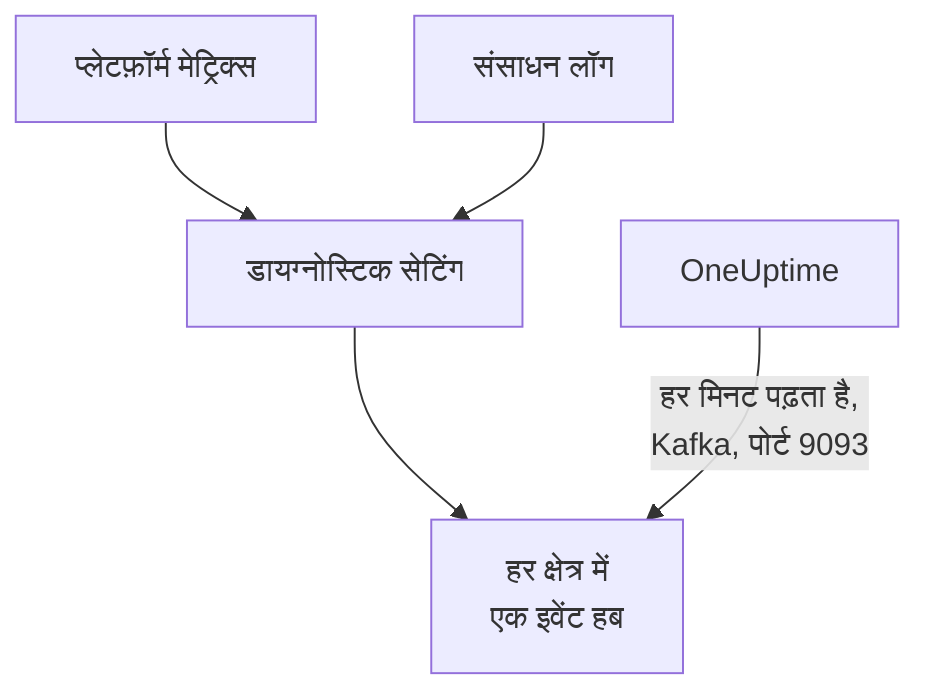

# Azure Monitor मेट्रिक्स और लॉग स्ट्रीम करें

कनेक्ट की गई Azure सब्सक्रिप्शन अपने Azure Monitor मेट्रिक्स और संसाधन लॉग OneUptime को स्ट्रीम कर सकती है। डायग्नोस्टिक सेटिंग उन्हें आपकी सब्सक्रिप्शन के इवेंट हब पर भेजती हैं, और OneUptime इवेंट हब को हर मिनट पढ़ता है: मुख्य मेट्रिक्स कनेक्शन की अगली रीडिंग का इंतज़ार किए बिना, Azure Monitor के पास आने के कुछ मिनटों में पहुँचते हैं, और संसाधन लॉग OneUptime लॉग के रूप में पहुँचते हैं, हर एक उस संसाधन के तहत रखा जाता है जिसके बारे में वह है। Azure Cloud Shell में एक कमांड से सब सेट अप हो जाता है, और चलाने के लिए कुछ नहीं है।

:::cards
- [यह कैसे काम करता है](#यह-कैसे-काम-करता-है): डायग्नोस्टिक सेटिंग हर क्षेत्र के इवेंट हब पर भेजती हैं, और OneUptime उन्हें पढ़ता है।
- [स्ट्रीमिंग सेट अप करें](#स्ट्रीमिंग-सेट-अप-करें): चुनें कि क्या स्ट्रीम करना है, पढ़ना चालू करें और एक कमांड चलाएँ।
- [क्या पहुँचता है](#क्या-पहुँचता-है): मेट्रिक्स उन संसाधनों पर जिन्हें वे मापते हैं, और लॉग उन संसाधनों पर जहाँ से वे आते हैं।
- [कमांड क्या बनाती है](#कमांड-क्या-बनाती-है): हर संसाधन और हर अनुमति जो कमांड आपकी सब्सक्रिप्शन में बनाती है।
- [स्ट्रीमिंग रोकें](#स्ट्रीमिंग-रोकें): पढ़ना रोकें, फिर कमांड ने जो बनाया उसे हटाएँ।
:::

## यह कैसे काम करता है



- **हर क्षेत्र में एक इवेंट हब।** डायग्नोस्टिक सेटिंग केवल अपने संसाधन के क्षेत्र के इवेंट हब पर भेजती है, इसलिए कमांड हर उस क्षेत्र में, जहाँ आपके संसाधन हैं, एक Event Hubs नेमस्पेस बनाती है, सभी एक ही संसाधन समूह में, और हर संसाधन की डायग्नोस्टिक सेटिंग को उसके क्षेत्र के इवेंट हब की ओर करती है।
- **OneUptime उन्हें पढ़ता है।** Azure Monitor केवल इवेंट हब, स्टोरेज खाते या Log Analytics वर्कस्पेस पर भेजता है, आपके किसी पते पर कभी नहीं: OneUptime द्वारा पढ़ा जाने वाला इवेंट हब वह तरीका है जिसमें आपको कुछ नहीं चलाना पड़ता। OneUptime कनेक्शन के अपने ऐप के रूप में साइन इन करता है, जो उन इवेंट हब को पढ़ सकता है और कुछ नहीं।
- **रीडिंग स्ट्रीम किए गए मेट्रिक्स स्ट्रीम पर छोड़ देती हैं।** जब तक स्ट्रीम किसी क्षेत्र में किसी संसाधन प्रकार के मुख्य मेट्रिक्स डिलीवर करती है, कनेक्शन की रीडिंग उन्हें लिखना बंद कर देती हैं, ताकि कोई डेटा पॉइंट दो बार न गिना जाए। रीडिंग संसाधनों, उनकी स्थिति और उनके बदलावों को खोजती रहती हैं, और बिना किसी इवेंट के 15 मिनट बाद मेट्रिक्स फिर से सँभाल लेती हैं।
- **जब OneUptime पढ़ नहीं पाता, तब भी कुछ नहीं खोता।** इवेंट तब तक इवेंट हब में OneUptime के पढ़ने का इंतज़ार करते हैं जब तक इवेंट हब उन्हें रखते हैं, और OneUptime याद रखता है कि उसने हर पार्टीशन कहाँ तक पढ़ा, ताकि वह वहीं से आगे बढ़े जहाँ रुका था।

## शुरू करने से पहले

- **एक कनेक्ट की गई Azure सब्सक्रिप्शन।** पहले इसे **क्लाउड → कनेक्ट करें** में कनेक्ट करें: देखें [क्लाउड खाता कनेक्ट करें](/docs/telemetry/cloud-accounts)।
- **प्रोजेक्ट का मालिक या एडमिन।** केवल वे पढ़ना चालू कर सकते हैं और स्ट्रीमिंग रोक सकते हैं।
- **Azure Cloud Shell**, सब्सक्रिप्शन के **Owner** के रूप में, या ऐसे **Contributor** के रूप में साइन इन जो **User Access Administrator** भी हो: कमांड एक संसाधन समूह और एक भूमिका असाइनमेंट बनाती है, और डायग्नोस्टिक सेटिंग बदलती है।
- **सेल्फ़-होस्टेड OneUptime पर, Azure तक बाहर जाने का रास्ता।** OneUptime हर नेमस्पेस को `<namespace>.servicebus.windows.net` पर पोर्ट 9093 से पढ़ता है, और नेमस्पेस इंटरनेट से कनेक्शन स्वीकार करते हैं।

## स्ट्रीमिंग सेट अप करें

:::steps
### स्ट्रीमिंग डायलॉग खोलें

**क्लाउड → कनेक्ट करें** पर जाएँ, और Azure सब्सक्रिप्शन की पंक्ति में **मेट्रिक्स और लॉग स्ट्रीम करें** चुनें।

### चुनें कि क्या स्ट्रीम करना है

**मेट्रिक्स** हर संसाधन का हर मुख्य मेट्रिक हर मिनट स्ट्रीम करता है: वे मेट्रिक्स जिनसे OneUptime हर संसाधन का चार्ट बनाता है और उसे परखता है। **मेट्रिक्स और लॉग** हर संसाधन के अपने लॉग जोड़ता है, यानी हर वह श्रेणी जो Azure उसके लिए रखता है, और **लॉग** केवल संसाधन लॉग स्ट्रीम करता है।

### पढ़ना चालू करें

**पढ़ना चालू करें** चुनें। OneUptime हर मिनट इवेंट हब खोजता है, और कमांड के उन्हें बनाने तक उनकी प्रतीक्षा करता है।

### Azure Cloud Shell में कमांड चलाएँ

कमांड कॉपी करें, उसे Azure Cloud Shell में चलाएँ और उसके पूरा होने की प्रतीक्षा करें। यह बताती है कि किन क्षेत्रों में इसने इवेंट हब बनाए, कितने संसाधन उन पर भेजते हैं, और कौन-से संसाधन इसने छोड़ दिए, Azure के कारण के साथ।

### पहले इवेंट की प्रतीक्षा करें

डायलॉग हर कुछ सेकंड में पूछता है कि क्या पहुँचा। कमांड पूरी होने के कुछ मिनटों में Azure भेजना शुरू करता है; फिर डायलॉग बताता है कि क्या कहाँ से आया, और कनेक्शन की पंक्ति में **स्ट्रीमिंग हो रही है** दिखता है।
:::

**और फ़ील्ड** में बाकी सब है:

| फ़ील्ड | यह क्या करता है |
| --- | --- |
| **सब्सक्रिप्शन** | जिन सब्सक्रिप्शन से स्ट्रीम करना है: शुरू में वे, जिन्हें कनेक्शन पढ़ता है। पहली में इवेंट हब रहते हैं, और OneUptime उन्हें वहीं पढ़ता है। अधिकतम 50 |
| **किसी और तरीके से सेट अप करें** | कमांड द्वारा इस्तेमाल किए गए नाम, ताकि Terraform या पोर्टल से सेट अप किया जा सके |

जब कनेक्शन ने अभी तक कोई सब्सक्रिप्शन नहीं पढ़ा है, या 50 से अधिक पढ़ता है, तो डायलॉग इसके बजाय अपने चरणों से पहले **सब्सक्रिप्शन** पूछता है।

जब पहली सब्सक्रिप्शन वह नहीं होती जिसमें OneUptime इवेंट हब पढ़ता है, तो डायलॉग यह बताता है: कमांड चलाने से पहले **उन्हें वहाँ पढ़ें** चुनें।

## क्या पहुँचता है

| क्या | कहाँ पहुँचता है |
| --- | --- |
| मुख्य मेट्रिक्स | उन क्लाउड संसाधनों पर जिन्हें वे मापते हैं, उन्हीं सीरीज़ में जिन्हें कनेक्शन की रीडिंग लिखती हैं |
| संसाधन लॉग | लॉग एक्सप्लोरर में, कनेक्शन की टेलीमेट्री सेवा के तहत, सब्सक्रिप्शन, क्षेत्र और श्रेणी को एट्रिब्यूट के रूप में लेकर |
| ऐसे संसाधन के लॉग जिसे OneUptime जानता है | उस संसाधन पर भी: क्लाउड में उसके पेज पर **लॉग** टैब जुड़ जाता है |

स्ट्रीम वे मुख्य मेट्रिक्स लाती है जिन्हें कनेक्शन हर मिनट पढ़ता है। जो मेट्रिक वह अधिक मोटे अंतराल पर पढ़ता है, जैसे किसी स्टोरेज खाते की इस्तेमाल की गई क्षमता, वह रीडिंग के पास ही रहता है। लॉग संसाधन की ARM ID के आधार पर उसके संसाधन के तहत रखा जाता है, जिसे `cloud.resource_id` के रूप में ले जाया जाता है, और अपनी श्रेणी, ऑपरेशन, परिणाम और प्रॉपर्टी को एट्रिब्यूट के रूप में रखता है, जैसे `azure.category`।

वर्चुअल मशीनें, स्केल सेट, डिस्क, नेटवर्क इंटरफ़ेस, वर्चुअल नेटवर्क, प्राइवेट एंडपॉइंट, NAT गेटवे, DNS ज़ोन और App Service प्लान अपने संसाधन लॉग नहीं भेजते, इसलिए उनके पेजों पर **लॉग** टैब नहीं होता। स्टोरेज खाते के लॉग उसकी सेवाओं के लॉग हैं, और कंटेनर ऐप के लॉग उसके एनवायरनमेंट के।

## कमांड क्या बनाती है

संसाधन समूह का नाम `oneuptime-stream-` के बाद कनेक्शन की ID के पहले 8 वर्ण होता है। यह OneUptime को आपके संसाधनों तक कोई पहुँच नहीं देता: कनेक्शन का ऐप इवेंट हब पढ़ सकता है, इससे ज़्यादा कुछ नहीं।

| संसाधन | यह क्या कर सकता है |
| --- | --- |
| पहली सब्सक्रिप्शन में संसाधन समूह `oneuptime-stream-<suffix>` | इवेंट हब रखता है, कनेक्शन की ID `oneuptime-connection` टैग के रूप में लगी होती है |
| हर क्षेत्र में Event Hubs नेमस्पेस `oneuptime-<suffix>-<region>`, Standard टियर पर 1 थ्रूपुट यूनिट के साथ | अपने क्षेत्र की डायग्नोस्टिक सेटिंग जो भेजती हैं, उसे लेता है |
| हर एक में इवेंट हब `oneuptime`, 2 पार्टीशन के साथ | OneUptime के पढ़ने तक इवेंट रखता है |
| कनेक्शन के ऐप के लिए **Azure Event Hubs Data Receiver** भूमिका, केवल संसाधन समूह पर | ऐप को इवेंट हब पढ़ने देती है, और कुछ नहीं |
| हर संसाधन पर डायग्नोस्टिक सेटिंग `OneUptime-<suffix>` | संसाधन के मेट्रिक्स, लॉग या दोनों उसके क्षेत्र के इवेंट हब पर भेजती है |

किसी ग्लोबल क्षेत्र का संसाधन, जैसे Front Door, पहले क्षेत्र के इवेंट हब पर भेजता है। जिस संसाधन के लिए Azure केवल मेट्रिक्स या केवल लॉग रखता है, उसे उसी से सेट अप किया जाता है जो उसके पास है, और जिसके पास पहले से 5 डायग्नोस्टिक सेटिंग हैं, यानी Azure की अनुमति वाली अधिकतम संख्या, उसे छोड़ दिया जाता है। Azure हर नेमस्पेस की थ्रूपुट यूनिट का घंटे के हिसाब से बिल बनाता है, और डायग्नोस्टिक सेटिंग द्वारा भेजे गए इवेंट का भी।

## स्ट्रीमिंग रोकें

:::steps
### पढ़ना रोकें

**क्लाउड → कनेक्ट करें** में सब्सक्रिप्शन की पंक्ति पर **स्ट्रीमिंग रोकें** चुनें। OneUptime तुरंत इवेंट हब पढ़ना बंद कर देता है, और कनेक्शन फिर से अपने सभी मेट्रिक्स अपने शेड्यूल पर पढ़ता है। जो पढ़ा जा चुका है, वह बना रहता है।

### कमांड ने जो बनाया उसे हटाएँ

इवेंट हब और डायग्नोस्टिक सेटिंग हटाए जाने तक Azure में रहते हैं, और Azure उनका बिल बनाता है। डायलॉग कमांड दिखाता है: यह हर संसाधन की डायग्नोस्टिक सेटिंग हटाती है, फिर संसाधन समूह, चाहे वह किसी भी सब्सक्रिप्शन में हो।

```bash
oneuptime_stream_stop() {
  local SUB ID N=0
  for SUB in '11111111-aaaa-4aaa-8aaa-111111111111' '22222222-bbbb-4bbb-8bbb-222222222222'; do
    while IFS= read -r ID; do
      if [ -z "$ID" ]; then continue; fi
      az monitor diagnostic-settings delete --name OneUptime-6f1c3a2e --resource "$ID" --output none 2> /dev/null &
      N=$((N + 1))
      if [ $((N % 4)) -eq 0 ]; then wait; fi
    done < <(az resource list --subscription "$SUB" --query "[].id" --output tsv)
  done
  wait
  for SUB in '11111111-aaaa-4aaa-8aaa-111111111111' '22222222-bbbb-4bbb-8bbb-222222222222'; do
    if [ "$(az group exists --subscription "$SUB" --name oneuptime-stream-6f1c3a2e 2> /dev/null)" = true ]; then
      az group delete --subscription "$SUB" --name oneuptime-stream-6f1c3a2e --yes --no-wait && echo "Deleting oneuptime-stream-6f1c3a2e in $SUB."
    fi
  done
}
oneuptime_stream_stop
```
:::

क्या स्ट्रीम होता है यह बदलने के लिए, **मेट्रिक्स और लॉग स्ट्रीम करें** फिर से खोलें, चुनें कि क्या स्ट्रीम करना है और नई कमांड चलाएँ: यह पहली बार चलाने पर बनी चीज़ों को अपडेट करती है, और कुछ भी दो बार नहीं बनाती।

## किसी और तरीके से सेट अप करें

Terraform या पोर्टल से, कमांड जो बनाती है उसे इन नामों के साथ बनाएँ:

| सेटिंग | मान |
| --- | --- |
| संसाधन समूह | `oneuptime-stream-<suffix>`, उस सब्सक्रिप्शन में जिसमें OneUptime इवेंट हब पढ़ता है |
| Event Hubs नेमस्पेस | `oneuptime-<suffix>-<region>`, स्ट्रीम किए जाने वाले संसाधन के हर क्षेत्र में एक |
| इवेंट हब | `oneuptime`, हर नेमस्पेस में |
| डायग्नोस्टिक सेटिंग | हर संसाधन पर `OneUptime-<suffix>`, उसके क्षेत्र के इवेंट हब पर, नेमस्पेस के `RootManageSharedAccessKey` नियम के साथ |
| भूमिका | कनेक्शन के ऐप के लिए **Azure Event Hubs Data Receiver**, संसाधन समूह पर |

फिर पढ़ना चालू करें, उस सब्सक्रिप्शन को **सब्सक्रिप्शन** में सबसे पहले रखकर।

## समस्या निवारण

:::details डायलॉग पहले इवेंट का इंतज़ार करता रहता है
जाँचें कि कमांड पूरी हुई, और उसने बताया कि किसी क्षेत्र का इवेंट हब तैयार है: `az eventhubs namespace list --resource-group oneuptime-stream-6f1c3a2e` नेमस्पेस की सूची दिखाता है। डायग्नोस्टिक सेटिंग केवल वही भेजती है जो Azure Monitor के पास है, इसलिए कुछ न करने वाला संसाधन कम भेजता है। नई भूमिका लागू होने में कुछ मिनट लग सकते हैं: तब तक रीडिंग को इवेंट नहीं दिखते।
:::

:::details कनेक्शन में स्ट्रीम विफल दिखता है
डायलॉग और पंक्ति का टूलटिप कारण बताते हैं। जब ऐप इवेंट हब नहीं पढ़ सकता, तो कमांड फिर से चलाएँ: यह ऐप को उसकी भूमिका फिर से देती है। जब OneUptime उन तक नहीं पहुँच सका, तो जाँचें कि नेमस्पेस इंटरनेट से कनेक्शन स्वीकार करते हैं, और सेल्फ़-होस्टेड OneUptime पोर्ट 9093 तक पहुँच सकता है।
:::

:::details कमांड ने कुछ संसाधन छोड़ दिए
यह उनकी सूची देती है, हर एक के साथ Azure का कारण। जिस प्रकार के संसाधन की कोई डायग्नोस्टिक सेटिंग नहीं होती, वह कुछ नहीं भेजता, और जिस संसाधन के पास पहले से 5 डायग्नोस्टिक सेटिंग हैं, उसकी एक सेटिंग पहले हटानी होगी। फिर कमांड दोबारा चलाएँ।
:::

## अगले कदम

:::cards
- [क्लाउड खाता कनेक्ट करें](/docs/telemetry/cloud-accounts): कनेक्शन क्या पढ़ता है, और कितनी बार।
- [Google Cloud लॉग स्ट्रीम करें](/docs/telemetry/cloud-streaming-google-cloud): किसी Google Cloud प्रोजेक्ट के लॉग, Pub/Sub के ज़रिए पुश किए गए।
- [CloudWatch मेट्रिक्स और लॉग स्ट्रीम करें](/docs/telemetry/cloud-streaming): किसी AWS खाते के, Amazon Data Firehose द्वारा डिलीवर किए गए।
- [लॉग एक्सप्लोरर](/docs/telemetry/logs-explorer): स्ट्रीम ने जो डिलीवर किया, उसे खोजें और फ़िल्टर करें।
:::
