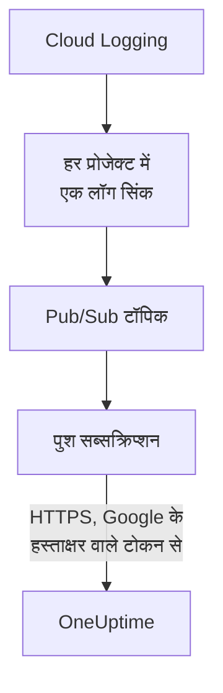

# Google Cloud लॉग स्ट्रीम करें

कनेक्ट किया गया Google Cloud प्रोजेक्ट अपने लॉग लिखे जाते ही OneUptime को स्ट्रीम कर सकता है। Cloud Logging उन्हें एक लॉग सिंक के ज़रिए Pub/Sub टॉपिक पर भेजता है, और टॉपिक का पुश सब्सक्रिप्शन हर एंट्री को एक मिनट के भीतर OneUptime तक पहुँचाता है, OneUptime लॉग के रूप में, उस संसाधन के तहत जिसके बारे में वह है। Google Cloud Shell में एक कमांड से सब सेट अप हो जाता है, और चलाने के लिए कुछ नहीं है। Cloud Monitoring में मेट्रिक्स पुश करने वाला कोई एक्सपोर्ट नहीं है, इसलिए कनेक्शन अपने शेड्यूल पर मेट्रिक्स पढ़ता रहता है।

:::cards
- [यह कैसे काम करता है](#यह-कैसे-काम-करता-है): हर प्रोजेक्ट में एक लॉग सिंक, एक टॉपिक और उसका पुश सब्सक्रिप्शन।
- [स्ट्रीमिंग सेट अप करें](#स्ट्रीमिंग-सेट-अप-करें): चुनें कौन-से लॉग, स्ट्रीम कुंजी बनाएँ और एक कमांड चलाएँ।
- [क्या पहुँचता है](#क्या-पहुँचता-है): लॉग उन संसाधनों पर जहाँ से वे आते हैं।
- [कमांड क्या बनाती है](#कमांड-क्या-बनाती-है): हर संसाधन और हर अनुमति जो कमांड आपके प्रोजेक्ट में बनाती है।
- [स्ट्रीमिंग रोकें](#स्ट्रीमिंग-रोकें): कुंजियाँ बंद करें, फिर कमांड ने जो बनाया उसे हटाएँ।
:::

## यह कैसे काम करता है



- **हर प्रोजेक्ट में एक लॉग सिंक।** हर प्रोजेक्ट का सिंक अपने फ़िल्टर से मेल खाने वाली एंट्री को एक ही Pub/Sub टॉपिक पर भेजता है, जो कनेक्शन के अपने सर्विस अकाउंट वाले प्रोजेक्ट में होता है।
- **हर पुश पर दो जाँच।** Pub/Sub केवल पुश के लिए बनाए गए सर्विस अकाउंट के लिए OpenID Connect टोकन पर हस्ताक्षर करता है, और टोकन की ऑडियंस कनेक्शन की स्ट्रीम कुंजी होती है। OneUptime पुश तभी स्वीकार करता है जब Google ने उस सर्विस अकाउंट के लिए उसके टोकन पर हस्ताक्षर किए हों और कुंजी कनेक्शन की कुंजियों में से एक हो। कुंजी कनेक्शन को, और इसलिए प्रोजेक्ट को, बताती है: पुश की कोई भी चीज़ यह तय नहीं करती कि वह कहाँ लिखा जाए। OneUptime कुंजी का केवल SHA-256 रखता है।
- **जब OneUptime स्वीकार नहीं कर पाता, तब भी कुछ नहीं खोता।** Pub/Sub अस्वीकार की गई एंट्री को फिर से पुश करता है, प्रयासों के बीच 10 सेकंड से लेकर 10 मिनट तक इंतज़ार करते हुए, और उसे एक दिन तक रखता है।

## शुरू करने से पहले

- **एक कनेक्ट किया गया Google Cloud प्रोजेक्ट।** पहले इसे **क्लाउड → कनेक्ट करें** में कनेक्ट करें: देखें [क्लाउड खाता कनेक्ट करें](/docs/telemetry/cloud-accounts)।
- **प्रोजेक्ट का मालिक या एडमिन।** केवल वे स्ट्रीम कुंजी बना सकते हैं और स्ट्रीमिंग रोक सकते हैं।
- **Google Cloud Shell**, प्रोजेक्ट के **Owner** के रूप में, या ऐसे व्यक्ति के रूप में साइन इन जो उनमें सर्विस अकाउंट, Pub/Sub टॉपिक और लॉग सिंक बना सकता हो।
- **सेल्फ़-होस्टेड OneUptime पर, HTTPS पता।** Pub/Sub केवल `https://` पतों पर पुश करता है, ऐसे प्रमाणपत्र के साथ जिस पर Google भरोसा करता हो, और पता Google Cloud से पहुँच योग्य होना चाहिए।

## स्ट्रीमिंग सेट अप करें

:::steps
### स्ट्रीमिंग डायलॉग खोलें

**क्लाउड → कनेक्ट करें** पर जाएँ, और Google Cloud प्रोजेक्ट की पंक्ति में **लॉग स्ट्रीम करें** चुनें।

### चुनें कौन-से लॉग

**चेतावनियाँ और त्रुटियाँ** `WARNING` या उससे ऊपर की गंभीरता वाली हर एंट्री स्ट्रीम करता है: जो गड़बड़ हुआ, हर अनुरोध नहीं। **हर लॉग** Data Access ऑडिट लॉग को छोड़कर हर एंट्री स्ट्रीम करता है, क्योंकि वे हर रीड दर्ज करते हैं और प्रोजेक्ट के लिखे बाकी सब से ज़्यादा हो सकते हैं। **आपका अपना फ़िल्टर** उन एंट्री को स्ट्रीम करता है जो **फ़िल्टर** फ़ील्ड में लिखी Cloud Logging क्वेरी से मेल खाती हैं।

### स्ट्रीम कुंजी बनाएँ

**स्ट्रीम कुंजी बनाएँ** चुनें। कुंजी केवल इसी एक बार, कमांड में दिखाई जाती है: OneUptime उसका केवल SHA-256 रखता है।

### Google Cloud Shell में कमांड चलाएँ

कमांड कॉपी करें, उसे Google Cloud Shell में चलाएँ और उसके पूरा होने की प्रतीक्षा करें। यह हर उस प्रोजेक्ट को बताती है जिसमें इसने सिंक सेट अप किया, और Google के अस्वीकार किए गए पहले चरण पर, Google के कारण के साथ, रुक जाती है।

### पहले पुश की प्रतीक्षा करें

डायलॉग हर कुछ सेकंड में पूछता है कि क्या पहुँचा। कोई प्रोजेक्ट फ़िल्टर द्वारा स्वीकार्य एंट्री लिखे, तो Pub/Sub उसे एक मिनट के भीतर पुश करता है; फिर डायलॉग बताता है कि क्या कहाँ से आया, और कनेक्शन की पंक्ति में **स्ट्रीमिंग हो रही है** दिखता है।
:::

**और फ़ील्ड** में बाकी सब है:

| फ़ील्ड | यह क्या करता है |
| --- | --- |
| **परियोजनाएँ** | जिन प्रोजेक्ट के लॉग स्ट्रीम करने हैं: शुरू में वे, जिन्हें कनेक्शन पढ़ता है। टॉपिक कनेक्शन के सर्विस अकाउंट वाले प्रोजेक्ट में बनता है। अधिकतम 100 |
| **किसी और तरीके से सेट अप करें** | पुश एंडपॉइंट, पुश सर्विस अकाउंट और कुंजी, ताकि Terraform या कंसोल से सेट अप किया जा सके |

## क्या पहुँचता है

| क्या | कहाँ पहुँचता है |
| --- | --- |
| लॉग | लॉग एक्सप्लोरर में, कनेक्शन की टेलीमेट्री सेवा के तहत, प्रोजेक्ट, क्षेत्र और लॉग नाम को एट्रिब्यूट के रूप में लेकर |
| ऐसे संसाधन के लॉग जिसे OneUptime जानता है | उस संसाधन पर भी: क्लाउड में उसके पेज पर **लॉग** टैब जुड़ जाता है |

हर लॉग अपनी एंट्री का समय नैनोसेकंड तक, अपनी गंभीरता, अपना ट्रेस और स्पैन, और अपना HTTP अनुरोध OpenTelemetry सिमैंटिक कन्वेंशन के नामों में रखता है। अगर उसका मॉनिटर किया गया संसाधन ऐसे प्रकार का है जिसके मेट्रिक्स OneUptime पढ़ता है, जैसे VM (`gce_instance`), Cloud Run सेवा (`cloud_run_revision`) या Cloud SQL इंस्टेंस (`cloudsql_database`), तो लॉग उस संसाधन के तहत रखा जाता है, और संसाधन की ID `cloud.resource_id` के रूप में ले जाता है। किसी एक्सटर्नल लोड बैलेंसर के अनुरोध लॉग `http_load_balancer` के तहत लिखे जाते हैं, पर उसके URL मैप, यानी उस `https_lb_rule` के तहत रखे जाते हैं जिस पर उसके मेट्रिक्स पहुँचते हैं।

किसी इंस्टेंस ग्रुप के लॉग उसके VM के लॉग हैं, इसलिए उसके पेज पर **लॉग** टैब नहीं होता। किसी और प्रकार की एंट्री भी, उसके प्रोजेक्ट के तहत, स्ट्रीम होती है।

## कमांड क्या बनाती है

इसके संसाधनों के नाम कनेक्शन की ID के पहले 8 वर्णों पर रखे जाते हैं। यह OneUptime को आपके प्रोजेक्ट तक कोई पहुँच नहीं देती: एंट्री केवल बाहर जाती हैं।

| संसाधन | यह क्या कर सकता है |
| --- | --- |
| कनेक्शन के सर्विस अकाउंट वाले प्रोजेक्ट में सर्विस अकाउंट `oneuptime-push-<suffix>` | इसकी कोई भूमिका नहीं: Pub/Sub इसके लिए अपने पुश के टोकन पर हस्ताक्षर करता है |
| Pub/Sub सर्विस एजेंट के लिए **Service Account OpenID Connect Identity Token Creator** भूमिका, केवल उस सर्विस अकाउंट पर | Pub/Sub को वे टोकन बनाने देती है, और कुछ नहीं |
| Pub/Sub टॉपिक `oneuptime-stream-<suffix>` | सिंक जो एंट्री भेजते हैं, उन्हें रखता है |
| उसका पुश सब्सक्रिप्शन `oneuptime-stream-<suffix>-push` | हर एंट्री 60 सेकंड की पावती समय सीमा के साथ OneUptime को पुश करता है, और जो पुश नहीं कर सका उसे एक दिन तक रखता है |
| हर प्रोजेक्ट में लॉग सिंक `oneuptime-stream-<suffix>` | अपने फ़िल्टर से मेल खाने वाली एंट्री टॉपिक पर भेजता है |
| हर सिंक के राइटर के लिए **Pub/Sub Publisher** भूमिका, केवल टॉपिक पर | सिंक को टॉपिक पर प्रकाशित करने देती है, और कुछ नहीं |

अगर टॉपिक वाले प्रोजेक्ट में Pub/Sub और Cloud Logging API बंद हैं, तो कमांड उन्हें चालू करती है। Google डिलीवर किए गए लॉग के लिए Pub/Sub का बिल बनाता है: केवल वही लॉग स्ट्रीम करें जिनकी आपको ज़रूरत है।

## स्ट्रीमिंग रोकें

:::steps
### कुंजियाँ बंद करें

**क्लाउड → कनेक्ट करें** में प्रोजेक्ट की पंक्ति पर **स्ट्रीमिंग रोकें** चुनें। कनेक्शन की हर स्ट्रीम कुंजी तुरंत काम करना बंद कर देती है, और Pub/Sub जो पुश करता है उसे OneUptime अस्वीकार करता है। जो डिलीवर हो चुका है, वह बना रहता है।

### कमांड ने जो बनाया उसे हटाएँ

सिंक, टॉपिक और उसका पुश सब्सक्रिप्शन हटाए जाने तक Google Cloud में रहते हैं, और Pub/Sub पुश करता रहता है। डायलॉग कनेक्शन द्वारा पढ़े जाने वाले प्रोजेक्ट के लिए कमांड दिखाता है:

```bash
for SOURCE in 'acme-prod' 'acme-data'; do
  gcloud logging sinks delete oneuptime-stream-6f1c3a2e --project "$SOURCE" --quiet
done
gcloud pubsub subscriptions delete oneuptime-stream-6f1c3a2e-push --project 'acme-prod' --quiet
gcloud pubsub topics delete oneuptime-stream-6f1c3a2e --project 'acme-prod' --quiet
gcloud iam service-accounts delete 'oneuptime-push-6f1c3a2e@acme-prod.iam.gserviceaccount.com' --project 'acme-prod' --quiet
```
:::

कौन-से लॉग स्ट्रीम हों यह बदलने के लिए, **लॉग स्ट्रीम करें** फिर से खोलें, **नई कुंजी बनाएँ** चुनें और नई कमांड चलाएँ। जिस कुंजी को यह बदलती है, वह 24 घंटे तक काम करती रहती है, ताकि सब्सक्रिप्शन अपडेट होते समय कोई पुश अस्वीकार न हो। एक साथ अधिकतम 3 बदली गई कुंजियाँ काम करती हैं।

## किसी और तरीके से सेट अप करें

किसी Pub/Sub टॉपिक को इन मानों के साथ पुश सब्सक्रिप्शन दें, और Pub/Sub सर्विस एजेंट को पुश सर्विस अकाउंट के लिए टोकन बनाने दें:

| सेटिंग | मान |
| --- | --- |
| पुश एंडपॉइंट | `https://oneuptime.com/telemetry/gcp-pubsub/v1/logs` |
| ऑथेंटिकेशन | `oneuptime-push-<suffix>@<project>.iam.gserviceaccount.com` के लिए OpenID Connect टोकन |
| ऑडियंस | स्ट्रीम कुंजी |
| पेलोड | रैप किया हुआ, जैसा Pub/Sub अलग से न कहे जाने पर भेजता है |
| पावती समय सीमा | 60 सेकंड |
| संदेश अवधारण | 1 दिन |

फिर लॉग सिंक से हर प्रोजेक्ट के लॉग टॉपिक पर भेजें, और हर सिंक के राइटर को टॉपिक पर **Pub/Sub Publisher** दें। सेल्फ़-होस्टेड OneUptime पर, `https://oneuptime.com` को अपने OneUptime के HTTPS पते से बदलें।

OneUptime हर पुश का जवाब वैसे देता है जैसा Pub/Sub उम्मीद करता है:

| जवाब | कब | Pub/Sub क्या करता है |
| --- | --- | --- |
| `204` | एंट्री स्वीकार हुई, या पहले स्वीकार हो चुकी थी, या संदेश कोई लॉग एंट्री नहीं है | आगे बढ़ता है |
| `400` | यह ऐसा Pub/Sub पुश नहीं है जिसे OneUptime पढ़ सके | हर बार ज़्यादा इंतज़ार करते हुए, एक दिन तक फिर से पुश करता है |
| `401` | टोकन पर Google ने पुश सर्विस अकाउंट के लिए हस्ताक्षर नहीं किए, या उसकी ऑडियंस कनेक्शन की कुंजी नहीं है | हर बार ज़्यादा इंतज़ार करते हुए, एक दिन तक फिर से पुश करता है |
| `402` | प्रोजेक्ट से टेलीमेट्री का बिल नहीं लिया जा सकता | हर बार ज़्यादा इंतज़ार करते हुए, एक दिन तक फिर से पुश करता है |
| `403` | कनेक्शन बंद है, या प्रोजेक्ट टेलीमेट्री स्वीकार नहीं कर सकता | हर बार ज़्यादा इंतज़ार करते हुए, एक दिन तक फिर से पुश करता है |
| `413` | अनुरोध 1 MiB से बड़ा है, या उसकी एंट्री 512 KiB से बड़ी है | हर बार ज़्यादा इंतज़ार करते हुए, एक दिन तक फिर से पुश करता है |
| `429` | कनेक्शन के सब्सक्रिप्शन ने एक मिनट में 12,000 से ज़्यादा एंट्री पुश कीं | हर बार ज़्यादा इंतज़ार करते हुए, एक दिन तक फिर से पुश करता है |
| `503` | OneUptime उस समय टोकन जाँच नहीं सका या एंट्री को कतार में नहीं डाल सका | हर बार ज़्यादा इंतज़ार करते हुए, एक दिन तक फिर से पुश करता है |

## समस्या निवारण

:::details डायलॉग पहले पुश का इंतज़ार करता रहता है
जाँचें कि कमांड बिना रुके पूरी हुई, और किसी प्रोजेक्ट ने फ़िल्टर द्वारा स्वीकार्य एंट्री लिखी: **चेतावनियाँ और त्रुटियाँ** के साथ, शांत प्रोजेक्ट कुछ नहीं भेजता। `gcloud pubsub subscriptions describe oneuptime-stream-6f1c3a2e-push --project acme-prod` सब्सक्रिप्शन का एंडपॉइंट दिखाता है। सेल्फ़-होस्टेड OneUptime पर, जाँचें कि Google Cloud उसके पते तक HTTPS से पहुँचता है।
:::

:::details कनेक्शन में स्ट्रीम अस्वीकृत दिखता है
डायलॉग और पंक्ति का टूलटिप कारण बताते हैं। गलत कुंजी का मतलब है कि सब्सक्रिप्शन ऐसी कुंजी से पुश कर रहा है जो अब काम नहीं करती: नई कुंजी बनाएँ और कमांड फिर से चलाएँ। पुश सर्विस अकाउंट के लिए हस्ताक्षरित न होने वाले पुश का मतलब है कि सब्सक्रिप्शन किसी दूसरे अकाउंट के रूप में हस्ताक्षर करता है, या Pub/Sub को उसके लिए हस्ताक्षर करने की अनुमति नहीं है: कमांड फिर से चलाएँ।
:::

:::details किसी संसाधन के लॉग उसके पेज पर नहीं दिखते
पेज वे लॉग दिखाता है जिन्हें Cloud Logging संसाधन के मॉनिटर किए गए संसाधन के तहत, उसके मेट्रिक्स वाले लेबल के साथ रखता है। कोई वर्कलोड किसी दूसरे संसाधन के तहत जो लॉग लिखता है, जैसे किसी कंटेनर के, वे केवल उसके प्रोजेक्ट के तहत स्ट्रीम होते हैं।
:::

## अगले कदम

:::cards
- [क्लाउड खाता कनेक्ट करें](/docs/telemetry/cloud-accounts): कनेक्शन क्या पढ़ता है, और कितनी बार।
- [Azure Monitor मेट्रिक्स और लॉग स्ट्रीम करें](/docs/telemetry/cloud-streaming-azure): किसी Azure सब्सक्रिप्शन के, इवेंट हब से पढ़े गए।
- [CloudWatch मेट्रिक्स और लॉग स्ट्रीम करें](/docs/telemetry/cloud-streaming): किसी AWS खाते के, Amazon Data Firehose द्वारा डिलीवर किए गए।
- [लॉग एक्सप्लोरर](/docs/telemetry/logs-explorer): स्ट्रीम ने जो डिलीवर किया, उसे खोजें और फ़िल्टर करें।
:::
