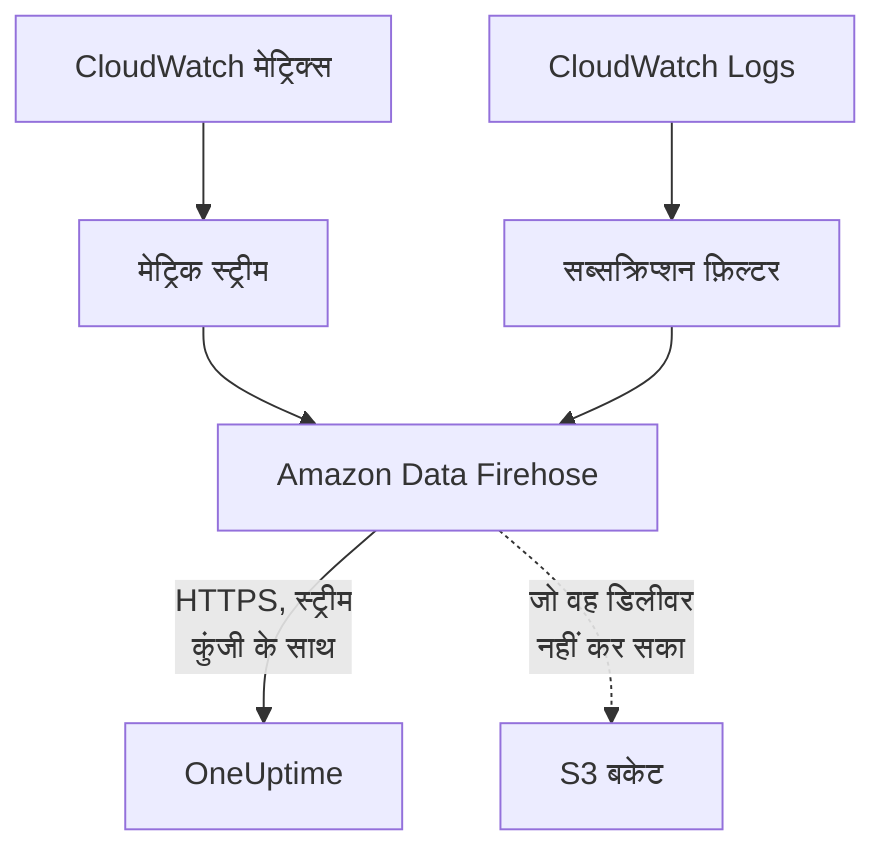

# CloudWatch मेट्रिक्स और लॉग स्ट्रीम करें

कनेक्ट किया गया AWS खाता Amazon Data Firehose के ज़रिए अपने CloudWatch मेट्रिक्स और लॉग OneUptime को स्ट्रीम कर सकता है। तब मेट्रिक्स कनेक्शन की अगली रीडिंग का इंतज़ार किए बिना, CloudWatch में आने के कुछ ही मिनटों बाद पहुँचते हैं, और CloudWatch Logs OneUptime लॉग के रूप में पहुँचता है, हर लॉग उस संसाधन के तहत रखा जाता है जिसके बारे में वह है। AWS CloudShell में एक कमांड सब कुछ सेट अप कर देती है, और चलाने के लिए कुछ भी नहीं बचता।

:::cards
- [यह कैसे काम करता है](#यह-कैसे-काम-करता-है): हर क्षेत्र में एक मेट्रिक स्ट्रीम और लॉग सब्सक्रिप्शन, जिन्हें Firehose डिलीवर करता है।
- [स्ट्रीमिंग सेट अप करें](#स्ट्रीमिंग-सेट-अप-करें): चुनें कि क्या स्ट्रीम करना है, स्ट्रीम कुंजी बनाएँ और एक कमांड चलाएँ।
- [क्या पहुँचता है](#क्या-पहुँचता-है): मेट्रिक्स उन संसाधनों पर जिन्हें वे मापते हैं, और लॉग उन संसाधनों पर जिनसे वे आते हैं।
- [स्टैक क्या बनाता है](#स्टैक-क्या-बनाता-है): हर संसाधन और हर अनुमति जो कमांड आपके खाते में बनाती है।
- [स्ट्रीमिंग रोकें](#स्ट्रीमिंग-रोकें): कुंजियाँ बंद करें, फिर स्टैक हटाएँ।
:::

## यह कैसे काम करता है



- **हर क्षेत्र में एक स्टैक।** कमांड हर उस क्षेत्र में एक CloudFormation स्टैक डिप्लॉय करती है जहाँ से आप स्ट्रीम करते हैं। उसकी मेट्रिक स्ट्रीम और लॉग सब्सक्रिप्शन फ़िल्टर सब कुछ दो Firehose स्ट्रीम को सौंपते हैं, और Firehose उसे HTTPS पर OneUptime तक डिलीवर करता है।
- **स्ट्रीम कुंजी बताती है कि यह किसका है।** Firehose हर डिलीवरी के साथ कनेक्शन की स्ट्रीम कुंजी भेजता है। कुंजी कनेक्शन का, और इसलिए प्रोजेक्ट का नाम बताती है: डिलीवरी में मौजूद कोई भी चीज़ तय नहीं करती कि उसे कहाँ लिखा जाए। OneUptime केवल कुंजी का SHA-256 रखता है।
- **रीडिंग स्ट्रीम किए गए मेट्रिक्स को स्ट्रीम पर छोड़ देती हैं।** जब तक कोई स्ट्रीम किसी क्षेत्र का कोई नेमस्पेस डिलीवर करती है, कनेक्शन की रीडिंग उस नेमस्पेस के मेट्रिक्स लिखना बंद कर देती हैं, ताकि कोई भी डेटा पॉइंट दो बार न गिना जाए। रीडिंग संसाधनों, उनकी स्थिति और उनके बदलावों को ढूँढती रहती हैं, और 15 मिनट तक कोई डिलीवरी न होने पर नेमस्पेस को फिर से अपने हाथ में ले लेती हैं।
- **जब OneUptime स्वीकार नहीं कर पाता, तब भी कुछ नहीं खोता।** Firehose अस्वीकार किया गया बैच अधिकतम एक घंटे तक फिर से भेजता है, फिर उसे स्टैक के S3 बकेट में 30 दिनों तक रखता है।

## शुरू करने से पहले

- **एक कनेक्ट किया गया AWS खाता।** पहले उसे **क्लाउड → कनेक्ट करें** में कनेक्ट करें: [क्लाउड खाता कनेक्ट करें](/docs/telemetry/cloud-accounts) देखें।
- **प्रोजेक्ट का मालिक या एडमिन।** केवल वही स्ट्रीम कुंजी बना सकते हैं और स्ट्रीमिंग रोक सकते हैं।
- **उस खाते में AWS CloudShell**, ऐसे व्यक्ति के रूप में साइन इन जो CloudFormation स्टैक और IAM भूमिकाएँ बना सकता हो।
- **सेल्फ़-होस्टेड OneUptime पर एक HTTPS पता।** Firehose केवल पोर्ट 443 पर `https://` पतों पर डिलीवर करता है, ऐसे प्रमाणपत्र के साथ जिस पर AWS भरोसा करता हो, और पता AWS से पहुँचने योग्य होना चाहिए।

## स्ट्रीमिंग सेट अप करें

:::steps
### स्ट्रीमिंग डायलॉग खोलें

**क्लाउड → कनेक्ट करें** पर जाएँ, और AWS खाते की पंक्ति में **मेट्रिक्स और लॉग स्ट्रीम करें** चुनें।

### चुनें कि क्या स्ट्रीम करना है

**मेट्रिक्स** हर संसाधन का हर मुख्य मेट्रिक हर मिनट में एक बार स्ट्रीम करता है: वे मेट्रिक्स जिनके आधार पर OneUptime हर संसाधन का चार्ट बनाता और उसे परखता है। **मेट्रिक्स और लॉग** CloudWatch Logs जोड़ता है, और **लॉग** केवल CloudWatch Logs स्ट्रीम करता है।

लॉग के लिए, **लॉग समूह** हर पंक्ति में एक लिखें, बगल वाले **क्षेत्र** में नाम से या उनके अपने क्षेत्र में ARN से, या **खाते के सभी लॉग समूह, नए भी** चुनें। एक कमांड नाम से अधिकतम 50 लॉग समूहों को, अधिकतम 10 क्षेत्रों में सब्सक्राइब करती है।

### स्ट्रीम कुंजी बनाएँ

**स्ट्रीम कुंजी बनाएँ** चुनें। कुंजी केवल इसी एक बार, कमांड में दिखाई जाती है: OneUptime केवल उसका SHA-256 रखता है।

### AWS CloudShell में कमांड चलाएँ

कमांड कॉपी करें, उसे AWS CloudShell में चलाएँ और उसके पूरा होने तक प्रतीक्षा करें। यह टेम्पलेट को `oneuptime-stream.json` में लिखती है और कुंजी को ऐसे पैरामीटर के रूप में देकर, जो फिर कभी नहीं दिखाया जाता, उसे हर क्षेत्र में डिप्लॉय करती है।

### पहली डिलीवरी की प्रतीक्षा करें

डायलॉग हर कुछ सेकंड में पूछता है कि क्या पहुँचा। कमांड पूरी होने के कुछ ही मिनटों में Firehose डिलीवर करता है; तब डायलॉग बताता है कि क्या कहाँ से आया, और कनेक्शन की पंक्ति **स्ट्रीमिंग हो रही है** दिखाती है।
:::

**और फ़ील्ड** में बाकी सब है:

| फ़ील्ड | यह क्या करता है |
| --- | --- |
| **हर मेट्रिक, सिर्फ़ मुख्य मेट्रिक्स नहीं** | खाते के लिए CloudWatch के पास मौजूद हर मेट्रिक स्ट्रीम करता है, आपके अपने मेट्रिक्स सहित। AWS स्ट्रीम द्वारा भेजे गए हर मेट्रिक अपडेट का शुल्क लेता है, इसलिए इसकी लागत कई गुना हो सकती है |
| **क्षेत्र** | कहाँ से स्ट्रीम करना है: शुरू में वे क्षेत्र जिनमें कनेक्शन को संसाधन मिले। खाली छोड़ने पर कमांड AWS CloudShell के अपने क्षेत्र से स्ट्रीम करती है। अधिकतम 30 |
| **किसी और तरीके से सेट अप करें** | Terraform या कंसोल से स्ट्रीम सेट अप करने के लिए मेट्रिक्स और लॉग के एंडपॉइंट और कुंजी |

**टेम्पलेट डाउनलोड करें** वह टेम्पलेट सहेजता है जिसे कमांड डिप्लॉय करती है, ताकि आप उसे अपने तरीके से डिप्लॉय कर सकें।

## क्या पहुँचता है

| क्या | कहाँ पहुँचता है |
| --- | --- |
| मेट्रिक्स | उन क्लाउड संसाधनों पर जिन्हें वे मापते हैं, उन्हीं नामों और एट्रिब्यूट के साथ जो कनेक्शन की रीडिंग उन्हें देती हैं |
| लॉग | लॉग एक्सप्लोरर में, कनेक्शन की टेलीमेट्री सेवा के तहत, खाते, क्षेत्र और लॉग समूह को एट्रिब्यूट के रूप में लिए हुए |
| ऐसे लॉग समूह के लॉग जिसका नाम AWS किसी संसाधन के नाम पर रखता है | उस संसाधन पर भी: क्लाउड में उसके पेज पर एक **लॉग** टैब जुड़ जाता है |

जब AWS किसी लॉग समूह का नाम किसी संसाधन के नाम पर रखता है, तो वह उस संसाधन के तहत रखा जाता है:

| लॉग समूह | संसाधन का प्रकार |
| --- | --- |
| `/aws/lambda/<function>` | `AWS::Lambda::Function` |
| `/aws/rds/instance/<instance>/<log>` | `AWS::RDS::DBInstance` |
| `/aws/rds/cluster/<cluster>/<log>` | `AWS::RDS::DBCluster` |
| `/aws/docdb/<cluster>/<log>` | `AWS::DocDB::DBCluster` |
| `/aws/neptune/<cluster>/<log>` | `AWS::Neptune::DBCluster` |
| `/aws/redshift/cluster/<cluster>/<log>` | `AWS::Redshift::Cluster` |
| `/aws/OpenSearchService/domains/<domain>/<log>` | `AWS::OpenSearchService::Domain` |
| `/aws/aes/domains/<domain>/<log>` | `AWS::OpenSearchService::Domain` |
| `/aws/apprunner/<service>/<service-id>/<log>` | `AWS::AppRunner::Service` |
| `/aws/elasticbeanstalk/<environment>/<log>` | `AWS::ElasticBeanstalk::Environment` |
| `/aws/ecs/containerinsights/<cluster>/performance` | `AWS::ECS::Cluster` |

हर लॉग संसाधन की ID को `cloud.resource_id` के रूप में रखता है, और Lambda फ़ंक्शन के लॉग `faas.name` भी रखते हैं, इसलिए वे Serverless में फ़ंक्शन पर भी दिखते हैं। किसी और नाम वाला लॉग समूह भी स्ट्रीम होता है, अपने खाते और क्षेत्र के तहत। किसी लॉग की गंभीरता वही होती है जो उसका संदेश बताता है, उसी तरह जैसे Lambda उसे लिखता है।

## स्टैक क्या बनाता है

स्टैक का नाम `OneUptimeStream-` और उसके बाद कनेक्शन की ID के पहले 8 अक्षर होता है। यह OneUptime को आपके खाते तक कोई पहुँच नहीं देता: डेटा केवल बाहर जाता है।

| संसाधन | यह क्या कर सकता है |
| --- | --- |
| OpenTelemetry 1.0 फ़ॉर्मैट में एक CloudWatch मेट्रिक स्ट्रीम | केवल मेट्रिक्स वाली Firehose स्ट्रीम में रिकॉर्ड डालना |
| लॉग सब्सक्रिप्शन फ़िल्टर, या हर लॉग समूह के लिए पूरे खाते की एक सब्सक्रिप्शन नीति | केवल लॉग वाली Firehose स्ट्रीम में रिकॉर्ड डालना |
| दो Firehose स्ट्रीम, `OneUptime-<suffix>-metrics` और `OneUptime-<suffix>-logs` | GZIP, 1 MiB या 60 सेकंड के बफ़र और एक घंटे के पुनः प्रयासों के साथ OneUptime को डिलीवर करना, और जो डिलीवर न हो सका उसे बकेट में लिखना |
| जो डिलीवर न हो सका उसके लिए एक S3 बकेट | सार्वजनिक पहुँच अवरुद्ध, एन्क्रिप्टेड, 30 दिनों बाद खाली, और स्टैक हटाने पर भी बना रहता है |
| एक लॉग समूह, `/aws/kinesisfirehose/OneUptime-<suffix>` | Firehose की अपनी डिलीवरी त्रुटियाँ रखता है, और कभी स्ट्रीम नहीं होता |
| तीन IAM भूमिकाएँ | हर भूमिका इस खाते की एक AWS सेवा पर भरोसा करती है और केवल वही अनुमति देती है जो ऊपर की पंक्तियाँ बताती हैं |

AWS मेट्रिक स्ट्रीम के लिए उसके भेजे हर मेट्रिक अपडेट का, और Firehose के लिए उसकी डिलीवरी का शुल्क लेता है। केवल वही मेट्रिक्स और लॉग समूह स्ट्रीम करें जिनकी आपको ज़रूरत है।

## स्ट्रीमिंग रोकें

:::steps
### कुंजियाँ बंद करें

**क्लाउड → कनेक्ट करें** में खाते की पंक्ति पर **स्ट्रीमिंग रोकें** चुनें। कनेक्शन की हर स्ट्रीम कुंजी तुरंत काम करना बंद कर देती है, OneUptime स्ट्रीम्स की डिलीवरी अस्वीकार करता है, और कनेक्शन फिर से अपने शेड्यूल पर सभी मेट्रिक्स पढ़ता है। स्ट्रीम्स ने जो डिलीवर किया है, वह बना रहता है।

### स्टैक हटाएँ

जब तक उनके स्टैक हटाए नहीं जाते, स्ट्रीम्स AWS में रहती हैं और AWS उनका शुल्क लेता है। डायलॉग उन क्षेत्रों के लिए कमांड दिखाता है जिनसे स्ट्रीम्स ने डिलीवरी की और जिनमें कनेक्शन को संसाधन मिले:

```bash
for REGION in us-east-1 eu-west-1; do
  aws cloudformation delete-stack --region "$REGION" --stack-name OneUptimeStream-6f1c3a2e
done
```
:::

कोई स्टैक क्या स्ट्रीम करता है यह बदलने के लिए, **मेट्रिक्स और लॉग स्ट्रीम करें** फिर से खोलें, **नई कुंजी बनाएँ** चुनें और नई कमांड चलाएँ। जिस कुंजी को यह बदलती है, वह 24 घंटे तक काम करती रहती है, इसलिए स्टैक अपडेट होते समय कोई डिलीवरी अस्वीकार नहीं होती। एक साथ अधिकतम 3 बदली गई कुंजियाँ काम करती हैं।

## किसी और तरीके से सेट अप करें

हर Firehose स्ट्रीम को इन मानों के साथ एक HTTP एंडपॉइंट डेस्टिनेशन दें, और मेट्रिक स्ट्रीम को OpenTelemetry 1.0 आउटपुट फ़ॉर्मैट दें:

| सेटिंग | मान |
| --- | --- |
| मेट्रिक्स एंडपॉइंट | `https://oneuptime.com/telemetry/aws-firehose/v1/metrics` |
| लॉग एंडपॉइंट | `https://oneuptime.com/telemetry/aws-firehose/v1/logs` |
| एक्सेस कुंजी | स्ट्रीम कुंजी, जो `X-Amz-Firehose-Access-Key` के रूप में भेजी जाती है |
| कंटेंट एन्कोडिंग | `GZIP` |
| बफ़र | 1 MiB या 60 सेकंड |
| पुनः प्रयास की अवधि | 3600 सेकंड, जो डिलीवर न हो सका उसके लिए एक S3 बकेट के साथ |

सेल्फ़-होस्टेड OneUptime पर, `https://oneuptime.com` को अपने OneUptime के HTTPS पते से बदलें। मेट्रिक्स एंडपॉइंट JSON फ़ॉर्मैट में मेट्रिक स्ट्रीम भी स्वीकार करता है।

OneUptime हर डिलीवरी का जवाब उसी तरह देता है जैसा Firehose अपेक्षा करता है:

| जवाब | कब | Firehose क्या करता है |
| --- | --- | --- |
| `200` | डिलीवरी स्वीकार की गई, या पहले स्वीकार की जा चुकी थी | आगे बढ़ता है |
| `400` | यह ऐसी Firehose डिलीवरी नहीं है जिसे OneUptime पढ़ सके, जैसे 10,000 से अधिक रिकॉर्ड वाली डिलीवरी | अधिकतम एक घंटे तक फिर से भेजता है |
| `401` | कुंजी कनेक्शन की कुंजियों में से एक नहीं है | अधिकतम एक घंटे तक फिर से भेजता है |
| `402` | प्रोजेक्ट से टेलीमेट्री का शुल्क नहीं लिया जा सकता | अधिकतम एक घंटे तक फिर से भेजता है |
| `403` | कनेक्शन बंद है, या प्रोजेक्ट टेलीमेट्री स्वीकार नहीं कर सकता | अधिकतम एक घंटे तक फिर से भेजता है |
| `413` | अनुरोध 4 MiB से बड़ा है, या डीकंप्रेस होकर 32 MiB से अधिक हो जाता है | उसे बकेट में रखता है |
| `429` | कनेक्शन की स्ट्रीम्स ने एक मिनट में 600 से अधिक डिलीवरी भेजीं | बाद में फिर से भेजता है |

## समस्या निवारण

:::details डायलॉग अब भी पहली डिलीवरी की प्रतीक्षा कर रहा है
जाँचें कि कमांड हर क्षेत्र में बिना त्रुटि के पूरी हुई: `aws cloudformation describe-stacks --stack-name OneUptimeStream-6f1c3a2e` स्टैक की स्थिति बताता है। मेट्रिक स्ट्रीम केवल वे मेट्रिक्स डिलीवर करती है जो CloudWatch के पास हैं, इसलिए बिना संसाधनों वाला क्षेत्र कुछ नहीं भेजता। सेल्फ़-होस्टेड OneUptime पर जाँचें कि AWS पोर्ट 443 पर HTTPS के ज़रिए उसके पते तक पहुँचता है।
:::

:::details कनेक्शन स्ट्रीम अस्वीकृत दिखाता है
डायलॉग और पंक्ति का टूलटिप कारण बताते हैं। गलत कुंजी का मतलब है कि स्टैक ऐसी कुंजी से चल रहे हैं जो अब काम नहीं करती: नई कुंजी बनाएँ और कमांड फिर से चलाएँ। Firehose अपने पास रखा डेटा भेजता रहता है, और कुंजी सही होते ही उसे स्वीकार कर लिया जाता है।
:::

:::details Lambda फ़ंक्शन के लॉग उसके पेज पर नहीं दिखते
पेज उस लॉग समूह के लॉग दिखाता है जिसका नाम फ़ंक्शन के नाम पर है, `/aws/lambda/<function>`। जो फ़ंक्शन किसी और नाम वाले लॉग समूह में लिखता है, वह अपने लॉग केवल अपने खाते और क्षेत्र के तहत स्ट्रीम करता है।
:::

## अगले कदम

:::cards
- [क्लाउड खाता कनेक्ट करें](/docs/telemetry/cloud-accounts): कनेक्शन क्या पढ़ता है, और कितनी बार।
- [क्लाउड संसाधन (IaaS और PaaS)](/docs/telemetry/cloud-resources): हर संसाधन प्रकार जिसे OneUptime पहचानता है।
- [लॉग एक्सप्लोरर](/docs/telemetry/logs-explorer): स्ट्रीम्स ने जो डिलीवर किया उसे खोजें और फ़िल्टर करें।
:::
