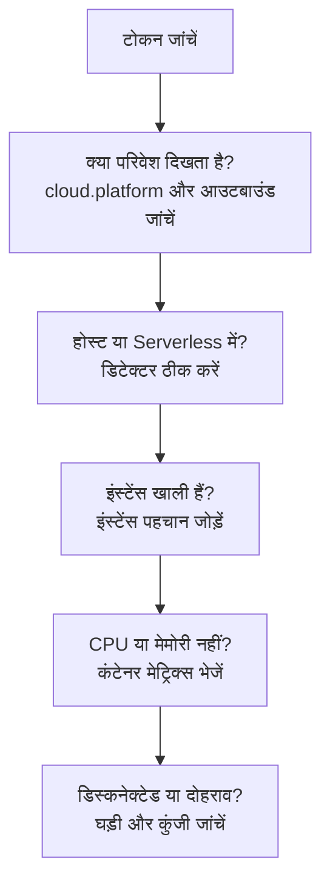

# क्लाउड समस्या निवारण

पता लगाएं कि कोई क्लाउड परिवेश क्यों गायब है, गलत जगह दर्ज है, खाली है या दोहराया गया है। सेक्शन उसी क्रम में हैं जिसमें ये चीज़ें विफल होती हैं, और हर सेक्शन एक परत को खारिज करता है, इसलिए ऊपर से नीचे की ओर बढ़ें। जो विफलताएँ किसी एक प्लेटफ़ॉर्म की हैं, वे उसके पेज के अंत में हैं: [AWS ECS / Fargate](/docs/telemetry/cloud-aws-ecs), [Google Cloud Run](/docs/telemetry/cloud-gcp-cloud-run), [Azure Container Apps](/docs/telemetry/cloud-azure-container-apps) और [अन्य क्लाउड प्लेटफ़ॉर्म](/docs/telemetry/cloud-other-platforms)।



## पहले टोकन जांचें

यह सबसे आसान जांच है, और इसके बिना नीचे का कुछ भी काम नहीं करता:

```bash
curl -i https://oneuptime.com/otlp/v1/validate \
  -H "x-oneuptime-token: YOUR_TELEMETRY_INGESTION_TOKEN"
```

| जवाब | इसका मतलब |
| ------------------------- | -------------------------------------------------------------------------------------------------------------------------- |
| `200`, `"valid": true` | टोकन स्वीकार हो गया। उसका `keyType` `Server` होना चाहिए: कलेक्टर या बैकएंड सेवा से आने पर `Browser` कुंजी अस्वीकार हो जाती है। |
| `401`, `"valid": false` | टोकन गायब, अज्ञात, रद्द, निष्क्रिय या समाप्त है, और जवाब का `message` बताता है कि कौन-सा। **प्रोजेक्ट सेटिंग्स → टेलीमेट्री और APM → इंजेशन कुंजियाँ** में नई कुंजी बनाएं और उसे फिर से डिप्लॉय करें। |

अगर आप OneUptime को खुद होस्ट करते हैं, तो `https://YOUR-ONEUPTIME-HOST/otlp/v1/validate` इस्तेमाल करें। जहाँ हो सके, जांच टास्क, इंस्टेंस या रेप्लिका के अंदर से चलाएं (ECS Exec, `az containerapp exec`): इससे साबित होता है कि वर्कलोड खुद OneUptime तक पहुँच सकता है, न कि सिर्फ़ आपका लैपटॉप।

## परिवेश नहीं दिखता

पहले अनुरोध के एक मिनट बाद भी **क्लाउड → All Environments** में कुछ नहीं है। ये तीन चीज़ें इसी क्रम में जांचें।

**`cloud.platform` गायब है, या प्रबंधित मान नहीं है।** OneUptime टेलीमेट्री को क्लाउड परिवेश में तभी दर्ज करता है जब रिसोर्स पर इनमें से कोई मान हो: `aws_ecs`, `aws_elastic_beanstalk`, `aws_app_runner`, `gcp_cloud_run`, `gcp_app_engine`, `azure_container_apps`, `azure_container_instances` या `azure_app_service`। आम कारण:

- SDK में रिसोर्स डिटेक्टर बंद है (`OTEL_NODE_RESOURCE_DETECTORS`, `OTEL_EXPERIMENTAL_RESOURCE_DETECTORS`, `-Dotel.resource.providers.<cloud>.enabled=true`)।
- कलेक्टर की पाइपलाइन `resourcedetection` प्रोसेसर को छोड़ देती है।
- बिना डिटेक्टर वाले प्लेटफ़ॉर्म पर `OTEL_RESOURCE_ATTRIBUTES` में टाइपो है।

Node.js और .NET के Azure डिटेक्टर `azure.container_apps`, `azure.app_service` और `azure.functions` लिखते हैं; OneUptime इन्हें अंडरस्कोर वाले मानों में बदल देता है, इसलिए ये भी गिने जाते हैं। आपकी टेलीमेट्री में क्या है, यह देखने के लिए **सेवाएं** में सेवा खोलें, **ट्रेस** टैब से उसका कोई ट्रेस खोलें, और रिसोर्स एट्रिब्यूट पढ़ें। अगर वहाँ `cloud.platform` नहीं है, तो पूरी समस्या यही है।

**टोकन गलत है।** टोकन जांच ने `401` लौटाया। कलेक्टर इसे `Permanent error: ... 401` के रूप में लॉग करता है। SDK इसे एक बार लॉग करता है और फिर से कोशिश करना बंद कर देता है, जो सही OTLP व्यवहार है और आसानी से छूट जाता है।

**आउटबाउंड ट्रैफ़िक ब्लॉक है।** कलेक्टर `connection refused`, `context deadline exceeded`, `i/o timeout` या कोई DNS विफलता लॉग करता है:

- **ECS और Fargate:** निजी सबनेट को NAT गेटवे या `assignPublicIp=ENABLED` चाहिए, और सिक्योरिटी ग्रुप को TCP 443 पर आउटबाउंड की अनुमति देनी चाहिए।
- **Cloud Run:** **VPC egress: All traffic** को Cloud NAT चाहिए।
- **Container Apps:** फ़ायरवॉल तक जाने वाले उपयोगकर्ता-परिभाषित रूट को OneUptime होस्ट की अनुमति देनी चाहिए।
- **हर जगह:** किसी निजी DNS नाम के पीछे सेल्फ़-होस्टेड OneUptime वर्कलोड के नेटवर्क से रिज़ॉल्व होना चाहिए।

## इसके बजाय यह होस्ट में दिखता है

रिसोर्स पर किसी वर्चुअल मशीन का प्लेटफ़ॉर्म (`aws_ec2`, `gcp_compute_engine` या `azure_vm`) है, इसलिए OneUptime इसे **होस्ट** में दर्ज करता है: वर्चुअल मशीन के लिए सही, प्रबंधित कंप्यूट के लिए गलत। किसी वर्चुअल मशीन का डिटेक्टर प्रबंधित डिटेक्टर से जीत गया: किसी कलेक्टर में `detectors: [ec2, elastic_beanstalk]`, जहाँ `cloud.platform` सेट करने वाला पहला डिटेक्टर जीतता है, या कोई SDK जिसका क्रम EC2 डिटेक्टर को तरजीह देता है। `elastic_beanstalk` को पहले रखें, या `OTEL_RESOURCE_ATTRIBUTES` में `cloud.platform` खुद सेट करें और सिर्फ़ `env` डिटेक्टर रखें।

## यह सिर्फ़ Serverless फ़ंक्शन में दिखता है

रिसोर्स पर `faas.name` है, लेकिन कोई प्रबंधित `cloud.platform` नहीं। GCP डिटेक्टर चलने पर Cloud Run और App Engine दोनों सेट करते हैं। अगर आप `faas.name` हाथ से सेट करते हैं, या कोई कलेक्टर SDK के डिटेक्टर द्वारा सेट किए रिसोर्स एट्रिब्यूट हटा देता है, तो सिर्फ़ serverless वाली शर्त पूरी होती है। डिटेक्टर चालू करें, या `cloud.platform=gcp_cloud_run` (या `gcp_app_engine`), `cloud.account.id` और `cloud.region` खुद सेट करें।

> [!NOTE]
> Cloud Run और App Engine पर किसी सेवा का दोनों जगह दिखना ही अपेक्षित है: परिवेश प्रोजेक्ट और क्षेत्र को एक साथ रखता है, और **Serverless फ़ंक्शन** अकेली सेवा दिखाता है।

## इंस्टेंस खाली है

परिवेश मौजूद है, लेकिन उसका **इंस्टेंस** टैब कुछ नहीं दिखाता: टेलीमेट्री में कोई इंस्टेंस पहचान नहीं है। OneUptime किसी इंस्टेंस का नाम इन रिसोर्स एट्रिब्यूट में से पहले मिलने वाले से रखता है:

1. `aws.ecs.task.id`
2. `aws.ecs.task.arn` (टास्क ID तक छोटा किया गया)
3. `faas.instance`
4. `azure.container_app.instance.id`
5. `service.instance.id`
6. `container.id`
7. `host.id`
8. `host.name`

प्लेटफ़ॉर्म की अपनी पहचान `service.instance.id` से पहले आती है, इसलिए SDK जो ID हर प्रोसेस के लिए बना लेता है (Node.js SDK डिफ़ॉल्ट रूप से ऐसा करता है), वह किसी टास्क को उसके sidecar के CPU और मेमोरी से अलग नहीं कर सकता। हर प्लेटफ़ॉर्म पर पहचान क्या सेट करता है:

| प्लेटफ़ॉर्म | पहचान क्या सेट करता है |
| ----------------------------------------- | ------------------------------------------------------------------------------------------------------------------------------------------------ |
| ECS | `ecs` डिटेक्टर टास्क ARN सेट करता है |
| Cloud Run, App Engine | `gcp` डिटेक्टर `faas.instance` सेट करता है |
| Container Apps | कलेक्टर का `azurecontainerapps` डिटेक्टर रेप्लिका ID सेट करता है; या `CONTAINER_APP_REPLICA_NAME` से `service.instance.id` सेट करें, या होस्ट डिटेक्टर चलाएं |
| App Runner, Container Instances | होस्ट डिटेक्टर का `host.name` |
| App Service, Elastic Beanstalk | प्लेटफ़ॉर्म का डिटेक्टर `service.instance.id` सेट करता है; Beanstalk पर इसे हटाएं ताकि `host.id` हर इंस्टेंस का नाम रखे |

एट्रिब्यूट वाला पहला सिग्नल आने के एक मिनट के भीतर इंस्टेंस दिखता है।

## CPU और मेमोरी खाली हैं

इंस्टेंस सूची में हैं, लेकिन अवलोकन की **CPU** और **मेमोरी** टाइलें, और **इंस्टेंस** के CPU और मेमोरी कॉलम खाली हैं। ये ट्रेस से नहीं, मेट्रिक्स से आते हैं: `container.cpu.utilization` और `container.memory.usage` (या `container.memory.usage.total`) के डेटा पॉइंट, जिनके रिसोर्स पर ट्रेस वाली ही इंस्टेंस पहचान और `cloud.platform` हो।

- **ECS पर** sidecar कलेक्टर का `awsecscontainermetrics` रिसीवर इन्हें `ecs.task.cpu.utilized` और `ecs.task.memory.utilized` के रूप में देता है। इसे `metrics` पाइपलाइन में रखें, और उसी पाइपलाइन में `resourcedetection` भी रखें, वरना मेट्रिक्स `cloud.platform` के बिना आते हैं और कहीं और दर्ज हो जाते हैं।
- **Cloud Run, Container Apps और बाकी प्लेटफ़ॉर्म पर** प्लेटफ़ॉर्म किसी sidecar को कंटेनर का उपयोग नहीं दिखाता। जब तक आप वे मेट्रिक्स खुद नहीं भेजते, टाइलें खाली रहती हैं: इसके बजाय अनुरोध वाली टाइलें देखें।
- **SDK direct के साथ** कोई कंटेनर मेट्रिक्स नहीं भेजता, इसलिए खाली टाइलें अपेक्षित हैं।

## परिवेश डिस्कनेक्टेड दिखाता है

कोई परिवेश तब **डिस्कनेक्टेड** दिखाता है जब 15 मिनट तक उसके लिए कोई टेलीमेट्री नहीं आई, और अगला स्पैन, लॉग या मेट्रिक उसे वापस ले आता है। जिस समय OneUptime खुद बंद था या बकाया डेटा निपटा रहा था, वह नहीं गिना जाता। जब टेलीमेट्री आ रही होती है, तब भी आखिरी बार देखे जाने का समय पाँच मिनट तक पीछे रह सकता है, इसीलिए सीमा 15 है।

- **व्यस्त परिवेश डिस्कनेक्टेड दिखाता है:** एक्सपोर्टर रुक गया। कलेक्टर के लॉग में ऊपर बताई `401` और आउटबाउंड त्रुटियाँ खोजें।
- **रात में शून्य तक घटने वाला स्टेजिंग परिवेश** सुबह के पहले अनुरोध तक डिस्कनेक्टेड दिखाता है, जो सही है।

इंस्टेंस दो घड़ियों का पालन करते हैं:

- **Stale:** **इंस्टेंस** टैब किसी टास्क, इंस्टेंस या रेप्लिका को **Stale** चिह्नित करता है जब उसने पिछले 15 मिनट में रिपोर्ट नहीं किया हो, और अवलोकन सिर्फ़ बाकी को लाइव गिनता है।
- **हटाया गया:** एक सफ़ाई प्रक्रिया उन इंस्टेंस पंक्तियों को हटाती है जो `CLOUD_INSTANCE_STALE_MINUTES` (डिफ़ॉल्ट 15, कम से कम 10) तक नहीं दिखीं, यह परिवेश की अपनी आखिरी टेलीमेट्री से मापा जाता है, इसलिए कलेक्टर का बंद होना उस घड़ी को रोक देता है, आखिरी ज्ञात टास्क सूची को मिटाता नहीं। Serverless फ़ंक्शन `SERVERLESS_INSTANCE_STALE_MINUTES` इस्तेमाल करते हैं। सीमा बढ़ाने से पंक्तियाँ ज़्यादा देर रहती हैं; इससे यह नहीं बदलता कि वे कब **Stale** होती हैं।

## जहाँ एक होना चाहिए, वहाँ दो परिवेश

एनवायरनमेंट कुंजी `cloud.platform|cloud.account.id|cloud.region` है, जिसे अक्षरशः मिलाया जाता है। अगर कुछ वर्कलोड `cloud.account.id` सेट करते हैं और कुछ नहीं, कोई `eastus` लिखता है और कोई `East US`, या एक कलेक्टर `ecs` डिटेक्टर चलाता है और दूसरा नहीं, तो आपको `aws_ecs|123456789012|us-east-1` और `aws_ecs||us-east-1` अगल-बगल मिलते हैं।

हर परिवेश का **अवलोकन** खोलें: उसकी **एनवायरनमेंट कुंजी** दिखाती है कि कौन-सा हिस्सा अलग है। जिस वर्कलोड में मान गायब है, उसे ठीक करें। खाली हिस्से वाले परिवेश को टेलीमेट्री मिलना बंद हो जाता है, और आप उसे संग्रहीत कर सकते हैं।

## हाथ से बनाया गया परिवेश कभी मेल नहीं खाता

इंजेशन किसी परिवेश को सिर्फ़ उसकी कुंजी से मिलाता है, और कुंजी ठीक `platform|account|region` होनी चाहिए, जैसे `aws_ecs|123456789012|us-east-1`: वही प्लेटफ़ॉर्म मान, खाता ID और क्षेत्र जो टेलीमेट्री में है। बनाने वाला फ़ॉर्म (**क्लाउड → All Environments** में **क्लाउड संसाधन बनाएँ**) कुंजी को अपने **क्लाउड प्लेटफ़ॉर्म**, **क्लाउड खाता ID** और **क्लाउड क्षेत्र** फ़ील्ड से बनाता है, इसलिए ये तीनों टेलीमेट्री से अक्षरशः मेल खाने चाहिए। अगर नहीं खाते, तो इंजेशन अपनी निकाली गई कुंजी से एक दूसरा परिवेश बनाता है, और आपका परिवेश खाली रहता है। हाथ से बनाए परिवेश को संग्रहीत करें और इंजेशन को सही परिवेश बनाने दें, या सुधरे हुए मानों के साथ उसे फिर से बनाएं।

## अब भी हल नहीं हुआ

मदद माँगने से पहले ये चीज़ें इकट्ठा करें:

- वर्कलोड के किसी असली स्पैन या लॉग रिकॉर्ड के रिसोर्स एट्रिब्यूट। कलेक्टर का `debug` एक्सपोर्टर इन्हें प्रिंट करता है, या **सेवाएं** में सेवा का कोई ट्रेस खोलें।
- वर्कलोड के अंदर से चलाई गई `/otlp/v1/validate` जांच का जवाब।
- कलेक्टर के लॉग की आखिरी 50 पंक्तियाँ, या `OTEL_LOG_LEVEL=debug` के साथ SDK का डायग्नोस्टिक लॉग।
- जो भी परिवेश दिखा, उसकी **एनवायरनमेंट कुंजी**।

फिर support@oneuptime.com से संपर्क करें, या [GitHub](https://github.com/OneUptime/oneuptime) पर एक इश्यू खोलें।

## अगले कदम

:::cards
- [क्लाउड परिवेश](/docs/telemetry/cloud-environments): परिवेश और इंस्टेंस कैसे पहचाने जाते हैं।
- [AWS ECS / Fargate](/docs/telemetry/cloud-aws-ecs): पूरी टास्क परिभाषा के साथ ECS सेटअप।
- [OpenTelemetry](/docs/telemetry/open-telemetry): एंडपॉइंट, सीमाएँ और हर जवाब का मतलब।
:::
