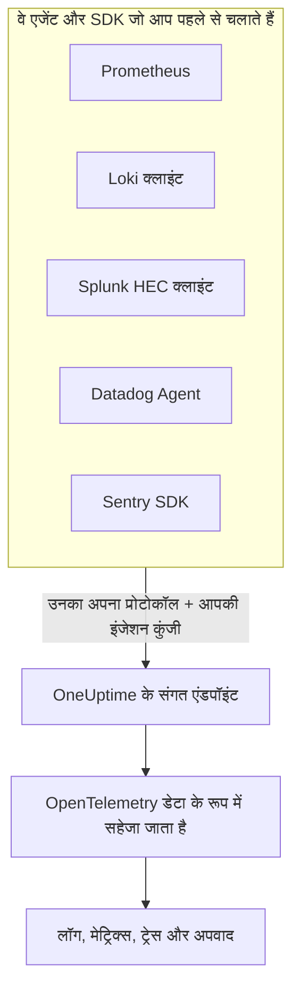

# Prometheus, Loki, Splunk, Datadog & Sentry

क्या आप पहले से Prometheus, कोई Loki क्लाइंट, कोई Splunk फ़ॉरवर्डर, Datadog Agent या कोई Sentry SDK चला रहे हैं? उसे बनाए रखें। OneUptime इनमें से हर टूल का भेजा हुआ डेटा उन्हीं पाथ पर स्वीकार करता है जिन्हें वह टूल पहले से इस्तेमाल करता है, और उसे OpenTelemetry डेटा के रूप में सहेजता है। OneUptime आज़माने के लिए बस URL और कुंजी बदलनी होती है, दोबारा इंस्ट्रुमेंटेशन नहीं करना पड़ता, और आपके ड्रॉप फ़िल्टर, स्क्रब नियम, लॉग पाइपलाइन, डेटा प्रतिधारण और इंजेशन बजट इस डेटा पर भी वैसे ही लागू होते हैं जैसे किसी और डेटा पर।

:::cards
- [Prometheus remote write](#prometheus-remote-write): Prometheus, Grafana Alloy या remote write भेजने वाले किसी भी टूल से मेट्रिक्स।
- [Loki](#loki): Promtail, Grafana Alloy, Fluent Bit या Vector से लॉग।
- [Splunk HTTP Event Collector](#splunk-http-event-collector): किसी भी HEC क्लाइंट से लॉग और मेट्रिक इवेंट।
- [Datadog Agent](#datadog-agent): Datadog Agent से मेट्रिक्स और लॉग।
- [Sentry SDK](#sentry-sdk): किसी भी Sentry SDK से त्रुटियाँ, ट्रांज़ैक्शन और लॉग।
:::

## यह कैसे काम करता है



हर एंडपॉइंट अपने टूल के ही अंदाज़ में जवाब देता है — Prometheus और Loki के लिए `204`, HEC का `{"text": "Success", "code": 0}`, Datadog का `202`, Sentry की इवेंट ID — इसलिए टूल सफलता और विफलता वैसे ही बताता है जैसे हमेशा बताता आया है। इसके बाद डेटा ठीक वैसे ही प्रोसेस होता है जैसे किसी OpenTelemetry SDK से आया डेटा।

## शुरू करने से पहले

- **एक OneUptime प्रोजेक्ट** – OneUptime Cloud पर टेलीमेट्री का बिल प्रति GB इंजेस्ट किए गए डेटा पर बनता है, और Free प्लान वाले प्रोजेक्ट को टेलीमेट्री भेजने से पहले भुगतान विधि जोड़नी होती है।
- **टेलीमेट्री इंजेशन कुंजी** – **उत्पाद → प्रोजेक्ट सेटिंग्स → टेलीमेट्री और APM → इंजेशन कुंजियाँ** में एक **सर्वर** कुंजी बनाएं, और उसकी **सीक्रेट कुंजी** कॉपी करें। हर टूल इसे वहीं भेजता है जहां वह अपना क्रेडेंशियल भेजता है। ब्राउज़र ऐप के Sentry DSN में इसकी जगह **ब्राउज़र** कुंजी लगती है, जिस पर आपकी साइट के ऑरिजिन जुड़े हों।
- **आपका होस्ट** – उदाहरणों में `oneuptime.com` इस्तेमाल हुआ है। अगर आप OneUptime खुद होस्ट करते हैं, तो अपना होस्ट इस्तेमाल करें।

> [!TIP]
> लॉग, मेट्रिक्स, ट्रेस और अपवाद पेज के सेटअप गाइड टैब में ये टूल भेजने के तरीकों में शामिल हैं, और उनमें आपका होस्ट और आपकी चुनी हुई कुंजी पहले से भरे होते हैं।

## एंडपॉइंट

| टूल | इसे कहां पॉइंट करें | कुंजी कहां जाती है |
| --- | --- | --- |
| Prometheus remote write | `https://oneuptime.com/telemetry/prometheus/api/v1/write` | बेयरर टोकन, या पासवर्ड के रूप में कुंजी के साथ basic auth। |
| Loki | `https://oneuptime.com/telemetry/loki/api/v1/push` | पासवर्ड के रूप में कुंजी के साथ basic auth, या बेयरर टोकन। |
| Splunk HTTP Event Collector | `https://oneuptime.com/telemetry/services/collector` | HEC टोकन: `Authorization: Splunk <key>`। |
| Datadog Agent | `https://oneuptime.com/telemetry/datadog` | API कुंजी: `DD-API-KEY`। |
| Sentry SDK | DSN `https://<key>@oneuptime.com/telemetry/sentry/1` | DSN की पब्लिक कुंजी। |

हर एंडपॉइंट `x-oneuptime-token` हेडर में भी कुंजी लेता है, और `x-oneuptime-service-name` हेडर बताता है कि टूल जो कुछ भी भेजता है, वह किस सेवा का है। कुंजी को बिना हाइफ़न के उसके 32 हेक्स अंकों के रूप में लिखा जा सकता है; Sentry DSN और Datadog API कुंजी में उसे इसी तरह लिखना ज़रूरी है।

## Prometheus remote write

OneUptime को remote write टारगेट के रूप में जोड़ें। Prometheus अभी की तरह स्क्रेप करता रहता है और हर सैंपल की एक कॉपी भेजता है:

```yaml title="prometheus.yml"
remote_write:
  - url: https://oneuptime.com/telemetry/prometheus/api/v1/write
    authorization:
      credentials: YOUR_TELEMETRY_KEY
```

Grafana Alloy में एक `prometheus.remote_write` कंपोनेंट जोड़ें और अपने स्क्रेप उसकी ओर फ़ॉरवर्ड करें:

```text title="config.alloy"
prometheus.remote_write "oneuptime" {
  endpoint {
    url          = "https://oneuptime.com/telemetry/prometheus/api/v1/write"
    bearer_token = "YOUR_TELEMETRY_KEY"
  }
}
```

Remote write 1.0 और 2.0 दोनों स्वीकार होते हैं, snappy से कंप्रेस किए हुए, जैसे हर सेंडर उन्हें भेजता है।

### एक सीरीज़ क्या बनती है

- **उसका नाम और लेबल बने रहते हैं।** `http_requests_total{job="checkout", code="500"}` मेट्रिक `http_requests_total` बन जाता है, जिसके एट्रिब्यूट `job` और `code` होते हैं, इसलिए Grafana से लाई गई क्वेरी उसे ढूंढ लेती है।
- **जॉब ही सेवा है।** हर `job` एक सेवा बनता है, और हर `instance` उसका सेवा इंस्टेंस, जैसे OpenTelemetry के Prometheus नियम उन्हें मैप करते हैं।
- **टाइप बने रहते हैं।** काउंटर, और हिस्टोग्राम के बकेट और काउंट, संचयी योग होते हैं, इसलिए उनकी दरें चार्ट पर सही दिखती हैं। टाइप उस मेटाडेटा से आता है जो सेंडर साथ भेजता है; उसके बिना, `_total` पर ख़त्म होने वाला नाम काउंटर माना जाता है और `le` लेबल वाला `_bucket` हिस्टोग्राम बकेट।
- **नेटिव हिस्टोग्राम** एक्सपोनेंशियल हिस्टोग्राम बनते हैं, और कस्टम बकेट वाले नेटिव हिस्टोग्राम सामान्य हिस्टोग्राम बनते हैं।
- **नहीं रखे जाते:** staleness मार्कर और दूसरे NaN या अनंत मान वाले सैंपल, काउंटर की `_created` सीरीज़, और exemplar।

## Loki

OneUptime, Loki का push API Loki के अपने पाथ पर स्वीकार करता है, JSON में या उस snappy-कंप्रेस्ड protobuf के रूप में जिसे Promtail और Grafana Alloy भेजते हैं। OneUptime को क्लाइंट के रूप में जोड़ें:

```yaml title="promtail.yaml"
clients:
  - url: https://oneuptime.com/telemetry/loki/api/v1/push
    bearer_token: YOUR_TELEMETRY_KEY
```

Fluent Bit का `loki` आउटपुट होस्ट और पाथ अलग-अलग लेता है:

```text title="fluent-bit.conf"
[OUTPUT]
    Name         loki
    Match        *
    Host         oneuptime.com
    Port         443
    Tls          On
    Uri          /telemetry/loki/api/v1/push
    Http_User    oneuptime
    Http_Passwd  YOUR_TELEMETRY_KEY
    Labels       job=fluent-bit
```

### एक स्ट्रीम क्या बनती है

- **हर एंट्री एक लॉग है**, नैनोसेकंड तक के अपने टाइमस्टैम्प और बॉडी के रूप में अपनी लाइन के साथ।
- **लेबल और स्ट्रक्चर्ड मेटाडेटा एट्रिब्यूट हैं**, उन्हीं नामों से जो उनके Loki में हैं।
- **सेवा** `service_name`, `service`, `app`, `application`, `name`, `app_kubernetes_io_name`, `container`, `container_name`, `component`, `workload` और `job` में से उस पहले से आती है जो स्ट्रीम में मौजूद हो, जैसे Loki उसे ढूंढता है। `host` या `hostname` लेबल होस्ट का नाम बताता है।
- **लेवल** `level`, `detected_level` या `severity` लेबल या मेटाडेटा से आता है, नहीं तो logfmt के `level=` या JSON लाइन के `level` फ़ील्ड से।
- **ट्रेस संदर्भ:** स्ट्रक्चर्ड मेटाडेटा में मौजूद `trace_id` और `span_id` लॉग को उसके ट्रेस से जोड़ते हैं।

## Splunk HTTP Event Collector

OneUptime को HTTP Event Collector के रूप में इस्तेमाल करें, और अपनी इंजेशन कुंजी को HEC टोकन के रूप में। Splunk का Docker लॉगिंग ड्राइवर पाथ खुद जोड़ता है, इसलिए उसे सिर्फ़ होस्ट चाहिए:

```bash
docker run \
  --log-driver=splunk \
  --log-opt splunk-url=https://oneuptime.com \
  --log-opt splunk-token=YOUR_TELEMETRY_KEY \
  --log-opt splunk-format=json \
  your-image
```

कोई भी दूसरा HEC क्लाइंट `/services/collector/event` या `/services/collector/raw` पर पोस्ट करता है। एक इवेंट भेजने के लिए:

```bash
curl https://oneuptime.com/telemetry/services/collector/event \
  -H "Authorization: Splunk YOUR_TELEMETRY_KEY" \
  -d '{"event": "Payment failed for order 42", "sourcetype": "app", "fields": {"service": "checkout"}}'
```

`{"text": "Success", "code": 0}` के साथ `200` का मतलब है कि इवेंट स्वीकार हो गया। एंडपॉइंट HEC के अपने कोड से भी जवाब देता है — `No data` (5), `Invalid data format` (6) उस इवेंट के नंबर के साथ जो मान्य नहीं था, और `Event field is required` (12) — और `GET /services/collector/health` का जवाब बिना टोकन के देता है।

### एक इवेंट क्या बनता है

- **एक लॉग**, जिसका टाइमस्टैम्प इवेंट का `time` होता है। स्ट्रिंग इवेंट बॉडी होता है; ऑब्जेक्ट इवेंट का `message`, `msg`, `log`, `line` या `text` बॉडी होता है, और उसके बाकी फ़ील्ड एट्रिब्यूट होते हैं।
- **उसका मेटाडेटा बना रहता है:** `host` होस्ट होता है, और `source`, `sourcetype` और `index` को `com.splunk.source`, `com.splunk.sourcetype` और `com.splunk.index` के रूप में रखा जाता है। क्वेरी स्ट्रिंग के `host`, `source`, `sourcetype` और `index` वह भर देते हैं जो इवेंट में छूट गया हो।
- **उसके फ़ील्ड एट्रिब्यूट हैं।** `service.name` फ़ील्ड सेवा का नाम बताता है, और लॉग का `service` फ़ील्ड भी।
- **मेट्रिक इवेंट** (`"event": "metric"`, `metric_name` और `_value` के साथ, या `metric_name:<name>` फ़ील्ड) मेट्रिक्स के रूप में सहेजे जाते हैं, कभी लॉग के रूप में नहीं।
- **उपलब्ध नहीं:** indexer acknowledgement। जो क्लाइंट इसे मांगता है, उसे कोई `ackId` नहीं मिलता।

## Datadog Agent

Agent के मेट्रिक्स और लॉग को OneUptime की ओर पॉइंट करें, अपनी इंजेशन कुंजी को उसकी API कुंजी बनाकर:

```yaml title="datadog.yaml"
api_key: YOUR_TELEMETRY_KEY_WITHOUT_HYPHENS
dd_url: https://oneuptime.com/telemetry/datadog
logs_enabled: true
logs_config:
  use_http: true
  logs_dd_url: oneuptime.com:443
apm_config:
  enabled: false
process_config:
  process_collection:
    enabled: false
```

Agent `dd_url` में अपने पाथ खुद जोड़ता है, और लॉग `logs_dd_url` में दिए गए होस्ट और पोर्ट के `/api/v2/logs` पाथ पर भेजता है। रूट पर OneUptime इन पाथ का जवाब सिर्फ़ उसी रिक्वेस्ट को देता है जिसमें `DD-API-KEY` हेडर हो। बदलाव के बाद Agent रीस्टार्ट करें; जब OneUptime कुंजी स्वीकार कर लेता है, तो `datadog-agent status` उसकी API कुंजी को मान्य दिखाता है।

### Agent का डेटा क्या बनता है

- **मेट्रिक्स** के नाम बने रहते हैं। गेज गेज ही रहते हैं, काउंट योग बनते हैं, और रेट अपने प्रति-सेकंड मान के गेज बनते हैं।
- **डिस्ट्रीब्यूशन** अपनी गिनती, योग, न्यूनतम और अधिकतम के साथ समरी बनते हैं।
- **सर्विस चेक** चेक के नाम वाला एक मेट्रिक बनते हैं, जिसका मान चेक का स्टेटस होता है: 0 OK, 1 चेतावनी, 2 क्रिटिकल, 3 अज्ञात।
- **लॉग** का संदेश, स्टेटस, होस्ट और सेवा बने रहते हैं, और उनके बाकी फ़ील्ड एट्रिब्यूट बन जाते हैं।
- **टैग एट्रिब्यूट हैं**, और `service`, `env` और `version` टैग सेवा, उसके एनवायरनमेंट और उसके वर्शन का नाम बताते हैं।
- **अभी पढ़े नहीं जाते:** APM ट्रेस, प्रोसेस, कंटेनर, नेटवर्क डेटा और प्रोफ़ाइल। इन्हें `datadog.yaml` में बंद रखें, जैसा ऊपर है।

Datadog के HTTP API क्लाइंट — `/api/v2/logs` पर पोस्ट करने वाली कोई लॉग लाइब्रेरी, सीरीज़ पोस्ट करने वाली कोई स्क्रिप्ट — `DD-API-KEY` हेडर के साथ इसी एंडपॉइंट पर भेज सकते हैं।

## Sentry SDK

जहां आप Sentry सेट अप करते हैं, वहां DSN बदल दें। आपका बाकी Sentry कोड जैसा है वैसा ही रहता है:

```javascript
Sentry.init({
  dsn: "https://YOUR_TELEMETRY_KEY_WITHOUT_HYPHENS@oneuptime.com/telemetry/sentry/1",
  release: "checkout@1.4.2",
  environment: "production",
});
```

```python
sentry_sdk.init(
    dsn="https://YOUR_TELEMETRY_KEY_WITHOUT_HYPHENS@oneuptime.com/telemetry/sentry/1",
    release="checkout@1.4.2",
    environment="production",
)
```

DSN के अंत में लगा `1` Sentry के SDK के लिए ज़रूरी है और पढ़ा नहीं जाता। ब्राउज़र ऐप का DSN सार्वजनिक होता है, इसलिए वहां **ब्राउज़र** इंजेशन कुंजी इस्तेमाल करें, जिस पर आपकी साइट के ऑरिजिन जुड़े हों।

### एक एनवेलप क्या बनता है

- **त्रुटियाँ** अपवाद पेज पर दिखती हैं, अपने स्टैक ट्रेस और उन्हें पैदा करने वाले अपवादों के साथ, और किसी भी दूसरे अपवाद की तरह समूहित होती हैं। हर त्रुटि अपने ट्रेस पर एक स्पैन होती है, उस स्पैन के नीचे जो उस समय सक्रिय था।
- **ट्रांज़ैक्शन** और उनके स्पैन ट्रेस पेज पर दिखते हैं।
- **Sentry लॉग** और `capture_message` से कैप्चर किए गए मैसेज लॉग पेज पर दिखते हैं।
- **सेवा** एक `service` टैग होती है, नहीं तो `@` से पहले रिलीज़ का नाम: `checkout@1.4.2` से `checkout` बनता है। रिलीज़ सेवा का वर्शन होती है, और एनवायरनमेंट बना रहता है।
- **नहीं रखे जाते:** सेशन, रीप्ले, अटैचमेंट, प्रोफ़ाइल और चेक-इन। SDK उन्हें फिर भी भेजता है; OneUptime उन्हें स्वीकार करके छोड़ देता है।

## सीमाएँ और इंजेशन बजट

- **रिक्वेस्ट का आकार** – OneUptime का इनग्रेस `/telemetry` के तहत 4 MB तक की रिक्वेस्ट स्वीकार करता है, और हर बॉडी डीकंप्रेस होकर ज़्यादा से ज़्यादा 64 MB की हो सकती है।
- **इंजेशन बजट** – Prometheus remote write और Loki की बॉडी पढ़ने से पहले उन्हें मेट्रिक्स या लॉग के बजट से जांचा जाता है, और बजट ख़त्म होने पर उन्हें `403` के साथ अस्वीकार कर दिया जाता है। HEC बैच, Datadog पेलोड या Sentry एनवेलप में कई सिग्नल हो सकते हैं, इसलिए हर सिग्नल को सहेजते समय उसके अपने बजट में गिना जाता है, और वह बजट ख़त्म होने पर उसे छोड़ दिया जाता है।

## समस्या निवारण

### हर रिक्वेस्ट 401 के साथ अस्वीकार होती है

कुंजी वहां नहीं पहुंची जहां एंडपॉइंट उसे ढूंढता है, या यह इस प्रोजेक्ट की कुंजी नहीं है। टूल की क्रेडेंशियल सेटिंग को [एंडपॉइंट](#एंडपॉइंट) तालिका से मिलाएं, और जांचें कि कुंजी बंद या समाप्त तो नहीं हुई।

### कोई Sentry SDK कहता है कि DSN अमान्य है

Sentry के SDK उस DSN को अस्वीकार करते हैं जिसकी कुंजी में हाइफ़न हों। कुंजी को उसके 32 हेक्स अंकों के रूप में, बिना हाइफ़न के लिखें।

### Datadog मेट्रिक्स पहुंचते हैं, लेकिन लॉग नहीं

जांचें कि `logs_config.use_http` का मान `true` है और `logs_config.logs_dd_url` एक होस्ट और पोर्ट है, URL नहीं। जब `use_http` सेट नहीं होता, तो Agent लॉग TCP पर भेजता है।

### Prometheus 415 बताता है

सेंडर ने ऐसा remote write प्रोटोकॉल मांगा जिसे OneUptime नहीं पढ़ता। remote write 1.0 या 2.0 भेजें।
