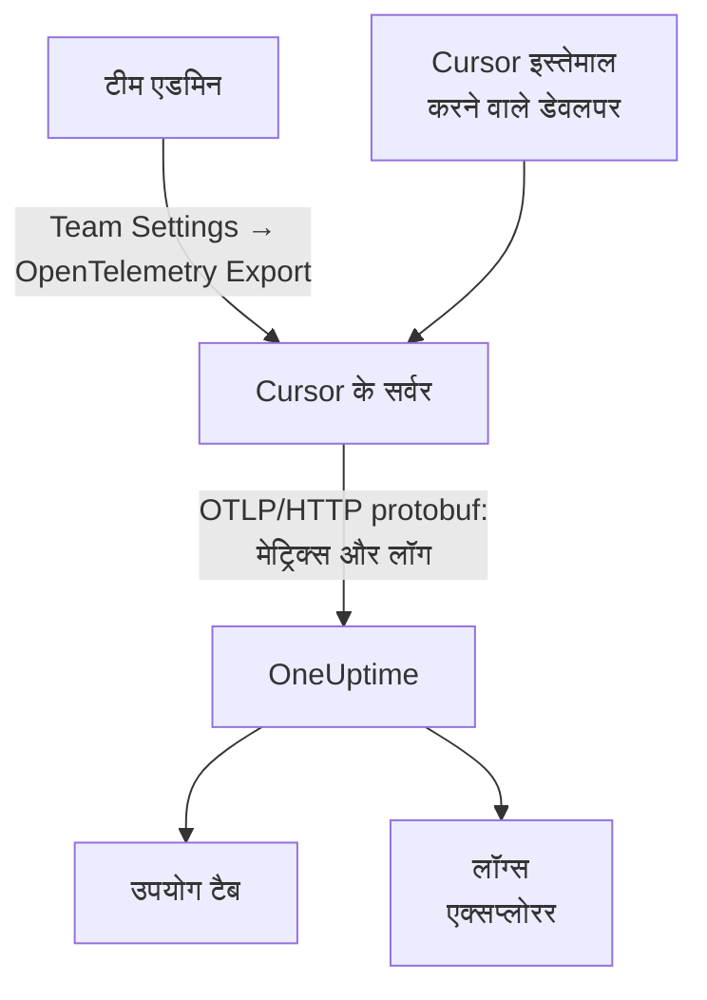

# Cursor

Cursor अपनी टीम की टेलीमेट्री Cursor के अपने सर्वर से एक्सपोर्ट करता है। एक टीम एडमिन Cursor के डैशबोर्ड में OneUptime को एक बार गंतव्य के रूप में जोड़ता है, और पूरी टीम के टोकन, अनुमानित लागत और टूल कॉल आने लगते हैं: डेवलपर मशीनों पर कुछ भी इंस्टॉल या सेट नहीं करना पड़ता।

:::cards
- [सेट अप करें](#सेट-अप-करें): OneUptime में एक कुंजी और Cursor में एक गंतव्य बनाएँ।
- [आपको क्या मिलता है](#आपको-क्या-मिलता-है-और-क्या-नहीं): मेट्रिक्स और लॉग; कोई ट्रेस नहीं।
- [किसने क्या खर्च किया](#कर्मचारी-एट्रिब्यूशन): लोग Cursor यूज़र ID के रूप में आते हैं।
- [समस्या निवारण](#समस्या-निवारण): कुछ न आए तो क्या जांचें।
:::

## यह कैसे काम करता है



## शुरू करने से पहले

- **Cursor का Enterprise प्लान।** OpenTelemetry Export स्क्रीन दूसरे प्लान में नहीं है।
- **ऐसा एंडपॉइंट जिस तक Cursor इंटरनेट से पहुँच सके।** Cursor आपसे जुड़ता है, पतों के एक तय सेट से। OneUptime Cloud को और कुछ नहीं चाहिए; फ़ायरवॉल के पीछे खुद होस्ट किए गए OneUptime को उन आउटबाउंड पतों को अनुमति देनी होगी जिन्हें Cursor अपने [OpenTelemetry Export](https://cursor.com/docs/enterprise/opentelemetry-export) पेज पर बताता है।

## सेट अप करें

:::steps
### इंजेशन कुंजी बनाएँ

OneUptime में **प्रोजेक्ट सेटिंग्स → टेलीमेट्री और APM → इंजेशन कुंजियाँ** खोलें, **इन्जेशन कुंजी बनाएँ** पर क्लिक करें और कुंजी कॉपी करें। आपका OTLP बेस URL `https://oneuptime.com/otlp` है, या अगर आप OneUptime खुद होस्ट करते हैं तो `https://YOUR-ONEUPTIME-HOST/otlp`।

### Cursor में गंतव्य बनाएँ

Cursor के वेब डैशबोर्ड में, टीम एडमिन के रूप में, **Team Settings → OpenTelemetry Export** खोलें और एक गंतव्य बनाएँ:

| फ़ील्ड | मान |
| --- | --- |
| Endpoint (base URL) | `https://oneuptime.com/otlp` |
| Header name | `x-oneuptime-token` |
| Header value | `YOUR_INGESTION_TOKEN` |

बेस URL `/v1` के बिना डालें: Cursor `/v1/metrics` और `/v1/logs` खुद जोड़ता है, और `https://oneuptime.com/otlp/v1` डेटा `/otlp/v1/v1/metrics` पर भेजेगा, जहाँ कुछ नहीं पहुँचता।

### टेस्ट करें और चालू करें

URL और हेडर जांचने के लिए **Test connection** पर क्लिक करें, फिर **Enable** पर। एक्सपोर्ट लगभग एक मिनट में शुरू हो जाता है; बाद में हेडर के बदलाव लगभग 30 सेकंड लेते हैं।

### जांचें कि डेटा आ रहा है

एक-दो मिनट Cursor इस्तेमाल करें, फिर OneUptime में **लॉग्स** खोलें और सेवा नाम `cursor` पर फ़िल्टर करें: टोकन गिनती वाले `cursor.api.request` रिकॉर्ड का मतलब है कि कुंजी और URL सही हैं।
:::

Cursor HTTP पर OTLP सिर्फ़ बाइनरी protobuf में बोलता है (न gRPC, न JSON), जिसे OneUptime जैसा है वैसा स्वीकार करता है। यह हेडर को एन्क्रिप्ट करके रखता है, और हर टीम के लिए एक ही गंतव्य पर भेजता है: OneUptime और किसी और जगह दोनों पर भेजने के लिए आगे एक collector लगाएँ।

## आपको क्या मिलता है, और क्या नहीं

| सिग्नल | Cursor से |
| --- | --- |
| मेट्रिक्स: टोकन, अनुमानित लागत, टूल कॉल | हाँ, डेल्टा के रूप में |
| लॉग इवेंट: अनुरोध, त्रुटियाँ, सुधार, स्किल, हुक, प्लगइन, क्लाउड एजेंट | हाँ |
| प्रॉम्प्ट और जवाब का टेक्स्ट | सिर्फ़ तब जब आप `conversation_content` फ़ैमिली चालू करें |
| ट्रेस | नहीं |
| गंतव्य चालू करने से पहले का कुछ भी | नहीं |

इसलिए OneUptime में Cursor **उत्पाद → AI / LLM** के **उपयोग** टैब पर `cursor.token.usage` और `cursor.cost.usage` से दिखता है, लेकिन कभी **कॉल** या **बातचीत** में नहीं, जो ट्रेस से बनती हैं। हर अनुरोध का ब्योरा **लॉग्स** एक्सप्लोरर में `cursor.api.request` इवेंट है।

### फ़ैमिली

हर सिग्नल, और टेलीमेट्री की हर फ़ैमिली, का Cursor की सेटिंग्स में अपना स्विच है:

| फ़ैमिली | क्या कवर करती है |
| --- | --- |
| `model_usage` | `cursor.token.usage`, `cursor.cost.usage`, और `cursor.api.request`, `cursor.api.error` और `cursor.api.correction` इवेंट |
| `tool_calls` | `cursor.tool.calls` |
| `skills_hooks_plugins` | स्किल, हुक और प्लगइन इवेंट |
| `cloud_agents` | `cursor.cloud_agent.*` इवेंट |
| `grok_bot_agent_actions` | `cursor.grok_bot.*` इवेंट; Action Recording चाहिए |
| `conversation_content` | संदेश का टेक्स्ट और MCP टूल का इनपुट और आउटपुट; डिफ़ॉल्ट रूप से बंद |

`conversation_content` को छोड़कर हर फ़ैमिली चालू से शुरू होती है। जो फ़ैमिली Cursor बाद में जोड़ता है वे भी चालू से शुरू होती हैं, जब तक आप `auto_enable_new_families` बंद न करें।

## मेट्रिक्स और इवेंट

तीनों मेट्रिक्स डेल्टा योग हैं:

| मेट्रिक | इकाई | विशेषताएँ |
| --- | --- | --- |
| `cursor.token.usage` | `{token}` | `cursor.token.type`: `input`, `output`, `cache_read`, `cache_creation`; `cursor.model.name`; `cursor.api.status`: `success`, `errored`, `aborted`; `cursor.api.billable` |
| `cursor.cost.usage` | `USD` | `cursor.model.name` |
| `cursor.tool.calls` | `{call}` | `cursor.tool.kind`: `builtin`, `mcp`; `cursor.tool.name`; `cursor.tool.status`: `success`, `failure`, `aborted`; `cursor.mcp.server.name` |

डेटा पॉइंट में कोई बातचीत या अनुरोध ID नहीं होती, इसलिए प्रति-सेशन लागत मेट्रिक्स में नहीं है। `cursor.model.name` मांगा गया मॉडल है, जिसमें रूट किए गए विकल्प एक साथ मिला दिए जाते हैं: मॉडल ब्रेकडाउन में `Auto` नाम की एक पंक्ति होती है जिसे उन मॉडलों में बाँटा नहीं जा सकता जिन पर Cursor ने उसे भेजा।

जिस लॉग इवेंट का आप सबसे ज़्यादा इस्तेमाल करेंगे वह `cursor.api.request` है: हर अनुरोध के लिए एक, उसके इनपुट, आउटपुट और कैश टोकन की गिनती, मॉडल और यह कि बिल हुआ या नहीं। `cursor.api.error` एक विफल अनुरोध रिकॉर्ड करता है (त्रुटि संदेश के बिना), और `cursor.api.correction` बाद में आकर बताता है कि कोई अनुरोध आख़िरकार बिल नहीं हुआ। Cursor का [वायर संदर्भ](https://cursor.com/docs/enterprise/opentelemetry-export/wire) हर इवेंट और विशेषता की सूची देता है।

हर रिकॉर्ड में ये रिसोर्स विशेषताएँ होती हैं:

| विशेषता | यह क्या है |
| --- | --- |
| `service.name` | हमेशा `cursor`: **लॉग्स** और **मेट्रिक्स** एक्सप्लोरर को इस पर फ़िल्टर करें |
| `cursor.team.id` | आपकी टीम, एक पूर्णांक; हमेशा मौजूद |
| `cursor.user.id` | व्यक्ति, टीम के दायरे वाला एक पूर्णांक; वैकल्पिक |
| `cursor.surface` | गतिविधि कहाँ से आई, जैसे `desktop`, `cli`, `cloud_agent` या `bugbot` |
| `cursor.entrypoint` | यह कैसे शुरू हुई, जैसे `desktop`, `cli`, `web`, `api` या `github_pr` |

## कर्मचारी एट्रिब्यूशन

**Cursor किसी व्यक्ति को `cursor.user.id` से बताता है, एक पूर्णांक जिसे सिर्फ़ Cursor नाम में बदल सकता है, और क्लाउड एजेंट के लिए अक्सर इसे छोड़ देता है।** OneUptime इसे कर्मचारी के रूप में पढ़ता है, और `cursor.team.id` को टीम के रूप में, इसलिए **उपयोग** टैब बिना सेटअप के व्यक्तियों और टीमों को रैंक करता है, लेकिन लोग पूर्णांकों के रूप में दिखते हैं।

- दोनों रिसोर्स विशेषताओं (`resource.cursor.user.id`, `resource.cursor.team.id`) के रूप में आते हैं, जिन्हें OneUptime पढ़ता है।
- Cursor `cursor.user.email` भी भेज सकता है, लेकिन OneUptime इसे अभी नहीं पढ़ता, इसलिए Cursor के लिए कर्मचारी ईमेल कॉलम खाली रहता है।
- `gen_ai.user`, `llm.user` और LiteLLM की अंतिम-उपयोगकर्ता ID कभी कर्मचारी के रूप में नहीं पढ़ी जातीं: वे आपके ग्राहकों का नाम बताती हैं, आपके स्टाफ़ का नहीं। [कर्मचारी और टीम एट्रिब्यूशन](/docs/telemetry/ai-coding-assistants#कर्मचारी-और-टीम-एट्रिब्यूशन) देखें।

### उपयोग टैब में Cursor कहाँ दिखता है

Cursor मेट्रिक्स भेजता है और कोई GenAI स्पैन नहीं, और मेट्रिक्स सिर्फ़ स्पैन की कमी पूरी करते हैं: **अगर उसी प्रोजेक्ट को लागत वाले GenAI स्पैन मिलते हैं, तो Cursor का खर्च नहीं दिखता।** Cursor को उसके अपने प्रोजेक्ट में भेजें। [स्पैन पहले, मेट्रिक्स कमी पूरी करते हैं](/docs/telemetry/ai-llm-observability#स्पैन-पहले-मेट्रिक्स-कमी-पूरी-करते-हैं) देखें।

| ब्रेकडाउन | Cursor के लिए |
| --- | --- |
| **कर्मचारी** | हाँ, `cursor.user.id` के हिसाब से |
| **टीम** | हाँ, `cursor.team.id` के हिसाब से |
| **मॉडल** | हाँ, `cursor.model.name` के हिसाब से |
| **प्रदाता** | नहीं: Cursor कभी नहीं बताता कि किस प्रदाता ने कॉल पूरी की |
| **ऐप्लिकेशन / सेवा** | नहीं: Cursor के मेट्रिक्स किसी OneUptime सेवा के नहीं होते |

Cursor की पंक्ति में सिर्फ़ लागत होती है: उसके कॉल और टोकन सेल `—` दिखाते हैं, क्योंकि `cursor.cost.usage` में हर कॉल का ब्योरा नहीं होता। `cursor.token.usage` फिर भी तालिका के ऊपर टोकन के कुल को भरता है (इसके `input` और `output` प्रकार; कैश टोकन छोड़ दिए जाते हैं), और आप इसे किसी डैशबोर्ड पर `cursor.token.type` के हिसाब से चार्ट कर सकते हैं।

:::details Cursor यूज़र ID को व्यक्ति में बदलना
नाम और बिल की गई रकम Cursor के Admin API में हैं, जिसे OneUptime कॉल नहीं करता: ज़रूरत हो तो इसे खुद चलाएँ। यह सिर्फ़ Enterprise के लिए है, `https://api.cursor.com` पर, और यूज़रनेम के रूप में एडमिन API कुंजी और खाली पासवर्ड लेता है:

```bash
curl -u YOUR_API_KEY: https://api.cursor.com/teams/members
```

`GET /teams/members` हर सदस्य का ईमेल और नाम बताता है। `POST /teams/filtered-usage-events` हर इवेंट का बिल किया गया उपयोग लौटाता है; खर्च के लिए इसके `chargedCents` जोड़ें। इसका `conversationId` Cursor के लॉग इवेंट पर `cursor.conversation.id` से मेल खाता है, जो किसी व्यक्ति और बिल की गई रकम को उस सेशन से जोड़ता है जिसे आप पहले से देखते हैं, जब दोनों तरफ़ यह मौजूद हो। Cursor यह दर्ज नहीं करता कि पूर्णांक `cursor.user.id` और Admin API की यूज़र ID एक ही हैं, इसलिए इसके आधार पर किसी से पैसे लेने से पहले इसे अपनी टीम पर जांच लें।
:::

## Cursor कैसे डिलीवर करता है

ये बातें चार्ट में दिखने वाली चीज़ें बदलती हैं, इसलिए कोई गैप रिपोर्ट करने से पहले इन्हें जान लें:

- **मेट्रिक्स ज़्यादा से ज़्यादा एक बार भेजे जाते हैं।** विफल एक्सपोर्ट दोबारा नहीं भेजा जाता, इसलिए विफलता के बाद एक छोटा गैप स्वाभाविक है: Cursor के मेट्रिक्स के गैप पर किसी को पेज न करें।
- **लॉग कम से कम एक बार भेजे जाते हैं**, `cursor.event.id` पर डुप्लिकेट हटाए जाते हैं, और लगभग 7 दिनों तक अपने आप दोबारा भेजे जाते हैं।
- **कोई क्रम तय नहीं है।** `cursor.api.correction` उस अनुरोध के बाद आता है जिसे वह सुधारता है: रिकॉर्ड के टाइमस्टैम्प से क्रमबद्ध करें, आने के क्रम से कभी नहीं।
- **पीछे का कुछ नहीं भरा जाता।** गंतव्य चालू करने से पहले का कुछ नहीं आता, और टूटा छोड़ा गया गंतव्य वह खो देता है जो Cursor भेज नहीं सका।
- **किसी गंतव्य को बंद करने या हटाने से रास्ते में मौजूद डेटा खो जाता है।** इंजेशन कुंजी बदलने के लिए, गंतव्य को हटाकर दोबारा बनाने के बजाय उसका हेडर संपादित करें।

## लागत एक अनुमान है, इनवॉइस नहीं

Cursor `cursor.cost.usage` को एक सर्वोत्तम-प्रयास अनुमान बताता है। यह शामिल उपयोग को मांग पर बिल होने वाले उपयोग से अलग नहीं करता; आपकी अपनी मॉडल कुंजियों के साथ यह सिर्फ़ Cursor की टोकन दर दिखाता है, आपके प्रदाता का बिल नहीं; और बाद में आने वाला `cursor.api.correction` पहले गिने जा चुके उपयोग को वापस ले सकता है। इसे एक रुझान की तरह पढ़ें। इनवॉइस से मेल खाने वाले आंकड़े के लिए, Cursor के Admin API से `chargedCents` जोड़ें।

## समस्या निवारण

:::details कुछ नहीं आता
Cursor में **Test connection** फिर से चलाएँ। जांचें कि बेस URL `/v1` पर खत्म नहीं होता, हेडर का नाम `x-oneuptime-token` है और उसका मान ठीक कुंजी है, और `model_usage` फ़ैमिली चालू है। गंतव्य चालू करने के लगभग एक मिनट बाद एक्सपोर्ट शुरू होता है।
:::

:::details खुद होस्ट किए गए OneUptime तक कुछ नहीं पहुँचता
Cursor अपने सर्वर से जुड़ता है: आपका OTLP एंडपॉइंट इंटरनेट से, किसी सार्वजनिक DNS नाम पर, पहुँचने योग्य होना चाहिए, और आपके फ़ायरवॉल से Cursor के आउटबाउंड पतों को आने देना चाहिए।
:::

:::details लॉग आते हैं, लेकिन उपयोग टैब पर Cursor का कोई खर्च नहीं दिखता
प्रोजेक्ट को लागत वाले GenAI स्पैन भी मिलते हैं, इसलिए Cursor के मेट्रिक्स नहीं पढ़े जाते। Cursor को उसके अपने प्रोजेक्ट में भेजें, उसकी अपनी इंजेशन कुंजी के साथ।
:::

:::details लोग संख्याओं के रूप में दिखते हैं
वह `cursor.user.id` है: वह अकेली व्यक्ति ID जिसे OneUptime आज Cursor से पढ़ता है। इसे Cursor के Admin API से नामों से मिलाएँ।
:::

## अगले कदम

:::cards
- [AI कोडिंग असिस्टेंट](/docs/telemetry/ai-coding-assistants): हर कोडिंग असिस्टेंट में खर्च कैसे जोड़ा जाता है।
- [AI गेटवे](/docs/telemetry/ai-gateways): आपके अपने ऐप की मॉडल कॉल के पूरे ट्रेस और प्रॉम्प्ट।
- [मेट्रिक्स मॉनिटर](/docs/monitor/metrics-monitor): `cursor.cost.usage`, `cursor.token.usage` या `cursor.tool.calls` पर अलर्ट लगाएँ।
:::
