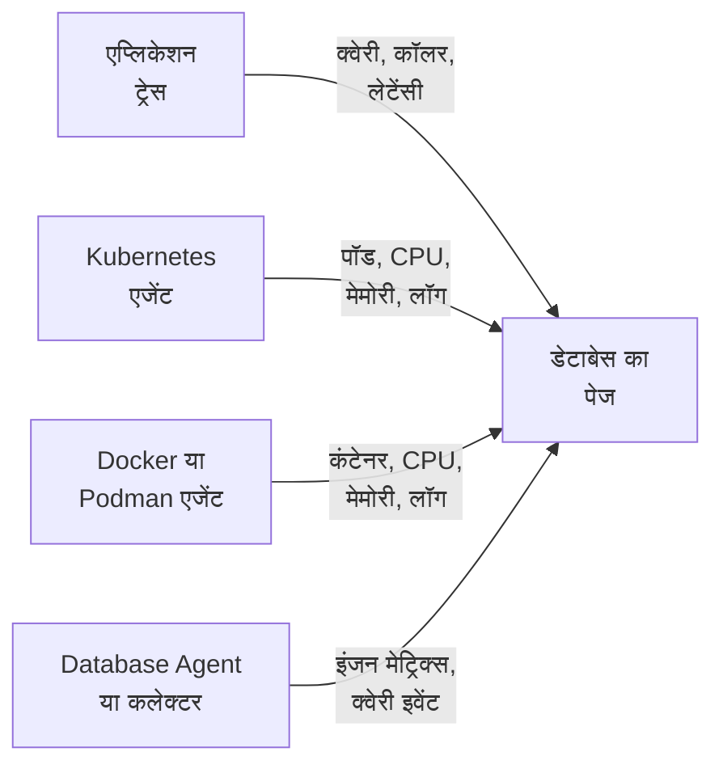

# डेटाबेस

**Databases** आपके प्रोजेक्ट द्वारा चलाए जाने वाले या जिससे वह बात करता है, ऐसे हर डेटाबेस सर्वर को उसका अपना पेज देता है: उसे कौन कॉल कर रहा है और कितनी तेज़ी से, वह कहाँ चलता है, इंजन की अपनी हेल्थ मेट्रिक्स, उसके लॉग और ट्रेस, उससे जुड़ी घटनाएँ, अलर्ट और अनुसूचित रखरखाव, और उसके इंजन के लिए सुझाए गए अलर्ट मॉनिटर। हर दूसरे रिसोर्स की तरह, डेटाबेस में भी लेबल, मालिक, लेबल और मालिक नियम, हर डेटाबेस की अपनी प्रतिधारण अवधि और आर्काइव करने की सुविधा होती है। इन्हें **उत्पाद → संसाधन → डेटाबेस** में खोलें।

:::cards
- [Database Agent](#database-agent): PostgreSQL, MySQL, SQL Server, Oracle, Redis, MongoDB, Elasticsearch और Memcached के लिए इंजन मेट्रिक्स।
- [डेटाबेस कैसे पहचाने जाते हैं](#डेटाबेस-कैसे-पहचाने-जाते-हैं): ट्रेस, Kubernetes, Docker, Podman और कलेक्टर से।
- [डेटाबेस पर अलर्ट](#डेटाबेस-पर-अलर्ट): सुझाए गए मॉनिटर, और आपके खुद बनाए मॉनिटर।
- [समस्या निवारण](#समस्या-निवारण): एक डायग्नोस्टिक स्क्रिप्ट, और आम समस्याएँ।
:::

## यह कैसे काम करता है

ज़्यादातर डेटाबेस अपने आप दिखाई देते हैं। OneUptime हर डेटाबेस को अधिकतम चार स्रोतों से जोड़कर बनाता है, और हर स्रोत कुछ अलग जोड़ता है:

| स्रोत | आपसे क्या चाहिए | डेटाबेस के पेज में क्या जोड़ता है |
| --- | --- | --- |
| **एप्लिकेशन ट्रेस** | इंस्ट्रूमेंट किए गए एप्लिकेशन (OpenTelemetry) | एप्लिकेशन से आने वाली क्वेरी: कॉल दर, त्रुटियाँ, लेटेंसी, और उसे कॉल करने वाली सेवाएँ |
| **Kubernetes** | [OneUptime Kubernetes एजेंट](/docs/telemetry/kubernetes-agent) | वह कहाँ चलता है: पॉड, CPU और मेमोरी, और पॉड के लॉग |
| **Docker / Podman** | [Docker एजेंट](/docs/telemetry/docker-host) या [Podman एजेंट](/docs/telemetry/podman-host) | वह कहाँ चलता है: कंटेनर, उनका CPU और मेमोरी, और उनके लॉग |
| **Database Agent** (एक OpenTelemetry Collector) | [Database Agent](#database-agent) या आपका अपना कलेक्टर | **Engine metrics**: कनेक्शन, थ्रूपुट, कैश हिट अनुपात, लॉक, रेप्लिकेशन लैग, मेमोरी, जहाँ तक इंजन में ये उपलब्ध हों ([क्या एकत्र किया जाता है](#क्या-एकत्र-किया-जाता-है) देखें), साथ ही वैकल्पिक क्वेरी सैंपल, टॉप क्वेरी और इंजन की लॉग फ़ाइल |



इंजन मेट्रिक्स सिर्फ़ उसी कलेक्टर से आती हैं जो खुद डेटाबेस से बात करता है (या, किसी मैनेज्ड क्लाउड डेटाबेस के लिए, उसके प्रोवाइडर के मॉनिटरिंग API से)। ट्रेस और कंटेनर इन्वेंटरी OneUptime को बताती हैं कि डेटाबेस मौजूद है और उसका उपयोग कैसे होता है, लेकिन यह नहीं कि अंदर से उसकी हालत कैसी है; हर डेटाबेस पर **Engine metrics** स्थिति बताती है कि वह हिस्सा कनेक्टेड है या नहीं।

आप डेटाबेस को हाथ से भी जोड़ सकते हैं: **Databases → डेटाबेस बनाएँ** में उसका इंजन, पता और पोर्ट दें। ऐसी प्रोब-आधारित हेल्थ जाँच के लिए जिसे किसी एजेंट की ज़रूरत ही नहीं, [डेटाबेस हेल्थ मॉनिटर](/docs/monitor/database-health-monitor) देखें।

## समर्थित डेटाबेस

OneUptime नीचे दिए इंजनों को नाम से पहचानता है: इंस्ट्रूमेंटेशन जो कुछ `db.system.name` (या पुराने `db.system`) में डालते हैं, उसे वह दूसरे कॉलम के मान में सामान्यीकृत करता है, इंजन का नाम दिखाता है, जब किसी स्पैन या पते में पोर्ट न हो तो उसका डिफ़ॉल्ट पोर्ट लगाता है, उसकी कंटेनर इमेज और Helm चार्ट पहचानता है, और जानता है कि उसकी इंजन मेट्रिक्स कहाँ से आती हैं। जो इंजन सूची में नहीं है, वह भी हर उस जगह काम करता है जहाँ डेटाबेस उसके पते से पहचाना जाता है; वह बस उसी कच्चे नाम से दिखता है जो आपके स्पैन रिपोर्ट करते हैं, और कभी सिर्फ़ ट्रेस से नहीं बनता।

**फ़ैमिली** वह इंजन है जिसके ज़रिए किसी फ़ोर्क या प्रोटोकॉल-संगत इंजन तक पहुँचा जाता है: क्लाइंट लाइब्रेरी MariaDB को MySQL से या Valkey को Redis से अलग नहीं कर सकतीं, इसलिए स्पैन `mysql` या `redis` बताता है, जबकि कंटेनर इमेज, Helm चार्ट या Database Agent फ़ोर्क का नाम बताते हैं। दोनों एक ही डेटाबेस पर पहुँचते हैं, और जैसे ही उसकी कंटेनर इमेज, या कम से कम उतना ही मज़बूत स्रोत जितना उसके मौजूदा इंजन के पीछे है, ज़्यादा विशिष्ट इंजन का नाम लेता है, डेटाबेस वही इंजन दिखाता है ([डेटाबेस कौन-सा इंजन दिखाता है](#डेटाबेस-कौन-सा-इंजन-दिखाता-है) देखें)।

**ट्रेस से बनाया गया** बताता है कि क्या सिर्फ़ क्लाइंट स्पैन उस इंजन का डेटाबेस बना देते हैं ([एप्लिकेशन ट्रेस से](#एप्लिकेशन-ट्रेस-से) देखें): प्रोवाइडर के साझा API होस्ट से पहुँची जाने वाली मैनेज्ड सेवा, और आपके एप्लिकेशन की प्रोसेस के अंदर चलने वाला इंजन, कभी नहीं बनाते। **Engine metrics** बताता है कि इंजन की अपनी हेल्थ मेट्रिक्स कहाँ से आती हैं: Database Agent कॉन्फ़िग, collector-contrib का कोई रिसीवर जिसे आप अपने कलेक्टर में जोड़ते हैं, इंजन का अपना Prometheus एंडपॉइंट (`:port/path`, जिसे कलेक्टर के `prometheus` रिसीवर से स्क्रेप किया जाता है), क्लाउड प्रोवाइडर का मॉनिटरिंग API, या कुछ बिल्ट-इन नहीं। हर डेटाबेस का **दस्तावेज़ीकरण** टैब इसे उस डेटाबेस के लिए तुरंत इस्तेमाल होने लायक कलेक्टर कॉन्फ़िग में बदल देता है।

| इंजन | `db.system.name` | डिफ़ॉल्ट पोर्ट | फ़ैमिली | ट्रेस से बनाया गया | Engine metrics |
| --- | --- | --- | --- | --- | --- |
| Actian Ingres | `actian.ingres` | — | — | हाँ | कुछ बिल्ट-इन नहीं |
| Actian Zen (Pervasive PSQL) | `pervasive` | 1583 | — | हाँ | कुछ बिल्ट-इन नहीं |
| Aerospike | `aerospike` | 3000 | — | हाँ | `aerospike` रिसीवर |
| Amazon DocumentDB | `aws.documentdb` | 27017 | MongoDB | हाँ | `awsfirehose` रिसीवर (क्लाउड मॉनिटरिंग) |
| Amazon DynamoDB | `aws.dynamodb` | 443 | — | नहीं (क्लाउड API) | `awsfirehose` रिसीवर (क्लाउड मॉनिटरिंग) |
| Amazon Neptune | `aws.neptune` | 8182 | — | हाँ | `awsfirehose` रिसीवर (क्लाउड मॉनिटरिंग) |
| Amazon Redshift | `aws.redshift` | 5439 | PostgreSQL | हाँ | `awsfirehose` रिसीवर (क्लाउड मॉनिटरिंग) |
| Apache Derby | `derby` | 1527 | — | नहीं (इन-प्रोसेस) | कोई नहीं (इन-प्रोसेस) |
| Apache Doris | `doris` | 9030 | MySQL | हाँ | Prometheus, `:8030/metrics` |
| Apache Druid | `druid` | 8888 | — | हाँ | कुछ बिल्ट-इन नहीं |
| Apache Geode | `geode` | 10334 | — | हाँ | कुछ बिल्ट-इन नहीं |
| Apache HBase | `hbase` | — | — | हाँ | कुछ बिल्ट-इन नहीं |
| Apache Hive | `hive` | 10000 | — | हाँ | कुछ बिल्ट-इन नहीं |
| Apache Ignite | `ignite` | 10800 | — | हाँ | कुछ बिल्ट-इन नहीं |
| Apache Impala | `impala` | 21050 | — | हाँ | कुछ बिल्ट-इन नहीं |
| Apache Pinot | `pinot` | 8099 | — | हाँ | कुछ बिल्ट-इन नहीं |
| Apache Solr | `solr` | 8983 | — | हाँ | कुछ बिल्ट-इन नहीं |
| ArangoDB | `arangodb` | 8529 | — | हाँ | Prometheus, `:8529/_admin/metrics/v2` |
| Azure Cosmos DB | `azure.cosmosdb` | 443 | — | नहीं (क्लाउड API) | `azure_monitor` रिसीवर (क्लाउड मॉनिटरिंग) |
| Cassandra | `cassandra` | 9042 | — | हाँ | कुछ बिल्ट-इन नहीं |
| Chroma | `chroma` | 8000 | — | हाँ | कुछ बिल्ट-इन नहीं |
| Claris FileMaker | `filemaker` | 2399 | — | हाँ | कुछ बिल्ट-इन नहीं |
| ClickHouse | `clickhouse` | 9000 | — | हाँ | Prometheus, `:9363/metrics` |
| Cloud Bigtable | `gcp.bigtable` | 443 | — | नहीं (क्लाउड API) | `googlecloudmonitoring` रिसीवर (क्लाउड मॉनिटरिंग) |
| Cloud Firestore | `gcp.firestore` | 443 | — | नहीं (क्लाउड API) | `googlecloudmonitoring` रिसीवर (क्लाउड मॉनिटरिंग) |
| Cloud Spanner | `gcp.spanner` | 443 | — | नहीं (क्लाउड API) | `google_cloud_spanner` रिसीवर |
| CockroachDB | `cockroachdb` | 26257 | PostgreSQL | हाँ | Prometheus, `:8080/_status/vars` |
| Couchbase | `couchbase` | 11210 | — | हाँ | Prometheus, `:8091/metrics` |
| CouchDB | `couchdb` | 5984 | — | हाँ | `couchdb` रिसीवर |
| Databricks | `databricks` | 443 | — | हाँ | कुछ बिल्ट-इन नहीं |
| Dragonfly | `dragonfly` | 6379 | Redis | हाँ | Database Agent (`redis` रिसीवर) |
| DuckDB | `duckdb` | — | — | नहीं (इन-प्रोसेस) | कोई नहीं (इन-प्रोसेस) |
| Elasticsearch | `elasticsearch` | 9200 | — | हाँ | Database Agent (`elasticsearch` रिसीवर) |
| etcd | `etcd` | 2379 | — | हाँ | Prometheus, `:2379/metrics` |
| FerretDB | `ferretdb` | 27017 | MongoDB | हाँ | Prometheus, `:8088/debug/metrics` |
| Firebird | `firebirdsql` | 3050 | — | हाँ | कुछ बिल्ट-इन नहीं |
| FoundationDB | `foundationdb` | 4500 | — | हाँ | कुछ बिल्ट-इन नहीं |
| Google BigQuery | `bigquery` | 443 | — | नहीं (क्लाउड API) | `googlecloudmonitoring` रिसीवर (क्लाउड मॉनिटरिंग) |
| Greenplum | `greenplum` | 5432 | PostgreSQL | हाँ | कुछ बिल्ट-इन नहीं |
| H2 | `h2database` | 9092 | — | नहीं (इन-प्रोसेस) | कोई नहीं (इन-प्रोसेस) |
| Hazelcast | `hazelcast` | 5701 | — | हाँ | कुछ बिल्ट-इन नहीं |
| HyperSQL | `hsqldb` | 9001 | — | नहीं (इन-प्रोसेस) | कोई नहीं (इन-प्रोसेस) |
| IBM Db2 | `ibm.db2` | 50000 | — | हाँ | कुछ बिल्ट-इन नहीं |
| IBM Informix | `ibm.informix` | 9088 | — | हाँ | कुछ बिल्ट-इन नहीं |
| IBM Netezza | `ibm.netezza` | 5480 | — | हाँ | कुछ बिल्ट-इन नहीं |
| InfluxDB | `influxdb` | 8086 | — | हाँ | Prometheus, `:8086/metrics` |
| InstantDB | `instantdb` | — | — | नहीं (इन-प्रोसेस) | कोई नहीं (इन-प्रोसेस) |
| InterBase | `interbase` | 3050 | Firebird | हाँ | कुछ बिल्ट-इन नहीं |
| InterSystems IRIS / Caché | `intersystems.cache` | 1972 | — | हाँ | Prometheus, `:52773/api/monitor/metrics` |
| KeyDB | `keydb` | 6379 | Redis | हाँ | Database Agent (`redis` रिसीवर) |
| MariaDB | `mariadb` | 3306 | MySQL | हाँ | Database Agent (`mysql` रिसीवर) |
| Meilisearch | `meilisearch` | 7700 | — | हाँ | Prometheus, `:7700/metrics` |
| Memcached | `memcached` | 11211 | — | हाँ | Database Agent (`memcached` रिसीवर) |
| Milvus | `milvus` | 19530 | — | हाँ | Prometheus, `:9091/metrics` |
| MongoDB | `mongodb` | 27017 | — | हाँ | Database Agent (`mongodb` रिसीवर) |
| MySQL | `mysql` | 3306 | — | हाँ | Database Agent (`mysql` रिसीवर) |
| Neo4j | `neo4j` | 7687 | — | हाँ | Prometheus, `:2004/metrics` |
| OceanBase | `oceanbase` | 2881 | MySQL | हाँ | कुछ बिल्ट-इन नहीं |
| OpenSearch | `opensearch` | 9200 | Elasticsearch | हाँ | Database Agent (`elasticsearch` रिसीवर) |
| Oracle | `oracle.db` | 1521 | — | हाँ | Database Agent (`oracledb` रिसीवर) |
| Pinecone | `pinecone` | 443 | — | नहीं (क्लाउड API) | कुछ बिल्ट-इन नहीं |
| PostgreSQL | `postgresql` | 5432 | — | हाँ | Database Agent (`postgresql` रिसीवर) |
| Presto | `presto` | 8080 | — | हाँ | कुछ बिल्ट-इन नहीं |
| Progress OpenEdge | `progress` | — | — | हाँ | कुछ बिल्ट-इन नहीं |
| Qdrant | `qdrant` | 6333 | — | हाँ | Prometheus, `:6333/metrics` |
| QuestDB | `questdb` | 8812 | PostgreSQL | हाँ | Prometheus, `:9003/metrics` |
| RavenDB | `ravendb` | 8080 | — | हाँ | कुछ बिल्ट-इन नहीं |
| Redis | `redis` | 6379 | — | हाँ | Database Agent (`redis` रिसीवर) |
| Riak KV | `riak` | 8087 | — | हाँ | `riak` रिसीवर |
| SAP ASE (Sybase) | `sybase` | 5000 | — | हाँ | कुछ बिल्ट-इन नहीं |
| SAP HANA | `sap.hana` | 30015 | — | हाँ | `saphana` रिसीवर |
| SAP MaxDB | `sap.maxdb` | 7210 | — | हाँ | कुछ बिल्ट-इन नहीं |
| ScyllaDB | `scylladb` | 9042 | Cassandra | हाँ | Prometheus, `:9180/metrics` |
| SingleStore | `singlestore` | 3306 | MySQL | हाँ | Prometheus, `:9104/metrics` |
| Snowflake | `snowflake` | 443 | — | हाँ | `snowflake` रिसीवर |
| Software AG Adabas | `softwareag.adabas` | — | — | हाँ | कुछ बिल्ट-इन नहीं |
| SQL Server | `microsoft.sql_server` | 1433 | — | हाँ | Database Agent (`sqlserver` रिसीवर) |
| SQLite | `sqlite` | — | — | नहीं (इन-प्रोसेस) | कोई नहीं (इन-प्रोसेस) |
| StarRocks | `starrocks` | 9030 | MySQL | हाँ | Prometheus, `:8030/metrics` |
| SurrealDB | `surrealdb` | 8000 | — | हाँ | कुछ बिल्ट-इन नहीं |
| Teradata | `teradata` | 1025 | — | हाँ | कुछ बिल्ट-इन नहीं |
| TiDB | `tidb` | 4000 | MySQL | हाँ | Prometheus, `:10080/metrics` |
| Trino | `trino` | 8080 | — | हाँ | Prometheus, `:8080/metrics` |
| Typesense | `typesense` | 8108 | — | हाँ | कुछ बिल्ट-इन नहीं |
| Valkey | `valkey` | 6379 | Redis | हाँ | Database Agent (`redis` रिसीवर) |
| Vertica | `vertica` | 5433 | — | हाँ | कुछ बिल्ट-इन नहीं |
| Vitess | `vitess` | 3306 | MySQL | हाँ | Prometheus, `:15000/metrics` |
| Weaviate | `weaviate` | 8080 | — | हाँ | Prometheus, `:2112/metrics` |
| YugabyteDB | `yugabytedb` | 5433 | PostgreSQL | हाँ | Prometheus, `:9000/prometheus-metrics` |

दूसरी आम वर्तनियाँ भी स्वीकार की जाती हैं: `postgres` और `pg`, `mssql` और `sqlserver`, `oracle`, `mongo`, `scylla`, `dragonflydb`, `memsql`, और OpenTelemetry द्वारा इस्तेमाल किया गया हर पुराना `db.system` मान (`db2`, `hanadb`, `cosmosdb`, `dynamodb`, `spanner`, `redshift`, `informix`, `maxdb`, `cache`, `h2`, `firebird`, `edb`, `cloudscape`, …)। किसी इंजन का प्रोटोकॉल बोलने वाली मैनेज्ड सेवा (Amazon RDS और Aurora, Azure Database, Cloud SQL, AlloyDB, Neon, Supabase, PlanetScale, ElastiCache, Memorystore, MongoDB Atlas) वही इंजन मानी जाती है।

## डेटाबेस कैसे पहचाने जाते हैं

हर डेटाबेस उस स्रोत को याद रखता है जिसने उसे बनाया (**Discovered from** कॉलम), और उसके **फ़ीड** की पहली प्रविष्टि बताती है कि उसे किसने ढूँढा: Kubernetes वर्कलोड और उसका क्लस्टर, Docker या Podman कंटेनर (या Compose या Swarm सेवा) और उसका होस्ट, वह एंडपॉइंट जिसे एप्लिकेशन ने कॉल किया, या उसे रिपोर्ट करने वाला Database Agent (उसके वर्शन के साथ) या कलेक्टर। बाद के स्रोत दूसरा डेटाबेस बनाने के बजाय उसी डेटाबेस में जुड़ते हैं, जब तक वे उसी एंडपॉइंट का वर्णन करते हैं ([एंडपॉइंट](#एंडपॉइंट-और-एक-मालिक-का-नियम) देखें)।

### एप्लिकेशन ट्रेस से

हर 10 मिनट में OneUptime उन CLIENT स्पैन का सारांश बनाता है जो आपके एप्लिकेशन ने पिछले 15 मिनट में भेजे और जिनमें `db.system.name` (या पुराना `db.system`) होता है। सर्वर `server.address` (या पुराने `net.peer.name`, फिर `network.peer.address` / `net.sock.peer.addr`) से और पोर्ट `server.port` (या `net.peer.port`, `network.peer.port`, `net.sock.peer.port`) से आता है; जब स्पैन में पोर्ट न हो, तो इंजन का डिफ़ॉल्ट पोर्ट मान लिया जाता है। इंजन के नाम सामान्यीकृत किए जाते हैं ([समर्थित डेटाबेस](#समर्थित-डेटाबेस) देखें), इसलिए `postgres`, `pg` और `postgresql` एक ही इंजन हैं, वैसे ही `mssql` और `microsoft.sql_server`; `mariadb` और `mysql` एक ही फ़ैमिली के दो इंजन हैं।

ट्रेस से डेटाबेस सिर्फ़ तभी **बनाया जाता है** जब ये सभी शर्तें पूरी हों; बाकी सब कुछ पहले से मौजूद डेटाबेस में तो गिना जाता है, लेकिन कभी नया डेटाबेस नहीं बनाता:

- पता पूरे प्रोजेक्ट में एक ही सर्वर को दर्शाता हो: एक DNS नाम, न कि कोई IP लिटरल, और न ही ऐसा नाम जो सिर्फ़ एक मशीन पर या एक नेटवर्क के अंदर रिज़ॉल्व होता हो, जब तक कि कॉल करने वाले का Kubernetes क्लस्टर उसे योग्य न बनाए ([एंडपॉइंट](#एंडपॉइंट-और-एक-मालिक-का-नियम) देखें);
- पोर्ट वह हो जिस पर कोई सर्वर सुनता है। ऑपरेटिंग सिस्टम कनेक्शन के क्लाइंट वाले सिरे को 32768 और उससे ऊपर का पोर्ट देते हैं (Linux की डिफ़ॉल्ट एफ़ेमरल रेंज वहीं से शुरू होती है; Windows और macOS 49152–65535 इस्तेमाल करते हैं), इसलिए 32768 और उससे ऊपर का पोर्ट कभी डेटाबेस नहीं बनाता, जब तक कि वह इंजन का अपना डिफ़ॉल्ट पोर्ट न हो (IBM Db2 का 50000)। eBPF इंस्ट्रूमेंटेशन, Kubernetes एजेंट का भी, किसी लंबे चलने वाले कनेक्शन से बीच में जुड़ सकता है और उसके दोनों सिरे उलट सकता है। तब स्पैन क्लाइंट के अपने पोर्ट को सर्वर बताता है, और इस नियम के बिना हर कनेक्शन अपना अलग डेटाबेस बन जाता;
- इंजन ऐसा हो जिसे OneUptime जानता है और जिसका अपना पता होता है: [समर्थित डेटाबेस](#समर्थित-डेटाबेस) का **ट्रेस से बनाया गया** कॉलम। वे क्लाउड API जिनका होस्ट सभी ग्राहक साझा करते हैं (DynamoDB, BigQuery, Spanner, Firestore, Bigtable, Cosmos DB, Pinecone), आपके एप्लिकेशन के अंदर चलने वाले इंजन (SQLite, DuckDB, H2, HyperSQL, Derby) और ऐसे इंजन जिन्हें OneUptime नहीं जानता, कभी ट्रेस से नहीं बनाए जाते; उन्हें हाथ से जोड़ें;
- किसी रन द्वारा देखी जाने वाली 15 मिनट की विंडो में एंडपॉइंट को कम से कम 10 क्वेरी मिली हों, ताकि कोई एक बार चलने वाली स्क्रिप्ट डेटाबेस न बनाए। किसी क्लाइंट लाइब्रेरी के कनेक्शन-मैनेजमेंट स्पैन (node-postgres के `pg.connect` और `pg-pool.connect`, `redis-connect`, `connect`, …) क्वेरी नहीं हैं: वे न यहाँ गिने जाते हैं, न किसी डेटाबेस की **क्वेरी** में;
- प्रोजेक्ट अपने [ऑटो-क्रिएट बजट](#ऑटो-क्रिएट-बजट) के अंदर हो।

डेटाबेस के हर CLIENT स्पैन को इंजेस्ट होते समय उसके एंडपॉइंट से टैग भी किया जाता है, इसलिए जैसे ही कोई डेटाबेस किसी एंडपॉइंट का मालिक बनता है, **ऐप्लिकेशन से आई क्वेरी** सेक्शन और **ट्रेस** टैब उसकी हर कॉल दिखाते हैं, डेटाबेस बनने से पहले की कॉल भी। `server.address` वाली `db.client.*` मेट्रिक्स (उदाहरण के लिए `db.client.operation.duration`) भी इसी तरह टैग की जाती हैं।

**क्लस्टर और होस्ट सूचियाँ।** कई होस्ट वाली कनेक्शन स्ट्रिंग (`m1:27017,m2:27017,m3:27017`) एक ही डेटाबेस है, चाहे क्लाइंट उन्हें किसी भी क्रम में लिखे। MongoDB Atlas के सदस्य (`cluster0-shard-00-01.ab1cd.mongodb.net`) अपने क्लस्टर के नाम वाला एक डेटाबेस बन जाते हैं (`cluster0.ab1cd.mongodb.net`), और दिखा हर सदस्य उसका एक एंडपॉइंट बन जाता है। जो ड्राइवर Cassandra रिंग, Redis Cluster, Elasticsearch क्लस्टर के हर सदस्य या ElastiCache नोड को अलग-अलग रिपोर्ट करते हैं, उनसे अब भी हर सदस्य का एक डेटाबेस बनता है: उन होस्ट नामों में ऐसा कुछ नहीं है जो बताए कि वे किस क्लस्टर के हैं। एक को रखें और बाकी को उसमें [मर्ज करें](#एंडपॉइंट-और-एक-मालिक-का-नियम)।

### Kubernetes से

हर 5 मिनट में OneUptime हर कनेक्टेड Kubernetes क्लस्टर के पॉड देखता है और डेटाबेस वर्कलोड पहचानता है:

1. **पहले ऑपरेटर और चार्ट लेबल**: CloudNativePG, Zalando (Spilo), Crunchy PGO, Bitnami चार्ट, ECK, Altinity ClickHouse, cass-operator, Percona, Oracle MySQL ऑपरेटर और Vitess ऑपरेटर (इसके `vtgate` पॉड ही डेटाबेस हैं; `vttablet`, `vtctld`, `vtorc` और `vtbackup` उसके हिस्से हैं, सदस्य नहीं)। एक ऑपरेटर क्लस्टर एक डेटाबेस बनता है। Vitess क्लस्टर की अपनी vtgate Service का नाम हैश किया हुआ होता है, इसलिए अगर एप्लिकेशन उसी के ज़रिए कनेक्ट होते हैं, तो उसे डेटाबेस के **एंडपॉइंट** टैब पर जोड़ें।
2. **अन्यथा कंटेनर इमेज**, इमेज के सटीक नाम से: [समर्थित डेटाबेस](#समर्थित-डेटाबेस) के हर उस इंजन की आधिकारिक, Bitnami (स्थानांतरित `bitnamilegacy` और `bitnamisecure` रिपॉज़िटरी सहित) और Red Hat / OpenShift इमेज जो इमेज देता है (`postgres`, `bitnami/postgresql`, `rhel9/postgresql-16`, `mysql`, `mariadb`, `mssql/server`, `gvenzl/oracle-free`, `redis`, `valkey/valkey`, `mongo`, `cockroachdb/cockroach`, `pingcap/tidb`, `clickhouse/clickhouse-server`, `qdrant/qdrant`, …)। फ़ोर्क अपने ही रूप में पहचाना जाता है: `mariadb` इमेज MariaDB है, `valkey/valkey` इमेज Valkey है। एक्सपोर्टर, ऑपरेटर, एडमिन UI, कनेक्शन पूलर (pgbouncer, pgpool, ProxySQL, HAProxy, Cloud SQL Proxy) और बैकअप टूल डेटाबेस नहीं हैं। जो पॉड कोई एप्लिकेशन कंटेनर भी चलाता है, उसे भी डेटाबेस नहीं माना जाता (डेटाबेस साइडकार वाला ऐप फिर भी ऐप ही है), हालाँकि जिस StatefulSet का डेटाबेस कंटेनर इंजन का डिफ़ॉल्ट पोर्ट घोषित करता है, उसमें एक अतिरिक्त ऐसा कंटेनर हो सकता है जिसे OneUptime नहीं पहचानता (जैसे कोई लॉग शिपर)।

डेटाबेस इमेज किसी पॉड को डेटाबेस सर्वर नहीं बनाती, लेकिन उसे कुछ और ठहराने के लिए ठोस सबूत चाहिए। जिस कंटेनर का प्रोग्राम कोई क्लाइंट या डंप टूल (`psql`, `redis-cli`, `mongosh`, `pg_dump`, `mysql`), कोई कीप-अलाइव (`sleep infinity`, `tail -f /dev/null`) या कोई इंटरैक्टिव शेल हो (या जिसकी `sh -c` स्क्रिप्ट ऐसे टूल, शेल बिल्ट-इन और `echo` और `cp` जैसी साधारण यूटिलिटी के सिवा कुछ न चलाए), वह क्लाइंट या डीबग रन है, डेटाबेस नहीं; Redis या Valkey Sentinel (`redis-sentinel`, `redis-server --sentinel`) भी नहीं। यह किसी लॉन्चर के पीछे भी लागू होता है: `env` (अपनी `NAME=value` सेटिंग के साथ), `nohup`, `setsid`, `tini`, `dumb-init` और इमेज के `docker-entrypoint.sh` के आर-पार देखकर उस प्रोग्राम तक पहुँचा जाता है जिसे वे शुरू करते हैं, और स्क्रिप्ट के अंदर `exec`, `env` और `nohup` के साथ भी ऐसा ही होता है, इसलिए `env PGPASSWORD=… psql` और `tini -- redis-cli` क्लाइंट रन हैं, जबकि `tini -- docker-entrypoint.sh postgres` सर्वर है, और `docker-entrypoint.sh -c max_connections=200` भी, जो किसी फ़्लैग के साथ शुरू किया गया इमेज का अपना सर्वर है। जो स्क्रिप्ट आगे कुछ और शुरू करती है (`sleep 5 && exec redis-server`, `bash -ecx 'exec cockroach start …'`), कोई स्क्रिप्ट फ़ाइल (`sh /start.sh`), प्रोग्राम से पहले अपने तर्क लेने वाला रैपर (`gosu postgres …`, `timeout 30 …`) या पढ़ने के लिए बहुत लंबी स्क्रिप्ट संभावित सर्वर मानी जाती है। पूरे हो चुके पॉड, बैच जॉब और कोई पोर्ट घोषित न करने वाले एक बार के `kubectl run` पॉड भी डेटाबेस नहीं हैं।

डेटाबेस तब दिखाई देता है जब उसका कोई पॉड लगभग 10 मिनट से Ready हो (जब पॉड को Ready होने से सिर्फ़ कोई साइडकार रोक रहा हो, तो उसकी जगह तैयार डेटाबेस कंटेनर गिना जाता है)। क्रैश-लूप में फँसा पॉड हर रीस्टार्ट पर फिर से Ready होता है, इसलिए वह कभी डेटाबेस नहीं बनता, और न ही कोई CI जॉब या एक मिनट बाद क्रैश हुआ पॉड। एक बार बनने के बाद डेटाबेस हर रन पर रीफ़्रेश होता है।

पॉड अपने StatefulSet, Deployment या ऑपरेटर क्लस्टर के हिसाब से समूहित किए जाते हैं, इसलिए तीन सदस्यों वाला StatefulSet तीन सदस्यों वाला एक डेटाबेस है। उसके पेज पर **इंस्टेंस** उन पॉड को गिनता है जिनका डेटाबेस कंटेनर चल रहा है: `CrashLoopBackOff` या `ImagePullBackOff` में इंतज़ार कर रहा पॉड या समाप्त हो चुका पॉड नहीं गिना जाता, भले ही Kubernetes ऐसे पॉड को अब भी Running बताए; शून्य पर स्केल किया गया वर्कलोड 0 दिखाता है और अपना पेज तब तक रखता है जब तक [ऑटोमैटिक आर्काइविंग](#लाइफ़साइकल-आर्काइविंग-और-प्रतिधारण) उसे हटा न दे। उल्टी दिशा भी काम करती है: वर्कलोड का StatefulSet या Deployment पेज, और उसके हर पॉड का पेज, वह डेटाबेस जिसे वह चलाता है, **Open database** लिंक के साथ बताता है, उन StatefulSet या Deployment के लिए भी जिनका नाम उनके डेटाबेस से अलग है (`shop-redis` के लिए Bitnami का `shop-redis-master`, `cluster1` के लिए Percona का `cluster1-pxc`), जबकि जिस पूलर या बैकअप वर्कलोड को कोई ऑपरेटर किसी क्लस्टर के हिस्से के रूप में लेबल करता है, वह बताता है कि वह उस डेटाबेस के क्लस्टर का हिस्सा है।

Kubernetes एजेंट Service ऑब्जेक्ट रिपोर्ट नहीं करता, इसलिए डेटाबेस के Service नाम उन परंपराओं से आते हैं जिनका पालन चार्ट और ऑपरेटर करते हैं: मालिक StatefulSet या Deployment का नाम, StatefulSet की headless Service (और उसके पीछे का हर सदस्य, `<pod>.<headless-service>`), और ऑपरेटरों की प्रॉक्सी और पूलर Service: Percona XtraDB Cluster के HAProxy और ProxySQL, Percona Server for MySQL के राउटर और HAProxy, Percona Server for MongoDB का mongos, Crunchy का pgBouncer, और Zalando और CloudNativePG के पूलर। हर एक क्लस्टर से योग्य किया गया एंडपॉइंट बनता है (`postgres.prod.svc.cluster.local:5432@my-cluster`), इसलिए दो क्लस्टर में एक जैसा नाम दो डेटाबेस ही रहता है। जब तक प्रोजेक्ट में ठीक एक क्लस्टर है, बिना योग्यता वाला `postgres.prod.svc.cluster.local:5432` भी जोड़ा जाता है, और दूसरा क्लस्टर दिखने के लगभग 2 घंटे बाद फिर से छोड़ दिया जाता है। किसी और नाम वाली Service को डेटाबेस के **एंडपॉइंट** टैब पर जोड़ें।

जिन एप्लिकेशन की टेलीमेट्री Kubernetes एजेंट से होकर जाती है, वे अपना नेमस्पेस और क्लस्टर साथ रखते हैं, इसलिए उनकी कॉल वैसे पढ़ी जाती हैं जैसे उनके पॉड का रिज़ॉल्वर उन्हें पढ़ता है: `postgres` (उसी नेमस्पेस से), `postgres.prod` (नेमस्पेस `prod` में Service `postgres`), `postgres.prod.svc` और पूरा नाम, सभी डेटाबेस से मिलाए जाते हैं, और `mongo-0.mongo-headless` भी, जो कॉल करने वाले के अपने नेमस्पेस में एक StatefulSet सदस्य है।

OneUptime पॉड मेटाडेटा, लेबल, इमेज, घोषित पोर्ट और यह पढ़ता है कि कंटेनर की कमांड लाइन क्या चलाती है (प्रोग्राम का नाम, शेल के फ़्लैग, और उसकी स्क्रिप्ट कौन-से जाने-माने क्लाइंट, कीप-अलाइव और शेल कमांड चलाती है; कोई भी दूसरा कमांड सिर्फ़ अपरिचित के रूप में दर्ज होता है), लेकिन एनवायरनमेंट वेरिएबल, तर्कों के मान, स्क्रिप्ट का टेक्स्ट या सीक्रेट कभी नहीं पढ़ता।

### Docker और Podman से

हर 5 मिनट में हर कनेक्टेड Docker या Podman होस्ट के कंटेनर उसी तरह इमेज के हिसाब से वर्गीकृत किए जाते हैं, फिर उनके नामों और उनके Compose, Swarm और Testcontainers लेबल के हिसाब से समूहित और फ़िल्टर किए जाते हैं, उनके द्वारा चलाए जाने वाले कमांड के हिसाब से कभी नहीं (नीचे देखें)। एक Compose सेवा (Compose प्रोजेक्ट और सेवा लेबल के हिसाब से) या एक Swarm सेवा के कंटेनर कई सदस्यों वाला एक डेटाबेस हैं, और उसका वर्कलोड वही सेवा है (`Compose service/<project>-<service>`, `Swarm service/<service>`)। कोई भी दूसरा कंटेनर अपने सटीक नाम (`Container/<name>`) से अपना अलग डेटाबेस है, इसलिए `redis-6379` और `redis-6380` दो ही रहते हैं। Testcontainers, `docker compose run` के एक बार के रन, Docker नोड पर kubelet द्वारा चलाए जाने वाले कंटेनर (Kubernetes डिस्कवरी उन्हें पॉड के रूप में ढूँढती है) और 10 मिनट से कम चलने वाले कंटेनर कभी डेटाबेस नहीं बनते। कंटेनर की उम्र उसका अपटाइम है, इसलिए जो कंटेनर पहले से इतनी देर चल चुका है, वह एजेंट इंस्टॉल होने के बाद पहले ही रन पर डेटाबेस बन जाता है। **इंस्टेंस** चल रहे कंटेनर गिनता है, और हर कंटेनर का पेज वापस उसके डेटाबेस से लिंक होता है (**Open database**)। एक ही नाम से दो बार रजिस्टर हुआ होस्ट एक ही बार पढ़ा जाता है, सबसे हाल में देखे गए रजिस्ट्रेशन के ज़रिए।

एजेंट हर कंटेनर की मेट्रिक्स के साथ ये लेबल भेजता है, जब उसकी `otel-collector-config.yaml` उन्हें कॉपी करती है (`container_labels_to_metric_labels`)। पुराना Docker या Podman एजेंट ऐसा नहीं करता: उसे अपडेट करें, वरना हर कंटेनर अपना अलग डेटाबेस होगा, Testcontainers रन और एक बार के रन भी।

Kubernetes के विपरीत, कंटेनर की कमांड लाइन कभी नहीं पढ़ी जाती (एजेंट इसे नहीं भेजते, क्योंकि इसमें सीक्रेट हो सकते हैं), इसलिए किसी डेटाबेस इमेज का लंबे समय तक चलने वाला क्लाइंट या डीबग कंटेनर (`sleep infinity`, कोई `psql` या `redis-cli` लूप) 10 मिनट चलने के बाद डेटाबेस बन जाता है। उसे हटाने के लिए आर्काइव करें: जिस डेटाबेस को किसी व्यक्ति ने आर्काइव किया है, वह आर्काइव ही रहता है। अगर छोड़ दिया जाए, तो कंटेनर रुकने के 7 दिन बाद वह [अपने आप आर्काइव](#लाइफ़साइकल-आर्काइविंग-और-प्रतिधारण) हो जाता है।

कंटेनर नाम सिर्फ़ एक Docker नेटवर्क के अंदर रिज़ॉल्व होते हैं, इसलिए इन डेटाबेस को अपने आप **कोई** एंडपॉइंट नहीं मिलता; उनका पेज कंटेनरों की अपनी मेट्रिक्स और लॉग दिखाता है। आपके एप्लिकेशन जो क्वेरी भेजते हैं उन्हें जोड़ने के लिए, वे जिस पते का इस्तेमाल करते हैं उसे [एंडपॉइंट](#एंडपॉइंट-और-एक-मालिक-का-नियम) टैब पर जोड़ें।

इंजन मेट्रिक्स के लिए, डेटाबेस के अपने **दस्तावेज़ीकरण** टैब से [Database Agent](#database-agent) इंस्टॉल करें: उसके इंस्टॉल कमांड और `.env` में `DATABASE_SERVER_ID` पहले से भरा होता है, इसलिए एजेंट का डेटा इसी डेटाबेस में जुड़ता है। इसके बिना इंस्टॉल किया गया एजेंट इसके बजाय अपने `DATABASE_SERVER_ADDRESS` से मिलाया जाता है, जिसका मालिक कंटेनर डेटाबेस नहीं होता: DNS नाम होने पर सर्वर दूसरे डेटाबेस के रूप में रजिस्टर होता है (एक पेज पर कंटेनर, दूसरे पर इंजन मेट्रिक्स; [एक सर्वर के लिए दो डेटाबेस](#एक-सर्वर-के-लिए-दो-डेटाबेस) देखें), और निजी IP या कंटेनर नाम होने पर वह किसी से नहीं जुड़ता।

### Database Agent या आपके अपने कलेक्टर से

जब इंजन मेट्रिक्स या लॉग किसी कलेक्टर के डेटाबेस रिसीवर से आते हैं, तो OneUptime उन्हें इंजेस्ट होते ही किसी डेटाबेस से मिलाता है: अगर डेटा में `oneuptime.database.server.id` (एजेंट का `DATABASE_SERVER_ID`) हो तो सीधे id से, नहीं तो उस एंडपॉइंट से जिसे डेटा बताता है (`server.address` / `server.port`):

- id से जुड़ा डेटा उसी डेटाबेस में जुड़ता है और उसके पेजों पर (और सिर्फ़ वहीं) दिखता है, चाहे वह कोई भी पता बताए: निजी IP, क्लस्टर-लोकल नाम, किसी दूसरे डेटाबेस का पता, या कोई पता नहीं। अगर उसका बताया पता पूरे प्रोजेक्ट में एक ही सर्वर को दर्शाता हो और अभी किसी डेटाबेस का न हो, तो वह डेटाबेस में एंडपॉइंट के रूप में जोड़ दिया जाता है, ताकि उस पते पर जाने वाले एप्लिकेशन ट्रेस भी वहीं पहुँचें;
- नहीं तो, किसी डेटाबेस के पहले से मौजूद एंडपॉइंट से डेटा उसी डेटाबेस से जुड़ता है, चाहे उसे किसी ने भी बनाया हो;
- नहीं तो एक डेटाबेस **बनाया जाता है**, लेकिन सिर्फ़ ऐसे नाम से जो पूरे प्रोजेक्ट में एक ही सर्वर को दर्शाता हो (DNS नाम, सार्वजनिक IP, या ऐसा क्लस्टर-लोकल, `.internal` या `.local` नाम जिसे डेटा अपने Kubernetes क्लस्टर से योग्य बनाता है, `k8s.cluster.name`, जिसे Database Agent कभी नहीं लगाता), और सिर्फ़ ऐसे इंजन के लिए जो अपने आप बनाया जा सकता है ([समर्थित डेटाबेस](#समर्थित-डेटाबेस) का **ट्रेस से बनाया गया** कॉलम: कभी कोई साझा क्लाउड API, इन-प्रोसेस इंजन या अज्ञात इंजन नहीं)। निजी और लिंक-लोकल IP, सिंगल-लेबल नाम (`db`) और बिना योग्यता वाले क्लस्टर-लोकल (`postgres.prod.svc.cluster.local`), `.internal` या `.local` नाम हर नेटवर्क में अलग सर्वर हो सकते हैं; पॉड का IP हर रीस्टार्ट पर बदलता है; और कलेक्टर के अपने नेमस्पेस से पूरा किया गया सिंगल-लेबल नाम कोई Service या कलेक्टर का अपना पॉड हो सकता है। इनमें से किसी को बताने वाला डेटा सिर्फ़ उस डेटाबेस में जुड़ता है जिसमें वह पहले से एंडपॉइंट के रूप में है: Service नामों के लिए, Kubernetes में पहचाना गया वर्कलोड। वह डेटाबेस हाथ से बनाएँ (**Databases → डेटाबेस बनाएँ**, वही पता और पोर्ट) या `DATABASE_SERVER_ID` से एजेंट को उससे जोड़ें। Kubernetes क्लस्टर वाले प्रोजेक्ट में, क्लस्टर के बिना क्लस्टर-लोकल Service नाम अस्वीकार किया जाता है: डेटाबेस को `postgres.prod.svc.cluster.local:5432@my-cluster` के रूप में बनाएँ, फिर उसके **एंडपॉइंट** टैब पर बिना योग्यता वाला `postgres.prod.svc.cluster.local:5432` (जो एजेंट बताता है) जोड़ें;
- जो रिसीवर बैच कोई सर्वर बताता ही नहीं, उसे अनदेखा किया जाता है ([अपने खुद के OpenTelemetry Collector का इस्तेमाल](#अपने-खुद-के-opentelemetry-collector-का-इस्तेमाल) देखें)।

कलेक्टर द्वारा बनाए गए डेटाबेस हर दूसरे पहचाने गए डेटाबेस की तरह [ऑटो-क्रिएट बजट](#ऑटो-क्रिएट-बजट) में गिने जाते हैं; जिस डेटाबेस को आपने हाथ से बनाया और `DATABASE_SERVER_ID` से जोड़ा, उसे कभी बनाए जाने की ज़रूरत नहीं होती। [Database Agent](#database-agent) देखें।

### डेटाबेस कौन-सा इंजन दिखाता है

जब स्रोत किसी डेटाबेस के इंजन पर असहमत होते हैं, तो ज़्यादा मज़बूत सबूत जीतता है: किसी व्यक्ति द्वारा सेट किया गया इंजन, फिर कोई कलेक्टर या Database Agent (इंजन जो अपने बारे में बताता है), फिर कंटेनर इमेज या Helm चार्ट, फिर क्लाइंट स्पैन; PostgreSQL ड्राइवर CockroachDB से बात करते समय भी `postgresql` बताता है। कोई स्रोत डेटाबेस को दूसरी इंजन फ़ैमिली में तभी ले जाता है जब उसका सबूत उससे ज़्यादा मज़बूत हो जिसने मौजूदा इंजन का नाम लिया था, और किसी व्यक्ति द्वारा सेट किया गया इंजन डिस्कवरी कभी नहीं बदलती। एक फ़ैमिली के अंदर, फ़ोर्क इंजन को तब और सटीक बनाता है जब उसका नाम लेने वाला स्रोत कम से कम उतना ही मज़बूत हो जितना मौजूदा इंजन का नाम लेने वाला, या कंटेनर इमेज हो: स्पैन `redis` कहता है, इमेज `valkey` कहती है, और डेटाबेस Valkey दिखाता है, वहाँ भी जहाँ किसी कलेक्टर के `redis` रिसीवर ने `redis` कहा था, क्योंकि वह दोनों में फ़र्क नहीं कर सकता। सिर्फ़ एप्लिकेशन ट्रेस किसी इमेज या कलेक्टर द्वारा तय किए गए इंजन को कभी और सटीक नहीं बनाते: क्लाइंट वही प्रोटोकॉल बताता है जो वह बोलता है, और MariaDB Connector/J किसी MySQL सर्वर से बात करते हुए भी `mariadb` बताता है। कलेक्टर फ़ोर्क का नाम तब लेता है जब वह उसे `db.system.name` में लगाता है (Database Agent `DATABASE_SYSTEM` से ऐसा करता है), या जब बैच का `db.system.version` उसका नाम लेता है: फ़ोर्क के नाम वाली वर्शन स्ट्रिंग (`8.0.11-TiDB-v7.5.1`), या ऐसा मेजर वर्शन जो सिर्फ़ फ़ोर्क ने जारी किया है; MySQL का कोई 10.x या 11.x नहीं है, इसलिए `11.4.13` के साथ `mysql`, यानी वह खाली नंबर जो `mysql` रिसीवर MariaDB 11.4 के लिए बताता है, MariaDB है ([अपने खुद के OpenTelemetry Collector का इस्तेमाल](#अपने-खुद-के-opentelemetry-collector-का-इस्तेमाल) देखें)। फ़ोर्क सिर्फ़ ऐसी कंटेनर इमेज से पलटा जाता है जो उसकी फ़ैमिली के इंजन का नाम लेती है, और सिर्फ़ तब जब फ़ोर्क का नाम सिर्फ़ एप्लिकेशन ट्रेस ने लिया हो; फ़ैमिली का नाम लेने वाला कलेक्टर या ट्रेस उसे कभी नहीं पलटता। जिस Kubernetes वर्कलोड की इमेज उसी फ़ैमिली के किसी फ़ोर्क पर चली जाती है (`redis` से `valkey`), वह वही डेटाबेस रहता है।

### ऑटो-क्रिएट बजट

ट्रेस, Kubernetes, Docker, Podman और कलेक्टर अपने आप डेटाबेस तभी बनाते हैं जब प्रोजेक्ट में 500 से कम लाइव, गैर-आर्काइव, पहचाने गए डेटाबेस हों (`DATABASE_SERVER_AUTO_CREATE_BUDGET`, [सेल्फ़-होस्टेड ट्यूनिंग](#सेल्फ़-होस्टेड-ट्यूनिंग) देखें)। आपके हाथ से बनाए गए डेटाबेस कभी नहीं गिने जाते और कभी रोके नहीं जाते; आर्काइव किए गए डेटाबेस नहीं गिने जाते, इसलिए [ऑटोमैटिक आर्काइविंग](#लाइफ़साइकल-आर्काइविंग-और-प्रतिधारण) बजट खाली करती है; और पहले से मौजूद डेटाबेस मिलाए और अपडेट किए जाते रहते हैं। बजट पूरा होने के बाद, किसी नए एंडपॉइंट के लिए कलेक्टर डेटा कुछ नहीं बनाता (वह सिर्फ़ पहले से मौजूद डेटाबेस में जुड़ता है), और OneUptime हर प्रोजेक्ट के लिए हर 10 मिनट में ज़्यादा से ज़्यादा एक बार चेतावनी लॉग करता है।

## Database Agent

OneUptime Database Agent **PostgreSQL**, **MySQL / MariaDB**, **SQL Server**, **Oracle**, **Redis / Valkey / KeyDB / Dragonfly**, **MongoDB**, **Elasticsearch / OpenSearch** और **Memcached** के लिए पहले से कॉन्फ़िगर किया गया एक OpenTelemetry Collector है। यह सिर्फ़ कॉन्फ़िगरेशन है: एक सामान्य `otel/opentelemetry-collector-contrib` कंटेनर जो आपके इंजन के लिए कलेक्टर का नेटिव रिसीवर चलाता है, और उसकी कॉन्फ़िग हर बैच पर डेटाबेस की पहचान लगाकर उसे OTLP के ज़रिए OneUptime को भेजती है। डेटाबेस सर्वर पर कुछ भी इंस्टॉल नहीं होता। वही `docker-compose.yml` OneUptime AI के लिए कलेक्टर के साथ [डेटाबेस AI एजेंट](#ai-एजेंट) भी चलाती है। [समर्थित डेटाबेस](#समर्थित-डेटाबेस) के दूसरे इंजनों के लिए [अपने खुद के OpenTelemetry Collector का इस्तेमाल](#अपने-खुद-के-opentelemetry-collector-का-इस्तेमाल) देखें; हर डेटाबेस के **दस्तावेज़ीकरण** टैब में उसकी कॉन्फ़िग होती है।

**एक एजेंट एक डेटाबेस सर्वर की निगरानी करता है।** एजेंट जो कुछ भी भेजता है उस पर पहचान लगी होती है, इसलिए हर सर्वर के लिए एक एजेंट (एक इंस्टॉल डायरेक्टरी) चलाएँ, और अगर आप रेप्लिका को उनके अपने पेज पर देखना चाहते हैं तो हर रेप्लिका के लिए एक।

एजेंट [DatabaseAgent डायरेक्टरी](https://github.com/OneUptime/oneuptime/tree/master/agents/DatabaseAgent) में है: `docker-compose.yml`, हर रिसीवर के लिए एक कलेक्टर कॉन्फ़िग (`configs/postgresql.yaml`, `configs/mysql.yaml`, `configs/sqlserver.yaml`, `configs/oracledb.yaml`, `configs/redis.yaml`, `configs/mongodb.yaml`, `configs/elasticsearch.yaml`, `configs/memcached.yaml`), `install.sh`, `troubleshoot.sh` और एक systemd यूनिट। कोई फ़ोर्क या संगत विकल्प अपनी फ़ैमिली की कॉन्फ़िग चलाता है और अपना नाम बताता है: `DATABASE_SYSTEM=mariadb` `configs/mysql.yaml` चलाता है, और डेटाबेस MariaDB के रूप में दिखता है।

### शुरू करने से पहले

- Docker Engine 20.10 या बाद का संस्करण, Docker Compose v2 प्लगइन के साथ, ऐसी मशीन पर जो डेटाबेस के पोर्ट तक पहुँच सके (या कोई Kubernetes क्लस्टर: [Kubernetes](#kubernetes) देखें)।
- डेटाबेस पर एक ऐसा लॉगिन जो मॉनिटरिंग उपयोगकर्ता बना सके और उसे नीचे दी गई सांख्यिकी अनुमतियाँ दे सके।
- एक इंजेशन कुंजी। **प्रोजेक्ट सेटिंग्स → टेलीमेट्री और APM → इंजेशन कुंजियाँ** के अंतर्गत एक बनाएँ और उसका मान कॉपी करें।

:::steps
### मॉनिटरिंग उपयोगकर्ता बनाएँ

एजेंट को उसका अपना लॉगिन दें, जिसे इंजन की सांख्यिकी पढ़ने की अनुमति हो: कभी कोई एडमिनिस्ट्रेटर नहीं और कभी किसी एप्लिकेशन का लॉगिन नहीं। अगर आपने [डेटाबेस हेल्थ मॉनिटर](/docs/monitor/database-health-monitor#मॉनिटरिंग-उपयोगकर्ता-बनाएं) के लिए पहले ही मॉनिटरिंग उपयोगकर्ता बना लिया है, तो उसकी PostgreSQL, MySQL और SQL Server अनुमतियाँ एजेंट के लिए भी काफ़ी हैं।

:::tabs
@tab PostgreSQL
```sql
CREATE USER oneuptime_monitor WITH PASSWORD 'a-strong-password';
GRANT pg_monitor TO oneuptime_monitor;
```

`pg_monitor` एक बिल्ट-इन भूमिका है (PostgreSQL 10 और बाद के संस्करण) जो सांख्यिकी और मॉनिटरिंग व्यू पढ़ने की अनुमति देती है और आपकी तालिकाओं तक कोई पहुँच नहीं देती। यह वैकल्पिक नहीं है: इसके बिना `pg_stat_activity` विफल नहीं होता, बल्कि सिर्फ़ एजेंट का अपना सेशन लौटाता है, इसलिए असल में भरे हुए सर्वर पर भी कनेक्शन की संख्या `1` दिखती है। रिसीवर हर डेटाबेस की सांख्यिकी पढ़ने के लिए हर डेटाबेस से कनेक्ट होता है, इसलिए उपयोगकर्ता को हर डेटाबेस पर `CONNECT` भी चाहिए (`PUBLIC` के पास यह डिफ़ॉल्ट रूप से होता है)। PostgreSQL रिसीवर पासवर्ड के बिना शुरू होने से मना कर देता है।

टॉप क्वेरी (`DATABASE_QUERY_EVENTS=true`) `pg_stat_statements` भी पढ़ती हैं: इसे `shared_preload_libraries = 'pg_stat_statements'` से लोड करें (रीस्टार्ट ज़रूरी) और हर मॉनिटर किए जाने वाले डेटाबेस में बनाएँ:

```sql
CREATE EXTENSION IF NOT EXISTS pg_stat_statements;
```

टॉप क्वेरी के एक्सप्लेन प्लान के लिए उन तालिकाओं पर `SELECT` चाहिए जिन्हें क्वेरी छूती हैं, जो `pg_monitor` नहीं देता; अगर आपको प्लान चाहिए तो इसे हर स्कीमा के लिए दें (`GRANT SELECT ON ALL TABLES IN SCHEMA app TO oneuptime_monitor`)। इसके बिना भी टॉप क्वेरी आती हैं, बस खाली प्लान के साथ, और कलेक्टर हर एक के लिए `failed to explain` लॉग करता है; डायग्नोस्टिक स्क्रिप्ट इसे चेतावनी के रूप में बताती है, किसी अनुमति की कमी के रूप में नहीं।

किसी मैनेज्ड सेवा पर जहाँ `pg_monitor` उपलब्ध नहीं है, `pg_read_all_stats` वही व्यू कवर करता है। एजेंट Amazon RDS, Azure, Cloud SQL और AlloyDB के उन आंतरिक डेटाबेस को पहले से छोड़ देता है जिन्हें कोई ग्राहक लॉगिन नहीं खोल सकता।
@tab MySQL / MariaDB
```sql
CREATE USER 'oneuptime_monitor'@'%' IDENTIFIED BY 'a-strong-password';
GRANT PROCESS, REPLICATION CLIENT ON *.* TO 'oneuptime_monitor'@'%';
GRANT SELECT ON performance_schema.* TO 'oneuptime_monitor'@'%';
```

`PROCESS` और `REPLICATION CLIENT` ग्लोबल स्टेटस काउंटर, InnoDB स्टेटस और रेप्लिका स्टेटस कवर करते हैं; क्वेरी सैंपल और टॉप क्वेरी के लिए `performance_schema` (MySQL 5.6 से डिफ़ॉल्ट रूप से चालू) पढ़ा जाता है। MariaDB 10.5.9 और बाद के संस्करणों ने रेप्लिका स्टेटस को अलग अनुमति में बाँट दिया है, इसलिए वहाँ `GRANT SLAVE MONITOR ON *.* TO 'oneuptime_monitor'@'%';` भी चलाएँ। MariaDB सर्वर के लिए `DATABASE_SYSTEM=mariadb` सेट करें: वही कॉन्फ़िग उसकी निगरानी करती है, और डेटाबेस MariaDB के रूप में दिखता है। यही भरोसेमंद तरीका है। MariaDB 10 या बाद के संस्करण के लिए `mysql` के रूप में इंस्टॉल किया गया एजेंट भी अपने वर्शन नंबर से वहीं पहुँचता है (`11.4.13`; MySQL ने कभी 10.x या 11.x जारी नहीं किया), लेकिन MariaDB 5.5 MySQL ही रहता है।
@tab SQL Server
```sql
CREATE LOGIN oneuptime_monitor WITH PASSWORD = 'a-strong-password';
GRANT VIEW SERVER STATE TO oneuptime_monitor;
GRANT VIEW ANY DEFINITION TO oneuptime_monitor;
```

`VIEW SERVER STATE` (SQL Server 2022 और बाद के संस्करणों पर `VIEW SERVER PERFORMANCE STATE` काफ़ी है) वे डायनेमिक मैनेजमेंट व्यू पढ़ता है जिनसे हर मेट्रिक आती है, और आपके डेटा तक कोई पहुँच नहीं देता। रिसीवर लॉगिन को बिना उद्धरण चिह्नों के कनेक्शन स्ट्रिंग में डालता है, इसलिए उपयोगकर्ता नाम और पासवर्ड में अर्धविराम (`;`) या दोहरा उद्धरण चिह्न (`"`) नहीं होना चाहिए, और न ही वे स्पेस से शुरू या खत्म होने चाहिए; `install.sh` उन्हें अस्वीकार कर देती है। ड्राइवर सर्वर के साथ एन्क्रिप्शन खुद तय करता है, इसलिए TLS वेरिएबल लागू नहीं होते।

किसी नेम्ड इंस्टेंस (`sql1.corp\INST01`) के लिए `DATABASE_ENDPOINT` को उस इंस्टेंस के अपने TCP पोर्ट पर इंगित करें, डिफ़ॉल्ट इंस्टेंस के 1433 पर कभी नहीं, जो उसकी जगह डिफ़ॉल्ट इंस्टेंस तक पहुँचता है। SQL Server Configuration Manager इसे दिखाता है (इंस्टेंस का TCP/IP प्रोटोकॉल, IPAll), या इंस्टेंस पर `SELECT local_tcp_port FROM sys.dm_exec_connections WHERE session_id = @@SPID;` चलाएँ। `install.sh` `host\instance` अस्वीकार करती है और `host:port` माँगती है।
@tab Oracle
```sql
-- In the pluggable database the agent connects to, e.g. ALTER SESSION SET CONTAINER = FREEPDB1;
CREATE USER oneuptime_monitor IDENTIFIED BY "a-strong-password";
GRANT CREATE SESSION TO oneuptime_monitor;
GRANT SELECT_CATALOG_ROLE TO oneuptime_monitor;
```

`SELECT_CATALOG_ROLE` वे `V$` और `DBA_` व्यू पढ़ता है जिनसे मेट्रिक्स, क्वेरी सैंपल और टॉप क्वेरी आती हैं, और आपकी तालिकाओं तक कोई पहुँच नहीं देता। `DATABASE_ORACLE_SERVICE` उस सेवा का नाम है जिससे एजेंट कनेक्ट होता है (`FREEPDB1`, `ORCLPDB1`, …)।
@tab Redis / Valkey / KeyDB / Dragonfly
```text
ACL SETUSER oneuptime_monitor on >a-strong-password -@all +info +ping
```

रिसीवर सिर्फ़ `INFO` चलाता है। उपयोगकर्ता को `ACL SAVE` से स्थायी बनाएँ (या `redis.conf` / आपकी ACL फ़ाइल में एक `user` लाइन से)। सिर्फ़ `requirepass` से सुरक्षित सर्वर पर `DATABASE_USERNAME` खाली छोड़ें और `DATABASE_PASSWORD` सेट करें; बिना ऑथेंटिकेशन वाले सर्वर पर दोनों खाली छोड़ें। उन सर्वरों के लिए `DATABASE_SYSTEM` को `valkey`, `keydb` या `dragonfly` पर सेट करें। रिसीवर वर्शन `INFO` के `redis_version` से पढ़ता है, जिसे Valkey `7.2.4` पर रखता है (वह Redis रिलीज़ जिससे उसका फ़ोर्क बना) और Dragonfly उस Redis वर्शन पर सेट करता है जिसकी वह नकल करता है। OneUptime उनके लिए इसे अनदेखा करता है, इसलिए Valkey या Dragonfly डेटाबेस, जब उसे Kubernetes, Docker या Podman चलाते हैं, तो अपनी कंटेनर इमेज का वर्शन दिखाता है, और सिर्फ़ एजेंट होने पर कोई वर्शन नहीं।
@tab MongoDB
```js
db.getSiblingDB("admin").createUser({
  user: "oneuptime_monitor",
  pwd: "a-strong-password",
  roles: [{ role: "clusterMonitor", db: "admin" }],
});
```

`clusterMonitor` हर मेट्रिक कवर करता है। टॉप क्वेरी के एक्सप्लेन प्लान के लिए हर मॉनिटर किए जाने वाले डेटाबेस पर `{ role: "read", db: "<database>" }` भी चाहिए; इसके बिना भी टॉप क्वेरी आती हैं, बस खाली प्लान के साथ। एजेंट ठीक एक सदस्य से कनेक्ट होता है (`direct_connection`), इसलिए रेप्लिका-सेट के हर सदस्य के लिए एक एजेंट चलाएँ।
@tab Elasticsearch / OpenSearch
```text
POST /_security/role/oneuptime_monitor
{ "cluster": ["monitor"], "indices": [{ "names": ["*"], "privileges": ["monitor"] }] }

POST /_security/user/oneuptime_monitor
{ "password": "a-strong-password", "roles": ["oneuptime_monitor"] }
```

`monitor` अनुमतियाँ नोड, क्लस्टर और इंडेक्स की सांख्यिकी पढ़ती हैं और कोई दस्तावेज़ नहीं पढ़तीं। सिक्योरिटी प्लगइन वाले OpenSearch पर इसकी जगह क्लस्टर अनुमति `cluster_monitor` और `*` पर इंडेक्स अनुमति `indices_monitor` दें; बिना सिक्योरिटी वाले क्लस्टर पर `DATABASE_USERNAME` और `DATABASE_PASSWORD` खाली छोड़ें। एक एजेंट एक एंडपॉइंट, यानी एक URL (`http://search.internal:9200`, या TLS के लिए `https://`) के ज़रिए पूरे क्लस्टर की निगरानी करता है। OpenSearch क्लस्टर के लिए `DATABASE_SYSTEM=opensearch` सेट करें।
@tab Memcached
Memcached में उपयोगकर्ता नहीं होते: रिसीवर टेक्स्ट प्रोटोकॉल पर `stats` चलाता है, इसलिए `DATABASE_USERNAME` और `DATABASE_PASSWORD` खाली छोड़ें। SASL ऑथेंटिकेशन (`-S`) के साथ शुरू किए गए सर्वर की निगरानी इस तरह नहीं की जा सकती।
:::

### एजेंट इंस्टॉल करें और शुरू करें

:::tabs
@tab install.sh
इंस्टॉल स्क्रिप्ट डाउनलोड करें और उसे उस मशीन पर चलाएँ जो एजेंट को होस्ट करेगी:

```bash
curl -sSL https://raw.githubusercontent.com/OneUptime/oneuptime/master/agents/DatabaseAgent/install.sh -o install.sh
bash install.sh
```

स्क्रिप्ट आपका OneUptime URL और इंजेशन कुंजी, इंजन, कनेक्ट करने का एंडपॉइंट और मॉनिटरिंग क्रेडेंशियल पूछती है (पासवर्ड बिना इको के पढ़ा जाता है), और, जिस इंजन को [AI एजेंट](#ai-एजेंट) सपोर्ट करता है उसके लिए, यह भी पूछती है कि क्या वह सुधार लागू कर सकता है, और अगर हाँ, तो उसका अपना लॉगिन। यह `docker-compose.yml` और मिलती-जुलती `configs/<receiver>.yaml` (`otel-collector-config.yaml` के रूप में सहेजी गई) को `/opt/oneuptime-database-agent` में डाउनलोड करती है, `0600` अनुमतियों वाली `.env` फ़ाइल लिखती है और एजेंट शुरू करती है। जब एंडपॉइंट का मतलब सिर्फ़ इसी मशीन पर हो (`localhost`, `host.docker.internal`), तो यह वह होस्ट नाम भी पूछती है जिसका आपके एप्लिकेशन इस्तेमाल करते हैं, क्योंकि वही नाम डेटाबेस की पहचान है; जब वह नाम सिर्फ़ एक नेटवर्क के अंदर रिज़ॉल्व होता है (निजी या लिंक-लोकल IP, सिंगल-लेबल नाम, क्लस्टर-लोकल, `.internal` या `.local` नाम), तो यह OneUptime में डेटाबेस की id (`DATABASE_SERVER_ID`) माँगती है, क्योंकि ऐसा नाम कभी अपने आप डेटाबेस नहीं बनाता।

हर प्रश्न का जवाब उसी नाम के एक्सपोर्ट किए गए वेरिएबल से दिया जा सकता है, और `INSTALL_DIR` डायरेक्टरी चुनता है, उदाहरण के लिए दूसरे डेटाबेस के लिए `INSTALL_DIR=/opt/oneuptime-database-agent-orders bash install.sh`। स्क्रिप्ट दोबारा चलाने पर आपकी मौजूदा `.env` का हर मान फिर से इस्तेमाल होता है ([अपग्रेड और अनइंस्टॉल](#अपग्रेड-और-अनइंस्टॉल) देखें)।

पासवर्ड में कोई भी अक्षर चल सकता है, सिवाय उन कुछ अक्षरों के जिन्हें SQL Server की कनेक्शन स्ट्रिंग नहीं ले जा सकती ([मॉनिटरिंग उपयोगकर्ता बनाएँ](#मॉनिटरिंग-उपयोगकर्ता-बनाएँ) का SQL Server टैब देखें)। कलेक्टर जिन मानों को पढ़ता है उनके अंदर `$` को एक बार और फैलाता है (`$$` बन जाता है `$` और `${NAME}` कोई दूसरा वेरिएबल बन जाता है), इसलिए स्क्रिप्ट Docker Compose के लिए मानों को उद्धरण चिह्नों में रखने के अलावा `DATABASE_USERNAME` और `DATABASE_PASSWORD` के हर `$` को दोहरा करके लिखती है।
@tab Docker Compose
[DatabaseAgent डायरेक्टरी](https://github.com/OneUptime/oneuptime/tree/master/agents/DatabaseAgent) से `docker-compose.yml` और अपने इंजन की कॉन्फ़िग एक फ़ोल्डर में डाउनलोड करें, और कॉन्फ़िग को `otel-collector-config.yaml` के रूप में सहेजें:

```bash
curl -fsSL https://raw.githubusercontent.com/OneUptime/oneuptime/master/agents/DatabaseAgent/docker-compose.yml -o docker-compose.yml
curl -fsSL https://raw.githubusercontent.com/OneUptime/oneuptime/master/agents/DatabaseAgent/configs/postgresql.yaml -o otel-collector-config.yaml
```

उनके बगल में एक `.env` फ़ाइल बनाएँ (`chmod 600 .env`; इसमें एक पासवर्ड है):

```bash
# DATABASE_USERNAME and DATABASE_PASSWORD are escaped for the collector: every $ is written as $$.
ONEUPTIME_URL=YOUR_ONEUPTIME_URL
ONEUPTIME_TELEMETRY_INGESTION_KEY=YOUR_TELEMETRY_INGESTION_KEY
DATABASE_SYSTEM=postgresql
DATABASE_ENDPOINT=db.example.com:5432
DATABASE_ENDPOINT_HOST=db.example.com
DATABASE_ENDPOINT_PORT=5432
DATABASE_ORACLE_SERVICE=
DATABASE_SERVER_ADDRESS=db.example.com
DATABASE_SERVER_PORT=5432
DATABASE_USERNAME=oneuptime_monitor
DATABASE_PASSWORD='a-strong-password'
DATABASE_TLS_INSECURE=true
DATABASE_TLS_INSECURE_SKIP_VERIFY=false
DATABASE_COLLECTION_INTERVAL=30s
DATABASE_QUERY_EVENTS=false
DATABASE_SERVER_ID=
```

पासवर्ड को सिंगल कोट में रखें, और उसमें हर `$` को `$$` लिखें। पहली लाइन यही कहती है, उसी `.env` के शब्दों में जिसे `install.sh` लिखती है, और इस फ़ोल्डर (`INSTALL_DIR`) पर दोबारा चलाई गई `install.sh` भी फ़ाइल को इसी तरह पढ़ती है। इसे शुरू करें:

```bash
docker compose up -d
```
:::

### OneUptime में डेटाबेस ढूँढें

पहले संग्रह के बाद डेटाबेस **Databases** के अंतर्गत दिखाई देता है, या, अगर OneUptime ने उसे उसी पते पर ट्रेस या कंटेनर से पहले ही पहचान लिया था, तो उसकी **Engine metrics** स्थिति कनेक्टेड हो जाती है। किसी निजी IP या ऐसे नाम के लिए जो सिर्फ़ आपके नेटवर्क के अंदर रिज़ॉल्व होता है (`db.prod.internal`, कोई क्लस्टर-लोकल नाम), पहले डेटाबेस बनाएँ या `DATABASE_SERVER_ID` सेट करें ([Database Agent या आपके अपने कलेक्टर से](#database-agent-या-आपके-अपने-कलेक्टर-से) देखें)।
:::

### एनवायरनमेंट वेरिएबल

| वेरिएबल | ज़रूरी | विवरण |
| --- | --- | --- |
| `ONEUPTIME_URL` | हाँ | आपके OneUptime इंस्टेंस का URL (उदाहरण के लिए `https://oneuptime.com` या आपका सेल्फ़-होस्टेड होस्ट) |
| `ONEUPTIME_TELEMETRY_INGESTION_KEY` | हाँ | **प्रोजेक्ट सेटिंग्स → टेलीमेट्री और APM → इंजेशन कुंजियाँ** से इंजेशन कुंजी |
| `DATABASE_SYSTEM` | हाँ | इंजन, जो `db.system.name` के रूप में लगाया जाता है: `postgresql`, `mysql`, `mariadb`, `redis`, `valkey`, `keydb`, `dragonfly`, `mongodb`, `microsoft.sql_server`, `oracle.db`, `elasticsearch`, `opensearch` या `memcached`। `install.sh` आम वर्तनियाँ स्वीकार करती है और मिलती-जुलती कॉन्फ़िग डाउनलोड करती है |
| `DATABASE_ENDPOINT` | हाँ | वह `host:port` जिससे एजेंट कनेक्ट होता है। जब एजेंट डेटाबेस मशीन पर चलता हो, तो `host.docker.internal:<port>` इस्तेमाल करें (अगर वह अस्वीकार हो, तो [समस्या निवारण](#समस्या-निवारण) देखें)। Elasticsearch / OpenSearch के लिए एक URL: `http://host:9200`, या TLS के लिए `https://` |
| `DATABASE_ENDPOINT_HOST` | SQL Server | सिर्फ़ `DATABASE_ENDPOINT` का होस्ट; SQL Server रिसीवर होस्ट और पोर्ट अलग-अलग लेता है। `install.sh` इसे लिखती है |
| `DATABASE_ENDPOINT_PORT` | SQL Server | सिर्फ़ `DATABASE_ENDPOINT` का पोर्ट। `install.sh` इसे लिखती है |
| `DATABASE_ORACLE_SERVICE` | Oracle | कनेक्ट करने के लिए Oracle सेवा, उदाहरण के लिए `FREEPDB1` या `ORCLPDB1` |
| `DATABASE_SERVER_ADDRESS` | हाँ | डेटाबेस की पहचान, जो `server.address` के रूप में लगाई जाती है: वह होस्ट नाम जिसका इस्तेमाल आपके **एप्लिकेशन** उस तक पहुँचने के लिए करते हैं। कभी `localhost` नहीं; OneUptime उन पतों को अनदेखा करता है जिनका मतलब सिर्फ़ एक मशीन पर होता है। जो नाम सिर्फ़ एक नेटवर्क के अंदर रिज़ॉल्व होता है (निजी IP, सिंगल-लेबल नाम, क्लस्टर-लोकल, `.internal` या `.local` नाम), वह सिर्फ़ उस डेटाबेस में जुड़ता है जिसमें वह पहले से एंडपॉइंट है। इसे स्थिर रखें; इसे बदलने से दूसरा डेटाबेस रजिस्टर होता है |
| `DATABASE_SERVER_PORT` | हाँ | वह पोर्ट जिसका इस्तेमाल आपके एप्लिकेशन करते हैं, जो `server.port` के रूप में लगाया जाता है |
| `DATABASE_USERNAME` | PostgreSQL, MySQL, SQL Server, Oracle | मॉनिटरिंग उपयोगकर्ता। बिना ऑथेंटिकेशन वाले Redis, MongoDB और Elasticsearch सर्वर के लिए वैकल्पिक; Memcached के लिए इस्तेमाल नहीं होता |
| `DATABASE_PASSWORD` | PostgreSQL, SQL Server, Oracle | उसका पासवर्ड। `.env` में इसे सिंगल कोट में रखें और हर `$` को `$$` लिखें (`install.sh` आपके लिए दोनों करती है) |
| `DATABASE_TLS_INSECURE` | नहीं | `true` (डिफ़ॉल्ट) बिना TLS के कनेक्ट करता है; `false` TLS चालू करता है |
| `DATABASE_TLS_INSECURE_SKIP_VERIFY` | नहीं | `true` ऐसा सर्टिफ़िकेट स्वीकार करता है जिस पर कलेक्टर इमेज भरोसा नहीं करती (सेल्फ़-साइन्ड, निजी CA)। डिफ़ॉल्ट `false` है |
| `DATABASE_COLLECTION_INTERVAL` | नहीं | इंजन की सांख्यिकी कितनी बार पढ़ी जाए। डिफ़ॉल्ट `30s` है |
| `DATABASE_QUERY_EVENTS` | नहीं | `true` क्वेरी सैंपल और टॉप क्वेरी को लॉग के रूप में भेजता है (PostgreSQL, MySQL, MongoDB, SQL Server और Oracle)। इनमें क्वेरी टेक्स्ट होता है। डिफ़ॉल्ट `false` है |
| `DATABASE_SERVER_ID` | नहीं | उस डेटाबेस की id जिसे OneUptime पहले से दिखाता है (उसके **दस्तावेज़ीकरण** टैब में यह पहले से भरी होती है)। तब डेटा सीधे उसी डेटाबेस में जुड़ता है और उसके पेजों पर दिखता है, चाहे वह कोई भी पता बताए (या कोई नहीं); Kubernetes में और निजी IP के लिए यही तरीका है। यह उसी प्रोजेक्ट का डेटाबेस होना चाहिए जिसकी इंजेशन कुंजी है |

### क्या एकत्र किया जाता है

| इंजन | रिसीवर | एजेंट द्वारा अतिरिक्त रूप से चालू (अपस्ट्रीम में बंद) | क्वेरी इवेंट |
| --- | --- | --- | --- |
| PostgreSQL | `postgresql`: `max_connections` के मुकाबले कनेक्शन, कमिट और रोलबैक, ब्लॉक रीड, डेटाबेस और तालिका के आकार, रो ऑपरेशन, बाइट में रेप्लिकेशन लैग, WAL की उम्र, चेकपॉइंट, vacuum | `postgresql.blks_hit` / `postgresql.blks_read` (कैश हिट अनुपात), `postgresql.deadlocks`, `postgresql.temp_files`, `postgresql.tup_*` (रो थ्रूपुट), `postgresql.database.locks`, `postgresql.wal.delay` (समय में रेप्लिकेशन लैग) | क्वेरी सैंपल (`pg_stat_activity`), टॉप क्वेरी (`pg_stat_statements`) |
| MySQL / MariaDB | `mysql`: थ्रेड और कनेक्शन, बफ़र पूल का उपयोग और रीड, रो और तालिका लॉक, हैंडलर, रो ऑपरेशन (सिर्फ़ MySQL), अपटाइम | `mysql.query.count`, `mysql.query.slow.count`, `mysql.commands`, `mysql.connection.count`, `mysql.connection.errors`, `mysql.max_used_connections`, `mysql.replica.time_behind_source`, `mysql.client.network.io` | क्वेरी सैंपल, टॉप क्वेरी (`performance_schema`) |
| SQL Server | `sqlserver`: उपयोगकर्ता कनेक्शन, बैच अनुरोध, कंपाइलेशन, बफ़र कैश हिट अनुपात, पेज लाइफ़ एक्सपेक्टेंसी, लॉक वेट | `sqlserver.deadlock.rate`, `sqlserver.processes.blocked`, `sqlserver.memory.grants.pending.count`, `sqlserver.cpu.utilization`, `sqlserver.database.io`, `sqlserver.database.latency`, `sqlserver.availability_group.database_replica.secondary_lag` | क्वेरी सैंपल, टॉप क्वेरी (डायनेमिक मैनेजमेंट व्यू) |
| Oracle | `oracledb`: सेशन, एक्ज़ीक्यूशन, कमिट और रोलबैक, पार्स, लॉजिकल और फ़िज़िकल रीड, CPU समय, PGA, टेबलस्पेस के आकार (प्लगेबल डेटाबेस से कनेक्शन न प्रोसेस की संख्या बताता है, न सेशन या प्रोसेस की सीमाएँ) | `oracledb.db.time`, `oracledb.tablespace.utilization`, `oracledb.sga.usage`, `oracledb.sga.limit` | क्वेरी सैंपल, टॉप क्वेरी (`V$SESSION`, `V$SQL`) |
| Redis / Valkey / KeyDB / Dragonfly | `redis`: क्लाइंट, प्रति सेकंड कमांड, कीस्पेस हिट और मिस, मेमोरी, एविक्शन, एक्सपायरेशन, रेप्लिकेशन ऑफ़सेट, अपटाइम | `redis.maxmemory`, `redis.role`, `redis.replication.replica_offset`, `redis.cmd.latency` | — |
| MongoDB | `mongodb`: कनेक्शन, ऑपरेशन और उनका समय, कैश ऑपरेशन, मेमोरी, डेटा, स्टोरेज और इंडेक्स के आकार, कर्सर, सेशन | `mongodb.uptime`, `mongodb.operation.latency.time`, `mongodb.page_faults`, `mongodb.lock.deadlock.count`, `mongodb.active.reads`, `mongodb.active.writes` | क्वेरी सैंपल (`$currentOp`), टॉप क्वेरी (प्रोफ़ाइलर या `getLog`) |
| Elasticsearch / OpenSearch | `elasticsearch`: क्लस्टर हेल्थ, शार्ड और लंबित टास्क, प्रति नोड दस्तावेज़, ऑपरेशन और उनका समय, थ्रेड पूल, कैश, डिस्क, JVM हीप और GC, प्रति इंडेक्स आकार और ऑपरेशन | `jvm.memory.heap.utilization`, `elasticsearch.process.cpu.usage`, `elasticsearch.node.operations.current` | — |
| Memcached | `memcached`: कनेक्शन, कमांड, हिट और मिस, एविक्शन, आइटम, बाइट, नेटवर्क, थ्रेड, CPU (सभी डिफ़ॉल्ट रूप से चालू) | — | — |

PostgreSQL रिसीवर का `postgresqlreceiver.preciselagmetrics` फ़ीचर गेट, जो डिफ़ॉल्ट रूप से चालू है, समय में रेप्लिकेशन लैग को `postgresql.wal.lag` की जगह `postgresql.wal.delay` के रूप में दर्ज करता है, और वह मेट्रिक अपस्ट्रीम में बंद है; इसीलिए एजेंट उसे चालू करता है। हर कॉन्फ़िग एक टिप्पणी में और वैकल्पिक मेट्रिक्स की सूची देती है; उनमें से किसी को भी इसी तरह चालू करें। डेटाबेस के अवलोकन का **Engine metrics** सेक्शन इस तालिका के हर इंजन के लिए चुनी हुई मेट्रिक्स का चार्ट दिखाता है (Elasticsearch / OpenSearch के लिए क्लस्टर हेल्थ, नोड, बिना असाइन किए शार्ड, लंबित टास्क, JVM हीप, खाली डिस्क, सर्च और इंडेक्सिंग; Memcached के लिए कनेक्शन, मेमोरी, आइटम, get हिट और मिस, कमांड और एविक्शन), और **मेट्रिक्स** टैब में सब कुछ होता है। वहाँ, अवलोकन में चार्ट की गई मेट्रिक अवलोकन वाला मान दिखाती है (उसकी सीरीज़ उसी तरह जोड़ी जाती हैं, काउंटर प्रति-सेकंड दर के रूप में) और एक कैप्शन बताता है कि कैसे (_total of series_, _per second, all series_); हर दूसरी पंक्ति अपनी सीरीज़ का औसत दिखाती है, और जब आप सूची को किसी एट्रिब्यूट से फ़िल्टर करते हैं तब हर पंक्ति यही करती है। MariaDB `mysql.buffer_pool.limit` को रिसीवर द्वारा घोषित बाइट के बजाय बफ़र पूल के पेजों की संख्या के रूप में बताता है, इसलिए MariaDB डेटाबेस पर वह पंक्ति और उसका चार्ट पेजों में पढ़े जाते हैं। MariaDB में `Innodb_rows_*` स्टेटस काउंटर नहीं होते, इसलिए रिसीवर उसके लिए कोई `mysql.row_operations` नहीं भेजता और MariaDB के अवलोकन में **Row operations** चार्ट नहीं होता; उसकी रो रीड और राइट **Handler operations** दिखाता है।

डेटाबेस का **संस्करण** रिसीवर से आता है, जहाँ वह इसे बताता है: `db.system.version` (MySQL / MariaDB, MongoDB), `redis.version` (Redis, KeyDB), `oracle.db.version` (Oracle) और `elasticsearch.node.version` (Elasticsearch / OpenSearch)। PostgreSQL, SQL Server और Memcached रिसीवर कोई वर्शन नहीं बताते, इसलिए सिर्फ़ एजेंट होने पर वे डेटाबेस कोई वर्शन नहीं दिखाते; जो डेटाबेस Kubernetes, Docker या Podman में भी चलता है, वह अपनी कंटेनर इमेज का वर्शन दिखाता है।

क्वेरी सैंपल और टॉप क्वेरी डेटाबेस के **लॉग** टैब पर पहुँचती हैं, क्वेरी टेक्स्ट उनके संदेश के रूप में। रिसीवर उन्हें खाली बॉडी और `db.query.text` में क्वेरी के साथ भेजते हैं; कॉन्फ़िग का `transform/query_event_body` प्रोसेसर उसे बॉडी में कॉपी करता है और एट्रिब्यूट रखता है, और बिना क्वेरी टेक्स्ट वाले इवेंट को उसका इवेंट नाम देता है (`db.server.query_sample`, `db.server.top_query`)।

हर बैच में `db.system.name` (`DATABASE_SYSTEM` से), `server.address`, `server.port`, `oneuptime.database.agent` और `oneuptime.agent.version` होते हैं, और `DATABASE_SERVER_ID` सेट होने पर `oneuptime.database.server.id` भी। कॉन्फ़िग `service.name` हटा देती है ताकि डेटा कभी कोई काल्पनिक सेवा रजिस्टर न कर सके, SQL Server और Oracle कॉन्फ़िग अपने रिसीवर का `host.name` (डेटाबेस मशीन का नाम) बंद करती हैं, और किसी कॉन्फ़िग में `resourcedetection` प्रोसेसर नहीं है, इसलिए कोई भी मशीन कभी डेटाबेस की पहचान की जगह नहीं लेती।

### वैकल्पिक — डेटाबेस की लॉग फ़ाइल भेजें

PostgreSQL, MySQL, Redis और MongoDB कॉन्फ़िग में एक कमेंट किया हुआ `filelog` रिसीवर है। उसे अनकमेंट करें, `logs` पाइपलाइन में जोड़ें, और `docker-compose.yml` में इंजन की लॉग डायरेक्टरी को `/var/log/database` पर माउंट करें (उदाहरण के लिए `- /var/log/postgresql:/var/log/database:ro`)। कलेक्टर non-root उपयोगकर्ता के रूप में चलता है, इसलिए फ़ाइलें उसके द्वारा पढ़ी जा सकने लायक होनी चाहिए। `resource` प्रोसेसर वही पहचान लगाता है, इसलिए लाइनें डेटाबेस के **लॉग** टैब पर पहुँचती हैं।

### systemd सेवा के रूप में चलाएँ

```bash
sudo cp /opt/oneuptime-database-agent/systemd/oneuptime-database-agent.service /etc/systemd/system/
sudo systemctl daemon-reload
sudo systemctl enable --now oneuptime-database-agent
```

यूनिट `/opt/oneuptime-database-agent` (इंस्टॉल स्क्रिप्ट का डिफ़ॉल्ट) मानकर चलती है। दूसरे डेटाबेस के लिए इसे नए नाम से कॉपी करें और `WorkingDirectory` बदलें।

### अपग्रेड और अनइंस्टॉल

`install.sh` दोबारा चलाएँ: यह आपकी मौजूदा `.env` का हर मान फिर से इस्तेमाल करती है, `docker-compose.yml`, `otel-collector-config.yaml` और systemd यूनिट को मौजूदा वर्शन से बदलती है, और एजेंट का कंटेनर फिर से बनाती है ताकि नई कॉन्फ़िग लागू हो। जो फ़ाइल आपने बदली थी (`network_mode: host`, कोई `filelog` रिसीवर और उसका माउंट, अतिरिक्त मेट्रिक्स), वह नई फ़ाइल के बगल में `<file>.bak.<timestamp>` के रूप में रखी जाती है, और स्क्रिप्ट आखिर में उसकी सूची देती है ताकि आप बदलाव फिर से लागू कर सकें। `.env` या `otel-collector-config.yaml` में कोई भी बदलाव `docker compose up -d --force-recreate` से लागू करें: कलेक्टर अपनी कॉन्फ़िग सिर्फ़ शुरू होते समय पढ़ता है, और जब सिर्फ़ कॉन्फ़िग फ़ाइल बदली हो तो सामान्य `docker compose up -d` चल रहे कंटेनर को नहीं छेड़ता। स्क्रिप्ट `.agent-files.sha256` में दर्ज करती है कि उसने क्या इंस्टॉल किया, इसलिए जिस फ़ाइल को किसी ने नहीं बदला, उसे बिना कॉपी के बदल दिया जाता है, चाहे नया वर्शन कितना भी बदला हो; उस रिकॉर्ड के बिना वाली डायरेक्टरी में (जिसे आपने हाथ से सेट किया हो) नए वर्शन से अलग हर फ़ाइल रखी जाती है, क्योंकि उसमें बदलाव हो सकते हैं। एजेंट हटाने के लिए `cd /opt/oneuptime-database-agent && docker compose down` चलाएँ, फिर मॉनिटरिंग उपयोगकर्ता हटाएँ (और AI एजेंट का अपना लॉगिन, अगर आपने बनाया था)।

एजेंट उस कलेक्टर वर्शन को, जिसे उसकी फ़ाइलें पिन करती हैं, अपने **Agent version** के रूप में बताता है। जब वह उस वर्शन से पुराना हो जिसे यह OneUptime रिलीज़ पिन करती है, तो डेटाबेस के **अवलोकन** पर उसके बगल में एक चेतावनी चिह्न दिखता है। अपग्रेड का तरीका देखने के लिए उसे चुनें: इंस्टॉल स्क्रिप्ट से, Docker Compose से, या Kubernetes में किसी डेटाबेस के लिए सेटअप गाइड के Deployment से।

## AI एजेंट

Database Agent की `docker-compose.yml` **डेटाबेस AI एजेंट** भी चलाती है, यानी `oneuptime-database-ai-agent` सेवा (इमेज `oneuptime/resource-ai-agent:release`)। जब OneUptime AI इस डेटाबेस पर किसी घटना या अलर्ट की जाँच करता है, तो वह एजेंट से डायग्नोस्टिक माँगता है (`db sessions --limit 20`, `db long-queries --min-seconds 30`, `db locks`, `db replication`, `db settings work_mem`) और, सिर्फ़ आपकी अनुमति होने पर, एक सुधार लागू करता है: एक चल रही क्वेरी रद्द करना या एक सेशन खत्म करना। `db` SQL नहीं है: हर कमांड एक तय कैटलॉग का एक ऑपरेशन है, जिसे एजेंट इंजन के अपने ड्राइवर से, हर स्टेटमेंट पर समय-सीमा वाले केवल-पढ़ने वाले सेशन में चलाता है। OneUptime AI कभी SQL, कोई Redis कमांड या MongoDB शेल कोड नहीं लिखता, और क्वेरी टेक्स्ट हर लिटरल को `?` से बदलकर लौटता है।

- **AI जाँच डिफ़ॉल्ट रूप से चालू है।** एजेंट के कनेक्ट होते ही OneUptime AI इस डेटाबेस की घटनाओं और अलर्ट की जाँच इसके साथ करता है, और डेटाबेस का **अवलोकन** एजेंट की स्थिति दिखाता है। रोकने के लिए, जहाँ एजेंट चलता है वहाँ `ONEUPTIME_AI_INVESTIGATION=false` सेट करें (AI एजेंट पेज पर **AI क्या कर सकता है** के अंतर्गत **बदलें** तरीका दिखाता है), या एजेंट को छोड़ दें।
- यह PostgreSQL, MySQL (और MariaDB और Percona Server), Redis (और Valkey, KeyDB और Dragonfly) और MongoDB को सपोर्ट करता है। SQL Server, Oracle, Elasticsearch / OpenSearch और Memcached के लिए यह कुछ नहीं चलाता और डेटाबेस के **एआई → AI एजेंट** पेज पर यही बताता है।
- यह उस डेटाबेस के रूप में रजिस्टर होता है जिसे कलेक्टर बताता है (`DATABASE_SERVER_ID`, या `DATABASE_SYSTEM`, `DATABASE_SERVER_ADDRESS` और `DATABASE_SERVER_PORT`), और उसी `.env` के कलेक्टर के मॉनिटरिंग लॉगिन से `DATABASE_ENDPOINT` से कनेक्ट होता है। **लॉगिन ही पक्की सीमा है**: मॉनिटरिंग लॉगिन पढ़ सकता है और कुछ नहीं।
- यह तब तक **केवल-पढ़ने** वाला है जब तक आप `ONEUPTIME_AI_ALLOW_WRITES=true` सेट नहीं करते। सुधारों के लिए AI एजेंट का अपना ऐसा लॉगिन चाहिए जो दूसरे सेशन को सिग्नल भेज सके (PostgreSQL पर `pg_signal_backend`, MySQL 8 पर `CONNECTION_ADMIN` अनुमति, Redis ACL उपयोगकर्ता के लिए `+client|kill`, MongoDB पर `killop` एक्शन), जिसे उसी `.env` में `ONEUPTIME_AI_DATABASE_USERNAME` / `ONEUPTIME_AI_DATABASE_PASSWORD` के रूप में सेट किया जाता है, ताकि कलेक्टर का लॉगिन केवल-पढ़ने वाला ही रहे (एजेंट की README में अनुमतियाँ हैं, और दूसरे रिसोर्स की अनुमतियाँ [क्रेडेंशियल और न्यूनतम विशेषाधिकार](/docs/ai/infrastructure-ai-agents#क्रेडेंशियल-और-न्यूनतम-विशेषाधिकार) में)। यह कभी अपना ही सेशन खत्म नहीं करता। उसी `.env` में `ONEUPTIME_AI_FIXES` बताता है कि सुधार कैसे चलते हैं (`ask-for-approval`, जिसमें हर सुधार को कोई व्यक्ति मंज़ूरी देता है, `automatic` या `bypass-approval`), और AI एजेंट पेज इसे केवल-पढ़ने के रूप में दिखाता है ([AI क्या कर सकता है, एजेंट द्वारा सेट](/docs/ai/infrastructure-ai-agents#ai-क्या-कर-सकता-है-एजेंट-द्वारा-सेट))।
- यह UID 1000 के रूप में बिना किसी capabilities के चलता है। अगर आप OneUptime AI इस्तेमाल नहीं करते, तो `docker-compose.yml` से `oneuptime-database-ai-agent` सेवा हटा दें।

इसके अपने वेरिएबल, उसी `.env` में (compose फ़ाइल इन्हें सिर्फ़ AI एजेंट को देती है; किसी को बदलने के बाद `docker compose up -d` चलाएँ):

| वेरिएबल | डिफ़ॉल्ट | विवरण |
| --- | --- | --- |
| `ONEUPTIME_AI_INVESTIGATION` | `true` | `false` होने पर OneUptime AI जाँच के दौरान केवल-पढ़ने वाले डायग्नोस्टिक भी नहीं चलाता |
| `ONEUPTIME_AI_FIXES` | `ONEUPTIME_AI_ALLOW_WRITES=true` होने पर `ask-for-approval`, नहीं तो `off` | सुधार कैसे चलते हैं: `off`, `ask-for-approval`, `automatic` या `bypass-approval`। `off` के अलावा किसी भी मोड के लिए `ONEUPTIME_AI_ALLOW_WRITES=true` भी चाहिए। डेटाबेस का AI एजेंट पेज दोनों को केवल-पढ़ने के रूप में दिखाता है |
| `ONEUPTIME_AI_ALLOW_WRITES` | `false` | `true` इसे सुधार लागू करने देता है; कोई भी दूसरा मान इसे केवल-पढ़ने वाला रखता है |
| `ONEUPTIME_AI_WRITE_TARGETS` | कोई भी सेशन | कॉमा से अलग `session:<id>` ग्लोब, जिन्हें कोई सुधार छू सकता है |
| `ONEUPTIME_AI_PROTECTED_TARGETS` | — | कॉमा से अलग `session:<id>` ग्लोब, जिन्हें कोई सुधार कभी नहीं छूता |
| `ONEUPTIME_AI_DATABASE_USERNAME` | मॉनिटरिंग लॉगिन | AI एजेंट का अपना लॉगिन, जो इन दोनों में से किसी के भी सेट होने पर `DATABASE_USERNAME` / `DATABASE_PASSWORD` की जगह इस्तेमाल होता है। जैसा है वैसा लिखा जाता है: कलेक्टर के लॉगिन के विपरीत, इसके `$` दोहरे नहीं किए जाते |
| `ONEUPTIME_AI_DATABASE_PASSWORD` | — | उस लॉगिन का पासवर्ड; इसे सिंगल कोट में रखें |
| `ONEUPTIME_AI_DATABASE_NAME` | `postgres` / `admin` | PostgreSQL: वह डेटाबेस जिससे एजेंट कनेक्ट होता है। MongoDB: लॉगिन का ऑथेंटिकेशन डेटाबेस |
| `ONEUPTIME_AI_DATABASE_CA_FILE` | — | कंटेनर में माउंट किया गया PEM CA बंडल (`oneuptime-database-ai-agent` के कमेंट किए गए `volumes` देखें), जिससे `DATABASE_TLS_INSECURE=false` होने पर सर्वर के सर्टिफ़िकेट की जाँच होती है |
| `ONEUPTIME_AI_AGENT_RESOURCE_NAME` | कलेक्टर की पहचान | AI एजेंट को कलेक्टर वाले डेटाबेस के बजाय किसी दूसरे डेटाबेस के रूप में रजिस्टर करता है: OneUptime में उसकी id, या `<engine>\|<address>:<port>`। इसे खाली छोड़ें |
| `LOG_LEVEL` | `info` | AI एजेंट का लॉग लेवल: `debug`, `info`, `warn` या `error` |

यह क्या चला सकता है, सुधार कैसे काम करते हैं और इसकी समस्याएँ कैसे सुलझाएँ: [Infrastructure AI Agents](/docs/ai/infrastructure-ai-agents#डेटाबेस-सर्वर)।

## Kubernetes

OneUptime Kubernetes एजेंट वाले क्लस्टर में चलने वाले डेटाबेस अपने पॉड, रिसोर्स उपयोग और लॉग के साथ [अपने आप पहचाने जाते हैं](#kubernetes-से)। इंजन मेट्रिक्स के लिए उनके बगल में Database Agent चाहिए: इसे डेटाबेस के नेमस्पेस में एक छोटे Deployment के रूप में चलाएँ, जो पहचाने गए डेटाबेस से उसकी id के ज़रिए जुड़ा हो।

पहचाने गए डेटाबेस का ऐप में मौजूद **दस्तावेज़ीकरण** टैब उस डेटाबेस के लिए यह मैनिफ़ेस्ट पहले से भरकर दिखाता है: नेमस्पेस, इंजन, पता और id। हाथ से:

:::steps
### कॉन्फ़िग और सीक्रेट नेमस्पेस में रखें

अपने इंजन की कॉन्फ़िग एक ConfigMap में और सीक्रेट एक Secret में रखें (पासवर्ड में हर `$` को `$$` लिखें; कलेक्टर उसे फैलाता है):

```bash
curl -fsSL https://raw.githubusercontent.com/OneUptime/oneuptime/master/agents/DatabaseAgent/configs/postgresql.yaml -o config.yaml
kubectl -n prod create configmap oneuptime-database-agent --from-file=config.yaml=config.yaml
kubectl -n prod create secret generic oneuptime-database-agent \
  --from-literal=ONEUPTIME_TELEMETRY_INGESTION_KEY='YOUR_TELEMETRY_INGESTION_KEY' \
  --from-literal=DATABASE_PASSWORD='a-strong-password'
```

### Deployment लागू करें

```yaml
apiVersion: apps/v1
kind: Deployment
metadata:
  name: oneuptime-database-agent
  namespace: prod
spec:
  replicas: 1
  selector:
    matchLabels:
      app.kubernetes.io/name: oneuptime-database-agent
  template:
    metadata:
      labels:
        app.kubernetes.io/name: oneuptime-database-agent
    spec:
      containers:
        - name: otel-collector
          image: otel/opentelemetry-collector-contrib:0.161.0
          env:
            - name: ONEUPTIME_URL
              value: "YOUR_ONEUPTIME_URL"
            - name: ONEUPTIME_TELEMETRY_INGESTION_KEY
              valueFrom:
                secretKeyRef:
                  name: oneuptime-database-agent
                  key: ONEUPTIME_TELEMETRY_INGESTION_KEY
            - name: DATABASE_SYSTEM
              value: "postgresql"
            - name: DATABASE_ENDPOINT
              value: "postgres.prod.svc.cluster.local:5432"
            - name: DATABASE_ENDPOINT_HOST
              value: "postgres.prod.svc.cluster.local"
            - name: DATABASE_ENDPOINT_PORT
              value: "5432"
            - name: DATABASE_ORACLE_SERVICE
              value: ""
            - name: DATABASE_SERVER_ADDRESS
              value: "postgres.prod.svc.cluster.local"
            - name: DATABASE_SERVER_PORT
              value: "5432"
            - name: DATABASE_USERNAME
              value: "oneuptime_monitor"
            - name: DATABASE_PASSWORD
              valueFrom:
                secretKeyRef:
                  name: oneuptime-database-agent
                  key: DATABASE_PASSWORD
            - name: DATABASE_TLS_INSECURE
              value: "true"
            - name: DATABASE_TLS_INSECURE_SKIP_VERIFY
              value: "false"
            - name: DATABASE_COLLECTION_INTERVAL
              value: "30s"
            - name: DATABASE_QUERY_EVENTS
              value: "false"
            - name: DATABASE_SERVER_ID
              value: "YOUR_DATABASE_ID"
          volumeMounts:
            - name: config
              mountPath: /etc/otelcol-contrib
              readOnly: true
          resources:
            requests:
              cpu: 50m
              memory: 64Mi
            limits:
              memory: 320Mi
      volumes:
        - name: config
          configMap:
            name: oneuptime-database-agent
```
:::

दो मान मेट्रिक्स को उस डेटाबेस से जोड़ते हैं जिसे OneUptime पहले ही पहचान चुका है:

- `DATABASE_SERVER_ID`: डेटाबेस के **दस्तावेज़ीकरण** टैब से उसकी id। क्लस्टर-लोकल नाम सिर्फ़ एक क्लस्टर के अंदर अनोखा होता है, इसलिए वह कभी अपने आप डेटाबेस नहीं बनाता; id डेटा को सीधे पहचाने गए डेटाबेस से जोड़ती है, और प्रोजेक्ट में कई क्लस्टर होने पर भी वह उस डेटाबेस के पेजों पर दिखता है। इसके बिना डेटा सिर्फ़ उस डेटाबेस में जुड़ता है जिसमें सादा `<service>.<namespace>.svc.cluster.local:<port>` पहले से एंडपॉइंट है, जिसे OneUptime अपने आप सिर्फ़ तब तक जोड़ता है जब तक प्रोजेक्ट में ठीक एक क्लस्टर हो।
- `DATABASE_SERVER_ADDRESS`: Service का पूरा नाम, `<service>.<namespace>.svc.cluster.local`, और `DATABASE_ENDPOINT` उसी Service की ओर इंगित करे। प्रति-सदस्य मेट्रिक्स के लिए हर सदस्य के लिए एक एजेंट चलाएँ, दोनों को उस पॉड के headless नाम (`<pod>.<headless-service>.<namespace>.svc.cluster.local`) पर और `DATABASE_SERVER_ID` को एक जैसा सेट करके: तब सदस्यों की सीरीज़ `server.address` से अलग-अलग रहती हैं।

एजेंट कभी `k8s.cluster.name` नहीं लगाता। OneUptime उस एट्रिब्यूट को Kubernetes एजेंट की अपनी हार्टबीट के रूप में पढ़ता है, इसलिए Database Agent क्लस्टर को कनेक्टेड दिखाता रहता, या किसी टाइपो पर नया क्लस्टर रजिस्टर कर देता।

कलेक्टर इमेज ConfigMap को उसी पथ पर माउंट करती है जिसे उसका डिफ़ॉल्ट कमांड पहले से पढ़ता है, इसलिए किसी `args` की ज़रूरत नहीं। यह खुद डेटाबेस के रूप में नहीं पहचाना जाता: कलेक्टर इन्फ़्रास्ट्रक्चर के रूप में पहचाने जाते हैं।

## अपने खुद के OpenTelemetry Collector का इस्तेमाल

अगर आप पहले से कलेक्टर चलाते हैं, तो एजेंट चलाने के बजाय उनमें से किसी एक में रिसीवर जोड़ें। OneUptime collector-contrib के `postgresql`, `mysql`, `sqlserver`, `oracledb`, `redis`, `mongodb`, `mongodbatlas`, `elasticsearch`, `memcached`, `couchdb`, `riak`, `saphana`, `snowflake`, `aerospike` और `googlecloudspanner` रिसीवर का डेटा पहचानता है (मौजूदा कलेक्टर Atlas और Spanner वाले रिसीवर को `mongodb_atlas` और `google_cloud_spanner` के रूप में कॉन्फ़िगर करते हैं), और किसी भी ऐसे रिसोर्स का डेटा जिसमें `db.system.name` (या पुराना `db.system`) और `server.address` दोनों हों (उदाहरण के लिए इंजन के अपने मेट्रिक्स एंडपॉइंट का Prometheus स्क्रेप, जिस पर आप खुद पहचान लगाते हैं)। हर डेटाबेस का **दस्तावेज़ीकरण** टैब उसके इंजन के लिए पूरी कलेक्टर कॉन्फ़िग दिखाता है: रिसीवर या Prometheus स्क्रेप, पहचान का ठप्पा, एक्सपोर्टर और पाइपलाइन। तीन नियम:

1. **हर बैच को सर्वर का नाम बताना होगा।** OneUptime `server.address` / `server.port` पढ़ता है, फिर `service.instance.id` में `host:port`, फिर `mysql.instance.endpoint`, फिर `mongodb_atlas.host.name` / `mongodb_atlas.process.port`, फिर `saphana.host` (SAP HANA के डिफ़ॉल्ट पोर्ट, 30015 के साथ); जो मान कुछ भी नहीं पहचानते (`unknown`, कोई कंटेनर id, पॉड का अपना नाम) उन्हें गायब माना जाता है। जो रिसीवर इनमें से कुछ भी नहीं बताते (Redis, जब तक `resource_attributes.server.address` और `server.port` चालू न हों, Memcached, Elasticsearch, CouchDB, Snowflake, Riak, Aerospike और Cloud Spanner), उन्हें तब तक अनदेखा किया जाता है जब तक आप एजेंट कॉन्फ़िग की तरह किसी `resource` प्रोसेसर से `server.address` और `server.port` नहीं लगाते (या `oneuptime.database.server.id` नहीं लगाते)। `saphana` रिसीवर के बैच HANA के अपने होस्ट नाम से जुड़ते हैं; फिर भी `server.address` और `server.port` (या id) लगाएँ, जब वह होस्ट नाम सिंगल-लेबल नाम हो (जो सिर्फ़ उस डेटाबेस में जुड़ता है जिसमें वह पहले से है और कभी डेटाबेस नहीं बनाता) या वह पता न हो जिसका आपके एप्लिकेशन इस्तेमाल करते हैं। हर पाइपलाइन में एक रिसीवर इंस्टेंस रखें, वरना पहचान का ठप्पा उन्हें मिला देगा। किसी फ़ोर्क पर इंगित रिसीवर उसकी फ़ैमिली बताता है: अपनी डिफ़ॉल्ट सेटिंग में `mysql` रिसीवर MariaDB और TiDB के लिए `mysql` कहता है, और `redis` रिसीवर Valkey के लिए `redis`। `mysql` रिसीवर अपना `resource_attributes.db.system.name` चालू होने पर (यह डिफ़ॉल्ट रूप से बंद है) खुद MariaDB का नाम लेता है: तब वह `mariadb` बताता है। सर्वर की अपनी वर्शन स्ट्रिंग वाला `db.system.version` भी इंजन को सटीक बनाता है, जब वह MariaDB, TiDB, Vitess या OceanBase का नाम लेता है (`8.0.11-TiDB-v7.5.1` TiDB है)। `mysql` रिसीवर वहाँ सिर्फ़ नंबर बताता है (`11.4.13`, कभी `11.4.13-MariaDB` नहीं); इससे फिर भी MariaDB 10 और बाद के संस्करण पहचाने जाते हैं, क्योंकि MySQL ने कभी 10.x या 11.x जारी नहीं किया, लेकिन MariaDB 5.5 नहीं, और न ही TiDB, Vitess या OceanBase, जिनके नंबर MySQL वाले हैं। फ़ोर्क को उसके अपने रूप में देखने का भरोसेमंद तरीका `db.system.name` में उसका नाम लगाना है; Database Agent `DATABASE_SYSTEM` से यही करता है।
2. **रिसोर्स पर `service.name` न रखें।** `service.name` वाला डेटा सबसे पहले उसी सेवा को भेजा जाता है। Prometheus रिसीवर इसे हमेशा सेट करता है (जॉब के नाम पर), इसलिए `resource` प्रोसेसर में इसे हटा दें, और `service.instance.id` को भी, जो स्क्रेप टारगेट है।
3. **वही सर्वर नाम दें जिसका आपके एप्लिकेशन इस्तेमाल करते हैं।** लूपबैक एंडपॉइंट (`localhost:5432`) किसी सर्वर का नाम नहीं है। OneUptime कलेक्टर मशीन के `host.name` पर सिर्फ़ उस कलेक्टर के लिए लौटता है जो सीधे किसी VM या बेयर-मेटल होस्ट पर चलता हो (`resourcedetection` का `system` डिटेक्टर `os.type` बताता है, और कोई चीज़ उसे कंटेनर, पॉड या सर्वरलेस टास्क के रूप में चिह्नित नहीं करती); बाकी हर जगह बैच अनदेखा किया जाता है। किसी भी हाल में `server.address` पर वह नाम लगाना ज़्यादा भरोसेमंद है जिसका एप्लिकेशन इस्तेमाल करते हैं, और यही इंजन मेट्रिक्स को एप्लिकेशन ट्रेस से जोड़ता है। एजेंट कॉन्फ़िग की तरह डेटाबेस रिसीवर को उनकी अपनी पाइपलाइन दें: रिसीवर का डेटा हर हाल में उसके डेटाबेस का है ([मेट्रिक्स किसी होस्ट पर पहुँचती हैं](#मेट्रिक्स-किसी-होस्ट-पर-पहुँचती-हैं-या-कोई-नई-सेवा-दिखाई-देती-है) देखें), लेकिन डेटाबेस की पहचान लगाने वाला `resource` प्रोसेसर अपनी पाइपलाइन के हर रिसोर्स पर पहचान लगाता है, होस्ट मेट्रिक्स पर भी।

किसी रिसीवर को ऐसे डेटाबेस से जोड़ने के लिए जिसे OneUptime पहले से दिखाता है, चाहे उसका पता कुछ भी हो, `oneuptime.database.server.id` पर भी उस डेटाबेस की id लगाएँ (उसके **दस्तावेज़ीकरण** टैब में यह है)। कलेक्टर एनवायरनमेंट से जो मान पढ़ता है उन्हें एक बार और फैलाया जाता है, इसलिए पासवर्ड में हर `$` को `$$` लिखें।

अगर आप किसी रिसीवर के क्वेरी इवेंट (`db.server.query_sample`, `db.server.top_query`) चालू करते हैं, तो एजेंट कॉन्फ़िग की तरह क्वेरी टेक्स्ट को लॉग बॉडी में कॉपी करें: रिसीवर बॉडी खाली छोड़ते हैं, और **लॉग** टैब हर इवेंट के संदेश के रूप में `{}` दिखाता:

```yaml
processors:
  transform/query_event_body:
    error_mode: ignore
    log_statements:
      - set(log.body, log.attributes["db.query.text"]) where (log.body == nil or log.body == "") and log.attributes["db.query.text"] != nil and log.attributes["db.query.text"] != ""
      - set(log.body, log.event_name) where (log.body == nil or log.body == "") and log.event_name != ""
```

इसे `logs` पाइपलाइन में `batch` से पहले जोड़ें।

## एंडपॉइंट और एक मालिक का नियम

एंडपॉइंट वह `host:port` है जिस पर कोई डेटाबेस जवाब देता है। डेटाबेस का **एंडपॉइंट** टैब उनकी सूची देता है: प्राइमरी एंडपॉइंट (वह एंडपॉइंट जिससे डेटाबेस बना था, जिसे हटाया नहीं जा सकता) और कोई भी उपनाम। जो कुछ भी किसी एंडपॉइंट का नाम लेता है (कोई स्पैन, कोई `db.client.*` मेट्रिक, कोई रिसीवर बैच, कोई डेटाबेस हेल्थ या SQL क्वेरी मॉनिटर), वह उस डेटाबेस का माना जाता है जो उस एंडपॉइंट का मालिक है, इसलिए एंडपॉइंट ही ट्रेस, Kubernetes, इंजन मेट्रिक्स और अलर्ट को एक पेज में जोड़ते हैं।

- **एक मालिक।** एक प्रोजेक्ट में कोई एंडपॉइंट ज़्यादा से ज़्यादा एक डेटाबेस का होता है। ऐसा उपनाम जोड़ना जिसका मालिक पहले से कोई दूसरा डेटाबेस है, अस्वीकार किया जाता है, और अगर आप वह डेटाबेस देख सकते हैं तो उसका नाम बताया जाता है।
- **उपनाम जोड़ना या हटाना एक संपादन है।** इसके लिए उस डेटाबेस को संपादित करने की अनुमति चाहिए (लेबल या मालिक तक सीमित संपादन अनुमति सिर्फ़ उन डेटाबेस पर लागू होती है जिन तक वह पहुँचती है), और प्राइमरी एंडपॉइंट कभी हटाया नहीं जा सकता। इस तरह जोड़ा या हटाया गया हर उपनाम डेटाबेस के **फ़ीड** में दर्ज होता है, एंडपॉइंट और उसे बदलने वाले के नाम के साथ; डिस्कवरी के अपने एंडपॉइंट बदलाव दर्ज नहीं होते।
- **एक ही सर्वर वाले दो डेटाबेस को मर्ज करना।** जिसे आप नहीं रखते, उसके एंडपॉइंट नोट करें, उसे हटाएँ, और तुरंत उन एंडपॉइंट को दूसरे पर उपनाम के रूप में जोड़ें। हटाने से हटाए गए डेटाबेस के सभी एंडपॉइंट मुक्त हो जाते हैं, प्राइमरी भी; आर्काइव करने से नहीं, आर्काइव किया गया डेटाबेस अपने एंडपॉइंट रखता है। उपनाम जुड़ जाने के बाद, उनका नाम लेने वाली हर चीज़ उस डेटाबेस पर पहुँचती है जिसे आपने रखा, इसलिए हटाया गया डेटाबेस वापस नहीं आता।
- **मानक रूप।** एंडपॉइंट छोटे अक्षरों में और पोर्ट के साथ संग्रहीत होते हैं (पोर्ट न दिया हो तो इंजन का डिफ़ॉल्ट), IPv6 ब्रैकेट में। Kubernetes नाम `<service>.<namespace>.svc.cluster.local` तक फैलाए जाते हैं, और जो नाम सिर्फ़ एक नेटवर्क के अंदर रिज़ॉल्व होते हैं, क्लस्टर पता होने पर उनके अंत में क्लस्टर जुड़ता है (`postgres.prod.svc.cluster.local:5432@my-cluster`)। कई होस्ट वाली कनेक्शन स्ट्रिंग एक ही एंडपॉइंट है, चाहे वह उन्हें किसी भी क्रम में लिखे।
- **SQL Server के नेम्ड इंस्टेंस।** एक होस्ट पर दो नेम्ड इंस्टेंस दो डेटाबेस हैं। जो पता किसी इंस्टेंस का नाम ले और पोर्ट का नहीं (`sql1.corp\INST01`, या किसी स्पैन का `db.mssql.instance_name`, या `instance|database` रूप वाले `db.namespace` का इंस्टेंस वाला हिस्सा), वह बिना पोर्ट वाला एंडपॉइंट `sql1.corp\inst01` बनता है। ज्ञात पोर्ट पहले से इंस्टेंस की पहचान करता है, इसलिए `sql1.corp:14330` को इंस्टेंस नाम की ज़रूरत नहीं, और `MSSQLSERVER`, यानी डिफ़ॉल्ट इंस्टेंस, कोई इंस्टेंस ही नहीं है। अगर कुछ एप्लिकेशन इंस्टेंस का नाम लेते हैं और कुछ उसका पोर्ट, तो ऊपर बताए तरीके से दोनों डेटाबेस मर्ज करें।
- **सिर्फ़ लोकल नाम कभी किसी डेटाबेस की पहचान नहीं करते।** `localhost`, `127.0.0.1`, `::1`, `host.docker.internal`, `host.containers.internal`, बाकी सभी `*.docker.internal` नाम और minikube, k3d, Lima, OrbStack और Rancher Desktop के `host.<tool>.internal` नाम हर कॉलर के लिए किसी अलग जगह की ओर इशारा करते हैं, आम तौर पर localhost पर Cloud SQL Auth Proxy या pgbouncer जैसे साइडकार प्रॉक्सी की ओर। इन्हें की गई कॉल किसी डेटाबेस की नहीं मानी जातीं, और इन्हें उपनाम के रूप में नहीं जोड़ा जा सकता।
- **सिर्फ़ एक नेटवर्क के अंदर रिज़ॉल्व होने वाले नाम** (सिंगल-लेबल नाम जैसे `postgres`, क्लस्टर-लोकल नाम, `.internal`, `.local`, `.home.arpa` या `.localdomain` नाम, निजी IP जैसे `10/8`, `172.16/12`, `192.168/16`, `100.64/10`, `fc00::/7`) कॉलर के Kubernetes में चलने पर कॉलर के क्लस्टर से योग्य बनाए जाते हैं। क्लस्टर के बिना (किसी VM, लैपटॉप, सर्वरलेस फ़ंक्शन या Database Agent से कॉल) वे स्पैन और रिसीवर डेटा पर दर्ज होते हैं, लेकिन कभी डेटाबेस नहीं बनाते: वे सिर्फ़ उस डेटाबेस से जुड़ते हैं जिसमें ठीक वही एंडपॉइंट पहले से है, यानी जिसे आपने उसी पते से बनाया, या जिसमें आपने उसे उपनाम के रूप में जोड़ा क्योंकि वह नाम सच में आपके प्रोजेक्ट में अनोखा है। लिंक-लोकल पते (`169.254/16`, `fe80::/10`) कभी डेटाबेस नहीं बनाते, पॉड से भी नहीं: हर नेटवर्क लिंक के अपने होते हैं।
- **Kubernetes से आने वाली कॉल अपना क्लस्टर साथ रखती हैं।** जिस एप्लिकेशन की टेलीमेट्री Kubernetes एजेंट से होकर जाती है, वह अपना नेमस्पेस और क्लस्टर बताता है, इसलिए उसकी कॉल वैसे पढ़ी जाती हैं जैसे उसके पॉड का रिज़ॉल्वर उन्हें पढ़ता है (`postgres` उसके अपने नेमस्पेस की Service के रूप में, `postgres.prod` नेमस्पेस `prod` की Service `postgres` के रूप में), और जो नाम सिर्फ़ क्लस्टर के अंदर रिज़ॉल्व होते हैं, वे क्लस्टर के साथ दर्ज होते हैं। किसी VM से कॉल किया गया दो हिस्सों वाला नाम एक सामान्य DNS नाम है।
- **क्लस्टर का नाम खुद देना।** जब आप कोई एंडपॉइंट टाइप करते हैं (आपके द्वारा बनाए जा रहे डेटाबेस का पता, या उसके एंडपॉइंट टैब पर कोई उपनाम), तो सिर्फ़ एक क्लस्टर या नेटवर्क के अंदर रिज़ॉल्व होने वाले नाम के लिए `@` के बाद क्लस्टर लिखें: `postgres.prod.svc.cluster.local:5432@my-cluster` या `postgres.prod:5432@my-cluster`, उसी क्लस्टर नाम के साथ जिससे आपका Kubernetes एजेंट इंस्टॉल हुआ था; वरना उस क्लस्टर की कॉल इससे मेल नहीं खाएँगी। Kubernetes में पहचाने गए डेटाबेस पर, बिना क्लस्टर के टाइप किया गया नाम डेटाबेस का अपना क्लस्टर ले लेता है। जो नाम हर जगह एक जैसा रिज़ॉल्व होता है (`db.example.com@prod`), उस पर क्वालिफ़ायर अस्वीकार किया जाता है, सिंगल-लेबल नाम को पहले अपना नेमस्पेस चाहिए (`postgres.prod@prod`, न कि `postgres@prod`), और `user@host` (`admin@10.0.0.5:5432`) अस्वीकार किया जाता है: डेटाबेस उपयोगकर्ता का एंडपॉइंट में कोई काम नहीं।
- **इंजन से स्वतंत्र।** एंडपॉइंट कोई इंजन नहीं रखते, इसलिए प्रोटोकॉल-संगत इंजन एक साथ जुड़ते हैं: CockroachDB या YugabyteDB क्लस्टर जिस तक एप्लिकेशन PostgreSQL ड्राइवर से पहुँचते हैं, MariaDB सर्वर जिस तक वे MySQL ड्राइवर से पहुँचते हैं, या OpenSearch क्लस्टर जिसे क्लाइंट Elasticsearch बताते हैं, फिर भी अपने डेटाबेस पर पहुँचते हैं, जो जैसे ही कोई इमेज, चार्ट या एजेंट उसका नाम लेता है, विशिष्ट इंजन दिखाता है।
- **पहचाने गए एंडपॉइंट आगे बढ़ जाते हैं।** **Added by** कॉलम बताता है कि एंडपॉइंट किसी व्यक्ति ने जोड़ा या डिस्कवरी ने। डिस्कवरी अपने एंडपॉइंट खुद संभालती है: Kubernetes Service नाम वर्कलोड के उसे बनाना बंद करने के लगभग 2 घंटे बाद छोड़ दिया जाता है (कोई नाम बदली गई Service, या प्रोजेक्ट में दूसरा क्लस्टर आने के बाद बिना योग्यता वाला रूप), और जब कोई वर्कलोड बदला जाता है (कोई Deployment StatefulSet में चला गया, कोई इमेज दूसरे इंजन के रूप में पहचानी गई), तो पुराने वर्कलोड के एक घंटे तक न दिखने पर पुराने डेटाबेस के एंडपॉइंट नए पर चले जाते हैं। वे उस अनछुए डुप्लिकेट से भी हट जाते हैं जिसे एप्लिकेशन ट्रेस ने वर्कलोड पहचाने जाने से पहले बनाया था, यानी जिसका पिछले 30 दिनों में किसी ने नाम नहीं बदला, विवरण नहीं लिखा, लेबल या मालिक नहीं दिया, किसी घटना, अलर्ट या अनुसूचित रखरखाव से नहीं जोड़ा, उसमें एंडपॉइंट नहीं जोड़ा, उसकी प्रतिधारण अवधि नहीं बदली, या उसे आर्काइव से बहाल नहीं किया। किसी व्यक्ति द्वारा जोड़े गए एंडपॉइंट कभी आगे नहीं बढ़ाए जाते और न छोड़े जाते हैं। **Last Matched** घंटे में ज़्यादा से ज़्यादा एक बार रीफ़्रेश होता है; Kubernetes Service नाम के लिए यह वह समय है जब वर्कलोड ने उसे आखिरी बार बनाया।

डेटाबेस का नाम डिफ़ॉल्ट रूप से इंजन और उसका एंडपॉइंट होता है (`PostgreSQL db.example.com:5432`), या, कंटेनरों से पहचाने गए डेटाबेस के लिए, इंजन और उसका वर्कलोड: Kubernetes में `<namespace>/<workload>` (`PostgreSQL data/postgres`), और Docker या Podman पर कंटेनर का नाम, उसकी Compose सेवा (`<project>-<service>`) या उसकी Swarm सेवा। इसका नाम आज़ादी से बदला जा सकता है; नाम पहचान नहीं है। यह डिफ़ॉल्ट नाम के हिसाब से लेबल और मालिक नियम बनाना आसान बनाता है: `^PostgreSQL` नाम पैटर्न हर PostgreSQL डेटाबेस से मेल खाता है, और `^MariaDB` हर MariaDB डेटाबेस से।

## डेटाबेस पर अलर्ट

डेटाबेस के **अलर्ट** और **घटनाएं** टैब दिखाते हैं कि उसका नाम लेने वाले मॉनिटर ने क्या खोला। जब तक डेटाबेस किसी चल रही अनुसूचित रखरखाव विंडो में है, वे मॉनिटर कोई नई घटना या अलर्ट नहीं खोलते, जब तक कि वे विंडो से बाहर के किसी रिसोर्स का भी नाम न लें। उनकी स्थिति फिर भी अपडेट होती है, और विंडो से पहले उन्होंने जो खोला था वह फिर भी हल होता है। डेटाबेस को किसी भी दूसरे रिसोर्स की तरह हाथ से घटनाओं, अलर्ट और अनुसूचित रखरखाव से भी जोड़ा जा सकता है: डेटाबेस के अपने **घटनाएं**, **अलर्ट** या **अनुसूचित रखरखाव** टैब से बनाने पर डेटाबेस पहले से चुना हुआ होता है।

### सुझाए गए मॉनिटर

डेटाबेस का **सुझाव** टैब उसके इंजन के लिए तैयार मेट्रिक्स मॉनिटर पेश करता है (सीमा के पास कनेक्शन, रेप्लिकेशन लैग, मेमोरी और कैश का दबाव, ब्लॉक किए गए सेशन, भरे हुए टेबलस्पेस, क्लस्टर हेल्थ, रीस्टार्ट, और एक **Engine Metrics Stopped** जाँच जो इंजन की मेट्रिक्स आना बंद होने पर चलती है), इन इंजनों के लिए: PostgreSQL, MySQL, MariaDB, SQL Server, Oracle, Redis, Valkey, KeyDB, Dragonfly, Memcached, MongoDB, CouchDB, Elasticsearch और OpenSearch। ये वे मेट्रिक्स पढ़ते हैं जो इंजन का कलेक्टर रिसीवर बताता है, इसलिए ये तब पेश किए जाते हैं जब इनमें से कोई मेट्रिक पिछले 30 दिनों में डेटाबेस के `oneuptime.database.server.id` के साथ आई हो (उसके लॉग, कोई दूसरा रिसीवर, जैसे MongoDB Atlas क्लस्टर का `mongodbatlas` रिसीवर, या कोई एक्सपोर्टर नहीं गिने जाते, और तब तक टैब बताता है कि वह खाली क्यों है), और हर एक डेटाबेस के `oneuptime.database.server.id` पर फ़िल्टर करता है। टैब के बगल का बैज उन मॉनिटर को गिनता है जो अभी नहीं बने।

किसी रिसीवर का दस्तावेज़ बताता है कि वह क्या बता सकता है, न कि हर सेटअप से क्या आता है, इसलिए SQL Server और Oracle मॉनिटर सिर्फ़ वही मेट्रिक्स पढ़ते हैं जो Database Agent की अपनी कॉन्फ़िग से आती देखी गई हैं। इसीलिए SQL Server के लिए कोई ट्रांज़ैक्शन-लॉग या लॉक-वेट-टाइम मॉनिटर नहीं है (उन्हें सिर्फ़ Windows परफ़ॉर्मेंस काउंटर बताते हैं, और एजेंट सीधे कनेक्ट होता है), और Oracle के लिए उसकी सेशन या प्रोसेस सीमा का कोई मॉनिटर नहीं (प्लगेबल डेटाबेस से कनेक्शन उन्हें नहीं बताता)।

### आपके बनाए मॉनिटर

आपका बनाया मॉनिटर जब किसी डेटाबेस का नाम लेता है, तो अपने अलर्ट और घटनाएँ उस डेटाबेस से जोड़ता है:

- **id से।** किसी इंजन मेट्रिक पर **मेट्रिक्स** मॉनिटर, या उसके क्वेरी इवेंट और लॉग फ़ाइल पर **लॉग** मॉनिटर, जो `oneuptime.database.server.id` पर फ़िल्टर करता है, यानी डेटाबेस के **दस्तावेज़ीकरण** टैब पर दी गई id। एक मॉनिटर से कई डेटाबेस पर नज़र रखने के लिए, इसके बजाय क्वेरी को `oneuptime.database.server.id` से ग्रुप करें: तब हर सीरीज़ अपने डेटाबेस से जुड़ती है और सिर्फ़ उसी डेटाबेस के अनुसूचित रखरखाव से साइलेंस होती है।
- **एंडपॉइंट से।** **Database Health** और **SQL Query** मॉनिटर उस डेटाबेस से जुड़ते हैं जिसके एंडपॉइंट में वह होस्ट और पोर्ट शामिल है जिससे वे कनेक्ट होते हैं (SQL Server नेम्ड इंस्टेंस `host\instance` के लिए उसका होस्ट और इंस्टेंस: ड्राइवर नेम्ड इंस्टेंस का पोर्ट अनदेखा करता है और इंस्टेंस का अपना पोर्ट SQL Browser से पूछता है), और वैसे ही `server.address` पर फ़िल्टर करने वाले मेट्रिक्स और **ट्रेस** मॉनिटर भी, `server.port` के साथ, नहीं तो उस इंजन के डिफ़ॉल्ट पोर्ट के साथ जिसका नाम कोई `db.system.name` फ़िल्टर या रिसीवर मेट्रिक (`postgresql.backends`) लेता है। `orders-db.example.com` पर असफल कॉल पर बना ट्रेस मॉनिटर उसी डेटाबेस का है। पता उसी तरह पढ़ा जाता है जैसे किसी स्पैन का, इसलिए किसी क्लस्टर-लोकल नाम के बगल में `k8s.namespace.name` या `k8s.cluster.name` फ़िल्टर उसे पूरा और योग्य बनाता है; प्रोब कोई क्लस्टर नहीं रखता, इसलिए वह सिर्फ़ एक क्लस्टर के अंदर रिज़ॉल्व होने वाले नाम से तभी मेल खाता है जब डेटाबेस के पास वह बिना योग्यता वाले रूप में भी हो (एक Kubernetes क्लस्टर वाला प्रोजेक्ट)।

इसे बनाने का सबसे तेज़ तरीका चार्ट से ही है: डेटाबेस के **मेट्रिक्स** टैब से खोले गए चार्ट में **मॉनिटर बनाएं** होता है, जो उस मेट्रिक पर एक नया मेट्रिक्स मॉनिटर खोलता है (चार्ट के एग्रीगेशन, एट्रिब्यूट फ़िल्टर और समय सीमा के साथ), डेटाबेस के `oneuptime.database.server.id` पर फ़िल्टर किया हुआ, इसलिए वह शुरू से ही डेटाबेस का होता है। चुना हुआ गेज जिसे चार्ट सीरीज़ में जोड़ता है (प्रति डेटाबेस कनेक्शन, हर रेप्लिका-सेट सदस्य के लिए एक एजेंट) ऐसा मॉनिटर बनता है जो हर सीरीज़ पर अलर्ट करता है (मॉनिटर सीरीज़ को जोड़ नहीं सकता), और जिस गेज का चार्ट अपनी सीरीज़ में सबसे ऊँचा या सबसे नीचा मान दिखाता है, उसे Max या Min से पढ़ा जाता है; बटन के नीचे की एक लाइन यही बताती है। बटन किसी क्यूमुलेटिव काउंटर (चार्ट उसकी दर दिखाता है, और मॉनिटर में दर नहीं होती) और ऐसी मेट्रिक के लिए बंद रहता है जिसमें डेटाबेस की id नहीं होती, और कारण बताता है: उसे कॉल करने वाले एप्लिकेशन की `db.client.*` मेट्रिक्स, या उन पॉड और कंटेनरों का CPU और मेमोरी जिनमें वह चलता है। उन्हें इसके बजाय मेट्रिक्स एक्सप्लोरर से बनाएँ।

`server.address` से ग्रुप करने पर कुछ नहीं जुड़ता: `oneuptime.database.server.id` से ग्रुप करें। चार्ट डेटाबेस की घटनाएँ और अलर्ट तब ओवरले करते हैं जब वे `oneuptime.database.server.id` से फ़िल्टर हों, कभी `oneuptime.database.server.name` से नहीं, जो डेटा से बना एक डिस्प्ले नाम है, डेटाबेस का अपना नाम नहीं।

### किस पर अलर्ट करें

थ्रेशोल्ड वाले गेज (अपनी सीमा के मुकाबले कनेक्शन, मेमोरी, रेप्लिकेशन लैग, कैश हिट अनुपात, ब्लॉक किए गए सेशन) या एक ही स्क्रेप के दो गेज का अनुपात। क्यूमुलेटिव काउंटर (धीमी क्वेरी, डेडलॉक, अस्वीकार किए गए कनेक्शन, एविक्शन) सिर्फ़ बढ़ता है और मॉनिटर में कोई दर फ़ंक्शन नहीं होता, इसलिए उसके कच्चे मान पर थ्रेशोल्ड एक बार चलता है और फिर कभी साफ़ नहीं होता; **मेट्रिक्स** टैब फिर भी उसे दर के रूप में चार्ट करता है। ऐसे काउंटर पर अलर्ट करने के लिए, कलेक्टर में `cumulativetodelta` प्रोसेसर से उसे डेल्टा में बदलें: तब हर पॉइंट पिछले पॉइंट के बाद की बढ़ोतरी होता है, और मॉनिटर की विंडो पर Sum पर थ्रेशोल्ड लगता है। एजेंट की `otel-collector-config.yaml` में प्रोसेसर जोड़ें और उसे `metrics` पाइपलाइन में `batch` से पहले रखें:

```yaml
processors:
  cumulativetodelta/alerting:
    include:
      metrics:
        - postgresql.deadlocks
        - postgresql.rollbacks
      match_type: strict

service:
  pipelines:
    metrics:
      processors: [memory_limiter, resource, transform/optional_identity, cumulativetodelta/alerting, batch]
```

सिर्फ़ उन काउंटर की सूची दें जिन पर आप अलर्ट करते हैं: तब से डेटाबेस के चार्ट उन मेट्रिक्स को प्रति इंटरवल दिखाते हैं। अपग्रेड कॉन्फ़िग बदल देता है और आपकी बदली हुई कॉपी उसके बगल में रखता है ([अपग्रेड और अनइंस्टॉल](#अपग्रेड-और-अनइंस्टॉल) देखें), इसलिए बाद में बदलाव फिर से लागू करें।

SQL Server की `sqlserver.*.rate` मेट्रिक्स (बैच अनुरोध, कंपाइलेशन, लॉक वेट, डेडलॉक) असल में छिपे हुए काउंटर हैं: एजेंट के सीधे कनेक्शन पर ये प्रति-सेकंड दर के बजाय सर्वर शुरू होने के बाद का काउंटर का कुल योग रखती हैं (दर सिर्फ़ Windows परफ़ॉर्मेंस काउंटर बताते हैं), और `cumulativetodelta` इन्हें नहीं छेड़ता क्योंकि रिसीवर इन्हें गेज के रूप में बताता है। इसके बजाय SQL Server के उस समय के मानों पर अलर्ट करें: ब्लॉक किए गए सेशन, लंबित मेमोरी ग्रांट, पेज लाइफ़ एक्सपेक्टेंसी, बफ़र कैश हिट अनुपात।

ऐसे प्रोब के लिए जो बिना किसी एजेंट के डेटाबेस की जाँच करता है, [डेटाबेस हेल्थ मॉनिटर](/docs/monitor/database-health-monitor) देखें।

## लाइफ़साइकल, आर्काइविंग और प्रतिधारण

- **आख़िरी बार देखा गया** हर स्रोत से अपडेट होता है, और डेटाबेस के हेडर का बैज इसे पढ़ता है: जब तक किसी स्रोत ने पिछले 30 मिनट में डेटाबेस देखा हो तब तक _हाल में देखा गया_, उसके बाद _हाल में नहीं देखा गया_, और किसी स्रोत के देखने से पहले _कभी नहीं देखा गया_। यह इंजन मेट्रिक्स के बारे में कुछ नहीं बताता, जिनकी अपनी स्थिति होती है।
- **Engine metrics** तब तक _कनेक्टेड_ दिखाता है जब तक कलेक्टर डेटा आता रहता है, रिपोर्ट कर चुका कलेक्टर 15 मिनट रुक जाए तो _डिस्कनेक्टेड_, और जब किसी Database Agent या कलेक्टर ने कभी रिपोर्ट न किया हो तो _कनेक्ट नहीं है_। 15 मिनट एक न्यूनतम सीमा है: डेटा बहने के दौरान OneUptime कलेक्टर की हार्टबीट लगभग हर 5 मिनट में ही दर्ज करता है, इसलिए वह आखिरी दर्ज हार्टबीट से गिनकर उनके ऊपर 7 मिनट और इंतज़ार करता है, और हर 5 मिनट में जाँच करता है; रुका हुआ कलेक्टर अपने आखिरी डेटा पॉइंट के 15 से लगभग 27 मिनट बाद के बीच _डिस्कनेक्टेड_ दिखाता है। सूची का **Engine metrics** फ़िल्टर तीनों विकल्प देता है।
- **हटाने के लिए आर्काइव करें।** किसी पहचाने गए डेटाबेस को डिलीट करना उसे सिर्फ़ तब तक हटाता है जब तक कोई स्रोत उसे फिर से नहीं देखता: अगला स्पैन या पॉड उसे नए डेटाबेस के रूप में वापस ले आता है। उसे हमेशा के लिए हटाने के लिए उसे **आर्काइव** करें: आर्काइव किया गया डेटाबेस अपने एंडपॉइंट रखता है, इसलिए उनसे मेल खाने वाली हर चीज़ नया डेटाबेस बनाने के बजाय आर्काइव किए गए डेटाबेस से जुड़ी रहती है।
- **किसी क्लाइंट के पोर्ट के लिए बने डेटाबेस।** जिस डेटाबेस को एप्लिकेशन ट्रेस ने 32768 और उससे ऊपर के किसी पोर्ट के लिए बनाया हो (उसके इंजन के डिफ़ॉल्ट पोर्ट के सिवा), उसे आर्काइव करने के बजाय डिलीट किया जाता है, अगर किसी ने उसमें कुछ नहीं लगाया, उसका नाम नहीं बदला, उसका विवरण नहीं लिखा, या उसे आर्काइव या बहाल नहीं किया। डिस्कवरी अब ऐसे डेटाबेस नहीं बनाती ([हर कनेक्शन का एक डेटाबेस](#हर-कनेक्शन-का-एक-डेटाबेस-हर-एक-अलग-ऊँचे-पोर्ट-पर) देखें), और डिलीट किया गया डेटाबेस वापस नहीं आता।
- **ऑटोमैटिक आर्काइविंग।** जिस पहचाने गए डेटाबेस को 7 दिनों से किसी स्रोत ने नहीं देखा, वह अपने आप आर्काइव हो जाता है, जब तक कि किसी ने उसमें कुछ लगाया न हो: किसी व्यक्ति द्वारा जोड़े गए लेबल या मालिक, कोई घटना, अलर्ट या अनुसूचित रखरखाव, किसी व्यक्ति द्वारा जोड़ा गया एंडपॉइंट, या प्रतिधारण सेटिंग। लेबल या मालिक नियमों, या `oneuptime.label.*` एट्रिब्यूट द्वारा अपने आप लगाए गए लेबल और मालिक तब तक नहीं गिने जाते (वरना कोई सब पर लागू होने वाला नियम हर डेटाबेस को हमेशा बनाए रखता) जब तक कोई व्यक्ति उन्हें डेटाबेस पर सहेज न दे। जिस Kubernetes क्लस्टर या Docker या Podman होस्ट ने खुद ही संकेत भेजना बंद कर दिया है, उसके डेटाबेस उसके शांत रहने तक आर्काइव नहीं होते: कोई डेटाबेस तभी बिना देखा गया माना जाता है जब वह अपने क्लस्टर या होस्ट से काफ़ी पहले दिखना बंद हो गया हो।
- **बहाली।** अपने आप आर्काइव हुआ डेटाबेस किसी स्रोत के उसे फिर से देखते ही अपने आप बहाल हो जाता है, सिवाय Kubernetes, Docker या Podman वर्कलोड के डेटाबेस के, जिसे सिर्फ़ उसका वर्कलोड या कोई कलेक्टर वापस लाता है: जो एप्लिकेशन ट्रेस अब भी उसकी Service का नाम लेते हैं, वे न उसे बहाल करते हैं न उसे देखा गया मानते हैं (उसका **आख़िरी बार देखा गया** नहीं बदलता)। आपके बनाए डेटाबेस, और जिन डेटाबेस को किसी व्यक्ति ने आर्काइव किया है, डिस्कवरी कभी आर्काइव या बहाल नहीं करती। जिस डेटाबेस को कोई व्यक्ति बहाल करता है, वह 30 दिनों तक बहाल रहता है (या आर्काइव विंडो तक, अगर वह लंबी हो), भले ही उसे कुछ भी न देखे; उसके अगली बार दिखने से 7 दिन वाला नियम फिर लागू होता है।
- **प्रतिधारण।** डेटाबेस के **सेटिंग्स** टैब की प्रतिधारण सेटिंग उस टेलीमेट्री पर लागू होती है जिसे कोई कलेक्टर या एजेंट खुद डेटाबेस से एकत्र करता है: इंजन मेट्रिक्स, क्वेरी इवेंट और उसकी लॉग फ़ाइल, उस डेटाबेस रिसीवर का डेटा भी जो होस्ट या Kubernetes मेट्रिक्स के साथ कलेक्टर साझा करता है। सेटिंग न होने पर प्रोजेक्ट का डिफ़ॉल्ट लागू होता है। एप्लिकेशन ट्रेस उन्हें भेजने वाली सेवा की प्रतिधारण अवधि का पालन करते हैं, और कंटेनर लॉग और मेट्रिक्स अपने क्लस्टर या होस्ट की।

## सेल्फ़-होस्टेड ट्यूनिंग

सेल्फ़-होस्टेड इंस्टॉलेशन OneUptime ऐप पर इन एनवायरनमेंट वेरिएबल से डिस्कवरी को ट्यून कर सकते हैं:

| वेरिएबल | डिफ़ॉल्ट | यह क्या नियंत्रित करता है |
| --- | --- | --- |
| `DATABASE_SERVER_MIN_CALLS` | `10` | हर 10 मिनट के रन द्वारा देखी जाने वाली 15 मिनट की विंडो में किसी एंडपॉइंट को कितनी क्वेरी चाहिए, इससे पहले कि ट्रेस उसके लिए डेटाबेस बनाएँ (`pg.connect` जैसे कनेक्शन स्पैन नहीं गिने जाते) |
| `DATABASE_SERVER_AUTO_CREATE_BUDGET` | `500` | किसी प्रोजेक्ट में कितने लाइव, गैर-आर्काइव, पहचाने गए डेटाबेस हो सकते हैं, इससे पहले कि ट्रेस, Kubernetes, Docker, Podman और कलेक्टर नए बनाना बंद करें। सिर्फ़ हाथ से बने डेटाबेस छूट में हैं; `0` ऑटोमैटिक निर्माण बंद करता है |
| `DATABASE_SERVER_AUTO_ARCHIVE_DAYS` | `7` | किसी अनछुए पहचाने गए डेटाबेस के आर्काइव होने से पहले उसके न दिखने के दिन (कम से कम 1) |
| `DATABASE_SERVER_COLLECTOR_STALE_MINUTES` | `15` | कलेक्टर के कितने मिनट चुप रहने के बाद Engine metrics डिस्कनेक्टेड दिखाता है (कम से कम 10): आखिरी डेटा के बाद कम से कम इतनी देर, और लगभग 12 मिनट तक और ([लाइफ़साइकल](#लाइफ़साइकल-आर्काइविंग-और-प्रतिधारण) देखें) |

## समस्या निवारण

### पहले डायग्नोस्टिक स्क्रिप्ट चलाएँ

```bash
curl -sSL https://raw.githubusercontent.com/OneUptime/oneuptime/master/agents/DatabaseAgent/troubleshoot.sh -o troubleshoot.sh
bash troubleshoot.sh    # add -d <dir> if you installed outside /opt/oneuptime-database-agent
```

यह कंटेनर, `.env` में पहचान, एजेंट के अपने नेटवर्क से डेटाबेस की TCP पहुँच, कलेक्टर लॉग में लॉगिन, अनुमति और TLS त्रुटियाँ (और वहाँ मिलने वाली किसी भी दूसरी रिसीवर त्रुटि का नाम), और इंजेशन कुंजी जाँचती है। कुंजी की जाँच ज़रूरी है: OneUptime के OTLP एंडपॉइंट गलत कुंजी को `401` से अस्वीकार करते हैं (बंद की गई कुंजी या ब्राउज़र कुंजी के लिए `422`), और कलेक्टर हर वह बैच छोड़ देता है जिसे वह पहुँचा नहीं पाता, हर बैच के लिए एक `Exporting failed` लाइन लॉग करते हुए, जो रिसीवर के आउटपुट में आसानी से छूट जाती है। स्क्रिप्ट `GET <url>/otlp/v1/validate` कॉल करती है, जो सीधे `200` या `401` जवाब देता है। यह अपनी जाँच एक पिन की गई curl इमेज से चलाती है और कुंजी उसे stdin पर देती है, कभी कमांड लाइन पर नहीं।

### एजेंट चलता है लेकिन कोई डेटाबेस दिखाई नहीं देता

- `DATABASE_SERVER_ADDRESS` `localhost`, `127.0.0.1` या `host.docker.internal` है: सिर्फ़ लोकल पते अनदेखे किए जाते हैं। वह नाम इस्तेमाल करें जिसका आपके एप्लिकेशन इस्तेमाल करते हैं।
- यह कोई निजी IP, सिंगल-लेबल नाम या क्लस्टर-लोकल नाम (`*.svc.cluster.local`) है: ऐसे नाम कभी अपने आप डेटाबेस नहीं बनाते। उस पते और पोर्ट से डेटाबेस हाथ से बनाएँ, या `DATABASE_SERVER_ID` सेट करें। Kubernetes क्लस्टर वाले प्रोजेक्ट में, क्लस्टर-लोकल Service नाम उसके क्लस्टर के साथ बनाएँ (`postgres.prod.svc.cluster.local:5432@my-cluster`), क्योंकि वहाँ बिना योग्यता वाला नाम अस्वीकार किया जाता है, और फिर एजेंट जो बिना योग्यता वाला नाम बताता है, उसे डेटाबेस के **एंडपॉइंट** टैब पर जोड़ें।
- `DATABASE_SERVER_ID` उस प्रोजेक्ट के किसी डेटाबेस की id नहीं है जिसकी इंजेशन कुंजी है।
- इंजेशन कुंजी गलत है: डायग्नोस्टिक स्क्रिप्ट चलाएँ।
- आपका अपना कलेक्टर बिना `server.address` के रिसीवर बैच भेजता है: **जो रिसीवर बैच अपने सर्वर का नाम नहीं लेते, उन्हें अनदेखा किया जाता है**। `resource_attributes.server.address` / `server.port` चालू करें (Redis) या किसी `resource` प्रोसेसर से दोनों लगाएँ (Memcached, Elasticsearch, CouchDB, Snowflake, Riak, Aerospike, Cloud Spanner)। जिस रिसोर्स पर आप खुद पहचान लगाते हैं, उसे `server.address` के बगल में `db.system.name` (या पुराना `db.system`) चाहिए।
- आपके अपने कलेक्टर के बैच किसी सर्वर का नाम सिर्फ़ सिंगल-लेबल नाम से लेते हैं (जैसे SAP HANA का अपना होस्ट नाम), जो कभी डेटाबेस नहीं बनाता। `server.address` / `server.port` पर वह नाम लगाएँ जिसका एप्लिकेशन इस्तेमाल करते हैं, या `oneuptime.database.server.id` लगाएँ।

### कलेक्टर डेटाबेस से कनेक्ट नहीं हो पाता

एजेंट के कंटेनर के अंदर `localhost` खुद कंटेनर है। `host.docker.internal:<port>` इस्तेमाल करें (compose फ़ाइल इसे Linux पर भी मशीन से जोड़ती है) और डेटाबेस को Docker ब्रिज के पते पर भी सुनने दें, या `docker-compose.yml` में `network_mode: host` अनकमेंट करें और `localhost:<port>` इस्तेमाल करें। रिमोट सर्वर के लिए DNS, फ़ायरवॉल और सर्वर की अपनी अनुमति सूची (`pg_hba.conf`, `bind-address`, `bind`, `net.bindIp`) जाँचें।

### कलेक्टर लॉग में लॉगिन, अनुमति या TLS त्रुटियाँ

- `password authentication failed`, `Access denied for user`, `Login failed for user`, `ORA-01017`, `WRONGPASS`, `Authentication failed`: क्रेडेंशियल जाँचें। कलेक्टर उनके अंदर `$` को एक बार और फैलाता है, इसलिए `.env` या Kubernetes Secret में हर `$` को `$$` लिखना होगा (`install.sh` यह करती है)। `.env` में `#`, स्पेस या उद्धरण चिह्न वाले पासवर्ड को उद्धरण चिह्नों में रखें। SQL Server पर `;` या `"` वाला, या आसपास स्पेस वाला लॉगिन हमेशा विफल होता है: उसकी कनेक्शन स्ट्रिंग उन्हें नहीं ले जा सकती ([मॉनिटरिंग उपयोगकर्ता बनाएँ](#मॉनिटरिंग-उपयोगकर्ता-बनाएँ) का SQL Server टैब देखें)।
- कनेक्शन हमेशा `1`, `permission denied`, `Access denied; you need … privilege(s)` (MySQL / MariaDB त्रुटि 1227: `PROCESS`, या MariaDB 10.5.9 और बाद के संस्करणों पर `SLAVE MONITOR`), `NOPERM`, `not authorized`, `VIEW SERVER STATE`, `ORA-00942`: मॉनिटरिंग उपयोगकर्ता के पास उसकी अनुमति नहीं है; [मॉनिटरिंग उपयोगकर्ता बनाएँ](#मॉनिटरिंग-उपयोगकर्ता-बनाएँ) देखें।
- `ORA-12514` या `ORA-12505`: Oracle लिसनर जवाब देता है (इसलिए कनेक्शन जाँच पास होती है), लेकिन उस सेवा को नहीं जानता जिसका नाम `DATABASE_ORACLE_SERVICE` लेता है; डेटाबेस होस्ट पर `lsnrctl services` उन सेवाओं की सूची देता है जिन्हें वह जानता है।
- `ORA-28000` या `ORA-28001`: Oracle मॉनिटरिंग उपयोगकर्ता लॉक है या उसका पासवर्ड समाप्त हो गया है।
- PostgreSQL टॉप क्वेरी पर `failed to explain` किसी अनुमति की कमी नहीं है: एक्सप्लेन प्लान के लिए आपकी तालिकाओं पर `SELECT` चाहिए, जो `pg_monitor` जान-बूझकर नहीं देता। मेट्रिक्स और टॉप क्वेरी पर असर नहीं होता; सिर्फ़ प्लान खाली रहते हैं।
- `SSL is not enabled on the server`: `DATABASE_TLS_INSECURE=true` सेट करें। TLS माँगने वाला सर्वर: `DATABASE_TLS_INSECURE=false`, और ऐसे सर्टिफ़िकेट के लिए जिस पर इमेज भरोसा नहीं करती, `DATABASE_TLS_INSECURE_SKIP_VERIFY=true`। Elasticsearch / OpenSearch के लिए यह `DATABASE_ENDPOINT` का `http://` या `https://` तय करता है।
- `pg_stat_statements` त्रुटियाँ: एक्सटेंशन बनाएँ, या `DATABASE_QUERY_EVENTS=false` सेट करें।
- किसी भी दूसरी रिसीवर त्रुटि के लिए डायग्नोस्टिक स्क्रिप्ट सबसे ज़्यादा बार आने वाली त्रुटि को डेटाबेस ड्राइवर के शब्दों में ही प्रिंट करती है (पासवर्ड छिपाकर)।

### मेट्रिक्स किसी होस्ट पर पहुँचती हैं, या कोई नई सेवा दिखाई देती है

OneUptime किसी बैच को डेटाबेस का तभी मानता है जब बैच डेटाबेस के सर्वर का नाम ले, या उसका `oneuptime.database.server.id` रखे। जो बैच ऐसा नहीं करता, वह अपने दूसरे एट्रिब्यूट के हिसाब से किसी का माना जाता है: जब `resourcedetection` ने `host.name` जोड़ा हो तो कलेक्टर के होस्ट का, या जब उसमें `service.name` हो तो किसी सेवा का, जो किसी डेटाबेस की पहचान पर भी भारी पड़ता है। `server.address` / `server.port` लगाएँ ([अपने खुद के OpenTelemetry Collector का इस्तेमाल](#अपने-खुद-के-opentelemetry-collector-का-इस्तेमाल) देखें), और `resource` प्रोसेसर में `service.name` हटाएँ।

किसी डेटाबेस रिसीवर का डेटा डेटाबेस का ही होता है, तब भी जब रिसीवर होस्ट या Kubernetes मेट्रिक्स के साथ कलेक्टर (और पाइपलाइन) साझा करता हो: हर रिसीवर अपना रिसोर्स भेजता है, इसलिए होस्ट-मेट्रिक्स या Kubernetes एजेंट की पाइपलाइन में जोड़ा गया PostgreSQL रिसीवर अपने डेटाबेस का माना जाता है, होस्ट या क्लस्टर का नहीं, और वह न कोई इन्वेंटरी होस्ट रजिस्टर करता है न हार्टबीट से किसी को ज़िंदा रखता है। सिर्फ़ ऐसा एक रिसोर्स होस्ट बना रहता है जिसमें खुद भी `system.*` या `process.*` मेट्रिक्स हों। डेटाबेस के मौजूद होने से पहले इस तरह सेट किए गए कलेक्टर अब वह डेटा डेटाबेस को भेजते हैं (जो पता अनुमति दे तो अपने आप बनाया जाता है), इसलिए:

- उस पर डेटाबेस की प्रतिधारण अवधि लागू होती है (इसे डेटाबेस के **सेटिंग्स** टैब पर सेट करें), और जब तक आप इसे सेट नहीं करते, प्रोजेक्ट का डिफ़ॉल्ट, होस्ट या क्लस्टर का नहीं;
- उसकी पंक्तियों में `oneuptime.host.id` की जगह `oneuptime.database.server.id` होता है: जो मॉनिटर या डैशबोर्ड ऐसी मेट्रिक्स को `oneuptime.host.id` से ग्रुप करता था, उसे इसके बजाय `oneuptime.database.server.id` से फ़िल्टर या ग्रुप करना चाहिए।

### एक सर्वर के लिए दो डेटाबेस

स्रोतों ने उसे अलग-अलग नाम दिए: एक जगह IP और दूसरी जगह DNS नाम, दो DNS नाम, एक जगह इंस्टेंस से और दूसरी जगह पोर्ट से नामित SQL Server इंस्टेंस, या कोई क्लस्टर सदस्य जिसे ड्राइवर ने अलग से बताया (Cassandra, Redis Cluster, Elasticsearch, ElastiCache)। जिसे आप नहीं रखते उसे डिलीट करें और उसके एंडपॉइंट दूसरे पर उपनाम के रूप में जोड़ें ([एंडपॉइंट](#एंडपॉइंट-और-एक-मालिक-का-नियम) देखें)। `DATABASE_SERVER_ID` से एजेंट को डेटाबेस की ओर इंगित करने पर इंजन मेट्रिक्स के लिए यह समस्या नहीं आती, खासकर Docker या Podman कंटेनरों से पहचाने गए डेटाबेस के लिए, जिसका कोई ऐसा एंडपॉइंट नहीं होता जिससे एजेंट का पता मेल खा सके: उस डेटाबेस के **दस्तावेज़ीकरण** टैब से एजेंट इंस्टॉल करें, जहाँ id पहले से भरी होती है।

### हर कनेक्शन का एक डेटाबेस, हर एक अलग ऊँचे पोर्ट पर

एक ही होस्ट और 32768 और उससे ऊपर के अलग-अलग पोर्ट वाले कई डेटाबेस, जैसे `Redis my-worker.default.svc.cluster.local:46600`, `…:46482` और `…:60538`, जो सभी **एप्लिकेशन ट्रेस** से मिले हों, डेटाबेस नहीं हैं। वे हर कनेक्शन का क्लाइंट वाला अपना सिरा हैं। कनेक्शन से बीच में जुड़े eBPF इंस्ट्रूमेंटेशन ने उनके दोनों सिरे उलट दिए, इसलिए हर स्पैन ने कॉल करने वाले वर्कलोड और उसके एफ़ेमरल पोर्ट को सर्वर बताया। डिस्कवरी अब ऐसे पोर्ट के लिए डेटाबेस नहीं बनाती ([एप्लिकेशन ट्रेस से](#एप्लिकेशन-ट्रेस-से) देखें)। पहले बने ऐसे डेटाबेस 5 मिनट के अंदर डिलीट कर दिए जाते हैं, जब तक कि किसी ने उनमें से किसी का नाम न बदला हो, विवरण न लिखा हो, लेबल या मालिक न दिया हो, उसे आर्काइव या बहाल न किया हो, किसी घटना, अलर्ट या अनुसूचित रखरखाव से न जोड़ा हो, उसमें एंडपॉइंट न जोड़ा हो या उसकी प्रतिधारण अवधि न बदली हो। उन्हें आप खुद डिलीट करें।

### मेरे एप्लिकेशन जिस डेटाबेस का इस्तेमाल करते हैं, वह नहीं बना

शायद वह [निर्माण नीति](#एप्लिकेशन-ट्रेस-से) के बाहर था: कोई IP पता, सिर्फ़ लोकल या सिंगल-लेबल नाम, Kubernetes के बाहर से कॉल किया गया ऐसा नाम जो सिर्फ़ एक नेटवर्क के अंदर रिज़ॉल्व होता है (`.internal` या `.local` नाम, क्लस्टर-लोकल नाम), 32768 और उससे ऊपर का ऐसा पोर्ट जो इंजन का डिफ़ॉल्ट नहीं है (जैसे किसी Docker पोर्ट को बेतरतीब ढंग से पब्लिश किया गया हो), पिछले 15 मिनट में 10 से कम क्वेरी (`pg.connect` और `pg-pool.connect` जैसे कनेक्शन स्पैन नहीं गिने जाते), ऐसा इंजन जो कभी ट्रेस से नहीं बनता (कोई साझा क्लाउड API, इन-प्रोसेस इंजन, या ऐसा इंजन जिसे OneUptime नहीं जानता), या प्रोजेक्ट का [ऑटो-क्रिएट बजट](#ऑटो-क्रिएट-बजट)। इसे उस पते से हाथ से बनाएँ जिसका आपके एप्लिकेशन इस्तेमाल करते हैं: इसका **ऐप्लिकेशन से आई क्वेरी** सेक्शन पहले से संग्रहीत स्पैन से भर जाता है।

### कोई Kubernetes डेटाबेस नहीं पहचाना गया

क्लस्टर कनेक्टेड होना चाहिए (Kubernetes एजेंट चल रहा हो), और डेटाबेस का कोई पॉड लगभग 10 मिनट से Ready होना चाहिए; `CrashLoopBackOff` में फँसा पॉड हर रीस्टार्ट पर फिर से Ready होता है। जो पॉड कोई एप्लिकेशन कंटेनर भी चलाता है, किसी डेटाबेस इमेज का क्लाइंट या डीबग रन (सीधे, `sh -c` के ज़रिए, या `env`, `nohup`, `tini`, `dumb-init` या `docker-entrypoint.sh` के पीछे), कोई पोर्ट घोषित न करने वाला `kubectl run` पॉड, ऐसी इमेज जिसे OneUptime नहीं पहचानता, या कोई कनेक्शन पूलर डेटाबेस नहीं है। इसे हाथ से बनाएँ और इसके Service नाम क्लस्टर के साथ एंडपॉइंट के रूप में जोड़ें (`postgres.prod.svc.cluster.local:5432@my-cluster`), ताकि क्लस्टर के एप्लिकेशन की कॉल मेल खाएँ।

### ऐप्लिकेशन से आई क्वेरी खाली है

स्पैन में `db.system.name` / `db.system` या `server.address` नहीं है, या वे ऐसा पता इस्तेमाल करते हैं जो डेटाबेस के एंडपॉइंट में से एक नहीं है: **एंडपॉइंट** टैब की तुलना **ट्रेस** एक्सप्लोरर में किसी स्पैन के `server.address` से करें, और छूटा हुआ उपनाम जोड़ें।

### Engine metrics डिस्कनेक्टेड या कनेक्ट नहीं है दिखाता है

_कनेक्ट नहीं है_: इस डेटाबेस के लिए किसी Database Agent या कलेक्टर ने कभी रिपोर्ट नहीं किया; उसके **दस्तावेज़ीकरण** टैब से एजेंट इंस्टॉल करें। _डिस्कनेक्टेड_: किसी ने रिपोर्ट किया था और कम से कम 15 मिनट से कुछ नहीं भेजा ([लाइफ़साइकल](#लाइफ़साइकल-आर्काइविंग-और-प्रतिधारण) देखें); जहाँ वह चलता है वहाँ [डायग्नोस्टिक स्क्रिप्ट](#पहले-डायग्नोस्टिक-स्क्रिप्ट-चलाएँ) चलाएँ। इंजन रिसीवर की अपनी मेट्रिक्स आने के बाद सुझाए गए मॉनिटर **सुझाव** टैब पर दिखते हैं।

### किसी मॉनिटर के अलर्ट डेटाबेस पर नहीं दिखते

मॉनिटर डेटाबेस का नाम नहीं लेता। किसी मेट्रिक्स या लॉग मॉनिटर को `oneuptime.database.server.id` से फ़िल्टर या ग्रुप करें, या जाँचें कि डेटाबेस हेल्थ, SQL क्वेरी, मेट्रिक्स या ट्रेस मॉनिटर जिस होस्ट और पोर्ट का नाम लेता है, वह डेटाबेस के एंडपॉइंट में से एक हो, ठीक वैसा ही जैसा **एंडपॉइंट** टैब उसे दिखाता है ([आपके बनाए मॉनिटर](#आपके-बनाए-मॉनिटर) देखें)।

## अगले कदम

:::cards
- [मेट्रिक्स मॉनिटर](/docs/monitor/metrics-monitor): किसी डेटाबेस की इंजन मेट्रिक्स पर अलर्ट करें, उसके `oneuptime.database.server.id` पर फ़िल्टर करके।
- [डेटाबेस हेल्थ मॉनिटर](/docs/monitor/database-health-monitor): किसी प्रोब से, बिना एजेंट के, PostgreSQL, MySQL या SQL Server की जाँच करें।
- [OpenTelemetry](/docs/telemetry/open-telemetry): अपने एप्लिकेशन को इंस्ट्रूमेंट करें, ताकि उनकी डेटाबेस कॉल **ऐप्लिकेशन से आई क्वेरी** भरें।
- [Infrastructure AI Agents](/docs/ai/infrastructure-ai-agents): डेटाबेस AI एजेंट क्या चला सकता है, और सुधार कैसे काम करते हैं।
:::
