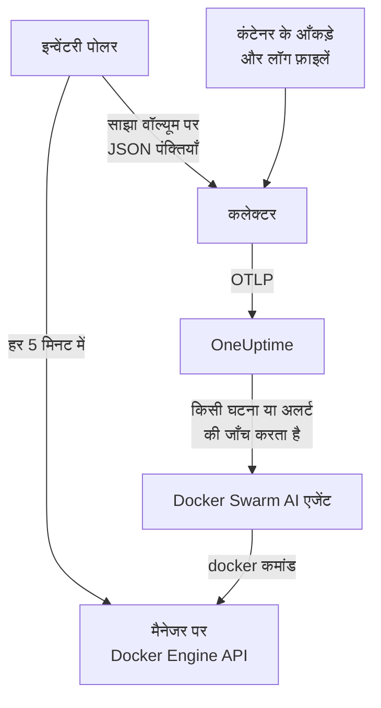

# Docker Swarm एजेंट

OneUptime Docker Swarm एजेंट एक Docker Swarm क्लस्टर की निगरानी करता है: उसके नोड, सेवाएँ, टास्क, स्टैक, ओवरले नेटवर्क, सीक्रेट, कॉन्फ़िग और वॉल्यूम, साथ ही हर कंटेनर के मेट्रिक्स और लॉग। आप इसे किसी swarm मैनेजर नोड पर Docker Compose से चलाते हैं, और क्लस्टर इन सबके साथ OneUptime में दिखाई देता है। [Docker Swarm मॉनिटर](/docs/monitor/docker-swarm-monitor) आने वाले डेटा पर अलर्ट करते हैं।

:::cards
- [एजेंट इंस्टॉल करें](#एजेंट-इंस्टॉल-करें): किसी मैनेजर नोड पर इंस्टॉल स्क्रिप्ट या Docker Compose।
- [एजेंट क्या एकत्र करता है](#एजेंट-क्या-इकट्ठा-करता-है): इन्वेंटरी, क्लस्टर की गिनतियाँ, और कंटेनर मेट्रिक्स व लॉग।
- [AI एजेंट](#ai-एजेंट): जाँच के दौरान OneUptime AI को swarm पढ़ने दें।
- [समस्या निवारण](#समस्या-निवारण): एक डायग्नोस्टिक स्क्रिप्ट, और आम समस्याएँ।
:::

## यह कैसे काम करता है

एजेंट तीन कंटेनर हैं, सभी एक ही `docker-compose.yml` में परिभाषित:

1. **कलेक्टर**: एक OpenTelemetry Collector, जो हर कंटेनर के मेट्रिक्स के लिए `docker_stats` पढ़ता है, कंटेनरों की लॉग फ़ाइलों को फ़ॉलो करता है, और इन्वेंटरी स्नैपशॉट फ़ाइल को भी फ़ॉलो करता है। यह हर चीज़ पर आपके क्लस्टर का नाम (`docker.swarm.cluster.name`) लगाता है और उसे OTLP पर OneUptime को भेजता है।
2. **इन्वेंटरी पोलर**: `curl` और `jq` वाला एक छोटा साइडकार, जो हर 5 मिनट में swarm मैनेजर के API (`/nodes`, `/services`, `/tasks`, `/networks`, `/secrets`, `/configs`, `/volumes`) को खंगालता है और सेवा लेबल `com.docker.stack.namespace` से स्टैक निकालता है। यह हर ऑब्जेक्ट के लिए एक JSON पंक्ति लिखता है, जिसे कलेक्टर आगे भेजता है।
3. **AI एजेंट**: `oneuptime-docker-swarm-ai-agent`, जो OneUptime AI के माँगे `docker` कमांड चलाता है, जब वह इस क्लस्टर पर किसी घटना या अलर्ट की जाँच करता है। जब तक आप सुधारों की अनुमति न दें, यह केवल-पढ़ने वाला है ([AI एजेंट](#ai-एजेंट) देखें)।



क्लस्टर अपने पहले डेटा के साथ, आपके कॉन्फ़िगर किए क्लस्टर नाम के अंतर्गत खुद को रजिस्टर करता है।

## शुरू करने से पहले

- एजेंट चलाने के लिए एक swarm **मैनेजर** नोड: इन्वेंटरी पोलर और AI एजेंट उन API एंडपॉइंट को कॉल करते हैं जिनका जवाब सिर्फ़ मैनेजर देते हैं।
- Docker Compose v2 प्लगइन के साथ Docker Engine 20.10 या बाद का।
- एक इंजेशन कुंजी। **प्रोजेक्ट सेटिंग्स → टेलीमेट्री और APM → इंजेशन कुंजियाँ** के अंतर्गत एक बनाएँ और उसका मान कॉपी करें।
- नोड से आपके OneUptime URL तक आउटबाउंड HTTPS।

### एजेंट कहाँ चलाएँ

इसे किसी मैनेजर नोड पर चलाएँ। कलेक्टर उसी नोड के कंटेनरों की रिपोर्ट करता है जिस पर वह चलता है, इसलिए हर नोड के कंटेनर मेट्रिक्स के लिए हर नोड पर कलेक्टर चलाएँ, सभी पर एक ही `DOCKER_SWARM_CLUSTER_NAME` के साथ; इन्वेंटरी पोलर और AI एजेंट को सिर्फ़ एक मैनेजर पर चलना होता है। `install.sh` ऐसे नोड पर AI एजेंट नहीं रखती जो मैनेजर न हो (और वहाँ पहले रखा गया AI एजेंट हटा देती है)। फिर भी किसी वर्कर पर शुरू किया गया AI एजेंट क्लस्टर के लिए कभी रजिस्टर नहीं होता: वह तब तक इंतज़ार करता है जब तक उसका नोड मैनेजर न बन जाए, इसलिए वह मैनेजर के AI एजेंट की जगह नहीं ले सकता। एजेंट को Compose के बजाय swarm स्टैक के रूप में डिप्लॉय कर रहे हैं? इन्वेंटरी पोलर और AI एजेंट को `node.role == manager` बाध्यता के साथ मैनेजरों पर रखें।

## एजेंट इंस्टॉल करें

:::steps
### एजेंट इंस्टॉल करें और शुरू करें

:::tabs
@tab install.sh
इंस्टॉल स्क्रिप्ट डाउनलोड करें और उसे किसी मैनेजर नोड पर चलाएँ:

```bash
curl -sSL https://raw.githubusercontent.com/OneUptime/oneuptime/master/agents/DockerSwarmAgent/install.sh -o install.sh
sh install.sh
```

स्क्रिप्ट आपका OneUptime URL, इंजेशन कुंजी और क्लस्टर का नाम पूछती है। यह `/opt/oneuptime-docker-swarm-agent` में इंस्टॉल करती है, एक ऐसी `.env` फ़ाइल लिखती है जिसे सिर्फ़ उसका मालिक पढ़ सकता है, और तीनों कंटेनर शुरू करती है। AI एजेंट को छोड़ने के लिए `--no-ai-agent` जोड़ें।
@tab Docker Compose
[DockerSwarmAgent डायरेक्टरी](https://github.com/OneUptime/oneuptime/tree/master/agents/DockerSwarmAgent) से `docker-compose.yml`, `otel-collector-config.yaml` और `inventory-snapshot.sh` किसी मैनेजर नोड के एक नए फ़ोल्डर में डाउनलोड करें:

```bash
curl -fsSL https://raw.githubusercontent.com/OneUptime/oneuptime/master/agents/DockerSwarmAgent/docker-compose.yml -o docker-compose.yml
curl -fsSL https://raw.githubusercontent.com/OneUptime/oneuptime/master/agents/DockerSwarmAgent/otel-collector-config.yaml -o otel-collector-config.yaml
curl -fsSL https://raw.githubusercontent.com/OneUptime/oneuptime/master/agents/DockerSwarmAgent/inventory-snapshot.sh -o inventory-snapshot.sh
chmod +x inventory-snapshot.sh
```

उनके बगल में एक `.env` फ़ाइल बनाएँ। इसमें इंजेशन कुंजी होती है, इसलिए इसे `chmod 600 .env` से निजी रखें:

```bash title=".env"
ONEUPTIME_URL=https://oneuptime.com
ONEUPTIME_SERVICE_TOKEN=your-telemetry-ingestion-key
DOCKER_SWARM_CLUSTER_NAME=my-swarm
```

एजेंट शुरू करें:

```bash
docker compose up -d
```
:::

### जाँचें कि एजेंट चल रहा है

```bash
docker compose ps
docker compose logs --tail 50 oneuptime-docker-swarm-agent oneuptime-docker-swarm-inventory
```

`docker compose ps` तीन कंटेनर दिखाता है: कलेक्टर (`oneuptime-docker-swarm-agent`), इन्वेंटरी पोलर (`oneuptime-docker-swarm-inventory`) और AI एजेंट (`oneuptime-docker-swarm-ai-agent`)।

### OneUptime में क्लस्टर खोजें

**उत्पाद → बुनियादी ढांचा → Docker Swarm → सभी क्लस्टर** खोलें। क्लस्टर कुछ ही मिनटों में दिखाई देता है, और पहले इन्वेंटरी स्नैपशॉट के बाद 5 मिनट के भीतर उसके **नोड**, **सेवाएं**, **कार्य**, **Stacks**, **नेटवर्क**, **सीक्रेट**, **Configs** और **वॉल्यूम** पेज भर जाते हैं।
:::

## एनवायरनमेंट वेरिएबल

इंस्टॉल स्क्रिप्ट पहले तीन को `/opt/oneuptime-docker-swarm-agent/.env` में लिखती है; Docker Compose इंस्टॉल इन्हें `docker-compose.yml` के बगल की `.env` से पढ़ता है। वहाँ इनमें से कोई भी जोड़ें या बदलें, फिर उस फ़ोल्डर में `docker compose up -d` चलाएँ।

| वेरिएबल | ज़रूरी | विवरण |
| --- | --- | --- |
| `ONEUPTIME_URL` | हाँ | आपका OneUptime URL, जैसे `https://oneuptime.com` या आपका सेल्फ़-होस्टेड इंस्टेंस। अगर इंस्टेंस सिर्फ़ HTTP पर है तो `http://` और उसका पोर्ट उपयोग करें। |
| `ONEUPTIME_SERVICE_TOKEN` | हाँ | **प्रोजेक्ट सेटिंग्स → टेलीमेट्री और APM → इंजेशन कुंजियाँ** से इंजेशन कुंजी। |
| `DOCKER_SWARM_CLUSTER_NAME` | हाँ | OneUptime में क्लस्टर का नाम, और वह कुंजी जिससे हर नोड का डेटा जुड़ता है: हर चीज़ पर `docker.swarm.cluster.name` रिसोर्स एट्रिब्यूट के रूप में लगाया गया। इसे स्थिर रखें: बाद में बदलने से एक दूसरा क्लस्टर रजिस्टर होता है। डिफ़ॉल्ट `docker-swarm` है। |
| `DOCKER_INVENTORY_INTERVAL_SECONDS` | नहीं | इन्वेंटरी पोलर कितनी बार स्नैपशॉट लेता है, सेकंड में। डिफ़ॉल्ट `300` है। |
| `DOCKER_API_VERSION` | नहीं | Docker Engine API का वह वर्शन जिसे कलेक्टर और इन्वेंटरी पोलर बोलते हैं। डिफ़ॉल्ट `1.44` है; खाली रखने पर डेमन के साथ तय होता है ([समस्या निवारण](#समस्या-निवारण) देखें)। जब तक आप कोई वर्शन तय न करें, AI एजेंट इसे खुद तय करता है। |

AI एजेंट की अपनी सेटिंग्स [AI एजेंट](#ai-एजेंट) के अंतर्गत हैं।

## एजेंट क्या इकट्ठा करता है

| सिग्नल | स्रोत | कहाँ दिखता है |
| --- | --- | --- |
| नोड, सेवाएँ, टास्क, स्टैक, नेटवर्क, सीक्रेट, कॉन्फ़िग और वॉल्यूम | इन्वेंटरी पोलर, swarm मैनेजर के API से | क्लस्टर की सूचियाँ और विवरण पेज |
| क्लस्टर की गिनतियाँ (तैयार नोड, चल रहे टास्क, सेवाएँ, स्टैक, …) | वही स्नैपशॉट | अवलोकन के कार्ड और साइड मेनू के बैज |
| कंटेनर CPU, मेमोरी, प्रोसेस की संख्या और अपटाइम | `docker_stats` रिसीवर | **मेट्रिक्स** पेज |
| कंटेनर के stdout और stderr लॉग | `filelog` रिसीवर | **लॉग** पेज |

### यह Docker एजेंट से कैसे अलग है

[Docker एजेंट](/docs/telemetry/docker-host) एक होस्ट को मॉडल करता है, और `host.name` और `container.runtime=docker` लगाता है। Docker Swarm एजेंट जानबूझकर सिर्फ़ `docker.swarm.cluster.name` लगाता है: तब OneUptime हर नोड को अलग होस्ट के रूप में रजिस्टर करने के बजाय डेटा को swarm क्लस्टर के अंतर्गत रखता है।

## क्लस्टर पर प्रोजेक्ट लेबल लगाएँ

`oneuptime.label.` से शुरू होने वाला रिसोर्स एट्रिब्यूट क्लस्टर पर एक प्रोजेक्ट लेबल बन जाता है: `oneuptime.label.<dimension>=<value>` लेबल `<dimension>:<value>` है। एट्रिब्यूट को `otel-collector-config.yaml` में `resource` प्रोसेसर में, `docker.swarm.cluster.name` के बगल में जोड़ें:

```yaml
processors:
  resource:
    attributes:
      # ...existing attributes...
      - key: oneuptime.label.team
        value: platform
        action: upsert
      - key: oneuptime.label.env
        value: production
        action: upsert
```

कलेक्टर अपना कॉन्फ़िगरेशन सिर्फ़ शुरू होते समय पढ़ता है: `docker compose restart oneuptime-docker-swarm-agent` चलाएँ। इसके बाद क्लस्टर `team:platform` और `env:production` लेबल दिखाता है। लेबल का मिलान अक्षरों के बड़े-छोटे होने की परवाह किए बिना होता है, इसलिए मौजूदा `Production` लेबल दोहराया नहीं जाता बल्कि फिर से उपयोग होता है, और एजेंट कभी वह लेबल नहीं हटाता जिसे किसी ने OneUptime में जोड़ा हो।

## systemd सेवा के रूप में चलाएँ

एजेंट को नोड के साथ शुरू करने और विफल होने पर फिर से शुरू करने के लिए उसकी systemd यूनिट इंस्टॉल करें। यह मानती है कि एजेंट `/opt/oneuptime-docker-swarm-agent` में है, जहाँ इंस्टॉल स्क्रिप्ट उसे रखती है:

```bash
sudo curl -fsSL https://raw.githubusercontent.com/OneUptime/oneuptime/master/agents/DockerSwarmAgent/systemd/oneuptime-docker-swarm-agent.service -o /etc/systemd/system/oneuptime-docker-swarm-agent.service
sudo systemctl daemon-reload
sudo systemctl enable --now oneuptime-docker-swarm-agent
```

## एजेंट अपग्रेड करना

एजेंट वह कलेक्टर वर्शन बताता है जिसे वह चलाता है। जब वह इस OneUptime रिलीज़ के पिन किए वर्शन से पुराना होता है, तो क्लस्टर के **अवलोकन** पेज पर एजेंट के वर्शन के बगल में एक चेतावनी चिह्न दिखता है। ये कमांड देखने के लिए उसे चुनें।

मैनेजर नोड पर इंस्टॉल स्क्रिप्ट फिर से चलाएँ, और उसके सवालों के जवाब उसी URL, कुंजी और क्लस्टर नाम से दें। यह नवीनतम फ़ाइलें डाउनलोड करती है, इमेज पुल करती है और एजेंट को फिर से शुरू करती है:

```bash
curl -sSL https://raw.githubusercontent.com/OneUptime/oneuptime/master/agents/DockerSwarmAgent/install.sh -o install.sh
sh install.sh
```

स्क्रिप्ट आपके जवाबों से `.env` फिर से लिखती है। यह सिर्फ़ AI एजेंट की लक्ष्य सूचियाँ और AI क्या कर सकता है (`ONEUPTIME_AI_INVESTIGATION`, `ONEUPTIME_AI_FIXES`) रखती है: कोई भी वेरिएबल जिसे आपने खुद सेट किया था, जैसे `DOCKER_API_VERSION`, फिर से जोड़ें। AI सुधार चालू किए थे? उन्हें चालू रखने के लिए इसे `ONEUPTIME_AI_ALLOW_WRITES=true sh install.sh` के रूप में चलाएँ। AI एजेंट छोड़ दिया था? फिर से `--no-ai-agent` दें।

Docker Compose के साथ, एजेंट के फ़ोल्डर में तीनों फ़ाइलें फिर से डाउनलोड करें (फिर `docker-compose.yml` में किए गए बदलाव फिर से करें), और पुल करके फिर से शुरू करें:

```bash
docker compose pull
docker compose up -d
```

कलेक्टर वर्शन फ़ाइलों में पिन है, इसलिए सिर्फ़ पुल करने से एजेंट आगे नहीं बढ़ता।

## एजेंट अनइंस्टॉल करना

```bash
cd /opt/oneuptime-docker-swarm-agent
docker compose down
```

## AI एजेंट

swarm की `docker-compose.yml` (और `install.sh`) **Docker Swarm AI एजेंट** भी चलाती है: एक तीसरा कंटेनर, `oneuptime-docker-swarm-ai-agent` (इमेज `oneuptime/resource-ai-agent:release`), जो OneUptime AI के माँगे केवल-पढ़ने वाले `docker` कमांड चलाता है जब वह इस क्लस्टर पर किसी घटना या अलर्ट की जाँच करता है — `docker node ls`, `docker service ps web --no-trunc`, `docker service logs --tail 200 web` — और, सिर्फ़ आपकी अनुमति होने पर, सुधार लागू करता है, जैसे किसी नामित सेवा का रोलिंग रीस्टार्ट। यह कलेक्टर वाले ही `ONEUPTIME_URL`, `ONEUPTIME_SERVICE_TOKEN` और `DOCKER_SWARM_CLUSTER_NAME` पढ़ता है, इसलिए ठीक इसी क्लस्टर की सेवा करता है, और OneUptime में क्लस्टर के **एआई → AI एजेंट** पेज पर दिखता है।

- **AI जाँच डिफ़ॉल्ट रूप से चालू है।** एजेंट के कनेक्ट होते ही OneUptime AI इस क्लस्टर की घटनाओं और अलर्ट की जाँच इसके साथ करता है, और क्लस्टर का **अवलोकन** एजेंट की स्थिति दिखाता है। रोकने के लिए, जहाँ एजेंट चलता है वहाँ `ONEUPTIME_AI_INVESTIGATION=false` सेट करें (AI एजेंट पेज पर **AI क्या कर सकता है** के अंतर्गत **बदलें** तरीका दिखाता है), या एजेंट को छोड़ दें।
- इन्वेंटरी पोलर की तरह इसे **किसी मैनेजर नोड पर ही चलना चाहिए**: नोड, सेवा और टास्क कमांड सिर्फ़ मैनेजर पर उपलब्ध हैं। किसी वर्कर पर यह कुछ नहीं चलाता और जब तक नोड मैनेजर न बने, क्लस्टर के लिए रजिस्टर नहीं होता (इसका `/status` कारण बताता है)। हर क्लस्टर के लिए एक चलाएँ।
- यह **केवल-पढ़ने वाला** है, जब तक आप `.env` में `ONEUPTIME_AI_ALLOW_WRITES=true` सेट करके `docker compose up -d` न चलाएँ (या उसके साथ `install.sh` न चलाएँ; इंस्टॉलर `ONEUPTIME_AI_ALLOW_WRITES`, `ONEUPTIME_AI_INVESTIGATION`, `ONEUPTIME_AI_FIXES`, `ONEUPTIME_AI_WRITE_TARGETS` और `ONEUPTIME_AI_PROTECTED_TARGETS` को अपने एनवायरनमेंट से `.env` में लिखता है, और दोबारा चलाने पर आख़िरी चार के लिए वह रखता है जो `.env` में पहले से है, जब तक आप वह वेरिएबल न दें, खाली ही सही); `ONEUPTIME_AI_WRITE_TARGETS` (सेवा और नोड नामों के ग्लोब, उदाहरण के लिए `web_*,api_*`) सीमित करता है कि कोई सुधार किसे छू सकता है। उसी `.env` में `ONEUPTIME_AI_FIXES` बताता है कि सुधार कैसे चलते हैं — `ask-for-approval` (हर एक को कोई व्यक्ति स्वीकृत करता है), `automatic` या `bypass-approval` — और AI एजेंट पेज इसे केवल-पढ़ने के रूप में दिखाता है ([AI क्या कर सकता है, एजेंट द्वारा तय](/docs/ai/infrastructure-ai-agents#what-ai-may-do-set-by-the-agent))। किसी नोड को ड्रेन करने के लिए हमेशा किसी व्यक्ति की स्वीकृति चाहिए, मोड चाहे जो हो।
- यह माउंट किए गए Docker सॉकेट के साथ root के रूप में चलता है, क्योंकि सॉकेट का मालिक root है — और मैनेजर पर, जो भी सॉकेट का उपयोग कर सकता है, वह पूरे swarm को नियंत्रित करता है, `:ro` हो या न हो। सीमा एजेंट की कमांड नीति है: यह कभी सेवाएँ या स्टैक नहीं बनाता या हटाता, कभी सीक्रेट या कॉन्फ़िग को नहीं छूता, और कभी खुद को, कलेक्टर को, इन्वेंटरी पोलर को या `ONEUPTIME_AI_PROTECTED_TARGETS` (सेवा और नोड नामों के ग्लोब) में से किसी चीज़ को नहीं बदलता।
- `install.sh --no-ai-agent` इसे छोड़ देती है; या `docker-compose.yml` से `oneuptime-docker-swarm-ai-agent` सेवा हटा दें।

यह क्या चला सकता है, सुधार कैसे काम करते हैं और इसकी समस्याएँ कैसे हल करें: [Infrastructure AI Agents](/docs/ai/infrastructure-ai-agents#docker-swarm-clusters)।

## समस्या निवारण

:::details पहले डायग्नोस्टिक स्क्रिप्ट चलाएँ
एजेंट एक स्क्रिप्ट, [`troubleshoot.sh`](https://github.com/OneUptime/oneuptime/blob/master/agents/DockerSwarmAgent/troubleshoot.sh), के साथ आता है, जो पूरी शृंखला जाँचती है: कंटेनर, यह कि इन्वेंटरी पोलर किसी मैनेजर पर है (`docker node ls`), स्नैपशॉट फ़ाइल, हर चीज़ पर लगा क्लस्टर नाम, टोकन का आकार, कलेक्टर के अपने मेट्रिक्स, और क्या OneUptime इंजेशन कुंजी स्वीकार करता है। वह आखिरी जाँच सबसे अहम है। OneUptime गलत कुंजी को `401` के साथ अस्वीकार करता है (अक्षम कुंजी या ब्राउज़र कुंजी के लिए `422`), और कलेक्टर इसे हर बैच के लिए एक `Exporting failed` पंक्ति के रूप में लॉग करता है, जो आसानी से छूट जाती है। स्क्रिप्ट सीधे `200` (मान्य) या `401` (अमान्य) पाने के लिए `GET <url>/otlp/v1/validate` पूछती है। इसे मैनेजर नोड पर चलाएँ:

```bash
curl -sSL https://raw.githubusercontent.com/OneUptime/oneuptime/master/agents/DockerSwarmAgent/troubleshoot.sh -o troubleshoot.sh
bash troubleshoot.sh    # add -d <dir> if you installed outside /opt/oneuptime-docker-swarm-agent
```
:::

:::details क्लस्टर कभी दिखाई नहीं देता
पहले डायग्नोस्टिक स्क्रिप्ट चलाएँ। वरना कलेक्टर के लॉग पढ़ें (`docker compose logs oneuptime-docker-swarm-agent`), जाँचें कि `.env` में `ONEUPTIME_SERVICE_TOKEN` और `ONEUPTIME_URL` सही हैं, और नोड आपके OneUptime URL तक पहुँचता है।
:::

:::details कोई इन्वेंटरी दिखाई नहीं देती
जाँचें कि इन्वेंटरी पोलर किसी मैनेजर पर चल रहा है: वहाँ `docker node ls` सफल होना चाहिए। फिर उसके लॉग में `failed to emit ...` पंक्तियाँ खोजें: `docker compose logs oneuptime-docker-swarm-inventory`।
:::

:::details क्लस्टर डिस्कनेक्टेड हो जाता है
जब OneUptime को किसी क्लस्टर से 15 मिनट तक कुछ नहीं मिलता, तो वह डिस्कनेक्टेड हो जाता है; OneUptime हर 5 मिनट में जाँच करता है, और जिस समय वह खुद डेटा नहीं पा रहा था, वह गिना नहीं जाता। पक्का करें कि कलेक्टर कंटेनर चलता रहे: `docker compose ps` उसे दिखाता है।
:::

:::details कलेक्टर "client version is too new" के साथ बंद हो जाता है
कलेक्टर के लॉग दिखाते हैं:

```text
Error: cannot start pipelines: failed to start "docker_stats" receiver:
Error response from daemon: client version 1.44 is too new.
Maximum supported API version is 1.41
```

डेमन का सबसे ऊँचा API वर्शन डिफ़ॉल्ट `1.44` से नीचे है (Docker Engine 20.10 `1.41` पर रुकता है), इसलिए `docker_stats` रिसीवर शुरू नहीं हो पाता और कंटेनर बार-बार रीस्टार्ट होता है। डेमन का सबसे ऊँचा वर्शन पता करें:

```bash
docker version --format '{{ .Server.APIVersion }}'
```

`.env` में `DOCKER_API_VERSION` को उस मान पर सेट करें, और हर उस नोड पर `docker compose up -d` चलाएँ जिस पर एजेंट चलता है। नए डेमन अब भी पुराने API वर्शन देते हैं, इसलिए Docker अपग्रेड करने के बाद भी यह सेटिंग काम करती रहती है। या `DOCKER_API_VERSION=` (खाली) सेट करें, ताकि कलेक्टर कोई वर्शन पिन करने के बजाय डेमन के साथ वर्शन तय करे।
:::

:::details क्लस्टर गलत नाम से दिखाई देता है
क्लस्टर का नाम `DOCKER_SWARM_CLUSTER_NAME` से आता है। इसे `.env` में बदलें और `docker compose up -d` चलाएँ: नया नाम पुराने का नाम बदलने के बजाय एक नया क्लस्टर रजिस्टर करता है।
:::

## अगले कदम

:::cards
- [Docker Swarm मॉनिटर](/docs/monitor/docker-swarm-monitor): नोड, सेवाओं, टास्क और कंटेनरों पर अलर्ट करें।
- [Infrastructure AI Agents](/docs/ai/infrastructure-ai-agents): Docker Swarm AI एजेंट क्या चला सकता है, और सुधार कैसे काम करते हैं।
- [Docker एजेंट](/docs/telemetry/docker-host): इसके बजाय किसी एक Docker होस्ट की निगरानी करें।
:::
