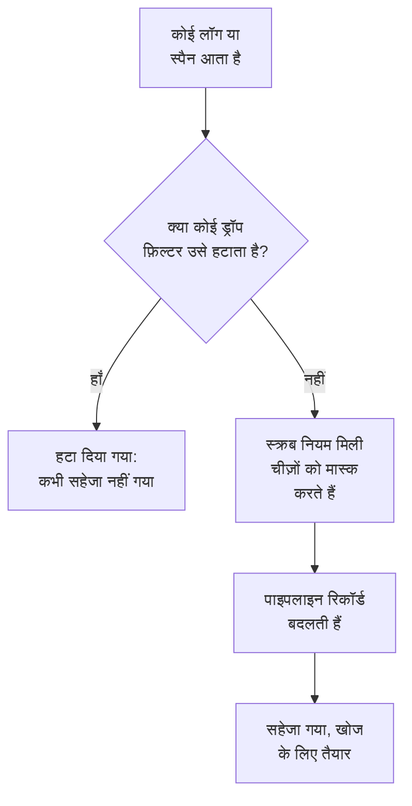

# ड्रॉप फ़िल्टर और स्क्रब नियम

ड्रॉप फ़िल्टर और स्क्रब नियम आपके लॉग और स्पैन पर उनके आते ही काम करते हैं, कुछ भी सहेजे जाने से पहले। ड्रॉप फ़िल्टर उन रिकॉर्ड को फेंक देता है जिनकी आपको कभी ज़रूरत नहीं होती, या उनका केवल एक नमूना रखता है। स्क्रब नियम व्यक्तिगत डेटा और सीक्रेट, जैसे ईमेल पते, कार्ड नंबर और पासवर्ड, को मास्क करता है, ताकि वे कभी आपके स्टोरेज तक न पहुँचें।

:::cards
- [ये कहाँ चलते हैं](#ये-कहाँ-चलते-हैं): पाइपलाइन से पहले, स्टोरेज से पहले।
- [रिकॉर्ड ड्रॉप करें या नमूना लें](#रिकॉर्ड-ड्रॉप-करें-या-नमूना-लें): रिकॉर्ड चुनें, फिर उन्हें ड्रॉप करें या एक हिस्सा रखें।
- [संवेदनशील डेटा स्क्रब करें](#संवेदनशील-डेटा-स्क्रब-करें): पैटर्न को जो मिले उसे छिपाएँ, मास्क करें या हैश करें।
- [देखें कि फ़िल्टर ने क्या ड्रॉप किया](#देखें-कि-फ़िल्टर-ने-क्या-ड्रॉप-किया): हर फ़िल्टर पर गिनतियाँ।
:::

## ये कहाँ चलते हैं

लॉग के लिए ये **लॉग → सेटिंग्स** में हैं, और स्पैन के लिए **ट्रेस → सेटिंग्स** में। रिकॉर्ड आने पर OneUptime इन्हें इस क्रम में चलाता है:



- **ये केवल नए रिकॉर्ड पर काम करते हैं।** आपका बनाया या बदला गया नियम उन रिकॉर्ड पर लागू होता है जो लगभग एक मिनट बाद आते हैं। पहले से सहेजे गए रिकॉर्ड नहीं बदलते।
- **ड्रॉप किया गया रिकॉर्ड चला जाता है।** कोई खोज, चार्ट, मॉनिटर या रिकॉर्डिंग नियम उसे कभी नहीं देखता, और उससे कोई अपवाद नहीं बनता। OneUptime Cloud पर उसका बिल भी नहीं बनता।
- **हर सूची क्रम से चलती है।** क्रम बदलने के लिए सूची की पंक्तियों को खींचें। केवल सक्षम फ़िल्टर और नियम चलते हैं।

लॉग ड्रॉप फ़िल्टर और स्क्रब नियम OpenTelemetry, Syslog, Fluent Bit और Fluentd से आए लॉग पर एक जैसे लागू होते हैं। [लॉग पाइपलाइन](/docs/telemetry/log-pipelines) इनके बाद का चरण समझाता है।

## शुरू करने से पहले

- **आते हुए लॉग या स्पैन।** देखें [OpenTelemetry](/docs/telemetry/open-telemetry)।
- **ऐसी भूमिका जो टेलीमेट्री सेटिंग्स बदले।** प्रोजेक्ट स्वामी या प्रोजेक्ट एडमिन, या आप जो बदलते हैं उसकी अनुमति वाली कोई कस्टम भूमिका, जैसे Create Log Drop Filter या Create Trace Scrub Rule। Telemetry भूमिकाएँ फ़िल्टर और नियम देख सकती हैं, लेकिन उन्हें बदल नहीं सकतीं।

## रिकॉर्ड ड्रॉप करें या नमूना लें

:::steps
### ड्रॉप फ़िल्टर खोलें

**लॉग → सेटिंग्स → ड्रॉप फ़िल्टर** पर जाएँ, या स्पैन के लिए **ट्रेस → सेटिंग्स → ड्रॉप फ़िल्टर** पर।

### रिकॉर्ड चुनें

**लॉग ड्रॉप फ़िल्टर बनाएँ** पर क्लिक करें, या स्पैन के लिए **ट्रेस ड्रॉप फ़िल्टर बनाएँ** पर। **मिलान** पर फ़िल्टर को एक **नाम** दें, फिर उसकी **फ़िल्टर क्वेरी** बनाएँ: हर शर्त के लिए एक फ़ील्ड, एक ऑपरेटर और एक मान, और यह कि **सभी शर्तें** मेल खाएँ या **कोई भी शर्त**। **अगला** पर क्लिक करें।

### कार्रवाई चुनें

**कार्रवाई** पर, हर मेल खाने वाले रिकॉर्ड को फेंकने के लिए **ड्रॉप करें** रहने दें, या **नमूना** चुनें और रखने के लिए **नमूना प्रतिशत** डालें, 1 से 99 तक। फिर फ़िल्टर बनाएँ।
:::

फ़िल्टर एक मिनट के भीतर ड्रॉप करना शुरू कर देता है। अभी कुछ ड्रॉप किए बिना इसे सहेजने के लिए, बनाने से पहले **उन्नत** के नीचे **सक्षम** बंद करें।

> [!WARNING]
> ड्रॉप किया गया रिकॉर्ड वापस नहीं लाया जा सकता। फ़िल्टर की क्वेरी सीमित रखें, और बनाने के बाद उसकी **छोड़े गए** गिनती पर नज़र रखें।

फ़िल्टर इन फ़ील्ड की जाँच कर सकता है, और **Custom Attribute...** से किसी भी विशेषता की:

| रिकॉर्ड | फ़ील्ड |
| --- | --- |
| लॉग | **गंभीरता**, **लॉग बॉडी**, **सेवा ID** |
| स्पैन | **स्पैन नाम**, **स्पैन प्रकार**, **स्थिति**, **स्थिति संदेश**, **सेवा ID**, **अपवाद है**, **रूट स्पैन है** |

| ऑपरेटर | किससे मेल खाता है |
| --- | --- |
| **बराबर है** | सटीक मान से, उसके बड़े और छोटे अक्षरों के साथ: `Debug` मेल खाता है, `DEBUG` नहीं। |
| **बराबर नहीं है** | सटीक मान के अलावा किसी भी चीज़ से। |
| **शामिल है** | फ़ील्ड में कहीं भी मौजूद मान से, अक्षरों का भेद किए बिना। मान में `%` एक वाइल्डकार्ड है। |
| **इनमें से एक है** | अल्पविराम से अलग किए गए सटीक मानों की सूची में से किसी एक से। |

**Preview query** वह क्वेरी दिखाता है जो शर्तों से बनती है। यह क्वेरी किसी स्वास्थ्य जाँच की डीबग लाइनें ड्रॉप करती है:

```text
severityText = 'Debug' AND body LIKE 'healthcheck'
```

नमूना हर रिकॉर्ड के लिए अलग से तय होता है: **नमूना प्रतिशत** 10 होने पर, मेल खाने वाले लगभग दस में से एक रिकॉर्ड रखा जाता है। फ़िल्टर सूची के क्रम में चलते हैं, और जो पहला फ़िल्टर किसी रिकॉर्ड को ड्रॉप करता है वही तय करता है; नमूने में रखा गया रिकॉर्ड अगले फ़िल्टर पर जाता है।

## संवेदनशील डेटा स्क्रब करें

:::steps
### स्क्रब नियम खोलें

**लॉग → सेटिंग्स → स्क्रब नियम** पर जाएँ, या स्पैन के लिए **ट्रेस → सेटिंग्स → स्क्रब नियम** पर।

### चुनें कि क्या खोजना है

**लॉग स्क्रब नियम बनाएँ** पर क्लिक करें, या स्पैन के लिए **ट्रेस स्क्रब नियम बनाएँ** पर, और एक **पैटर्न प्रकार** चुनें। नियम का नाम उसी के अनुसार रखा जाता है, जैसे **ईमेल पते स्क्रब करें**, जब तक आप अपना नाम न लिखें। **कस्टम Regex** के लिए **कस्टम Regex पैटर्न** भी डालें।

### चुनें कि स्क्रब कैसे करना है

**उन्नत** के नीचे **स्क्रब क्रिया** और **स्क्रब करने के लिए फ़ील्ड** चुनें, या उन्हें जैसा है वैसा छोड़ दें: नया नियम हर मिलान को `[REDACTED]` से बदल देता है, चाहे वह रिकॉर्ड में कहीं भी हो। फिर नियम बनाएँ।
:::

| पैटर्न प्रकार | यह क्या खोजता है |
| --- | --- |
| **ईमेल पता** | ईमेल पते, जैसे `jane@example.com` |
| **क्रेडिट कार्ड नंबर** | चार-चार के समूहों में सोलह अंक, जैसे `4111 1111 1111 1111` |
| **SSN (सोशल सिक्योरिटी नंबर)** | अमेरिकी सोशल सिक्योरिटी नंबर, जैसे `123-45-6789` |
| **फ़ोन नंबर** | उत्तरी अमेरिकी फ़ोन नंबर, जैसे `555-123-4567` |
| **आईपी पता** | सार्वजनिक IPv4 और IPv6 पते, जैसे `203.0.113.7` या `2001:db8::1`, लेकिन निजी, loopback या link-local पते नहीं |
| **संवेदनशील विशेषता कुंजियाँ** | किसी भी ऐसी विशेषता का पूरा मान जिसकी कुंजी गुप्त लगे, जैसे `password`, `token`, `api_key`, `authorization` या `cookie` |
| **कस्टम Regex** | आपकी अपनी रेगुलर एक्सप्रेशन, स्लैश या फ़्लैग के बिना लिखी गई, और बड़े-छोटे अक्षरों के भेद के साथ मिलाई गई |

| स्क्रब क्रिया | मिलान क्या बन जाता है |
| --- | --- |
| **संपादित करें (छिपाएं)** | `[REDACTED]`, डिफ़ॉल्ट |
| **मास्क** | ज़्यादातर छिपा हुआ: ईमेल अपना पहला अक्षर और अपने डोमेन का अंत रखता है, कार्ड, फ़ोन या सोशल सिक्योरिटी नंबर अपने आख़िरी चार अंक, और कोई कस्टम मिलान या सीक्रेट मान अपना पहला और आख़िरी वर्ण। आईपी पता पूरी तरह छिपाया जाता है। |
| **हैश** | आपके प्रोजेक्ट का अपना टोकन, एक ही मान के लिए हर बार एक जैसा, ताकि दोहराव फिर भी गिने जा सकें, लेकिन कोई भी उससे मूल मान तक न पहुँच सके |

उदाहरण के लिए, **ईमेल पता** नियम इस लॉग बॉडी को:

```text
Payment failed for jane@example.com
```

अपनी **स्क्रब क्रिया** के अनुसार इनमें से किसी एक रूप में सहेजता है:

```text
Redact: Payment failed for [REDACTED]
Mask:   Payment failed for j***@***.com
Hash:   Payment failed for [HASHED:5e29db14e508e09a]
```

लॉग नियम के लिए **स्क्रब करने के लिए फ़ील्ड** **दोनों (बॉडी और विशेषताएँ)** होता है, जब तक आप **केवल बॉडी** या **केवल विशेषताएँ** न चुनें, और स्पैन नियम के लिए **सभी (नाम, विशेषताएँ और इवेंट)** होता है, जब तक आप **केवल स्पैन नाम**, **केवल विशेषताएँ** या **केवल इवेंट विशेषताएँ** न चुनें। किसी स्पैन के लिंक की विशेषताएँ स्पैन की अपनी विशेषताओं के साथ स्क्रब होती हैं, और **सभी (नाम, विशेषताएँ और इवेंट)** किसी स्पैन का स्थिति संदेश और उसके इवेंट के नाम भी स्क्रब करता है। **संवेदनशील विशेषता कुंजियाँ** नियम कुंजियाँ पढ़ता है, इसलिए वह हमेशा उनके नीचे के मान स्क्रब करता है: विशेषताओं में, और किसी लॉग की JSON बॉडी में।

- **कोई नियम एक सेवा के लिए हो सकता है।** **उन्नत** में **केवल एक सेवा के लिए** में सेवा चुनें: नियम उस सेवा के रिकॉर्ड स्क्रब करता है, और दूसरी सेवाओं के रिकॉर्ड जैसे हैं वैसे ही रहते हैं। खाली छोड़ने पर वह हर सेवा के रिकॉर्ड स्क्रब करता है। सूची का **दायरा** कॉलम बताता है कि कौन-सा।
- **फ़ॉर्म बताता है कि कोई नियम दूसरों के लिए क्या बदलेगा।** नियम बनाने से पहले, और किसी नियम को चालू करते समय, OneUptime बताता है कि उन मानों को क्या पढ़ता है जिन्हें वह छिपाएगा: मॉनिटर, डैशबोर्ड, सहेजे गए व्यू, रिकॉर्डिंग नियम और SLO, हर एक लिंक के रूप में, और [सुरक्षा इवेंट](/docs/telemetry/security-events) क्या खोएँगे। छिपे मान पर फ़िल्टर करने वाला मॉनिटर उससे मेल खाना बंद कर देता है। नियम हर हाल में सहेजा जाता है।
- **आईपी पता नियम उन पतों को छिपाता है जो व्यक्तिगत डेटा हैं।** ये सार्वजनिक IPv4 और IPv6 पते हैं, चाहे वे किसी भी तरह लिखे हों: छोटा करके, जैसे `2001:db8::1`, पोर्ट के साथ कोष्ठकों में, जैसे `[2001:db8::1]:443`, जिसके कोष्ठक और पोर्ट बने रहते हैं, ज़ोन के साथ, जैसे `2001:db8::2%eth0`, जिसका ज़ोन बना रहता है, या IPv6 के रूप में लिखा IPv4 पता, जैसे `::ffff:203.0.113.7`, जो पूरा छिपाया जाता है। यह निजी, loopback और link-local पते रखता है, जैसे `10.0.0.12`, `127.0.0.1` और `fe80::1`, और किसी अनुरोध के URL में क्लाउड मेटाडेटा पता `169.254.169.254` भी, जहाँ [सुरक्षा इवेंट](/docs/telemetry/security-events) सर्वर-साइड अनुरोध जालसाज़ी खोजते हैं। आंतरिक पते भी छिपाने के लिए उनके लिए एक **कस्टम Regex** नियम जोड़ें, जैसे हर IPv4 पते के लिए `\b(?:\d{1,3}\.){3}\d{1,3}\b`।
- **हैश टोकन आपके प्रोजेक्ट का अपना होता है।** यह आपके प्रोजेक्ट की अपनी कुंजी से बनता है, जो इंस्टॉलेशन के `ENCRYPTION_SECRET` से निकाली जाती है, इसलिए एक ही मान का दूसरे प्रोजेक्ट में दूसरा टोकन होता है, और टोकन पढ़ने वाला कोई भी न मूल मान तक पहुँच सकता है, न किसी अनुमान को हैश करके मिला सकता है। एक आईपी पते का एक ही टोकन होता है, चाहे वह कैसे भी लिखा हो: `::ffff:203.0.113.7` और `203.0.113.7` का एक ही टोकन है। टोकन को कुंजी मिलने से पहले सहेजे गए रिकॉर्ड में 8 अक्षरों के टोकन होते हैं, जैसे `[HASHED:8c87b489]`, जो आज के 16 अक्षरों वाले टोकन से अलग हैं: जब तक वे रिकॉर्ड अपनी रिटेंशन के अंत तक न पहुँचें, दोनों खोजें। `ENCRYPTION_SECRET` बदलने से हर टोकन बदल जाता है, और सेल्फ़-होस्टेड इंस्टॉलेशन पर टोकन उतने ही गुप्त होते हैं जितना वह।
- **सुरक्षा इवेंट अब भी हैश किया गया IP पता बता सकते हैं।** जब [सुरक्षा इवेंट](/docs/telemetry/security-events) आपके लॉग या ट्रेस पढ़ते हैं, तो हैश करने वाला IP पता नियम हर छिपाए गए पते को उसके टोकन के साथ ऐसे भंडार में भी रखता है जिसे केवल सुरक्षा इवेंट के स्कैन पढ़ते हैं: कोई पेज, खोज, एक्सपोर्ट, API या AI टूल इसे नहीं पढ़ सकता। इसलिए ऐसे पते से आया हमला, जिसे आपके लॉग केवल टोकन के रूप में दिखाते हैं, फिर भी वह पता बताता है, और उसका केस बताता है कि कौन-सा पता ब्लॉक करना है। हर पता आख़िरी बार दिखने के 30 दिन बाद तक रखा जाता है। पते को मिटाने या मास्क करने वाला नियम कुछ नहीं रखता, इसलिए तब सुरक्षा इवेंट बताते हैं कि किसी स्क्रब नियम ने पता छिपाया, जैसा वे 30 दिन से पुराने टोकन या टोकन को कुंजी मिलने से पहले बने टोकन के लिए बताते हैं।
- **सूचियाँ और नेस्टेड मान भी पढ़े जाते हैं।** नियम किसी सूची, सूचियों की सूची या की-वैल्यू सूची के भीतर का हर टेक्स्ट पढ़ता है, जैसे किसी HTTP हेडर के मान, और मान का आकार बनाए रखता है: संख्याएँ और सही या गलत मान जैसे हैं वैसे ही रहते हैं। **संवेदनशील विशेषता कुंजियाँ** नियम किसी मान के भीतर की कुंजियाँ भी पढ़ता है, इसलिए की-वैल्यू सूची के भीतर का `password` भी छिपाया जाता है। मैप या सूची के रूप में भेजी गई लॉग बॉडी अपने JSON टेक्स्ट के रूप में सहेजी जाती है, और **संवेदनशील विशेषता कुंजियाँ** नियम उसके भीतर की कुंजियाँ पढ़ता है, जैसे वह JSON में लिखी गई बॉडी में करता है। पैटर्न नियम ऐसी बॉडी को JSON ही रहने देता है, और JSON में लिखी गई विशेषता को भी, जैसे किसी AI कॉल के संदेश: वह टेक्स्ट को वैसे ही पढ़ता है जैसे आपके ऐप्लिकेशन ने उसे लिखा था, `\n` जैसे एस्केप को उसी लाइन ब्रेक के रूप में पढ़ते हुए जिसका वह प्रतीक है, और जो पाता है उसे केवल उसके टेक्स्ट और संख्याओं के भीतर बदलता है।
- **किसी टेक्स्ट के भीतर का JSON भी पढ़ा जाता है।** जो टेक्स्ट अपने आप में JSON है, जैसे `{"password":"hunter2"}` रखने वाली विशेषता `http.request.body`, या किसी लॉग बॉडी के भीतर Fluentd रिकॉर्ड की `log` लाइन, वह JSON के रूप में पढ़ा जाता है, एक-दूसरे के भीतर JSON के 4 स्तरों तक, और उससे गहरा टेक्स्ट के रूप में। **संवेदनशील विशेषता कुंजियाँ** नियम उसके भीतर की गुप्त दिखने वाली कुंजियों के नीचे के मान छिपाता है, और कुछ नहीं: उसकी संख्याएँ, खाली जगहें और बाकी टेक्स्ट वैसे ही रहते हैं जैसे आपके ऐप्लिकेशन ने उन्हें लिखा था। जो टेक्स्ट केवल JSON जैसा दिखता है, जैसे `{token}`, वह जैसा है वैसा ही छोड़ दिया जाता है।
- **जो मान आइटम-दर-आइटम पढ़ने के लिए बहुत बड़ा है, वह टेक्स्ट के रूप में पढ़ा जाता है।** जो मान 32 से ज़्यादा स्तर गहराई तक नेस्टेड हो, या जो किसी रिकॉर्ड की सूचियों और मैप के भीतर के मानों को 10,000 से ऊपर ले जाए, वह अपने JSON टेक्स्ट के रूप में पढ़ा और सहेजा जाता है। पैटर्न नियम उस टेक्स्ट में जो पाता है उसे स्क्रब करता है, और जब उसमें `password` या `token` जैसा कोई शब्द आता है, तो **संवेदनशील विशेषता कुंजियाँ** नियम पूरा मान छिपा देता है। किसी लॉग बॉडी में, और किसी टेक्स्ट के भीतर के JSON में, केवल इन सीमाओं से आगे का हिस्सा टेक्स्ट के रूप में पढ़ा जाता है: बाकी अब भी एक-एक कुंजी करके पढ़ा जाता है।
- **अपवाद स्क्रब किए गए रिकॉर्ड से बनते हैं।** लॉग में मिला अपवाद स्क्रबिंग के बाद बनता है, और स्पैन इवेंट को स्क्रब करने वाले नियम उन पर दर्ज अपवादों को भी स्क्रब करते हैं। हर अपवाद अब भी उसी के अनुसार समूहित होता है जो उसमें स्क्रबिंग से पहले था, इसलिए नया नियम जोड़ने से आपका पहले से मौजूद अपवाद कभी नया अपवाद नहीं बनता, और उसके लिए **नया अपवाद** फिर से नहीं चलता। जब कोई नियम उस हिस्से को छिपाता है जिसके अनुसार नया अपवाद समूहित होता है, तो उसका फ़िंगरप्रिंट हैश टोकन की तरह आपके प्रोजेक्ट की कुंजी से बनता है, ताकि कोई उससे छिपाई गई चीज़ तक न पहुँच सके।
- **किसी syslog लाइन की रॉ कॉपियाँ वह छिपाती हैं जो नियमों ने उसके हिस्सों में छिपाया।** Syslog किसी RFC 5424 लाइन का स्ट्रक्चर्ड डेटा जैसा पहुँचा वैसा ही `syslog.structured.raw` में रखता है, और HTTP से भेजा गया syslog पूरी लाइन `syslog.raw` में रखता है। हर कॉपी उससे दोबारा जोड़ी जाती है जो नियमों ने हेडर के फ़ील्ड, स्ट्रक्चर्ड डेटा के हर पैरामीटर और मैसेज में से छोड़ा, और फिर नियम उसे वैसे ही पढ़ते हैं जैसे किसी भी विशेषता को पढ़ते हैं। इसलिए जो पासवर्ड **संवेदनशील विशेषता कुंजियाँ** नियम `syslog.structured.auth_1.password` में छिपाता है, या जो पता **केवल बॉडी** नियम मैसेज में छिपाता है, वह कॉपियों में भी छिपा रहता है, और वैसे लिखा जाता है जैसे RFC 5424 कोई मान लिखता है: `password="[REDACTED\]"`। जिस लाइन में नियम कुछ नहीं बदलते, वह अपनी कॉपियाँ वैसे ही रखती है जैसे वह पहुँची थी।
- **रिकॉर्ड की सत्र आईडी बनी रहती है।** **संवेदनशील विशेषता कुंजियाँ** नियम लॉगिन सत्र को छिपाता है, जैसे `session_id`, `sessionid` या कोई कुकी, लेकिन `session.id` को तब रखता है जब उसमें वह सत्र हो जिससे लॉग या स्पैन जुड़ा है: वह रैंडम आईडी जिसके तहत [Session Replay](/docs/telemetry/session-replay) रिकॉर्ड को दर्ज करता है, और जिसे रिकॉर्ड हर हाल में अपने सत्र के रूप में रखता है। AI कॉल की बातचीत आईडी भी इसी तरह बनी रहती है। लॉगिन सत्र का रहस्य `session.id` के रूप में न भेजें।
- **Session Replay भी स्क्रब होते हैं।** हर सेवा के लिए बने लॉग स्क्रब नियम Session Replay रिकॉर्डिंग पर भी चलते हैं, उस मास्किंग के अलावा जो रिकॉर्डर ब्राउज़र में करता है।
- **नियम सूची के क्रम में चलते हैं।** हर नियम वही देखता है जो उससे पहले के नियमों ने छोड़ा।
- **कस्टम पैटर्न में लगने वाला समय रिकॉर्ड के अनुपात में होता है।** वह चाहे जैसे लिखा हो, लुकअहेड और लुकबिहाइंड समेत JavaScript का सिंटैक्स और उसके नतीजे बनाए रखता है। बैक-रेफ़रेंस, जैसे `\1`, इस तरह नहीं चल सकता: ऐसे नियम को सहेजते समय अस्वीकार कर दिया जाता है, जैसे चलाने के लिए बहुत बड़े पैटर्न को। अगर हर मेल ढूँढ़ने के लिए किसी लंबे मान को बार-बार पढ़ना पड़े, तो नियम पूरे मान को स्क्रब करता है। किसी प्रोजेक्ट के ड्रॉप फ़िल्टर, स्क्रब नियम और पाइपलाइन भी उसके भेजे हर बैच के लिए काम का एक साझा कोटा रखते हैं, जो बैच के आकार के अनुपात में होता है और इतना होता है कि दर्जनों कस्टम पैटर्न हर मान पढ़ सकें। जब उनके पैटर्न को इससे ज़्यादा चाहिए, तो कस्टम स्क्रब नियम पूरे मान को स्क्रब करता है, और जिस फ़िल्टर का जवाब नहीं मिल पाता वह रिकॉर्ड पर लागू नहीं होता।

## देखें कि फ़िल्टर ने क्या ड्रॉप किया

**ड्रॉप फ़िल्टर** सूची हर फ़िल्टर की **छोड़े गए** गिनती और यह दिखाती है कि उसने आख़िरी बार कब ड्रॉप किया, **Last Dropped**। **Nothing dropped yet** का मतलब है कि वह कभी मेल नहीं खाया। फ़िल्टर का अपना पेज यही जानकारी **गतिविधि** के नीचे दिखाता है, जो ड्रॉप के एक मिनट के भीतर अपडेट होती है। उसका **फ़िल्टर शर्तें** कार्ड दिखाता है कि वह किससे मेल खाता है, और आप वहीं शर्तें बदल सकते हैं।

## समस्या निवारण

:::details ड्रॉप फ़िल्टर कुछ भी ड्रॉप नहीं करता
**बराबर है**, **बराबर नहीं है** और **इनमें से एक है** सटीक टेक्स्ट की तुलना करते हैं, बड़े और छोटे अक्षरों समेत। गंभीरताएँ `Information` और `Warning` हैं, `INFO` या `WARN` नहीं। जाँचें कि फ़िल्टर सक्षम है, और बदलाव के बाद एक मिनट रुकें।
:::

:::details जिन लॉग की उम्मीद थी वे गायब हैं
हर ड्रॉप फ़िल्टर की **छोड़े गए** गिनती और **Last Dropped** समय देखें। जिस पर शक हो उस पर **सक्षम** बंद करें, और अगले लॉग फिर से आने लगते हैं।
:::

:::details कस्टम स्क्रब नियम पर कुछ भी स्क्रब नहीं करता लिखा है
उसका पैटर्न ख़ाली है, मान्य रेगुलर एक्सप्रेशन नहीं है, या चल नहीं सकता, जैसे `\1` जैसे बैक-रेफ़रेंस के कारण, इसलिए वह कुछ भी स्क्रब नहीं करता। नियम संपादित करें और उसे ऐसा पैटर्न दें जो कम से कम एक वर्ण से मेल खाए।
:::

:::details पुराने रिकॉर्ड अब भी वह डेटा दिखाते हैं जिसे नया नियम स्क्रब करता है
स्क्रब नियम रिकॉर्ड के आते समय काम करते हैं। नियम से पहले सहेजे गए रिकॉर्ड अपनी प्रतिधारण अवधि ख़त्म होने तक वही रखते हैं जो उनमें था। देखें [डेटा प्रतिधारण](/docs/telemetry/data-retention)।
:::

## अगले कदम

:::cards
- [लॉग पाइपलाइन](/docs/telemetry/log-pipelines): आपके रखे गए लॉग को पार्स और समृद्ध करें।
- [लॉग एक्सप्लोरर](/docs/telemetry/logs-explorer): जो सहेजा गया उसे खोजें।
- [ट्रेस एक्सप्लोरर](/docs/telemetry/traces-explorer): आपके रखे गए स्पैन को फ़ॉलो करें।
- [डेटा प्रतिधारण](/docs/telemetry/data-retention): तय करें कि वे कितने समय तक रखे जाएँ।
:::
