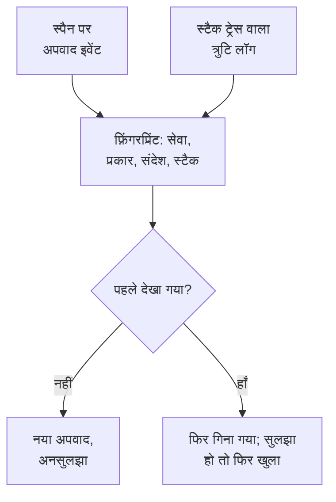

# अपवाद ट्रैकिंग

अपवाद ट्रैकिंग आपके कोड से फेंकी गई त्रुटियों को इकट्ठा करती है और एक ही त्रुटि की हर घटना को एक अपवाद में समूहित करती है, उसके स्टैक ट्रेस, उसके रुझान और उन अनुरोधों के साथ जिनमें वह हुई। उन्हें एक कार्य सूची की तरह छाँटें: ठीक करें, सुलझाएँ, या शोर को संग्रहीत करें, और जिन्हें AI ठीक कर सकता है उनके लिए उसे pull request खोलने दें।

:::cards
- [अपवाद कहाँ से आते हैं](#अपवाद-कहाँ-से-आते-हैं): वे स्पैन और लॉग जो आपकी सेवाएं पहले से भेजती हैं।
- [सूची को छाँटना](#सूची-को-छाँटना): अनसुलझे पहले, शोर छिपा हुआ।
- [किसी अपवाद का पेज](#किसी-अपवाद-का-पेज): स्टैक ट्रेस, घटनाएं और संदर्भ।
- [AI से ठीक करना](#ai-से-ठीक-करना): सुधार या रिग्रेशन टेस्ट वाला एक pull request।
- [AI से नए और बढ़ते अपवाद खोजें और ठीक करें](#ai-से-नए-और-बढ़ते-अपवाद-खोजें-और-ठीक-करें): OneUptime को मिलने वाले अपवादों के लिए pull request।
:::

## अपवाद कहाँ से आते हैं

आपको अपवाद अलग से नहीं भेजने होते। OneUptime उन्हें उस टेलीमेट्री में ढूँढता है जो आपकी सेवाएं पहले से भेजती हैं:

- किसी स्पैन पर अपवाद इवेंट, जो OpenTelemetry का `recordException()` लिखता है;
- `exception.type`, `exception.message` या `exception.stacktrace` विशेषताओं वाला लॉग;
- Error या Fatal गंभीरता वाला ऐसा लॉग जिसके संदेश में स्टैक ट्रेस हो, जब वह लॉग किसी स्पैन के अंदर नहीं लिखा गया हो (स्पैन उसे पहले ही रिपोर्ट करता है)।

हर घटना उसी त्रुटि की पिछली घटनाओं के साथ एक अपवाद में समूहित होती है:

- **हर सेवा और त्रुटि का एक अपवाद।** फ़िंगरप्रिंट सेवा, अपवाद प्रकार, संदेश और स्टैक ट्रेस से बनता है। हर कॉल पर बदलने वाले मान पहले हटा दिए जाते हैं: UUID और दूसरे ID, टाइमस्टैम्प, IP और ईमेल पते, और सात या उससे ज़्यादा अंकों वाली संख्याएँ। इसलिए `Order id=1042 not found` और `Order id=2077 not found` एक ही अपवाद हैं।
- **नई घटना सुलझाए गए अपवाद को फिर खोल देती है।** अगर सुलझाने के बाद वह फिर होती है, तो सुधार काम नहीं आया, और अपवाद पर **दोबारा हुआ** का निशान लगता है। सुलझाने से पहले की कोई घटना जो OneUptime तक देर से पहुँचे, उसे फिर नहीं खोलती।
- **संग्रहीत अपवाद संग्रहीत ही रहता है।** उसकी नई घटनाएं अब भी गिनी जाती हैं, लेकिन वे सूचनाएं भेजना बंद कर देती हैं।

> [!TIP]
> किसी अपेक्षित त्रुटि को, जैसे आपकी सेवा द्वारा ठुकराया गया अमान्य इनपुट, अपवाद ट्रैकिंग से बाहर रखने के लिए स्पैन के अपवाद इवेंट पर `error.class` विशेषता को `user-error` या `expected-denial` पर सेट करें। तब OneUptime उसके लिए कोई अपवाद दर्ज नहीं करता।

## शुरू करने से पहले

- **आते हुए स्पैन या लॉग।** अपनी सेवाओं को [OpenTelemetry](/docs/telemetry/open-telemetry) से इंस्ट्रूमेंट करें। **सेटअप गाइड** टैब आपकी भाषा का कोड दिखाता है।
- **टेलीमेट्री पढ़ सकने वाली भूमिका।** Project Owner, Project Admin, Project Member, Viewer, Telemetry Admin, Telemetry Member या Telemetry Viewer, या Read Telemetry Service Exception अनुमति वाली कस्टम भूमिका। सुलझाने और संग्रहीत करने के लिए Project Owner या Project Admin, या Edit Telemetry Service Exception अनुमति चाहिए।

## सूची को छाँटना

:::steps
### अपवाद खोलें

**उत्पाद → अवलोकनीयता → अपवाद** पर जाएँ। **अपवाद** टैब पर बैज अनसुलझी समस्याओं को गिनता है, और सूची **अनसुलझा** अपवादों पर खुलती है।

### कोई स्थिति चुनें

**अनसुलझा**, **सुलझाया गया**, **संग्रहीत** और **सभी** के बीच बदलें। सूची के ऊपर वाला चार्ट दिखाता है कि समय के साथ कितनी घटनाएं **अनहैंडल्ड** थीं और कितनी **नियंत्रित किया गया**। **दोबारा हुआ** वाली पंक्ति सुलझाए जाने के बाद फिर आई है, और **नया** वाली पंक्ति पिछले 24 घंटों में पहली बार देखी गई।

### चुनें कि समस्या किसे गिना जाए

**समस्याएं**, जो डिफ़ॉल्ट है, उपयोगकर्ता त्रुटियाँ और अपेक्षित इनकार छिपाता है, ताकि सूची वही दिखाए जिसे सुधार चाहिए। **User errors** सिर्फ़ उन्हें दिखाता है, और **सभी** हर अपवाद दिखाता है।

### खोजें और फ़िल्टर करें

`type:TypeError env:production` जैसी क्वेरी लिखें, देखें [खोज सिंटैक्स](/docs/telemetry/search-syntax#अपवाद), या **फ़िल्टर** साइडबार में किसी मान पर क्लिक करें: कोई सेवा, कोई होस्ट या दूसरा संसाधन, कोई **अपवाद प्रकार**, कोई **एनवायरनमेंट** या कोई **Error Class**।

### कोई अपवाद खोलें

अपवाद का पेज खोलने के लिए किसी पंक्ति पर क्लिक करें।
:::

## किसी अपवाद का पेज

पेज का साइड मेन्यू उन कामों को समूहित करता है जो आप किसी अपवाद के साथ करते हैं:

| पेज | यह क्या दिखाता है |
| --- | --- |
| **अवलोकन** | संदेश, सेवा, वह कितनी बार हुआ और पहली और आख़िरी बार कब देखा गया, समय के साथ उसका रुझान, और उसकी नवीनतम घटना: रिलीज़, एनवायरनमेंट, स्पैन, ट्रेस और उपयोगकर्ता सेशन। सबसे ऊपर, AI चालू होने पर, जो हुआ उसकी OneUptime AI की व्याख्या। |
| **स्टैक ट्रेस** | स्टैक के फ़्रेम। ब्राउज़र कोड के लिए, रिलीज़ के [सोर्स मैप](/docs/telemetry/source-maps) अपलोड करने के बाद, मूल फ़ाइलें और पंक्तियाँ। |
| **Occurrences** | हर घटना, उसके समय, उसके संदेश और उस ट्रेस के साथ जिसमें वह हुई। |
| **Context** | नवीनतम घटना की विशेषताएं, अगर रिकॉर्ड हुआ हो तो उसका सेशन रीप्ले, और उस तक ले जाने वाले कदम। |
| **लॉग** | नवीनतम घटना के आसपास लिखे गए लॉग। |
| **AI Assistance** | ऐसे AI कार्य जो अपवाद को ठीक करते हैं या उसकी जाँच करते हैं। |
| **सेटिंग्स** | अपवाद को सुलझाएँ या संग्रहीत करें। यह **प्रबंधित करें** के तहत है, जो शुरू में बंद रहता है। |

## सुलझाना, फिर खोलना और संग्रहीत करना

अपवाद के पेज के ऊपर वाले बटन, उसका **सेटिंग्स** पेज और सूची में उसकी पंक्ति का ⋯ मेनू उसकी स्थिति बदलते हैं:

| क्रिया | कब इस्तेमाल करें | आगे क्या होता है |
| --- | --- | --- |
| **सुलझाएं** | आपने सुधार डिप्लॉय कर दिया। | वह **अनसुलझा** सूची से हट जाता है। नई घटना उसे फिर खोल देती है। |
| **अगली रिलीज़ में सुलझाएं** | सुधार आपकी अगली रिलीज़ में आएगा। | वह **अनसुलझा** सूची से हट जाता है। जिस रिलीज़ में वह आख़िरी बार देखा गया, उसकी घटनाएं उसे फिर नहीं खोलतीं, और किसी अन्य रिलीज़ की घटना खोल देती है। |
| **फिर से खोलें** | सुधार काम नहीं आया। | वह फिर से अनसुलझा हो जाता है। |
| **संग्रहित करें** | यह ऐसा शोर है जिसे आप ठीक करने का इरादा नहीं रखते। | वह सूची से हट जाता है। नई घटनाएं गिनी जाती हैं लेकिन सूचनाएं भेजना बंद कर देती हैं। |
| **अनसंग्रहीत करें** | आप उसके बारे में फिर सुनना चाहते हैं। | वह उस सूची में लौट आता है जिसमें वह होना चाहिए। |

जब तक अपवाद की घटनाएं अपनी रिलीज़ बताती हैं (रिसोर्स एट्रिब्यूट `service.version`), **अगली रिलीज़ में सुलझाएं** **सुलझाएं** के बगल वाले मेनू, पंक्ति के ⋯ मेनू, **बल्क कार्रवाइयाँ** और **सेटिंग्स** में मिलता है।

**सेटिंग्स** दिखाता है कि अपवाद को आख़िरी बार किसने और कब सुलझाया या संग्रहीत किया। उसके बटन **हल किए गए के रूप में चिह्नित करें** या **अनसुलझे के रूप में चिह्नित करें**, और **संग्रहित करें** या **अनसंग्रहीत करें** कहते हैं।

एक साथ कई बदलने के लिए, सूची में उनकी पंक्तियों पर टिक करें, या पेज के सभी अपवादों के लिए पंक्तियों के ऊपर वाला बॉक्स, और **बल्क कार्रवाइयाँ** में वही कार्रवाइयाँ इस्तेमाल करें। नतीजा बताता है कि कौन-से अपवाद बदले, कौन-से जैसे थे वैसे रहे, और क्यों।

## त्रुटि वर्ग

हर अपवाद का एक त्रुटि वर्ग होता है, जो बताता है कि समस्या किसकी है। OneUptime AI इसे तब सेट करता है जब वह अपवाद के बारे में किसी इनसाइट को छाँटता है, जैसे कोई नया या अचानक बढ़ता अपवाद: देखें [AI SRE](/docs/ai/ai-sre#इनसाइट्स-सक्रिय-पहचान)। जिस अपवाद को उसने नहीं छाँटा, वह `unknown` रहता है।

| वर्ग | इसका मतलब | **समस्याएं** में |
| --- | --- | --- |
| `code-fault` | कोड में कोई ख़राबी। अकेला वर्ग जिसे AI अपने आप ठीक करता है। | हाँ |
| `infrastructure` | टाइमआउट, टूटा कनेक्शन या ख़त्म हुए संसाधन। | हाँ |
| `unknown` | अभी तक वर्गीकृत नहीं। | हाँ |
| `user-error` | किसी उपयोगकर्ता के अमान्य इनपुट का नतीजा। | नहीं |
| `expected-denial` | अपना काम करती कोई जाँच, जैसे ठुकराया गया लॉगिन। | नहीं |

AI Insights की सेटिंग्स में **अपेक्षित अपवादों को संग्रहीत करें** चालू होने पर, जिन अपवादों को छँटाई अपेक्षित इनकार मानती है वे आपके लिए संग्रहीत हो जाते हैं।

## AI से समझाना

किसी अपवाद के **अवलोकन** के सबसे ऊपर, **OneUptime AI से समझाएं** OneUptime AI से पूछता है कि क्या गलत हुआ। यह नवीनतम घटना का स्टैक ट्रेस, ट्रेस और लॉग तथा अपवाद शुरू होने के आसपास की सेवा की डिप्लॉय पढ़ता है, और **क्या हुआ** कार्ड में जवाब देता है:

| हिस्सा | क्या बताता है |
| --- | --- |
| **क्या हुआ** | एक-दो वाक्य, OneUptime AI कितना निश्चित है, और गड़बड़ी कहाँ है: कोड, कोई डिपेंडेंसी, इन्फ्रास्ट्रक्चर, गलत इनपुट या कॉन्फ़िगरेशन। |
| **संभावित मूल कारण** | कारण, और वह फ़्रेम, स्पैन, लॉग लाइन या डिप्लॉय जो उसे दिखाता है। |
| **सुझाया गया सुधार** | क्या बदलना है। |
| **कहाँ देखें** | स्टैक ट्रेस के वे फ़्रेम जिन्हें पहले खोलना है। |
| **अगले कदम** | पुष्टि करने या ठीक करने के लिए ज़्यादा से ज़्यादा तीन कदम। |

व्याख्या अपवाद पर रखी जाती है, ताकि अगला व्यक्ति जो उसे खोले, उसे तुरंत पढ़ सके, और **फिर से समझाएं** नई व्याख्या माँगता है। **सुधार का पुल रिक्वेस्ट खोलें** अपवाद का **AI Assistance** पेज खोलता है, और **आगे का सवाल पूछें** इस अपवाद पर Ask AI खोलता है।

भेजी जाने वाली हर चीज़ से ID, ईमेल और IP पते और टोकन हटा दिए जाते हैं, और स्पैन के एट्रिब्यूट में से केवल कुछ, जैसे उसका रूट और स्टेटस कोड, भेजे जाते हैं। व्याख्या प्रोजेक्ट के LLM प्रदाता और AI क्रेडिट का उपयोग करती है, और **AI सक्षम करें** बंद होने पर नहीं दी जाती। जो भी अपवाद पढ़ सकता है, वह व्याख्या माँग सकता है।

## AI से ठीक करना

**AI Assistance** पेज तीन कार्य देता है। हर एक AI कार्य के रूप में चलता है जो आपकी कोड रिपॉज़िटरी में एक pull request खोलता है:

| कार्य | pull request क्या करता है |
| --- | --- |
| **Fix this exception with AI** | मूल कारण ठीक करता है। इसे **AI से ठीक करें** से शुरू करें। |
| **Generate Regression Test** | एक टेस्ट जोड़ता है जो बग ठीक होने तक विफल होता है। |
| **त्रुटि प्रबंधन सुधारें** | अपेक्षित त्रुटियों के लिए: इनपुट को पहले ही जाँचता है, उपयोगकर्ता डेटा को संदेशों से बाहर रखता है, और त्रुटि को हैंडल्ड के रूप में चिह्नित करता है। |

AI को पहले तीन चीज़ें चाहिए: एक LLM प्रदाता, एक जुड़ी हुई रिपॉज़िटरी (GitHub, GitLab, Forgejo या Gitea, या किसी भी Git सर्वर पर), और कार्य चलाने के लिए ऑनलाइन एक AI एजेंट। पेज हर एक को जाँचता है और जो कमी है उसका लिंक देता है। जब तक अपवाद सुलझाया गया या संग्रहीत है, कार्य रुके रहते हैं। देखें [कोड](/docs/ai/ai-agent)।

## AI से नए और बढ़ते अपवाद खोजें और ठीक करें

OneUptime हर 15 मिनट में आपके अपवादों में नए अपवाद, अचानक कहीं ज़्यादा बार होने वाले अपवाद, और ऐसी सेवाएँ खोजता है जिनके अपवादों में कोई स्टैक ट्रेस नहीं होता, और जो मिलता है उसे सबूत के साथ AI इनसाइट्स के रूप में दर्ज करता है। फिर OneUptime AI हर एक की जाँच करता है और जिसे वह ठीक कर सकता है उसके लिए pull request खोलता है। कुछ भी कभी मर्ज नहीं होता: आपकी टीम हर pull request की समीक्षा करती है।

| खोज | OneUptime इसे कब दर्ज करता है | pull request |
| --- | --- | --- |
| **नया अपवाद** | ऐसा अपवाद जो पिछले 24 घंटों में पहली बार दिखा और जो पहले ही 3 या अधिक बार हो चुका है। | अपवाद को ठीक करता है, या उसे बेहतर ढंग से संभालता है। |
| **अपवादों में उछाल** | ऐसा अपवाद जो पिछले एक घंटे में 10 या अधिक बार हुआ, उससे पहले के 24 घंटों की अपनी प्रति घंटा दर के 5 या अधिक गुना पर। | अपवाद को ठीक करता है, या उसे बेहतर ढंग से संभालता है। |
| **छूटा हुआ स्टैक ट्रेस** | किसी सेवा ने पिछले एक दिन में जो अपवाद दर्ज किए उनमें कोई स्टैक ट्रेस नहीं है, और वे मिलकर 20 या अधिक बार हुए। | सेवा से हर अपवाद के साथ एक स्टैक ट्रेस दर्ज करवाता है। |

किसी नए या बढ़ते अपवाद का pull request उस अपवाद का अपना AI कार्य है, वही जिसे उसका **AI Assistance** पेज शुरू करता है, और वह तब तक रुकता है जब तक OneUptime AI खोज की जाँच न कर ले। अगर उसे दोषी कोड मिलता है (`code-fault`), तो pull request उसे ठीक करता है, जैसे **Fix this exception with AI** करता है। अगर उसे कोई अपेक्षित त्रुटि मिलती है (`user-error` या `expected-denial`), तो pull request उस त्रुटि को बेहतर ढंग से संभालता है, जैसे **त्रुटि प्रबंधन सुधारें** करता है। कोई और निष्कर्ष अपने आप कोई pull request नहीं खोलता। **अपेक्षित अपवादों को संग्रहीत करें** चालू होने पर, कोई अपेक्षित इनकार इसके बजाय संग्रहीत हो जाता है और उसे कोई pull request नहीं मिलता।

OneUptime AI अपने आप एक pull request केवल उस अपवाद के लिए खोलता है जो आपके अपने कोड में उठा हो: ऐसा अपवाद जिसके स्टैक ट्रेस में आपके कोड का कोई फ़्रेम हो, न कि केवल लाइब्रेरी या रनटाइम के फ़्रेम। जिस pull request को किसी ने मर्ज किए बिना बंद किया, वह उस अपवाद के लिए अपने आप खुलने वाले pull request रोक देता है। फिर भी कोई भी खोज पर **AI से ठीक करें** से इनमें से कोई भी माँग सकता है।

### इसे चालू करें

**अपवाद → एआई → सेटिंग्स** में **नए और बढ़ते अपवाद खोजें और ठीक करें** स्विच है, जो नए प्रोजेक्ट के लिए चालू रहता है। जब तक यह बंद है, नए और बढ़ते अपवाद पहले की तरह AI इनसाइट्स के पास रहते हैं: देखें [AI SRE](/docs/ai/ai-sre#इनसाइट्स-सक्रिय-पहचान)। **AI सक्षम करें** बंद होने पर वे अब भी मिलते हैं, पर OneUptime AI उनके साथ कुछ नहीं करता। pull request खोलने के लिए OneUptime AI को [कोड](/docs/ai/ai-agent) में कनेक्ट की गई रिपॉजिटरी चाहिए: पेज पहले बताता है कि क्या कमी है। हर रिपॉजिटरी का कोड उस Runner पर बदला जाता है जिसे रिपॉजिटरी कोड में चुनती है।

OneUptime AI हर दिन (UTC) खुद से अधिकतम 5 pull request खोलता है, हर खोज के लिए एक, और कभी भी किसी रिपॉजिटरी की खुली AI pull request की सीमा से ज़्यादा नहीं।

### AI नियम

कोई नियम न होने पर OneUptime AI मिलने वाले हर अपवाद की तुरंत जाँच करता है और जिसे वह ठीक कर सकता है उसके लिए pull request खोलता है। **और सेटिंग्स** के अंतर्गत **AI नियम** इसे तीन चरणों में सीमित करते हैं:

| चरण | यह क्या तय करता है |
| --- | --- |
| **मिलान** | कौन सी सेवाएँ: चुनी गई, कुछ खास लेबल वाली, या जिनका नाम किसी पैटर्न से मेल खाता हो। |
| **जांच करें** | **तुरंत**, या **केवल तभी जब प्रतीक्षा के बाद भी मिले**: प्रतीक्षा के दौरान गायब हो जाने वाले अपवाद की जाँच नहीं होती। |
| **सुधार** | **ठीक न करें**, **ठीक करने से पहले पूछें** या **बिना पूछे ठीक करें**। पहले पूछने पर pull request किसी व्यक्ति पर छोड़ा जाता है: खोज **AI से ठीक करें** देती है। |

**और फ़ील्ड** में कोई नियम वे कोड रिपॉजिटरी, MCP सर्वर और LLM प्रदाता चुनता है जिन्हें OneUptime AI उसके लिए इस्तेमाल कर सकता है। कुछ न चुनने पर वह कोई भी इस्तेमाल कर सकता है, और प्रोजेक्ट का डिफ़ॉल्ट LLM प्रदाता।

### देखें कि इसने क्या किया

- **अपवाद → एआई → इनसाइट्स** वह सब दिखाता है जो OneUptime को मिला, हर खोज अपने सबूत के साथ, जिसमें उसके स्टैक ट्रेस में आपके कोड के फ़्रेम भी हैं। **View Exception Group** अपवाद खोलता है, और किसी सेवा के छूटे हुए स्टैक ट्रेस पर **अपवाद में खोलें** पिछले एक दिन के उसके अनसुलझे अपवाद खोलता है।
- **अपवाद → एआई → लॉग** हर जाँच और हर pull request को, सबसे नया पहले, हर एक की स्थिति और हर जाँच में क्या मिला, इसके साथ दिखाता है।
- pull request बताता है कि उसे क्यों खोला गया, उसकी खोज के लिंक के साथ। किसी नए या बढ़ते अपवाद का pull request अपवाद का लिंक भी देता है और अपवाद के **AI Assistance** पेज पर दिखता है। कोड में, उसका कार्य उस अपवाद का नाम बताता है जिसे वह ठीक करता है, या उस खोज का जिससे वह आया।

## अपवाद इनसाइट्स

**इनसाइट्स** टैब आपके **अनसुलझा**, **सुलझाया गया** और **संग्रहीत** अपवादों और आपकी समाधान दर को गिनता है, और सबसे ज़्यादा होने वाले अपवादों, उनसे प्रभावित सेवाओं और हाल में देखे गए अपवादों की सूची दिखाता है।

## समस्या निवारण

:::details मैंने अभी जो अपवाद फेंका वह सूची में नहीं है
पहले नज़रिया जाँचें: **समस्याएं** उपयोगकर्ता त्रुटियाँ और अपेक्षित इनकार छिपाता है, इसलिए **सभी** चुनें। फिर समय सीमा बढ़ाएँ, और जाँचें कि अपवाद किसी स्पैन पर, या स्टैक ट्रेस वाले किसी लॉग में दर्ज हुआ था।
:::

:::details एक त्रुटि कई अपवादों के रूप में दिखती है
फ़िंगरप्रिंट में संदेश और स्टैक ट्रेस शामिल हैं। जब वे अलग होते हैं, जैसे जब किसी संदेश में कोई छोटी संख्या या नाम हो जो हर कॉल पर बदलता है, तो हर रूप अपना अलग अपवाद होता है।
:::

:::details सुलझाया गया अपवाद बार-बार लौटता है
नई घटना सुलझाए गए अपवाद को जान-बूझकर फिर खोलती है: त्रुटि अब भी हो रही है। जाँचें कि सुधार उस रिलीज़ तक पहुँचा जो उसे रिपोर्ट करती है, या अगर अब उसके बारे में नहीं सुनना चाहते तो अपवाद को संग्रहीत करें। अगर रोलआउट के दौरान रिलीज़ के पुराने पॉड उसे रिपोर्ट करते रहें, तो इसके बजाय **अगली रिलीज़ में सुलझाएं** इस्तेमाल करें।
:::

## अगले कदम

:::cards
- [अपवाद मॉनिटर](/docs/monitor/exceptions-monitor): अपवाद अचानक बढ़ने पर अलर्ट पाएँ।
- [सोर्स मैप](/docs/telemetry/source-maps): ब्राउज़र कोड के लिए पढ़ने योग्य स्टैक ट्रेस।
- [कोड](/docs/ai/ai-agent): AI कोड कैसे ठीक करता है और pull request कैसे खोलता है।
- [ट्रेस एक्सप्लोरर](/docs/telemetry/traces-explorer): वह अनुरोध देखें जिसमें कोई अपवाद हुआ।
:::
