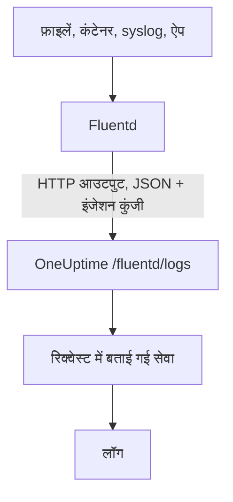

# Fluentd

[Fluentd](https://www.fluentd.org/) फ़ाइलों, कंटेनरों, syslog, एप्लिकेशन और [कई दूसरे स्रोतों](https://www.fluentd.org/datasources) से लॉग इकट्ठा करता है। इसका बिल्ट-इन [HTTP आउटपुट](https://docs.fluentd.org/output/http) उन्हें OneUptime के Fluentd एंडपॉइंट पर भेजता है, जहां वे **उत्पाद → लॉग** में खोजे जा सकते हैं।

:::cards
- [Fluentd कॉन्फ़िगर करें](#fluentd-कॉन्फ़िगर-करें): एक HTTP आउटपुट जोड़ें जो OneUptime की ओर इशारा करे।
- [रिकॉर्ड कैसे पढ़े जाते हैं](#रिकॉर्ड-कैसे-पढ़े-जाते-हैं): कौन-से फ़ील्ड मैसेज, सीवियरिटी और एट्रिब्यूट बनते हैं।
- [सेल्फ़-होस्टेड OneUptime](#सेल्फ़-होस्टेड-oneuptime): Fluentd को अपने इंस्टेंस की ओर करें।
:::

## यह कैसे काम करता है



Fluentd रिकॉर्ड को JSON के बैच में भेजता है, जिसमें आपकी इंजेशन कुंजी `x-oneuptime-token` हेडर में और सेवा का नाम `x-oneuptime-service-name` में होता है। OneUptime हर रिकॉर्ड को उस सेवा का एक लॉग बना देता है, और पहली बार डेटा भेजे जाने पर सेवा बनाता है।

## शुरू करने से पहले

- **Fluentd इंस्टॉल करें** — [इंस्टॉलेशन गाइड](https://docs.fluentd.org/installation) देखें।
- **एक OneUptime प्रोजेक्ट।** OneUptime Cloud पर टेलीमेट्री का बिल प्रति GB इंजेस्ट किए गए डेटा पर बनता है — देखें [मूल्य](https://oneuptime.com/pricing) — और Free प्लान वाले प्रोजेक्ट को टेलीमेट्री भेजने से पहले भुगतान विधि जोड़नी होती है।
- **एक टेलीमेट्री इंजेशन कुंजी।** अगर आपके पास नहीं है:

:::steps
### इंजेशन कुंजियाँ खोलें

**उत्पाद → प्रोजेक्ट सेटिंग्स** पर जाएं, साइड मेन्यू में **टेलीमेट्री और APM** खोलें और **इंजेशन कुंजियाँ** चुनें।


### एक कुंजी बनाएं

**इंजेशन कुंजी बनाएँ** पर क्लिक करें। डायलॉग में कुंजी का नाम पहले से भरा होता है और **सर्वर** चुना होता है — वह कुंजी प्रकार जिससे कोई एप्लिकेशन या collector डेटा भेजता है — इसलिए उसे बनाने के लिए **इंजेशन कुंजी बनाएँ** पर क्लिक करें, या पहले उसका नाम बदलें।

### सीक्रेट कॉपी करें

नई कुंजी अपने पेज पर खुलती है। उसकी **सीक्रेट कुंजी** कॉपी करें: यही नीचे की कॉन्फ़िगरेशन में `YOUR_SERVICE_TOKEN` है।


:::

## Fluentd कॉन्फ़िगर करें

Fluentd की कॉन्फ़िगरेशन फ़ाइल आमतौर पर `/etc/fluent/fluentd.conf` होती है, या पुराने td-agent पैकेज के लिए `/etc/td-agent/td-agent.conf`।

:::steps
### एक HTTP आउटपुट जोड़ें

एक `<match>` सेक्शन जोड़ें जो रिकॉर्ड OneUptime को भेजे। `YOUR_SERVICE_TOKEN` की जगह अपनी इंजेशन कुंजी लिखें, और `YOUR_SERVICE_NAME` की जगह वह नाम जिसके तहत लॉग दिखने चाहिए — कोई भी नाम जो आप चाहें:

```text title="fluentd.conf"
# Send the time Fluentd gave each event: the HTTP output sends only the record
<filter **>
  @type record_transformer
  enable_ruby true
  <record>
    fluentd_time ${time.utc.strftime("%Y-%m-%dT%H:%M:%S.%NZ")}
  </record>
</filter>

# Match all patterns
<match **>
  @type http

  endpoint https://oneuptime.com/fluentd/logs
  open_timeout 2

  headers {"x-oneuptime-token":"YOUR_SERVICE_TOKEN", "x-oneuptime-service-name":"YOUR_SERVICE_NAME"}

  content_type application/json
  json_array true

  # Send a batch again when OneUptime is busy (429) or restarting (502, 503, 504)
  retryable_response_codes 429,502,503,504

  <format>
    @type json
  </format>
  <buffer>
    # Keep the batches on disk until OneUptime takes them: a restart of Fluentd loses none
    @type file
    path /var/log/fluent/buffer/oneuptime
    total_limit_size 512m
    flush_interval 10s
    chunk_limit_size 900k
    # Try again at least every 30 seconds, for up to 72 hours
    retry_max_interval 30s
    retry_timeout 72h
  </buffer>
</match>

# Keep Fluentd's own logs out of OneUptime
<label @FLUENT_LOG>
  <match **>
    @type null
  </match>
</label>
```

`json_array true` बफ़र के हर चंक को एक JSON ऐरे के रूप में भेजता है, और `flush_interval 10s` हर 10 सेकंड में बफ़र भेजता है। `chunk_limit_size 900k` हर रिक्वेस्ट को 1 MB से कम रखता है, जो इस एंडपॉइंट पर OneUptime की अधिकतम सीमा है।

Fluentd की अपनी डिफ़ॉल्ट सेटिंग भी काम करती है: `content_type` और `json_array true` के बिना Fluentd न्यूलाइन से अलग किया गया JSON भेजता है, हर लाइन में एक रिकॉर्ड, और OneUptime हर लाइन को उसी रिकॉर्ड के रूप में पढ़ता है, `compress gzip` के साथ या उसके बिना।

`@type file` भेजे जाने से बचे बैच को उस फ़ोल्डर में रखता है जिसका नाम `path` देता है, ताकि Fluentd के रीस्टार्ट होने पर उनमें से कोई न खोए; मेमोरी वाला बफ़र, जो Fluentd का डिफ़ॉल्ट है, जो कुछ रखता है वह खो देता है। Fluentd के यूज़र को उस फ़ोल्डर में लिखने की अनुमति होनी चाहिए: `/var/log/fluent` fluent-package का है, `/var/log/td-agent` td-agent का, और `/fluentd/log` `fluent/fluentd` इमेज का। `total_limit_size 512m` वहाँ ज़्यादा से ज़्यादा 512 MB रखता है; भर जाने पर Fluentd तब तक और रिकॉर्ड नहीं लेता जब तक कोई बैच भेजा न जाए।

`retryable_response_codes 429,502,503,504` बैच को फिर से भेजता है जब OneUptime व्यस्त हो (`429`) या रीस्टार्ट हो रहा हो (`502`, `503`, `504`); इसके बिना Fluentd `503` को छोड़कर किसी भी जवाब पर बैच को छोड़ देता है। `retry_max_interval 30s` दो कोशिशों के बीच ज़्यादा से ज़्यादा 30 सेकंड रुकता है, और `retry_timeout 72h` उस बैच को छोड़ देता है जो 72 घंटे बाद भी नहीं भेजा जा सका। `record_transformer` फ़िल्टर हर रिकॉर्ड में वह समय जोड़ता है जो Fluentd ने उसे दिया, `fluentd_time` के रूप में: HTTP आउटपुट सिर्फ़ रिकॉर्ड भेजता है, और OneUptime लॉग का समय उसी से पढ़ता है।

### Fluentd रीस्टार्ट करें

Fluentd सर्विस को रीस्टार्ट करें, ताकि वह नया आउटपुट लोड करे।

### जांचें कि लॉग पहुंच रहे हैं

अगले फ़्लश के कुछ सेकंड के अंदर लॉग **उत्पाद → लॉग** में दिखते हैं। सेवा **उत्पाद → सेवाएं** में सूचीबद्ध होती है — अगर वह पहले से नहीं थी, तो OneUptime उसे बना देता है।
:::

## पूरा उदाहरण

यह कॉन्फ़िगरेशन पोर्ट `24224` पर Fluentd के forward प्रोटोकॉल से, सिर्फ़ इसी होस्ट से, रिकॉर्ड लेती है और उन सभी को OneUptime को भेजती है:

```text title="fluentd.conf"
####
## Source descriptions:
##

## built-in TCP input
## @see https://docs.fluentd.org/input/forward
<source>
  @type forward
  port 24224
  # This host alone: see "Take records from other hosts" to open it
  bind 127.0.0.1
</source>

# Send the time Fluentd gave each event: the HTTP output sends only the record
<filter **>
  @type record_transformer
  enable_ruby true
  <record>
    fluentd_time ${time.utc.strftime("%Y-%m-%dT%H:%M:%S.%NZ")}
  </record>
</filter>

<match **>
  @type http

  endpoint https://oneuptime.com/fluentd/logs
  open_timeout 2

  headers {"x-oneuptime-token":"YOUR_SERVICE_TOKEN", "x-oneuptime-service-name":"YOUR_SERVICE_NAME"}

  content_type application/json
  json_array true

  # Send a batch again when OneUptime is busy (429) or restarting (502, 503, 504)
  retryable_response_codes 429,502,503,504

  <format>
    @type json
  </format>
  <buffer>
    # Keep the batches on disk until OneUptime takes them: a restart of Fluentd loses none
    @type file
    path /var/log/fluent/buffer/oneuptime
    total_limit_size 512m
    flush_interval 10s
    chunk_limit_size 900k
    # Try again at least every 30 seconds, for up to 72 hours
    retry_max_interval 30s
    retry_timeout 72h
  </buffer>
</match>

# Keep Fluentd's own logs out of OneUptime
<label @FLUENT_LOG>
  <match **>
    @type null
  </match>
</label>
```

`bind 127.0.0.1` सिर्फ़ इसी होस्ट से रिकॉर्ड लेता है, जैसे Docker के `fluentd` लॉग ड्राइवर के, जो `localhost:24224` पर भेजता है। अलग-अलग स्रोतों को अलग-अलग सेवाओं के रूप में भेजने के लिए, हर टैग के लिए एक `<match>` सेक्शन इस्तेमाल करें, और हर एक में अपना `x-oneuptime-service-name` और बफ़र का अपना `path` रखें: एक ही पाथ पर दो बफ़र होने पर Fluentd शुरू नहीं होता।

## दूसरे होस्ट से रिकॉर्ड लें

`bind 0.0.0.0` के साथ और `<security>` सेक्शन के बिना, जो कोई भी पोर्ट `24224` तक पहुँच सकता है, वह आपकी इंजेशन कुंजी से OneUptime को लॉग भेज सकता है। दूसरे होस्ट पर चल रहे Fluentd या Fluent Bit से रिकॉर्ड लेने के लिए, हर पते पर सुनें, हर भेजने वाले से एक साझा कुंजी माँगें, और TLS इस्तेमाल करें। पूरे उदाहरण के `<source>` सेक्शन की जगह यह रखें:

```text title="fluentd.conf on this host"
<source>
  @type forward
  port 24224
  bind 0.0.0.0
  <transport tls>
    cert_path /etc/fluent/certs/fluentd.crt
    private_key_path /etc/fluent/certs/fluentd.key
  </transport>
  <security>
    self_hostname fluentd.example.com
    shared_key YOUR_SHARED_KEY
  </security>
</source>
```

`cert_path` और `private_key_path` इस होस्ट के नाम, यहाँ `fluentd.example.com`, का एक सर्टिफ़िकेट और उसकी कुंजी हैं, जिन्हें Fluentd का यूज़र पढ़ सके। कुंजी पर पासफ़्रेज़ न होने पर Fluentd चेतावनी देता है; `private_key_passphrase` एक पासफ़्रेज़ सेट करता है। `YOUR_SHARED_KEY` की जगह एक लंबा रैंडम सीक्रेट रखें, जैसे `openssl rand -base64 32` से बना एक, और हर भेजने वाले को वही दें:

```text title="fluentd.conf on each sender"
<match **>
  @type forward
  transport tls
  # The certificate of the authority that signed this host's; not needed for a public one
  tls_cert_path /etc/fluent/certs/ca.crt
  <security>
    self_hostname app-1.example.com
    shared_key YOUR_SHARED_KEY
  </security>
  <server>
    host fluentd.example.com
    port 24224
  </server>
  <buffer>
    @type file
    path /var/log/fluent/buffer/forward
  </buffer>
</match>

# Keep Fluentd's own logs out of OneUptime
<label @FLUENT_LOG>
  <match **>
    @type null
  </match>
</label>
```

Fluent Bit का `forward` आउटपुट भी यही सेटिंग लेता है: `Shared_Key`, `Self_Hostname`, `tls On` और `tls.ca_file`।

कुंजी या TLS के बिना भेजने वाले को लौटा दिया जाता है। कुंजी खुद कभी नेटवर्क पर नहीं जाती: हर पक्ष साबित करता है कि उसके पास वह है। TLS के बिना, होस्ट के बीच के नेटवर्क पर कोई भी रिकॉर्ड पढ़ सकता है। होस्ट के फ़ायरवॉल में पोर्ट `24224` सिर्फ़ उन होस्ट के लिए खोलें जो भेजते हैं। अगर Fluentd लॉग गाइड की Docker Compose फ़ाइल से चलता है, तो वहाँ भी पोर्ट को हर पते पर पब्लिश करें, `"24224:24224"`, और सर्टिफ़िकेट का फ़ोल्डर कंटेनर में माउंट करें।

## रिकॉर्ड कैसे पढ़े जाते हैं

OneUptime हर रिकॉर्ड से ये फ़ील्ड पढ़ता है:

| लॉग फ़ील्ड | रिकॉर्ड में इनमें से पहले मौजूद फ़ील्ड से पढ़ा जाता है | नोट्स |
| --- | --- | --- |
| बॉडी | `message`, `log`, `msg`, `body`, `text` | लॉग लाइन। इनमें से कोई फ़ील्ड न हो, तो पूरा रिकॉर्ड JSON के रूप में रखा जाता है। |
| सीवियरिटी | `level`, `severity`, `loglevel`, `log_level`, `priority`, `severityText`, `severity_text` | `trace`, `debug`, `info`, `notice`, `warn`, `error`, `critical` और `fatal` जैसे नाम, किसी भी केस में। कोई और मान `Unspecified` के रूप में रखा जाता है। |
| ट्रेस ID | `trace_id`, `traceId`, `traceid` | लॉग को उसके ट्रेस से जोड़ता है। |
| स्पैन ID | `span_id`, `spanId`, `spanid` | लॉग को उसके स्पैन से जोड़ता है। |
| सेवा | `x-oneuptime-service-name` हेडर | हेडर सेट न हो तो `Fluentd`। |
| समय | `time`, `timestamp`, `@timestamp`, `ts`, `fluentd_time` | ISO 8601 समय, जैसे `2026-11-14T08:00:00.123Z`, या epoch से सेकंड, मिलीसेकंड, माइक्रोसेकंड या नैनोसेकंड; बिना टाइम ज़ोन वाला समय UTC माना जाता है। 2000 से पहले का, या एक दिन से ज़्यादा आगे का समय नहीं पढ़ा जाता। जिस फ़ील्ड से समय पढ़ा जाता है, वह एट्रिब्यूट के रूप में नहीं रखी जाती। बिना समय वाला रिकॉर्ड उस समय पर सेव होता है जब OneUptime उसे प्राप्त करता है। |

बाकी हर फ़ील्ड `fluentd.` के बाद फ़ील्ड के नाम वाला एट्रिब्यूट बन जाता है, जिस पर आप खोज और फ़िल्टर कर सकते हैं: लॉग एक्सप्लोरर में `container_name` फ़ील्ड `@fluentd.container_name` होता है। नेस्टेड ऑब्जेक्ट डॉट्स से फ़्लैट किया जाता है, जैसे `fluentd.kubernetes.pod_name`, और सूची JSON के रूप में रखी जाती है।

Fluentd लॉग भी किसी दूसरे लॉग की तरह आपकी [लॉग पाइपलाइन](/docs/telemetry/log-pipelines), ड्रॉप फ़िल्टर और स्क्रब नियमों से गुज़रते हैं।

## सेल्फ़-होस्टेड OneUptime

`endpoint` में `https://oneuptime.com` की जगह अपने OneUptime इंस्टेंस का URL लिखें: `http(s)://YOUR_ONEUPTIME_HOST/fluentd/logs`।

## समस्या निवारण

:::details Fluentd, HTTP आउटपुट से `401` लॉग करता है
इंजेशन कुंजी मौजूद नहीं है, अज्ञात है या समाप्त हो गई है। `headers` में `x-oneuptime-token` का मान जांचें।
:::

:::details Fluentd `402` या `422` लॉग करता है
`402`: OneUptime Cloud पर प्रोजेक्ट Free प्लान पर है और उसकी कोई भुगतान विधि नहीं है। **प्रोजेक्ट सेटिंग्स → बिलिंग और चालान → बिलिंग** में एक जोड़ें। `422`: कुंजी अक्षम है, या यह ब्राउज़र कुंजी है। कुंजी की सेटिंग में **सक्षम** फिर से चालू करें, या **सर्वर** कुंजी बनाएं।
:::

:::details Fluentd `413` लॉग करता है
रिक्वेस्ट 1 MB से बड़ी है, जो इस एंडपॉइंट पर OneUptime की अधिकतम सीमा है। ऊपर के कॉन्फ़िगरेशन की तरह `<buffer>` सेक्शन में `chunk_limit_size 900k` सेट करें।
:::

:::details Fluentd `429`, `502`, `503` या `504` लॉग करता है
OneUptime व्यस्त है या रीस्टार्ट हो रहा है। ऊपर के कॉन्फ़िगरेशन की तरह `<match>` सेक्शन में `retryable_response_codes 429,502,503,504` होने पर Fluentd बैच को रखता है और फिर से भेजता है; इसके बिना Fluentd बैच को छोड़ देता है। `<buffer>` सेक्शन में `@type file` होने पर Fluentd रीस्टार्ट होने पर भी बैच रखता है।
:::

:::details लॉग अपना समय नहीं, बल्कि वह समय दिखाते हैं जब OneUptime ने उन्हें प्राप्त किया
OneUptime लॉग का समय उसके रिकॉर्ड से पढ़ता है, और Fluentd का HTTP आउटपुट सिर्फ़ रिकॉर्ड भेजता है। `<parse>` सेक्शन रिकॉर्ड से `time` फ़ील्ड को इवेंट के समय के रूप में निकाल देता है: उसमें `time_key fluentd_time` जोड़ें, ताकि वह किसी रिकॉर्ड का समय न पढ़े और `time` को जैसा है वैसा छोड़ दे। ऊपर के कॉन्फ़िगरेशन का `record_transformer` फ़िल्टर भी जोड़ें: यह हर रिकॉर्ड में वह समय जोड़ता है जो Fluentd ने उसे दिया, `fluentd_time` के रूप में।
:::

:::details ऐसी JSON लाइन कभी नहीं पहुँचती जिसका `time` `null`, `true`, एक लिस्ट या एक ऑब्जेक्ट हो
Fluentd का `json` पार्सर किसी लाइन के `time` फ़ील्ड को इवेंट के समय के रूप में पढ़ता है, और जिस लाइन का `time` न टेक्स्ट हो न कोई संख्या, उसे बिना किसी चेतावनी के छोड़ देता है। ऊपर की तरह उसके `<parse>` सेक्शन में `time_key fluentd_time` जोड़ें: तब Fluentd `time` को रिकॉर्ड में जैसा है वैसा छोड़ देता है। ऊपर के `record_transformer` फ़िल्टर के साथ, OneUptime लॉग को उस समय पर सहेजता है जब Fluentd ने उसे पढ़ा, `fluentd_time`; उसके बिना, उस समय पर जब OneUptime उसे प्राप्त करता है।
:::

:::details लॉग `Fluentd` सेवा के तहत पहुंचते हैं
`x-oneuptime-service-name` हेडर मौजूद नहीं है। इसे हर `<match>` सेक्शन में `headers` में जोड़ें।
:::

:::details लॉग की बॉडी में पूरा रिकॉर्ड JSON के रूप में दिखता है
OneUptime बॉडी को `message`, `log`, `msg`, `body` या `text` में से रिकॉर्ड में पहले मौजूद फ़ील्ड से लेता है, और इनमें से कोई न हो तो पूरा रिकॉर्ड रखता है। अपनी लॉग लाइन वाले फ़ील्ड का नाम इनमें से किसी एक में बदलें, जैसे Fluentd के `record_transformer` फ़िल्टर से।
:::

अगर आपके कोई सवाल हैं या कॉन्फ़िगरेशन में मदद चाहिए, तो हमें support@oneuptime.com पर लिखें।

## अगले कदम

:::cards
- [लॉग पाइपलाइन](/docs/telemetry/log-pipelines): Fluentd के भेजे लॉग पार्स करें और समृद्ध करें।
- [खोज सिंटैक्स](/docs/telemetry/search-syntax): लॉग एक्सप्लोरर में लॉग ढूंढें।
- [Fluent Bit](/docs/telemetry/fluentbit): एक हल्का एजेंट जो OpenTelemetry से भेजता है।
- [लॉग मॉनिटर](/docs/monitor/logs-monitor): मेल खाते लॉग दिखने पर अलर्ट करें।
:::
