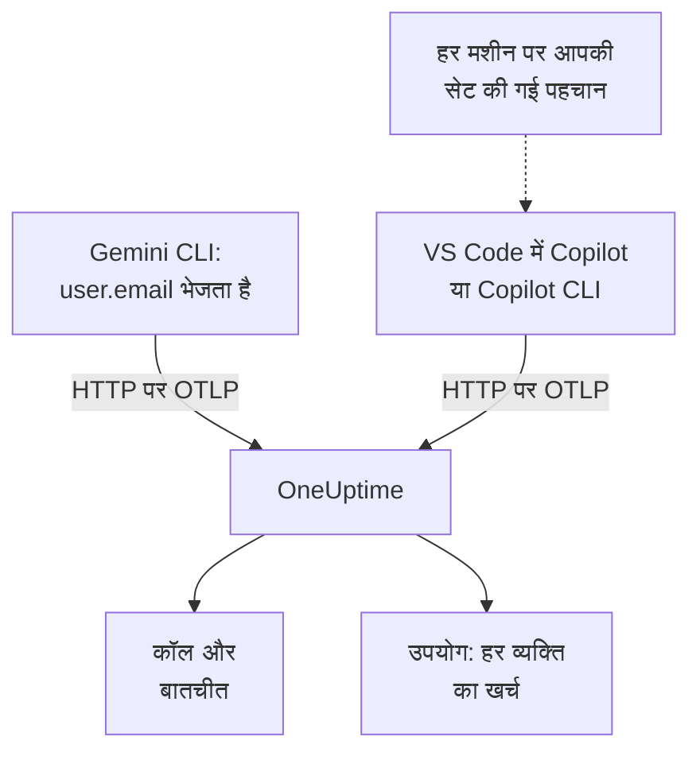

# Gemini CLI और GitHub Copilot

Gemini CLI और GitHub Copilot दोनों खुद OpenTelemetry एक्सपोर्ट करते हैं: उन्हें OneUptime की ओर मोड़ें, और उनकी मॉडल कॉल, टोकन, लागत और टूल कॉल [AI / LLM](/docs/telemetry/ai-llm-observability) में आपके अपने ऐप की AI कॉल के बगल में पहुँचती हैं। चार्जबैक के लिए जो बात सबसे ज़्यादा मायने रखती है, उसमें दोनों अलग हैं: Gemini CLI हर रिकॉर्ड पर व्यक्ति का नाम बताता है, और Copilot किसी का नहीं, इसलिए हर डेवलपर का नाम आप खुद देते हैं।

:::cards
- [Gemini CLI](#gemini-cli-सेट-अप-करें): ट्रेस के साथ टेलीमेट्री चालू करें और उसे सीधे OneUptime को भेजें।
- [GitHub Copilot](#github-copilot-सेट-अप-करें): VS Code या Copilot CLI से एक्सपोर्ट करें।
- [हर डेवलपर का नाम दें](#हर-डेवलपर-का-नाम-दें): वह पहचान जो Copilot छोड़ देता है।
- [समस्या निवारण](#समस्या-निवारण): कुछ न पहुँचे तो क्या जाँचें।
:::

## यह कैसे काम करता है



| | Gemini CLI | GitHub Copilot |
| --- | --- | --- |
| भेजता है | ट्रेस, मेट्रिक्स और लॉग | ट्रेस, मेट्रिक्स और इवेंट, सिर्फ़ अपनी एजेंट सुविधाओं से |
| व्यक्ति का नाम बताता है | साइन इन होने पर `user.email` | किसी का नहीं: `enduser.id` और `user.email` आप सेट करते हैं |
| प्रॉम्प्ट टेक्स्ट | भेजा जाता है, जब तक आप `logPrompts` बंद न करें | नहीं भेजा जाता, जब तक आप `captureContent` चालू न करें |
| डिफ़ॉल्ट रूप से कहाँ भेजता है | `http://localhost:4317`, gRPC पर | `http://localhost:4318`, HTTP पर |

## शुरू करने से पहले

- एक इन्जेशन कुंजी: **प्रोजेक्ट सेटिंग्स → टेलीमेट्री और APM → इंजेशन कुंजियाँ** खोलें और **इन्जेशन कुंजी बनाएँ** पर क्लिक करें।
- आपका OTLP बेस URL: `https://oneuptime.com/otlp`, या अगर आप OneUptime खुद होस्ट करते हैं तो `https://YOUR-ONEUPTIME-HOST/otlp`।
- कुंजी हर एक्सपोर्ट अनुरोध के `x-oneuptime-token` हेडर में जाती है।

## Gemini CLI सेट अप करें

Gemini CLI ट्रेस, मेट्रिक्स और लॉग इवेंट भेजता है, और जब कोई साइन इन हो तो हर रिकॉर्ड पर `user.email` लगाता है। OneUptime `user.email` को कर्मचारी के रूप में पढ़ता है, इसलिए हर व्यक्ति का खर्च बिना किसी मैपिंग के और बिना हर मशीन पर सेटअप के दिखता है।

:::steps
### टेलीमेट्री चालू करें

हर मशीन की उपयोगकर्ता सेटिंग्स फ़ाइल में, या किसी रिपॉज़िटरी की `.gemini/settings.json` में एक `telemetry` ब्लॉक जोड़ें:

```json title="~/.gemini/settings.json"
{
  "telemetry": {
    "enabled": true,
    "target": "local",
    "otlpEndpoint": "https://oneuptime.com/otlp",
    "otlpProtocol": "http",
    "otlpHeaders": {
      "x-oneuptime-token": "YOUR_INGESTION_TOKEN"
    },
    "traces": true,
    "logPrompts": false
  }
}
```

### नया सेशन शुरू करें

Gemini CLI शुरू होते समय अपनी सेटिंग्स पढ़ता है, इसलिए उसे फिर से शुरू करें और एक प्रॉम्प्ट चलाएँ।

### जाँचें कि डेटा पहुँच रहा है

**उत्पाद → AI / LLM → कॉल** खोलें: कॉल `gemini-cli` सेवा के अंदर, मॉडल और टोकन के साथ सूची में दिखती हैं।
:::

उस ब्लॉक की तीन सेटिंग्स बाकी से ज़्यादा मायने रखती हैं:

- `otlpProtocol: "http"`। जब तक कुछ और न बताया जाए, Gemini CLI gRPC इस्तेमाल करता है। HTTP पर वह बेस URL में `/v1/traces`, `/v1/metrics` और `/v1/logs` खुद जोड़ता है। OneUptime पोर्ट 443 पर gRPC भी स्वीकार करता है (देखें [gRPC पर OTLP](/docs/telemetry/open-telemetry#grpc-पर-otlp)), लेकिन HTTP ज़्यादा आसान है।
- `traces: true`। यह डिफ़ॉल्ट रूप से बंद है, और इसके बिना Gemini CLI के स्पैन में न मॉडल होता है न टोकन की गिनती, इसलिए किसी चीज़ की कीमत नहीं लगाई जा सकती। Gemini CLI कोई लागत मेट्रिक भी नहीं भेजता: उसकी कॉल की लागत देखने के लिए ट्रेस चालू करें।
- `logPrompts: false`। नीचे दी गई चेतावनी पढ़ें।

> [!WARNING]
> `logPrompts` डिफ़ॉल्ट रूप से `true` है, इसलिए टेलीमेट्री चालू करते ही आपके इंजीनियरों का टाइप किया टेक्स्ट भेजा जाता है: अक्सर सोर्स कोड, ग्राहकों का डेटा और चिपकाए गए क्रेडेंशियल। जिस बदलाव से टेलीमेट्री चालू होती है, उसी में इसे `false` पर सेट करें। अगर डीबगिंग के लिए प्रॉम्प्ट चाहिए, तो यह फ़ैसला सोच-समझकर लें, और जो ज़रूरी हो उसे **ट्रेस → सेटिंग्स** के अंदर स्क्रब नियमों से छिपाएँ।

### कई मशीनों के लिए सेटिंग्स

हर सेटिंग का एक एनवायरनमेंट वेरिएबल है, और वेरिएबल किसी रिपॉज़िटरी की `.gemini/settings.json` पर भारी पड़ते हैं, इसलिए MDM से भेजी जाने वाली नीति के लिए यही सही जगह है:

```bash
export GEMINI_TELEMETRY_ENABLED=true
export GEMINI_TELEMETRY_TARGET=local
export GEMINI_TELEMETRY_OTLP_ENDPOINT="https://oneuptime.com/otlp"
export GEMINI_TELEMETRY_OTLP_PROTOCOL=http
export GEMINI_TELEMETRY_OTLP_HEADERS="x-oneuptime-token=YOUR_INGESTION_TOKEN"
export GEMINI_TELEMETRY_TRACES_ENABLED=true
export GEMINI_TELEMETRY_LOG_PROMPTS=false
```

| सेटिंग | वेरिएबल | डिफ़ॉल्ट | यह क्या करती है |
| --- | --- | --- | --- |
| `enabled` | `GEMINI_TELEMETRY_ENABLED` | `false` | टेलीमेट्री चालू करती है |
| `target` | `GEMINI_TELEMETRY_TARGET` | `local` | `local` आपके सेट किए एंडपॉइंट पर भेजता है; `gcp` Google Cloud पर भेजता है |
| `otlpEndpoint` | `GEMINI_TELEMETRY_OTLP_ENDPOINT` | `http://localhost:4317` | टेलीमेट्री कहाँ जाती है |
| `otlpProtocol` | `GEMINI_TELEMETRY_OTLP_PROTOCOL` | `grpc` | `grpc` या `http` |
| `otlpHeaders` | `GEMINI_TELEMETRY_OTLP_HEADERS` | कोई नहीं | हर एक्सपोर्ट पर हेडर: फ़ाइल में ऑब्जेक्ट, वेरिएबल में `key=value` जोड़े या JSON |
| `traces` | `GEMINI_TELEMETRY_TRACES_ENABLED` | `false` | मॉडल, टोकन और पेलोड स्पैन पर डालती है |
| `logPrompts` | `GEMINI_TELEMETRY_LOG_PROMPTS` | `true` | प्रॉम्प्ट टेक्स्ट लॉग इवेंट में डालती है |
| `outfile` | `GEMINI_TELEMETRY_OUTFILE` | कोई नहीं | इसके बजाय टेलीमेट्री फ़ाइल में लिखती है, ताकि दिखे कि क्या भेजा जाएगा |

कमांड-लाइन फ़्लैग `GEMINI_TELEMETRY_*` वेरिएबल पर भारी पड़ते हैं, जो मानक `OTEL_EXPORTER_OTLP_*` वेरिएबल पर भारी पड़ते हैं, जो `settings.json` पर भारी पड़ते हैं। Gemini CLI `OTEL_EXPORTER_OTLP_HEADERS` भी पढ़ता है, इसलिए दूसरे टूल के लिए पहले से सेट किया गया हेडर उस तक भी पहुँचता है।

:::details इसके बजाय OpenTelemetry Collector से होकर भेजें
हर मशीन पर एक कलेक्टर, या हर टीम के लिए एक, टेलीमेट्री के OneUptime तक पहुँचने से पहले उसे बैच, रीट्राई और रूट कर सकता है। Gemini CLI को उसकी डिफ़ॉल्ट सेटिंग्स पर छोड़ दें, जो gRPC से `http://localhost:4317` पर भेजती हैं, और कुंजी कलेक्टर को जोड़ने दें:

```yaml title="otel-collector-config.yaml"
receivers:
  otlp:
    protocols:
      grpc:
        endpoint: 0.0.0.0:4317
      http:
        endpoint: 0.0.0.0:4318

exporters:
  otlphttp:
    endpoint: "https://oneuptime.com/otlp"
    headers:
      "x-oneuptime-token": "YOUR_INGESTION_TOKEN"

service:
  pipelines:
    traces:
      receivers: [otlp]
      exporters: [otlphttp]
    metrics:
      receivers: [otlp]
      exporters: [otlphttp]
    logs:
      receivers: [otlp]
      exporters: [otlphttp]
```

कलेक्टर चलाने के लिए [OpenTelemetry](/docs/telemetry/open-telemetry) देखें।
:::

### Gemini CLI क्या भेजता है

| मेट्रिक | इसमें क्या होता है |
| --- | --- |
| `gen_ai.client.token.usage` | इनपुट और आउटपुट टोकन: वह सीरीज़ जिसे OneUptime गिनता है |
| `gemini_cli.token.usage` | वही टोकन Gemini CLI के अपने नाम से, साथ में उसके `thought`, `cache` और `tool` टोकन; इन्हें नहीं गिना जाता, ताकि टोकन कभी दो बार न गिने जाएँ |
| `gen_ai.client.operation.duration` | हर मॉडल कॉल में कितना समय लगा |
| `gemini_cli.api.request.count` | मॉडल कॉल |
| `gemini_cli.tool.call.count` | टूल कॉल |
| `gemini_cli.session.count` | शुरू किए गए सेशन |
| `gemini_cli.lines.changed` | एजेंट की बदली गई पंक्तियाँ |

इसके लॉग इवेंट में `gemini_cli.user_prompt`, `gemini_cli.api_request`, `gemini_cli.api_response`, `gemini_cli.api_error`, `gemini_cli.tool_call` और `gemini_cli.file_operation` शामिल हैं। हर रिकॉर्ड में `session.id`, `installation.id`, `active_approval_mode` और, जब कोई साइन इन हो, `user.email` होता है। OneUptime `session.id` को बातचीत की ID के रूप में पढ़ता है, इसलिए Gemini CLI का पूरा सेशन **बातचीत** के अंदर एक बातचीत के रूप में दिखता है, चाहे उसमें कितने भी ट्रेस लगे हों।

ये मेट्रिक्स सामान्य OpenTelemetry मेट्रिक्स हैं: इनमें से किसी को भी डैशबोर्ड पर चार्ट करें, या [मेट्रिक्स मॉनिटर](/docs/monitor/metrics-monitor) से उस पर अलर्ट करें।

## GitHub Copilot सेट अप करें

GitHub सिर्फ़ Copilot की एजेंट सुविधाओं के लिए OpenTelemetry का दस्तावेज़ देता है:

| सुविधा | OpenTelemetry भेजती है |
| --- | --- |
| VS Code में Copilot Chat और एजेंट मोड | हाँ |
| Copilot CLI | हाँ |
| Copilot SDK | हाँ |
| JetBrains IDE में एजेंट वर्कफ़्लो | हाँ, Copilot प्लगइन की सेटिंग्स में सेट |
| इनलाइन कम्प्लीशन, github.com पर Copilot, Copilot कोड रिव्यू | दस्तावेज़ में नहीं |

इसलिए जो टीम ज़्यादातर इनलाइन कम्प्लीशन इस्तेमाल करती है, वह OneUptime में निष्क्रिय दिखती है, चाहे एक्सपोर्ट कैसे भी सेट हो।

:::tabs
@tab VS Code
```json title="settings.json"
{
  "github.copilot.chat.otel.enabled": true,
  "github.copilot.chat.otel.exporterType": "otlp-http",
  "github.copilot.chat.otel.otlpEndpoint": "https://oneuptime.com/otlp",
  "github.copilot.chat.otel.captureContent": false
}
```
@tab Copilot CLI
```bash
export COPILOT_OTEL_ENABLED=true
export OTEL_EXPORTER_OTLP_ENDPOINT="https://oneuptime.com/otlp"
export OTEL_EXPORTER_OTLP_HEADERS="x-oneuptime-token=YOUR_INGESTION_TOKEN"
```
@tab प्रबंधित सेटिंग्स
```json
{
  "telemetry": {
    "enabled": true,
    "endpoint": "https://oneuptime.com/otlp",
    "protocol": "http/protobuf",
    "serviceName": "github-copilot",
    "captureContent": false,
    "lockCaptureContent": true,
    "headers": {
      "x-oneuptime-token": "YOUR_INGESTION_TOKEN"
    }
  }
}
```
:::

- VS Code की सेटिंग्स में हेडर के लिए कोई कुंजी नहीं है: जिस एनवायरनमेंट से VS Code शुरू होता है, उसमें `OTEL_EXPORTER_OTLP_HEADERS` सेट करें, जैसे Copilot CLI के लिए। एनवायरनमेंट वेरिएबल VS Code की सेटिंग्स पर भारी पड़ते हैं।
- प्रबंधित सेटिंग्स, जिन्हें कोई एंटरप्राइज़ VS Code और Copilot CLI पर भेजता है, कुंजी को `headers` में रखती हैं और हर डेवलपर की अपनी सेटिंग पर भारी पड़ती हैं। `lockCaptureContent` सबके लिए प्रॉम्प्ट कैप्चर बंद रखता है। वहाँ `protocol` वायर फ़ॉर्मेट है, `http/protobuf` या `http/json`।
- `captureContent` डिफ़ॉल्ट रूप से बंद है, इसलिए जब तक आप इसे चालू न करें, प्रॉम्प्ट और जवाब नहीं भेजे जाते।

## हर डेवलपर का नाम दें

Copilot ऐसी कोई पहचान नहीं भेजता जिसे OneUptime इस्तेमाल कर सके। इसकी `captureIdentity` सेटिंग `user.name` जोड़ती है, और Copilot CLI `enduser.pseudo.id` जोड़ सकता है, लेकिन OneUptime इनमें से किसी को भी कर्मचारी के रूप में नहीं पढ़ता। पहचान के बिना, Copilot का सारा खर्च **उपयोग** टैब पर एक **बिना एट्रिब्यूशन** पंक्ति में चला जाता है।

हर मशीन पर, उस एनवायरनमेंट में पहचान सेट करें जिससे VS Code और Copilot CLI शुरू होते हैं: कोई शेल प्रोफ़ाइल, या कोई स्क्रिप्ट जिसे आपका MDM चलाता है।

```bash
export OTEL_RESOURCE_ATTRIBUTES="enduser.id=alice@example.com,user.email=alice@example.com,team.id=platform,cost_center=eng-tools"
```

| विशेषता | OneUptime इसे इस रूप में पढ़ता है |
| --- | --- |
| `enduser.id` | कर्मचारी की ID |
| `user.email` | कर्मचारी का ईमेल: वह नाम जो **उपयोग** टैब दिखाता है |
| `team.id`, `team`, `cost_center`, `department` | टीम या कॉस्ट सेंटर |

ये रिसोर्स विशेषताएँ हैं, इसलिए ये `resource.enduser.id`, `resource.user.email` आदि के रूप में आती हैं: OneUptime हर पहचान और टीम कुंजी को `resource.` प्रीफ़िक्स के साथ या उसके बिना पढ़ता है। Gemini CLI पहले से `user.email` भेजता है; उसे `OTEL_RESOURCE_ATTRIBUTES` सिर्फ़ टीम के लिए दें।

- पहली कॉल से पहले पहचान सेट करें: बिना पहचान के आई कॉल बाद में किसी के नाम नहीं की जा सकतीं।
- Copilot की प्रबंधित सेटिंग्स में `resourceAttributes` न डालें: वे `OTEL_RESOURCE_ATTRIBUTES` पर भारी पड़ती हैं, और हर मशीन पर आपकी सेट की गई पहचान को बदल देंगी।
- `gen_ai.user` या `llm.user` इस्तेमाल न करें। ग्राहकों को सेवा देने वाले ऐप में ये ग्राहक का नाम बताते हैं, इसलिए OneUptime इन्हें कभी कर्मचारी के रूप में नहीं पढ़ता।

## Copilot का डेटा कैसा दिखता है

Copilot OpenTelemetry GenAI कन्वेंशन का पालन करता है, इसलिए उसकी कॉल आपके अपने ऐप की कॉल की तरह **कॉल**, **बातचीत** और **उपयोग** में दिखती हैं।

| स्पैन | हर एक |
| --- | --- |
| `invoke_agent` | एजेंट की बारी |
| `chat` | मॉडल कॉल |
| `execute_tool` | टूल कॉल |
| `execute_hook` | हुक रन |

इसके स्पैन में मॉडल, `gen_ai.usage.input_tokens`, `gen_ai.usage.output_tokens` और `gen_ai.conversation.id` होते हैं, इसलिए एजेंट की पूरी बारी एक बातचीत के रूप में दिखती है। दोनों सुविधाएँ `gen_ai.client.token.usage` और `gen_ai.client.operation.duration` मेट्रिक्स, और OTLP लॉग सिग्नल पर इवेंट भी भेजती हैं: बीच में लगाए गए किसी भी कलेक्टर में `logs` पाइपलाइन रखें।

OneUptime हर कॉल की कीमत उसके मॉडल और टोकन से, **मूल्य** में दी गई दरों पर लगाता है। यह सूची मूल्य पर टोकन की लागत है, वह नहीं जो GitHub आपसे लेता है: Copilot का भुगतान प्रति सीट और प्रति प्रीमियम अनुरोध होता है।

सीट, सीट की गतिविधि और प्रीमियम अनुरोध की बिलिंग OpenTelemetry में बिल्कुल नहीं होतीं: ये GitHub के REST API में होती हैं, जिसे OneUptime नहीं पढ़ता। सीट और बिलिंग के आँकड़े GitHub से लें।

## समस्या निवारण

:::details Gemini CLI से कुछ नहीं आता
आम कारण यह है कि `otlpProtocol` अपने डिफ़ॉल्ट `grpc` पर रह गया है, जबकि एंडपॉइंट HTTP URL है। `otlpProtocol` को `http` पर सेट करें, और जाँचें कि `otlpEndpoint` `/otlp` पर खत्म होने वाला बेस URL है, और `x-oneuptime-token` हेडर सेट है। Gemini CLI क्या भेजेगा, यह देखने के लिए थोड़ी देर `outfile` सेट करें।
:::

:::details Gemini CLI की कॉल बिना मॉडल, टोकन या लागत के आती हैं
`traces` बंद है। इसे चालू करें: इसके बिना Gemini CLI के स्पैन में न मॉडल होता है न टोकन की गिनती, और वह कोई लागत मेट्रिक नहीं भेजता।
:::

:::details Copilot का खर्च बिना एट्रिब्यूशन दिखता है
पहचान एक्सपोर्टर तक नहीं पहुँची। जाँचें कि `OTEL_RESOURCE_ATTRIBUTES` उस एनवायरनमेंट में सेट है जिससे VS Code या Copilot CLI शुरू हुआ, और Copilot की प्रबंधित सेटिंग्स `resourceAttributes` सेट नहीं करतीं, जो उसे बदल देंगी।
:::

:::details Copilot कुछ भी नहीं भेजता
जाँचें कि जिन लोगों से आपको उम्मीद है वे इनलाइन कम्प्लीशन नहीं, बल्कि एजेंट सुविधा इस्तेमाल करते हैं, और `OTEL_EXPORTER_OTLP_HEADERS` में कुंजी है: VS Code की अपनी सेटिंग्स यह नहीं कर सकतीं।
:::

:::details कुंजी अस्वीकार हो जाती है
कुंजी न होने, अज्ञात होने या उसकी समय-सीमा खत्म होने पर OneUptime `401` जवाब देता है, और बंद की गई कुंजी या ब्राउज़र कुंजी पर `422`। `x-oneuptime-token` में भेजी गई सर्वर कुंजी इस्तेमाल करें।
:::

## अगले कदम

:::cards
- [AI कोडिंग असिस्टेंट](/docs/telemetry/ai-coding-assistants): कौन कौन-सा टूल इस्तेमाल करता है, और हर व्यक्ति और टीम कितना खर्च करती है।
- [AI / LLM ऑब्ज़र्वेबिलिटी](/docs/telemetry/ai-llm-observability): OneUptime कौन-सी विशेषताएँ पढ़ता है, लागत कैसे निकाली जाती है, और रोज़ाना बजट।
- [AI गेटवे](/docs/telemetry/ai-gateways): जिन टूल का अपना एक्सपोर्ट नहीं है, उन्हें गेटवे के ज़रिए जोड़ें।
:::
