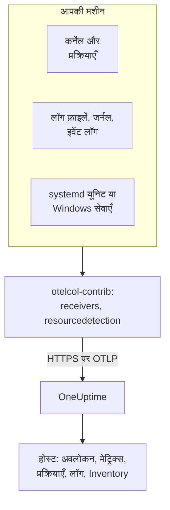

# होस्ट OpenTelemetry कलेक्टर

किसी Linux, macOS या Windows मशीन पर OpenTelemetry Collector चलाएँ ताकि उसके मेट्रिक्स, प्रक्रियाएँ, लॉग और सेवाओं की स्थिति OneUptime को भेजी जा सके। मशीन **उत्पाद → बुनियादी ढांचा → होस्ट्स** के अंतर्गत अपने पेजों के साथ दिखती है, और कोई OneUptime एजेंट इंस्टॉल नहीं करना पड़ता: कलेक्टर upstream की `otelcol-contrib` रिलीज़ ही है। [होस्ट मॉनिटर](/docs/monitor/host-monitor) उसके भेजे डेटा पर अलर्ट करते हैं।

:::cards
- [कलेक्टर इंस्टॉल करें](#कलेक्टर-इंस्टॉल-करें): Linux, macOS या Windows पर तीन चरण।
- [चुनें कि क्या इकट्ठा करना है](#चुनें-कि-क्या-इकट्ठा-करना-है): मेट्रिक्स, फ़ाइल लॉग, जर्नल, इवेंट लॉग और सेवाओं की स्थिति।
- [इन्वेंटरी एट्रिब्यूट](#इन्वेंटरी-एट्रिब्यूट-ip-mac-सीरियल-नंबर-निर्माता-मॉडल-फ़र्मवेयर): आपके CMDB के लिए IP, MAC, सीरियल नंबर, निर्माता, मॉडल और फ़र्मवेयर।
- [कम डेटा भेजें](#इकट्ठा-होने-वाले-डेटा-की-मात्रा-कम-करना): कम लॉग लाइनें, मोटे अंतराल, कम सीरीज़।
:::

## यह कैसे काम करता है

कलेक्टर अपने रिसीवरों के ज़रिए मशीन को पढ़ता है, हर रिकॉर्ड पर मशीन की पहचान लगाता है, और उसे आपकी इंजेशन कुंजी के साथ OTLP पर OneUptime को भेजता है। OneUptime पहले मेट्रिक्स से होस्ट को रजिस्टर करता है और डेटा आने के साथ उसके पेज भरता है।



| होस्ट पर आप क्या देखते हैं | यह कहाँ से आता है |
| --- | --- |
| **अवलोकन** और **मेट्रिक्स** | `hostmetrics` रिसीवर: CPU, मेमोरी, डिस्क, फ़ाइल सिस्टम, नेटवर्क, लोड, पेजिंग। |
| **प्रक्रियाएँ** | `hostmetrics` का `process` स्क्रैपर: हर प्रक्रिया के लिए सीरीज़ का एक सेट। |
| **लॉग** | `filelog`, `journald` और `windowseventlog` रिसीवर। |
| **Systemd Units** (Linux) | `systemd` रिसीवर। |
| **सेवाएं** (Windows) | `windows_service` रिसीवर। |
| इन्वेंटरी आइटम | `resourcedetection` प्रोसेसर, साथ में [आपके लगाए एट्रिब्यूट](#इन्वेंटरी-एट्रिब्यूट-ip-mac-सीरियल-नंबर-निर्माता-मॉडल-फ़र्मवेयर)। |
| **एजेंट संस्करण** | `resource` प्रोसेसर में `oneuptime.agent.version`। |

कोई होस्ट तब रजिस्टर होता है जब `host.name` वाले किसी बैच में `hostmetrics` या `process` मेट्रिक्स, या `os.type` एट्रिब्यूट भी हो। `resourcedetection` प्रोसेसर ये सब सेट करता है, इसीलिए हर कॉन्फ़िगरेशन उसे सबसे पहले रखता है। सिर्फ़ `host.id` या `host.arch` से कोई होस्ट रजिस्टर नहीं होता, और Kubernetes पहचान वाली टेलीमेट्री (`k8s.cluster.name`, `k8s.node.name`, `k8s.pod.name`) इसके बजाय अपने क्लस्टर के अंतर्गत दर्ज होती है: Kubernetes नोड की निगरानी [Kubernetes एजेंट](/docs/telemetry/kubernetes-agent) से करें।

## शुरू करने से पहले

- एक इंजेशन कुंजी। **प्रोजेक्ट सेटिंग्स → टेलीमेट्री और APM → इंजेशन कुंजियाँ** के अंतर्गत एक बनाएँ और उसका मान कॉपी करें। कलेक्टर इसे `x-oneuptime-token` हेडर में भेजता है।
- मशीन पर एडमिन अधिकार: Linux और macOS पर `sudo`, Windows पर एलिवेटेड PowerShell प्रॉम्प्ट।
- मशीन से आपके OneUptime URL तक आउटबाउंड HTTPS।
- कलेक्टर का contrib डिस्ट्रीब्यूशन, `otelcol-contrib`। कोर `otelcol` बिल्ड में वे रिसीवर और प्रोसेसर नहीं हैं जिनका ये कॉन्फ़िगरेशन उपयोग करते हैं। `systemd` रिसीवर (Linux) v0.143.0 से और `windows_service` रिसीवर (Windows) v0.155.0 से काम करता है; नीचे दिए कमांड v0.161.0 इंस्टॉल करते हैं, वह रिलीज़ जिसे OneUptime पिन करता है।

## कलेक्टर इंस्टॉल करें

:::steps
### कॉन्फ़िगरेशन सहेजें

इसे उस फ़ोल्डर में `config.yaml` के रूप में सहेजें जहाँ से आप इंस्टॉल कमांड चलाएँगे, और `YOUR_TELEMETRY_INGESTION_TOKEN` को अपनी इंजेशन कुंजी से बदलें (और अगर आप सेल्फ़-होस्ट करते हैं तो एंडपॉइंट को अपने URL से)।

:::tabs
@tab Linux
```yaml title="config.yaml"
receivers:
  hostmetrics:
    collection_interval: 30s
    scrapers:
      cpu:
        metrics:
          system.cpu.utilization:
            enabled: true
          system.cpu.logical.count:
            enabled: true
      memory:
        metrics:
          system.memory.utilization:
            enabled: true
      disk:
      filesystem:
        metrics:
          system.filesystem.utilization:
            enabled: true
      load:
      network:
      paging:
      processes:
      process:
        mute_process_name_error: true
        mute_process_exe_error: true
        mute_process_io_error: true
        metrics:
          process.cpu.utilization:
            enabled: true
          process.memory.utilization:
            enabled: true

  # The systemd journal: every unit's logs, info and above.
  journald:
    directory: /var/log/journal
    priority: info

  # Powers the Systemd Units tab (otelcol-contrib v0.143.0+).
  systemd:
    collection_interval: 30s
    units: ["*.service"]
    metrics:
      systemd.service.cpu.time:
        enabled: false

processors:
  # Stamps host.name, host.id and os.type: this is how OneUptime attaches
  # telemetry to the host. Without it the host's pages stay empty.
  resourcedetection:
    detectors: [system, env]
    system:
      hostname_sources: [os]
      resource_attributes:
        host.name:
          enabled: true
        host.id:
          enabled: true
        host.arch:
          enabled: true
        host.ip:
          enabled: true
        host.mac:
          enabled: true
        os.type:
          enabled: true
        os.description:
          enabled: true
        os.version:
          enabled: true
  # The collector release this config is for: the host's Agent Version.
  resource:
    attributes:
      - key: oneuptime.agent.version
        value: "0.161.0"
        action: upsert
  batch:

exporters:
  otlphttp/oneuptime:
    endpoint: https://oneuptime.com/otlp
    headers:
      x-oneuptime-token: YOUR_TELEMETRY_INGESTION_TOKEN

service:
  pipelines:
    metrics:
      receivers: [hostmetrics, systemd]
      processors: [resourcedetection, resource, batch]
      exporters: [otlphttp/oneuptime]
    logs:
      receivers: [journald]
      processors: [resourcedetection, resource, batch]
      exporters: [otlphttp/oneuptime]
```
@tab macOS
```yaml title="config.yaml"
receivers:
  hostmetrics:
    collection_interval: 30s
    scrapers:
      cpu:
        metrics:
          system.cpu.utilization:
            enabled: true
          system.cpu.logical.count:
            enabled: true
      memory:
        metrics:
          system.memory.utilization:
            enabled: true
      disk:
      filesystem:
        metrics:
          system.filesystem.utilization:
            enabled: true
      load:
      network:
      paging:
      processes:
      process:
        mute_process_name_error: true
        mute_process_exe_error: true
        mute_process_io_error: true
        metrics:
          process.cpu.utilization:
            enabled: true
          process.memory.utilization:
            enabled: true

  filelog/system:
    include:
      - /var/log/install.log
      - /var/log/wifi.log
    start_at: end

processors:
  # Stamps host.name, host.id and os.type: this is how OneUptime attaches
  # telemetry to the host. Without it the host's pages stay empty.
  resourcedetection:
    detectors: [system, env]
    system:
      hostname_sources: [os]
      resource_attributes:
        host.name:
          enabled: true
        host.id:
          enabled: true
        host.arch:
          enabled: true
        host.ip:
          enabled: true
        host.mac:
          enabled: true
        os.type:
          enabled: true
        os.description:
          enabled: true
        os.version:
          enabled: true
  # The collector release this config is for: the host's Agent Version.
  resource:
    attributes:
      - key: oneuptime.agent.version
        value: "0.161.0"
        action: upsert
  batch:

exporters:
  otlphttp/oneuptime:
    endpoint: https://oneuptime.com/otlp
    headers:
      x-oneuptime-token: YOUR_TELEMETRY_INGESTION_TOKEN

service:
  pipelines:
    metrics:
      receivers: [hostmetrics]
      processors: [resourcedetection, resource, batch]
      exporters: [otlphttp/oneuptime]
    logs:
      receivers: [filelog/system]
      processors: [resourcedetection, resource, batch]
      exporters: [otlphttp/oneuptime]
```
@tab Windows
```yaml title="config.yaml"
receivers:
  hostmetrics:
    collection_interval: 30s
    scrapers:
      cpu:
        metrics:
          system.cpu.utilization:
            enabled: true
          system.cpu.logical.count:
            enabled: true
      memory:
        metrics:
          system.memory.utilization:
            enabled: true
      disk:
      filesystem:
        metrics:
          system.filesystem.utilization:
            enabled: true
      load:
      network:
      paging:
      processes:
      process:
        mute_process_name_error: true
        mute_process_exe_error: true
        mute_process_io_error: true
        metrics:
          process.cpu.utilization:
            enabled: true
          process.memory.utilization:
            enabled: true

  windowseventlog/system:
    channel: System
    start_at: end

  windowseventlog/application:
    channel: Application
    start_at: end

  windowseventlog/security:
    channel: Security
    start_at: end

  # Powers the Services tab (otelcol-contrib v0.155.0+).
  windows_service:
    collection_interval: 30s

processors:
  # Stamps host.name, host.id and os.type: this is how OneUptime attaches
  # telemetry to the host. Without it the host's pages stay empty.
  resourcedetection:
    detectors: [system, env]
    system:
      hostname_sources: [os]
      resource_attributes:
        host.name:
          enabled: true
        host.id:
          enabled: true
        host.arch:
          enabled: true
        host.ip:
          enabled: true
        host.mac:
          enabled: true
        os.type:
          enabled: true
        os.description:
          enabled: true
        os.version:
          enabled: true
  # The collector release this config is for: the host's Agent Version.
  resource:
    attributes:
      - key: oneuptime.agent.version
        value: "0.161.0"
        action: upsert
  batch:

exporters:
  otlphttp/oneuptime:
    endpoint: https://oneuptime.com/otlp
    headers:
      x-oneuptime-token: YOUR_TELEMETRY_INGESTION_TOKEN

service:
  pipelines:
    metrics:
      receivers: [hostmetrics, windows_service]
      processors: [resourcedetection, resource, batch]
      exporters: [otlphttp/oneuptime]
    logs:
      receivers:
        - windowseventlog/system
        - windowseventlog/application
        - windowseventlog/security
      processors: [resourcedetection, resource, batch]
      exporters: [otlphttp/oneuptime]
```
:::

हर कॉन्फ़िगरेशन वही है जो डैशबोर्ड **उत्पाद → बुनियादी ढांचा → होस्ट्स → दस्तावेज़ीकरण** के अंतर्गत लिखता है, बस एक लॉग पाइपलाइन जोड़ी गई है: इसके प्रोसेसर `resourcedetection`, `resource` और `batch` हैं, और इसका एक्सपोर्टर `otlphttp/oneuptime` है। यह कोई `service.name` सेट नहीं करता, इसलिए होस्ट की टेलीमेट्री होस्ट की ही होती है और `host/<hostname>` के रूप में दर्ज होती है। `resource` प्रोसेसर में `service.name` तभी जोड़ें जब आप चाहते हों कि यह उस नाम की किसी टेलीमेट्री सेवा के अंतर्गत दर्ज हो।

### कलेक्टर इंस्टॉल करें और शुरू करें

:::tabs
@tab Linux
Debian या Ubuntu पर:

```bash
VERSION=0.161.0                      # the release OneUptime pins
ARCH=$(dpkg --print-architecture)   # amd64 or arm64

curl -fL -o /tmp/otelcol-contrib.deb \
  "https://github.com/open-telemetry/opentelemetry-collector-releases/releases/download/v${VERSION}/otelcol-contrib_${VERSION}_linux_${ARCH}.deb"
sudo dpkg -i /tmp/otelcol-contrib.deb
```

RHEL, CentOS, Fedora या Amazon Linux पर:

```bash
VERSION=0.161.0
ARCH=$(uname -m | sed 's/x86_64/amd64/;s/aarch64/arm64/')

curl -fL -o /tmp/otelcol-contrib.rpm \
  "https://github.com/open-telemetry/opentelemetry-collector-releases/releases/download/v${VERSION}/otelcol-contrib_${VERSION}_linux_${ARCH}.rpm"
sudo rpm -Uvh /tmp/otelcol-contrib.rpm
```

पैकेज `/usr/bin/otelcol-contrib` और एक systemd यूनिट इंस्टॉल करता है, और उसे एक डिफ़ॉल्ट कॉन्फ़िगरेशन के साथ शुरू करता है। उसकी जगह अपना कॉन्फ़िगरेशन रखें, कलेक्टर के उपयोगकर्ता को जर्नल पढ़ने दें, और उसे फिर से शुरू करें:

```bash
sudo install -m 0644 config.yaml /etc/otelcol-contrib/config.yaml
sudo usermod -aG systemd-journal otelcol-contrib
sudo systemctl enable otelcol-contrib
sudo systemctl restart otelcol-contrib
sudo systemctl status otelcol-contrib
```

पैकेज वाली यूनिट कलेक्टर को बिना विशेषाधिकार वाले `otelcol-contrib` उपयोगकर्ता के रूप में चलाती है। `systemd-journal` समूह उसे जर्नल पढ़ने देता है; `/var/log` की फ़ाइलें फ़ॉलो करने के लिए (जिन्हें Debian और Ubuntu पर `adm` समूह पढ़ सकता है) वह समूह भी जोड़ें। `process` स्क्रैपर को दूसरे उपयोगकर्ताओं की प्रक्रियाएँ दिखें, इसके लिए उसे `CAP_SYS_PTRACE` क्षमता दें।
@tab macOS
```bash
VERSION=0.161.0
ARCH=$(uname -m | sed 's/x86_64/amd64/')   # arm64 on Apple silicon, amd64 on Intel

curl -fL -o /tmp/otelcol-contrib.tar.gz \
  "https://github.com/open-telemetry/opentelemetry-collector-releases/releases/download/v${VERSION}/otelcol-contrib_${VERSION}_darwin_${ARCH}.tar.gz"

sudo mkdir -p /usr/local/otelcol-contrib /usr/local/bin /etc/otelcol-contrib
sudo tar -xzf /tmp/otelcol-contrib.tar.gz -C /usr/local/otelcol-contrib
sudo ln -sf /usr/local/otelcol-contrib/otelcol-contrib /usr/local/bin/otelcol-contrib
sudo install -m 0644 config.yaml /etc/otelcol-contrib/config.yaml
```

`/Library/LaunchDaemons/com.oneuptime.otelcol-contrib.plist` बनाएँ, ताकि launchd कलेक्टर को Mac के साथ शुरू करे और रुकने पर उसे फिर से शुरू करे:

```xml title="/Library/LaunchDaemons/com.oneuptime.otelcol-contrib.plist"
<?xml version="1.0" encoding="UTF-8"?>
<!DOCTYPE plist PUBLIC "-//Apple//DTD PLIST 1.0//EN" "http://www.apple.com/DTDs/PropertyList-1.0.dtd">
<plist version="1.0">
<dict>
  <key>Label</key><string>com.oneuptime.otelcol-contrib</string>
  <key>ProgramArguments</key>
  <array>
    <string>/usr/local/bin/otelcol-contrib</string>
    <string>--config=/etc/otelcol-contrib/config.yaml</string>
  </array>
  <key>RunAtLoad</key><true/>
  <key>KeepAlive</key><true/>
  <key>StandardOutPath</key><string>/var/log/otelcol-contrib.out.log</string>
  <key>StandardErrorPath</key><string>/var/log/otelcol-contrib.err.log</string>
</dict>
</plist>
```

इसे लोड करें:

```bash
sudo launchctl load -w /Library/LaunchDaemons/com.oneuptime.otelcol-contrib.plist
sudo launchctl list | grep otelcol-contrib
```

इस tarball का उपयोग करें, Homebrew का नहीं: Homebrew फ़ॉर्मूला कोर बिल्ड है, जो इस कॉन्फ़िगरेशन के साथ शुरू होने से मना कर देता है।
@tab Windows
एलिवेटेड PowerShell प्रॉम्प्ट से, उस फ़ोल्डर में जिसमें `config.yaml` है, यह पूरा ब्लॉक एक साथ चलाएँ: हर लाइन अपने ऊपर के वेरिएबल पर निर्भर है।

```powershell
$VERSION = "0.161.0"                          # the release OneUptime pins; v0.155.0+ has the Services tab
$ARCH    = "amd64"                            # use "arm64" on ARM hosts
$dest    = "C:\Program Files\otelcol-contrib"
$tar     = "$env:TEMP\otelcol-contrib.tar.gz"

# Note the "-contrib" in the asset name; otelcol_... is the wrong archive.
$url = "https://github.com/open-telemetry/opentelemetry-collector-releases/releases/download/v$VERSION/otelcol-contrib_${VERSION}_windows_${ARCH}.tar.gz"

New-Item -ItemType Directory -Force -Path $dest | Out-Null
Invoke-WebRequest -Uri $url -OutFile $tar
tar -xf $tar -C $dest                          # tar.exe ships with Windows 10 1803+ / Server 2019+
Get-ChildItem $dest                            # expect otelcol-contrib.exe, not otelcol.exe
Copy-Item config.yaml "$dest\config.yaml" -Force

# --% hands the rest of the line to sc.exe unchanged, so its quoting
# survives PowerShell — keep the command on one line.
sc.exe --% create "otelcol-contrib" binPath= "\"C:\Program Files\otelcol-contrib\otelcol-contrib.exe\" --config=\"C:\Program Files\otelcol-contrib\config.yaml\"" start= auto DisplayName= "OpenTelemetry Collector (OneUptime)"
sc.exe description "otelcol-contrib" "Collects host telemetry and forwards it to OneUptime over OTLP."
sc.exe start "otelcol-contrib"
sc.exe query "otelcol-contrib"
```

सेवा `LocalSystem` के रूप में चलती है, जो `Security` इवेंट लॉग और हर Windows सेवा को पढ़ सकता है। Windows पर `load` स्क्रैपर *Processor Queue Length* काउंटर से सिर्फ़ एक लोड औसत का अनुकरण करता है, जो 0 से शुरू होता है।

रिलीज़ फ़ाइल का नाम `otelcol-contrib_` से शुरू होना चाहिए। कोर `otelcol_<version>_windows_amd64.tar.gz` आर्काइव `otelcol.exe` खोलता है, जिसमें `windowseventlog` या `windows_service` रिसीवर नहीं है; इसका नाम बदलकर `otelcol-contrib.exe` करने से वे जुड़ते नहीं। इंस्टॉलर पसंद है? उसी [रिलीज़ पेज](https://github.com/open-telemetry/opentelemetry-collector-releases/releases) पर एक हस्ताक्षरित `otelcol-contrib_<version>_windows_x64.msi` है, जो सेवा आपके लिए रजिस्टर करता है: उसे इस `config.yaml` की ओर इंगित करें और सेवा को `LocalSystem` पर रखें।
:::

### जाँचें कि होस्ट दिखता है

**उत्पाद → बुनियादी ढांचा → होस्ट्स → सभी होस्ट** खोलें। पहले मेट्रिक्स आते ही, आम तौर पर 30 सेकंड के भीतर, होस्ट अपने होस्टनाम के अंतर्गत दिखता है, और उसके **अवलोकन**, **मेट्रिक्स**, **प्रक्रियाएँ** और **लॉग** पेज भर जाते हैं। अगर ऐसा न हो, तो कलेक्टर के अपने लॉग पढ़ें:

:::tabs
@tab Linux
```bash
sudo journalctl -u otelcol-contrib -f
```
@tab macOS
```bash
tail -f /var/log/otelcol-contrib.err.log
```
@tab Windows
```powershell
Get-WinEvent -LogName Application -MaxEvents 20 | Where-Object ProviderName -eq "otelcol-contrib"
```
:::
:::

टेस्ट लॉग लाइन बनाने के लिए `logger "hello from oneuptime"` (Linux, macOS) या `eventcreate /T INFORMATION /ID 999 /L APPLICATION /SO OneUptimeTest /D "hello from oneuptime"` (Windows, एलिवेटेड) चलाएँ, फिर होस्ट का **लॉग** पेज देखें।

## चुनें कि क्या इकट्ठा करना है

हर कॉन्फ़िगरेशन का ढाँचा एक जैसा है: क्या पढ़ना है उसके लिए रिसीवर, `resourcedetection`, `resource` और `batch` प्रोसेसर, और `otlphttp/oneuptime` एक्सपोर्टर। नीचे दिए रिसीवर `receivers:` में और उनकी पाइपलाइन में जोड़ें, फिर कलेक्टर को फिर से शुरू करें (`sudo systemctl restart otelcol-contrib`, Mac पर `launchctl unload` और `load`, Windows पर `Restart-Service otelcol-contrib`)। हर स्निपेट को अपने कॉन्फ़िगरेशन के मौजूदा सेक्शन में मिलाएँ: दूसरी `processors:` या `service:` कुंजी पहली की जगह ले लेती है।

### होस्ट मेट्रिक्स

`hostmetrics` हर OS पर काम करता है। यह हर `collection_interval` पर कर्नेल से CPU, मेमोरी, डिस्क, फ़ाइल सिस्टम, नेटवर्क, लोड, पेजिंग और प्रक्रियाएँ पढ़ता है। `*.utilization` मेट्रिक्स और `system.cpu.logical.count` रिसीवर में डिफ़ॉल्ट रूप से बंद हैं, और होस्ट के चार्ट और Host अलर्ट टेम्पलेट उन्हें पढ़ते हैं, इसलिए उन्हें ऊपर के कॉन्फ़िगरेशन की तरह चालू रखें। `process` स्क्रैपर **प्रक्रियाएँ** पेज भरता है; यह सीरीज़ का सबसे बड़ा स्रोत भी है ([कम डेटा भेजें](#इकट्ठा-होने-वाले-डेटा-की-मात्रा-कम-करना) देखें)।

Linux पर कलेक्टर `/proc` और `/sys` पढ़ता है। कंटेनर में चल रहे कलेक्टर को होस्ट वाले माउंट करने होंगे और `HOST_PROC` और `HOST_SYS` सेट करने होंगे ([Docker कंटेनर में](#docker-कंटेनर-में) देखें); नेटिव इंस्टॉल को कुछ नहीं चाहिए।

### फ़ाइल लॉग

डिस्क पर किसी भी लॉग फ़ाइल को `filelog` रिसीवर से फ़ॉलो करें, और उसे `logs` पाइपलाइन में जोड़ें:

```yaml
receivers:
  filelog/app:
    include:
      - /var/log/myapp/*.log
    start_at: end
    multiline:
      # A new entry starts with a timestamp; continuation lines (the
      # "at ...", "File ...", "Caused by: ..." frames) are folded into it.
      line_start_pattern: '^\d{4}-\d{2}-\d{2}[ T]\d{2}:\d{2}:\d{2}'
```

`start_at: end` सिर्फ़ नई लाइनें पढ़ता है; पहली बार चलाने पर फ़ाइलें शुरू से पढ़ने के लिए `beginning` का उपयोग करें। कलेक्टर हर फ़ाइल में अपनी जगह याद रखता है, इसलिए फिर से शुरू होने के बाद सही जगह से आगे बढ़ता है।

OneUptime एरर और फ़ेटल लॉग लाइनों में स्टैक ट्रेस खोजता है और उन्हें होस्ट के अंतर्गत **अपवाद** में समूहित करता है। इसके लिए कई लाइनों वाला स्टैक ट्रेस (Java, Python, .NET, Ruby) एक रिकॉर्ड के रूप में आना चाहिए, और `multiline` यही करता है; इसके बिना हर फ़्रेम अलग लॉग बन जाता है। अगर आपका एप्लिकेशन खुद OpenTelemetry के `exception.type`, `exception.message` और `exception.stacktrace` एट्रिब्यूट लिख सकता है, तो यह और भी भरोसेमंद है।

systemd होस्ट पर `/var/log/syslog` और `/var/log/messages` वही दोहराते हैं जो जर्नल में पहले से है, इसलिए दोनों में से एक ही पढ़ें।

### systemd जर्नल

systemd होस्ट पर `journald` रिसीवर हर यूनिट के लॉग उनके संरचित फ़ील्ड के साथ एक ही जगह पढ़ता है। ऊपर का Linux कॉन्फ़िगरेशन इन सबको `info` और उससे ऊपर के स्तर पर पढ़ता है; इसे कुछ यूनिट तक सीमित करें:

```yaml
receivers:
  journald:
    directory: /var/log/journal
    units:
      # Drop this list to ingest everything; restrict it to limit volume.
      - ssh.service
      - cron.service
      - nginx.service
    priority: info
```

रिसीवर `journalctl` चलाता है, जो हर systemd होस्ट पर होता है, और कलेक्टर का उपयोगकर्ता `systemd-journal` समूह में होना चाहिए।

### Linux सेवाएँ (systemd यूनिट, मेट्रिक्स)

होस्ट का **Systemd Units** पेज हर यूनिट और उसकी स्थिति [`systemdreceiver`](https://github.com/open-telemetry/opentelemetry-collector-contrib/tree/main/receiver/systemdreceiver) (कॉन्फ़िगरेशन टाइप `systemd`) से दिखाता है, जो Windows के **सेवाएं** पेज का Linux समकक्ष है। ऊपर का Linux कॉन्फ़िगरेशन इसे चालू करता है:

```yaml
receivers:
  systemd:
    collection_interval: 30s
    # The service manager to read: "system" (default) or "user".
    scope: system
    # Which units to scrape, as systemctl unit patterns. The default is
    # every service; widen it to include timers, sockets or mounts, or
    # narrow it to cut volume on hosts with hundreds of units:
    units: ["*.service"]
    # units: [nginx.service, postgresql.service, "*.timer"]
    metrics:
      # Per-service CPU time is on by default and doubles this receiver's
      # datapoint count. The Systemd Units tab does not use it, so turn it
      # off unless you chart it. On v0.142.0 the key is
      # systemd.unit.cpu.time — naming a metric the running build does not
      # have stops the collector at startup.
      systemd.service.cpu.time:
        enabled: false

service:
  pipelines:
    metrics:
      receivers: [hostmetrics, systemd]
      processors: [resourcedetection, resource, batch]
```

यह रिसीवर पहली बार `otelcol-contrib` v0.142.0 में आया, और v0.143.0 पहली रिलीज़ है जिसे चलाना सार्थक है। इससे पुरानी किसी भी रिलीज़ पर `systemd` जोड़ने से स्टार्टअप `'receivers' unknown type: "systemd"` के साथ विफल हो जाता है; अकेले v0.142.0 अपने CPU मेट्रिक को `systemd.unit.cpu.time` नाम देता है और हर यूनिट पर cgroup आँकड़े खोजता है, जिससे हर उस यूनिट के लिए स्क्रैप त्रुटि लॉग होती है जो `.service` नहीं है।

यह `systemd.unit.state` को एक स्टेट सेट के रूप में भेजता है: हर स्क्रैप पर हर यूनिट को हर संभव स्थिति (`active`, `reloading`, `inactive`, `failed`, `activating`, `deactivating`, `maintenance`, `refreshing`) के लिए एक डेटापॉइंट मिलता है, जिस स्थिति में वह है उसके लिए `1` और बाकी के लिए `0`। यूनिट का नाम रिसोर्स एट्रिब्यूट `systemd.unit.name` है और स्थिति डेटापॉइंट एट्रिब्यूट `systemd.unit.active_state`। क्योंकि यूनिट का नाम एक रिसोर्स एट्रिब्यूट है, `resourcedetection` को मेट्रिक्स पाइपलाइन में रहना होगा: यह हर यूनिट के रिसोर्स पर `host.name` लगाता है, और इसके बिना सैंपल कभी किसी होस्ट से नहीं जुड़ते।

यह सिस्टम D-Bus पर यूनिट की स्थिति उन्हीं केवल-पढ़ने वाली कॉल से पढ़ता है जो `systemctl list-units` करता है और जिन्हें systemd बिना विशेषाधिकार के अनुमति देता है। इसलिए पैकेज वाली सेवा, जो root नहीं बल्कि `otelcol-contrib` उपयोगकर्ता के रूप में चलती है, को कोई अतिरिक्त अधिकार नहीं चाहिए। हाँ, उसे सिस्टम बस ज़रूर चाहिए: कंटेनर में चल रहे कलेक्टर के पास तब तक कोई `/run/dbus/system_bus_socket` नहीं होता जब तक आप होस्ट वाला माउंट न करें, इसलिए नेटिव इंस्टॉल का उपयोग करें। यह रिसीवर alpha है और सिर्फ़ Linux के लिए है।

> [!WARNING]
> स्टेट सेट हर यूनिट पर हर स्क्रैप में आठ डेटापॉइंट लेता है, और डिफ़ॉल्ट रूप से चालू `systemd.service.cpu.time` दो और जोड़ता है (`user` और `system`): हर यूनिट पर हर स्क्रैप में 10 डेटापॉइंट। हर 30 सेकंड में 300 यूनिट ट्रैक करने वाला होस्ट अकेले इस रिसीवर से लगभग 6,000 डेटापॉइंट प्रति मिनट भेजता है, या CPU मेट्रिक बंद होने पर लगभग 4,800। इसे पूरे फ़्लीट पर चालू करने से पहले `units:` को उन सेवाओं तक सीमित करें जिन पर आप अलर्ट करते हैं, या `collection_interval` बढ़ाएँ।

### Apple Unified Log

macOS अपने सिस्टम लॉग `/var/log/system.log` के बजाय Apple Unified Log में लिखता है, जिसे `log show` और `log stream` से पढ़ा जाता है। इसे इकट्ठा करने के लिए एक छोटी स्क्रिप्ट `/usr/local/otelcol-contrib/log-stream.sh` से इसे एक फ़ाइल में स्ट्रीम करें:

```bash title="/usr/local/otelcol-contrib/log-stream.sh"
#!/bin/bash
exec /usr/bin/log stream --style ndjson --level info \
  --predicate 'subsystem != "com.apple.cfnetwork"' \
  >> /var/log/apple-unified.log
```

इसे एक्ज़ीक्यूटेबल बनाएँ और launchd के अंतर्गत चलाएँ (या जल्दी जाँच के लिए `nohup` से), फिर एक `filelog` रिसीवर को उस फ़ाइल की ओर इंगित करें:

```yaml
receivers:
  filelog/apple-unified:
    include:
      - /var/log/apple-unified.log
    start_at: end
    operators:
      - type: json_parser
        timestamp:
          parse_from: attributes.timestamp
          layout: "%Y-%m-%d %H:%M:%S.%f%j"
```

कई Mac फ़्लीट unified log के बिना, होस्ट मेट्रिक्स और कुछ फ़ाइल लॉग से ही अच्छा काम चला लेते हैं।

### Windows इवेंट लॉग

ऊपर का Windows कॉन्फ़िगरेशन `System`, `Application` और `Security` चैनलों की सदस्यता लेता है। ज़्यादा वॉल्यूम वाले `Security` चैनल को कुछ इवेंट ID तक सीमित करने के लिए:

```yaml
windowseventlog/security:
  channel: Security
  start_at: end
  query: "*[System[(EventID=4625 or EventID=4740)]]"
```

कोई दूसरा चैनल पढ़ने के लिए (*Event Viewer → Applications and Services Logs* के अंतर्गत कुछ भी), उसका सटीक नाम उपयोग करें:

```yaml
windowseventlog/iis:
  channel: Microsoft-IIS-Logging/Logs
  start_at: end
```

### Windows सेवाएँ (मेट्रिक्स)

होस्ट का **सेवाएं** पेज हर Windows सेवा को उसकी स्थिति और स्टार्टअप प्रकार के साथ [`windowsservicereceiver`](https://github.com/open-telemetry/opentelemetry-collector-contrib/tree/main/receiver/windowsservicereceiver) (कॉन्फ़िगरेशन टाइप `windows_service`) से दिखाता है। यह v0.155.0 से `otelcol-contrib` में आता है: पुरानी रिलीज़ पर `windows_service` जोड़ने से स्टार्टअप `'receivers' unknown type: "windows_service"` के साथ विफल हो जाता है। ऊपर का Windows कॉन्फ़िगरेशन इसे चालू करता है:

```yaml
receivers:
  windows_service:
    collection_interval: 30s
    # Collect every service by default. To cut volume — and avoid the
    # "access denied" noise from services the collector can't open —
    # list just the ones you care about:
    # include_services: [Spooler, W3SVC, MSSQLSERVER]
    # Or collect everything except a few:
    # exclude_services: [TrustedInstaller]

service:
  pipelines:
    metrics:
      receivers: [hostmetrics, windows_service]
```

यह हर सेवा के लिए एक `windows.service.status` गेज भेजता है, जो Win32 सेवा की स्थिति है (`4` यानी चल रही है, `1` यानी रुकी हुई), `name` और `startup_mode` एट्रिब्यूट के साथ। कलेक्टर हर सेवा को `LocalSystem` के रूप में पढ़ता है और जिसे खोल नहीं पाता उसे छोड़ देता है। यह रिसीवर alpha है और सिर्फ़ Windows के लिए है; अगर किसी एक सेवा पर स्क्रैप त्रुटि या `access denied` बाकी सेवाओं को प्रभावित करे, तो इसे `include_services` से सीमित करें।

`include_services` सिर्फ़ सेट को छोटा कर सकता है। अगर आपने सेवाएँ सूचीबद्ध की हैं और फिर भी सभी दिख रही हैं, तो संपादित कॉन्फ़िगरेशन चल रहे कलेक्टर तक नहीं पहुँचा है: सेवा फिर से शुरू करें, जाँचें कि `include_services` एक भरी हुई सूची है जो `collection_interval` जितने ही इंडेंट पर है, और **सेवाएं** पेज को कुछ मिनट दें, जब तक बदलाव से पहले रिपोर्ट हुई सेवाएँ उसकी रोलिंग विंडो से बाहर न हो जाएँ। नाम सेवा कुंजी के सटीक, केस-संवेदी नाम हैं (`Spooler`, `W3SVC`), जिन्हें `Get-Service | Select-Object Name` सूचीबद्ध करता है।

### लेबल

`oneuptime.label.` से शुरू होने वाला हर रिसोर्स एट्रिब्यूट होस्ट पर एक प्रोजेक्ट लेबल बन जाता है: `oneuptime.label.<dimension>=<value>` लेबल `<dimension>:<value>` है। इनके लिए एक प्रोसेसर जोड़ें और पाइपलाइन में उसका नाम दें:

```yaml
processors:
  resource/oneuptime-labels:
    attributes:
      - key: oneuptime.label.team
        value: payments
        action: upsert
      - key: oneuptime.label.env
        value: production
        action: upsert

service:
  pipelines:
    metrics:
      processors: [resourcedetection, resource, resource/oneuptime-labels, batch]
```

लेबल केस-असंवेदी रूप से मिलाए जाते हैं, इसलिए मौजूदा `Production` लेबल दोबारा उपयोग होता है, उसकी नकल नहीं बनती, और OneUptime में जोड़े गए लेबल कलेक्टर कभी नहीं हटाता।

### इन्वेंटरी एट्रिब्यूट (IP, MAC, सीरियल नंबर, निर्माता, मॉडल, फ़र्मवेयर)

हर होस्ट को एक इन्वेंटरी आइटम भी मिलता है: वह रिकॉर्ड जिसे CMDB एक्सपोर्ट पढ़ता है। इसके विवरण आपके भेजे टेलीमेट्री के रिसोर्स एट्रिब्यूट से सीधे भरे जाते हैं, इसलिए जो आता है वही CMDB सिंक ले सकता है।

| आपको क्या चाहिए | एट्रिब्यूट | यह कहाँ से आता है |
| --- | --- | --- |
| IP पते | `host.ip` | `resourcedetection`, मशीन के कई पते होने पर कॉमा से जुड़े |
| MAC पते | `host.mac` | `resourcedetection`, हर चालू इंटरफ़ेस का एक, कॉमा से जुड़े |
| आर्किटेक्चर | `host.arch` | `resourcedetection` |
| मशीन ID | `host.id` | `resourcedetection`: Windows पर मशीन GUID, Linux पर `/etc/machine-id` |
| OS | `os.type`, `os.description`, `os.version` | `resourcedetection` |
| सीरियल नंबर | `host.serial_number` | आपके द्वारा लगाया गया, WMI या DMI से |
| निर्माता | `device.manufacturer` | आपके द्वारा लगाया गया, WMI या DMI से |
| मॉडल | `device.model.name` | आपके द्वारा लगाया गया, WMI या DMI से |
| फ़र्मवेयर (BIOS या UEFI) संस्करण | `device.firmware.version` | आपके द्वारा लगाया गया, WMI या DMI से |

ऊपर के कॉन्फ़िगरेशन हर पहचाने गए एट्रिब्यूट को चालू करते हैं: system डिटेक्टर में डिफ़ॉल्ट रूप से सिर्फ़ `host.name` और `os.type` चालू होते हैं, इसीलिए वे बाकी को `resource_attributes` के अंतर्गत सूचीबद्ध करते हैं। अगर आप अपना कॉन्फ़िगरेशन बनाते हैं, तो वह `resourcedetection` ब्लॉक रखें: इसके बिना कोई `host.name` नहीं होता, इसलिए न कोई होस्ट होता है और न कोई इन्वेंटरी आइटम।

#### सीरियल नंबर, निर्माता, मॉडल और फ़र्मवेयर संस्करण का कोई डिटेक्टर नहीं है

ये मशीन के फ़र्मवेयर में होते हैं, जिसे कलेक्टर नहीं पढ़ता। Linux पर यह कोई सेटिंग नहीं है जिसे आप बदल सकें: पैकेज वाला कलेक्टर बिना विशेषाधिकार वाले `otelcol-contrib` उपयोगकर्ता के रूप में चलता है, और `/sys/class/dmi/id/product_serial` को सिर्फ़ root पढ़ सकता है। इसलिए मशीन प्रोविज़न होते समय इन्हें एक बार पढ़ें, और एक अलग प्रोसेसर से इन्हें रिसोर्स पर लगाएँ:

```yaml
processors:
  resource/oneuptime-hardware:
    attributes:
      - key: host.serial_number
        value: "7XYZ123"
        action: upsert
      - key: device.manufacturer
        value: "Dell Inc."
        action: upsert
      - key: device.model.name
        value: "OptiPlex 7090"
        action: upsert
      - key: device.firmware.version
        value: "1.21.0"
        action: upsert

service:
  pipelines:
    metrics:
      processors: [resourcedetection, resource, resource/oneuptime-hardware, batch]
```

`resource/oneuptime-hardware` को अपनी मौजूदा प्रोसेसर सूची में जोड़ें, इस लाइन को उसके ऊपर पेस्ट न करें: `resource` हटाते ही होस्ट अपना **एजेंट संस्करण** खो देता है। हर हाल में `resourcedetection` को पहले रखें: यही बैच को होस्ट से जोड़ता है।

`host.manufacturer`, `host.model.name`, `host.firmware.version` और `host.bios.version` वैकल्पिक वर्तनी के रूप में स्वीकार किए जाते हैं और ऊपर की `device.*` कुंजियों के अंतर्गत सहेजे जाते हैं, इसलिए किसी भी तरह लिखा कॉन्फ़िगरेशन एक ही जगह पहुँचता है; जब दोनों हों, तो `device.*` मान मान्य होता है। सीरियल नंबर उल्टी दिशा में जाता है: `device.serial_number` स्वीकार किया जाता है और `host.serial_number` के रूप में सहेजा जाता है।

> [!NOTE]
> जिस रिसोर्स पर होस्ट की पहचान नहीं है, उस पर `device.manufacturer` का अर्थ है "मोबाइल ऐप": यह उन एट्रिब्यूट में से एक है जो किसी बैच को मोबाइल Real User Monitoring के रूप में चिह्नित करते हैं। होस्ट के रिसोर्स में हमेशा `host.name` या `host.id` होता है, इसलिए ऊपर जैसा कलेक्टर कॉन्फ़िगरेशन कभी फ़ोन नहीं समझा जाता, लेकिन यही ब्लॉक किसी मोबाइल ऐप के SDK कॉन्फ़िगरेशन में दोबारा उपयोग न करें।

#### मान पढ़ना

Windows पर, एलिवेटेड PowerShell प्रॉम्प्ट से। यह उस मशीन का YAML ब्लॉक छापता है जिस पर आप इसे चलाते हैं:

```powershell
$bios = Get-CimInstance -ClassName Win32_BIOS
$cs   = Get-CimInstance -ClassName Win32_ComputerSystem

# Quote for YAML: trim, escape any embedded quote, wrap in single quotes.
# The cast to string first is what keeps this working on machines whose
# firmware leaves a field empty — .Trim() on $null throws.
function Format-YamlValue($value) {
  "'" + ("$value".Trim() -replace "'", "''") + "'"
}

@"
  resource/oneuptime-hardware:
    attributes:
      - key: host.serial_number
        value: $(Format-YamlValue $bios.SerialNumber)
        action: upsert
      - key: device.manufacturer
        value: $(Format-YamlValue $cs.Manufacturer)
        action: upsert
      - key: device.model.name
        value: $(Format-YamlValue $cs.Model)
        action: upsert
      - key: device.firmware.version
        value: $(Format-YamlValue $bios.SMBIOSBIOSVersion)
        action: upsert
"@
```

यह एक प्रोसेसर प्रविष्टि छापता है, पहले से इंडेंट की हुई: इसे अपने मौजूदा `processors:` ब्लॉक के भीतर जोड़ें, दूसरी `processors:` कुंजी के रूप में नहीं। `Get-CimInstance` का उपयोग करें, अप्रचलित `Get-WmiObject` का नहीं, जो PowerShell 7 और उसके बाद के संस्करणों में नहीं है। जो फ़ील्ड फ़र्मवेयर खाली छोड़ता है वह `''` के रूप में छपता है: खाली मान भेजने के बजाय वह एट्रिब्यूट हटा दें। वर्चुअल मशीनों में अक्सर कोई सीरियल नंबर होता ही नहीं।

Linux पर, root के रूप में:

```bash
cat /sys/class/dmi/id/product_serial   # host.serial_number
cat /sys/class/dmi/id/sys_vendor       # device.manufacturer
cat /sys/class/dmi/id/product_name     # device.model.name
cat /sys/class/dmi/id/bios_version     # device.firmware.version
```

`bios_version` इन चारों में से वह है जिसे कोई भी उपयोगकर्ता पढ़ सकता है। जिन मशीनों पर `/sys/class/dmi` नहीं है, उन पर `dmidecode -s system-serial-number`, `-s system-manufacturer`, `-s system-product-name` और `-s bios-version` वही मान लौटाते हैं। वर्चुअल मशीनें यहाँ अपना हाइपरवाइज़र बताती हैं (`QEMU`, `VMware, Inc.`, `Amazon EC2`), जो आम तौर पर CMDB में आपको चाहिए भी होता है।

Mac पर:

```bash
ioreg -l | awk -F'"' '/IOPlatformSerialNumber/{print $4}'   # host.serial_number
sysctl -n hw.model                                          # device.model.name
system_profiler SPHardwareDataType | awk -F': ' '/System Firmware Version/{print $2}'   # device.firmware.version
```

निर्माता `Apple Inc.` है। `hw.model` मॉडल पहचानकर्ता लौटाता है, जैसे `Mac14,7` या `MacBookPro18,3`, मार्केटिंग नाम नहीं, जिसे Mac बताता ही नहीं: अगर आपको नाम चाहिए तो अपने CMDB में पहचानकर्ता को मैप करें। फिर भी इसे `device.model.name` में रखें: `device.model.identifier` किसी बैच को, उसमें और कुछ भी हो, मोबाइल ऐप के रूप में चिह्नित करता है, इसलिए उससे चिह्नित Mac फ़ोन के रूप में दर्ज होता है और अपने होस्ट से अलग हो जाता है।

#### इसके बजाय एनवायरनमेंट वेरिएबल का उपयोग करना

`env` डिटेक्टर चालू है, इसलिए प्रोसेसर के बजाय `OTEL_RESOURCE_ATTRIBUTES` भी काम करता है:

```text
OTEL_RESOURCE_ATTRIBUTES=host.serial_number=7XYZ123,device.manufacturer=Dell%20Inc.,device.model.name=OptiPlex%207090
```

हर मान को प्रतिशत-एन्कोड करें। वेरिएबल को `key=value` की W3C Baggage सूची के रूप में पढ़ा जाता है, जिसमें `,` और `=` प्रविष्टियों को अलग करते हैं और स्पेस कलेक्टर संस्करणों के बीच भरोसेमंद नहीं हैं; उद्धरण चिह्न मदद नहीं करते, और `device.manufacturer="Dell Inc."` मान के भीतर उद्धरण चिह्नों के साथ पहुँच सकता है। Windows पर `[System.Uri]::EscapeDataString($value)` किसी मान को एन्कोड करता है।

इसे कलेक्टर की अपनी सेवा पर सेट करें, कभी पूरी मशीन पर नहीं:

- **Linux:** `sudo systemctl edit otelcol-contrib`, फिर `Environment="OTEL_RESOURCE_ATTRIBUTES=…"` के साथ एक `[Service]` सेक्शन।
- **Windows:** `HKLM\SYSTEM\CurrentControlSet\Services\otelcol-contrib` के अंतर्गत `Environment` मान (टाइप `REG_MULTI_SZ`)। `sc.exe create` सेवा के एनवायरनमेंट वेरिएबल सेट नहीं कर सकता, और `setx` ऐसा वेरिएबल सेट करता है जिसे चल रही सेवा दोबारा कभी नहीं पढ़ती।

> [!WARNING]
> इसे पूरी मशीन पर सेट न करें (`setx /M`, `/etc/environment`)। मशीन पर हर OpenTelemetry SDK प्रक्रिया `OTEL_RESOURCE_ATTRIBUTES` विरासत में लेती है, इसलिए आपके एप्लिकेशन मशीन का `device.manufacturer` अपना बताने लगेंगे, और `device.manufacturer` वाला लेकिन `host.name` या `host.id` के बिना एप्लिकेशन रिसोर्स मोबाइल ऐप माना जाता है, जिससे वह अपनी सेवा से अलग हो जाता है।

प्रोसेसर को सही रखना आसान है: बनावट से ही वह कलेक्टर तक सीमित है, और किसी मशीन के लिए मान कभी नहीं बदलते। जब तक आप पहले से एनवायरनमेंट फ़ाइलें टेम्पलेट से नहीं बनाते, इसी को चुनें।

#### MAC पता लगाया जाने वाला मान नहीं है

`host.mac`, `host.ip` की तरह `system` डिटेक्टर से आता है: हर चालू नेटवर्क इंटरफ़ेस का एक पता, loopback को छोड़कर, उस IEEE रूप में जिसे OpenTelemetry तय करता है (`AC-DE-48-23-45-67`)। Docker या Hyper-V चलाने वाली मशीन अपने वर्चुअल स्विच भी बताती है, इसीलिए मान एक सूची है। जो इंटरफ़ेस सिर्फ़ शून्य वाला प्लेसहोल्डर (`00-00-00-00-00-00`) बताता है, उसे छोड़ दिया जाता है।

मशीन पर कुछ भी अपग्रेड के रूप में उपलब्ध फ़र्मवेयर संस्करण नहीं बताता, इसलिए OneUptime इंस्टॉल किया गया संस्करण दर्ज करता है।

#### जाँचना कि यह काम कर गया

**उत्पाद → इन्वेंटरी** के अंतर्गत होस्ट का आइटम खोलें और उसका **एसेट विवरण** कार्ड देखें। मान अगले बैच के कुछ मिनट के भीतर दिखते हैं; जो विवरण कलेक्टर ने अभी तक नहीं बताया वह अज्ञात दिखता है, इस सेक्शन पर वापस आने वाले लिंक के साथ। क्योंकि ये लगाए जाते हैं, पहचाने नहीं जाते, इसलिए खुद अपडेट नहीं होते: मदरबोर्ड बदलने, फ़र्मवेयर अपडेट करने या फिर से इमेज करने के बाद इन्हें फिर से लगाएँ।

## कलेक्टर चलाने के अन्य तरीके

### Docker कंटेनर में

कलेक्टर को ऐसे कंटेनर में चलाएँ जो होस्ट की प्रक्रियाएँ और फ़ाइल सिस्टम देखता हो, उस फ़ोल्डर से जिसमें `config.yaml` है:

```bash
docker run -d \
  --name otel-collector \
  --restart unless-stopped \
  --network host \
  --pid host \
  -v $(pwd)/config.yaml:/etc/otelcol-contrib/config.yaml:ro \
  --volume /:/hostfs:ro,rslave \
  -e HOST_PROC=/hostfs/proc \
  -e HOST_SYS=/hostfs/sys \
  -e HOST_ETC=/hostfs/etc \
  -e HOST_VAR=/hostfs/var \
  -e HOST_RUN=/hostfs/run \
  -e HOST_DEV=/hostfs/dev \
  otel/opentelemetry-collector-contrib:0.161.0 \
  --config /etc/otelcol-contrib/config.yaml
```

`--network host`, `--pid host`, `/hostfs` माउंट और `HOST_*` वेरिएबल `hostmetrics` और `process` को कंटेनर के बजाय होस्ट का कर्नेल पढ़ने देते हैं। कॉन्फ़िगरेशन की सिर्फ़ मेट्रिक्स पाइपलाइन का उपयोग करें: इमेज में कोई `journalctl` नहीं है, और `systemd` रिसीवर को होस्ट का D-Bus चाहिए।

### रिलीज़ tarball से

जहाँ पैकेज विकल्प नहीं हैं, वहाँ स्टैटिक बाइनरी खोलें और उसे अपनी एक systemd यूनिट दें:

```bash
VERSION=0.161.0
ARCH=$(uname -m | sed 's/x86_64/amd64/;s/aarch64/arm64/')

curl -fL -o /tmp/otelcol.tar.gz \
  "https://github.com/open-telemetry/opentelemetry-collector-releases/releases/download/v${VERSION}/otelcol-contrib_${VERSION}_linux_${ARCH}.tar.gz"
sudo mkdir -p /opt/otelcol-contrib
sudo tar -xzf /tmp/otelcol.tar.gz -C /opt/otelcol-contrib
sudo install -m 0644 config.yaml /opt/otelcol-contrib/config.yaml
```

```ini title="/etc/systemd/system/otelcol-contrib.service"
[Unit]
Description=OpenTelemetry Collector
After=network.target

[Service]
ExecStart=/opt/otelcol-contrib/otelcol-contrib --config /opt/otelcol-contrib/config.yaml
Restart=on-failure
RestartSec=5s
User=root

[Install]
WantedBy=multi-user.target
```

```bash
sudo systemctl daemon-reload
sudo systemctl enable --now otelcol-contrib
```

`User=root` इस यूनिट को हर लॉग फ़ाइल और हर प्रक्रिया पढ़ने देता है; ऊपर का पैकेज इंस्टॉल बिना विशेषाधिकार वाला विकल्प है।

### Kubernetes नोड पर

Kubernetes नोड OneUptime में होस्ट नहीं हैं: उनकी टेलीमेट्री में Kubernetes पहचान होती है और वह क्लस्टर के अंतर्गत दर्ज होती है। [Kubernetes एजेंट](/docs/telemetry/kubernetes-agent) इंस्टॉल करें: हर नोड अपने क्लस्टर के **नोड** पेज पर, अपने पॉड के बगल में दिखता है।

## कलेक्टर अपग्रेड करना

इस पेज का हर कॉन्फ़िगरेशन जिस कलेक्टर रिलीज़ के लिए बना है, उसे अपने `resource` प्रोसेसर में `oneuptime.agent.version` के रूप में लगाता है। OneUptime इसे होस्ट के **अवलोकन** पर **एजेंट संस्करण** के रूप में दिखाता है, और जब OneUptime कोई नई रिलीज़ पिन करता है तो उसके बगल में एक चेतावनी चिह्न दिखाता है। जिस तरह आपने इंस्टॉल किया था उसी तरह अपग्रेड करने का तरीका देखने के लिए चिह्न चुनें।

हाथ से अपग्रेड करने के लिए, नई रिलीज़ को उसी तरह इंस्टॉल करें जैसे यह इंस्टॉल की थी, नए `VERSION` के साथ (Debian और Ubuntu पर `sudo dpkg -i --force-confold` बिना पूछे आपका कॉन्फ़िगरेशन रखता है), `config.yaml` में `oneuptime.agent.version` को उसी संस्करण पर सेट करें, और कलेक्टर को फिर से शुरू करें। जिस कलेक्टर का कॉन्फ़िगरेशन कोई संस्करण नहीं लगाता, वह कोई संस्करण नहीं दिखाता, और कभी कोई चिह्न नहीं।

## इकट्ठा होने वाले डेटा की मात्रा कम करना

कॉन्फ़िगरेशन आपका है, इसलिए जब तक आपका जोड़ा कोई रिसीवर उसे न पढ़े, मशीन से कुछ बाहर नहीं जाता। अगर कोई होस्ट आपकी चाहत से ज़्यादा भेजता है (जो ज़्यादा इंजेशन के रूप में, और OneUptime Cloud पर ज़्यादा लागत के रूप में दिखता है), तो उसे यहाँ घटाएँ। दो सबसे बड़े लीवर ये हैं कि आप कौन-से लॉग पढ़ते हैं और मेट्रिक्स कितनी बार स्क्रैप करते हैं; बाकी काम एक `filter` प्रोसेसर करता है। एक बार में एक लीवर बदलें, और हर बदलाव के बाद कलेक्टर फिर से शुरू करें।

### मात्रा कहाँ से आती है

| सिग्नल | सबसे बड़ा कारण | इससे घटाएँ |
| --- | --- | --- |
| लॉग | हर फ़ाइल, जर्नल यूनिट या इवेंट चैनल की हर लाइन | कम रिसीवर, संकरा `units:` या `query:`, गंभीरता पर एक `filter` |
| होस्ट मेट्रिक्स | आप कितनी बार स्क्रैप करते हैं, गुणा सीरीज़ की संख्या | लंबा `collection_interval`, कम स्क्रैपर |
| मेट्रिक कार्डिनैलिटी | प्रति-प्रक्रिया मेट्रिक्स: हर प्रक्रिया के लिए सीरीज़ का एक सेट | `process` स्क्रैपर को छोड़ना या सीमित करना |
| systemd यूनिट | हर यूनिट पर हर स्क्रैप में 10 डेटापॉइंट (स्टेट सेट और CPU) | संकरा `units:`, CPU मेट्रिक बंद, लंबा `collection_interval` |

### सिर्फ़ ज़रूरी लॉग पढ़ें

लॉग लगभग हमेशा सबसे बड़ा हिस्सा होते हैं, और कलेक्टर सिर्फ़ वही पढ़ता है जो आप सूचीबद्ध करते हैं, इसलिए कम सूचीबद्ध करें:

- `filelog` को चौड़े ग्लोब नहीं, विशिष्ट फ़ाइलों की ओर इंगित करें: `/var/log/**` के बजाय `/var/log/myapp/error.log`।
- `journald` को उन यूनिट तक सीमित करें जिनकी आपको परवाह है, और `priority` बढ़ाएँ ताकि `info` और `debug` मशीन छोड़ने से पहले ही हट जाएँ:

```yaml
receivers:
  journald:
    directory: /var/log/journal
    units:
      - ssh.service
      - nginx.service
    priority: warning # info and debug are dropped before export
```

- ज़्यादा वॉल्यूम वाले `Security` इवेंट चैनल को `query:` से उन इवेंट ID तक सीमित करें जिनका आप ऑडिट करते हैं ([Windows इवेंट लॉग](#windows-इवेंट-लॉग) की तरह), या चैनल हटा दें।

### मेट्रिक्स कम बार स्क्रैप करें

`hostmetrics` की मात्रा `collection_interval` के साथ बढ़ती-घटती है: अगर 30 सेकंड का रिज़ॉल्यूशन आपकी ज़रूरत से ज़्यादा है, तो 60 सेकंड डेटापॉइंट आधे कर देता है।

```yaml
receivers:
  hostmetrics:
    collection_interval: 60s
```

### प्रति-प्रक्रिया स्क्रैपर सीमित करें

`process` स्क्रैपर हर चल रही प्रक्रिया के लिए सीरीज़ का एक सेट भेजता है, इसलिए व्यस्त मशीन पर यह सीरीज़ का सबसे बड़ा स्रोत है। अगर आपको **प्रक्रियाएँ** पेज नहीं चाहिए तो इसे छोड़ दें, या इसे ज़रूरी प्रक्रियाओं तक सीमित करें (हर हाल में `processes` रखें, जो कुछ प्रक्रिया गिनतियाँ हैं):

```yaml
receivers:
  hostmetrics:
    collection_interval: 60s
    scrapers:
      cpu:
      memory:
      disk:
      filesystem:
      network:
      load:
      paging:
      processes: # aggregate counts only — cheap
      process:
        mute_process_name_error: true
        mute_process_exe_error: true
        mute_process_io_error: true
        include:
          names: [nginx, postgres, node]
          match_type: strict
```

यह रिसीवर को उसके डिफ़ॉल्ट मेट्रिक्स तक घटा देता है: अगर आप होस्ट के चार्ट और Host अलर्ट टेम्पलेट उपयोग करते हैं, तो ऊपर के कॉन्फ़िगरेशन के `metrics:` ब्लॉक `cpu`, `memory`, `filesystem` और `process` के अंतर्गत वापस रखें।

### systemd यूनिट सीमित करें

`systemd` रिसीवर हर स्क्रैप पर हर यूनिट की हर स्थिति के लिए एक डेटापॉइंट भेजता है, यानी हर यूनिट पर आठ, और डिफ़ॉल्ट रूप से चालू `systemd.service.cpu.time` के लिए दो और, इसलिए इसकी मात्रा इस पर निर्भर है कि `units:` कितनी यूनिट से मेल खाता है। डिफ़ॉल्ट `["*.service"]` में दर्जनों एक-बार चलने वाली यूनिट शामिल हैं जिनकी स्थिति कभी नहीं बदलती। जिन यूनिट पर आप अलर्ट करते हैं उन्हें सूचीबद्ध करें, और अगर आप CPU मेट्रिक का चार्ट नहीं बनाते तो उसे बंद करें:

```yaml
receivers:
  systemd:
    collection_interval: 60s
    units: [nginx.service, postgresql.service, ssh.service]
    metrics:
      # On otelcol-contrib v0.142.0 this key is systemd.unit.cpu.time.
      systemd.service.cpu.time:
        enabled: false
```

ये दोनों मिलकर 300 यूनिट वाले होस्ट को लगभग 6,000 डेटापॉइंट प्रति मिनट से 100 से काफ़ी नीचे ले आते हैं। सूची से हटाई गई यूनिट कुछ मिनट बाद **Systemd Units** पेज से हट जाती हैं, जब उनके आखिरी सैंपल उसकी रोलिंग विंडो से बाहर हो जाते हैं।

### filter प्रोसेसर से रिकॉर्ड हटाएँ

जब आपको कोई रिसीवर चाहिए पर उसका सारा आउटपुट नहीं, तो एक [`filter`](https://github.com/open-telemetry/opentelemetry-collector-contrib/tree/main/processor/filterprocessor) प्रोसेसर जोड़ें। यह एक [OTTL](https://github.com/open-telemetry/opentelemetry-collector-contrib/blob/main/pkg/ottl/README.md) शर्त जाँचता है और कुछ भी भेजे जाने से पहले हर मेल खाने वाला रिकॉर्ड हटा देता है।

किसी गंभीरता से नीचे के लॉग हटाएँ:

```yaml
processors:
  filter/drop-low-severity:
    error_mode: ignore
    logs:
      log_record:
        # Drop anything less severe than WARN (info, debug, trace).
        # The UNSPECIFIED guard is required — see the warning below.
        - "severity_number != SEVERITY_NUMBER_UNSPECIFIED and severity_number < SEVERITY_NUMBER_WARN"
```

> [!WARNING]
> `UNSPECIFIED` गार्ड रखें। `SEVERITY_NUMBER_UNSPECIFIED` का मान `0` है और `SEVERITY_NUMBER_WARN` का `13`, इसलिए अकेला `severity_number < SEVERITY_NUMBER_WARN` हर उस रिकॉर्ड के लिए सही है जिसकी गंभीरता कभी पार्स नहीं हुई। साधारण `filelog` रिसीवर लाइन से कोई गंभीरता पार्स नहीं करता, इसलिए गार्ड के बिना शर्त हर पढ़ी गई लाइन चुपचाप हटा देती है, और कहीं कोई त्रुटि नहीं आती। गार्ड के साथ बिना पार्स हुए रिकॉर्ड रखे जाते हैं और गंभीरता `Unspecified` के साथ पहुँचते हैं, जो आपको बताता है कि आपको एक गंभीरता पार्सर चाहिए।

फ़ाइल लॉग को गंभीरता के आधार पर ठीक से फ़िल्टर करने के लिए, पहले रिसीवर पर एक [`severity_parser`](https://github.com/open-telemetry/opentelemetry-collector-contrib/blob/main/pkg/stanza/docs/operators/severity_parser.md) ऑपरेटर से उसे पार्स करें:

```yaml
receivers:
  filelog/app:
    include:
      - /var/log/myapp/*.log
    start_at: end
    operators:
      # Pull a level out of lines like "2026-01-01 ERROR something broke".
      - type: regex_parser
        regex: '(?i)(?P<level>TRACE|DEBUG|INFO|WARN(?:ING)?|ERROR|FATAL)'
        parse_from: body
        # Lines with no recognisable level fall through unparsed rather
        # than being discarded, and are then kept by the guard above.
        on_error: send
      - type: severity_parser
        parse_from: attributes.level
        preset: default
        mapping:
          warn: warning
          error: err
          fatal: panic
```

systemd होस्ट पर जर्नल को इनमें से कुछ नहीं चाहिए: `journald` का `priority:` खुद `journalctl` में स्तर के आधार पर फ़िल्टर करता है।

जिन मेट्रिक्स का आप चार्ट नहीं बनाते उन्हें सटीक नाम या पैटर्न से हटाएँ:

```yaml
processors:
  filter/drop-metrics:
    error_mode: ignore
    metrics:
      metric:
        # Exact metric name.
        - 'name == "system.paging.faults"'
        # Or a whole family. IsMatch is RE2 and UNANCHORED, so anchor it
        # yourself with ^ when you mean "starts with".
        - 'IsMatch(name, "^system\\.paging\\.")'
```

सिर्फ़ मेट्रिक्स का एक तय सेट भेजने के लिए शर्त उलट दें: `filter` मेल खाने वाली चीज़ें हटाता है, इसलिए `not (...)` वह सब हटा देता है जिसका आपने नाम नहीं लिया। शर्त को एक लाइन में रखें:

```yaml
processors:
  filter/allowlist:
    error_mode: ignore
    metrics:
      metric:
        - 'not (name == "system.cpu.utilization" or name == "system.memory.utilization" or name == "system.filesystem.utilization")'
```

अलाउलिस्ट एक भारी हथौड़ा है: जिसका नाम लेना आप भूल गए वह चला जाता है, उस पर बने मॉनिटर के साथ। बेहतर है कि आप वे कुछ मेट्रिक्स हटाएँ जो आपको नहीं चाहिए, या उन्हें बनाने वाला स्क्रैपर छोड़ दें: जो मेट्रिक कभी इकट्ठा ही नहीं होता, उसे फ़िल्टर करने में कोई लागत नहीं।

फिर प्रोसेसर को उसकी पाइपलाइन में `batch` से पहले जोड़ें:

```yaml
service:
  pipelines:
    metrics:
      receivers: [hostmetrics]
      processors: [filter/drop-metrics, resourcedetection, resource, batch]
      exporters: [otlphttp/oneuptime]
    logs:
      receivers: [journald]
      processors: [filter/drop-low-severity, resourcedetection, resource, batch]
      exporters: [otlphttp/oneuptime]
```

जो पाइपलाइन किसी ऐसे प्रोसेसर या एक्सपोर्टर का नाम लेती है जिसे कॉन्फ़िगरेशन परिभाषित नहीं करता, वह स्टार्टअप पर कलेक्टर को रोक देती है। `resourcedetection` रखें, जो टेलीमेट्री को होस्ट से जोड़ता है, और `resource`, जो कलेक्टर का संस्करण बताता है। `filter` एक contrib प्रोसेसर है, इसलिए कोर बिल्ड यह कॉन्फ़िगरेशन अस्वीकार करता है।

### एक हल्का शुरुआती बिंदु

सिर्फ़ मेट्रिक्स वाला होस्ट, मोटे अंतराल और बिना प्रति-प्रक्रिया सीरीज़ के, सबसे छोटा उपयोगी फ़ुटप्रिंट है:

```yaml title="config.yaml"
receivers:
  hostmetrics:
    collection_interval: 60s
    scrapers:
      cpu:
        metrics:
          system.cpu.utilization:
            enabled: true
          system.cpu.logical.count:
            enabled: true
      memory:
        metrics:
          system.memory.utilization:
            enabled: true
      disk:
      filesystem:
        metrics:
          system.filesystem.utilization:
            enabled: true
      load:
      network:
      paging:
      processes:

processors:
  # Stamps host.name, host.id and os.type: this is how OneUptime attaches
  # telemetry to the host. Without it the host's pages stay empty.
  resourcedetection:
    detectors: [system, env]
    system:
      hostname_sources: [os]
      resource_attributes:
        host.name:
          enabled: true
        host.id:
          enabled: true
        host.arch:
          enabled: true
        host.ip:
          enabled: true
        host.mac:
          enabled: true
        os.type:
          enabled: true
        os.description:
          enabled: true
        os.version:
          enabled: true
  # The collector release this config is for: the host's Agent Version.
  resource:
    attributes:
      - key: oneuptime.agent.version
        value: "0.161.0"
        action: upsert
  batch:

exporters:
  otlphttp/oneuptime:
    endpoint: https://oneuptime.com/otlp
    headers:
      x-oneuptime-token: YOUR_TELEMETRY_INGESTION_TOKEN

service:
  pipelines:
    metrics:
      receivers: [hostmetrics]
      processors: [resourcedetection, resource, batch]
      exporters: [otlphttp/oneuptime]
```

जब ज़रूरत हो, एक संकरे `filelog` या `journald` रिसीवर के साथ `logs` पाइपलाइन वापस जोड़ें।

> [!CAUTION]
> ध्यान दें कि आप क्या काट रहे हैं। लॉग मॉनिटर को अपने लॉग आने चाहिए, इसलिए किसी गंभीरता या चैनल को फ़िल्टर करने से उसे देखने वाले मॉनिटर चुप हो जाते हैं, और Host अलर्ट टेम्पलेट को `*.utilization` मेट्रिक्स चाहिए। वह डेटा घटाएँ जिस पर आप कार्रवाई नहीं करते, वह नहीं जिसे कोई मॉनिटर देखता है, और अगला लीवर खींचने से पहले एक-दो दिन बाद **प्रोजेक्ट सेटिंग्स → उपयोग इतिहास** के अंतर्गत गिरावट जाँचें (उपयोग प्रति दिन गिना जाता है)।

## सेल्फ़-होस्टेड OneUptime और प्रॉक्सी

सेल्फ़-होस्टेड OneUptime पर एक्सपोर्टर को अपने इंस्टेंस की ओर इंगित करें; अगर वह सिर्फ़ HTTP पर है तो `http://` और उसका पोर्ट उपयोग करें:

```yaml
exporters:
  otlphttp/oneuptime:
    endpoint: https://your-oneuptime-host.example.com/otlp
    headers:
      x-oneuptime-token: YOUR_TELEMETRY_INGESTION_TOKEN
```

प्रॉक्सी के पीछे कलेक्टर मानक `HTTPS_PROXY`, `HTTP_PROXY` और `NO_PROXY` वेरिएबल उपयोग करता है। इन्हें उसकी सेवा पर सेट करें:

- **Linux:** एक ड्रॉप-इन, `/etc/systemd/system/otelcol-contrib.service.d/proxy.conf`, जिसमें `[Service]` सेक्शन और `Environment="HTTPS_PROXY=http://proxy.example.com:3128"` हो; फिर `sudo systemctl daemon-reload` और कलेक्टर को फिर से शुरू करें।
- **macOS:** plist में एक `EnvironmentVariables` डिक्शनरी।
- **Windows:** `HKLM\SYSTEM\CurrentControlSet\Services\otelcol-contrib` के अंतर्गत `Environment` मान।

## AI एजेंट

कलेक्टर वह भेजता है जो होस्ट बताता है; **होस्ट AI एजेंट** OneUptime AI को किसी घटना या अलर्ट की जाँच करते समय खुद होस्ट से पूछने देता है। यह केवल-पढ़ने वाले कमांड चलाता है — `systemctl status nginx --no-pager -n 50`, `journalctl -u nginx -n 200 --no-pager`, `df -h`, `free -m`, `ps aux --sort=-%cpu`, `ss -tulpn` — और सिर्फ़ आपकी अनुमति होने पर किसी नामित systemd यूनिट को फिर से शुरू करने जैसे सुधार लागू करता है। यह एक Linux कंटेनर है (इमेज `oneuptime/resource-ai-agent:release`) जिसका अपना इंस्टॉलर है, और उसे Docker (सिस्टम इंजन, rootless Docker नहीं) और Docker Compose प्लगइन चाहिए:

```bash
curl -fsSL https://raw.githubusercontent.com/OneUptime/oneuptime/master/agents/HostAIAgent/install.sh -o install.sh
sudo bash install.sh
```

- **AI जाँच डिफ़ॉल्ट रूप से चालू है।** एजेंट के कनेक्ट होते ही OneUptime AI इस होस्ट की घटनाओं और अलर्ट की जाँच इसके साथ करता है, और होस्ट का **अवलोकन** एजेंट की स्थिति दिखाता है। रोकने के लिए, जहाँ एजेंट चलता है वहाँ `ONEUPTIME_AI_INVESTIGATION=false` सेट करें (AI एजेंट पेज पर **AI क्या कर सकता है** के अंतर्गत **बदलें** तरीका दिखाता है), या एजेंट हटा दें।
- यह `HOST_NAME` के अंतर्गत रजिस्टर होता है; होस्ट का अपना होस्टनाम उपयोग करने के लिए इसे खाली छोड़ें, जिसे यह कलेक्टर `host.name` के रूप में बताता है, जब तक आप कोई दूसरा नाम सेट न करें। दोनों मेल खाने चाहिए, ताकि एजेंट उसी होस्ट की सेवा करे जिसे इस कलेक्टर ने बनाया। यह OneUptime में होस्ट के **AI एजेंट** पेज पर दिखता है।
- यह होस्ट के अपने प्रोग्राम चलाता है, `nsenter` से होस्ट के नेमस्पेस में जाकर, इसलिए यह विशेषाधिकार के साथ, root के रूप में, `pid: host` के साथ चलता है: होस्ट पर यह root है। एजेंट की कमांड नीति ही सीमा है: जब तक आप `ONEUPTIME_AI_ALLOW_WRITES=true` सेट न करें तब तक केवल-पढ़ने वाले कमांड, कभी कोई शेल, `sudo` या उसकी सूची से बाहर का प्रोग्राम नहीं, और कभी खुद को, इस कलेक्टर की यूनिट को या `ONEUPTIME_AI_PROTECTED_TARGETS` में की किसी चीज़ को नहीं।
- `ONEUPTIME_AI_ALLOW_WRITES=true` के साथ, `ONEUPTIME_AI_WRITE_TARGETS` (पूरे यूनिट नाम, जैसे `nginx.service,app-*`) सीमित करता है कि कोई सुधार किन यूनिट को छू सकता है। `ONEUPTIME_AI_FIXES` बताता है कि सुधार कैसे चलते हैं — `ask-for-approval` (हर एक को एक व्यक्ति मंज़ूरी देता है), `automatic` या `bypass-approval` — और AI एजेंट पेज इसे केवल-पढ़ने के रूप में दिखाता है; इंस्टॉलर दोनों को अपने एनवायरनमेंट से एजेंट की `.env` में लिखता है ([AI क्या कर सकता है, एजेंट द्वारा सेट](/docs/ai/infrastructure-ai-agents#what-ai-may-do-set-by-the-agent))।

यह क्या चला सकता है, सुधार कैसे काम करते हैं और इसकी समस्याएँ कैसे सुलझाएँ: [Infrastructure AI Agents](/docs/ai/infrastructure-ai-agents#hosts)।

## समस्या निवारण

:::details OneUptime में कोई होस्ट नहीं दिखता
1. एक्सपोर्ट त्रुटियों के लिए कलेक्टर के लॉग पढ़ें ([जाँचें कि होस्ट दिखता है](#जाँचें-कि-होस्ट-दिखता-है) देखें)। ज़्यादा विवरण के लिए कॉन्फ़िगरेशन में `service.telemetry.logs.level: debug` जोड़ें।
2. HTTP `401` का अर्थ है कि इंजेशन कुंजी गायब, गलत या समाप्त है; `422` का अर्थ है कि वह अक्षम कर दी गई है, या एक ब्राउज़र कुंजी है, जो होस्ट टेलीमेट्री नहीं भेज सकती। **प्रोजेक्ट सेटिंग्स → टेलीमेट्री और APM → इंजेशन कुंजियाँ** के अंतर्गत एक कुंजी बनाएँ और `x-oneuptime-token` अपडेट करें।
3. जाँचें कि मशीन OneUptime तक पहुँचती है: उसी मशीन से `curl -v https://oneuptime.com/otlp` (या आपका सेल्फ़-होस्टेड URL)।
4. `resourcedetection` को मेट्रिक्स पाइपलाइन में रखें: यह `host.name` सेट करता है, जिससे OneUptime होस्ट को पहचानता है।
:::

:::details कलेक्टर जर्नल या कोई लॉग फ़ाइल नहीं पढ़ पाता
पैकेज वाला कलेक्टर बिना विशेषाधिकार वाले `otelcol-contrib` उपयोगकर्ता के रूप में चलता है। उसे उस समूह में जोड़ें जो लॉग पढ़ सकता है, फिर उसे फिर से शुरू करें: जर्नल के लिए `sudo usermod -aG systemd-journal otelcol-contrib`, और Debian और Ubuntu पर `/var/log` के ज़्यादातर हिस्से के लिए `adm` समूह। `journald` के लिए `journalctl` कलेक्टर के `PATH` में होना चाहिए और `/var/log/journal` मौजूद होना चाहिए (`sudo systemd-tmpfiles --create --prefix /var/log/journal` उसे बनाता है)।
:::

:::details Windows सेवा Error 2: The system cannot find the file specified के साथ विफल होती है
सर्विस कंट्रोल मैनेजर वह प्रोग्राम नहीं ढूँढ पाता जिसके साथ सेवा रजिस्टर हुई थी। `sc.exe qc "otelcol-contrib"` चलाएँ और `BINARY_PATH_NAME` की तुलना `C:\Program Files\otelcol-contrib` में मौजूद चीज़ से करें। लगभग हमेशा कोर `otelcol_<version>_windows_amd64.tar.gz` आर्काइव डाउनलोड हुआ होता है: वह `otelcol.exe` खोलता है, जबकि सेवा `otelcol-contrib.exe` का नाम लेती है, जो सिर्फ़ `otelcol-contrib_<version>_...` आर्काइव में है। contrib फ़ाइल फिर से डाउनलोड करें; `otelcol.exe` का नाम न बदलें, जिससे इसके बजाय नीचे वाली `1064` आती है। दूसरा कारण बिना उद्धरण चिह्नों वाला `binPath=` है: `C:\Program Files` से होकर जाने वाला पथ स्पेस पर टूट जाता है, जब तक वह ठीक वैसे उद्धरण चिह्नों में न हो जैसा इंस्टॉल चरण दिखाता है।
:::

:::details Windows सेवा Error 1064 के साथ विफल होती है
सेवा मैनेजर ने प्रोग्राम शुरू किया, लेकिन कलेक्टर स्टार्टअप के दौरान बंद हो गया। नाम बदला हुआ `otelcol.exe` यही करता है: कोर बिल्ड में `windowseventlog` या `windows_service` रिसीवर नहीं है, इसलिए वह कॉन्फ़िगरेशन अस्वीकार करता है। बिना उद्धरण चिह्नों वाला `--config` पथ भी यही करता है, जो `Program Files` के स्पेस पर टूट जाता है। जाँचें कि आपके पास क्या है:

- `otelcol-contrib.exe --version` को `otelcol-contrib version ...` छापना चाहिए; `otelcol version ...` नाम बदला हुआ कोर बिल्ड है।
- `otelcol-contrib.exe components` को रिसीवरों में `windowseventlog` और `windows_service` सूचीबद्ध करने चाहिए (`hostmetrics` नहीं, जो कोर बिल्ड में भी है)।
- असली त्रुटि देखने के लिए इसे फ़ोरग्राउंड में चलाएँ: `& "C:\Program Files\otelcol-contrib\otelcol-contrib.exe" --config="C:\Program Files\otelcol-contrib\config.yaml"`।
- *Event Viewer → Windows Logs → Application*, स्रोत `otelcol-contrib`, वह स्टार्टअप त्रुटि दर्ज करता है जिसे सेवा मैनेजर ने निगल लिया।
:::

:::details Security इवेंट लॉग पहुँच अस्वीकृत लौटाता है
सेवा के पास अधिकार नहीं हैं। इसे `LocalSystem` के रूप में चलाएँ (`sc.exe create` का डिफ़ॉल्ट), या उसके खाते को *Manage auditing and security log* उपयोगकर्ता अधिकार दें।
:::

:::details systemd रिसीवर D-Bus त्रुटि बताता है, या Systemd Units पेज खाली है
- कलेक्टर सिस्टम बस तक नहीं पहुँच पाता: जाँचें कि `/run/dbus/system_bus_socket` मौजूद है और कलेक्टर का उपयोगकर्ता उसे खोल सकता है; उस उपयोगकर्ता के रूप में चलाया गया `systemctl list-units` सबसे तेज़ जाँच है। root ज़रूरी नहीं है। कंटेनर में चल रहे कलेक्टर को तब तक कोई बस नहीं दिखती जब तक आप होस्ट का सॉकेट माउंट न करें।
- रिसीवर चलते हुए भी पेज खाली है: `resourcedetection` को उसी मेट्रिक्स पाइपलाइन में रखें। रिसीवर हर यूनिट के रिसोर्स से सिर्फ़ `systemd.unit.name` जोड़ता है, इसलिए `resourcedetection` के बिना कोई `host.name` नहीं होता और सैंपल कभी किसी होस्ट से नहीं जुड़ते।
- हर यूनिट पर स्क्रैप त्रुटि, या किसी अज्ञात मेट्रिक की वजह से कलेक्टर का शुरू होने से मना करना, संस्करण का अंतर है: v0.142.0 हर यूनिट पर cgroup आँकड़े पढ़ता है और अपने CPU मेट्रिक को `systemd.unit.cpu.time` कहता है; v0.143.0 और बाद के संस्करण सिर्फ़ सेवाएँ पढ़ते हैं और उसे `systemd.service.cpu.time` कहते हैं। v0.143.0 या बाद का संस्करण चलाएँ, और किसी भी `metrics:` ओवरराइड में वही कुंजी लिखें जो आपके बिल्ड में है।
:::

:::details CPU और मेमोरी चार्ट या Host अलर्ट टेम्पलेट कोई डेटा नहीं दिखाते
ये `system.cpu.utilization`, `system.memory.utilization` और `system.filesystem.utilization` पढ़ते हैं, जिन्हें `hostmetrics` तब तक बंद रखता है जब तक आप उन्हें चालू न करें। ऊपर के कॉन्फ़िगरेशन से `cpu`, `memory` और `filesystem` के अंतर्गत के `metrics:` ब्लॉक अपने कॉन्फ़िगरेशन में कॉपी करें, और कलेक्टर फिर से शुरू करें।
:::

:::details बहुत ज़्यादा डेटा, या बहुत ज़्यादा बिल
[इकट्ठा होने वाले डेटा की मात्रा कम करना](#इकट्ठा-होने-वाले-डेटा-की-मात्रा-कम-करना) देखें: रिसीवर सीमित करें (Windows चैनल, systemd यूनिट, लॉग फ़ाइलें), कम बार स्क्रैप करें, प्रति-प्रक्रिया स्क्रैपर सीमित करें, या भेजे जाने से पहले `filter` प्रोसेसर से रिकॉर्ड हटाएँ।
:::

## अगले कदम

:::cards
- [होस्ट मॉनिटर](/docs/monitor/host-monitor): CPU, मेमोरी, डिस्क और प्रक्रियाओं पर अलर्ट करें।
- [लॉग मॉनिटर](/docs/monitor/logs-monitor): लॉग पैटर्न पर अलर्ट करें, जैसे 5 मिनट की विंडो में विफल लॉगऑन।
- [CMDB में निर्यात करना](/docs/inventory/cmdb-sync): इन्वेंटरी एट्रिब्यूट अपने CMDB तक भेजें।
- [सर्वर / VM मॉनिटर](/docs/monitor/server-monitor): किसी सर्वर की पहुँच बाहर से भी देखें।
:::
