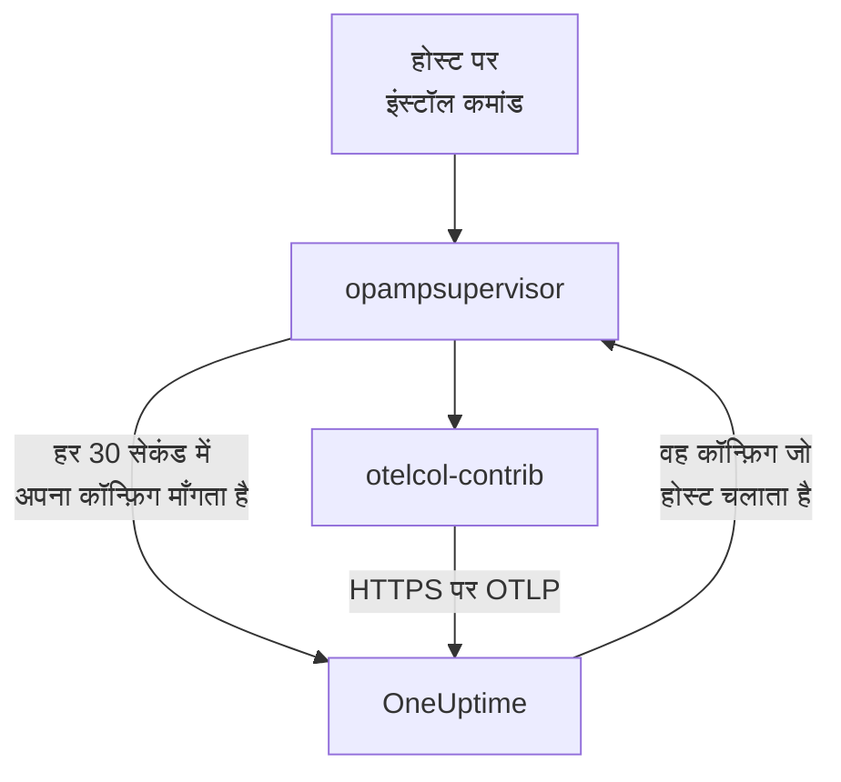

# होस्ट

एक ही कमांड से Linux, Windows या macOS मशीन को OneUptime में जोड़ें। कमांड होस्ट पर OpenTelemetry Collector इंस्टॉल करता है, और OneUptime कलेक्टर को उसका कॉन्फ़िग भेजता है और उसे अप टू डेट रखता है: कोई `config.yaml` लिखने, हर होस्ट पर कॉपी करने या एक जैसा रखने की ज़रूरत नहीं। आपके होस्ट क्या एकत्र करते हैं, यह बदलने के लिए एक बार कलेक्टर कॉन्फ़िग संपादित करें, और जिन होस्ट पर वह लागू होता है, उन्हें एक मिनट में बदलाव मिल जाता है।

:::cards
- [होस्ट जोड़ें](#होस्ट-जोड़ें): Linux, Windows या macOS पर एक कमांड।
- [होस्ट जो एकत्र करते हैं उसे बदलें](#होस्ट-जो-एकत्र-करते-हैं-उसे-बदलें): सिस्टम और लेबल के अनुसार कलेक्टर कॉन्फ़िग, हर संस्करण सहेजा हुआ।
- [होस्ट का कलेक्टर जाँचें](#होस्ट-का-कलेक्टर-जाँचें): वह कौन-सा कॉन्फ़िग चलाता है, उसका संस्करण, और कोई कॉन्फ़िग शुरू क्यों नहीं हुआ।
- [कॉन्फ़िग क्या कर सकता है](#कॉन्फ़िग-क्या-कर-सकता-है): होस्ट को पढ़ना, और केवल इसी OneUptime को भेजना।
:::

## यह कैसे काम करता है

कमांड OpenTelemetry Collector की रिलीज़ से दो प्रोग्राम इंस्टॉल करता है, और हर एक को उसकी रिलीज़ द्वारा प्रकाशित SHA-256 से जाँचता है: `otelcol-contrib`, जो कलेक्टर होस्ट को पढ़ता है, और `opampsupervisor`, जो कलेक्टर को चलाता है और उसे उसी कॉन्फ़िग पर रखता है जो OneUptime, OpAMP (OpenTelemetry Agent Management Protocol) के ज़रिए भेजता है। दोनों `oneuptime-collector` सेवा के रूप में चलते हैं।



सुपरवाइज़र लगभग हर 30 सेकंड में आपकी इंजेशन कुंजी के साथ OneUptime से होस्ट का कॉन्फ़िग माँगता है, और बताता है कि होस्ट कौन-सा कॉन्फ़िग चलाता है और वह शुरू हुआ या नहीं। सुपरवाइज़र के पहली बार कनेक्ट होते ही होस्ट मशीन के नाम से **होस्ट** में दर्ज हो जाता है, और उसके मेट्रिक्स और लॉग आने के साथ उसके पेज भरते जाते हैं।

हर होस्ट एक कॉन्फ़िग चलाता है, जो इस क्रम में चुना जाता है:

| होस्ट क्या चलाता है | कब |
| --- | --- |
| उसके **कलेक्टर** पेज पर उसके लिए चुना गया कॉन्फ़िग | जब किसी ने एक चुना हो। |
| **कलेक्टर कॉन्फ़िग** में से पहला जो उस पर लागू होता है | कॉन्फ़िग तब लागू होता है जब वह होस्ट के सिस्टम के लिए हो और, अगर उसमें लेबल हों, तो होस्ट में उनमें से एक हो। |
| उसके सिस्टम के लिए OneUptime का डिफ़ॉल्ट | जब कोई कॉन्फ़िग लागू न हो। |

OneUptime का डिफ़ॉल्ट हर सिस्टम पर CPU, मेमोरी, डिस्क, फ़ाइल सिस्टम, नेटवर्क और प्रोसेस पढ़ता है; Linux पर journal और systemd यूनिट, जहाँ होस्ट में वे हों; Windows पर System, Application और Security इवेंट लॉग और Windows सेवाएँ; और macOS पर `/var/log` में इंस्टॉल और Wi-Fi लॉग। यह उन फ़ाइल सिस्टम को छोड़ देता है जो डिज़ाइन से ही भरे होते हैं, जैसे snap पैकेज और macOS का `/dev`, ताकि उनकी वजह से High Filesystem Usage टेम्पलेट कभी लगातार ट्रिगर न होता रहे। यह OneUptime की रिलीज़ के साथ चलता है, इसलिए डिफ़ॉल्ट पर चल रहे होस्ट को OneUptime के सुधार मिलते रहते हैं।

## शुरू करने से पहले

- एक इंजेशन कुंजी। **होस्ट जोड़ें** आपके लिए एक बनाता है, या **प्रोजेक्ट सेटिंग्स → टेलीमेट्री और APM → इंजेशन कुंजियाँ** में बनाई गई कोई कुंजी चुनें।
- होस्ट पर व्यवस्थापक अधिकार: Linux और macOS पर `sudo`, Windows पर व्यवस्थापक के रूप में चलाया गया PowerShell।
- systemd वाला Linux, Windows 10 या Windows Server 2019 और उसके बाद के संस्करण, या Apple silicon या Intel पर macOS।
- होस्ट से आपके OneUptime URL तक आउटबाउंड HTTPS, सीधे या प्रॉक्सी के ज़रिए।

## होस्ट जोड़ें

:::steps
### होस्ट जोड़ें खोलें

**उत्पाद → बुनियादी ढांचा → होस्ट्स** खोलें और **होस्ट जोड़ें** चुनें। चुनें कि होस्ट पर क्या चलता है: Linux, Windows या macOS। Kubernetes क्लस्टर के नोड की निगरानी इसके बजाय [Kubernetes Agent](/docs/telemetry/kubernetes-agent) करता है।

### इंजेशन कुंजी चुनें

कोई कुंजी चुनें, या डायलॉग से नई बनाएँ। नीचे दिया गया कमांड उसे भर देता है।

### होस्ट पर कमांड चलाएँ

डायलॉग से कमांड कॉपी करें और होस्ट पर चलाएँ। इसमें लगभग एक मिनट लगता है। ये वही कमांड हैं, जिनमें उदाहरणों की जगह आपका OneUptime URL और कुंजी होगी:

:::tabs
@tab Linux
```bash
curl -fsSL https://oneuptime.com/docs/static/scripts/host-collector/install.sh | sudo sh -s -- --url https://oneuptime.com --key YOUR_INGESTION_KEY
```
@tab macOS
```bash
curl -fsSL https://oneuptime.com/docs/static/scripts/host-collector/install.sh | sudo sh -s -- --url https://oneuptime.com --key YOUR_INGESTION_KEY
```
@tab Windows
```powershell
[Net.ServicePointManager]::SecurityProtocol = [Net.ServicePointManager]::SecurityProtocol -bor [Net.SecurityProtocolType]::Tls12; & ([scriptblock]::Create((Invoke-RestMethod -Uri 'https://oneuptime.com/docs/static/scripts/host-collector/install.ps1'))) -Url 'https://oneuptime.com' -Key 'YOUR_INGESTION_KEY'
```
:::

हर OneUptime अपने इंस्टॉलर ख़ुद देता है, इसलिए सेल्फ़-होस्टेड OneUptime अपनी रिलीज़ का इंस्टॉलर देता है: दोनों जगह `https://oneuptime.com` को अपने URL से बदलें।

### होस्ट की प्रतीक्षा करें

डायलॉग का आख़िरी चरण बताता है कि होस्ट कब कनेक्ट हुआ, उसके लिंक के साथ। सूची में वह तब तक **शुरू हो रहा है** दिखता है जब तक उसके पहले मेट्रिक्स नहीं आ जाते, आमतौर पर एक मिनट में, फिर कनेक्टेड दिखता है, और उसका कलेक्टर **चल रहा है** होता है। होस्ट का **टोपोलॉजी** पेज एक मैप पर दिखाता है कि उस पर क्या चलता है, उसे कौन कॉल करता है और वह किसे कॉल करता है: देखें [टोपोलॉजी](/docs/telemetry/topology#किसी-संसाधन-का-अपना-मैप-खोलें)।
:::

## होस्ट पर लेबल लगाएँ

कमांड में लेबल जोड़ें, और कनेक्ट होते ही होस्ट पर वे लेबल होंगे:

:::tabs
@tab Linux
```bash
curl -fsSL https://oneuptime.com/docs/static/scripts/host-collector/install.sh | sudo sh -s -- --url https://oneuptime.com --key YOUR_INGESTION_KEY --label env=production --label team=payments
```
@tab macOS
```bash
curl -fsSL https://oneuptime.com/docs/static/scripts/host-collector/install.sh | sudo sh -s -- --url https://oneuptime.com --key YOUR_INGESTION_KEY --label env=production --label team=payments
```
@tab Windows
```powershell
[Net.ServicePointManager]::SecurityProtocol = [Net.ServicePointManager]::SecurityProtocol -bor [Net.SecurityProtocolType]::Tls12; & ([scriptblock]::Create((Invoke-RestMethod -Uri 'https://oneuptime.com/docs/static/scripts/host-collector/install.ps1'))) -Url 'https://oneuptime.com' -Key 'YOUR_INGESTION_KEY' -Label 'env=production','team=payments'
```
:::

`env=production` लेबल `env:production` बन जाता है। लेबल जोड़े जाते हैं, कभी हटाए नहीं जाते: किसी दूसरे लेबल के साथ कमांड फिर से चलाएँ और होस्ट पर दोनों होंगे। आप **होस्ट** सूची में या **लेबल नियम** से भी होस्ट पर लेबल लगा सकते हैं। जिस कलेक्टर कॉन्फ़िग में लेबल हों, वह केवल उन होस्ट के लिए होता है जिन पर उनमें से एक लेबल हो, इसलिए अलग-अलग लेबल के साथ वही कमांड होस्ट के हर समूह को उसका अपना कॉन्फ़िग देता है।

## होस्ट जो एकत्र करते हैं उसे बदलें

:::steps
### कलेक्टर कॉन्फ़िग बनाएँ

**उत्पाद → बुनियादी ढांचा → होस्ट्स → कलेक्टर कॉन्फ़िग** खोलें और **कलेक्टर कॉन्फ़िग बनाएँ** चुनें। इसे एक नाम दें, जिन होस्ट के लिए यह है उनका सिस्टम दें, और अगर केवल कुछ होस्ट तक पहुँचना हो तो उनके लेबल दें। इसका कॉन्फ़िग उस सिस्टम के लिए OneUptime के डिफ़ॉल्ट से शुरू होता है।

### इसकी config.yaml संपादित करें

कॉन्फ़िग के पेज पर **कॉन्फ़िग संपादित करें** चुनें, YAML बदलें और सहेजें। OneUptime पहले इसे जाँचता है और जिस कॉन्फ़िग को वह नहीं भेज सकता, उसे कारण बताते हुए अस्वीकार करता है: देखें [कॉन्फ़िग क्या कर सकता है](#कॉन्फ़िग-क्या-कर-सकता-है)।

### होस्ट तक पहुँचते देखें

हर सहेजा गया बदलाव एक नया संस्करण होता है, और जिन होस्ट पर यह लागू होता है उन्हें यह एक मिनट में मिल जाता है। कॉन्फ़िग की **होस्ट** सूची हर होस्ट, उसके कलेक्टर की स्थिति और वह कौन-सा संस्करण चलाता है, दिखाती है।
:::

होस्ट सूची का वह पहला कॉन्फ़िग चलाता है जो उस पर लागू होता है: क्रम बदलने के लिए **कलेक्टर कॉन्फ़िग** में पंक्तियाँ खींचें। सबसे सीमित कॉन्फ़िग पहले रखें, जैसे `env:production` वेब सर्वर के लिए एक, और व्यापक कॉन्फ़िग उनके बाद, जैसे हर Linux होस्ट के लिए एक। सूची के नीचे का **OneUptime डिफ़ॉल्ट कॉन्फ़िग** कार्ड दिखाता है कि जब कोई कॉन्फ़िग लागू न हो तो होस्ट क्या चलाता है।

### संस्करण और वापस लाना

किसी कॉन्फ़िग की **संस्करण** सूची हर सहेजे गए बदलाव को रखती है, सबसे नया पहले, साथ में यह कि किसने और कब सहेजा। कोई संस्करण पढ़ने के लिए **देखें** चुनें, और उसे होस्ट पर फिर से भेजने के लिए **वापस लाएं** चुनें: वह एक नए संस्करण के रूप में सहेजा जाता है जो बताता है कि उसने कौन-सा संस्करण वापस लाया, इसलिए सूची हमेशा बताती है कि हर होस्ट को क्या भेजा गया।

### एक होस्ट के लिए कॉन्फ़िग चुनें

किसी होस्ट के **कलेक्टर** पेज पर **कॉन्फ़िग बदलें** चुनें और केवल इस होस्ट के लिए एक कॉन्फ़िग चुनें। होस्ट के सिस्टम के लिए और किसी भी सिस्टम के लिए बने कॉन्फ़िग दिखाए जाते हैं। होस्ट को सूची पर वापस करने के लिए स्वचालित चुनें। जिस होस्ट का चुना गया कॉन्फ़िग हटा दिया जाए, वह अपने आप सूची पर लौट आता है।

### जब कोई कॉन्फ़िग शुरू न हो

सुपरवाइज़र किसी नए कॉन्फ़िग पर जाने से पहले उसे कलेक्टर से जाँचता है, और अगर वह शुरू न हो तो अंतिम काम करने वाले कॉन्फ़िग पर लौट जाता है। होस्ट पूरे समय डेटा भेजता रहता है। उसके **कलेक्टर** पेज पर **कॉन्फ़िग विफल** दिखता है, साथ में कलेक्टर का कारण, जैसे कोई लॉग फ़ाइल जिसे कलेक्टर पढ़ नहीं सकता, और जब तक कॉन्फ़िग बदल न जाए, OneUptime वह कॉन्फ़िग होस्ट को फिर से नहीं भेजता। होस्ट पर कारण ठीक करने के बाद, उसे एक बार और भेजने के लिए **फिर से प्रयास करें** चुनें।

## कॉन्फ़िग क्या कर सकता है

OneUptime जो कॉन्फ़िग भेजता है, वह हर उस होस्ट पर चलता है जिस पर वह लागू होता है, इसलिए OneUptime हर बार सहेजे जाने पर उसे जाँचता है, और नियम तोड़ने वाले कॉन्फ़िग को अस्वीकार करता है:

| नियम | क्यों |
| --- | --- |
| केवल OneUptime की सूची में मौजूद receivers, processors, exporters, extensions और connectors | यह होस्ट और उस पर चल रही सेवाओं को पढ़ता है। प्रोग्राम चलाने वाला या क्लाउड या क्लस्टर क्रेडेंशियल पढ़ने वाला कोई घटक सूची में नहीं है। |
| डेटा होस्ट से केवल exporter `otlp_http` के ज़रिए निकलता है, `${env:ONEUPTIME_URL}/otlp` पर, हेडर `x-oneuptime-token: ${env:ONEUPTIME_INGESTION_KEY}` के साथ | हर होस्ट उसी कुंजी से इस OneUptime को भेजता है जिससे उसे इंस्टॉल किया गया था। किसी कॉन्फ़िग में कुंजी नहीं होती। |
| यह केवल `${env:NAME}` वाला `${...}` इस्तेमाल कर सकता है | `${file:...}` या `${https:...}` हर होस्ट पर पढ़ा जाता और आगे भेजा जा सकता था। |
| कोई ऐसी सेटिंग नहीं जो प्रोग्राम चलाए या पढ़ी गई फ़ाइल भेजे, जैसे journald का `journalctl_path` | कॉन्फ़िग होस्ट को पढ़ने से आगे नहीं जा सकता। |

फिर भी कोई कॉन्फ़िग ऐसा हो सकता है जिसे होस्ट चला न सके, जैसे किसी दूसरे सिस्टम का receiver या ऐसी लॉग फ़ाइल जो वहाँ मौजूद न हो। हर होस्ट का कलेक्टर बदलने से पहले इसे जाँचता है, जैसा [जब कोई कॉन्फ़िग शुरू न हो](#जब-कोई-कॉन्फ़िग-शुरू-न-हो) में बताया गया है।

## होस्ट का कलेक्टर जाँचें

होस्ट और उसका **कलेक्टर** पेज खोलें। यह दिखाता है कि कलेक्टर किस स्थिति में है, वह कौन-सा कॉन्फ़िग चलाता है और **यह कॉन्फ़िग क्यों**, वह कौन-सा संस्करण चलाता है, उसकी **अंतिम रिपोर्ट** और उसकी **कलेक्टर रिलीज़**। **होस्ट पर** के नीचे होस्ट के शेल से उसे जाँचने के कमांड हैं: उसकी सेवा चल रही है या नहीं, उसका लॉग, और रीस्टार्ट।

:::tabs
@tab Linux
```bash
sudo systemctl status oneuptime-collector
sudo journalctl -u oneuptime-collector -n 50
sudo systemctl restart oneuptime-collector
```
@tab macOS
```bash
sudo launchctl print system/com.oneuptime.collector
sudo tail -n 50 /usr/local/oneuptime-collector/log/collector.log
sudo launchctl kickstart -k system/com.oneuptime.collector
```
@tab Windows
```powershell
Get-Service oneuptime-collector
Get-WinEvent -FilterHashtable @{ LogName = 'Application'; ProviderName = 'oneuptime-collector' } -MaxEvents 50 | Format-List TimeCreated, Message
Restart-Service oneuptime-collector
```
:::

Linux पर कलेक्टर बिना विशेषाधिकार वाले उपयोगकर्ता `oneuptime-collector` के रूप में, `systemd-journal` और `adm` समूहों में चलता है, ताकि वह journal और `/var/log` के लॉग पढ़ सके। macOS पर यह launchd डेमन की तरह root के रूप में चलता है, और Windows पर LocalSystem के रूप में, ताकि यह हर इवेंट लॉग और Windows सेवा पढ़ सके।

## हाथ से सेट किए गए होस्ट

जिस होस्ट का कलेक्टर आपने [होस्ट OpenTelemetry Collector](/docs/telemetry/host-otel-collector) गाइड से ख़ुद इंस्टॉल किया था, वह पहले की तरह रिपोर्ट करता रहता है, और OneUptime उसे कोई कॉन्फ़िग नहीं भेजता। उसे OneUptime को सौंपने के लिए होस्ट का **कलेक्टर** पेज खोलें: वहाँ का कमांड `--replace-existing` जोड़ता है, जो हाथ से इंस्टॉल किए गए कलेक्टर (`otelcol-contrib` सेवा) को रोककर बंद कर देता है, ताकि होस्ट दो बार रिपोर्ट न करे। होस्ट अपना नाम, अपना इतिहास और अपने लेबल रखता है।

## इंस्टॉल विकल्प

इनमें से कोई भी बदलने के लिए, या नई रिलीज़ पर जाने के लिए, कमांड फिर से चलाएँ: यह अपनी इंस्टॉल की हुई चीज़ों को बदल देता है और होस्ट को OneUptime में जैसा है वैसा रखता है।

| Linux और macOS | Windows | यह क्या करता है |
| --- | --- | --- |
| `--url URL` | `-Url URL` | OneUptime कहाँ है। |
| `--key KEY` | `-Key KEY` | आपके प्रोजेक्ट की टेलीमेट्री इंजेशन कुंजी। |
| `--label KEY=VALUE` | `-Label KEY=VALUE` | होस्ट पर लेबल लगाता है। और लेबल के लिए इसे दोहराएँ; Windows पर उन्हें कॉमा से अलग करके लिखें। |
| `--env NAME=VALUE` | `-EnvVar NAME=VALUE` | `${env:NAME}` पढ़ने वाले कॉन्फ़िग के लिए कलेक्टर को एक एनवायरनमेंट वेरिएबल देता है। |
| `--version VERSION` | `-Version VERSION` | इंस्टॉल की जाने वाली कलेक्टर रिलीज़, डिफ़ॉल्ट रूप से 0.161.0। |
| `--download-url URL` | `-DownloadUrl URL` | GitHub जैसी फ़ोल्डर संरचना वाले मिरर से रिलीज़ डाउनलोड करता है। |
| `--proxy URL` | `-Proxy URL` | डाउनलोड और कलेक्टर का सारा ट्रैफ़िक HTTP प्रॉक्सी से भेजता है। |
| `--replace-existing` | `-ReplaceExisting` | हाथ से इंस्टॉल किए गए कलेक्टर को रोककर बंद करता है। |
| `--uninstall` | `-Uninstall` | कलेक्टर और कमांड द्वारा इंस्टॉल की गई हर चीज़ हटाता है। |

## अनइंस्टॉल करें

:::tabs
@tab Linux
```bash
curl -fsSL https://oneuptime.com/docs/static/scripts/host-collector/install.sh | sudo sh -s -- --uninstall
```
@tab macOS
```bash
curl -fsSL https://oneuptime.com/docs/static/scripts/host-collector/install.sh | sudo sh -s -- --uninstall
```
@tab Windows
```powershell
& ([scriptblock]::Create((Invoke-RestMethod -Uri 'https://oneuptime.com/docs/static/scripts/host-collector/install.ps1'))) -Uninstall
```
:::

होस्ट अपने इतिहास के साथ OneUptime में बना रहता है: **होस्ट** सूची में उसे आर्काइव करें या हटाएँ।

## समस्या निवारण

:::details कमांड कहता है कि OneUptime ने कुंजी अस्वीकार कर दी
HTTP `401`: कुंजी गलत है, समाप्त हो गई है या हटा दी गई है। HTTP `422`: वह बंद है, ब्राउज़र कुंजी है, या किसी एक सेवा से बँधी है। **होस्ट जोड़ें** में एक सक्षम सर्वर कुंजी चुनें और कमांड फिर से चलाएँ: यह होस्ट पर कुंजी बदल देता है।
:::

:::details होस्ट दिखाई नहीं देता
जाँचें कि होस्ट HTTPS पर आपके OneUptime URL तक पहुँच सकता है, फिर [होस्ट का कलेक्टर जाँचें](#होस्ट-का-कलेक्टर-जाँचें) में उसके सिस्टम के कमांड से कलेक्टर का लॉग पढ़ें।
:::

:::details होस्ट कहता है कि उसका कॉन्फ़िग विफल रहा
उसका **कलेक्टर** पेज दिखाता है कि कॉन्फ़िग शुरू क्यों नहीं हुआ। होस्ट अंतिम काम करने वाला कॉन्फ़िग चलाता रहता है, और कॉन्फ़िग बदलने पर या आपके **फिर से प्रयास करें** चुनने पर विफल कॉन्फ़िग फिर से पाता है।
:::

:::details होस्ट "रिपोर्ट नहीं कर रहा" दिखाता है
OneUptime को 15 मिनट से अधिक समय से होस्ट के सुपरवाइज़र से कोई ख़बर नहीं मिली है। जाँचें कि `oneuptime-collector` सेवा चल रही है, और होस्ट अब भी OneUptime तक पहुँच सकता है।
:::

## अगले चरण

:::cards
- [होस्ट OpenTelemetry Collector](/docs/telemetry/host-otel-collector): इसके बजाय कलेक्टर ख़ुद इंस्टॉल करें और उसका कॉन्फ़िग ख़ुद लिखें।
- [होस्ट मॉनिटर](/docs/monitor/host-monitor): आपके होस्ट जो रिपोर्ट करते हैं उस पर अलर्ट पाएँ।
- [इंजेशन कुंजियाँ](/docs/telemetry/ingestion-keys): वे कुंजियाँ बनाएँ, सीमित करें और बदलें जिनसे होस्ट भेजते हैं।
- [Kubernetes Agent](/docs/telemetry/kubernetes-agent): किसी क्लस्टर के नोड और वर्कलोड की निगरानी करें।
:::
