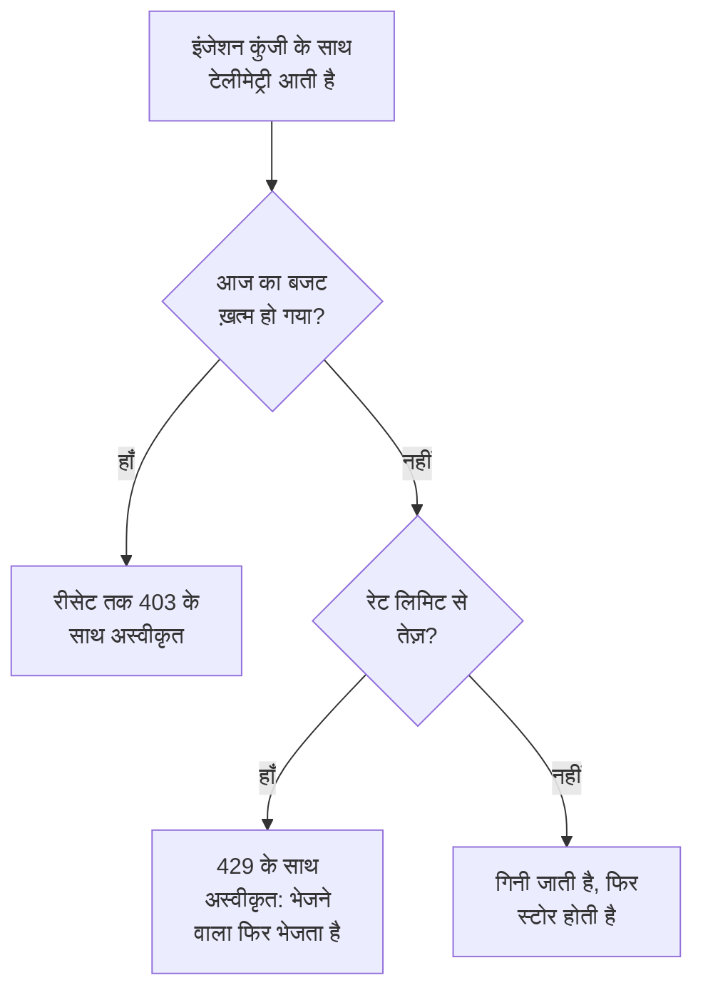

# इंजेशन बजट

इंजेशन बजट यह सीमित करता है कि कोई प्रोजेक्ट एक दिन में कितनी टेलीमेट्री भेजता है, ताकि कोई शोर मचाने वाली सेवा या बेकाबू लॉग लूप आपका स्टोरेज न भर सके। इंस्टेंस व्यवस्थापक हर सिग्नल के लिए एक दैनिक बजट सेट करता है, हर प्रोजेक्ट के लिए या किसी एक प्रोजेक्ट के लिए, और जो कोई भी इंजेशन कुंजी संपादित करता है, वह कुंजी को उसका अपना, छोटा बजट दे सकता है। हर बजट की एक प्रति सेकंड रेट लिमिट भी हो सकती है।

:::cards
- [बजट कैसे काम करते हैं](#बजट-कैसे-काम-करते-हैं): तीन स्तर, और गिनती टेलीमेट्री आते ही होती है।
- [हर प्रोजेक्ट के डिफ़ॉल्ट बजट सेट करें](#हर-प्रोजेक्ट-के-डिफ़ॉल्ट-बजट-सेट-करें): Admin Dashboard की सेटिंग्स में।
- [किसी इंजेशन कुंजी को उसका अपना बजट दें](#किसी-इंजेशन-कुंजी-को-उसका-अपना-बजट-दें): प्रोजेक्ट के बजट का एक हिस्सा।
- [किसी बजट पर अलर्ट करें](#किसी-बजट-पर-अलर्ट-करें): उसके ख़त्म होने से पहले, और ख़त्म होने पर।
:::

## बजट कैसे काम करते हैं

टेलीमेट्री आते ही गिनी जाती है: उसके सिग्नल के लिए उसके प्रोजेक्ट के बजट में, और जब उसकी इंजेशन कुंजी का अपना बजट हो, तो उस कुंजी के बजट में भी। दैनिक बजट ख़त्म होते ही वह सिग्नल तब तक अस्वीकार किया जाता है, जब तक बजट रीसेट नहीं हो जाता।



- **तीन स्तर।** इंस्टेंस का डिफ़ॉल्ट हर प्रोजेक्ट पर लागू होता है। इंस्टेंस व्यवस्थापक इसकी जगह किसी एक प्रोजेक्ट को उसका अपना बजट दे सकता है, या कोई सीमा ही नहीं। किसी कुंजी का बजट केवल उसके प्रोजेक्ट के बजट का एक हिस्सा होता है: वह छोटा हो सकता है, बड़ा कभी नहीं।
- **पाँच सिग्नल।** लॉग, ट्रेस, मेट्रिक्स, प्रोफ़ाइल और सुरक्षा इवेंट, हर एक का अपना बजट होता है। सेशन रीप्ले की अपनी अलग सीमाएँ हैं: देखें [सेशन रीप्ले](/docs/telemetry/session-replay)।
- **बाइट डीकंप्रेस करके गिने जाते हैं।** कोई अनुरोध अपनी बॉडी का डीकंप्रेस होने के बाद का आकार गिनता है, इसलिए उसे कंप्रेस करने से उसकी गिनती नहीं बदलती। एक GB 1024³ बाइट होता है, और एक MB 1024² बाइट।
- **जो आता है वह गिना जाता है, जो स्टोर होता है वह नहीं।** जिस टेलीमेट्री को कोई [ड्रॉप फ़िल्टर](/docs/telemetry/drop-filters-and-scrub-rules) बाद में हटाता है, वह भी गिनी जाती है, इसलिए कोई बजट [टेलीमेट्री उपयोग](/docs/telemetry/usage) पेज से ज़्यादा दिखा सकता है, जो वह गिनता है जो स्टोर हुआ।
- **आख़िरी अनुरोध पूरा स्टोर होता है।** जो अनुरोध तब आता है जब बजट में अभी जगह बची हो, वह पूरा स्टोर होता है, इसलिए ख़त्म हो चुका बजट 100% से थोड़ा ज़्यादा दिखा सकता है।
- **बजट सेट होने तक कुछ भी सीमित नहीं होता।** हर इंस्टॉलेशन बिना किसी बजट के शुरू होता है, और बिना बजट वाला प्रोजेक्ट बिल्कुल नहीं गिना जाता।
- **बदलाव एक मिनट के भीतर हर सर्वर तक पहुँचते हैं।**
- **जब टेलीमेट्री गिनी नहीं जा सकती, तब भी वह स्वीकार की जाती है।** बजट Valkey में गिने जाते हैं। जब तक उस तक पहुँचा नहीं जा सकता, OneUptime टेलीमेट्री को अस्वीकार करने के बजाय उसे बिना गिने स्टोर करता है, और बजट पेज यह बताते हैं।

## शुरू करने से पहले

- **इंस्टेंस और किसी प्रोजेक्ट के बजट के लिए, Admin Dashboard।** सेल्फ़-होस्टेड इंस्टॉलेशन पर, केवल इंस्टेंस व्यवस्थापक उन्हें सेट करता है। किसी प्रोजेक्ट के स्वामी और एडमिन उसके बजट देखते हैं, लेकिन उन्हें बदल नहीं सकते।
- **किसी कुंजी के अपने बजट के लिए, ऐसी भूमिका जो इंजेशन कुंजियाँ संपादित करे।** Project Owner या Project Admin, या Edit Ingestion Key अनुमति वाली कोई कस्टम भूमिका।
- **बजट देखने के लिए, ऐसी भूमिका जो प्रोजेक्ट का उपयोग देखती हो।** जो भूमिकाएँ [टेलीमेट्री उपयोग](/docs/telemetry/usage) पेज देखती हैं, वे उस पर उसके बजट भी देखती हैं।

## हर प्रोजेक्ट के डिफ़ॉल्ट बजट सेट करें

:::steps
### इंजेशन बजट खोलें

Admin Dashboard में, **सेटिंग्स → टेलीमेट्री → इंजेशन बजट** पर जाएँ। साइड मेनू में **टेलीमेट्री** शुरुआत में सिमटा रहता है: इसे खोलने के लिए इस पर क्लिक करें।

### दैनिक बजट सेट करें

**डिफ़ॉल्ट दैनिक बजट** कार्ड पर, **डिफ़ॉल्ट दैनिक बजट संपादित करें** पर क्लिक करें, जिस हर सिग्नल को सीमित करना है उसके लिए GB की संख्या डालें, जैसे **लॉग (GB प्रति दिन)**, और **परिवर्तन सहेजें** पर क्लिक करें। कोई सीमा न रखने के लिए सिग्नल खाली छोड़ें।

### ज़रूरत हो तो रेट लिमिट सेट करें

**डिफ़ॉल्ट रेट लिमिट** कार्ड पर, **डिफ़ॉल्ट रेट लिमिट संपादित करें** पर क्लिक करें और किसी सिग्नल के लिए प्रति सेकंड MB की संख्या डालें, जैसे **लॉग (MB प्रति सेकंड)**। रेट लिमिट किसी एक अचानक उछाल को कुछ ही मिनटों में एक दिन का बजट ख़त्म करने से रोकती है।
:::

**चेतावनी और रीसेट** कार्ड में चेतावनी सीमा और वह समय होता है जब बजट दिन रीसेट होता है: देखें [चेतावनी और रीसेट](#चेतावनी-और-रीसेट)।

## किसी एक प्रोजेक्ट के बजट सेट करें

:::steps
### प्रोजेक्ट खोलें

Admin Dashboard में, **परियोजनाएँ** पर जाएँ, प्रोजेक्ट पर क्लिक करें, और उसके साइड मेनू में **इंजेशन बजट** पर क्लिक करें। पेज इस जानकारी के साथ खुलता है कि प्रोजेक्ट ने आज अपने बजट का कितना इस्तेमाल किया।

### उसके दैनिक बजट सेट करें

**इस प्रोजेक्ट के लिए दैनिक बजट** कार्ड पर, **दैनिक बजट संपादित करें** पर क्लिक करें। किसी सिग्नल के लिए इंस्टेंस डिफ़ॉल्ट की जगह GB की संख्या डालें, या बिल्कुल कोई सीमा न रखने के लिए 0। इंस्टेंस डिफ़ॉल्ट बनाए रखने के लिए सिग्नल खाली छोड़ें।

### उसकी रेट लिमिट सेट करें

**इस प्रोजेक्ट के लिए रेट लिमिट** कार्ड पर, **रेट लिमिट संपादित करें** पर क्लिक करें और उन्हें इसी तरह सेट करें: प्रति सेकंड MB की संख्या, कोई सीमा न रखने के लिए 0, या इंस्टेंस डिफ़ॉल्ट के लिए खाली।
:::

प्रोजेक्ट के सदस्य ये बजट अपने [टेलीमेट्री उपयोग](/docs/telemetry/usage) पेज पर देखते हैं, केवल पढ़ने के लिए।

## किसी इंजेशन कुंजी को उसका अपना बजट दें

किसी कुंजी का बजट उसके प्रोजेक्ट के बजट का एक हिस्सा होता है: जो भेजने वाला अपनी कुंजी से बहुत ज़्यादा डेटा भेजता है, वह कुंजी के बजट पर रुक जाता है, जबकि प्रोजेक्ट की दूसरी कुंजियाँ भेजती रहती हैं।

:::steps
### कुंजी खोलें

**प्रोजेक्ट सेटिंग्स → टेलीमेट्री और APM → इंजेशन कुंजियाँ** पर जाएँ और कुंजी पर क्लिक करें। साइड मेनू में **टेलीमेट्री और APM** शुरुआत में सिमटा रहता है: इसे खोलने के लिए इस पर क्लिक करें।

### उसके बजट सेट करें

**इंजेशन बजट** कार्ड पर, **इंजेशन बजट संपादित करें** पर क्लिक करें। **दैनिक बजट** चरण पर, जिस हर सिग्नल को सीमित करना है उसके लिए प्रति दिन GB की संख्या डालें, और **रेट लिमिट** चरण पर प्रति सेकंड MB की संख्या। कुंजी का अपना कोई बजट न रखने के लिए सिग्नल खाली छोड़ें।

### बजट सहेजें

**परिवर्तन सहेजें** पर क्लिक करें। किसी कुंजी का बजट उसके प्रोजेक्ट के बजट से ज़्यादा नहीं हो सकता: OneUptime उसे अस्वीकार करता है और बताता है कि वह अधिकतम कितना हो सकता है।
:::

- **दोनों बजट गिने जाते हैं।** कुंजी से भेजी गई टेलीमेट्री कुंजी के बजट और प्रोजेक्ट के बजट, दोनों में गिनी जाती है, और जो पहले ख़त्म होता है वही उसे अस्वीकार करता है।
- **घटाया गया प्रोजेक्ट बजट कुंजी को भी रोकता है।** जब प्रोजेक्ट का बजट किसी कुंजी के बजट से कम कर दिया जाता है, तो कुंजी प्रोजेक्ट के बजट तक सीमित रहती है।

## भेजने वालों को क्या दिखता है

| कब | HTTP पर | OTLP/gRPC पर | भेजने वाला क्या करता है |
| --- | --- | --- | --- |
| दैनिक बजट ख़त्म हो गया है | `403` | `RESOURCE_EXHAUSTED` | बैच छोड़ देता है: रीसेट से पहले फिर कोशिश करने से कोई फ़ायदा नहीं |
| रेट लिमिट पार हो गई है | `Retry-After` के साथ `429` | रीट्राई देरी के साथ `RESOURCE_EXHAUSTED` | देरी के बाद बैच फिर भेजता है |

हर अस्वीकृति कारण बताती है। OTLP/HTTP पर इसकी बॉडी एक `google.rpc.Status` होती है, protobuf या JSON में, जैसे अनुरोध भेजा गया था, इसलिए भेजने वाले के लॉग में इस तरह का कारण दिखता है:

```text
This project's daily logs ingestion budget of 10 GB is used up, so OneUptime is not storing logs from this project until the budget resets at 2026-11-10 00:00 UTC.
```

- **दूसरे HTTP भेजने वालों को JSON मिलता है।** Fluent Bit, Fluentd, syslog और दूसरे HTTP एंडपॉइंट को `error`, `message` और `resetsAt` मिलते हैं, और रेट लिमिट से `retryAfterSeconds` भी।
- **MQTT और क्लाउड स्ट्रीम को बताया नहीं जा सकता।** जो टेलीमेट्री MQTT पर या किसी क्लाउड प्रदाता की स्ट्रीम से आती है, उसका बजट ख़त्म होते ही उसे छोड़ दिया जाता है। उस पर कोई रेट लिमिट लागू नहीं होती: उसे दोबारा भेजा नहीं जा सकता।
- **अस्वीकृतियाँ गिनी जाती हैं।** ख़त्म हुआ बजट जो कुछ अस्वीकार करता है या छोड़ता है, वह छोड़े गए के रूप में गिना जाता है, और रेट लिमिट जिस भी अनुरोध को अस्वीकार करती है, वह थ्रॉटल किए गए के रूप में: देखें [आज का उपयोग और ड्रॉप देखें](#आज-का-उपयोग-और-ड्रॉप-देखें)।

## चेतावनी और रीसेट

- **चेतावनी।** जब कोई दैनिक बजट चेतावनी सीमा पार करता है (जब तक इंस्टेंस व्यवस्थापक इसे न बदले, यह 80% है), तो प्रोजेक्ट के स्वामियों को एक ईमेल मिलता है, और एक्सप्लोरर उस सिग्नल के डेटा के ऊपर एक बैनर दिखाते हैं। बजट ख़त्म होने पर उन्हें एक और ईमेल मिलता है। हर बजट हर ईमेल दिन में अधिकतम एक बार भेजता है।
- **रीसेट।** हर बजट दिन 00:00 UTC पर फिर से शुरू होता है, जब तक इंस्टेंस व्यवस्थापक इसे न बदले। **चेतावनी और रीसेट** कार्ड **चेतावनी सीमा (%)** (1 से 99 तक), **रीसेट समय** (HH:MM के रूप में) और **रीसेट समय क्षेत्र** सेट करता है: **चेतावनी और रीसेट संपादित करें** पर क्लिक करें।
- **डेलाइट सेविंग टाइम।** रीसेट समय क्षेत्र की घड़ी का पालन करता है, इसलिए जिस बजट दिन घड़ियाँ बदलती हैं, वह एक घंटा छोटा या लंबा होता है। अगर रीसेट समय उस अंतराल में पड़ता है जिसे घड़ियाँ छोड़ देती हैं, तो रीसेट छलांग के बाद उतनी ही देर से होता है।
- **बदला गया रीसेट नया दिन शुरू करता है।** रीसेट समय या समय क्षेत्र बदलने से तुरंत एक नया बजट दिन शुरू होता है, जिसमें अभी कुछ भी गिना नहीं गया होता।

## आज का उपयोग और ड्रॉप देखें

**प्रोजेक्ट सेटिंग्स → टेलीमेट्री और APM → उपयोग** पर जाएँ। जब प्रोजेक्ट के लिए कोई बजट या रेट लिमिट सेट हो, तो पेज **इंजेशन बजट** कार्ड के साथ खुलता है, और जिन कुंजियों के अपने बजट हैं, वे **इंजेशन कुंजी बजट** कार्ड पर होती हैं:

| कॉलम | यह क्या दिखाता है |
| --- | --- |
| **सिग्नल** | वह सिग्नल जिसके लिए यह पंक्ति है। |
| **आज का उपयोग** | बजट दिन शुरू होने के बाद से क्या गिना गया, और बजट में उसका हिस्सा। |
| **दैनिक बजट** | लागू बजट, और वह कहाँ सेट हुआ: **इंस्टेंस डिफ़ॉल्ट**, **इस प्रोजेक्ट के लिए सेट** या **इस कुंजी का अपना**। |
| **रेट लिमिट** | लागू रेट लिमिट। |
| **छोड़े गए** | बजट ख़त्म होने के कारण जो अस्वीकार किया गया या छोड़ा गया। |
| **थ्रॉटल किया गया** | रेट लिमिट ने कितने अनुरोध अस्वीकार किए। |
| **स्थिति** | **बजट के भीतर**, **चेतावनी सीमा पार** या **ख़त्म**, केवल रेट लिमिट वाले सिग्नल के लिए **कोई दैनिक बजट नहीं**, और जब गिनतियाँ पढ़ी न जा सकें तब **अज्ञात**। |

- **किसी कुंजी के पेज पर**, **आज का बजट उपयोग** कार्ड दिखाता है कि कुंजी ने अपने बजट का कितना इस्तेमाल किया।
- **एक्सप्लोरर में**, लॉग, ट्रेस, मेट्रिक्स, प्रोफ़ाइल और सुरक्षा इवेंट के डेटा के ऊपर एक बैनर बताता है कि कब उस सिग्नल का बजट अपनी चेतावनी सीमा पार कर गया है या ख़त्म हो गया है, साथ में उपयोग पेज खोलने के लिए **बजट देखें**।
- **Admin Dashboard में**, किसी प्रोजेक्ट का **इंजेशन बजट** पेज वही आँकड़े दिखाता है।

## किसी बजट पर अलर्ट करें

हर 5 मिनट में, OneUptime हर बजट के उस दिन के आँकड़े प्रोजेक्ट के मेट्रिक्स के रूप में लिखता है, और [मेट्रिक्स मॉनिटर](/docs/monitor/metrics-monitor) उन पर किसी भी दूसरे मेट्रिक की तरह अलर्ट करता है:

| मेट्रिक | इकाई | इसमें क्या होता है |
| --- | --- | --- |
| `oneuptime.telemetry.budget.used.bytes` | `By` | बजट दिन शुरू होने के बाद से दैनिक बजट में गिने गए बाइट। |
| `oneuptime.telemetry.budget.used.percent` | `%` | यही, दैनिक बजट के प्रतिशत के रूप में। 100 या उससे ज़्यादा पर, सिग्नल रीसेट तक अस्वीकार किया जाता है। |
| `oneuptime.telemetry.budget.dropped.bytes` | `By` | बजट दिन शुरू होने के बाद से, बजट ख़त्म होने के कारण अस्वीकार किए गए या छोड़े गए बाइट। |
| `oneuptime.telemetry.budget.throttled.requests` | `{request}` | बजट दिन शुरू होने के बाद से रेट लिमिट ने जो अनुरोध अस्वीकार किए। |

हर पॉइंट में ये एट्रिब्यूट होते हैं:

| एट्रिब्यूट | मान |
| --- | --- |
| `projectId` | प्रोजेक्ट की ID। |
| `signal` | `logs`, `traces`, `metrics`, `profiles` या `security-events`। |
| `scope` | `project`, या किसी कुंजी के अपने बजट के लिए `ingestion-key`। |
| `ingestionKeyId` | कुंजी की ID, किसी कुंजी के अपने बजट के लिए। |
| `ingestionKeyName` | पॉइंट लिखे जाते समय कुंजी का नाम, किसी कुंजी के अपने बजट के लिए। |

प्रोजेक्ट के लॉग बजट के 90% पर सूचना पाने के लिए, `oneuptime.telemetry.budget.used.percent` पर एक मेट्रिक्स मॉनिटर बनाएँ, जो `signal` `logs` और `scope` `project` पर फ़िल्टर हो, और जो अधिकतम मान 90 से ऊपर होने पर अलर्ट करे:

- **अधिकतम मान से एग्रीगेट करें।** बजट दिन के दौरान हर आँकड़ा केवल बढ़ता है।
- **15 मिनट या उससे ज़्यादा की विंडो इस्तेमाल करें।** हर 5 मिनट में एक पॉइंट लिखा जाता है, और बिना किसी पॉइंट वाली विंडो अलर्ट को हल कर देती है।
- **शून्य नहीं, खाली जगहों की अपेक्षा करें।** जो आँकड़ा 0 हो, उसके लिए, या जब गिनतियाँ पढ़ी न जा सकें, तब कुछ नहीं लिखा जाता।
- **इनकी कोई लागत नहीं है।** ये मेट्रिक्स किसी बजट में या टेलीमेट्री उपयोग के रूप में नहीं गिने जाते, और मॉनिटर मेट्रिक्स जितने समय तक रखे जाते हैं: 30 दिन, जब तक इंस्टेंस व्यवस्थापक इसे न बदले। `oneuptime.telemetry.budget.` से शुरू होने वाले मेट्रिक नाम इनके लिए आरक्षित हैं: आपके एप्लिकेशन ऐसे नाम से जो मेट्रिक्स भेजते हैं, वे छोड़ दिए जाते हैं।

## समस्या निवारण

:::details कोई कलेक्टर अपने एक्सपोर्ट के लिए 403 लॉग करता है
उस सिग्नल के लिए प्रोजेक्ट का या कुंजी का दैनिक बजट ख़त्म हो गया है, और कलेक्टर जो नहीं भेज सकता उसे बजट रीसेट होने तक छोड़ देता है। उपयोग पेज पर **आज का उपयोग** देखें। इंस्टेंस व्यवस्थापक से प्रोजेक्ट का बजट बढ़ाने को कहें, या कम भेजें: ड्रॉप फ़िल्टर यहाँ मदद नहीं करता, क्योंकि वह टेलीमेट्री को गिने जाने के बाद हटाता है।
:::

:::details कोई कलेक्टर 429 लॉग करता है और फिर कोशिश करता है
वह रेट लिमिट की अनुमति से ज़्यादा तेज़ी से भेजता है। वह `Retry-After` देरी के बाद फिर कोशिश करता है, इसलिए जब तक उसकी कतार भर न जाए, कुछ नहीं खोता। रेट लिमिट बढ़ाएँ, या भेजने को ज़्यादा समान रूप से फैलाएँ।
:::

:::details आज का उपयोग टेलीमेट्री उपयोग पेज से ज़्यादा है
बजट टेलीमेट्री को आते ही, डीकंप्रेस करके गिनता है, उसे भी जिसे ड्रॉप फ़िल्टर बाद में हटाते हैं। उपयोग पेज वह गिनता है जो स्टोर हुआ, और वह भी अगले दिन।
:::

:::details बजट कहते हैं कि आज की गिनतियाँ पढ़ी नहीं जा सकीं
OneUptime Valkey तक नहीं पहुँच पा रहा, जहाँ बजट गिने जाते हैं। जब तक वह पहुँच नहीं पाता, टेलीमेट्री बिना गिने स्टोर होती है, और कोई बजट लागू नहीं होता।
:::

## अगले कदम

:::cards
- [टेलीमेट्री उपयोग](/docs/telemetry/usage): देखें कि हर प्रोजेक्ट और सेवा क्या भेजती है।
- [ड्रॉप फ़िल्टर और स्क्रब नियम](/docs/telemetry/drop-filters-and-scrub-rules): वह टेलीमेट्री स्टोर करना बंद करें जिसकी आपको ज़रूरत नहीं है।
- [इंजेशन कुंजियाँ](/docs/telemetry/ingestion-keys): हर भेजने वाले के लिए एक कुंजी, ताकि हर एक का अपना बजट हो सके।
- [मेट्रिक्स मॉनिटर](/docs/monitor/metrics-monitor): बजट मेट्रिक्स पर अलर्ट करें।
:::
