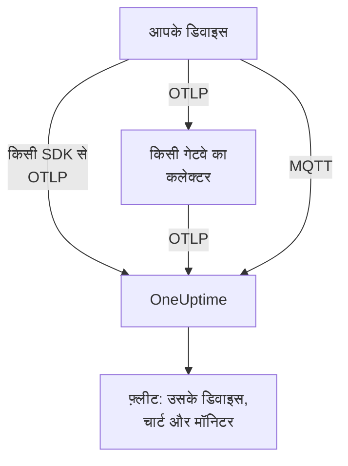

# IoT डिवाइस

OneUptime IoT डिवाइस के फ़्लीट — सेंसर, गेटवे, कंट्रोलर और एज बॉक्स — की निगरानी उनके भेजे `iot_*` मेट्रिक्स के एक छोटे सेट से करता है। यह डिवाइसों को फ़्लीट में समूहित करता है, हर फ़्लीट के डिवाइसों की इन्वेंटरी रखता है, और उनकी बैटरी, सिग्नल, तापमान, CPU, मेमोरी और उपलब्धता के चार्ट बनाता है। किसी डिवाइस पर इंस्टॉल करने के लिए कोई OneUptime एजेंट नहीं है: डिवाइस मानक OpenTelemetry भेजते हैं, या OneUptime के MQTT एंडपॉइंट पर प्रकाशित करते हैं। [IoT डिवाइस मॉनिटर](/docs/monitor/iot-device-monitor) उनके भेजे डेटा पर अलर्ट करते हैं।

:::cards
- [चुनें कि कैसे भेजना है](#चुनें-कि-कैसे-भेजना-है): एक OpenTelemetry SDK, एक गेटवे कलेक्टर, या MQTT।
- [MQTT के माध्यम से मेट्रिक्स भेजना](#mqtt-के-माध्यम-से-मेट्रिक्स-भेजना): टॉपिक, हर डिवाइस के क्रेडेंशियल और Last Will।
- [मेट्रिक परंपराएँ](#मेट्रिक-परंपराएँ): वे `iot_*` नाम जिनके चार्ट OneUptime बनाता है और जिन पर अलर्ट करता है।
- [समस्या निवारण](#समस्या-निवारण): गायब फ़्लीट, गायब डिवाइस, गलत ऑफ़लाइन।
:::

## यह कैसे काम करता है

हर रीडिंग किसी फ़्लीट और डिवाइस की होती है। OneUptime पहली रीडिंग से फ़्लीट बनाता है, हर नए डिवाइस को फ़्लीट की इन्वेंटरी में जोड़ता है, और उसके बाद हर रीडिंग के साथ डिवाइस के नवीनतम मान अपडेट करता है। OpenTelemetry और MQTT पर भेजी गई रीडिंग एक ही फ़्लीट, इन्वेंटरी, चार्ट और मॉनिटर भरती हैं।



## OneUptime IoT को कैसे मॉडल करता है

- **फ़्लीट**: डिवाइसों का एक समूह, जैसे `building-a-sensors` या `field-gateways`। यह `iot.fleet.name` रिसोर्स एट्रिब्यूट से आता है, और OneUptime में टेलीमेट्री सेवा `iot/<fleet>` के रूप में दिखता है। `service.name=iot/<fleet>` भी सेट करें, ताकि लॉग और मेट्रिक्स एक ही सेवा के अंतर्गत मिलें।
- **डिवाइस**: किसी फ़्लीट का एक डिवाइस, जिसका नाम हर डेटापॉइंट पर `device.id` एट्रिब्यूट से आता है। फ़्लीट की इन्वेंटरी `device.id` पर आधारित है।

| एट्रिब्यूट | कहाँ सेट होता है | ज़रूरी | विवरण |
| --- | --- | --- | --- |
| `iot.fleet.name` | रिसोर्स | हाँ | वह फ़्लीट जिसका डिवाइस हिस्सा है। यह OneUptime सेवा `iot/<fleet>` बन जाता है। |
| `device.id` | हर डेटापॉइंट | हाँ | डिवाइस की एक स्थिर ID, अपने फ़्लीट में अद्वितीय। |
| `iot.device.kind` | हर डेटापॉइंट | नहीं | डिवाइस की श्रेणी, जैसे `Device`, `Sensor` या `Gateway`। डिफ़ॉल्ट `Device` है। |
| `iot.device.type` | हर डेटापॉइंट | नहीं | मॉनिटर फ़िल्टर करने के लिए एक बारीक प्रकार या मॉडल, जैसे `temp-sensor`। |
| `iot.device.firmware` | हर डेटापॉइंट | नहीं | डिवाइस द्वारा बताया गया फ़र्मवेयर संस्करण। |

MQTT पर टॉपिक आपके लिए फ़्लीट और डिवाइस सेट करता है।

## चुनें कि कैसे भेजना है

| तरीका | कब उपयोग करें | क्या चाहिए |
| --- | --- | --- |
| [OpenTelemetry SDK](#opentelemetry-sdk-के-माध्यम-से-मेट्रिक्स-भेजना) | डिवाइस एक OpenTelemetry SDK चलाता है और खुद OneUptime तक पहुँचता है। | डिवाइस पर एक इंजेशन कुंजी। |
| [OpenTelemetry Collector](#opentelemetry-collector-के-माध्यम-से-मेट्रिक्स-भेजना) | कई डिवाइस एक गेटवे के ज़रिए रिपोर्ट करते हैं। | कलेक्टर चलाने वाला एक गेटवे। |
| [MQTT](#mqtt-के-माध्यम-से-मेट्रिक्स-भेजना) | डिवाइस पहले से MQTT बोलता है, या उसे गिरते ही ऑफ़लाइन रिपोर्ट होना चाहिए। | WebSocket पर कनेक्ट होने वाला कोई भी MQTT क्लाइंट। |

## शुरू करने से पहले

- एक इंजेशन कुंजी। **प्रोजेक्ट सेटिंग्स → टेलीमेट्री और APM → इंजेशन कुंजियाँ** के अंतर्गत एक बनाएँ और उसका मान कॉपी करें। डिवाइस इसे `x-oneuptime-token` हेडर में, या MQTT पासवर्ड के रूप में भेजते हैं।
- डिवाइस या गेटवे से आपके OneUptime URL तक नेटवर्क पहुँच।
- डिवाइसों के हर समूह के लिए एक फ़्लीट नाम, और हर डिवाइस के लिए एक स्थिर ID।

## OpenTelemetry SDK के माध्यम से मेट्रिक्स भेजना

:::steps
### SDK को OneUptime की ओर इंगित करें

डिवाइस पर मानक OpenTelemetry एनवायरनमेंट वेरिएबल सेट करें। कुंजी, फ़्लीट नाम और डिवाइस ID को अपने मानों से बदलें:

```bash
export OTEL_EXPORTER_OTLP_ENDPOINT=https://oneuptime.com/otlp
export OTEL_EXPORTER_OTLP_PROTOCOL=http/protobuf
export OTEL_EXPORTER_OTLP_HEADERS=x-oneuptime-token=YOUR_TELEMETRY_INGESTION_TOKEN
export OTEL_RESOURCE_ATTRIBUTES=iot.fleet.name=building-a-sensors,device.id=sensor-001,service.name=iot/building-a-sensors
```

`iot.fleet.name` स्थिर रखें: इसे बदलने से एक नया फ़्लीट रजिस्टर होता है।

### रीडिंग को IoT मेट्रिक्स के रूप में दर्ज करें

हर रीडिंग को [पारंपरिक नामों](#मेट्रिक-परंपराएँ) में से किसी एक के साथ मेट्रिक के रूप में भेजें, और हर डेटापॉइंट को एक `device.id` एट्रिब्यूट दें:

| मेट्रिक | मान | डेटापॉइंट एट्रिब्यूट |
| --- | --- | --- |
| `iot_device_up` | `1` | `device.id=sensor-001` |
| `iot_battery_percent` | `87` | `device.id=sensor-001` |
| `iot_temperature_celsius` | `21.5` | `device.id=sensor-001` |

इन्वेंटरी डेटापॉइंट के `device.id` पर आधारित है, रिसोर्स के नहीं, इसलिए इसे हर माप पर और साथ ही `OTEL_RESOURCE_ATTRIBUTES` में सेट करें।
:::

फिर [जाँचें कि फ़्लीट दिखता है](#जाँचें-कि-फ़्लीट-दिखता-है)।

## OpenTelemetry Collector के माध्यम से मेट्रिक्स भेजना

जब कई डिवाइस एक गेटवे के ज़रिए रिपोर्ट करते हैं, तो गेटवे पर एक OpenTelemetry Collector चलाएँ। यह आपके डिवाइसों से OTLP प्राप्त करता है, हर रीडिंग पर फ़्लीट लगाता है और उन्हें OneUptime तक आगे भेजता है।

:::steps
### गेटवे का कॉन्फ़िगरेशन सहेजें

इसे गेटवे पर `config.yaml` के रूप में सहेजें:

```yaml title="config.yaml"
receivers:
  otlp:
    protocols:
      grpc:
        endpoint: 0.0.0.0:4317
      http:
        endpoint: 0.0.0.0:4318

processors:
  batch:
    send_batch_size: 512
    timeout: 5s
  resource:
    attributes:
      - key: iot.fleet.name
        value: field-gateways
        action: upsert
      - key: service.name
        value: iot/field-gateways
        action: upsert

exporters:
  otlphttp:
    endpoint: "https://oneuptime.com/otlp"
    headers:
      "x-oneuptime-token": "YOUR_TELEMETRY_INGESTION_TOKEN"

service:
  pipelines:
    metrics:
      receivers: [otlp]
      processors: [resource, batch]
      exporters: [otlphttp]
```

- `otlp` आपके डिवाइसों से gRPC (`4317`) और HTTP (`4318`) पर प्राप्त करता है। कलेक्टर जिस किसी भी दूसरे तरीके को समर्थित करता है (एक MQTT ब्रिज, फ़ाइल लॉग) उससे रीडिंग प्राप्त करें और उन्हें उसी पाइपलाइन से भेजें।
- `resource` हर रीडिंग पर फ़्लीट लगाता है। हर गेटवे के लिए `iot.fleet.name`, और उससे मेल खाता `service.name=iot/<fleet>`, सेट करें, ताकि हर गेटवे के डिवाइस अपने फ़्लीट में पहुँचें।
- हर डेटापॉइंट पर `device.id`, और `iot.device.kind`, `iot.device.type` और `iot.device.firmware` में से जो भी हो, रखें, ताकि OneUptime फ़्लीट के डिवाइसों को अलग पहचान सके।
- `otlphttp` इंजेशन कुंजी के साथ HTTPS पर OneUptime को भेजता है। डिफ़ॉल्ट protobuf एन्कोडिंग और `encoding: json` दोनों स्वीकार होते हैं।

### गेटवे पर कलेक्टर चलाएँ

:::tabs
@tab Docker
इसे उस फ़ोल्डर से चलाएँ जिसमें `config.yaml` है:

```bash
docker run -d \
  --name otel-collector \
  --restart unless-stopped \
  -p 4317:4317 \
  -p 4318:4318 \
  -v $(pwd)/config.yaml:/etc/otelcol-contrib/config.yaml:ro \
  otel/opentelemetry-collector-contrib:0.161.0 \
  --config /etc/otelcol-contrib/config.yaml
```
@tab otelcol-contrib
अगर गेटवे पर पहले से `otelcol-contrib` है, तो उसे इस फ़ाइल की ओर इंगित करें:

```bash
otelcol-contrib --config config.yaml
```
:::

फिर डिवाइस गेटवे को OTLP भेजते हैं, उदाहरण के लिए हर डिवाइस के SDK में `OTEL_EXPORTER_OTLP_ENDPOINT=http://<gateway-host>:4318` के साथ।
:::

फिर [जाँचें कि फ़्लीट दिखता है](#जाँचें-कि-फ़्लीट-दिखता-है)।

## MQTT के माध्यम से मेट्रिक्स भेजना

OneUptime का अपना MQTT एंडपॉइंट है, इसलिए MQTT बोलने वाले डिवाइस बिना किसी SDK, कलेक्टर या ब्रिज के सीधे उस पर रीडिंग प्रकाशित करते हैं। MQTT पर आने वाला डेटा OTLP वाली ही पाइपलाइन से गुज़रता है: फ़्लीट बनते हैं, इन्वेंटरी अपडेट होती है, और हर IoT मॉनिटर और अलर्ट टेम्पलेट उसी तरह काम करता है।

### एंडपॉइंट

| ट्रांसपोर्ट | पता | टिप्पणियाँ |
| --- | --- | --- |
| WebSocket पर MQTT | `wss://<your-host>/mqtt` | हर डिप्लॉयमेंट पर, सामान्य HTTPS पोर्ट के ज़रिए काम करता है। |
| TCP पर MQTT | `<app-host>:1883` | सिर्फ़ सेल्फ़-होस्टेड, और जब तक आप इसे उजागर न करें तब तक क्लस्टर या Compose नेटवर्क के भीतर। पोर्ट `MQTT_INGEST_PORT` है। |

### प्रमाणीकरण

- **इंजेशन कुंजी के साथ**: इसे MQTT पासवर्ड के रूप में भेजें। उपयोगकर्ता नाम अनदेखा होता है; अगर आपके क्लाइंट में सिर्फ़ उपयोगकर्ता नाम का फ़ील्ड है, तो कुंजी वहीं रखें। यह ऐसे गेटवे के लिए ठीक है जो कई डिवाइसों के लिए प्रकाशित करता है।
- **हर डिवाइस के क्रेडेंशियल के साथ**: सीधे कनेक्ट होने वाले डिवाइसों के लिए सुझाया गया। फ़्लीट का **Device Registry** पेज खोलें और डिवाइस को उस **Device ID** के साथ रजिस्टर करें जिसे वह `device.id` के रूप में उपयोग करता है। डिवाइस का **MQTT Username** उसका उपयोगकर्ता नाम है और उसका **MQTT Password (Secret)** उसका पासवर्ड।

डिवाइस का क्रेडेंशियल सिर्फ़ उसके अपने `oneuptime/<fleet>/<device>/` टॉपिक के अंतर्गत प्रकाशित कर सकता है। आप बाकी फ़्लीट को छुए बिना एक डिवाइस को रद्द कर सकते हैं: उसका **सक्षम** स्विच बंद करें, या उसे हटाएँ, और कनेक्टेड डिवाइस लगभग एक मिनट में काट दिया जाता है। जो रजिस्टर्ड डिवाइस चुप हो जाता है वह इन्वेंटरी में ऑफ़लाइन के रूप में बना रहता है, और उसके लिए Device Offline अलर्ट टेम्पलेट चलता है, भले वह Last Will के बिना बंद हो।

OneUptime गलत क्रेडेंशियल को CONNECT पर रिटर्न कोड 4 (गलत उपयोगकर्ता नाम या पासवर्ड) के साथ अस्वीकार करता है, इसलिए गलत कॉन्फ़िगर किया गया डिवाइस साफ़ तौर पर विफल होता है। MQTT पर ब्राउज़र कुंजियाँ अस्वीकार होती हैं।

### टॉपिक और पेलोड

तय `oneuptime/` उपसर्ग के अंतर्गत प्रकाशित करें। फ़्लीट और डिवाइस सेगमेंट में `/`, `+` या `#` नहीं होने चाहिए, वे `$` से शुरू नहीं होने चाहिए, और अधिकतम 100 वर्ण लंबे होते हैं।

| टॉपिक | पेलोड |
| --- | --- |
| `oneuptime/<fleet>/<device>/telemetry` | रीडिंग का एक JSON ऑब्जेक्ट: `{"metrics":{"iot_temperature_celsius":21.5}}`, या एक सपाट ऑब्जेक्ट जिसके संख्यात्मक फ़ील्ड ही मेट्रिक्स हैं। |
| `oneuptime/<fleet>/<device>/metrics/<metricName>` | एक मान: एक खाली संख्या (`23.4`) या `{"value":23.4}`। |
| `oneuptime/<fleet>/<device>/status` | `online` या `offline` (साथ ही `1` या `0`, `true` या `false`, `up` या `down`)। यह `iot_device_up` सेट करता है। |

टेलीमेट्री पेलोड में `"attributes"` भी हो सकता है, स्ट्रिंग का एक मैप जो हर डेटापॉइंट पर लगाया जाता है (इसे `iot.device.kind`, `iot.device.type`, `iot.device.firmware` या अपने लेबल के लिए उपयोग करें), और `"timestamp"`, ISO 8601 में या unix सेकंड या मिलीसेकंड में। दोनों वैकल्पिक हैं: `timestamp` के बिना वह समय उपयोग होता है जब OneUptime रीडिंग प्राप्त करता है।

### Last Will के साथ ऑफ़लाइन पहचान

`oneuptime/<fleet>/<device>/status` पर `offline` पेलोड के साथ एक MQTT Last Will रजिस्टर करें। अगर डिवाइस बंद हो जाए या नेटवर्क से गिर जाए, तो उसका सत्र खत्म होते ही OneUptime उसके लिए `iot_device_up = 0` प्रकाशित करता है, जो तैयार Device Offline अलर्ट टेम्पलेट चलाता है और इन्वेंटरी में डिवाइस को डाउन चिह्नित करता है, बिना किसी पोलिंग के। कनेक्ट होने के बाद उसी टॉपिक पर `online` प्रकाशित करें, ताकि डिवाइस फिर से अप दिखे।

### उदाहरण

:::tabs
@tab mosquitto_pub
रॉ TCP पर, किसी सेल्फ़-होस्टेड इंस्टेंस पर:

```bash
mosquitto_pub -h YOUR-ONEUPTIME-APP-HOST -p 1883 \
  -u oneuptime -P "YOUR_TELEMETRY_INGESTION_TOKEN" \
  -t "oneuptime/building-a-sensors/sensor-001/telemetry" \
  -m '{"metrics":{"iot_device_up":1,"iot_battery_percent":87,"iot_temperature_celsius":21.5},"attributes":{"iot.device.type":"temp-sensor","iot.device.firmware":"1.4.2"}}'
```
@tab Node.js
`mqtt` पैकेज के साथ, WebSocket पर, oneuptime.com या किसी भी सेल्फ़-होस्टेड इंस्टेंस के विरुद्ध:

```javascript
const mqtt = require("mqtt");

const client = mqtt.connect("wss://oneuptime.com/mqtt", {
  username: "oneuptime", // ignored — the token below is what authenticates
  password: "YOUR_TELEMETRY_INGESTION_TOKEN",
  will: {
    topic: "oneuptime/building-a-sensors/sensor-001/status",
    payload: "offline",
  },
});

client.on("connect", () => {
  client.publish("oneuptime/building-a-sensors/sensor-001/status", "online");
  setInterval(() => {
    client.publish(
      "oneuptime/building-a-sensors/sensor-001/telemetry",
      JSON.stringify({
        metrics: {
          iot_device_up: 1,
          iot_battery_percent: readBattery(),
          iot_temperature_celsius: readTemperature(),
        },
      }),
    );
  }, 60 * 1000);
});
```
@tab Python
`paho-mqtt` के साथ, WebSocket पर:

```python
import json
import paho.mqtt.client as mqtt

client = mqtt.Client(transport="websockets")
client.username_pw_set("oneuptime", "YOUR_TELEMETRY_INGESTION_TOKEN")
client.tls_set()
client.will_set("oneuptime/building-a-sensors/sensor-001/status", "offline")
client.ws_set_options(path="/mqtt")
client.connect("oneuptime.com", 443)

client.publish("oneuptime/building-a-sensors/sensor-001/status", "online")
client.publish(
    "oneuptime/building-a-sensors/sensor-001/telemetry",
    json.dumps({"metrics": {"iot_device_up": 1, "iot_temperature_celsius": 21.5}}),
)
```
:::

### सीमाएँ और डिलीवरी

- एंडपॉइंट सिर्फ़ रीडिंग लेता है: सब्सक्रिप्शन अस्वीकार होते हैं (एक SUBACK विफलता), और retained संदेश नहीं रखे जाते।
- इंजेशन कम से कम एक बार होता है। OneUptime से हर प्रकाशन की पावती पाने के लिए QoS 1 उपयोग करें; खोई हुई पावती के बाद QoS 1 या 2 पर दोबारा भेजने से दोहरे डेटापॉइंट बन सकते हैं।
- 128 KB से बड़ा, या 100 से ज़्यादा मेट्रिक्स वाला प्रकाशन हटा दिया जाता है, और उससे ज़्यादा घोषित करने वाला पैकेट कनेक्शन बंद कर देता है।
- इन टॉपिक के बाहर, या गलत बने पेलोड वाला प्रकाशन स्वीकार करके हटा दिया जाता है, क्योंकि MQTT 3.1.1 में हर संदेश की कोई त्रुटि नहीं होती। OneUptime कारण के साथ एक चेतावनी लॉग करता है (`MQTT: dropped publish to …`)।
- WebSocket एंडपॉइंट पर MQTT keepalive 5 मिनट से कम रखें। इंग्रेस 300 सेकंड तक निष्क्रिय रहने वाला WebSocket बंद कर देता है, जिससे Last Will और एक गलत Device Offline अलर्ट चलता है। क्लाइंट लाइब्रेरी के डिफ़ॉल्ट (`mqtt` और `paho-mqtt` के लिए 60 सेकंड) ठीक हैं, और TCP एंडपॉइंट पर ऐसी कोई सीमा नहीं है।

## मेट्रिक परंपराएँ

OneUptime ये `iot_*` मेट्रिक नाम पहचानता है। सिर्फ़ वे भेजें जो आपके डिवाइस के लिए मायने रखते हैं: जो नहीं भेजे जाते उनके चार्ट नहीं बनते। हर डेटापॉइंट में डिवाइस का `device.id` होता है (MQTT पर टॉपिक डिवाइस का नाम देता है)।

| मेट्रिक नाम | अर्थ |
| --- | --- |
| `iot_device_up` | उपलब्धता: `1` यानी अप और पहुँच योग्य, `0` यानी डाउन। IoT Device मॉनिटर इसे पढ़ता है। |
| `iot_device_info` | सिर्फ़ पहचान। इसमें `device.id`, श्रेणी, प्रकार और फ़र्मवेयर होते हैं, ताकि डिवाइस रीडिंग बताने से पहले ही इन्वेंटरी में दिखे। |
| `iot_battery_percent` | बैटरी चार्ज, `0` से `100` (%)। |
| `iot_signal_strength_dbm` | dBm में वायरलेस सिग्नल शक्ति, जैसे Wi-Fi, LoRa या सेलुलर RSSI। |
| `iot_temperature_celsius` | °C में डिवाइस या सेंसर का तापमान। |
| `iot_cpu_usage_ratio` | `0` से `1` तक के अनुपात के रूप में CPU उपयोग। OneUptime इसे प्रतिशत के रूप में सहेजता और दिखाता है। |
| `iot_memory_usage_bytes` | उपयोग में मेमोरी, बाइट में। |
| `iot_memory_size_bytes` | डिवाइस की कुल मेमोरी, बाइट में। |
| `iot_uptime_seconds` | डिवाइस के पिछली बार बूट होने के बाद के सेकंड। |

## जाँचें कि फ़्लीट दिखता है

1. जाँचें कि डिवाइस, गेटवे का कलेक्टर या MQTT क्लाइंट बिना त्रुटियों के भेजता है: उसके लॉग में एक्सपोर्ट विफलताएँ और HTTP `401` या `422` जवाब देखें, या रिटर्न कोड 4 के साथ अस्वीकार हुआ कनेक्शन।
2. **उत्पाद → बुनियादी ढांचा → IoT → All Fleets** खोलें। फ़्लीट अपनी पहली रीडिंग के लगभग एक मिनट में `iot/<fleet>` के रूप में दिखता है।
3. फ़्लीट का **Devices** पेज खोलें। आपने जिस भी डिवाइस से भेजा, वह अपनी नवीनतम बैटरी, सिग्नल, तापमान, CPU, मेमोरी और अप या डाउन स्थिति के साथ सूचीबद्ध होना चाहिए।
4. किसी भी `iot_*` सीरीज़ का चार्ट बनाने के लिए फ़्लीट का **मेट्रिक्स** पेज खोलें।

## सेल्फ़-होस्टेड OneUptime

एंडपॉइंट को अपने इंस्टेंस की ओर इंगित करें:

```bash
export OTEL_EXPORTER_OTLP_ENDPOINT=https://your-oneuptime-host.example.com/otlp
```

या, किसी कलेक्टर में:

```yaml
exporters:
  otlphttp:
    endpoint: https://your-oneuptime-host.example.com/otlp
    headers:
      "x-oneuptime-token": "YOUR_TELEMETRY_INGESTION_TOKEN"
```

MQTT के लिए `wss://your-oneuptime-host.example.com/mqtt` से कनेक्ट करें, या WebSocket उपयोग न कर पाने वाले डिवाइसों के लिए ऐप सेवा का रॉ MQTT TCP पोर्ट (`MQTT_INGEST_PORT`, डिफ़ॉल्ट `1883`) उजागर करें। दोनों MQTT लिसनर बंद करने के लिए ऐप सेवा पर `MQTT_INGEST_ENABLED=false` सेट करें। अगर इंस्टेंस सिर्फ़ HTTP पर है, तो `http://` (और MQTT के लिए `ws://`) और उसका पोर्ट उपयोग करें।

## समस्या निवारण

:::details फ़्लीट नहीं दिखता
1. जाँचें कि `iot.fleet.name` एक रिसोर्स एट्रिब्यूट है (डेटापॉइंट लेबल नहीं) और `service.name` का मान `iot/<fleet>` है।
2. जाँचें कि एंडपॉइंट `https://oneuptime.com/otlp` है (या आपका सेल्फ़-होस्टेड `…/otlp`) और `x-oneuptime-token` हेडर में एक मान्य इंजेशन कुंजी है।
3. MQTT पर जाँचें कि टॉपिक ठीक `oneuptime/<fleet>/<device>/…` का पालन करता है: टॉपिक का फ़्लीट सेगमेंट ही फ़्लीट बनाता है।
:::

:::details इन्वेंटरी से डिवाइस गायब हैं
1. हर डेटापॉइंट को एक `device.id` लेबल दें: डिवाइस इसी पर आधारित हैं। MQTT पर यह टॉपिक का डिवाइस सेगमेंट है।
2. जिस डिवाइस ने अभी तक रीडिंग नहीं बताई है, उसके लिए `iot_device_info` (या MQTT पर एक `status` संदेश) भेजें, ताकि वह इन्वेंटरी में दिखे।
3. `device.id` मान स्थिर रखें: बदलती ID दोहरे डिवाइस बनाती है।
:::

:::details एक्सपोर्टर से HTTP 401 या 422
`401` का अर्थ है कि इंजेशन कुंजी गायब, गलत या समाप्त है; `422` का अर्थ है कि वह अक्षम है, या एक ब्राउज़र कुंजी है, जो डिवाइस टेलीमेट्री नहीं भेज सकती। **प्रोजेक्ट सेटिंग्स → टेलीमेट्री और APM → इंजेशन कुंजियाँ** के अंतर्गत एक नई बनाएँ और `x-oneuptime-token` हेडर अपडेट करें।
:::

:::details MQTT कनेक्शन "bad username or password" के साथ अस्वीकार होता है
OneUptime गलत क्रेडेंशियल को CONNECT पर रिटर्न कोड 4 के साथ अस्वीकार करता है। जाँचें कि पासवर्ड एक मान्य इंजेशन कुंजी है जो अक्षम या समाप्त नहीं हुई, या, किसी रजिस्टर्ड डिवाइस के लिए, क्रेडेंशियल का सीक्रेट है और उसका **MQTT Username** उपयोगकर्ता नाम है। MQTT पर ब्राउज़र कुंजियाँ अस्वीकार होती हैं।
:::

:::details डिवाइस चलते हुए भी ऑफ़लाइन दिखने लगते हैं
WebSocket एंडपॉइंट पर इंग्रेस 300 सेकंड तक निष्क्रिय रहने वाला कनेक्शन बंद कर देता है, जिससे Last Will और एक गलत Device Offline अलर्ट चलता है। MQTT keepalive 5 मिनट से कम रखें: क्लाइंट लाइब्रेरी के 60 सेकंड वाले डिफ़ॉल्ट ठीक हैं।
:::

:::details रीडिंग फ़्लीट के चार्ट पर नहीं दिखतीं
1. [मेट्रिक परंपराएँ](#मेट्रिक-परंपराएँ) के सटीक `iot_*` नाम उपयोग करें: दूसरे नाम सामान्य मेट्रिक्स के रूप में सहेजे जाते हैं और IoT चार्ट नहीं भरते।
2. `iot_cpu_usage_ratio` को `0` से `1` तक के अनुपात के रूप में भेजें; OneUptime इसे प्रतिशत के रूप में दिखाता है।
3. किसी डिवाइस के रिपोर्ट करना शुरू करने के बाद पहले डेटापॉइंट दिखने में एक मिनट तक लग सकता है।
:::

## अगले कदम

:::cards
- [IoT डिवाइस मॉनिटर](/docs/monitor/iot-device-monitor): जब कोई डिवाइस ऑफ़लाइन हो, उसकी बैटरी कम हो या वह ज़्यादा गरम हो, तब अलर्ट करें।
- [OpenTelemetry](/docs/telemetry/open-telemetry): OneUptime किसी भी SDK या कलेक्टर से OTLP कैसे लेता है।
- [होस्ट OpenTelemetry कलेक्टर](/docs/telemetry/host-otel-collector): खुद किसी Linux, macOS या Windows गेटवे की निगरानी करें।
:::
