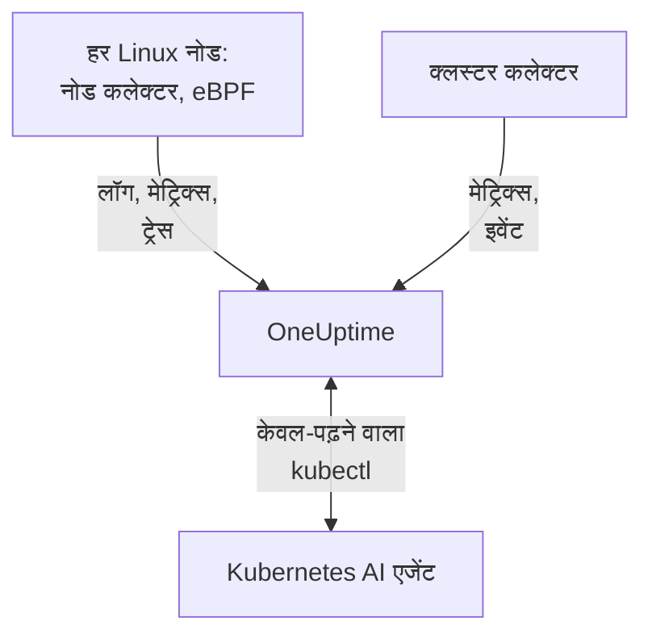

# Kubernetes एजेंट

OneUptime Kubernetes एजेंट एक Helm चार्ट है जो आपके क्लस्टर के मेट्रिक्स, इवेंट और पॉड लॉग, और eBPF के साथ हर पॉड के ट्रेस, अनुरोध मेट्रिक्स, सेवा ग्राफ़ और नेटवर्क फ़्लो इकट्ठा करता है, बिना किसी कोड बदलाव और बिना SDK के। यह [Kubernetes AI एजेंट](#kubernetes-ai-एजेंट) भी चलाता है, जो OneUptime AI को किसी घटना या अलर्ट की जाँच करते समय केवल-पढ़ने वाला `kubectl` चलाने देता है। एक `helm install` इसे सेट कर देता है; [Kubernetes मॉनिटर](/docs/monitor/kubernetes-monitor) इसके भेजे डेटा पर अलर्ट करते हैं।

:::cards
- [एजेंट इंस्टॉल करें](#एजेंट-इंस्टॉल-करें): Helm के साथ चार चरण।
- [कॉन्फ़िगरेशन विकल्प](#कॉन्फ़िगरेशन-विकल्प): फ़िल्टर, सैंपलिंग, कंट्रोल प्लेन, सर्विस मेश, लागत और लेबल।
- [Kubernetes AI एजेंट](#kubernetes-ai-एजेंट): OneUptime AI के लिए केवल-पढ़ने वाला `kubectl`, और आपकी अनुमति होने पर सुधार।
- [कम डेटा भेजें](#इकट्ठा-होने-वाले-डेटा-की-मात्रा-कम-करना): लीवर, असर के क्रम में।
:::

## यह कैसे काम करता है

चार्ट अपने नेमस्पेस में कुछ वर्कलोड चलाता है। हर वर्कलोड जो इकट्ठा करता है उसे आपकी दी गई इंजेशन कुंजी के साथ OTLP पर आपके OneUptime URL को भेजता है, और क्लस्टर `clusterName` में दिए गए नाम से खुद को रजिस्टर करता है।



| वर्कलोड | प्रकार | यह क्या करता है | कब चलता है |
| --- | --- | --- | --- |
| क्लस्टर कलेक्टर | Deployment | Kubernetes API से क्लस्टर मेट्रिक्स, Kubernetes इवेंट और पॉड, नोड और वर्कलोड के स्पेसिफ़िकेशन। | हमेशा |
| नोड कलेक्टर | DaemonSet | `/var/log/pods` से पॉड लॉग, kubelet और cAdvisor मेट्रिक्स, और नोड के OS मेट्रिक्स। | EKS Fargate को छोड़कर हर जगह |
| eBPF इंस्ट्रुमेंटेशन (OBI) | DaemonSet | हर पॉड से HTTP, gRPC, SQL और Redis ट्रेस और अनुरोध मेट्रिक्स, और सेवा मैप। | डिफ़ॉल्ट रूप से, GKE Autopilot और EKS Fargate को छोड़कर |
| Kubernetes AI एजेंट | Deployment | किसी घटना या अलर्ट की जाँच करते समय OneUptime AI के लिए केवल-पढ़ने वाला `kubectl`। | डिफ़ॉल्ट रूप से |
| लॉग टेलर | Deployment | Kubernetes API के ज़रिए पॉड लॉग, जहाँ नोड कलेक्टर उन्हें नहीं पढ़ सकता। | `gke-autopilot` और `eks-fargate` प्रीसेट के साथ |
| लागत इंजन और पोलर | Deployments | हर नेमस्पेस, वर्कलोड और पॉड का खर्च। | `cost.enabled=true` के साथ |

हर एजेंट इमेज सिर्फ़ Linux के लिए है, इसलिए हर वर्कलोड Linux नोड पर पिन है।

## शुरू करने से पहले

- v1.23 या उसके बाद का Kubernetes क्लस्टर, और उस तक पहुँचने के लिए कॉन्फ़िगर किया गया `kubectl`।
- Helm 3। अपग्रेड `--reset-then-reuse-values` का उपयोग करते हैं, जिसके लिए Helm 3.14 या उसके बाद का संस्करण चाहिए।
- एक इंजेशन कुंजी। **प्रोजेक्ट सेटिंग्स → टेलीमेट्री और APM → इंजेशन कुंजियाँ** के अंतर्गत एक बनाएँ। एजेंट इसे `x-oneuptime-token` हेडर में भेजता है, इसलिए प्रोजेक्ट API कुंजी यहाँ काम नहीं करती।
- क्लस्टर का एक नाम, जो आपके प्रोजेक्ट में अद्वितीय और स्थिर हो, जैसे `prod-us-east-1`: क्लस्टर OneUptime में इसी नाम से दिखता है।
- क्लस्टर से आपके OneUptime URL तक आउटबाउंड HTTPS।

## एजेंट इंस्टॉल करें

:::steps
### Helm रिपॉज़िटरी जोड़ें

```bash
helm repo add oneuptime https://helm-chart.oneuptime.com
helm repo update
```

### चार्ट इंस्टॉल करें

`YOUR_ONEUPTIME_URL`, `YOUR_ONEUPTIME_API_KEY` (इंजेशन कुंजी) और क्लस्टर नाम को अपने मानों से बदलें, और अपने प्लेटफ़ॉर्म का टैब चुनें ([प्रीसेट चुनें](#प्रीसेट-चुनें) देखें)।

:::tabs
@tab Standard
स्व-प्रबंधित क्लस्टर, EKS on EC2, GKE Standard, AKS, minikube, kind और k3s:

```bash
helm install kubernetes-agent oneuptime/kubernetes-agent \
  --namespace oneuptime-agent \
  --create-namespace \
  --set oneuptime.url="YOUR_ONEUPTIME_URL" \
  --set oneuptime.apiKey="YOUR_ONEUPTIME_API_KEY" \
  --set clusterName="my-cluster" \
  --set aiAgent.enabled=true
```
@tab GKE Autopilot
```bash
helm install kubernetes-agent oneuptime/kubernetes-agent \
  --namespace oneuptime-agent \
  --create-namespace \
  --set oneuptime.url="YOUR_ONEUPTIME_URL" \
  --set oneuptime.apiKey="YOUR_ONEUPTIME_API_KEY" \
  --set clusterName="my-cluster" \
  --set aiAgent.enabled=true \
  --set preset=gke-autopilot
```
@tab EKS Fargate
```bash
helm install kubernetes-agent oneuptime/kubernetes-agent \
  --namespace oneuptime-agent \
  --create-namespace \
  --set oneuptime.url="YOUR_ONEUPTIME_URL" \
  --set oneuptime.apiKey="YOUR_ONEUPTIME_API_KEY" \
  --set clusterName="my-cluster" \
  --set aiAgent.enabled=true \
  --set preset=eks-fargate
```
:::

**AI जाँच डिफ़ॉल्ट रूप से चालू है।** `aiAgent.enabled=true` कलेक्टर के बगल में [Kubernetes AI एजेंट](#kubernetes-ai-एजेंट) चलाता है: जब इस क्लस्टर पर कोई घटना या अलर्ट उठता है, तो OneUptime AI केवल-पढ़ने वाले `kubectl` (`get`, `describe`, `logs`, `events`, `top`) से उसकी जाँच करता है और कुछ नहीं बदलता। जब तक आप अनुमति न दें, सुधार बंद रहते हैं। इसके बिना इंस्टॉल करने के लिए इसके बजाय `--set aiAgent.enabled=false` का उपयोग करें।

### जाँचें कि पॉड चल रहे हैं

```bash
kubectl get pods -n oneuptime-agent
```

हर पॉड को एक-दो मिनट में `Running` तक पहुँच जाना चाहिए:

:::tabs
@tab Standard
क्लस्टर कलेक्टर, AI एजेंट, और हर नोड पर एक नोड कलेक्टर और एक eBPF पॉड:

```text
NAME                                          READY   STATUS    RESTARTS   AGE
kubernetes-agent-xxxxxxxxxx-xxxxx             1/1     Running   0          1m
kubernetes-agent-ai-agent-xxxxxxxxxx-xxxxx    1/1     Running   0          1m
kubernetes-agent-ebpf-xxxxx                   1/1     Running   0          1m
kubernetes-agent-logs-xxxxx                   1/1     Running   0          1m
```
@tab GKE Autopilot
नोड कलेक्टर अब भी चलता है और `hostPath` के बिना kubelet और cAdvisor मेट्रिक्स पढ़ता है, और एक लॉग टेलर Deployment Kubernetes API के ज़रिए पॉड लॉग पढ़ता है:

```text
NAME                                          READY   STATUS    RESTARTS   AGE
kubernetes-agent-xxxxxxxxxx-xxxxx             1/1     Running   0          1m
kubernetes-agent-ai-agent-xxxxxxxxxx-xxxxx    1/1     Running   0          1m
kubernetes-agent-logs-yyyyyyyyyy-yyyyy        1/1     Running   0          1m
kubernetes-agent-logs-xxxxx                   1/1     Running   0          1m
```
@tab EKS Fargate
तीन Deployment और कोई DaemonSet नहीं: Fargate हर पॉड को उसका अपना माइक्रो-VM देता है और कभी DaemonSet शेड्यूल नहीं करता, इसलिए वहाँ नोड मेट्रिक्स उपलब्ध नहीं हैं:

```text
NAME                                          READY   STATUS    RESTARTS   AGE
kubernetes-agent-xxxxxxxxxx-xxxxx             1/1     Running   0          1m
kubernetes-agent-ai-agent-xxxxxxxxxx-xxxxx    1/1     Running   0          1m
kubernetes-agent-logs-yyyyyyyyyy-yyyyy        1/1     Running   0          1m
```
:::

### OneUptime में क्लस्टर खोजें

**उत्पाद → बुनियादी ढांचा → Kubernetes → सभी क्लस्टर** खोलें। क्लस्टर कुछ मिनट में अपने `clusterName` के अंतर्गत दिखता है, और उसके नोड, पॉड और वर्कलोड भर जाते हैं। Kubernetes AI एजेंट क्लस्टर के **एजेंट** पेज पर, **एआई** के अंतर्गत, कनेक्टेड दिखता है।
:::

## प्रीसेट चुनें

`preset` वे डिफ़ॉल्ट चुनता है जो आपके प्लेटफ़ॉर्म पर काम करते हैं: पॉड लॉग नोड से `hostPath` के ज़रिए पढ़े जाएँ या Kubernetes API के ज़रिए, और कौन-से वर्कलोड विशेषाधिकार के साथ चल सकते हैं।

| `preset` | किसके लिए | पॉड लॉग | नोड मेट्रिक्स |
| --- | --- | --- | --- |
| `standard` (डिफ़ॉल्ट) | स्व-प्रबंधित क्लस्टर, **EKS on EC2**, **GKE Standard**, **AKS**, minikube, kind, k3s | नोड कलेक्टर `hostPath` के ज़रिए `/var/log/pods` पढ़ता है (सबसे कम ओवरहेड) | Kubelet, cAdvisor और नोड के OS मेट्रिक्स |
| `gke-autopilot` | **GKE Autopilot** | लॉग टेलर उन्हें Kubernetes API के ज़रिए पढ़ता है (कोई `hostPath` नहीं, होस्ट तक कोई पहुँच नहीं) | Kubelet और cAdvisor, `hostPath` के बिना |
| `eks-fargate` | **EKS Fargate** | लॉग टेलर उन्हें Kubernetes API के ज़रिए पढ़ता है (कोई `hostPath` नहीं, होस्ट तक कोई पहुँच नहीं) | कोई नहीं: Fargate कोई DaemonSet नहीं चलाता |

अगर आप निश्चित नहीं हैं, तो `standard` से शुरू करें। अगर इंस्टॉल ऐसी Pod Security त्रुटि के साथ विफल हो जिसमें `hostPath` का नाम हो, तो `preset=gke-autopilot` (या Fargate पर `eks-fargate`) के साथ फिर से इंस्टॉल करें। GKE Autopilot और EKS Fargate विशेषाधिकार वाले पॉड भी अस्वीकार करते हैं, जिनकी eBPF और प्रोफ़ाइलर को ज़रूरत है, इसलिए वे दोनों प्रीसेट दोनों को छोड़ देते हैं।

## क्या इकट्ठा होता है

| श्रेणी | डेटा |
| --- | --- |
| नोड मेट्रिक्स | CPU, मेमोरी, फ़ाइल सिस्टम और नेटवर्क का उपयोग |
| पॉड मेट्रिक्स | CPU, मेमोरी, नेटवर्क और रीस्टार्ट |
| कंटेनर मेट्रिक्स | हर कंटेनर का CPU और मेमोरी |
| क्लस्टर मेट्रिक्स | नोड की स्थितियाँ, आवंटन योग्य संसाधन, पॉड की संख्या |
| Kubernetes इवेंट | चेतावनियाँ, त्रुटियाँ और शेड्यूलिंग इवेंट |
| पॉड लॉग | हर कंटेनर का stdout और stderr (मानक क्लस्टर पर `hostPath` के ज़रिए, Autopilot और Fargate पर Kubernetes API के ज़रिए) |
| एप्लिकेशन ट्रेस (eBPF, डिफ़ॉल्ट रूप से चालू) | हर पॉड से HTTP, gRPC, SQL और Redis स्पैन, बिना SDK या कोड बदलाव के |
| HTTP RED मेट्रिक्स (eBPF) | `http.server.request.duration`, और हर सेवा के अनुरोध और प्रतिक्रिया बॉडी के आकार |
| सेवा ग्राफ़ (eBPF) | कॉल करने वाले से कॉल पाने वाले तक अनुरोध दर, लेटेंसी और त्रुटि वाले किनारे, जो सेवा मैप बनाते हैं |
| नेटवर्क फ़्लो मेट्रिक्स (eBPF) | पॉड से पॉड तक TCP और UDP बाइट और पैकेट काउंटर, Kubernetes मेटाडेटा के साथ |
| TCP आँकड़े (eBPF) | नोड स्तर पर राउंड-ट्रिप समय, विफल कनेक्शन और रीट्रांसमिट काउंटर |
| वर्कलोड लागत (वैकल्पिक, `cost.enabled=true`) | हर नेमस्पेस, वर्कलोड और पॉड का खर्च, निष्क्रिय क्षमता और दक्षता के साथ, और नोड और वॉल्यूम की प्रति घंटा लागत: [Kubernetes लागत ऑब्ज़र्वेबिलिटी](/docs/telemetry/kubernetes-cost) देखें |

## कॉन्फ़िगरेशन विकल्प

नीचे का हर विकल्प एक Helm मान है। इसे इंस्टॉल के समय सेट करें, या इंस्टॉल किए गए एजेंट पर `helm upgrade ... --reset-then-reuse-values --set <value>` से।

### नेमस्पेस फ़िल्टरिंग

`namespaceFilters.rules` नेमस्पेस पैटर्न को चार दायरों पर, हर एक पर अलग से, लागू करता है:

| दायरा | यह कहाँ फ़िल्टर करता है | यह किस पर असर डालता है |
| --- | --- | --- |
| `podLogs` | hostPath filelog रिसीवर पर या API लॉग टेलर पर | सिर्फ़ पॉड stdout और stderr; Kubernetes इवेंट और ऑडिट लॉग पर असर नहीं |
| `ebpfDiscovery` | OBI की प्रक्रिया खोज पर | मेल खाने वाले वर्कलोड के eBPF ट्रेस और eBPF मेट्रिक्स दोनों |
| `metrics` | कलेक्टर में, Kubernetes मेटाडेटा जुड़ने के बाद | नेमस्पेस वाली मेट्रिक सीरीज़; बिना नेमस्पेस वाली नोड और क्लस्टर सीरीज़ रखी जाती हैं |
| `traces` | कलेक्टर में, Kubernetes मेटाडेटा जुड़ने के बाद | eBPF स्पैन और एप्लिकेशन के OTLP पर भेजे स्पैन, दोनों |

पैटर्न पूरे नेमस्पेस नाम से मेल खाता है और `*` (`team-*`) का उपयोग कर सकता है। अगर किसी दायरे में कोई `include` नियम है, तो उस दायरे के लिए सिर्फ़ मेल खाने वाले नेमस्पेस रखे जाते हैं, और `exclude` नियम हमेशा जीतते हैं। डिफ़ॉल्ट नियम `kube-system` को सिर्फ़ `podLogs` और `ebpfDiscovery` से बाहर रखता है।

पॉड लॉग और eBPF खोज को कुछ नेमस्पेस तक सीमित रखने के लिए:

```bash
helm install kubernetes-agent oneuptime/kubernetes-agent \
  --namespace oneuptime-agent \
  --create-namespace \
  --set oneuptime.url="YOUR_ONEUPTIME_URL" \
  --set oneuptime.apiKey="YOUR_ONEUPTIME_API_KEY" \
  --set clusterName="my-cluster" \
  --set-json 'namespaceFilters.rules=[{"action":"include","namespaces":["default","production","staging"],"scopes":["podLogs","ebpfDiscovery"]}]'
```

किसी शोर वाले नेमस्पेस के लॉग रोकने और उसके eBPF ट्रेस, सेवा मैप और मेट्रिक्स रखने के लिए, बहिष्करण को `podLogs` तक सीमित करें:

```bash
  --set-json 'namespaceFilters.rules=[{"action":"exclude","namespaces":["kube-system"],"scopes":["podLogs","ebpfDiscovery"]},{"action":"exclude","namespaces":["noisy-*"],"scopes":["podLogs"]}]'
```

`podLogs` और `ebpfDiscovery` नियम स्रोत पर फ़िल्टर करते हैं: बाहर रखी गई लॉग फ़ाइलें कभी खोली नहीं जातीं, और बाहर रखे गए वर्कलोड कभी इंस्ट्रुमेंट नहीं होते। `metrics` और `traces` नियम बाद में, कलेक्टर में, डेटा से नेमस्पेस जुड़ने के बाद काम करते हैं।

#### नेमस्पेस के आधार पर मेट्रिक्स और ट्रेस फ़िल्टर करना

नेमस्पेस वाले मेट्रिक्स या स्पैन भी फ़िल्टर करने के लिए ये दायरे किसी नियम में जोड़ें:

```bash
  --set-json 'namespaceFilters.rules=[{"action":"exclude","namespaces":["kube-system","noisy-*"],"scopes":["podLogs","ebpfDiscovery","metrics","traces"]}]'
```

> [!NOTE]
> नोड और क्लस्टर स्तर के मेट्रिक्स हमेशा रखे जाते हैं। नेमस्पेस किसी पॉड का होता है, नोड का नहीं, इसलिए नोड CPU, नोड मेमोरी और फ़ाइल सिस्टम उपयोग जैसी सीरीज़ के पास मेल खाने को कुछ नहीं होता और वे कभी नहीं हटतीं: `metrics` दायरे वाला नियम प्रति-पॉड सीरीज़ घटाता है, खराब होते नोड को छिपाए बिना।

Kubernetes इवेंट को एजेंट पर नेमस्पेस के आधार पर फ़िल्टर नहीं किया जा सकता: वे `k8sobjects` रिसीवर से `k8s.namespace.name` एट्रिब्यूट के बिना आते हैं (नेमस्पेस इवेंट के मुख्य भाग में होता है), इसलिए किसी फ़िल्टर के मेल खाने के लिए कुछ नहीं होता। इसके बजाय उन्हें OneUptime में **लॉग → सेटिंग्स → ड्रॉप फ़िल्टर** से हटाएँ।

### लॉग गंभीरता द्वारा फ़िल्टरिंग

`filters.logs.minSeverity` किसी गंभीरता से नीचे के पॉड लॉग रिकॉर्ड एजेंट पर ही, कुछ भी भेजे जाने से पहले, हटा देता है:

```bash
  --set filters.logs.minSeverity=WARN
```

यह `TRACE`, `DEBUG`, `INFO`, `WARN`, `ERROR` और `FATAL` स्वीकार करता है। `WARN` WARN, ERROR और FATAL रखता है और INFO, DEBUG और TRACE हटाता है; डिफ़ॉल्ट (`""`) सब कुछ रखता है। यह दोनों लॉग मोड में लागू होता है (`daemonset` मोड में कलेक्टर के ज़रिए, `api` मोड में लॉग टेलर के भीतर), इसलिए कोई प्रीसेट इसे चुपचाप बंद नहीं करता।

कंटेनर रनटाइम कोई गंभीरता दर्ज नहीं करते, इसलिए एजेंट उसे खुद लॉग टेक्स्ट से पढ़ता है (`[ERROR]`, `WARN:`, `"level":"info"`, …)। जिस लाइन में कोई पहचानने योग्य स्तर नहीं है उसका क्या होता है, यह लॉग मोड पर निर्भर है, क्योंकि दोनों मोड अलग-अलग बातें जानते हैं:

| मोड | बिना स्तर वाली लाइन | क्यों |
| --- | --- | --- |
| `daemonset` | `stderr` ERROR गिनी जाती है (रखी जाती है), `stdout` INFO (WARN सीमा से हटाई जाती है) | कंटेनर रनटाइम दर्ज करता है कि हर लाइन किस स्ट्रीम से आई। |
| `api` | हमेशा रखी जाती है | Kubernetes `pods/log` API stdout और stderr को हर लाइन के किसी चिह्न के बिना एक स्ट्रीम में मिला देता है, इसलिए अनुमान लगाने के बजाय एजेंट लाइन रखता है। |

इसलिए `api` मोड जानबूझकर `daemonset` मोड से कम हटाता है: Python ट्रेसबैक या `npm ERR!` में गंभीरता का कोई कीवर्ड नहीं होता, और उसे चुपचाप हटाना ठीक वही गलती है जिससे सीमा को आपको बचाना चाहिए। हाइब्रिड मोड (`logs.windowsPods.enabled`) में नोड OS के अनुसार दोनों पंक्तियाँ लागू होती हैं: Linux पॉड `daemonset` का पालन करते हैं, Windows पॉड `api` का।

दोनों मोड में कई लाइनों वाले इवेंट फ़िल्टरिंग से पहले फिर से जोड़े जाते हैं, इसलिए Java स्टैक ट्रेस का फ़ैसला उसकी पहली लाइन से होता है और वह पूरा रखा या हटाया जाता है।

> [!IMPORTANT]
> Kubernetes इवेंट और संसाधन स्पेसिफ़िकेशन इससे कभी फ़िल्टर नहीं होते। वे Kubernetes API से अपनी किसी गंभीरता के बिना आते हैं, इसलिए कोई सीमा पूरी फ़ीड हटा देती, जिसमें `FailedScheduling`, `BackOff` और `OOMKilling` चेतावनियाँ भी होतीं जो आपको सबसे ज़्यादा चाहिए। वे कम और कीमती हैं, इसलिए एजेंट उन्हें हमेशा भेजता है; उन्हें कम करने के लिए OneUptime में **लॉग → सेटिंग्स → ड्रॉप फ़िल्टर** का उपयोग करें।

### नाम के आधार पर मेट्रिक्स शामिल करना या बाहर रखना

`filters.metrics` तय करता है कि कौन-से मेट्रिक्स क्लस्टर छोड़ें, हर रिसीवर के लिए।

कुछ शोर वाले मेट्रिक्स हटाएँ (एक डिनायलिस्ट, जो आम तौर पर आप चाहते हैं):

```bash
  --set-json 'filters.metrics.exclude=["k8s.volume.available","k8s.volume.capacity"]'
```

सिर्फ़ एक तय सेट भेजें (एक अलाउलिस्ट: बाकी सब हटाया जाता है):

```bash
  --set-json 'filters.metrics.include=["k8s.pod.cpu.utilization","k8s.pod.memory.usage"]'
```

सटीक नाम के बजाय पैटर्न से मिलाएँ:

```bash
  --set filters.metrics.matchType=regexp \
  --set-json 'filters.metrics.exclude=["^container_network_"]'
```

| कुंजी | अर्थ |
| --- | --- |
| `filters.metrics.exclude` | हटाए जाने वाले मेट्रिक नाम। `include` के बाद लागू होता है, इसलिए बहिष्करण हमेशा जीतता है। |
| `filters.metrics.include` | खाली न होने पर सिर्फ़ यही मेट्रिक्स भेजे जाते हैं। |
| `filters.metrics.matchType` | `strict` (सटीक नाम, डिफ़ॉल्ट) या `regexp` (RE2, बिना एंकर)। |

- `regexp` बिना एंकर है: `system.cpu` `system.cpu.time` से भी मेल खाता है। जब आपका मतलब ठीक एक मेट्रिक से हो, तो उसे एंकर करें (`^system\.cpu$`)।
- RE2 में लुकअहेड नहीं है, इसलिए `^(?!container_)` कंपाइल नहीं होता। "इसके अलावा सब कुछ" को नकारात्मक पैटर्न से नहीं, `include` से कहें।
- `include` एक साथ हर रिसीवर पर लागू होता है। जो अलाउलिस्ट किसी मेट्रिक को भूल जाती है, वह उस पर बने मॉनिटर चुपचाप हटा देती है, इसलिए जब तक आपको बंद सेट न चाहिए, `exclude` को प्राथमिकता दें।
- सूचियों के लिए `--set-json` (या वैल्यूज़ फ़ाइल) का उपयोग करें: साधारण `--set` सूची में जोड़ने के बजाय उसे बदल देता है।

> [!WARNING]
> किसी पैटर्न को रोल आउट करने से पहले परखें। कलेक्टर शुरू होते समय पैटर्न कंपाइल करता है, इसलिए अमान्य पैटर्न चुपचाप गलत व्यवहार नहीं करता: कलेक्टर शुरू होने से मना कर देता है और बार-बार क्रैश होता है, और अपने मेट्रिक्स के साथ उस कलेक्टर के लॉग भी बंद कर देता है। Helm RE2 कंपाइल नहीं कर सकता, इसलिए `helm upgrade` खराब पैटर्न बिना शिकायत स्वीकार कर लेता है।

### ट्रेस सैंपलिंग

ऊपर के फ़िल्टर टेलीमेट्री की एक श्रेणी हटाते हैं: एक नेमस्पेस, एक गंभीरता, एक मेट्रिक नाम। सैंपलिंग हर श्रेणी रखती है और इसके बजाय आबादी को पतला करती है। रखे जाने वाले ट्रेस का हिस्सा `sampling.traces.percentage` में सेट करें:

```bash
helm upgrade kubernetes-agent oneuptime/kubernetes-agent \
  --namespace oneuptime-agent --reset-then-reuse-values \
  --set sampling.traces.percentage=10
```

यह दस में से एक ट्रेस रखता है और बाकी नौ को एजेंट पर ही, आपके क्लस्टर से निकलने से पहले, हटा देता है।

- **आपको पूरे ट्रेस मिलते हैं, टुकड़े नहीं।** फ़ैसला ट्रेस ID का हैश है, हर स्पैन के लिए सिक्का उछालना नहीं, इसलिए किसी ट्रेस के सभी स्पैन एक साथ रखे या हटाए जाते हैं, और बचे हुए ट्रेस शुरू से अंत तक पढ़े जा सकते हैं।
- **आपके मेट्रिक-आधारित मॉनिटर नहीं बदलते।** OBI eBPF RED मेट्रिक्स (अनुरोध दर, त्रुटि दर, अवधि) हर अनुरोध से गिनता है, और वे मेट्रिक्स पाइपलाइन से गुज़रते हैं, जिसमें सैंपलर नहीं है। 10% पर आपको ट्रेस का दसवाँ हिस्सा और सटीक दर, त्रुटियाँ और लेटेंसी मिलती है।
- **आपके स्पैन-आधारित मॉनिटर बदलते हैं।** OneUptime जो कुछ खुद स्पैन से गिनता है, वह दर के अनुपात में घट जाता है: नीचे की चेतावनी देखें।

| कुंजी | अर्थ |
| --- | --- |
| `sampling.traces.percentage` | रखे जाने वाले ट्रेस का प्रतिशत, 0 से 100। डिफ़ॉल्ट `100` (सब रखें)। |
| `sampling.traces.hashSeed` | ट्रेस-ID हैश का सीड। डिफ़ॉल्ट `22`। |

- `0` कोई भी ट्रेस नहीं रखता। यह एक दर है, बंद करने का स्विच नहीं: यह हर ट्रेस हटाता है जबकि eBPF DaemonSet चलता रहता है और आपकी लागत बढ़ाता रहता है। कोई ट्रेस न चाहिए तो `ebpf.enabled=false` का उपयोग करें; ट्रेस न चाहिए पर RED मेट्रिक्स और सेवा मैप चाहिए, तो eBPF चालू रखें और जानबूझकर `0` सेट करें।
- यह सिर्फ़ तब लागू होता है जब `ebpf.enabled` चालू हो: वरना कोई ट्रेस पाइपलाइन नहीं होती, और मान कुछ नहीं करता।
- यह सिर्फ़ ट्रेस सैंपल करता है। जानबूझकर कोई `sampling.logs` या `sampling.metrics` नहीं है: नीचे की टिप्पणी देखें।
- भिन्नों के लिए `--set-json` चाहिए, और उनकी एक न्यूनतम सीमा है। `--set sampling.traces.percentage=0.5` विफल होता है, क्योंकि Helm `0.5` को स्ट्रिंग पढ़ता है: `--set-json 'sampling.traces.percentage=0.5'` या वैल्यूज़ फ़ाइल का उपयोग करें। लगभग `0.0061` से नीचे दर शून्य तक गोल हो जाती है और बिना किसी त्रुटि के ठीक `0` की तरह व्यवहार करती है; `0.01` (दस हज़ार में एक) सबसे छोटा मान है जो वही करता है जो वह कहता है।
- कई क्लस्टर डिफ़ॉल्ट रूप से काम करते हैं। दो एजेंट एक ही ट्रेस तभी रखते हैं जब वे `hashSeed` और `percentage` दोनों पर सहमत हों, और दोनों के डिफ़ॉल्ट हर जगह एक जैसे हैं, इसलिए दो क्लस्टर से गुज़रने वाला ट्रेस पूरा बचता है। `hashSeed` सिर्फ़ दो सैंपलिंग स्तरों को स्वतंत्र बनाने के लिए बदलें: एक ही सीड के साथ कम दर ज़्यादा दर के ट्रेस का एक उपसमुच्चय रखती है।
- पॉड लॉग कभी सैंपल नहीं होते, इसलिए `ebpf.logToTraceCorrelation: true` के साथ हर लॉग रिकॉर्ड में अब भी ट्रेस ID होती है, जबकि उन ट्रेस का सिर्फ़ रखा गया हिस्सा मौजूद होता है। तब लगभग (100 − `percentage`)% लॉग रिकॉर्ड ऐसे ट्रेस से जुड़ते हैं जो मौजूद नहीं है; किसी ट्रेस से उसके लॉग तक जाना प्रभावित नहीं होता।

> [!WARNING]
> इसे सेट करते समय अपने स्पैन-आधारित मॉनिटर फिर से ट्यून करें। सैंपलिंग OneUptime तक पहुँचने वाले स्पैन घटाती है, इसलिए उन्हें गिनने वाली हर चीज़ कम गिनती है: `Span Count` पर **ट्रेस** मॉनिटर और `Exception Count` पर **अपवाद** मॉनिटर कल की मात्रा का लगभग `percentage`% देखते हैं। बिना सैंपल वाले ट्रैफ़िक पर ट्यून की गई सीमा चुपचाप पार होना बंद हो जाती है: मॉनिटर कोई त्रुटि नहीं देता, बस चुप हो जाता है। उन सीमाओं को उसी गुणक से भाग दें; दर पूरे क्लस्टर पर लागू है, इसलिए किसी सेवा को छूट नहीं दी जा सकती। त्रुटि समूहन रैखिक से भी बदतर होता है: आम अपवाद अब भी दिखता है, पर किसी दुर्लभ एक-बार के अपवाद के दसवें हिस्से जितनी बार दिखने के बजाय गायब हो जाने की संभावना ज़्यादा है।

> [!NOTE]
> लॉग या मेट्रिक सैंपलिंग क्यों नहीं है: कलेक्टर का सैंपलर मेट्रिक्स बिल्कुल सैंपल नहीं कर सकता। वह लॉग सैंपल कर सकता है, पर अपनी यादृच्छिकता ट्रेस ID से लेता है, जो पॉड लॉग में नहीं होती, इसलिए हर लॉग रिकॉर्ड एक ही तरह हैश होता, और लॉग दर सीड के आधार पर या तो सब कुछ रखती या सब कुछ हटा देती। आपके लॉग चुपचाप हटाने वाली सेटिंग देने के बजाय चार्ट कोई सेटिंग नहीं देता। लॉग को [लॉग गंभीरता द्वारा फ़िल्टरिंग](#लॉग-गंभीरता-द्वारा-फ़िल्टरिंग) और [नेमस्पेस फ़िल्टरिंग](#नेमस्पेस-फ़िल्टरिंग) से कम करें, जो सटीक हैं कि वे क्या हटाते हैं।

### लॉग संग्रह बंद करें

अगर आपको पॉड लॉग नहीं चाहिए:

```bash
helm install kubernetes-agent oneuptime/kubernetes-agent \
  --namespace oneuptime-agent \
  --create-namespace \
  --set oneuptime.url="YOUR_ONEUPTIME_URL" \
  --set oneuptime.apiKey="YOUR_ONEUPTIME_API_KEY" \
  --set clusterName="my-cluster" \
  --set logs.enabled=false
```

आपके मेट्रिक्स पर असर नहीं पड़ता: नोड कलेक्टर kubelet, cAdvisor और होस्ट मेट्रिक्स के लिए चलता रहता है, और सिर्फ़ पॉड लॉग पढ़ना बंद करता है। लॉग-आधारित अलर्ट बंद हो जाते हैं, और कुछ नहीं।

### कोई खास लॉग संग्रह मोड लागू करें

`logs.mode` प्रीसेट की पसंद को ओवरराइड करता है, और हमेशा उस पर हावी रहता है:

- `logs.mode=daemonset`: hostPath DaemonSet (सबसे कम ओवरहेड; `hostPath` चाहिए)।
- `logs.mode=api`: Kubernetes API लॉग टेलर Deployment (किसी भी क्लस्टर पर काम करता है)।
- `logs.mode=disabled`: कोई पॉड लॉग नहीं।

मोड सिर्फ़ यह तय करता है कि पॉड लॉग कहाँ से आएँ: नोड मेट्रिक्स दोनों ही तरह इकट्ठा होते हैं, इसलिए `api` और `disabled` आपके kubelet, cAdvisor और होस्ट मेट्रिक्स रखते हैं। अपवाद प्लेटफ़ॉर्म है: EKS Fargate DaemonSet शेड्यूल ही नहीं कर सकता, इसलिए उसमें कोई नोड कलेक्टर नहीं होता और कोई नोड, पॉड या कंटेनर मेट्रिक्स नहीं। GKE Autopilot नोड कलेक्टर चलाता है पर `hostPath` रोकता है, इसलिए वह kubelet और cAdvisor मेट्रिक्स इकट्ठा करता है, पर वे `hostmetrics` मेट्रिक्स (डिस्क I/O, inode, NIC त्रुटियाँ) नहीं जो होस्ट के `/proc` और `/sys` पढ़ते हैं।

Windows नोड पूल वाले क्लस्टर पर `daemonset` मोड सिर्फ़ Linux नोड को कवर करता है, क्योंकि हर एजेंट इमेज सिर्फ़ Linux के लिए है। सिर्फ़ Windows नोड के पॉड के लिए API लॉग टेलर को इसके बगल में चलाने के लिए `--set logs.windowsPods.enabled=true` जोड़ें: Linux पॉड नोड-लोकल फ़ाइल टेलिंग रखते हैं, और दोनों कभी एक ही लाइन दो बार नहीं भेजते। इसके लिए कम से कम चार्ट जितनी नई `kubernetes-log-tailer` इमेज चाहिए: पुरानी इमेज यह प्रतिबंध अनदेखा करती है और Linux लॉग दो बार भेजती है।

### कंट्रोल प्लेन निगरानी चालू करें

क्लस्टर का **कंट्रोल प्लेन** पेज etcd, API सर्वर, शेड्यूलर और कंट्रोलर मैनेजर के चार्ट दिखाता है। जब `controlPlane.enabled` का मान `true` होता है, तो एजेंट चारों को स्क्रैप करता है:

```bash
helm upgrade kubernetes-agent oneuptime/kubernetes-agent \
  --namespace oneuptime-agent \
  --reset-then-reuse-values \
  --set controlPlane.enabled=true
```

हर घटक को उसकी अपनी सूची के पतों पर स्क्रैप किया जाता है: `controlPlane.etcd.endpoints`, `controlPlane.apiServer.endpoints`, `controlPlane.scheduler.endpoints` और `controlPlane.controllerManager.endpoints`। स्क्रैप एजेंट के पॉड में चलता है, जिसका कोई होस्ट नेटवर्क नहीं है, इसलिए डिफ़ॉल्ट (`https://localhost:<port>/metrics`) उसी पॉड की ओर इंगित करते हैं: हर सूची को ऐसे पते पर सेट करें जिस तक पॉड पहुँच सके। किसी भी क्लस्टर के भीतर API सर्वर `https://kubernetes.default.svc:443/metrics` पर जवाब देता है:

```bash
helm upgrade kubernetes-agent oneuptime/kubernetes-agent \
  --namespace oneuptime-agent \
  --reset-then-reuse-values \
  --set controlPlane.enabled=true \
  --set "controlPlane.apiServer.endpoints={https://kubernetes.default.svc:443/metrics}"
```

`controlPlane.enabled` चारों स्क्रैप एक साथ चालू करता है। जहाँ कोई घटक अपने एंडपॉइंट पर नहीं पहुँचा जा सकता (प्रबंधित क्लस्टर पर etcd, शेड्यूलर और कंट्रोलर मैनेजर, या उनके `localhost` डिफ़ॉल्ट पर), वहाँ उसका स्क्रैप हर अंतराल पर विफल होता है: कलेक्टर एक स्क्रैप त्रुटि लॉग करता है और लक्ष्य को डाउन बताता है, और कुछ नहीं बदलता।

एजेंट सिर्फ़ HTTPS पर स्क्रैप करता है, सेवा खाते के टोकन के साथ और बिना क्लाइंट प्रमाणपत्र के। इसलिए:

- **etcd** को एक ऐसा HTTPS मेट्रिक्स पता चाहिए जो क्लाइंट प्रमाणपत्र न माँगे। etcd के सामान्य मेट्रिक्स पोर्ट पहुँच से बाहर हैं: `2381` पर साधारण HTTP (kubeadm का `--listen-metrics-urls`) HTTPS के रूप में स्क्रैप होकर विफल होता है, और `2379` को क्लाइंट प्रमाणपत्र चाहिए।
- **शेड्यूलर** (`10259`) और **कंट्रोलर मैनेजर** (`10257`) HTTPS परोसते हैं और टोकन स्वीकार करते हैं, पर kubeadm उन्हें कंट्रोल-प्लेन नोड पर `127.0.0.1` से बाँधता है: उन्हें ऐसा `--bind-address` चाहिए जिस तक एजेंट का पॉड पहुँच सके।

प्रबंधित Kubernetes सेवाएँ (EKS, GKE, AKS) etcd, शेड्यूलर या कंट्रोलर मैनेजर उजागर नहीं करतीं, इसलिए वहाँ वे टैब खाली रहते हैं। जब तक किसी टैब के मेट्रिक्स न आएँ, **कंट्रोल प्लेन** पेज उसके चार्ट की जगह दिखाता है कि क्या सेट करना है, कॉपी करने के लिए कमांड के साथ।

### CoreDNS मेट्रिक्स चालू करें

**कंट्रोल प्लेन** पेज का **CoreDNS** टैब DNS क्वेरी, लेटेंसी, कैश और फ़ॉरवर्डिंग के चार्ट दिखाता है। इन्हें इकट्ठा करना डिफ़ॉल्ट रूप से बंद है:

```bash
helm upgrade kubernetes-agent oneuptime/kubernetes-agent \
  --namespace oneuptime-agent \
  --reset-then-reuse-values \
  --set coreDns.enabled=true
```

एजेंट `kube-system` में `k8s-app=kube-dns` लेबल वाले पॉड का पोर्ट `9153` स्क्रैप करता है, जो kubeadm क्लस्टर, EKS और AKS पर CoreDNS चलने का तरीका है। अगर आपका कहीं और चलता है, तो `coreDns.namespace`, `coreDns.service` (`k8s-app` लेबल) और `coreDns.port` भी सेट करें। GKE CoreDNS के बजाय kube-dns (dnsmasq) या Cloud DNS चलाता है, इसलिए वहाँ टैब खाली रहता है।

### सर्विस मेश मेट्रिक्स चालू करें

क्लस्टर का **सर्विस मेश** पेज Istio और Linkerd के चार्ट दिखाता है। एजेंट एक मेश स्क्रैप करता है, वह जिसका नाम `serviceMesh.provider` देता है (`istio` या `linkerd`):

```bash
helm upgrade kubernetes-agent oneuptime/kubernetes-agent \
  --namespace oneuptime-agent \
  --reset-then-reuse-values \
  --set serviceMesh.enabled=true \
  --set serviceMesh.provider=istio
```

Istio के लिए यह हर `istio-proxy` साइडकार (पोर्ट `15090`) के Envoy आँकड़े पढ़ता है; Linkerd के लिए, हर `linkerd-proxy` का एडमिन पोर्ट। किसी भी मेश का कंट्रोल प्लेन स्क्रैप नहीं होता: istiod (**Pilot** कार्ड) और Linkerd के identity, destination और proxy-injector घटक (**कंट्रोल प्लेन** कार्ड) अपने मेट्रिक्स अपने एडमिन पोर्ट पर परोसते हैं, इसलिए वे कार्ड अपने चार्ट की जगह यही बताते हैं।

### वे मेट्रिक्स जिन्हें एजेंट इकट्ठा नहीं करता

कुछ चार्ट ऐसे मेट्रिक्स दिखाते हैं जिनके लिए एजेंट के पास कोई स्क्रैप नहीं है: **कंट्रोल प्लेन** पेज पर **kube-proxy**; **सर्विस मेश** पेज पर **Cilium** (Hubble के साथ); और Istio और Linkerd टैब पर मेश के अपने कंट्रोल प्लेन (**istiod**, और Linkerd के identity, destination और proxy-injector घटक)। ये तब भरते हैं जब वे मेट्रिक्स किसी और रास्ते से OneUptime तक पहुँचते हैं, उदाहरण के लिए आपके अपने [OpenTelemetry Collector](/docs/telemetry/open-telemetry) से जो उन्हें स्क्रैप करता है, `k8s.cluster.name` रिसोर्स एट्रिब्यूट को क्लस्टर के नाम (एजेंट का `clusterName`) पर सेट करके। जो क्लस्टर kube-proxy के बिना चलते हैं, उनमें kube-proxy मेट्रिक्स होते ही नहीं।

### लागत ऑब्ज़र्वेबिलिटी चालू करें

क्लस्टर के **Costs** पेज पर देखें कि हर नेमस्पेस, वर्कलोड और पॉड की लागत कितनी है, निष्क्रिय क्षमता और हर request का कितना हिस्सा उपयोग होता है, इसके साथ:

```bash
helm upgrade kubernetes-agent oneuptime/kubernetes-agent \
  --namespace oneuptime-agent \
  --reset-then-reuse-values \
  --set cost.enabled=true
```

बस इतना ही एक पूरा इंस्टॉल है: चार्ट ओपन-सोर्स [OpenCost](https://opencost.io) इंजन (उसके लिए ज़रूरी छोटे Prometheus के साथ) बंडल करता है और आपके नोड और वॉल्यूम की कीमत आपके क्लाउड प्रदाता के सार्वजनिक सूची मूल्यों से, बिना किसी क्रेडेंशियल के, तय करता है। यह दो छोटे पॉड जोड़ता है, और पहली लागत पहले बंद घंटे के बाद दिखती है। पहले से Kubecost या OpenCost चला रहे हैं? इसके बजाय `--set cost.engine.url=<its service URL>` जोड़ें, और कुछ भी बंडल नहीं होता। ऑन-प्रेम क्लस्टर `cost.opencost.customPricing` से रेट कार्ड सेट कर सकते हैं। ऑन-प्रेम मूल्य निर्धारण और समस्या निवारण के साथ पूरी गाइड [Kubernetes लागत ऑब्ज़र्वेबिलिटी](/docs/telemetry/kubernetes-cost) है।

### प्रोजेक्ट लेबल से अपने-आप टैग करें

`oneuptime.label.` से शुरू होने वाला हर रिसोर्स एट्रिब्यूट एक प्रोजेक्ट लेबल बन जाता है, जो क्लस्टर से और इस एजेंट द्वारा बताई गई सेवाओं और होस्ट से जुड़ता है: `oneuptime.label.<dimension>=<value>` लेबल `<dimension>:<value>` है। इंस्टॉल के समय लेबल `--set oneuptime.labels.<key>=<value>` से दें:

```bash
helm install kubernetes-agent oneuptime/kubernetes-agent \
  --namespace oneuptime-agent \
  --create-namespace \
  --set oneuptime.url="YOUR_ONEUPTIME_URL" \
  --set oneuptime.apiKey="YOUR_ONEUPTIME_API_KEY" \
  --set clusterName="prod" \
  --set oneuptime.labels.team=payments \
  --set oneuptime.labels.env=production \
  --set oneuptime.labels.region=us-east-1
```

या उन्हें वैल्यूज़ फ़ाइल में रखें:

```yaml title="values.yaml"
oneuptime:
  url: YOUR_ONEUPTIME_URL
  apiKey: YOUR_ONEUPTIME_API_KEY
  labels:
    team: payments
    env: production
    region: us-east-1
clusterName: prod
```

लेबल केस-असंवेदी रूप से मिलाए जाते हैं, इसलिए हाथ से बनाया गया मौजूदा `Production` लेबल दोबारा उपयोग होता है, उसकी नकल नहीं बनती, और OneUptime में जोड़े गए लेबल एजेंट कभी नहीं हटाता।

## eBPF के ज़रिए एप्लिकेशन ट्रेस और HTTP मेट्रिक्स (डिफ़ॉल्ट रूप से चालू)

चार्ट हर नोड पर [OpenTelemetry eBPF Instrumentation (OBI)](https://opentelemetry.io/docs/zero-code/obi/) के साथ एक DaemonSet चलाता है। यह कर्नेल में eBPF प्रोग्राम लोड करता है और हर समर्थित रनटाइम (Go, .NET, Java, Node.js, Python, Ruby, Rust) का HTTP और HTTPS, gRPC, SQL और Redis ट्रैफ़िक पकड़ता है, बिना SDK और बिना साइडकार के। फिर ट्रेस और अनुरोध मेट्रिक्स क्लस्टर के भीतर के कलेक्टर से होते हुए OneUptime तक जाते हैं।

इसके लिए BTF के साथ Linux कर्नेल 5.8 या उसके बाद का संस्करण चाहिए (Debian 11+, Ubuntu 20.10+, Fedora 34+, RHEL और Stream 9+ पर डिफ़ॉल्ट), और इसका DaemonSet विशेषाधिकार के साथ चलता है, क्योंकि eBPF प्रोग्राम लोड करने के लिए यही चाहिए।

### eBPF ट्रेस कैसे दिखते हैं

eBPF नेटवर्क कॉल देखता है, आपका कोड नहीं, इसलिए ट्रेस उन अनुरोधों से बनता है जिन्हें कोई सेवा संभालती है और उन कॉल से जो वह उन्हें संभालते समय करती है:

- **एक अनुरोध और उसकी कॉल एक ट्रेस बनाते हैं।** किसी सेवा में आने वाला अनुरोध रूट स्पैन है, जिसका नाम `<METHOD> <route>` है, और सेवा उसे संभालते समय जो HTTP, gRPC, SQL और Redis कॉल करती है वे उसके चाइल्ड हैं। (Node.js के लिए यह OBI के Node.js एजेंट पर निर्भर है, जिसे चार्ट `ebpf.nodejs.enabled` से चालू करता है।) समवर्ती अनुरोध एक साझा कनेक्शन पर जो कॉल भेजते हैं, जैसा Redis क्लाइंट में आम है, उन्हें हमेशा अलग नहीं किया जा सकता, इसलिए उनमें से कुछ अपने अनुरोध के ट्रेस में नहीं रखी जातीं।
- **किसी दूसरे नोड की सेवा को की गई कॉल एक नया ट्रेस शुरू करती है**, जब तक कोई चीज़ ट्रेस संदर्भ को आगे न ले जाए: एक OpenTelemetry SDK, या नीचे बताया गया वैकल्पिक संदर्भ प्रसार। जब दोनों सिरे एक ही नोड पर चलते हैं, तो OBI दोनों को देखता है और उन्हें खुद जोड़ देता है।
- **जिस काम को किसी अनुरोध ने शुरू नहीं किया, वह अकेला रहता है।** Redis को पोल करने वाले क्यू वर्कर या किसी cron जॉब के पास कोई अनुरोध नहीं होता जिससे उसकी कॉल जुड़ें।
- **डेटाबेस सर्वर आम तौर पर अकेले रहते हैं।** डेटाबेस वायर प्रोटोकॉल कोई ट्रेस संदर्भ नहीं ले जाते, इसलिए जब तक कॉल करने वाला उसी नोड पर न चले, OBI किसी डेटाबेस सर्वर के भीतर हर कमांड के लिए जो स्पैन दर्ज करता है, वह एक स्पैन का ट्रेस होता है।

ये अकेली डेटाबेस कॉल एक स्पैन वाले ट्रेस के रूप में आती हैं, जिनका नाम एक खाली कमांड (`set`, `evalsha`, `SELECT`) होता है, और व्यस्त क्लस्टर पर ये OBI की पकड़ का ज़्यादातर हिस्सा हो सकती हैं। डिफ़ॉल्ट रूप से एजेंट इन्हें क्लस्टर छोड़ने से पहले हटा देता है: डेटाबेस सर्वर का अपना स्पैन, जो हमेशा कॉल करने वाले के स्पैन की नकल होता है (`ebpf.dropDatabaseServerSpans=true`), और एप्लिकेशन की वह कॉल जो किसी ट्रेस से संबंधित नहीं है (`ebpf.dropUnlinkedDatabaseCalls=true`)। किसी अनुरोध के ट्रेस के भीतर एप्लिकेशन की डेटाबेस कॉल रखी जाती हैं, आपके एप्लिकेशन अपने SDK से जो स्पैन भेजते हैं उन्हें कभी छुआ नहीं जाता, और डेटाबेस मेट्रिक्स अब भी हर कमांड गिनते हैं।

एक समझौता: OneUptime डेटाबेस क्लाइंट स्पैन से डेटाबेस खोजता है, और उन्हें सेवा मैप पर बनाता है। जिस डेटाबेस से सिर्फ़ बैकग्राउंड काम बात करता है (किसी वर्कर की क्यू, किसी cron जॉब का वेयरहाउस), वह तब ट्रेस से खोजा नहीं जाता, और सेवा मैप पर एक रिमोट एंडपॉइंट के रूप में दिखता है। उसके मेट्रिक्स पर असर नहीं पड़ता। उन स्पैन को रखने के लिए `ebpf.dropUnlinkedDatabaseCalls=false` सेट करें।

बैकग्राउंड काम की HTTP और gRPC कॉल (HTTP पर ClickHouse से क्वेरी करने वाला वर्कर, अपनी Kubernetes लीज़ नवीनीकृत करने वाला कंट्रोलर) भी एक स्पैन वाले ट्रेस के रूप में आती हैं (`POST /`, `PUT /apis/*/...`)। इन्हें भी हटाने के लिए `ebpf.dropUnlinkedClientCalls=true` सेट करें, उन कॉल के साथ जिन्हें OBI उनके अनुरोध के ट्रेस में नहीं रख पाया और जो एक जैसी दिखती हैं; डेटाबेस, मैसेजिंग और GenAI कॉल (MCP सहित) यह कभी नहीं हटाता। यह डिफ़ॉल्ट रूप से बंद है क्योंकि इसमें डेटा खोता है: जब कॉल की गई सेवा उसी नोड पर चलती है, तो OBI उस सेवा द्वारा संभाले गए अनुरोध को कॉल के नीचे जोड़ता है, इसलिए कॉल उस ट्रेस की रूट होती है, और उसे हटाने से ट्रेस बिना रूट के रह जाता है। `ebpf.contextPropagation` चालू होने पर यह किसी भी नोड पर होता है, और अपनी OpenTelemetry SDK वाली सेवा के साथ भी। सेवा मैप भी इन कॉल को पढ़ता है: जिस निर्भरता को सिर्फ़ बैकग्राउंड काम कॉल करता है, वह तब सिर्फ़ OBI के सेवा ग्राफ़ मेट्रिक्स से बनती है, और जो किनारा अनुरोधों के भीतर भी दिखता है वह सिर्फ़ वही कॉल गिनता है। किसी सेवा का अवलोकन उसके स्पैन गिनता है, इसलिए जिस वर्कर या प्रोब के ज़्यादातर स्पैन ऐसी कॉल हैं, वह बहुत कम अनुरोध दिखाता है, बचे हुए स्पैन पर त्रुटि दर और p95 लेटेंसी के साथ। OBI के क्लाइंट अनुरोध मेट्रिक्स अब भी हर कॉल गिनते हैं।

सेल्फ़-होस्टेड OneUptime पर एजेंट से पहले सर्वर अपग्रेड करें: यह चार्ट जो eBPF ट्रेसर चलाता है (OBI v0.14), वह कॉल की गई सेवाओं के नाम और मैसेज ब्रोकर के अपने स्पैन ऐसे तरीकों से बताता है जिन्हें पुराने OneUptime सर्वर नहीं पढ़ते।

नाम ट्रैफ़िक से आते हैं। HTTP स्पैन ऐप के रूट टेम्पलेट का उपयोग करते हैं जब OBI उसे पढ़ पाता है, और वरना URL से बना एक पैटर्न जिसमें ID जैसे सेगमेंट `*` से बदले जाते हैं; उन्हें खुद नाम देने के लिए `ebpf.routes.patterns` सेट करें। OBI Go (net/http, Gorilla mux, Gin), Java (Spring, JAX-RS), Node.js (Express, Fastify, Koa, NestJS, Next.js), Python (Django, FastAPI, Flask), Ruby (Rails), .NET (ASP.NET Core attribute routes) और PHP (Symfony, Laravel, Slim) ऐप के रूट टेम्पलेट पढ़ता है। `OrderService.charge` जैसे एप्लिकेशन-स्तर के नाम सिर्फ़ कोड में होते हैं और उनके लिए OpenTelemetry SDK चाहिए।

अगर कोई ऐप पहले से OpenTelemetry SDK से ट्रेस एक्सपोर्ट करता है, तो OBI यह देखकर उसके लिए eBPF ट्रेस भेजना बंद कर देता है, ताकि वह दो बार ट्रेस न हो (`ebpf.excludeOtelInstrumentedServices=true`, OBI का डिफ़ॉल्ट)। अगर वह SDK किसी दूसरे प्रोजेक्ट को रिपोर्ट करता है और आपको इस प्रोजेक्ट में भी ऐप के eBPF ट्रेस चाहिए, तो इसे `false` पर सेट करें।

### eBPF ऑटो-इंस्ट्रुमेंटेशन बंद करें

eBPF तब बंद करें जब:

- आप **GKE Autopilot** या **EKS Fargate** पर इंस्टॉल करते हैं: वे प्लेटफ़ॉर्म विशेषाधिकार वाले पॉड अस्वीकार करते हैं, इसलिए `preset=gke-autopilot` और `preset=eks-fargate` पहले ही आपके लिए eBPF छोड़ देते हैं, और उसके साथ प्रोफ़ाइलर भी।
- नोड BTF बैकपोर्ट के बिना 5.8 से पुराना कर्नेल चलाते हैं।
- आप पहले से हर ऐप में OpenTelemetry SDK से ट्रेस भेजते हैं और eBPF मेट्रिक्स भी नहीं चाहते। (सिर्फ़ ट्रेस के लिए ज़रूरत नहीं: जिस ऐप को OBI अपने ट्रेस खुद एक्सपोर्ट करते देखता है, उसके लिए वह eBPF ट्रेस भेजना बंद कर देता है, जैसा ऊपर बताया।)

```bash
helm install kubernetes-agent oneuptime/kubernetes-agent \
  --namespace oneuptime-agent \
  --create-namespace \
  --set oneuptime.url="YOUR_ONEUPTIME_URL" \
  --set oneuptime.apiKey="YOUR_ONEUPTIME_API_KEY" \
  --set clusterName="my-cluster" \
  --set ebpf.enabled=false
```

### अलग-अलग सिग्नल परिवार चालू या बंद करें

एक को छोड़कर सभी डिफ़ॉल्ट रूप से चालू हैं। किसी को भी `--set ebpf.features.<name>=false` से बंद करें:

| `ebpf.features.*` | डिफ़ॉल्ट | यह क्या जोड़ता है |
| --- | --- | --- |
| `httpMetrics` | चालू | हर सेवा के HTTP और gRPC RED मेट्रिक्स (अनुरोध दर, लेटेंसी, त्रुटियाँ) |
| `spanMetrics` | चालू | स्पैन कॉल की संख्या और अवधि (`traces.span.metrics.*`) |
| `serviceGraph` | चालू | कॉल करने वाले से कॉल पाने वाले तक किनारे के मेट्रिक्स, जो सेवा मैप बनाते हैं |
| `networkMetrics` | चालू | पॉड से पॉड तक TCP और UDP फ़्लो काउंटर |
| `networkInterZoneMetrics` | बंद | नेटवर्क मेट्रिक्स का इंटर-ज़ोन रूप (उनकी कार्डिनैलिटी दोगुनी करता है) |
| `tcpStats` | चालू | नोड स्तर पर TCP राउंड-ट्रिप समय, विफल कनेक्शन और रीट्रांसमिट काउंटर |

सेवाओं के बीच ट्रेस संदर्भ प्रसार, जिसमें OBI एक W3C `traceparent` डालता है ताकि पॉड A से पॉड B तक जाने वाला अनुरोध कहीं भी SDK के बिना एक ट्रेस के रूप में दिखे, डिफ़ॉल्ट रूप से बंद है। इसे `--set ebpf.contextPropagation=true` से चालू करें। इसके लिए बाकी एजेंट की ज़रूरत से ज़्यादा कोई कर्नेल नहीं चाहिए, और कोई कर्नेल संस्करण इसे निष्प्रभावी नहीं बनाता।

यह बंद है क्योंकि हेडर डालने का अर्थ है पहले से चल रहे ट्रैफ़िक को फिर से लिखना: सादा HTTP अनुरोध कर्नेल में अपनी जगह पर चौड़े किए जाते हैं, जबकि TLS और रॉ TCP में Traffic Control हुक से एक TCP विकल्प जोड़ा जाता है। अगर कनेक्शन का बाइट हिसाब ठीक-ठीक सुधारा न जाए, तो स्ट्रीम तालमेल खो देती है; बताया गया लक्षण यह है कि nginx जैसे L7 प्रॉक्सी से होने वाले ट्रांसफ़र, प्रतिक्रिया के लगभग 64KB पार करते ही बॉडी के बीच में अटक जाते हैं, जबकि छोटे अनुरोध काम करते रहते हैं। इसे कर्नेल की उम्र के आधार पर खारिज न करें: कर्नेल 5.17 से नीचे OBI सीमित-स्कैन प्रोग्राम पर लौट जाता है और ट्रैफ़िक को उसी तरह फिर से लिखता है। ट्रेस, RED मेट्रिक्स और सेवा मैप इस पर निर्भर नहीं हैं; सेवाओं को जोड़ने के लिए OpenTelemetry SDK यूज़रस्पेस में, बिना कर्नेल पुनर्लेखन के, `traceparent` फैलाता है, और यह ज़्यादा सुरक्षित विकल्प है।

## Kubernetes AI एजेंट

जब इस क्लस्टर पर कोई घटना या अलर्ट उठता है, तो OneUptime AI उसकी जाँच करता है। चार्ट का **Kubernetes AI एजेंट** उसे एक टर्मिनल देता है: यह केवल-पढ़ने वाला `kubectl` वैसे ही चलाता है जैसे कोई ऑन-कॉल इंजीनियर चलाता (विफल पॉड का वर्णन करता है, उसके इवेंट पढ़ता है, क्रैश हो रहे कंटेनर के लॉग देखता है, नोड की क्षमता जाँचता है) और घटना पेज पर हर कमांड का हवाला देता है।

एजेंट **डिफ़ॉल्ट रूप से चालू** और **केवल-पढ़ने वाला** है: एक छोटा Deployment (`kubernetes-agent-ai-agent`, पॉड लेबल `component=ai-agent`, इमेज `oneuptime/kubernetes-ai-agent`) जिसका ServiceAccount सिर्फ़ पढ़ सकता है। यह खुद को उसी `oneuptime.apiKey` और `clusterName` से रजिस्टर करता है जिनका कलेक्टर उपयोग करता है, इसलिए डैशबोर्ड में कुछ सेट नहीं करना पड़ता: क्लस्टर का **AI एजेंट** पेज (Kubernetes → क्लस्टर → एआई → एजेंट) एक मिनट में उसे कनेक्टेड दिखाता है, और उस स्थिति के बगल के **⋯** मेनू में **कनेक्शन का परीक्षण करें** उसके ज़रिए `kubectl version` और `kubectl auth can-i --list` चलाता है। AI ने इसके साथ जो कुछ किया वह क्लस्टर के **AI लॉग** पेज (एआई → लॉग) पर है, और क्लस्टर के बारे में जानने लायक बातें — बार-बार लौटने वाली समस्याएँ और उनका कारण, उनमें से ज़्यादातर के पीछे का नोड या वर्कलोड, AI ने क्या ठीक किया — **AI Insights** पेज (एआई → Insights) पर हैं। एजेंट एक पिन किया गया kubectl (v1.36.4) साथ लाता है। यह Runner नहीं है और कभी Runbooks → Runners के अंतर्गत नहीं दिखता: OneUptime इसे कभी क्रेडेंशियल नहीं देता, इस पर कभी रनबुक नहीं चलाता, और यह किसी ऑटो-रेमेडिएशन नियम के कमांड Runner के रूप में कभी स्वीकार नहीं होता।

AI एजेंट आने से पहले इंस्टॉल किए गए एजेंट पर, पहले अपना चार्ट इंडेक्स रीफ़्रेश करें, फिर अपग्रेड करें (सेल्फ़-होस्टेड OneUptime पर पहले OneUptime अपग्रेड करें — [एजेंट अपग्रेड करना](#एजेंट-अपग्रेड-करना) देखें):

```bash
helm repo update
helm upgrade kubernetes-agent oneuptime/kubernetes-agent \
  --namespace oneuptime-agent --reset-then-reuse-values \
  --set aiAgent.enabled=true
```

अगर रिलीज़ नाम और नेमस्पेस अलग हैं, तो वही उपयोग करें जिनसे आपने एजेंट इंस्टॉल किया था (`helm list -A | grep kubernetes-agent` उन्हें दिखाता है)। `helm repo update` के बिना Helm उसी चार्ट को चुन सकता है जिससे आपने इंस्टॉल किया था, जो `aiAgent` नहीं जानता और `Additional property aiAgent is not allowed` के साथ विफल होता है। प्रकाशित चार्ट संस्करण OneUptime संस्करण का पालन करते हैं, इसलिए अगर `helm show values oneuptime/kubernetes-agent | grep aiAgent` कुछ नहीं छापता, तो आपका इंडेक्स अब भी पुराना है। AI एजेंट के बिना चार्ट चलाने के लिए `--set aiAgent.enabled=false` दें।

### AI क्या कर सकता है

OneUptime AI क्लस्टर पर क्या कर सकता है, यह चार्ट में दो मानों से सेट होता है, और क्लस्टर का AI एजेंट पेज उन्हें **AI क्या कर सकता है** के अंतर्गत दिखाता है, वहाँ उन्हें बदलने के किसी तरीके के बिना:

- `aiAgent.investigation` — `true`: क्लस्टर पर किसी घटना या अलर्ट की जाँच करते समय AI केवल-पढ़ने वाला `kubectl` चलाता है। `false`: यह फिर भी जाँच करता है, OneUptime के पास पहले से मौजूद डेटा से।
- `aiAgent.fixes` — `off`, `ask-for-approval`, `automatic` या `bypass-approval` (नीचे)। `off` को छोड़कर हर स्तर AI एजेंट को लिखने की पहुँच देता है; `off` कोई पहुँच नहीं देता, और तब एजेंट खुद हर लिखने को अस्वीकार करता है।

AI एजेंट दोनों को OneUptime को बताता है, जो उन्हें क्लस्टर पर लागू करता है और कहीं और किया गया बदलाव — AI एजेंट पेज, API या Terraform — अस्वीकार करता है। उस पेज पर **बदलें** आपके चुने विकल्प का कमांड दिखाता है। दोनों `values.yaml` में सेट नहीं हैं: जो रिलीज़ इनमें से कोई सेट नहीं करती वह एजेंट को उसके डिफ़ॉल्ट उपयोग करने देती है (जाँच चालू, सुधार बंद), और OneUptime इन्हें सिर्फ़ उस क्लस्टर पर लागू करता है जिसकी सेटिंग किसी ने उसके AI एजेंट पेज पर नहीं चुनीं — वहाँ किसी की चुनी सेटिंग जैसी हैं वैसी रहती हैं, और पेज दिखाता है कि उन्हें चार्ट में कैसे ले जाएँ।

### AI को जो मिले उसे ठीक करने दें

सुधार तब तक बंद रहते हैं जब तक आप उन्हें `aiAgent.fixes` से चालू न करें — एक अलग, वैकल्पिक चरण जो AI एजेंट को लिखने की पहुँच भी देता है। सुझाया गया रूप यह पहुँच सिर्फ़ उन नेमस्पेस में देता है जिन्हें AI ठीक कर सकता है, नोड ऑपरेशन बंद रखकर:

```bash
helm repo update
helm upgrade kubernetes-agent oneuptime/kubernetes-agent \
  --namespace oneuptime-agent --reset-then-reuse-values \
  --set aiAgent.enabled=true \
  --set aiAgent.investigation=true \
  --set aiAgent.fixes=ask-for-approval \
  --set "aiAgent.remediation.namespaces={web,api}" \
  --set aiAgent.remediation.nodeOperations=false
```

या पूरे क्लस्टर पर:

```bash
helm repo update
helm upgrade kubernetes-agent oneuptime/kubernetes-agent \
  --namespace oneuptime-agent --reset-then-reuse-values \
  --set aiAgent.enabled=true \
  --set aiAgent.investigation=true \
  --set aiAgent.fixes=ask-for-approval \
  --set-json 'aiAgent.remediation.namespaces=[]'
```

आप जो भी नेमस्पेस सूचीबद्ध करें वह पहले से मौजूद होना चाहिए: चार्ट हर एक में एक RoleBinding बनाता है और कभी नेमस्पेस नहीं बनाता, इसलिए कोई गायब नेमस्पेस पूरे अपग्रेड को — कलेक्टर के अपग्रेड को भी — `namespaces "api" not found` के साथ विफल कर देता है। पहले उसे बनाएँ, या सूची से हटाएँ, और किसी नेमस्पेस को हटाने से पहले उसे सूची से निकालें। अपग्रेड में फ़्लैग न देने पर सहेजी गई सूची बनी रहती है; `--set-json 'aiAgent.remediation.namespaces=[]'` (Helm 3.10+) पूरे क्लस्टर पर लौटाता है — `={}` नहीं, जिसे Helm एक खाली नाम पढ़ता है। `--set aiAgent.remediation.namespaces=null` `--reuse-values` के अंतर्गत सहेजी गई सूची रीसेट नहीं करता: Helm सहेजी गई सूची रखता है। `aiAgent.remediation.nodeOperations=false` सुधारों को नोड से दूर रखता है; AI को नोड को cordon, uncordon, drain और taint करने देने के लिए इसे `true` पर सेट करें।

`aiAgent.fixes` चुनता है कि सुधार कैसे चलें; उन्हें फिर से बंद करने के लिए `--set aiAgent.fixes=off` के साथ अपग्रेड करें, जो लिखने की पहुँच भी हटा देता है:

- **ask-for-approval** — OneUptime AI सटीक `kubectl` योजना बनाता है और एक व्यक्ति घटना पर एक क्लिक से उसे मंज़ूरी देता है;
- **automatic** — सुरक्षित बदलाव अपने-आप चलते हैं; ज़्यादा जोखिम वाला बदलाव कभी नहीं। जब किसी राउंड को सिर्फ़ ज़्यादा जोखिम वाले सुधार मिलते हैं, तो वह ठीक उन्हीं को एक-क्लिक मंज़ूरी के लिए प्रस्तावित करके खत्म होता है; जब उसने कोई सुरक्षित सुधार भी चलाया हो, तो ज़्यादा जोखिम वाला सुधार तभी प्रस्तावित होता है जब सत्यापन दिखाए कि सुरक्षित सुधार ने सिग्नल ठीक नहीं किया (फ़ॉलो-अप राउंड, जो पूछता है);
- **bypass-approval** — AI पूछता नहीं: नीति जिस बदलाव की अनुमति देती है वह अपने-आप चलता है, फ़ॉलो-अप राउंड सहित, सिवाय इसके कि कोई राउंड तब पूछता है जब प्रति घंटा सर्किट ब्रेकर ट्रिप हो, जब कोई दूसरा बिना निगरानी वाला OneUptime AI राउंड अब भी उसी क्लस्टर को बदल या सत्यापित कर रहा हो, या जब वह किसी ऐसे सुधार के बाद आए जिसका रोलबैक पूरा नहीं हुआ।

मोड चाहे जो हो, kube-system, kube-public या kube-node-lease में लिखने के लिए हमेशा एक व्यक्ति चाहिए, और इसी तरह किसी नोड के `drain`, `taint` और `patch` के लिए भी (drain हर नेमस्पेस के पॉड निकालता है, एजेंट के अपने पॉड सहित, और `NoExecute` taint भी यही करता है, चाहे उसे `kubectl taint` सेट करे या नोड का `patch`); कस्टम रिसोर्स को उसके नेमस्पेस से आँका जाता है, भले उसका नाम किसी बिल्ट-इन प्रकार जैसा हो; और AI एजेंट कभी अपने नेमस्पेस में, `aiAgent.remediation.namespaces` के बाहर, या `aiAgent.remediation.nodeOperations=false` वाले नोड पर कुछ नहीं बदलता। OneUptime यह दायरा AI एजेंट की रिपोर्ट से पढ़ता है और ऐसे सुधार को प्रस्तावित या मंज़ूर होते समय अस्वीकार करता है, सिर्फ़ एजेंट में नहीं। दोनों बिना निगरानी वाले मोड में, जब प्रति घंटा सर्किट ब्रेकर ट्रिप हो या कोई दूसरा बिना निगरानी वाला राउंड पहले से क्लस्टर पकड़े हो, तो राउंड अपनी योजना चलाने के बजाय मंज़ूरी के लिए प्रस्तावित करता है। हर मोड क्या चला सकता है और कमांड नीति क्या सीधे अस्वीकार करती है, इसके लिए [AI SRE — क्लस्टर एक्सेस](/docs/ai/ai-sre) देखें।

**लिखने की पहुँच का असल मतलब।** किसी नेमस्पेस में वर्कलोड, पॉड और CronJob पर patch/update, और Job पर create, उस नेमस्पेस में किसी भी ServiceAccount के रूप में कोई भी इमेज चलाने और उसके Secret पढ़ने के बराबर है — पॉड टेम्पलेट कोई भी इमेज, ServiceAccount और Secret वॉल्यूम बता सकता है। इसलिए चार्ट का RBAC यह सीमित करता है कि AI एजेंट *कहाँ* लिख सकता है, यह नहीं कि लिखना क्या कर सकता है: कमांड नीति पॉड-टेम्पलेट सुरक्षा पैच, पॉड स्पेसिफ़िकेशन या पूरी `containers` सूची बदलने वाले पैच, `set serviceaccount`, `create … --image`, `expose --overrides` (जो Service के बजाय कोई Job या किसी भी दूसरे प्रकार का ऑब्जेक्ट बना सकता है) और JSON न होने वाली पैच बॉडी अस्वीकार करती है। यह `set image` या किसी इमेज फ़ील्ड का पैच अस्वीकार नहीं करती: यह ज़्यादा जोखिम वाला बदलाव है — नई इमेज वर्कलोड के अपने ServiceAccount के रूप में, उसके Secret के साथ चलती है — जिसे एक व्यक्ति मंज़ूर करता है, जब तक क्लस्टर मंज़ूरी छोड़ता न हो या उसकी अलाउलिस्ट उस कमांड का नाम न लेती हो। `aiAgent.remediation.namespaces` खाली होने पर लिखने की भूमिका पूरे क्लस्टर पर बँधती है, जिसे RBAC kube-system, kube-public, kube-node-lease या एजेंट के अपने नेमस्पेस से दूर नहीं रख सकता; वहाँ नीति और AI एजेंट सीमा संभालते हैं। नेमस्पेस सूचीबद्ध करें, तो चार्ट उसे सिर्फ़ उन्हीं में बाँधता है, और कहीं और लिखना प्रस्तावित या मंज़ूर होते समय अस्वीकार होता है, और फिर AI एजेंट द्वारा भी।

### AI एजेंट के मान

`aiAgent.remediation.*` और `aiAgent.extraEnv` `values.yaml` में सेट नहीं हैं, इसलिए पुरानी `aiAccess` कुंजी के अंतर्गत सहेजा गया मान तब तक लागू रहता है जब तक आप उन्हें सेट न करें ([एजेंट अपग्रेड करना](#एजेंट-अपग्रेड-करना) देखें)। तालिका उनके लिए जो डिफ़ॉल्ट देती है, वे सिर्फ़ तब लागू होते हैं जब न `aiAgent` कुंजी सेट हो न `aiAccess` कुंजी। `aiAgent.investigation` और `aiAgent.fixes` भी सेट नहीं हैं, इसलिए किसी क्लस्टर के AI एजेंट पेज पर चुनी गई AI सेटिंग तब तक बनी रहती हैं जब तक आप इनमें से कोई सेट न करें।

| मान | डिफ़ॉल्ट | यह क्या करता है |
| --- | --- | --- |
| `aiAgent.enabled` | `true` | केवल-पढ़ने वाले RBAC (पूरे क्लस्टर पर) के साथ Kubernetes AI एजेंट चलाता है। `false` इसे हटा देता है। |
| `aiAgent.investigation` | सेट नहीं (`true`) | जाँच के दौरान OneUptime AI केवल-पढ़ने वाला `kubectl` चलाए या नहीं। क्लस्टर का AI एजेंट पेज इसे केवल-पढ़ने के रूप में दिखाता है। |
| `aiAgent.fixes` | सेट नहीं (`off`) | `off`, `ask-for-approval`, `automatic` या `bypass-approval`। `off` को छोड़कर हर स्तर नीचे के लिखने वाले वर्ब देता है। क्लस्टर का AI एजेंट पेज इसे केवल-पढ़ने के रूप में दिखाता है। |
| `aiAgent.remediation.enabled` | `false` | `aiAgent.fixes` से अप्रचलित, और सिर्फ़ तब पढ़ा जाता है जब वह सेट न हो। OneUptime AI के सुधार जिन लिखने वाले वर्ब का उपयोग करते हैं वे भी देता है: Deployments, StatefulSets, DaemonSets, ReplicaSets (और उनके scale सबरिसोर्स), Jobs, CronJobs, Pods और HPA पर patch/update; Jobs और HPA पर create; सिर्फ़ Pods और Jobs पर delete। यह कभी Secrets, `exec`, `attach`, `port-forward`, CRD या RBAC लिखने की पहुँच नहीं देता, इसलिए किसी दूसरे प्रकार का बदलाव — किसी Deployment को हटाना, किसी Service या ConfigMap को लेबल करना — मंज़ूरी के बाद भी `Forbidden` के साथ विफल होता है। |
| `aiAgent.remediation.namespaces` | `[]` | लिखने की भूमिका सिर्फ़ इन नेमस्पेस में बाँधता है, हर एक में एक RoleBinding; कहीं और लिखना प्रस्तावित या मंज़ूर होते समय, और AI एजेंट द्वारा, अस्वीकार होता है। हर एक पहले से मौजूद होना चाहिए, वरना अपग्रेड विफल होता है। खाली होने पर यह पूरे क्लस्टर पर बँधता है; `--set-json 'aiAgent.remediation.namespaces=[]'` सहेजी गई सूची रीसेट करता है (`--set aiAgent.remediation.namespaces=null` `--reuse-values` के अंतर्गत सहेजी गई सूची रीसेट नहीं करता)। एजेंट का अपना नेमस्पेस सूचीबद्ध नहीं किया जा सकता। |
| `aiAgent.remediation.nodeOperations` | `true` | `remediation.enabled` के साथ, पूरे क्लस्टर पर cordon/uncordon/taint (नोड पर patch) और drain (पॉड निष्कासन) भी देता है। सुधारों को नोड से दूर रखने के लिए `false` सेट करें: कोई नोड RBAC नहीं, नोड ऑपरेशन प्रस्तावित या मंज़ूर होते समय अस्वीकार होते हैं, और AI एजेंट उन्हें अस्वीकार करता है (`ONEUPTIME_KUBECTL_ALLOW_NODE_OPERATIONS=false`)। |
| `aiAgent.image.repository` | `oneuptime/kubernetes-ai-agent` | एजेंट इमेज। अगर नोड Docker Hub से पुल नहीं कर सकते तो इसे अपने मिरर की ओर इंगित करें। |
| `aiAgent.image.tag` | `release` | `release` हर OneUptime रिलीज़ के साथ बदलता है; किसी संस्करण पर टिके रहने के लिए उसे पिन करें। |
| `aiAgent.image.pullPolicy` | `release` के लिए `Always`, पिन किए गए टैग के लिए `IfNotPresent` | उसी डिफ़ॉल्ट के लिए खाली छोड़ें, ताकि नोड पर कैश किया गया एजेंट कभी अपग्रेड के बाद न बचे। |
| `aiAgent.imagePullSecrets` | `[]` | निजी रजिस्ट्री या मिरर के लिए पुल सीक्रेट, `[{name: <secret>}]` के रूप में। |
| `aiAgent.resources` | `50m` / `64Mi` requests, `500m` / `256Mi` limits | एजेंट कमांड के बीच निष्क्रिय रहता है। |
| `aiAgent.extraEnv` | `[]` | एजेंट कंटेनर के लिए अतिरिक्त `EnvVar` ऑब्जेक्ट — जैसे इग्रेस प्रॉक्सी के पीछे `HTTPS_PROXY` / `NO_PROXY`, जिनका एजेंट पालन करता है। चार्ट जो नाम खुद सेट करता है (जैसे `ONEUPTIME_KUBECTL_ALLOW_WRITES`, `ONEUPTIME_KUBECTL_WRITE_NAMESPACES`, `ONEUPTIME_KUBECTL_ALLOW_NODE_OPERATIONS` या `ONEUPTIME_KUBERNETES_CLUSTER_NAME`) वे चार्ट का मान चुपचाप बदलने के बजाय रेंडर को विफल कर देते हैं। |

### अगर AI एजेंट कनेक्ट नहीं होता

अगर कुछ मिनट बाद भी AI एजेंट पेज कहता है कि एजेंट कनेक्ट नहीं है, तो उसका लॉग पढ़ें:

```bash
kubectl logs -n oneuptime-agent -l component=ai-agent --tail=100
```

- **"This OneUptime server does not have the Kubernetes AI agent API"** — चार्ट आपके OneUptime सर्वर से नया है। OneUptime अपग्रेड करें, या अपने सर्वर से मेल खाने वाला चार्ट संस्करण इंस्टॉल करें (`--version <your OneUptime version>`)। एजेंट हर 5 मिनट में फिर से कोशिश करता है।
- **खुद हट जाने वाला अस्वीकार** — पिछला एजेंट पॉड जो अब भी रिपोर्ट कर रहा है (साफ़ शटडाउन के बिना बदला गया पॉड), या क्लस्टर के भीतर का पुराना Runner जो अपग्रेड के दौरान अब भी बंद हो रहा है। एजेंट सर्वर के बताए इंतज़ार के बाद फिर से कोशिश करता है।
- **आपकी ज़रूरत वाला अस्वीकार** — खाली या बहुत लंबा `clusterName`, या ऐसा प्रोजेक्ट जो AI एजेंट की अपनी सीमा तक पहुँच गया है; लॉग बताता है कि क्या बदलना है। अगर कोई एजेंट कभी कनेक्ट नहीं होता और उसका लॉग कहता है `Another Kubernetes AI agent for cluster "<name>" is online`, तो दो इंस्टॉल एक ही `clusterName` साझा कर रहे हैं (AI एजेंट पेज भी इसकी चेतावनी देता है): जो पहले से कनेक्ट है वह चलते रहने तक उसे रखता है, इसलिए हर क्लस्टर को उसका अपना `clusterName` दें या अतिरिक्त रिलीज़ हटाएँ। **Pinned Service Name** वाली इंजेशन कुंजी एजेंट को रजिस्टर नहीं कर सकती — चार्ट को उसके बिना वाली कुंजी दें।

AI एजेंट पेज पर एजेंट की स्थिति के बगल के **⋯** मेनू में **एजेंट रीसेट करें**, आपकी पुष्टि के बाद सर्वर से एजेंट की कुंजी भुलवा देता है (Project Owner, Project Admin या **Edit Auto Remediation Rule** यह कर सकता है); पॉड कुछ मिनट में अपने-आप फिर से कनेक्ट होता है। एजेंट की रेडीनेस OneUptime पर निर्भर नहीं है, इसलिए गलत कॉन्फ़िगर किया गया AI एजेंट कभी `helm upgrade --wait` को विफल नहीं करता — सिर्फ़ वह पॉड करता है जो अपनी इमेज पुल नहीं कर पाता।

## एजेंट अपग्रेड करना

जब एजेंट आपके OneUptime से पुराना होता है, तो क्लस्टर के **क्लस्टर विवरण** में **एजेंट संस्करण** के बगल में एक चेतावनी चिह्न दिखता है। यह कमांड देखने के लिए उसे चुनें।

```bash
helm repo update
helm upgrade kubernetes-agent oneuptime/kubernetes-agent \
  --namespace oneuptime-agent \
  --reset-then-reuse-values
```

`--reset-then-reuse-values` (Helm 3.14+) आपके सेट किए मान (प्रीसेट, क्लस्टर नाम, फ़िल्टर) रखता है और बाकी हर मान नए चार्ट से लेता है; कोई भी नया `--set` ओवरराइड इसके ऊपर दें। Helm 3.13 या उससे पुराने पर इसके बजाय अपने सेट किए मानों के साथ अपग्रेड करें:

```bash
helm repo update
helm get values kubernetes-agent --namespace oneuptime-agent -o yaml > values.yaml && \
  helm upgrade kubernetes-agent oneuptime/kubernetes-agent \
  --namespace oneuptime-agent -f values.yaml
```

`--reuse-values` का उपयोग न करें: यह उस चार्ट के डिफ़ॉल्ट भी रखता है जिससे आप अपग्रेड करते हैं, इसलिए नए चार्ट के डिफ़ॉल्ट (उनमें उसकी eBPF इमेज भी) कभी लागू नहीं होते। जब कोई रिलीज़ पुराने चार्ट के डिफ़ॉल्ट पर चलती है, तो इंस्टॉल या अपग्रेड के बाद Helm जो नोट्स छापता है वे एक चेतावनी और उसे ठीक करने वाले कमांड के साथ खत्म होते हैं।

अगर अपग्रेड `namespaces "<name>" not found` के साथ विफल हो, तो `aiAgent.remediation.namespaces` (या पुराना `aiAccess.remediation.namespaces`) ऐसा नेमस्पेस सूचीबद्ध करता है जो मौजूद नहीं है (या अब नहीं है): चार्ट हर सूचीबद्ध नेमस्पेस में एक RoleBinding रखता है और कभी नेमस्पेस नहीं बनाता। नेमस्पेस बनाएँ, या उस नेमस्पेस के बिना वाली सूची के साथ अपग्रेड करें (`--set "aiAgent.remediation.namespaces={web}"`), या पूरे क्लस्टर वाली बाइंडिंग पर लौटने के लिए `--set-json 'aiAgent.remediation.namespaces=[]'` के साथ। `--set aiAgent.remediation.namespaces=null` `--reuse-values` के अंतर्गत सहेजी गई सूची रीसेट नहीं करता, इसलिए वही त्रुटि देता है।

> **eBPF स्पैन मेट्रिक्स के नाम बदल गए हैं।** `ebpf.features.spanMetrics` अब `traces_spanmetrics_calls_total` और `traces_spanmetrics_latency` के बजाय `traces.span.metrics.calls` और `traces.span.metrics.duration` (सेकंड) भेजता है: वही सीरीज़, उन नामों से जिन्हें OBI रखता है (उसने पुराने नाम अप्रचलित कर दिए)। किसी पुराने नाम पर बना डैशबोर्ड, चार्ट या मेट्रिक मॉनिटर अपग्रेड के बाद कोई नया डेटा नहीं पाता, बिना किसी त्रुटि के — उसे नए नाम पर ले जाएँ, और पुराने नाम वाली हर `filters.metrics` प्रविष्टि अपडेट करें।

### Kubernetes AI एजेंट पर अपग्रेड करना

चार्ट अब डिफ़ॉल्ट रूप से [Kubernetes AI एजेंट](#kubernetes-ai-एजेंट) चलाता है। यह क्लस्टर के भीतर के उस Runner (`component=ai-runner`) की जगह लेता है जिसे पुराने संस्करणों में `aiAccess.enabled=true` इंस्टॉल करता था। अपग्रेड करने से पहले:

- **सेल्फ़-होस्टेड OneUptime: पहले OneUptime सर्वर अपग्रेड करें।** AI एजेंट को एक ऐसा API चाहिए जो पुराने सर्वर में नहीं है। ऐसे सर्वर के सामने यह "This OneUptime server does not have the Kubernetes AI agent API" लॉग करता है और हर 5 मिनट में फिर से कोशिश करता है — और अपग्रेड पहले ही क्लस्टर के भीतर का पुराना Runner हटा चुका होता है, इसलिए सर्वर अपग्रेड होने तक OneUptime AI के पास कोई kubectl पहुँच नहीं होती। अगर आप अभी सर्वर अपग्रेड नहीं कर सकते, तो उससे मेल खाने वाला चार्ट संस्करण इंस्टॉल करें (`--version <your OneUptime version>`)।
- **अपग्रेड एक ऐसा पॉड जोड़ता है जो `docker.io/oneuptime/kubernetes-ai-agent` पुल करता है।** अगर आपके नोड किसी मिरर या इमेज अलाउलिस्ट से पुल करते हैं, और आप `--wait` या `--atomic` के साथ, Terraform से या Flux से (दोनों डिफ़ॉल्ट रूप से इंतज़ार करते हैं) अपग्रेड करते हैं, तो पहले इमेज मिरर करें और `aiAgent.image.repository` सेट करें (और निजी रजिस्ट्री के लिए `aiAgent.imagePullSecrets`) — या `--set aiAgent.enabled=false` दें। वरना पॉड कभी तैयार नहीं होता, अपग्रेड का समय खत्म हो जाता है, और `--atomic` पूरी रिलीज़ को, कलेक्टर सहित, वापस ले लेता है।

आपकी `aiAccess` सेटिंग आगे बढ़ती हैं:

- लिखने की पहुँच (`aiAccess.remediation.enabled` के साथ `aiAccess.enabled`), `aiAccess.remediation.namespaces`, `aiAccess.remediation.nodeOperations` और `aiAccess.extraEnv` तब तक लागू रहते हैं जब तक आप संबंधित `aiAgent.*` मान सेट न करें, जो हमेशा जीतता है। लिखने की पहुँच `--set aiAgent.fixes=off` से वापस लें, `--set-json 'aiAgent.remediation.namespaces=[]'` से पूरे क्लस्टर पर लौटें, और सहेजी गई प्रॉक्सी सेटिंग `--set-json 'aiAgent.extraEnv=[]'` से साफ़ करें।
- `aiAccess.enabled=false` AI एजेंट को बंद नहीं करता; `--set aiAgent.enabled=false` करता है।
- `aiAccess.image` और `aiAccess.resources` आगे नहीं बढ़ते: AI एजेंट एक अलग इमेज है, जिसके अपने `aiAgent.image` और `aiAgent.resources` हैं।
- OneUptime में हर क्लस्टर अपनी AI सेटिंग रखता है, सर्वर अपग्रेड होने पर किए जाने वाले दो बदलावों के साथ: जिस क्लस्टर का Runner (क्लस्टर के भीतर का Runner या कोई दूसरा) किसी ने अनबाइंड या डिलीट किया था, वह **kubectl से जाँच करें** और सुधार बंद रखकर शुरू होता है (उन्हें उसके AI एजेंट पेज पर फिर से चालू करें), और जिस क्लस्टर के प्रोजेक्ट ने कभी **Enable AI Command Execution** चालू नहीं किया, उस पर **स्वचालित** या **अनुमोदन छोड़ें** बदलकर **अनुमोदन माँगें** हो जाता है — वह स्विच पहले उन सुधारों को रोकता था, और AI एजेंट के ज़रिए होने वाले सुधारों को अब उसकी ज़रूरत नहीं।

वापस जाने के लिए `helm rollback kubernetes-agent <revision> --namespace oneuptime-agent` का उपयोग करें (`helm history` रिविज़न सूचीबद्ध करता है), `helm upgrade --version <older version>` का नहीं: पुराने चार्ट का स्कीमा रिलीज़ पर सहेजे गए `aiAgent` मान अस्वीकार करता है। अपग्रेड के एक हफ़्ते के भीतर रोलबैक क्लस्टर के भीतर का Runner वापस लाता है, और AI एजेंट रुकते ही वह अपने-आप फिर से कनेक्ट हो जाता है। उसके बाद OneUptime पुराना Runner हटा चुका हो सकता है (क्लस्टर का **Feed** बताता है कब)। तब वापस लाया गया Runner कनेक्ट होता है पर तब तक उपयोग नहीं होता जब तक आप उसे API या Terraform से फिर से क्लस्टर से बाँध न दें (क्लस्टर का **AI Access Runner**; Project Owner, Project Admin या **Edit Auto Remediation Rule** यह कर सकता है), या चार्ट फिर से अपग्रेड न करें।

Kubernetes AI एजेंट का OneUptime 12 में रिटायर किए गए AI Agent से कोई संबंध नहीं है।

## एजेंट अनइंस्टॉल करना

```bash
helm uninstall kubernetes-agent --namespace oneuptime-agent
kubectl delete namespace oneuptime-agent
```

क्लस्टर अपने भेजे डेटा के साथ OneUptime में बना रहता है, डिस्कनेक्टेड दिखते हुए। अगर अब आपको उसकी ज़रूरत नहीं, तो उसके मेनू में **क्लस्टर हटाएं** से उसे हटाएँ।

## इकट्ठा होने वाले डेटा की मात्रा कम करना

शुरुआत में एजेंट कवरेज के लिए ट्यून किया गया है: यह पूरे क्लस्टर से मेट्रिक्स, पॉड लॉग और eBPF ट्रेस भेजता है, ताकि हर डैशबोर्ड और मॉनिटर पहले दिन से काम करे। बड़े या व्यस्त क्लस्टर पर यह आपकी ज़रूरत से ज़्यादा हो सकता है, जो ज़्यादा इंजेशन (और OneUptime Cloud पर ज़्यादा लागत) के रूप में दिखता है। यहाँ कुछ भी अनिवार्य नहीं है, पर अगर कोई क्लस्टर आपकी चाहत से ज़्यादा भेजता है, तो ये बदलने वाली सेटिंग हैं, लगभग असर के क्रम में। हर एक एक Helm मान है: इसे `helm upgrade --reset-then-reuse-values` पर `--set` से लागू करें, और उसी तरह वापस लें।

### मात्रा कहाँ से आती है

| सिग्नल | सबसे बड़ा कारण | इससे घटाएँ |
| --- | --- | --- |
| पॉड लॉग | पूरे क्लस्टर में हर कंटेनर की हर लाइन | `namespaceFilters`, `filters.logs.minSeverity`, `logs.enabled`, `logs.mode` |
| eBPF ट्रेस और स्पैन मेट्रिक्स | हर इंस्ट्रुमेंटेड प्रक्रिया से हर अनुरोध का एक ट्रेस | `sampling.traces.percentage`, `ebpf.enabled`, `ebpf.features.*`, `ebpf.autoTargetExe`, `ebpf.excludeExePaths` |
| मेट्रिक डेटापॉइंट | एजेंट कितनी बार स्क्रैप करता है, गुणा पॉड और कंटेनर | `collectionInterval`, `hostMetrics.collectionInterval`, `cadvisor.scrapeInterval` |
| मेट्रिक कार्डिनैलिटी | अलग-अलग सीरीज़ की संख्या (हर कंटेनर, हर PVC, …) | `filters.metrics.exclude`, `metrics` दायरे के साथ `namespaceFilters.rules`, `cadvisor.metricsAllowlist`, `kubeletstats.volumeMetrics` |
| वैकल्पिक अतिरिक्त | प्रोफ़ाइलिंग, ऑडिट लॉग, कंट्रोल प्लेन, इंटर-ज़ोन मेट्रिक्स | उन्हें बंद रहने देना, जैसे वे डिफ़ॉल्ट रूप से हैं |

मात्रा घटाने के तीन तरीके हैं, और यह जानना उपयोगी है कि आप कौन-सा उपयोग कर रहे हैं:

- **रिसीवर पर**: डेटा कभी इकट्ठा ही नहीं होता। पॉड लॉग पर `namespaceFilters`, `cadvisor.metricsAllowlist`, लंबा `collectionInterval`। इसे चलाने में कुछ खर्च नहीं होता और यह CPU, इग्रेस और इंजेशन तीनों बचाता है, इसलिए जहाँ यह आपकी ज़रूरत पूरी करे वहाँ इसे प्राथमिकता दें।
- **फ़िल्टर प्रोसेसर पर**: डेटा इकट्ठा होता है, फिर भेजे जाने से पहले हटा दिया जाता है। `filters.logs.minSeverity`, `filters.metrics.*`, और `metrics` या `traces` दायरे वाले `namespaceFilters.rules`। कलेक्टर में थोड़ा ज़्यादा CPU, पर यह हर रिसीवर पर काम करता है और वह कह सकता है जो कोई रिसीवर नहीं कह सकता।
- **सैंपलर पर**: डेटा इकट्ठा होता है, फिर एक प्रतिनिधि हिस्सा रखा जाता है। `sampling.traces.percentage`। बाकी दो तरीके टेलीमेट्री की पूरी श्रेणी हटाते हैं; सैंपलिंग हर श्रेणी रखती है और उसे पतला करती है, इसलिए जो बचता है वह अब भी पूरा और प्रतिनिधि होता है।

तीनों अपरिवर्तनीय हैं: आप जो हटाते हैं वह कभी OneUptime तक नहीं पहुँचता, और तीनों किसी मॉनिटर को चुप करा सकते हैं। पहले दो मॉनिटर जिस चीज़ को देखता है उसे हटाकर उसे चुप कराते हैं। सैंपलिंग का असर संकरा है: eBPF RED मेट्रिक्स सैंपलर से पहले गिने जाते हैं, इसलिए मेट्रिक मॉनिटर सटीक रहते हैं, पर स्पैन गिनने वाले मॉनिटर (`Span Count` पर **ट्रेस**, `Exception Count` पर **अपवाद**) अनुपात में कम देखते हैं और उनकी सीमाएँ फिर से ट्यून करनी पड़ती हैं। इसके बजाय बाद में तय करने के लिए OneUptime में डेटा हटाएँ (**लॉग → सेटिंग्स → ड्रॉप फ़िल्टर**, **मेट्रिक्स → सेटिंग्स → पाइपलाइन नियम**): इसमें इग्रेस का खर्च तब भी होता है, पर आप इसे बिना दोबारा डिप्लॉय किए बदल सकते हैं।

### पहले पॉड लॉग घटाएँ

कंटेनर लॉग लगभग हमेशा इंजेशन का सबसे बड़ा हिस्सा होते हैं: क्लस्टर के हर कंटेनर से, हर लाइन का एक रिकॉर्ड।

- सिर्फ़ कुछ नेमस्पेस के लॉग चाहिए? `podLogs` के लिए include नियम का उपयोग करें। मिलान स्रोत पर होता है, इसलिए फ़िल्टर किए गए नेमस्पेस कभी पढ़े नहीं जाते, और eBPF टेलीमेट्री पर असर नहीं पड़ता:

```bash
helm upgrade kubernetes-agent oneuptime/kubernetes-agent \
  --namespace oneuptime-agent --reset-then-reuse-values \
  --set-json 'namespaceFilters.rules=[{"action":"include","namespaces":["default","production"],"scopes":["podLogs"]}]'
```

- शोर वाले नेमस्पेस के एक परिवार को छोड़कर हर नेमस्पेस रखने के लिए `"namespaces":["noisy-*"]` और `"scopes":["podLogs"]` वाले exclude नियम का उपयोग करें।
- सिर्फ़ चेतावनियों और त्रुटियों की परवाह है? `filters.logs.minSeverity` बाकी को एजेंट पर ही हटा देता है। बातूनी क्लस्टर पर यह अक्सर सबसे बड़ी अकेली कटौती है, क्योंकि एप्लिकेशन जो लिखते हैं उसका ज़्यादातर हिस्सा INFO और DEBUG होता है (गंभीरता कैसे पढ़ी जाती है, इसके लिए [लॉग गंभीरता द्वारा फ़िल्टरिंग](#लॉग-गंभीरता-द्वारा-फ़िल्टरिंग) देखें):

```bash
helm upgrade kubernetes-agent oneuptime/kubernetes-agent \
  --namespace oneuptime-agent --reset-then-reuse-values \
  --set filters.logs.minSeverity=WARN
```

- OneUptime में पॉड लॉग बिल्कुल नहीं चाहिए? उन्हें बंद करें:

```bash
helm upgrade kubernetes-agent oneuptime/kubernetes-agent \
  --namespace oneuptime-agent --reset-then-reuse-values \
  --set logs.enabled=false
```

यह सिर्फ़ पॉड लॉग रोकता है। नोड, पॉड और कंटेनर मेट्रिक्स आते रहते हैं, और उन पर बने मॉनिटर (OOM kill, CPU थ्रॉटलिंग, PVC में कम डिस्क) काम करते रहते हैं: नोड कलेक्टर बना रहता है, बस `/var/log/pods` पढ़ना बंद करता है। यही बात `logs.mode: api` और `logs.mode: disabled` पर भी लागू है।

### eBPF ऑटो-इंस्ट्रुमेंटेशन घटाएँ

eBPF बिना कोड बदले आपको ट्रेस, RED मेट्रिक्स, सेवा मैप और नेटवर्क फ़्लो मेट्रिक्स देता है, पर यह डेटा का दूसरा सबसे बड़ा स्रोत भी है: हर अनुरोध का एक स्पैन, और हर सेवा के कई मेट्रिक परिवार।

- पहले से OpenTelemetry SDK से ट्रेस भेजते हैं, या अपने-आप बनने वाले ट्रेस नहीं चाहिए? eBPF बंद करें:

```bash
helm upgrade kubernetes-agent oneuptime/kubernetes-agent \
  --namespace oneuptime-agent --reset-then-reuse-values \
  --set ebpf.enabled=false
```

- ट्रेस रखें, और भारी मेट्रिक परिवार हटाएँ। [सिग्नल परिवार तालिका](#अलग-अलग-सिग्नल-परिवार-चालू-या-बंद-करें) हर `ebpf.features.*` फ़्लैग सूचीबद्ध करती है; नेटवर्क और स्पैन मेट्रिक्स सबसे बड़े हैं, और उन्हें बंद करने से ट्रेस, HTTP RED मेट्रिक्स और सेवा मैप बने रहते हैं:

```bash
helm upgrade kubernetes-agent oneuptime/kubernetes-agent \
  --namespace oneuptime-agent --reset-then-reuse-values \
  --set ebpf.features.networkMetrics=false \
  --set ebpf.features.tcpStats=false \
  --set ebpf.features.spanMetrics=false
```

- `ebpf.features.networkInterZoneMetrics` को उसके डिफ़ॉल्ट की तरह बंद रहने दें: यह नेटवर्क फ़्लो सीरीज़ दोगुनी करता है।
- सिर्फ़ वे रनटाइम इंस्ट्रुमेंट करें जिनकी आपको परवाह है। डिफ़ॉल्ट रूप से OBI हर पहचानी गई प्रक्रिया से जुड़ता है (`ebpf.autoTargetExe: "*"`); इसे सीमित करें, या बाइनरी को छोड़ने वाली सूची में जोड़ें (चार्ट के मानों में `ebpf.excludeExePaths`), ताकि एजेंट जो सेवाएँ और ट्रेस बनाता है वे कम हों। `--set` कॉमा पर विभाजित करता है, इसलिए दोनों पैटर्न के बीच वाले कॉमा को एस्केप करें:

```bash
helm upgrade kubernetes-agent oneuptime/kubernetes-agent \
  --namespace oneuptime-agent --reset-then-reuse-values \
  --set 'ebpf.autoTargetExe=*/python\,*/java'
```

### कम बार स्क्रैप करें

मेट्रिक की मात्रा इस पर निर्भर करती है कि एजेंट कितनी बार स्क्रैप करता है। अंतराल दोगुना करने से उस मेट्रिक के डेटापॉइंट लगभग आधे हो जाते हैं, उसी कवरेज और मोटे रिज़ॉल्यूशन के साथ। अगर 30 सेकंड का रिज़ॉल्यूशन आपकी ज़रूरत से ज़्यादा है, तो 60 या 120 सेकंड एक बड़ी, सुरक्षित कटौती है:

```bash
helm upgrade kubernetes-agent oneuptime/kubernetes-agent \
  --namespace oneuptime-agent --reset-then-reuse-values \
  --set collectionInterval=60s \
  --set hostMetrics.collectionInterval=60s \
  --set cadvisor.scrapeInterval=60s
```

- `collectionInterval` (डिफ़ॉल्ट `30s`) नोड, पॉड और कंटेनर मेट्रिक्स (`kubeletstats`) और क्लस्टर स्थिति मेट्रिक्स (`k8s_cluster`) को चलाता है: मेट्रिक मात्रा का ज़्यादातर हिस्सा।
- `hostMetrics.collectionInterval` और `cadvisor.scrapeInterval` नोड के OS मेट्रिक्स और थ्रॉटलिंग और OOM काउंटर को कवर करते हैं।
- `resourceSpecs.interval` (डिफ़ॉल्ट `300s`) तय करता है कि पूरे संसाधन स्पेसिफ़िकेशन (लेबल, एनोटेशन, स्थिति) कितनी बार पढ़े जाएँ: अगर स्पेसिफ़िकेशन बदलाव जल्दी दिखने ज़रूरी नहीं हैं तो इसे बढ़ाएँ।
- वैकल्पिक स्क्रैपर के अपने अंतराल हैं: `kubeStateMetrics.scrapeInterval`, `serviceMesh.*.scrapeInterval`, `coreDns.scrapeInterval`, `csi.scrapeInterval`।

### मेट्रिक कार्डिनैलिटी सीमित रखें

कार्डिनैलिटी, यानी अलग-अलग सीरीज़ की संख्या, आवृत्ति जितनी ही मायने रखती है, क्योंकि हर सीरीज़ अलग से सहेजी और बिल की जाती है।

- cAdvisor जानबूझकर अलाउलिस्टेड है। cAdvisor रिसीवर (डिफ़ॉल्ट रूप से चालू) सैकड़ों मेट्रिक्स भेज सकता है; चार्ट सिर्फ़ वे कुछ आगे भेजता है जिनका मॉनिटर उपयोग करते हैं (`cadvisor.metricsAllowlist`)। सूची छोटी रखें: हर प्रविष्टि हर कंटेनर के लिए रखी जाती है, इसलिए एक और मेट्रिक क्लस्टर के कंटेनरों की संख्या से गुणा होता है। kube-state-metrics डिफ़ॉल्ट रूप से बंद है; अगर आप इसे चालू करते हैं (`kubeStateMetrics.enabled=true`), तो इसकी `kubeStateMetrics.metricsAllowlist` उसी तरह काम करती है।
- प्रति-PVC वॉल्यूम मेट्रिक्स (`kubeletstats.volumeMetrics.enabled`, डिफ़ॉल्ट रूप से चालू) हर पॉड के हर PVC की एक सीरीज़ भेजते हैं: ज़्यादातर क्लस्टर के लिए ठीक, पर हज़ारों PVC वाले स्टेटफ़ुल वर्कलोड (Kafka, डेटाबेस) पर बहुत ज़्यादा। अगर आप PVC डिस्क स्पेस नहीं देखते, तो वहाँ उन्हें `--set kubeletstats.volumeMetrics.enabled=false` से बंद करें।
- सैचुरेशन मेट्रिक्स (`kubeletstats.utilizationMetrics.enabled`, डिफ़ॉल्ट रूप से चालू) "request या limit का %" वाले 8 व्युत्पन्न परिवार जोड़ते हैं। इनके लिए कोई अतिरिक्त स्क्रैप नहीं चाहिए, पर अगर आप limit के मुकाबले CPU और मेमोरी वाले मॉनिटर उपयोग नहीं करते, तो इन्हें `--set kubeletstats.utilizationMetrics.enabled=false` से हटाएँ।
- नाम के आधार पर मेट्रिक्स `filters.metrics.exclude` से हटाएँ, जो हर रिसीवर पर लागू होता है, उन सबके लिए जिन्हें रिसीवर अलाउलिस्ट नहीं कह सकतीं ([नाम के आधार पर मेट्रिक्स शामिल करना या बाहर रखना](#नाम-के-आधार-पर-मेट्रिक्स-शामिल-करना-या-बाहर-रखना) देखें):

```bash
helm upgrade kubernetes-agent oneuptime/kubernetes-agent \
  --namespace oneuptime-agent --reset-then-reuse-values \
  --set filters.metrics.matchType=regexp \
  --set-json 'filters.metrics.exclude=["^container_network_"]'
```

- किसी पूरे नेमस्पेस के मेट्रिक्स `metrics` दायरे वाले exclude नियम से हटाएँ। प्रति-पॉड और प्रति-कंटेनर सीरीज़ फ़िल्टर होती हैं, और बिना नेमस्पेस वाली नोड और क्लस्टर सीरीज़ हमेशा रखी जाती हैं:

```bash
helm upgrade kubernetes-agent oneuptime/kubernetes-agent \
  --namespace oneuptime-agent --reset-then-reuse-values \
  --set-json 'namespaceFilters.rules=[{"action":"exclude","namespaces":["noisy-*"],"scopes":["metrics"]}]'
```

### भारी वैकल्पिक सुविधाएँ बंद रहने दें

ये डिफ़ॉल्ट रूप से बंद हैं क्योंकि ये लोड बढ़ाती हैं। किसी को तभी चालू करें जब आप उसका दिया हुआ उपयोग करें, और अगर सिर्फ़ आज़मा रहे थे तो फिर से बंद करें:

| मान | जोड़ता है |
| --- | --- |
| `profiling.enabled` | एक निरंतर CPU प्रोफ़ाइलिंग DaemonSet, eBPF ट्रेस से भारी |
| `auditLogs.enabled` | हर Kubernetes API अनुरोध एक लॉग रिकॉर्ड के रूप में (ज़्यादा मात्रा) |
| `controlPlane.enabled` | etcd, API सर्वर, शेड्यूलर और कंट्रोलर मैनेजर मेट्रिक्स |
| `kubeStateMetrics.enabled` | CrashLoop, ImagePull और शेड्यूलिंग-कारण मेट्रिक्स (एक kube-state-metrics Deployment और एक स्क्रैप जोड़ता है) |
| `ebpf.features.networkInterZoneMetrics` | नेटवर्क फ़्लो सीरीज़ दोगुनी करता है |
| `serviceMesh.enabled` / `csi.enabled` / `coreDns.enabled` | ज़्यादा Prometheus स्क्रैप जॉब |
| `cost.enabled` | वर्कलोड लागत (OpenCost और एक छोटा Prometheus बंडल करता है; प्रति घंटा लागत पंक्तियाँ और कड़ी अलाउलिस्ट वाला एक मेट्रिक्स स्क्रैप; मामूली इंजेशन, दो और पॉड) |

### ट्रेस हटाने के बजाय उन्हें सैंपल करें

ऊपर की हर सेटिंग कुछ छोड़कर मात्रा घटाती है: एक नेमस्पेस जिसे आप देखना बंद करते हैं, एक गंभीरता जिसे रखना बंद करते हैं, एक मेट्रिक परिवार जिसे इकट्ठा करना बंद करते हैं। सैंपलिंग अपवाद है, और व्यस्त क्लस्टर पर यह अक्सर सबसे कम नुकसान में सबसे बड़ी कटौती होती है:

```bash
helm upgrade kubernetes-agent oneuptime/kubernetes-agent \
  --namespace oneuptime-agent --reset-then-reuse-values \
  --set sampling.traces.percentage=10
```

यह ट्रेस मात्रा में 90% की कटौती है, और आप जो ट्रेस रखते हैं वे पूरे होते हैं, जबकि आपके RED मेट्रिक्स सटीक रहते हैं। आप जो छोड़ते हैं वह ज़्यादातर उदाहरण ट्रेस हैं: जब कोई मॉनिटर चलता है, तो खोलने के लिए आपके पास दसवाँ हिस्सा होता है। हर सेकंड हज़ारों एक जैसे अनुरोध संभालने वाले क्लस्टर पर यह आम तौर पर अच्छा सौदा है; शांत क्लस्टर पर नहीं, क्योंकि हो सकता है आपके पास उस दुर्लभ अनुरोध का कोई उदाहरण न हो जो टूटा। पहले स्पैन गिनने वाले मॉनिटर जाँचें ([ट्रेस सैंपलिंग](#ट्रेस-सैंपलिंग) देखें), और जब आप किसी चीज़ को इंस्ट्रुमेंट करना पूरी तरह बंद करना चाहें तो eBPF सुविधाएँ बंद करना बेहतर है।

### एक हल्का शुरुआती बिंदु

हर मॉनिटर के काम करते रहते हुए कम भेजने के लिए, यह प्रोफ़ाइल पूरा मेट्रिक कवरेज रखती है और मात्रा बढ़ाने वाली दो चीज़ें घटाती है, लॉग लाइनें और eBPF स्पैन:

```yaml title="lean-values.yaml"
# lean-values.yaml
oneuptime:
  url: YOUR_ONEUPTIME_URL
  apiKey: YOUR_ONEUPTIME_API_KEY
clusterName: my-cluster

# Halve the metric data points. Coarser resolution, same coverage.
collectionInterval: 60s
hostMetrics:
  collectionInterval: 60s
cadvisor:
  scrapeInterval: 60s

# Keep pod logs, but only ship the ones worth alerting on. (Metrics do
# not depend on this — the node collector runs either way.)
logs:
  enabled: true
  mode: daemonset

filters:
  logs:
    minSeverity: WARN # drop INFO / DEBUG / TRACE at the agent

namespaceFilters:
  rules:
    - action: exclude
      namespaces: [kube-system]
      scopes: [podLogs, ebpfDiscovery]
    - action: exclude
      namespaces: [noisy-*]
      scopes: [podLogs]

ebpf:
  enabled: true
  features:
    networkMetrics: false # the heaviest eBPF families
    tcpStats: false
    spanMetrics: false
```

```bash
helm upgrade --install kubernetes-agent oneuptime/kubernetes-agent \
  --namespace oneuptime-agent --create-namespace \
  -f lean-values.yaml
```

ज़रूरत के अनुसार और कसें: `minSeverity` को `ERROR` तक बढ़ाएँ, किसी नेमस्पेस नियम के दायरों में `metrics` जोड़ें, या अगर आप पहले से OpenTelemetry SDK से ट्रेस भेजते हैं तो `ebpf.enabled=false` सेट करें।

> [!CAUTION]
> ध्यान दें कि आप क्या काट रहे हैं। कुछ मॉनिटर खास सिग्नल पर निर्भर हैं: `cadvisor` बंद करने से OOM-kill और CPU-थ्रॉटलिंग मॉनिटर हट जाते हैं, `kubeletstats.volumeMetrics` बंद करने से PVC कम-डिस्क मॉनिटर हट जाता है, और लॉग बंद करने से लॉग-आधारित अलर्ट हट जाते हैं। `sampling.traces.percentage` कोई मॉनिटर नहीं हटाता पर स्पैन-आधारित मॉनिटर (`Span Count` पर **ट्रेस**, `Exception Count` पर **अपवाद**) घटा देता है, इसलिए उनकी सीमाएँ फिर से ट्यून करें। वे सिग्नल घटाएँ जिन पर आप कार्रवाई नहीं करते, वे नहीं जिन्हें कोई मॉनिटर देख रहा है।

### असर मापें

टेलीमेट्री उपयोग प्रति दिन गिना जाता है, इसलिए एक-दो दिन तक **प्रोजेक्ट सेटिंग्स → उपयोग इतिहास** के अंतर्गत रुझान देखें: बदलाव लागू करते ही वह नहीं बदलता। एक बार में एक सेटिंग बदलें (लॉग बंद, फिर अंतराल ऊपर, फिर eBPF घटाया), ताकि आप बता सकें कि हर एक ने क्या किया, बजाय सब कुछ एक साथ घटाने और किसी भरोसेमंद मॉनिटर को खो देने के।

## समस्या निवारण

डायग्नोस्टिक स्क्रिप्ट से शुरू करें। यह पॉड की सेहत जाँचती है, इंजेशन कुंजी को डिकोड और सत्यापित करती है, जाँचती है कि क्लस्टर OneUptime तक पहुँच सकता है, और OneUptime से पूछती है कि वह आपकी कुंजी स्वीकार करता है या नहीं, फिर सबसे संभावित कारण बताने वाला एक निष्कर्ष छापती है:

```bash
curl -fsSL https://raw.githubusercontent.com/OneUptime/oneuptime/master/HelmChart/Public/kubernetes-agent/troubleshoot.sh \
  | bash -s -- -n oneuptime-agent
```

यह सिर्फ़ क्लस्टर की स्थिति पढ़ती है और कुछ प्रोब चलाती है; यह कुछ नहीं बदलती। इग्रेस की सबसे सटीक जाँच के लिए पहले `--set debug.enabled=true` के साथ इंस्टॉल करें: यह एजेंट के पॉड में नेटवर्क टूल वाला एक छोटा साइडकार जोड़ता है, ताकि स्क्रिप्ट कलेक्टर का अपना बाहरी रास्ता जाँचे।

:::details इंस्टॉल "hostPath volumes are not allowed" या Pod Security त्रुटि के साथ विफल होता है
आपका क्लस्टर `hostPath` अस्वीकार करता है, जैसा GKE Autopilot और EKS Fargate करते हैं। API-मोड प्रीसेट पर जाएँ। यह eBPF और प्रोफ़ाइलर को भी छोड़ देता है, जिन्हें वे विशेषाधिकार वाले पॉड चाहिए जिन्हें ये प्लेटफ़ॉर्म अस्वीकार करते हैं:

```bash
helm repo update
helm upgrade kubernetes-agent oneuptime/kubernetes-agent \
  --namespace oneuptime-agent \
  --reset-then-reuse-values \
  --set preset=gke-autopilot   # or eks-fargate
```
:::

:::details क्लस्टर डिस्कनेक्टेड दिखता है
क्लस्टर की कनेक्टेड स्थिति आने वाली टेलीमेट्री का पालन करती है: अगर लगभग 15 मिनट तक कोई डेटा नहीं आता, तो क्लस्टर डिस्कनेक्टेड दिखता है। इसलिए "डिस्कनेक्टेड" और "कोई मेट्रिक्स नहीं" का कारण लगभग हमेशा एक ही होता है: OneUptime एजेंट की टेलीमेट्री स्वीकार नहीं कर रहा।

सबसे आम कारण, खासकर दोबारा इंस्टॉल के बाद, गलत या रद्द की गई इंजेशन कुंजी है। OneUptime ऐसी कुंजी अस्वीकार करता है: OTLP एंडपॉइंट गायब, अज्ञात या समाप्त कुंजी के लिए HTTP `401` और अक्षम कुंजी या ब्राउज़र कुंजी के लिए `422` लौटाते हैं। किसी का भी फिर से प्रयास नहीं होता, इसलिए कलेक्टर हर बैच हटा देता है और हर बैच के लिए एक `Exporting failed. Dropping data.` त्रुटि लॉग करता है, जबकि पॉड Running और Ready बने रहते हैं, जिससे यह लाइन आसानी से छूट जाती है।

1. जाँचें कि एजेंट के पॉड चल रहे हैं: `kubectl get pods -n oneuptime-agent`
2. मेट्रिक्स कलेक्टर के लॉग जाँचें: `kubectl logs -n oneuptime-agent -l component=metrics-collector -c otel-collector` (`HTTP Status Code 401` या `422` बताने वाली `Exporting failed` लाइन का अर्थ है कि कुंजी अस्वीकार हुई)
3. OneUptime से पूछें कि आपकी कुंजी स्वीकार होती है या नहीं (`200` यानी मान्य, `401` यानी अज्ञात या रद्द):

```bash
curl -i -H "x-oneuptime-token: <YOUR_API_KEY>" https://oneuptime.com/otlp/v1/validate
```

4. अगर जवाब `401` है, तो आपकी रिलीज़ की कुंजी गलत है या रद्द कर दी गई है। **प्रोजेक्ट सेटिंग्स → टेलीमेट्री और APM → इंजेशन कुंजियाँ** से एक चालू कुंजी कॉपी करें और उसे डिप्लॉय करें:

```bash
helm upgrade kubernetes-agent oneuptime/kubernetes-agent \
  --namespace oneuptime-agent --reset-then-reuse-values \
  --set oneuptime.apiKey=<LIVE_KEY>
```

5. जाँचें कि `oneuptime.url` सही है और क्लस्टर नेटवर्क पर उस तक पहुँच सकता है।
6. अगर दोबारा इंस्टॉल करते समय आपने `clusterName` बदला, तो एजेंट नए क्लस्टर के रूप में दिखता है, और पुराना डिस्कनेक्टेड रहता है: यह अपेक्षित है, वह पुराना पड़ चुका है।
:::

:::details कोई मेट्रिक्स नहीं दिखते
1. पहले अस्वीकार हुई इंजेशन कुंजी की संभावना खत्म करें: यह सबसे आम कारण है, और एजेंट की ओर से इसे देखना कठिन है। ऊपर *क्लस्टर डिस्कनेक्टेड दिखता है* देखें, या डायग्नोस्टिक स्क्रिप्ट चलाएँ।
2. जाँचें कि क्लस्टर का **क्लस्टर नाम (clusterName)** आपके दिए `clusterName` से मेल खाता है। यह क्लस्टर के **सेटिंग्स** पेज पर, **क्लस्टर विवरण** में है; इसे ठीक करने के लिए **विवरण संपादित करें** चुनें और **और फ़ील्ड** खोलें।
3. RBAC अनुमतियाँ जाँचें: `kubectl get clusterrolebinding | grep kubernetes-agent`
4. कलेक्टर के लॉग में एक्सपोर्ट त्रुटियाँ देखें।
:::

:::details कोई पॉड लॉग नहीं दिखते (API मोड)
1. जाँचें कि लॉग टेलर पॉड Ready है: `kubectl get pods -n oneuptime-agent -l component=log-collector`
2. उसका `/healthz` जाँचें: लॉग टेलर पोर्ट `13133` पर अपनी सक्रिय स्ट्रीम की संख्या और अपनी आखिरी एक्सपोर्ट त्रुटि के साथ जवाब देता है।
3. उसके लॉग पढ़ें: `kubectl logs -n oneuptime-agent deployment/kubernetes-agent-logs`
4. बहुत बड़े क्लस्टर पर एक रेप्लिका अड़चन बन सकती है: `namespaceFilters.rules` में `podLogs` दायरे वाले include नियमों से नेमस्पेस को कई रिलीज़ में बाँटें।
:::

:::details eBPF पॉड बार-बार क्रैश होते हैं या शुरू नहीं होते
उनके लॉग पढ़ें:

```bash
kubectl logs -n oneuptime-agent -l component=ebpf-instrument --tail=200
```

- **कर्नेल बहुत पुराना है, या उसमें BTF नहीं है।** OBI को BTF के साथ Linux 5.8 या उसके बाद का संस्करण चाहिए; किसी नोड पर `uname -r` चलाएँ। अगर आप अपग्रेड नहीं कर सकते, तो `--set ebpf.enabled=false` से eBPF बंद करें।
- **विशेषाधिकार वाले पॉड अस्वीकार होते हैं।** GKE Autopilot और EKS Fargate पर उनके प्रीसेट पहले से eBPF छोड़ देते हैं; दूसरे लॉक-डाउन क्लस्टर पर eBPF बंद करें।
- **होस्ट पर `debugfs` या `tracefs` माउंट नहीं है।** `tcpStats` परिवार उन कर्नेल ट्रेसपॉइंट से जुड़ता है जिन्हें इनकी ज़रूरत है। चार्ट दोनों को `hostPath` के ज़रिए माउंट करता है; अगर आपके होस्ट पर ये नहीं हैं, तो सिर्फ़ उस परिवार को `--set ebpf.features.tcpStats=false` से बंद करें।
:::

:::details कोई एप्लिकेशन ट्रेस नहीं दिखते
1. जाँचें कि eBPF DaemonSet स्वस्थ है: `kubectl get pods -n oneuptime-agent -l component=ebpf-instrument`
2. OBI का ट्रेस प्रिंटर चालू करके जाँचें कि वह ट्रैफ़िक पकड़ता है: `--set ebpf.printTraces=true --set ebpf.logLevel=debug`, फिर `kubectl logs -n oneuptime-agent -l component=ebpf-instrument --tail=200` पढ़ें।
3. अगर OBI ऐसे स्पैन छापता है जिन्हें डैशबोर्ड नहीं दिखाता, तो समस्या कलेक्टर से OneUptime तक के एक्सपोर्ट में है: मेट्रिक्स कलेक्टर के लॉग पढ़ें।
:::

## अगले कदम

:::cards
- [Kubernetes मॉनिटर](/docs/monitor/kubernetes-monitor): क्रैश लूप, OOM kill, CPU थ्रॉटलिंग और भरी हुई डिस्क पर अलर्ट करें।
- [Kubernetes लागत ऑब्ज़र्वेबिलिटी](/docs/telemetry/kubernetes-cost): देखें कि हर वर्कलोड की लागत कितनी है, और कौन-से request घटाने हैं।
- [डेटाबेस](/docs/telemetry/databases): क्लस्टर के डेटाबेस वर्कलोड खोजे जाते हैं और उन्हें अपने पेज मिलते हैं।
- [होस्ट OpenTelemetry कलेक्टर](/docs/telemetry/host-otel-collector): Kubernetes के बाहर की Linux, macOS और Windows मशीनों की निगरानी करें।
:::
