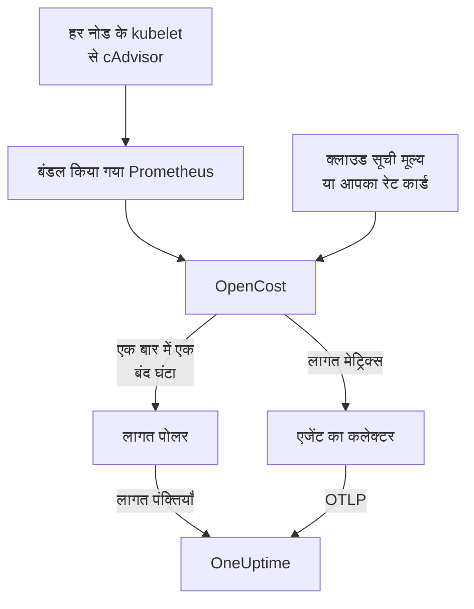

# Kubernetes लागत ऑब्ज़र्वेबिलिटी

देखें कि हर Kubernetes वर्कलोड की लागत कितनी है — हर नेमस्पेस, वर्कलोड और पॉड का खर्च, निष्क्रिय क्षमता, और हर request का कितना हिस्सा उपयोग होता है — उन मेट्रिक्स, लॉग और ट्रेस के बगल में जिन्हें [Kubernetes एजेंट](/docs/telemetry/kubernetes-agent) पहले से इकट्ठा करता है। यह डिफ़ॉल्ट रूप से चालू है, बिना किसी क्लाउड क्रेडेंशियल के: क्लस्टर का अवलोकन बताता है कि उसकी लागत कितनी है, उसका **लागत** पेज आपको बताता है कि कौन-से request घटाने हैं, और लागत मेट्रिक्स को किसी भी दूसरे मेट्रिक की तरह चार्ट किया जा सकता है और उन पर अलर्ट किया जा सकता है।

:::cards
- [इसे चालू करें](#लागत-ऑब्ज़र्वेबिलिटी-चालू-करें): डिफ़ॉल्ट रूप से चालू; जहाँ नहीं है, वहाँ एक `helm upgrade`।
- [लागत पर अलर्ट करना](#लागत-पर-अलर्ट-करना): क्लस्टर, नेमस्पेस और वर्कलोड के हिसाब से लागत, मेट्रिक्स के रूप में।
- [आपका अपना इंजन](#पहले-से-kubecost-या-opencost-चला-रहे-हैं): जो Kubecost या OpenCost आप पहले से चलाते हैं, उसे ढूँढकर पढ़ा जाता है।
- [Right-sizing](#right-sizing): request की अनुशंसाएँ, और वे कैसे बनती हैं।
- [समस्या निवारण](#समस्या-निवारण): खाली पेज, गायब अनुशंसाएँ।
:::

## यह कैसे काम करता है

लागत निगरानी चालू होने पर, जैसी वह डिफ़ॉल्ट रूप से होती है (`cost.enabled: auto`), चार्ट एजेंट के बगल में चार चीज़ें चलाता है:



1. **OpenCost**, ओपन-सोर्स लागत इंजन (Apache-2.0, CNCF; वही [cost-model](https://github.com/kubecost/cost-model) जिस पर Kubecost भी चलता है)। यह क्लस्टर पर नज़र रखता है, आपके नोड, वॉल्यूम और लोड बैलेंसर की कीमत तय करता है, और हिसाब लगाता है कि हर वर्कलोड की लागत कितनी है।
2. **एक छोटा Prometheus**, जिसकी OpenCost को उपयोग और कीमत के इतिहास के लिए ज़रूरत है। यह एक रेप्लिका चलाता है, 7 दिन का इतिहास रखता है, और ठीक दो लक्ष्य स्क्रैप करता है: हर नोड के kubelet पर cAdvisor (`eks-fargate` प्रीसेट पर API सर्वर के नोड प्रॉक्सी से, जहाँ कोई पॉड kubelet तक नहीं पहुँचता), जिसकी सिर्फ़ वे सीरीज़ रखी जाती हैं जिन्हें OpenCost पढ़ता है, और खुद OpenCost (जो अपने संसाधन-request मेट्रिक्स खुद भेजता है, इसलिए kube-state-metrics शामिल नहीं है)। यह कभी क्लस्टर के बाहर उजागर नहीं होता, और इसका डेटा कभी उससे बाहर नहीं जाता।
3. **लागत पोलर** (`cost.agent`)। हर बंद घंटे में एक बार यह OpenCost का Allocation API पढ़ता है और हर वर्कलोड की एक लागत पंक्ति OneUptime को भेजता है: CPU, मेमोरी, GPU, वॉल्यूम, नेटवर्क, लोड बैलेंसर और निष्क्रियता, दक्षता के साथ। हर घंटा एक बार भेजा जाता है; सर्वर वह घंटा छोड़ देता है जो उसके पास पहले से है, इसलिए फिर से शुरू होने पर खर्च दो बार नहीं गिना जा सकता। OneUptime इन पंक्तियों से [लागत मेट्रिक्स](#लागत-पर-अलर्ट-करना) भी लिखता है।
4. **लागत मेट्रिक्स का एक स्क्रैप** (`cost.metrics`)। एजेंट का कलेक्टर OpenCost के मूल्य मेट्रिक्स, यानी हर नोड, वॉल्यूम और लोड बैलेंसर की प्रति घंटा लागत, स्क्रैप करता है और उन्हें क्लस्टर के बाकी मेट्रिक्स के साथ भेजता है।

OpenCost नोड की कीमत आपके क्लाउड प्रदाता के सार्वजनिक सूची मूल्यों (AWS, Google Cloud, Azure) से, बिना किसी क्रेडेंशियल के, तय करता है। बाकी जगहों पर यह अपनी डिफ़ॉल्ट दरें उपयोग करता है, जिनकी जगह आपका अपना [रेट कार्ड](#ऑन-प्रेम-और-बेयर-मेटल-मूल्य-निर्धारण) ले लेता है।

तीनों पॉड मिलकर लगभग 150m CPU और 450Mi मेमोरी का request करते हैं। `gke-autopilot` और `eks-fargate` प्रीसेट पर लागत निगरानी डिफ़ॉल्ट रूप से बंद है: वे प्लेटफ़ॉर्म हर पॉड का बिल उसके request के हिसाब से बनाते हैं, इसलिए लागत पॉड उसी बिल को बढ़ा देते जिसे वे मापते हैं, और OpenCost नोड की कीमत तय करता है, जबकि इन दोनों में से कोई भी प्लेटफ़ॉर्म नोड के हिसाब से शुल्क नहीं लेता।

## लागत ऑब्ज़र्वेबिलिटी चालू करें

नए इंस्टॉल को कुछ नहीं करना पड़ता: लागत निगरानी डिफ़ॉल्ट रूप से चालू है। उस एजेंट को अपग्रेड करें जो इसके डिफ़ॉल्ट होने से पहले इंस्टॉल हुआ था, या `gke-autopilot` या `eks-fargate` प्रीसेट के साथ इसे चालू करें:

:::steps
### एजेंट अपग्रेड करें

```bash
helm upgrade kubernetes-agent oneuptime/kubernetes-agent \
  --namespace oneuptime-agent \
  --reset-then-reuse-values \
  --set cost.enabled=true
```

यह एक पूरा इंस्टॉल है: तीन छोटे अतिरिक्त पॉड, OpenCost, उसका Prometheus और लागत एजेंट। अगर आपने एजेंट किसी दूसरे रिलीज़ नाम या नेमस्पेस के अंतर्गत इंस्टॉल किया है, तो अपना वाला उपयोग करें (`helm list -A | grep kubernetes-agent` उन्हें दिखाता है)। लागत निगरानी बंद करने के लिए, इसी तरह `--set cost.enabled=false` सेट करें।

### पहले बंद घंटे का इंतज़ार करें

पहली लागत पहला पूरा घंटा बंद होने के बाद दिखती है, और OpenCost को शुरू होने के बाद अपना पहला घंटा आँकने में कुछ मिनट लगते हैं।

### लागत पेज खोलें

- **उत्पाद → बुनियादी ढांचा → Kubernetes → लागत** प्रोजेक्ट के हर क्लस्टर का खर्च दिखाता है।
- किसी क्लस्टर पर अवलोकन पिछले 24 घंटों का उसका खर्च, मासिक रन-रेट, निष्क्रिय खर्च, दक्षता और उसके सबसे महँगे नेमस्पेस और वर्कलोड दिखाता है।
- किसी क्लस्टर पर **लागत** उसके खर्च का रुझान, CPU, मेमोरी और स्टोरेज के बँटवारे के साथ **Spend by Namespace**, **Spend by Workload**, निष्क्रिय खर्च, दक्षता और **Right-Sizing** कार्ड दिखाता है।
:::

लागत मेट्रिक्स (`node_total_hourly_cost`, `pv_hourly_cost` और बाकी) सामान्य मेट्रिक्स हैं: वे मेट्रिक एक्सप्लोरर में, कस्टम डैशबोर्ड पर और मेट्रिक मॉनिटर में मिलते हैं। तैयार डैशबोर्ड के लिए **उत्पाद → डैशबोर्ड** पर जाएँ, **डैशबोर्ड बनाएँ** चुनें और **Kubernetes Cost Dashboard** चुनें: नोड की प्रति घंटा लागत के रुझान, CPU और मेमोरी की इकाई लागत, और वॉल्यूम और लोड बैलेंसर का खर्च।

आँकड़ों के नीचे अवलोकन और **लागत** पेज बताते हैं कि उनकी कीमतें कहाँ से आती हैं: किसी क्लाउड के सूची मूल्य, आपका रेट कार्ड, या OpenCost की डिफ़ॉल्ट दरें। दक्षता हर जगह एक ही आँकड़ा है, दक्षता मेट्रिक समेत: अनुरोधित CPU और मेमोरी का कितना हिस्सा उपयोग हुआ, जिसमें हर कंटेनर का हर घंटा उसके CPU और मेमोरी की लागत के अनुसार भारित होता है, ताकि कुछ भी उपयोग न करने वाला कोई सस्ता जॉब अच्छी तरह उपयोग होने वाले क्लस्टर की दक्षता नीचे न खींच सके, और निष्क्रिय क्षमता गिनी नहीं जाती।

## पहले से Kubecost या OpenCost चला रहे हैं?

लागत एजेंट उसे ढूँढ लेता है और बंडल किए गए OpenCost के बजाय उसी को पढ़ता है, इसलिए क्लस्टर की कीमत वैसे ही तय होती है जैसे आपने इंजन सेट किया है: आपके रेट कार्ड से, या Kubecost से जुड़े आपके क्लाउड बिल से। यह शुरू होते समय, और फिर हर घंटे, Kubernetes API के ज़रिए किसी भी नेमस्पेस में वे Service खोजता है जो इंजनों के अपने चार्ट बनाते हैं (Kubecost की `cost-analyzer` या `frontend`, OpenCost के चार्ट वाली, और उसके मैनिफ़ेस्ट से बनने वाली `opencost` Service), और Kubecost को पहले देखता है। जो इंजन जवाब नहीं देता, साइन-इन माँगता है या कई क्लस्टर के लिए जवाब देता है, उसे यह छोड़ देता है, और तब बंडल किए गए इंजन को पढ़ता है।

तब क्लस्टर का अवलोकन आपके इंजन का नाम बताता है और कहता है कि बंडल किए गए OpenCost की ज़रूरत नहीं है। उसे चलाना बंद करें:

```bash
helm upgrade kubernetes-agent oneuptime/kubernetes-agent \
  --namespace oneuptime-agent \
  --reset-then-reuse-values \
  --set cost.engine.url=auto
```

`cost.engine.url=auto` के साथ कुछ भी बंडल नहीं होता, और एजेंट आपके इंजन को पढ़ता है, वह जहाँ भी चलता हो; कोई इंजन इंस्टॉल न हो, तो किसी चीज़ की कीमत तय नहीं होती। चार्ट खुद कोई इंजन नहीं खोज सकता: `helm template`, Argo CD या ड्राई रन में Helm का `lookup` कुछ नहीं देखता। बंडल किए गए OpenCost को अपने इंजन के बगल में बनाए रखने के लिए `cost.engine.preferExisting=false` सेट करें; कौन-सा इंजन पढ़ना है, यह बताने के लिए `cost.engine.url` को उसकी Service पर सेट करें:

| इंजन | सामान्य सेवा URL |
| --- | --- |
| OpenCost | `http://opencost.opencost.svc.cluster.local:9003` |
| Kubecost 2 | `http://kubecost-cost-analyzer.kubecost.svc.cluster.local:9090` |
| Kubecost 3 | `http://kubecost-frontend.kubecost.svc.cluster.local:9090` |

Allocation API का पथ अपने-आप मिल जाता है (Kubecost के लिए `/model/allocation`, OpenCost के लिए `/allocation/compute` या `/allocation`)। `cost.engine.allocationPath` सिर्फ़ किसी असामान्य इंस्टॉल के लिए सेट करें। `auto` या किसी URL के साथ कुछ भी बंडल नहीं होता, इसलिए मेमोरी अनुशंसाओं के लिए `cost.engine.prometheusUrl` भी सेट करें ([इसके पीछे का डेटा](#इसके-पीछे-का-डेटा) देखें)। मूल्य मेट्रिक्स भी इसी तरह मिल जाते हैं, इसलिए इंजन की कोई भी Service बताई जा सकती है: एजेंट पहले इंजन का `/metrics` आज़माता है, फिर वह `/model/metrics` जिसे Kubecost 2 का फ़्रंटएंड या OpenCost का UI इंजन तक पहुँचाता है, फिर Kubecost 3 का FinOps एजेंट, और कलेक्टर उस पहले पते को स्क्रैप करता है जिस पर मूल्य सीरीज़ हों। इन्हें खुद बताने के लिए `cost.metrics.endpoint` सेट करें।

## ऑन-प्रेम और बेयर-मेटल मूल्य निर्धारण

जिन क्लस्टर के नोड का कोई सार्वजनिक क्लाउड सूची मूल्य नहीं है, वे एक रेट कार्ड सेट कर सकते हैं। रेट कार्ड के बिना OpenCost उनके नोड की कीमत अपनी डिफ़ॉल्ट दरों पर तय करता है (ऑन-प्रेम, बेयर मेटल, kind, k3s), जो आपके हार्डवेयर की असली लागत से बहुत अलग हो सकती हैं, और क्लस्टर का अवलोकन और **लागत** पेज यह बताते हैं; जिस क्लाउड को वह पहचानता है, उस पर नोड अपना सूची मूल्य बनाए रखता है, और रेट कार्ड सिर्फ़ उसी की कीमत तय करता है जो सूची में नहीं है। रेट कार्ड होने पर OpenCost हर संसाधन की कीमत इन आँकड़ों से तय करता है, सभी USD प्रति संसाधन-घंटा में:

```yaml title="values.yaml"
cost:
  enabled: true
  opencost:
    customPricing:
      enabled: true
      cpuPerCoreHour: "0.031611"       # ~$23 per core-month
      ramPerGiBHour: "0.004237"        # ~$3 per GiB-month
      storagePerGBHour: "0.00005479452" # ~$0.04 per GB-month
      gpuPerHour: "0.95"
```

ये OpenCost की अपनी डिफ़ॉल्ट दरें हैं: इनकी जगह अपने आँकड़े डालें, नहीं तो **लागत** पेज यही कहता रहेगा कि क्लस्टर की कीमत OpenCost की डिफ़ॉल्ट दरों पर तय हो रही है।

## जानने लायक सेटिंग

सभी वैकल्पिक हैं; चार्ट की `values.yaml` में पूरी सूची है:

```yaml title="values.yaml"
cost:
  enabled: auto           # on, except with the gke-autopilot and eks-fargate presets
  agent:
    windowSeconds: 3600   # allocation window length (hourly = native)
    includeIdle: true     # ship the engine's __idle__ allocation
    currency: USD         # currency code shown in the UI (informational)
  prometheus:
    retention: 7d         # bundled TSDB history; right-sizing reads peaks back over days
    persistence:
      enabled: false      # set true for a small PVC; emptyDir otherwise
  metrics:
    enabled: true         # cost metrics for dashboards / Metric Explorer
    scrapeInterval: 60s
```

## Right-sizing

किसी क्लस्टर के **लागत** पेज पर **Right-Sizing** कार्ड हर उस कंटेनर के लिए एक CPU और एक मेमोरी request की अनुशंसा करता है जिसका उसके पास पर्याप्त इतिहास है, इस क्रम में कि हर बदलाव हर महीने कितना बचाता है।

अनुशंसा देखी गई माँग और 25% गुंजाइश है, ऐसे मान तक गोल की गई जिसे आप मैनिफ़ेस्ट में पेस्ट कर सकें (10m CPU, 16Mi मेमोरी):

- CPU का आकार प्रति घंटा औसत उपयोग के 95वें पर्सेंटाइल से तय होता है: इतना ऊँचा कि असली लोड को कवर करे, इतना नीचा कि एक स्पाइक पूरे महीने के लिए request न फुलाए।
- मेमोरी का आकार working set के शिखर से तय होता है, कभी औसत से नहीं ([इसके पीछे का डेटा](#इसके-पीछे-का-डेटा) देखें)।

request की अनुशंसा होती है; limit की नहीं। request वह है जो शेड्यूलर आरक्षित करता है और जिससे बिल बनता है, इसलिए यही वह संख्या है जो लागत बदलती है। limit इस बारे में फ़ैसला है कि गलत व्यवहार करने वाले कंटेनर को थ्रॉटल किया जाए या मार दिया जाए, और यह फ़ैसला उपयोग डेटा आपके लिए नहीं कर सकता।

हर कंटेनर की तुलना उसके मौजूदा request से होती है:

| निष्कर्ष | इसका अर्थ |
| --- | --- |
| ज़रूरत से ज़्यादा प्रावधानित | यह जितना उपयोग करता है उससे साफ़ तौर पर ज़्यादा आरक्षित करता है। बचत यहीं से आती है। |
| ज़रूरत से कम प्रावधानित | यह जितना उपयोग करता है उससे कम आरक्षित करता है, इसलिए थ्रॉटल होता है या OOM kill के खतरे में है। इसे ठीक करने में पैसा लगता है, और कार्ड इसे बढ़ोतरी के रूप में दिखाता है। |
| कोई request सेट नहीं | घटाने को कुछ नहीं है, पर शेड्यूलर कंटेनर को सुरक्षित रूप से नहीं रख सकता, और दबाव में सबसे पहले इसी को निकाला जाता है। |

अपनी अनुशंसा के 15% के भीतर का कंटेनर सही आकार का माना जाता है और छोड़ दिया जाता है: किसी request से 3% घटाने के लिए किसी को मैनिफ़ेस्ट संपादित नहीं करना चाहिए।

दो सुरक्षा उपाय सलाह को ईमानदार रखते हैं। किसी वर्कलोड का आकार तय होने से पहले उसे कम से कम 24 घंटे की लागत विंडो चाहिए, क्योंकि चार घंटे की विंडो किसी रात के बैच जॉब को आराम में पकड़ सकती है और उसे शून्य तक घटाने की सलाह दे सकती है। और बचत का अनुमान आप जिस विंडो को देख रहे हैं उसकी लंबाई से लगाया जाता है, पंक्तियों की संख्या से नहीं, इसलिए किसी Deployment की बचत उसकी रेप्लिका संख्या से गुणा नहीं होती। अनुमान मानता है कि खर्च उस चीज़ के साथ बढ़ता है जो इंजन ने आवंटित की, यानी `max(request, usage)`; ज़रूरत से ज़्यादा प्रावधानित कंटेनर के लिए यह request है, इसलिए बचत का आँकड़ा सटीक है।

### इसके पीछे का डेटा

खर्च के साथ-साथ पोलर वह भी इकट्ठा करता है जिसकी अनुशंसा को ज़रूरत है: हर कंटेनर के CPU और मेमोरी request, limit और उपयोग।

मेमोरी को एक और स्रोत चाहिए। Allocation API हर विंडो का सिर्फ़ एक औसत बताता है, और प्रति घंटा औसत उस उछाल को छिपा देता है जो किसी कंटेनर को OOM-kill करता है, इसलिए उससे मेमोरी का आकार तय करना खतरनाक होगा। इसके बजाय पोलर हर कंटेनर का मेमोरी शिखर Prometheus से पढ़ता है, `(namespace, pod, container)` पर जोड़कर:

- बंडल किए गए इंजन (डिफ़ॉल्ट) के साथ यह चार्ट का अपना Prometheus उपयोग करता है। कुछ सेट नहीं करना।
- `cost.engine.url` सेट होने पर (`auto` या आपके इंजन का URL), `cost.engine.prometheusUrl` को cAdvisor स्क्रैप करने वाले Prometheus की ओर इंगित करें, और अगर उसके स्क्रैप जॉब का नाम `kubernetes-nodes-cadvisor` नहीं है तो `cost.engine.prometheusCadvisorJob` सेट करें।
- Prometheus के बिना CPU अनुशंसाएँ सहेजे गए प्रति घंटा औसतों से फिर भी काम करती हैं, और मेमोरी अनुशंसाएँ अनुमान लगाने के बजाय छोड़ दी जाती हैं।

Prometheus का बंद होना खर्च का संग्रह कभी नहीं रोकता: शिखर एक अतिरिक्त चीज़ हैं, और घंटा उनके बिना भेजा जाता है। CPU जानबूझकर Prometheus उपयोग नहीं करता: बहुत बड़ा CPU request सिर्फ़ थ्रॉटल करता है जबकि बहुत छोटा मेमोरी request कंटेनर को मार देता है, इसलिए CPU के लिए प्रति घंटा औसत सुरक्षित हैं, और पूरे क्लस्टर में हर कंटेनर की CPU दर की क्वेरी इतनी भारी है कि छोटे Prometheus को गिरा दे।

## लागत पर अलर्ट करना

OneUptime हर घंटे की लागत पंक्तियों से चार मेट्रिक्स लिखता है, जो पैसे में आँके गए हैं और जिनके नाम बताते हैं कि वे क्या हैं, ताकि लागत को चार्ट किया जा सके, डैशबोर्ड पर रखा जा सके और किसी [Kubernetes मॉनिटर](/docs/monitor/kubernetes-monitor) या [मेट्रिक्स मॉनिटर](/docs/monitor/metrics-monitor) में उस पर अलर्ट किया जा सके:

| मेट्रिक | यह क्या है | एट्रिब्यूट |
| --- | --- | --- |
| `oneuptime.kubernetes.cost.total` | हर घंटे में क्लस्टर की लागत, निष्क्रिय क्षमता समेत | `k8s.cluster.name` |
| `oneuptime.kubernetes.cost.idle` | उसका वह हिस्सा जिसे किसी वर्कलोड ने उपयोग नहीं किया: निष्क्रिय और अनावंटित क्षमता | `k8s.cluster.name` |
| `oneuptime.kubernetes.cost.workload` | हर घंटे में हर वर्कलोड की लागत; नेमस्पेस के हिसाब से जोड़ने पर, नेमस्पेस की लागत | `k8s.cluster.name`, `k8s.namespace.name`, और वर्कलोड का नाम उसके प्रकार वाले एट्रिब्यूट में, जैसे `k8s.deployment.name` |
| `oneuptime.kubernetes.cost.efficiency` | हर वर्कलोड ने अपने अनुरोधित CPU और मेमोरी का कितना हिस्सा उपयोग किया, प्रतिशत में, लागत के अनुसार भारित | वर्कलोड वाले, ऊपर की तरह |

हर बिंदु एक घंटे की लागत है, एजेंट की मुद्रा में (डिफ़ॉल्ट रूप से USD), जिस पर घंटे की शुरुआत का समय दर्ज होता है और जो घंटा खत्म होने के लगभग एक घंटे बाद लिखा जाता है: कुछ घंटों की विंडो पर बिंदुओं का योग लें, और एक दिन के बिंदु मिलकर उस दिन की लागत बनाते हैं। ये उस डेटा से बनते हैं जो क्लस्टर पहले ही भेज चुका है, इसलिए इनका बिल इंजेस्ट किए गए मेट्रिक्स के रूप में नहीं बनता, और ये उतने ही समय तक रखे जाते हैं जितने क्लस्टर के बाकी मेट्रिक्स।

Kubernetes मॉनिटर में इनके लिए तीन टेम्पलेट हैं: Cluster Daily Cost Over Budget, Namespace Daily Cost Over Budget और High Idle Spend, हर एक में एक बजट है, जिसे अपने बजट के अनुसार बदलें। OpenCost के मूल्य मेट्रिक्स भी सामान्य मेट्रिक्स हैं: कोई मेट्रिक्स मॉनिटर तब अलर्ट कर सकता है जब औसत `node_total_hourly_cost` किसी बजट से ऊपर जाए, या जब किसी ऐसी वॉल्यूम क्लास के लिए `pv_hourly_cost` दिखे जो क्लस्टर में होनी ही नहीं चाहिए।

## डेटा मॉडल और प्रतिधारण

लागत पंक्तियाँ ClickHouse में सहेजी जाती हैं, हर क्लस्टर, विंडो, नेमस्पेस, कंट्रोलर, पॉड और कंटेनर के लिए एक। वे क्लस्टर के टेलीमेट्री प्रतिधारण का पालन करती हैं: क्लस्टर का `retainTelemetryDataForDays`, या उसके सेट न होने पर प्रोजेक्ट का डेटा प्रतिधारण। निष्क्रिय और अनावंटित क्षमता `__idle__` और `__unallocated__` नेमस्पेस के अंतर्गत सामान्य पंक्तियों के रूप में सहेजी जाती है, इसलिए वे वर्कलोड खर्च की तरह समूहित और फ़िल्टर होती हैं।

## समस्या निवारण

:::details Costs पेज खाली हैं
`gke-autopilot` और `eks-fargate` प्रीसेट पर लागत निगरानी डिफ़ॉल्ट रूप से बंद है: इसे `--set cost.enabled=true` से चालू करें। नहीं तो, लागत पोलर के लॉग पढ़ें: `kubectl logs -n oneuptime-agent deploy/kubernetes-agent-cost`। (जब रिलीज़ नाम में `kubernetes-agent` न हो तो Deployment का नाम `<release>-kubernetes-agent-cost` होता है; `kubectl get deploy -n oneuptime-agent` उन्हें सूचीबद्ध करता है।) `HTTP 401` का अर्थ है कि OneUptime ने इंजेशन कुंजी अस्वीकार की। `did not answer any known allocation path` का अर्थ है कि इंजन अभी चालू नहीं हुआ (बंडल किए गए OpenCost को अपने पहले घंटे आँकने में कुछ मिनट लगते हैं) या `cost.engine.url` गलत है।
:::

:::details बंडल किया गया OpenCost तैयार नहीं है
इसके लॉग पढ़ें: `kubectl logs -n oneuptime-agent deploy/kubernetes-agent-opencost`। ये बताते हैं कि इसने कौन-सा क्लाउड प्रदाता पहचाना और क्या इसका मूल्य डेटा लोड हुआ।
:::

:::details अवलोकन कहता है कि बंडल किए गए OpenCost की ज़रूरत नहीं है
क्लस्टर अपना खुद का Kubecost या OpenCost चलाता है, और लागत एजेंट उसी को पढ़ता है, इसलिए चार्ट ने जो OpenCost और Prometheus बंडल किए हैं, वे किसी चीज़ की कीमत तय नहीं करते। उन्हें चलाना बंद करने के लिए `--set cost.engine.url=auto` के साथ अपग्रेड करें, या इसके बजाय बंडल किए गए इंजन को पढ़ने के लिए `cost.engine.preferExisting=false` सेट करें।
:::

:::details लागत एजेंट आपका इंजन नहीं पढ़ता
इसका लॉग बताता है कि यह कौन-सा इंजन पढ़ता है, और इसने बाकी इंजन क्यों छोड़े: `kubectl logs -n oneuptime-agent deploy/kubernetes-agent-cost`। यह ऐसा इंजन छोड़ देता है जो जवाब नहीं देता (मान लीजिए नेमस्पेस के बीच कोई NetworkPolicy है), साइन-इन माँगता है, या कई क्लस्टर के लिए जवाब देता है, जैसा दूसरे क्लस्टर को फ़ेडरेट करने वाला Kubecost करता है। कौन-सा इंजन पढ़ना है, यह `cost.engine.url` से बताएँ।
:::

:::details OpenCost लॉग में mkdir /var/configs: permission denied आता है
एक पुराना चार्ट OpenCost को बिना लिखने योग्य कॉन्फ़िग डायरेक्टरी के चलाता था, इसलिए `Error downloading default pricing data` की वजह से उसका Allocation API जवाब नहीं दे पाता था और पोलर रुक जाता था, जबकि पॉड `Running` रहता था, `/healthz` हरा रहता था और नोड लागत मेट्रिक्स प्रकाशित होते रहते थे। मौजूदा चार्ट इसे ठीक करते हैं: `helm repo update` चलाएँ, फिर `--reset-then-reuse-values` के साथ अपग्रेड करें। लागत पंक्तियाँ अगले पोल पर दिखती हैं।
:::

:::details Kubernetes Cost Dashboard कोई डेटा नहीं दिखाता
टेम्पलेट स्क्रैप किए गए लागत मेट्रिक्स पढ़ता है: जाँचें कि `cost.metrics.enabled` का मान `true` है। `cost.engine.url` सेट होने पर लागत एजेंट ढूँढ लेता है कि आपका इंजन इन्हें कहाँ देता है, और उसका लॉग बताता है कि कहाँ, या उसने कौन-से पते आज़माए: `kubectl logs -n oneuptime-agent deploy/kubernetes-agent-cost`। इन्हें खुद बताने के लिए `cost.metrics.endpoint` सेट करें।
:::

:::details Right-Sizing कार्ड खाली है
या तो समय सीमा उन 24 घंटों से छोटी है जो किसी अनुशंसा को चाहिए (उसे बढ़ाएँ), या हर कंटेनर पहले से अपने अनुशंसित request के 15% के भीतर है, जो कार्ड बताता है।
:::

:::details मेमोरी अनुशंसाएँ - दिखाती हैं, पर CPU अनुशंसाएँ काम करती हैं
कोई मेमोरी शिखर OneUptime तक नहीं पहुँचा, इसलिए औसत से अनुमान लगाने के बजाय मेमोरी का आकार तय नहीं किया गया। अपने इंजन के साथ `cost.engine.prometheusUrl` सेट करें। कार्ड बताता है कि इससे कितने कंटेनर प्रभावित हैं।
:::

:::details आँकड़े इंजन के अपने UI से अलग हैं
OneUptime इंजन के मिलान समायोजन हर लागत घटक में शामिल करता है, और पूरे बंद घंटे भेजता है: मौजूदा घंटे का खर्च उसके बंद होने के बाद दिखता है।
:::

:::details बंडल किया गया Prometheus फिर से शुरू हुआ
डिफ़ॉल्ट `emptyDir` स्टोरेज के साथ, फिर से शुरू होने पर कुछ घंटों का उपयोग इतिहास खो जाता है, इसलिए उन घंटों की लागत कम आ सकती है। अगर यह आपके लिए मायने रखता है तो `cost.prometheus.persistence.enabled=true` सेट करें।
:::

## अगले कदम

:::cards
- [Kubernetes एजेंट](/docs/telemetry/kubernetes-agent): एजेंट इंस्टॉल करें, और वह सब जो यह इकट्ठा करता है।
- [मेट्रिक्स मॉनिटर](/docs/monitor/metrics-monitor): जब खर्च किसी बजट को पार करे तो अलर्ट करें।
- [Kubernetes मॉनिटर](/docs/monitor/kubernetes-monitor): क्लस्टर के स्वास्थ्य पर भी अलर्ट करें।
:::
