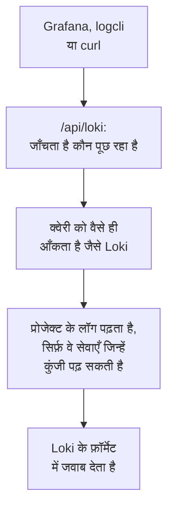

# LogQL से लॉग क्वेरी करें

LogQL, Grafana Loki की क्वेरी भाषा है। OneUptime आपके प्रोजेक्ट के लॉग पर Loki के क्वेरी API का जवाब देता है, ताकि Grafana का Loki डेटा स्रोत, logcli या कोई भी Loki क्लाइंट उन्हें पढ़ सके, और Loki के लिए लिखे आपके डैशबोर्ड और सहेजी गई क्वेरी काम करती रहें।

:::cards
- [Grafana कनेक्ट करना](#grafana-कनेक्ट-करना): OneUptime को Loki डेटा स्रोत के रूप में जोड़ें।
- [लॉग के लेबल](#लॉग-के-लेबल): स्ट्रीम सेलेक्टर किससे मेल खाता है।
- [LogQL में क्या-क्या शामिल है](#logql-में-क्या-क्या-शामिल-है): लॉग क्वेरी, पार्सर और मेट्रिक क्वेरी।
- [सीमाएँ](#सीमाएँ): एक क्वेरी क्या और कितनी बार पढ़ सकती है।
:::

## यह कैसे काम करता है

Grafana, OneUptime से वैसे ही पूछता है जैसे Loki से। OneUptime जाँचता है कि API कुंजी प्रोजेक्ट के लॉग पढ़ सकती है, सिर्फ़ वही सेवाएँ पढ़ता है जिन्हें वह पढ़ सकती है, और क्वेरी को वैसे ही आँकता है जैसे Loki।



## शुरू करने से पहले

- **आते हुए लॉग।** उन्हें [OpenTelemetry](/docs/telemetry/open-telemetry) से भेजें, या Promtail, Grafana Alloy, Fluent Bit या Vector से [Loki के पुश API](/docs/telemetry/compatible-endpoints) के ज़रिए।
- **लॉग पढ़ सकने वाली प्रोजेक्ट की API कुंजी**, जिसमें प्रोजेक्ट स्वामी, प्रोजेक्ट एडमिन, प्रोजेक्ट सदस्य, दर्शक, टेलीमेट्री एडमिन, टेलीमेट्री सदस्य या टेलीमेट्री दर्शक की भूमिका हो, या Read Logs अनुमति। कुछ सेवाओं तक सीमित कुंजी सिर्फ़ उन्हीं के लॉग पढ़ती है। देखें [एक API कुंजी बनाएँ](/docs/api-reference/api-reference#एक-api-कुंजी-बनाएँ)। OneUptime Cloud पर API कुंजियों के लिए **Growth** प्लान चाहिए।
- **इंजेशन कुंजी नहीं।** इंजेशन कुंजी टेलीमेट्री भेजती है और कुछ नहीं पढ़ती, इसलिए Grafana उससे साइन इन नहीं कर सकता।

## Grafana कनेक्ट करना

:::steps
### एक API कुंजी बनाएँ

OneUptime में **प्रोजेक्ट सेटिंग्स → उन्नत → API कुंजियाँ** खोलें और **API कुंजी बनाएँ** पर क्लिक करें। कुंजी को टेलीमेट्री पढ़ सकने वाली भूमिका दें, या Read Logs अनुमति।

### Loki डेटा स्रोत जोड़ें

Grafana में **Connections → Data sources → Add data source** खोलें और **Loki** चुनें।

### URL दर्ज करें

**URL** में अपना OneUptime पता डालें, और उसके बाद `/api/loki`। OneUptime Cloud पर यह `https://oneuptime.com/api/loki` है।

### API कुंजी भेजें

**HTTP headers** के तहत `Authorization` हेडर जोड़ें, जिसका मान `Bearer` हो, उसके बाद एक स्पेस और आपकी API कुंजी। बेसिक ऑथेंटिकेशन भी काम करता है: कोई भी यूज़र नाम, और पासवर्ड के रूप में API कुंजी।

### सहेजें और जाँचें

**Save & test** पर क्लिक करें। Grafana एक क्वेरी चलाता है, और बताता है कि डेटा स्रोत काम करता है।
:::

इसके बाद Explore, लाइनों के ऊपर का लॉग वॉल्यूम, लेबल ब्राउज़र और डैशबोर्ड OneUptime को वैसे ही पढ़ते हैं जैसे Loki को। logcli और कोई भी दूसरा Loki क्लाइंट इसी तरह काम करता है। curl से:

```bash title="Query OneUptime's Loki API"
curl -G -H "Authorization: Bearer $ONEUPTIME_API_KEY" \
  "https://oneuptime.com/api/loki/loki/api/v1/query_range" \
  --data-urlencode 'query={service_name="checkout"} |= "error"'
```

## लॉग के लेबल

स्ट्रीम सेलेक्टर किसी लॉग के एट्रिब्यूट से मेल खाता है, जिनके नाम वैसे ही हैं जैसे Loki 3 OpenTelemetry लॉग के नाम रखता है:

| OneUptime में | LogQL में |
| --- | --- |
| एक रिसोर्स एट्रिब्यूट `service.name` | लेबल `service_name` |
| एक रिसोर्स एट्रिब्यूट `k8s.pod.name` | लेबल `k8s_pod_name` |
| एक एट्रिब्यूट `http.method` | लेबल `http_method` |
| किसी Loki क्लाइंट का भेजा लेबल, जैसे `job` | लेबल `job` |
| लॉग की गंभीरता | लेबल `detected_level`: `trace`, `debug`, `info`, `warn`, `error`, `fatal` या `unknown` |

- **हर एट्रिब्यूट एक लेबल है।** लॉग क्वेरी हर लेबल सेट के लिए एक स्ट्रीम लौटाती है, इसलिए अलग एट्रिब्यूट वाले लॉग अलग स्ट्रीम होते हैं, जैसे Loki 3 संरचित मेटाडेटा वाले लॉग के लिए जवाब देता है।
- **लॉग का अपना एट्रिब्यूट पहले आता है**, जब उसके रिसोर्स में उसी नाम का एट्रिब्यूट हो।
- **सेलेक्टर एक मान बताता है**, जैसा Loki चाहता है: कम से कम एक मैचर जिसे वह लॉग पूरा न करे जिसमें वह लेबल नहीं है, जैसे `{service_name="checkout"}` या `{service_name=~"check.+"}`।

शुरू करने के लिए कुछ क्वेरी:

```text title="LogQL"
# The checkout service's lines that say error
{service_name="checkout"} |= "error"

# Requests slower than 250ms, read from JSON lines
{service_name="checkout"} | json | duration > 250ms

# Error logs per second, by service
sum by (service_name) (rate({detected_level="error"} [5m]))
```

## LogQL में क्या-क्या शामिल है

- **लॉग क्वेरी**: `=`, `!=`, `=~` और `!~` वाले स्ट्रीम सेलेक्टर; `or` के साथ लाइन फ़िल्टर `|=`, `!=`, `|~` और `!~`; `json` और `logfmt` पार्सर; टेक्स्ट, संख्या, अवधि और आकार पर लेबल फ़िल्टर, `and`, `or` और `__error__` के साथ; `{{.label}}` वाला `line_format`; `drop`, `keep` और `decolorize`।
- **मेट्रिक क्वेरी**: `count_over_time`, `rate`, `bytes_over_time`, `bytes_rate` और `absent_over_time`; `unwrap` (`duration()` या `bytes()` के साथ) से लिए गए लेबल पर `rate`, `sum_over_time`, `avg_over_time`, `min_over_time`, `max_over_time`, `first_over_time`, `last_over_time`, `stddev_over_time`, `stdvar_over_time` और `quantile_over_time`; और `offset`।
- **उनके आसपास**: `by` या `without` के साथ `sum`, `avg`, `min`, `max`, `count`, `stddev`, `stdvar`, `topk` और `bottomk`; अंकगणित, तुलना (`bool` के साथ), `and`, `or` और `unless`, `on`, `ignoring`, `group_left` और `group_right` के साथ; `sort`, `sort_desc`, `label_replace` और `vector()`।

`pattern`, `regexp` और `unpack` पार्सर, `label_format`, नाम वाले फ़ील्ड के साथ `json`, `ip()` फ़िल्टर, और `{{.label}}` से आगे के `line_format` टेम्पलेट अभी उपलब्ध नहीं हैं। इनमें से किसी का इस्तेमाल करने वाली क्वेरी एक संदेश के साथ अस्वीकार कर दी जाती है, जो उसका नाम बताता है।

## API

API, `/api/loki` के तहत, Loki के HTTP API के रूट का `GET` या `POST` से जवाब देता है:

| रूट | यह क्या लौटाता है |
| --- | --- |
| `/loki/api/v1/query_range` | किसी लॉग क्वेरी की `start` से `end` तक की लाइनें, या हर `step` पर एक मेट्रिक क्वेरी। |
| `/loki/api/v1/query` | एक समय पर (`time`, डिफ़ॉल्ट रूप से अभी) एक मेट्रिक क्वेरी। |
| `/loki/api/v1/labels` | लेबल के नाम, उन लॉग के जिन्हें `query` चुनता है या सभी लॉग के। |
| `/loki/api/v1/label/<name>/values` | एक लेबल के मान। |
| `/loki/api/v1/series` | उन लॉग के लेबल सेट जिन्हें `match[]` चुनता है। |

समय 1970 से नैनोसेकंड, Unix सेकंड या RFC 3339 में होते हैं, और कुछ और न कहा जाए तो रेंज `end` से पहले का एक घंटा है। लॉग क्वेरी `limit` लाइनें लौटाती है, डिफ़ॉल्ट रूप से 100, सबसे नई पहले, जब तक `direction=forward` न हो। जवाब Loki के फ़ॉर्मेट में होते हैं, और त्रुटियाँ सादा टेक्स्ट होती हैं, जैसे Loki उन्हें लिखता है। `/loki/api/v1/status/buildinfo` एक Loki 3 सर्वर की तरह जवाब देता है।

## सीमाएँ

हर क्वेरी की सीमा होती है, ताकि कई पैनल वाला डैशबोर्ड OneUptime पर ज़्यादा बोझ न डाल सके:

| सीमा | मान |
| --- | --- |
| लॉग क्वेरी जितनी लाइनें लौटाती है | 5,000 |
| लॉग क्वेरी जितने लॉग पढ़ती है, जब उसके पार्सर के बाद के फ़िल्टर कुछ हटा देते हैं | 20,000 |
| मेट्रिक क्वेरी ख़ुद जितने लॉग पढ़ती है, जब ClickHouse उन्हें गिन नहीं सकता | 100,000 |
| मेट्रिक क्वेरी जितनी सीरीज़ लौटाती है | 500 |
| किसी रेंज क्वेरी की एक सीरीज़ में बिंदु | 11,000 |
| एक बार पढ़ने पर लौटाए गए लॉग | 64 MB |
| एक बार पढ़ने में लग सकने वाला समय | 30 सेकंड |
| एक प्रोजेक्ट हर मिनट जितनी क्वेरी भेज सकता है | 1,200 |

जिस मेट्रिक क्वेरी की पाइपलाइन में सिर्फ़ लाइन फ़िल्टर हों, जैसे `sum(count_over_time({service_name="checkout"} |= "error" [5m]))`, उसकी गिनती वहीं होती है जहाँ लॉग रखे हैं, इसलिए वह कोई लाइन नहीं पढ़ती।

## समस्या निवारण

:::details Grafana कहता है कि डेटा स्रोत काम नहीं करता
जाँचें कि URL `/api/loki` पर ख़त्म होता है, और `Authorization` हेडर में `Bearer`, एक स्पेस और API कुंजी है। इंजेशन कुंजी, या लॉग पढ़ सकने वाली भूमिका के बिना API कुंजी, अस्वीकार कर दी जाती है: **प्रोजेक्ट सेटिंग्स → उन्नत → API कुंजियाँ** में कुंजी को ऐसी भूमिका दें।
:::

:::details "queries require at least one regexp or equality matcher that does not have an empty-compatible value"
सेलेक्टर कोई मान बताए बिना लॉग से मेल खाता है, जैसे `{service_name=~".*"}`। ऐसा मैचर जोड़ें जो एक मान बताए, जैसे `{service_name="checkout"}`।
:::

:::details "This project sent more queries this minute than OneUptime answers."
इस प्रोजेक्ट के डैशबोर्ड और क्लाइंट ने इस मिनट API को 1,200 से ज़्यादा क्वेरी भेजीं। पैनल अगले मिनट फिर से लोड होंगे; सीमा के भीतर रहने के लिए डैशबोर्ड कम बार रीफ़्रेश करें।
:::

## अगले कदम

:::cards
- [लॉग एक्सप्लोरर](/docs/telemetry/logs-explorer): क्वेरी लिखे बिना लॉग खोजें और फ़िल्टर करें।
- [PromQL](/docs/telemetry/promql): PromQL से मेट्रिक्स क्वेरी करें, Grafana के Prometheus डेटा स्रोत से भी।
- [लॉग मॉनिटर](/docs/monitor/logs-monitor): लॉग की मात्रा और सामग्री पर अलर्ट करें।
:::
