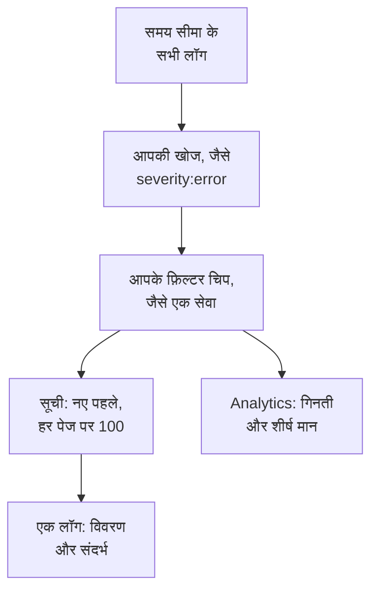

# लॉग एक्सप्लोरर

लॉग एक्सप्लोरर वह जगह है जहाँ आप उन लॉग को खोजते और पढ़ते हैं जो आपकी सेवाएं, होस्ट और एजेंट OneUptime को भेजते हैं। लाखों पंक्तियों को उन कुछ पंक्तियों तक छाँटें जो मायने रखती हैं, नई पंक्तियों को आते ही देखें, उनके चार्ट बनाएँ, और वे व्यू सहेजें जिन पर आपकी टीम बार-बार लौटती है।

:::cards
- [लॉग की पंक्ति ढूँढना](#लॉग-की-पंक्ति-ढूँढना): एक समय सीमा, एक खोज और कुछ फ़िल्टर।
- [लॉग पढ़ना](#लॉग-पढ़ना): उसकी विशेषताएं, उसका ट्रेस और उसके आसपास की पंक्तियाँ।
- [लॉग लाइव देखना](#लॉग-लाइव-देखना): हर 10 सेकंड में नई पंक्तियाँ।
- [व्यू सहेजना](#व्यू-सहेजना): एक खोज, उसके फ़िल्टर और उसके कॉलम सबके लिए रखें।
- [लॉग इनसाइट्स](#लॉग-इनसाइट्स): शीर्ष त्रुटियाँ, गंभीरता और कौन क्या लॉग कर रहा है।
- [AI से त्रुटि, छूटे हुए और शोर भरे लॉग खोजें और ठीक करें](#ai-से-त्रुटि-छूटे-हुए-और-शोर-भरे-लॉग-खोजें-और-ठीक-करें): पुल रिक्वेस्ट जो त्रुटियाँ ठीक करती हैं, जो लॉग नहीं होता उसे लॉग करती हैं और शोर भरी पंक्तियाँ कम करती हैं।
:::

## एक्सप्लोरर आपके लॉग कैसे छाँटता है

**दर्शक** टैब पर सब कुछ लॉग के एक ही समूह पर काम करता है: वे लॉग जो समय सीमा में हैं और आपकी खोज और हर फ़िल्टर चिप से मेल खाते हैं। इनमें से कुछ भी बदलें, तो सूची, वॉल्यूम चार्ट और साइडबार की गिनतियाँ एक साथ बदलती हैं।

एक्सप्लोरर में पाँच टैब हैं:

| टैब | यह किसलिए है |
| --- | --- |
| **दर्शक** | लॉग खोजें, फ़िल्टर करें और पढ़ें। यह पिछले एक घंटे पर खुलता है, नए पहले, हर पेज पर 100 लॉग। |
| **इनसाइट्स** | किसी समय सीमा में आपकी सेवाओं ने क्या लॉग किया, और क्या गड़बड़ हुई। |
| **एआई** | आपके लॉग में OneUptime को मिले त्रुटि लॉग, छूटी हुई लॉगिंग और शोर भरे लॉग, और OneUptime AI ने उनके बारे में क्या किया। देखें [AI से त्रुटि, छूटे हुए और शोर भरे लॉग खोजें और ठीक करें](#ai-से-त्रुटि-छूटे-हुए-और-शोर-भरे-लॉग-खोजें-और-ठीक-करें)। |
| **सेटअप गाइड** | अपनी किसी [इंजेशन कुंजी](/docs/telemetry/ingestion-keys) से OpenTelemetry, Fluent Bit या Fluentd के ज़रिए लॉग कैसे भेजें। |
| **सेटिंग्स** | लॉग आने पर उनके साथ क्या होता है: **पाइपलाइन**, **ड्रॉप फ़िल्टर**, **स्क्रब नियम** और **रिकॉर्डिंग नियम**। |

## शुरू करने से पहले

- **आते हुए लॉग।** उन्हें [OpenTelemetry](/docs/telemetry/open-telemetry), [Fluent Bit](/docs/telemetry/fluentbit), [Fluentd](/docs/telemetry/fluentd) या [Syslog](/docs/telemetry/syslog) से भेजें। **सेटअप गाइड** टैब आपकी भाषा या कलेक्टर के लिए कॉन्फ़िगरेशन दिखाता है।
- **टेलीमेट्री पढ़ सकने वाली भूमिका।** Project Owner, Project Admin, Project Member, Viewer, Telemetry Admin, Telemetry Member या Telemetry Viewer, या Read Telemetry Service Log अनुमति वाली कस्टम भूमिका। उसका दायरा तय करता है कि आप किसके लॉग देखते हैं: देखें [टेलीमेट्री](/docs/permissions/index#टेलीमेट्री)।

## लॉग की पंक्ति ढूँढना

:::steps
### दर्शक खोलें

**उत्पाद → अवलोकनीयता → लॉग्स** पर जाएँ। **दर्शक** पिछले एक घंटे के लॉग नए पहले के क्रम में, उनके **समय**, **सेवा**, **गंभीरता** और **संदेश** के साथ दिखाता है।

### समय सीमा चुनें

टाइम पिकर में एक सीमा चुनें, या किसी उछाल पर ज़ूम इन करने के लिए सूची के ऊपर वाले वॉल्यूम चार्ट पर खींचें। वापस ज़ूम आउट करने के लिए चार्ट पर डबल-क्लिक करें। देखें [समय सीमा पर ज़ूम इन करना](/docs/telemetry/charts-and-time-ranges)।

### खोजें

खोज बॉक्स में एक क्वेरी लिखें और Enter दबाएँ, जैसे `severity:error service:checkout timeout`। अकेले शब्द संदेश में खोजते हैं, और `@key:value` किसी विशेषता में खोजता है। देखें [खोज सिंटैक्स](/docs/telemetry/search-syntax#लॉग)।

### फ़िल्टर से छाँटें

किसी मान को चिप के रूप में जोड़ने के लिए **फ़िल्टर** साइडबार में उस पर क्लिक करें: कोई गंभीरता, कोई सेवा, या कोई होस्ट, क्लस्टर या दूसरा संसाधन जिसने लॉग भेजे। हर मान दिखाता है कि कितने लॉग में वह है। फ़ोन पर साइडबार खोलने के लिए **फ़िल्टर** पर टैप करें।

### लॉग खोलें

किसी पंक्ति पर क्लिक करें। उसका विवरण सूची के बगल में खुलता है।
:::

आपकी खोज, आपके चिप और समय सीमा पेज के पते में रहते हैं, इसलिए रीफ़्रेश, बुकमार्क या साझा किया गया लिंक वही लॉग खोलता है।

## लॉग पढ़ना

विवरण पैनल में दो टैब हैं:

| टैब | यह क्या दिखाता है |
| --- | --- |
| **विवरण** | **लॉग बॉडी**, अगर हों तो उसका **ट्रेस ID**, **स्पैन ID** और **Session**, और उसकी **विशेषताएं**, सूची के रूप में या JSON के रूप में। |
| **Context** | पड़ोसी लॉग के बीच यह लॉग। **Nearby (service + time)** उसी सेवा से उसके पहले और बाद की पाँच-पाँच पंक्तियाँ दिखाता है, और **This trace** उसके ट्रेस के 100 तक लॉग दिखाता है। |

- पूरे अनुरोध को [ट्रेस एक्सप्लोरर](/docs/telemetry/traces-explorer) में खोलने के लिए ट्रेस ID पर क्लिक करें।
- किसी विशेषता पर पॉइंटर ले जाकर उसके फ़िल्टर आइकन पर क्लिक करें ताकि उस मान को खोजा जा सके, या उसे कॉपी करें। आप सभी विशेषताओं को एक साथ JSON के रूप में कॉपी कर सकते हैं।
- **This trace** सिर्फ़ उसी लॉग के लिए दिखता है जो किसी ट्रेस के अंदर लिखा गया हो।

## लॉग लाइव देखना

सूची के ऊपर **Live** पर क्लिक करें। एक्सप्लोरर पहले पेज पर जाता है, नए पहले के क्रम में, और हर 10 सेकंड में नए लॉग जाँचता है, इसलिए पंक्तियाँ आपकी सेवाओं के लिखते ही दिखती हैं।

जब आप खोज, कोई फ़िल्टर या समय सीमा बदलते हैं, या नतीजों के दूसरे पेज पर जाते हैं, तो लाइव मोड अपने आप बंद हो जाता है: यह सिर्फ़ सबसे नए लॉग दिखाता है। फिर से शुरू करने के लिए दोबारा **Live** पर क्लिक करें।

## कॉलम चुनना और एक्सपोर्ट करना

- **कॉलम** चुनता है कि सूची क्या दिखाए। **समय**, **सेवा**, **गंभीरता** और **संदेश** सबसे पहले आते हैं; **ट्रेस ID**, **स्पैन ID** या कोई भी विशेषता जोड़ें, कॉलम ऊपर-नीचे करें, या डिफ़ॉल्ट पर लौटने के लिए **रीसेट** करें।
- **एक्सपोर्ट** उस पेज के लॉग डाउनलोड करता है जिसे आप देख रहे हैं। **Export as CSV** वे कॉलम लिखता है जो आप दिखा रहे हैं; **Export as JSON** हर लॉग का हर फ़ील्ड, उसकी सभी विशेषताओं के साथ लिखता है।

## व्यू सहेजना

सहेजा गया व्यू एक नाम के तहत एक खोज, उसके फ़िल्टर चिप, समय सीमा, कॉलम, क्रम और पेज का आकार रखता है।

:::steps
### व्यू तैयार करें

खोजें, फ़िल्टर करें और वे कॉलम चुनें जिन्हें आप रखना चाहते हैं।

### उसे सहेजें

**Saved Views** खोलें और **+ Save Current View** पर क्लिक करें। एक **नाम** डालें, अगर यह व्यू तब खुलना चाहिए जब भी कोई लॉग खोले तो **डिफ़ॉल्ट के रूप में सेट करें** पर टिक करें, और **व्यू सहेजें** पर क्लिक करें।

### उसे इस्तेमाल करें

व्यू लागू करने के लिए उसे **Saved Views** से चुनें, और बिना फ़िल्टर वाले पिछले एक घंटे पर लौटने के लिए **Clear view** चुनें। सूची में किसी व्यू पर पॉइंटर ले जाकर उसे **संपादित करें** या **हटाएं**, या जब वह लागू हो तब अपने बदलावों के साथ उसे **अपडेट करें**।
:::

सहेजे गए व्यू प्रोजेक्ट के होते हैं, इसलिए उसमें हर कोई वही सूची देखता है। पिछले एक घंटे जैसी चलती सीमा चलती ही रहती है: व्यू उसे खोलने से पहले का एक घंटा दिखाता है, न कि वह घंटा जब आपने उसे सहेजा था। जब तक प्रोजेक्ट में कोई डिफ़ॉल्ट व्यू नहीं है, अगला सहेजा गया व्यू डिफ़ॉल्ट बन जाता है, और किसी प्रोजेक्ट में एक समय में एक ही डिफ़ॉल्ट होता है।

## अपने लॉग का चार्ट बनाना

लॉग पढ़ने के बजाय गिनने के लिए सूची को **Analytics** पर बदलें। टाइम सीरीज़, टॉप सूची या टेबल चुनें; हर लॉग गिनें, या किसी एक फ़ील्ड के अलग-अलग मान; और गंभीरता, सेवा, ट्रेस, स्पैन या किसी भी विशेषता के अनुसार समूह बनाएँ, फिर किसी दूसरे फ़ील्ड के अनुसार। टॉप सूची या टेबल शीर्ष 5, 10, 25 या 50 समूह दिखाती है।

पंक्तियों पर ही लौटने के लिए **सूची** पर क्लिक करें।

## संबंधित ट्रेस और मेट्रिक्स खोलना

**Saved Views** के बगल वाले **ट्रेस** और **मेट्रिक्स** बटन उसी समय अवधि के लिए [ट्रेस एक्सप्लोरर](/docs/telemetry/traces-explorer) या [मेट्रिक्स एक्सप्लोरर](/docs/telemetry/metrics-explorer) खोलते हैं, आपकी फ़िल्टरिंग का उतना हिस्सा साथ लेकर जितना वह एक्सप्लोरर इस्तेमाल कर सकता है। जो वह साथ नहीं ले जा सकता, उसे देखने के लिए बटन पर पॉइंटर ले जाएँ।

## लॉग इनसाइट्स

**इनसाइट्स** टैब दिखाता है कि किसी समय सीमा में आपकी सेवाओं ने क्या लॉग किया, और क्या गड़बड़ हुई। टाइम पिकर के बगल वाले ड्रॉपडाउन से इसे कुछ सेवाओं, होस्ट या क्लस्टर तक सीमित करें।

| पैनल | यह क्या दिखाता है |
| --- | --- |
| सारांश कार्ड | **कुल लॉग्स**, **त्रुटियाँ**, **Distinct errors** और **Reporting sources**। |
| **Severity distribution** | लॉग गंभीरता के अनुसार कैसे बँटे हैं। |
| **Top errors** | Error या Fatal गंभीरता पर लॉग किए गए अलग-अलग संदेश, सबसे ज़्यादा बार वाले पहले। |
| **Sources reporting logs** | हर सेवा, होस्ट या दूसरे स्रोत का वॉल्यूम और त्रुटि संकेत। |

किसी शीर्ष त्रुटि को चुनकर देखें कि उसके आसपास क्या हो रहा था: वह कब हुई, उसकी घटनाओं में क्या समान है, वह कहाँ होती है, उसे ले जाने वाले ट्रेस और उसकी सबसे हाल की पंक्तियाँ। **Open matching logs** उन्हें **दर्शक** में खोलता है, और **Explain with AI** त्रुटि और उसके सबूत को एक संपादन योग्य प्रॉम्प्ट के रूप में लेकर [AI से पूछें](/docs/ai/ask-ai) खोलता है।

## AI से त्रुटि, छूटे हुए और शोर भरे लॉग खोजें और ठीक करें

OneUptime हर घंटे हर सेवा के पिछले एक घंटे के लॉग में ऐसी त्रुटियाँ खोजता है जिन्हें वह बार-बार लॉग करती है, ऐसी विफलताएँ जिन्हें वह लॉग नहीं करती, और ऐसी पंक्तियाँ जो उसके लॉग को भर देती हैं, और जो मिलता है उसे सबूत के साथ AI इनसाइट्स के रूप में दर्ज करता है। फिर OneUptime AI हर एक की जाँच करता है और उसे ठीक करने वाली पुल रिक्वेस्ट खोलता है। कुछ भी कभी मर्ज नहीं होता: आपकी टीम हर पुल रिक्वेस्ट की समीक्षा करती है।

OneUptime तीन तरह की खोज दर्ज करता है:

| खोज | OneUptime इसे कब दर्ज करता है | पुल रिक्वेस्ट |
| --- | --- | --- |
| **त्रुटि लॉग** | किसी सेवा ने उस घंटे में एक ही संदेश Error या Fatal पर 20 या अधिक बार लॉग किया, ऐसा संदेश जिसके अपने शब्द हों और जिसमें कोई अपवाद न हो। जो संदेश अपवाद के साथ, या अपने भीतर स्टैक ट्रेस के साथ लॉग होता है, उसे इसके बजाय [अपवाद ट्रैकिंग](/docs/telemetry/exceptions) में ट्रैक किया जाता है। | त्रुटि के लॉग होने का कारण ठीक करती है, या उसे उस स्तर पर लॉग करती है जिसके वह योग्य है। |
| **छूटी हुई लॉगिंग** | किसी ऑपरेशन के कम से कम 20 स्पैन उस घंटे में विफल हुए, उनमें से 5% या अधिक, जबकि सेवा के कम से कम 100 लॉग में ट्रेस आईडी है, और ऑपरेशन की 20 सबसे हाल की विफल रिक्वेस्ट में से किसी ने भी लॉग पंक्ति नहीं लिखी। या किसी सेवा ने उस घंटे में 500 या अधिक लॉग और 100 या अधिक स्पैन भेजे, और उसके 1% से कम लॉग में ट्रेस आईडी है। | विफलता को वहीं लॉग करती है जहाँ वह होती है, या सेवा के लॉग में ट्रेस आईडी जोड़ती है। |
| **शोर भरा लॉग** | Error से नीचे लॉग होने वाला एक संदेश उस घंटे में किसी सेवा की पंक्तियों का 25% या अधिक है, लगभग 10,000 पंक्तियाँ या अधिक। | पंक्ति को कम लॉग करती है: Debug पर, हर बैच में एक बार, या बिल्कुल नहीं। |

एक खोज किसी संदेश को उसके पैटर्न के रूप में रखती है: पंक्ति दर पंक्ति बदलने वाले हिस्से, जैसे संख्याएँ और आईडी, छिपा दिए जाते हैं। पुल रिक्वेस्ट उसी पैटर्न के साथ माँगी जाती है, कभी भी लॉग हुई पंक्ति के साथ नहीं, और OneUptime AI को कहा जाता है कि वह कभी भी सीक्रेट या निजी डेटा लॉग न करे, और लॉग पंक्तियाँ पुल रिक्वेस्ट में कॉपी न करे।

त्रुटि लॉग की पुल रिक्वेस्ट OneUptime AI खुद तभी खोलता है जब उसे दोषी कोड मिल जाए। कहीं और से आने वाली त्रुटि, जैसे कोई बंद पड़ी डिपेंडेंसी, को कोई पुल रिक्वेस्ट नहीं मिलती, जब तक कोई **AI से ठीक करें** से उसे न माँगे।

### इसे चालू करें

**लॉग्स → एआई → सेटिंग्स** में **त्रुटि, छूटे हुए और शोर भरे लॉग खोजें और ठीक करें** स्विच है, जो नए प्रोजेक्ट के लिए चालू रहता है। **AI सक्षम करें** बंद होने पर त्रुटि, छूटे हुए और शोर भरे लॉग अब भी मिलते हैं, पर OneUptime AI उनके साथ कुछ नहीं करता। पुल रिक्वेस्ट खोलने के लिए OneUptime AI को [कोड](/docs/ai/ai-agent) में कनेक्ट की गई रिपॉजिटरी चाहिए: पेज पहले बताता है कि क्या कमी है। हर रिपॉजिटरी का कोड उस Runner पर बदला जाता है जिसे रिपॉजिटरी कोड में चुनती है।

OneUptime AI हर दिन (UTC) खुद से अधिकतम 5 पुल रिक्वेस्ट खोलता है, उन सभी टेलीमेट्री के लिए मिलाकर जिन्हें वह ठीक करता है, हर खोज के लिए एक, और कभी भी किसी रिपॉजिटरी की खुली AI पुल रिक्वेस्ट की सीमा से ज़्यादा नहीं।

### AI नियम

कोई नियम न होने पर OneUptime AI आपके लॉग में मिलने वाली हर समस्या की तुरंत जाँच करता है और जिसे वह ठीक कर सकता है उसके लिए पुल रिक्वेस्ट खोलता है। **और सेटिंग्स** के अंतर्गत **AI नियम** इसे तीन चरणों में सीमित करते हैं:

| चरण | यह क्या तय करता है |
| --- | --- |
| **मिलान** | कौन सी सेवाएँ: चुनी गई, कुछ खास लेबल वाली, या जिनका नाम किसी पैटर्न से मेल खाता हो। |
| **जांच करें** | **तुरंत**, या **केवल तभी जब प्रतीक्षा के बाद भी मिले**: प्रतीक्षा के दौरान गायब हो जाने वाली समस्या की जाँच नहीं होती। |
| **सुधार** | **ठीक न करें**, **ठीक करने से पहले पूछें** या **बिना पूछे ठीक करें**। पहले पूछने पर पुल रिक्वेस्ट किसी व्यक्ति पर छोड़ी जाती है: खोज **AI से ठीक करें** देती है। |

**और फ़ील्ड** में कोई नियम वे कोड रिपॉजिटरी, MCP सर्वर और LLM प्रदाता चुनता है जिन्हें OneUptime AI उसके लिए इस्तेमाल कर सकता है। कुछ न चुनने पर वह कोई भी इस्तेमाल कर सकता है, और प्रोजेक्ट का डिफ़ॉल्ट LLM प्रदाता।

### देखें कि इसने क्या किया

- **लॉग्स → एआई → इनसाइट्स** वह सब दिखाता है जो OneUptime को मिला, हर खोज अपने सबूत और **लॉग में खोलें** के साथ, जो उस घंटे की संबंधित पंक्तियों को **दर्शक** में खोलता है जिसमें खोज मिली थी। जो विफलता कोई लॉग पंक्ति नहीं लिखती, उसके पास खोलने को पंक्तियाँ नहीं होतीं: उसके बजाय **ट्रेस में खोलें** उसके विफल स्पैन खोलता है। त्रुटि लॉग पर, **मॉनिटर बनाएं** एक लॉग मॉनिटर बनाता है जो संदेश की पंक्तियाँ गिनता है।
- **लॉग्स → एआई → गतिविधि** हर जाँच और हर पुल रिक्वेस्ट को, सबसे नया पहले, हर एक की स्थिति के साथ दिखाता है। पूरी हुई जाँच यह भी बताती है कि OneUptime AI को क्या मिला, जैसे किसी त्रुटि का कारण कोड के बाहर होना, और इसी वजह से उस त्रुटि लॉग को खुद कोई पुल रिक्वेस्ट नहीं मिली।
- कोड में, कार्य बताता है कि उसे OneUptime ने शुरू किया, उसकी खोज के लिंक के साथ, और पुल रिक्वेस्ट बताती है कि उसे क्यों खोला गया।

## लॉग आने पर उनके साथ क्या होता है

**सेटिंग्स** टैब में वे नियम हैं जो OneUptime हर लॉग को सहेजने से पहले उस पर लागू करता है। ये उसके बाद आने वाले लॉग पर लागू होते हैं, पहले से सहेजे गए लॉग पर नहीं। हर लॉग कितने समय तक रखा जाएगा, यह भी उसके आते ही तय होता है: देखें [डेटा प्रतिधारण](/docs/telemetry/data-retention)।

| नियम | यह क्या करता है |
| --- | --- |
| **ड्रॉप फ़िल्टर** | जो लॉग आप नहीं रखना चाहते उन्हें छोड़ दें, या उनका एक नमूना रखें। देखें [रिकॉर्ड ड्रॉप करें या नमूना लें](/docs/telemetry/drop-filters-and-scrub-rules#रिकॉर्ड-ड्रॉप-करें-या-नमूना-लें)। |
| **स्क्रब नियम** | ईमेल पते और कार्ड नंबर जैसे संवेदनशील डेटा को छिपाएँ। देखें [संवेदनशील डेटा स्क्रब करें](/docs/telemetry/drop-filters-and-scrub-rules#संवेदनशील-डेटा-स्क्रब-करें)। |
| **पाइपलाइन** | संदेश से फ़ील्ड निकालें, गंभीरता ठीक करें, विशेषताओं के नाम बदलें। देखें [लॉग पाइपलाइन](/docs/telemetry/log-pipelines)। |
| **रिकॉर्डिंग नियम** | मेल खाने वाले लॉग को मेट्रिक्स में बदलें। देखें [लॉग रिकॉर्डिंग नियम](/docs/telemetry/log-recording-rules)। |

## कीबोर्ड शॉर्टकट

इन्हें देखने के लिए दर्शक में `?` दबाएँ।

| कुंजी | यह क्या करती है |
| --- | --- |
| `j` / `k` | अगले या पिछले लॉग पर जाएँ। |
| Enter | चुना गया लॉग खोलें या बंद करें। |
| Esc | विवरण पैनल बंद करें। |
| `/` | खोज बॉक्स पर जाएँ। |
| ⌘ + Enter या Ctrl + Enter | खोज लागू करें। |
| `?` | शॉर्टकट दिखाएँ या छिपाएँ। |

## समस्या निवारण

:::details कोई लॉग नहीं दिखता
पहले समय सीमा बढ़ाएँ: दर्शक पिछले एक घंटे पर खुलता है। अगर सूची फिर भी खाली है, तो अपने सेटअप की तुलना **सेटअप गाइड** से करें, और जाँचें कि आपकी भूमिका का दायरा उस सेवा को शामिल करता है जो लॉग भेजती है।
:::

:::details खोज कहती है कि उसका समय ख़त्म हो गया
45 सेकंड से ज़्यादा चलने वाली खोज रोक दी जाती है। छोटी समय सीमा चुनें, या कोई सटीक मान जोड़ें, जैसे कोई सेवा, ताकि OneUptime अपने इंडेक्स का इस्तेमाल कर सके। देखें [खोज सिंटैक्स](/docs/telemetry/search-syntax#जानने-योग्य-बातें)।
:::

:::details Live बार-बार अपने आप बंद हो जाता है
लाइव मोड सिर्फ़ सबसे नए लॉग देखता है, इसलिए खोज, कोई फ़िल्टर, समय सीमा या पेज बदलने से यह बंद हो जाता है। फ़िल्टर तय हो जाने पर दोबारा **Live** पर क्लिक करें।
:::

## अगले कदम

:::cards
- [खोज सिंटैक्स](/docs/telemetry/search-syntax): वे सभी फ़िल्टर जो खोज बॉक्स समझता है।
- [लॉग मॉनिटर](/docs/monitor/logs-monitor): जिन लॉग को आप खोजते हैं उनके दिखते ही अलर्ट पाएँ।
- [लॉग पाइपलाइन](/docs/telemetry/log-pipelines): लॉग पंक्ति के हिस्सों को ऐसी विशेषताओं में बदलें जिन पर फ़िल्टर किया जा सके।
- [ट्रेस एक्सप्लोरर](/docs/telemetry/traces-explorer): किसी लॉग के अनुरोध का आपकी सेवाओं में पीछा करें।
:::
